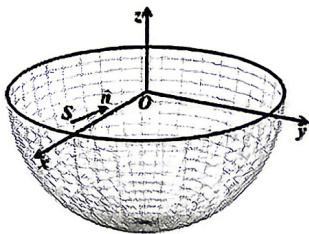
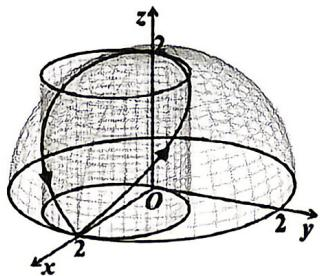

## 电子科技大学 2023-2024 学年第 2 学期微积分 II 期末考试 A 卷

%%
chapter: 综合
question_type: 真题整卷｜期末
source: 2023-2024期末A
paper_type: 期末
academic_year: 2023-2024
%%

#### 一、单项选择题(共15分，每小题3分)

### 23-24期末A-选1

%%
chapter: 第五章
question_type: 隐函数｜求导
source: 2023-2024期末A
score: 3
question_form: 选择题
ocr_status: 已做结构修复
%%

1. 设 $z = z(x, y)$ 由方程 $x - (y + 1)^2 + e^z - 2z = 0$ 确定，则 $dz \big|_{(0,0)} = (\quad)$ .

(A)dx - 2dy;

(B)dx + 2dy;

(C) $2dx - dy$ ;

(D) $2dx + dy$ .

> [!note]- 解答｜状态：存疑
> 通常预期选择 (A)，但这需要指定 $z(0,0)=0$。在 $(x,y)=(0,0)$ 时，方程为 $e^z-2z=1$，它有两个实根：$0$ 和另一个根 $\zeta\in(1,2)$。
> 对任一满足 $e^{z_0}\ne2$ 的分支，
>
> $$
> dz=-\frac{dx-2dy}{e^{z_0}-2}.
> $$
>
> 取 $z_0=0$ 时为 $dx-2dy$，对应 (A)；取 $z_0=\zeta$ 时得到另一个微分值。题面未指定分支，故不能无条件唯一选择。
>
> 自检：$e^z-2z-1$ 在 $z=1$ 为负、在 $z=2$ 为正，且在 $\ln2$ 右侧严格递增，确有第二个正根；两个根都满足局部隐函数条件。
>
> 起手：先解清指定 $(x,y)$ 处所有可能的 $z$ 值，再对选定分支微分。

### 23-24期末A-选2

%%
chapter: 第五章
question_type: 齐次函数｜欧拉公式
source: 2023-2024期末A
score: 3
question_form: 选择题
ocr_status: 已做结构修复
%%

2. 设 $z = xy + x \sin \frac{y}{x}$ , 则 $x \frac{\partial z}{\partial x} + y \frac{\partial z}{\partial y} = (\quad)$ .

(A) $z + 2xy;$

(B) $z - 2xy$ ;

(C) $z + xy$ ;

(D)z - xy.

> [!note]- 解答｜状态：独立解答未对照
> $xy$是二次齐次项，$x\sin(y/x)$是一次齐次项。按欧拉公式，$x z_x+y z_y=2xy+x\sin(y/x)=z+xy$。
> 结论：C。
>
> 自检：分别对两个齐次项用其次数核验。
>
> 起手：拆成齐次项并分别应用欧拉公式。

### 23-24期末A-选3

%%
chapter: 第六章
question_type: 二重积分｜极坐标｜区域识别
source: 2023-2024期末A
score: 3
question_form: 选择题
ocr_status: 已做结构修复
%%

3.二重积分 $\int_0^2 dx\int_0^{\sqrt{2x - x^2}}\sqrt{x^2 + y^2} dy = (\quad)$

(A) $\int_{0}^{\pi}d\theta\int_{0}^{2\cos\theta}rdr;$

(B) $\int_{0}^{\pi}d\theta\int_{0}^{2\cos\theta}r^{2}dr;$

(C) $\int_{0}^{\frac{\pi}{2}}d\theta\int_{0}^{2\cos\theta}rdr;$

(D) $\int_{0}^{\frac{\pi}{2}}d\theta\int_{0}^{2\cos\theta}r^{2}dr.$

> [!note]- 解答｜状态：独立解答未对照
> 区域为第一象限圆$(x-1)^2+y^2\le1$，极坐标界为$0\le\theta\le\pi/2,0\le r\le2\cos\theta$。被积函数$\sqrt{x^2+y^2}=r$，面积元另有$r$，故新被积函数为$r^2$。
> 结论：D。
>
> 自检：圆边界代入极坐标得$r=2\cos\theta$。
>
> 起手：先把圆域与被积函数都换成极坐标。

### 23-24期末A-选4

%%
chapter: 第七章
question_type: 全微分方程｜恰当性与势函数
source: 2023-2024期末A
score: 3
question_form: 选择题
ocr_status: 已做结构修复
%%

4.设函数 $u(x,y)$ 满足 $du=(x^{2}-2xy+ay^{2})dx+(bx^{2}+4xy)dy,$ 则().

(A)a=2,b=1;

(B)a=2,b=-1;

(C)a=-2,b=1;

(D)a=-2,b=-1.

> [!note]- 解答｜状态：独立解答未对照
> 令$M=x^2-2xy+ay^2,N=bx^2+4xy$。恰当条件$M_y=N_x$给$-2x+2ay=2bx+4y$，比较系数得$b=-1,a=2$。
> 结论：B。
>
> 自检：代回两边均为$-2x+4y$。
>
> 起手：恰当微分需满足$M_y=N_x$。

### 23-24期末A-选5

%%
chapter: 第八章
question_type: 常数项级数｜概念判断
source: 2023-2024期末A
score: 3
question_form: 选择题
ocr_status: 已做结构修复
%%

5.若正项级数 $\sum_{n=1}^{\infty}a_{n}$ 收敛， $a_{n}>0,n=1,2,\cdots$ ，则下列结论正确的是().

(A) $\lim_{n\to\infty}\frac{a_{n+1}}{a_n}<1;$

(B) $\lim_{n\to\infty}\sqrt[n]{a_{n}}<1;$

(C) $\lim_{n\to \infty}na_n = 1;$

(D) $\lim_{n\to\infty}(-1)^{n}a_{n}=0.$

> [!note]- 解答｜状态：独立解答未对照
> 收敛正项级数有$a_n\to0$，因此$(-1)^na_n\to0$。其他极限条件不必成立，例如$a_n=1/(n(\ln n)^2)$时$n$次根趋1，且比值也趋1。
> 结论：D。
>
> 自检：以收敛级数通项趋零直接得极限。
>
> 起手：先用正项级数收敛的必要条件$a_n\to0$。

#### 二、填空题(共15分，每小题3分)

### 23-24期末A-填1

%%
chapter: 其他
question_type: 极限｜等价替换
source: 2023-2024期末A
score: 3
question_form: 填空题
ocr_status: 已做结构修复
%%

1. $\lim_{\substack{x\to 0\\ y\to 0}}(1 + x^2y^2)^{\frac{1}{\sin(x^2 + y^2)}} = \underline{\quad}$

> [!note]- 解答｜状态：独立解答未对照
> 取对数，指数的对数为$\ln(1+x^2y^2)/\sin(x^2+y^2)\sim x^2y^2/(x^2+y^2)$，其绝对值不超过$(x^2+y^2)/4\to0$。故原极限为$e^0=1$。
>
> 自检：用$|xy|\le(x^2+y^2)/2$控制比值趋零。
>
> 起手：先对幂式取对数，再比较分子二次小量与分母二次量。

### 23-24期末A-填2

%%
chapter: 第五章
question_type: 积分定义函数｜求导
source: 2023-2024期末A
score: 3
question_form: 填空题
ocr_status: 已做结构修复
%%

2. 设 $f(x, y) = \int_{x+y}^{0} \cos(t^2 - x) dt$ , 则 $\frac{\partial f(x, y)}{\partial x} |_{(0,0)} =$ \_\_\_\_.

> [!note]- 解答｜状态：独立解答未对照
> Leibniz公式中上限为常数0，下限$x+y$贡献$-\cos((x+y)^2-x)$，参数对被积函数的贡献为$\int_{x+y}^0\sin(t^2-x)dt$。在$(0,0)$处积分项为0，故偏导为$-1$。
>
> 自检：下限项带负号；区间在该点退化。
>
> 起手：同时考虑变下限项与被积函数对$x$的偏导项。

### 23-24期末A-填3

%%
chapter: 第五章
question_type: 条件极值｜几何最值
source: 2023-2024期末A
score: 3
question_form: 填空题
ocr_status: 已做结构修复
%%

3. 目标函数 $f(x, y) = 2x^{2} + y^{2} + 1$ 在约束条件 $x^{2} + 4y^{2} = 4$ 下的最小值为 \_\_\_\_.

> [!note]- 解答｜状态：独立解答未对照
> 由约束$x^2=4-4y^2$，目标变为$2(4-4y^2)+y^2+1=9-7y^2$，其中$0\le y^2\le1$。最小值在$y^2=1$取得，为2。
>
> 自检：端点$(0,\pm1)$满足约束。
>
> 起手：用约束消去$x^2$，将目标化为单变量。

### 23-24期末A-填4

%%
chapter: 第八章
question_type: 傅里叶级数｜收敛值
source: 2023-2024期末A
score: 3
question_form: 填空题
ocr_status: 已做结构修复
%%

4. 设 $f(x) = 4x, b_n = 2\int_0^1 f(x)\sin n\pi x dx, s(x) = \sum_{n=1}^{\infty} b_n \sin n\pi x$ , 则 $s\left(-\frac{5}{2}\right) =$ \_\_\_\_.

> [!note]- 解答｜状态：独立解答未对照
> 该正弦级数是$4x$在$(0,1)$上的半区间正弦展开，对应奇延拓并以2为周期。将$-5/2$加2得$-1/2$，奇延拓在该点取$-4(1/2)=-2$。
>
> 自检：点不在跳跃端点，周期延拓连续，级数收敛于函数值。
>
> 起手：先用周期2将自变量移入基本区间，再应用奇延拓。

### 23-24期末A-填5

%%
chapter: 第六章
question_type: 第一类曲线积分
source: 2023-2024期末A
score: 3
question_form: 填空题
ocr_status: 已做结构修复
%%

5.设平面曲线C为圆周 $x^{2}+y^{2}=x$ ，则 $\oint_{C}(x+2y)ds=$ \_\_\_\_.

> [!note]- 解答｜状态：独立解答未对照
> 圆心为$(1/2,0)$、半径$1/2$，周长$\pi$。圆周上$x$的弧长平均值等于圆心横坐标$1/2$，$y$关于$x$轴对称积分为0，故积分为$\pi/2$。
>
> 自检：$\oint xds=(1/2)\cdot\pi$，而$\oint yds=0$。
>
> 起手：将线性函数按常数圆心坐标与对称分量分拆。

### 23-24期末A-算3

%%
chapter: 第五章
question_type: 连续与可微｜原点
source: 2023-2024期末A
score: 12
question_form: 计算题
ocr_status: 已做结构修复
%%

三、(12分)已知函数 $f(x,y)$ 在点(0,0)的某邻域内有定义， $f(0,0)=0$ ，且满足 $\lim_{\substack{x\to0\\ y\to0}}\frac{f(x,y)}{(x+y)^{2}}=1$ 。证明 $f(x,y)$ 在点(0,0)连续，求 $f_{x}(0,0),f_{y}(0,0)$ ，并证明 $f(x,y)$ 在点(0,0)可全微分。

> [!note]- 解答｜状态：存疑
> 题设可以确定两个偏导数：
>
> $$
> f_x(0,0)=\lim_{h\to0}h\,\frac{f(h,0)}{h^2}=0,\qquad
> f_y(0,0)=0.
> $$
>
> 但商在直线 $x+y=0$ 上无定义，给出的极限并不约束该直线上的函数值。取
>
> $$
> f(x,y)=
> \begin{cases}
> (x+y)^2,&x+y\ne0,\\
> 1,&x+y=0,\ (x,y)\ne(0,0),\\
> 0,&(x,y)=(0,0),
> \end{cases}
> $$
>
> 则商在其定义域上恒为 $1$，而 $f(h,-h)=1$，所以函数不连续、更不可微。因此连续性和全微分的证明需要补充题设；不能把偏导也误判为无法确定。
> 若另外给出 $f(x,-x)=0$，则由 $|x+y|^2\le2(x^2+y^2)$ 可得 $f=o(\sqrt{x^2+y^2})$，从而可微且 $df=0$。
>
> 自检：反例在两条坐标轴上的差商分别趋零，而沿 $y=-x$ 不连续，恰好区分三个结论。
>
> 起手：先沿坐标轴求偏导，再检查分母的零集是否受到题设约束。

### 23-24期末A-算4

%%
chapter: 第五章
question_type: 极值｜判定
source: 2023-2024期末A
score: 10
question_form: 计算题
ocr_status: 已做结构修复
%%

四、(10分)求函数 $f(x,y)=4x^{2}e^{y}-2x^{4}-e^{4y}$ 的极值点和极值。

> [!note]- 解答｜状态：独立解答未对照
> 偏导为$f_x=8xe^y-8x^3=8x(e^y-x^2)$，$f_y=4x^2e^y-4e^{4y}$。驻点方程给$x^2=e^y$且$e^{2y}=e^{4y}$，于是$y=0,x=\pm1$。Hessian有$f_{xx}=-16,f_{yy}=-12,f_{xy}=8x$，行列式$128>0$且$f_{xx}<0$，两点均为极大点，函数值1；无极小点。
>
> 自检：梯度代入两点为0，Hessian判别式严格正且首项负。
>
> 起手：先联立两个一阶偏导方程，再用Hessian判别极值类型。

### 23-24期末A-算5

%%
chapter: 第六章
question_type: 形心与质量｜质心
source: 2023-2024期末A
score: 10
question_form: 计算题
ocr_status: 已做结构修复
%%

五、(10分)设上半球体 $V: x^{2} + y^{2} + z^{2} \leq 1 (z \geq 0)$ 上任一点 $P(x, y, z)$ 处的体密度函数为 $\mu(x, y, z) = \sqrt{x^2 + y^2 + z^2}$ , 计算上半球体 $V$ 的质心坐标。

> [!note]- 解答｜状态：独立解答未对照
> 由球坐标，质量$M=\int_0^{2\pi}d\theta\int_0^{\pi/2}\sin\phi d\phi\int_0^1\rho^3d\rho=\pi/2$。关于$z$轴对称，故$\bar x=\bar y=0$。关于$xy$面的质量矩$M_z=\int z\mu dV=2\pi(1/5)(1/2)=\pi/5$，因此$\bar z=M_z/M=(\pi/5)/(\pi/2)=2/5$。
>
> 自检：密度为径向距离，球坐标质量被积因子为$\rho^3\sin\phi$；质心高度小于半球顶点1。
>
> 起手：球坐标计算总质量和关于$xy$面的质量矩。

### 23-24期末A-算6

%%
chapter: 第七章
question_type: 第二类曲面积分｜高斯公式
source: 2023-2024期末A
score: 10
question_form: 计算题
ocr_status: 已做结构修复
%%

六、(10分)计算第二类曲面积分: $I = \iint_{S} \frac{2xdydz - 3ydzdx + (z - 1)^{2}dxdy}{\sqrt{x^{2} + y^{2} + z^{2}}}$ , 其中, $S$ 为下半球面 $z = -\sqrt{1 - x^{2} - y^{2}}$ , $S$ 的方向取上侧。

> [!note]- 解答｜状态：独立解答未对照
> 球面上分母等于 $1$。令 $\boldsymbol F=(2x,-3y,(z-1)^2)$，其散度为 $2z-3$。先取下半球体的外侧边界，由 Gauss 公式，
>
> $$
> \iint_{\partial V}\boldsymbol F\cdot\boldsymbol n\,dS
> =2\iiint_Vz\,dV-3\operatorname{Vol}(V)
> =2\left(-\frac\pi4\right)-3\frac{2\pi}{3}
> =-\frac{5\pi}{2}.
> $$
>
> 赤道圆盘的外侧向上，通量为 $\pi$，故下半球面的外向（下侧）通量为 $-7\pi/2$。题设取上侧，与外向相反，所以
>
> $$
> I=\frac{7\pi}{2}.
> $$
>
> 自检：直接投影时 $z=-\sqrt{1-r^2}$，上侧面积向量是 $(-x/\sqrt{1-r^2},-y/\sqrt{1-r^2},1)\,dx\,dy$；两部分积分分别为 $2\pi/3$ 和 $17\pi/6$，相加同为 $7\pi/2$。
>
> 起手：先确定下半球“上侧”是内向，再用闭曲面通量减去赤道圆盘。

text_image

z
S
n̂
O
y
r

### 23-24期末A-算7

%%
chapter: 第七章
question_type: 第二类曲线积分｜斯托克斯公式
source: 2023-2024期末A
score: 12
question_form: 计算题
ocr_status: 已做结构修复
%%

七、(12分)计算第二类曲线积分： $I=\oint_{\Gamma}(z^{2}-y^{2})dx+(x^{2}-z^{2})dy+(y^{2}-x^{2})dz$ ，其中， $\Gamma$ 为上半球面 $z=\sqrt{4-x^{2}-y^{2}}$ 与圆柱面 $(x-1)^{2}+y^{2}=1$ 的交线，从x轴正向往负向观察， $\Gamma$ 取逆时针方向。

> [!note]- 解答｜状态：独立解答未对照
> 以$t$参数化圆柱交线：$x=1+\cos t,y=\sin t,z=\sqrt{2-2\cos t}=2\sin(t/2)$，$0\le t\le2\pi$。
>
> 从$+x$向$-x$看，屏幕右向为$+y$、上向为$+z$；在投影$yz$平面右端点切向向上，所以$t$递增正是题设逆时针方向。
>
> 代入线积分得被积式化为$-16\sin^5u\cos u+8(\cos^4u-\sin^2u)\cos2u+8(\sin^2u\cos^2u-\cos^4u)\cos u$，其中$u=t/2,0\le u\le\pi$。
>
> 第一项和第三项关于$u=\pi/2$反对称而积分为0；第二项积分为$4\pi$。
>
>
> 结论：$I=4\pi$。
>
> 自检：方向由题目视角固定；半角参数回代满足球面与圆柱方程，且全程$z\ge0$。
>
> 起手：先将曲线参数化并根据指定观察方向定向，再代入第二类曲线积分。

text_image

3D geometric diagram showing a sphere intersected by a plane in xyz-coordinate system, with labeled axes and points.

### 23-24期末A-算8

%%
chapter: 第八章
question_type: 函数展开｜幂级数
source: 2023-2024期末A
score: 10
question_form: 计算题
ocr_status: 已做结构修复
%%

八、(10分)设函数 $f(x)=\ln\frac{1+x}{1-x}=\ln(1+x)-\ln(1-x)$ ，将 $f(x)$ 在x=0点展开为泰勒级数，给出该级数的收敛域，并计算 $f(x)$ 在x=0点的n阶导数 $f^{(n)}(0)$ 。

> [!note]- 解答｜状态：独立解答未对照
> 由$1/(1-x)=\sum_{k=0}^\infty x^k$积分得$\ln(1+x)-\ln(1-x)=2\sum_{k=0}^\infty x^{2k+1}/(2k+1)$，$|x|<1$。在$x=\pm1$级数分别为同号调和型发散，收敛域$(-1,1)$。因此$f^{(n)}(0)=0$（偶数$n$），奇数$n$时为$2(n-1)!$。
>
> 自检：奇数次项系数为$2/n$，乘$n!$得到$2(n-1)!$。
>
> 起手：分别展开两个对数函数的麦克劳林级数并相减。

### 23-24期末A-算9

%%
chapter: 第八章
question_type: 常数项级数｜绝对与条件收敛
source: 2023-2024期末A
score: 6
question_form: 计算题
ocr_status: 已做结构修复
%%

九、(6分)设三常数项级数分别为 $\sum_{n=1}^{\infty}a_{n},\sum_{n=1}^{\infty}b_{n},\sum_{n=1}^{\infty}c_{n}$ ，其中， $\sum_{n=1}^{\infty}a_{n}$ 绝对收敛， $\sum_{n=1}^{\infty}c_{n}$ 收敛，满足 $a_{n}\leq b_{n}\leq c_{n}$ ， $n=1,2,\cdots,$ 证明级数 $\sum_{n=1}^{\infty}b_{n}$ 绝对收敛。

> [!note]- 解答｜状态：独立解答未对照
> 对任意$n$，若$b_n<0$，则$a_n\le b_n<0$，从而$|b_n|\le|a_n|$；若$b_n\ge0$，则$c_n\ge b_n\ge0$，故$|b_n|=b_n\le c_n^+$。
>
> 又当$c_n<0$时，$a_n\le b_n\le c_n<0$，所以$|c_n|\le|a_n|$，故$\sum c_n^-$收敛。
>
> 由于$\sum c_n$收敛，$\sum c_n^+$也收敛。
>
> 逐项有$|b_n|\le|a_n|+c_n^+$，求和得$\sum|b_n|<\infty$。
>
>
>
> 自检：逐项分$b_n$正负及$c_n$负时比较，证明正负部均可求和。
>
> 起手：将序列按正负部拆分，先用$a_n\le b_n\le c_n$控制$b_n$的两侧。

