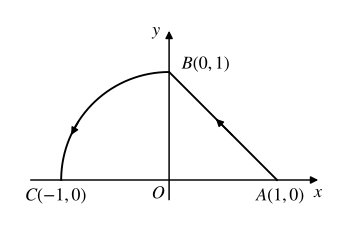

## 2024-2025-2 微积分 II 试卷

%%
chapter: 综合
question_type: 真题整卷｜期末
source: 2024-2025期末
paper_type: 期末
academic_year: 2024-2025
%%

#### 一、选择题（每小题3分，共15分，每题选项中只有一个正确答案）.

### 24-25期末-选1

%%
chapter: 第五章
question_type: 连续与可微｜关系判断
source: 2024-2025期末
score: 3
question_form: 选择题
ocr_status: 已做结构修复
%%

1、以下4个命题，正确的个数为（）

(1) 若函数 $f(x, y)$ 在点 $(x_0, y_0)$ 可微，则函数 $f(x, y)$ 在该点偏导数存在；  
(2) 若函数 $f(x, y)$ 在点 $(x_0, y_0)$ 可微，则函数 $f(x, y)$ 在该点偏导数连续；  
(3) 若函数 $f(x, y)$ 在点 $(x_0, y_0)$ 可微，则函数 $f(x, y)$ 在该点连续；  
(4) 若函数 $f(x, y)$ 在点 $(x_0, y_0)$ 连续且偏导数存在，则函数 $f(x, y)$ 在该点可微.

(A) 1; (B) 2; (C) 3; (D) 4.

> [!note]- 解答｜状态：已对照一致
> (1)可微蕴含偏导存在，真；(2)可微不保证偏导在该点连续，假；(3)可微蕴含连续，真；(4)连续且偏导存在不保证可微，假。正确命题共2个。
> 结论：B。
>
> 自检：第(4)项的反例可取$f(x,y)=\sqrt{|xy|}$：它连续、两偏导为零，但沿$y=x$的线性余项除以距离为$1/\sqrt2$；第(2)项可用$f(x,y)=x^2\sin(1/x)$（$x=0$赋值零），它在原点可微，但$x$偏导在该点不连续。
>
> 对照来源：[2024-2025微积分II期末参考答案](https://docs.qq.com/doc/DZE16RnZPYWJ4Z3pZ)，卷内对应题号；原扫描 PDF 第34–36页。
> 本轮复核（2026-11-06）：已按题号对照参考答案，并检查推导与适用条件。
>
> 起手：逐条用可微的标准蕴含关系判断，不把充分条件倒置。

### 24-25期末-选2

%%
chapter: 第五章
question_type: 切平面与法线｜切平面
source: 2024-2025期末
score: 3
question_form: 选择题
ocr_status: 已做结构修复
%%

2、曲面 $x^{2} + \cos (xy) + yz + x = 0$ 在点 $(0,1, - 1)$ 处的切平面方程为（ ）

(A) $x - y + z - 2 = 0$ ；(B) $x - y + z + 2 = 0$ ；(C) $x - y - z + 2 = 0$ ；(D) $x - y - z - 2 = 0$ 。

> [!note]- 解答｜状态：已对照一致
> 设$F=x^2+\cos(xy)+yz+x$。在点$(0,1,-1)$，$F_x=1,F_y=-1,F_z=1$。切平面为$(x-0)-(y-1)+(z+1)=0$。
> 结论：$x-y+z+2=0$，选B。
>
> 自检：点代入平面为0，法向量为$\nabla F=(1,-1,1)$。
>
> 对照来源：[2024-2025微积分II期末参考答案](https://docs.qq.com/doc/DZE16RnZPYWJ4Z3pZ)，卷内对应题号；原扫描 PDF 第34–36页。
> 本轮复核（2026-11-06）：已按题号对照参考答案，并检查推导与适用条件。
>
> 起手：对隐式曲面求梯度并写点法式。

### 24-25期末-选3

%%
chapter: 第六章
question_type: 二重积分｜极坐标
source: 2024-2025期末
score: 3
question_form: 选择题
ocr_status: 已做结构修复
%%

3、二重积分 $\int_0^1 dy\int_0^{\sqrt{1 - y^2}}e^{x^2 +y^2}dx =$ （

(A) $\frac{\pi}{4} (e - 1)$ ; (B) $\frac{\pi}{2} (e - 1)$ ; (C) $\frac{\pi}{4} e$ ; (D) $\frac{\pi}{2} e$ .

> [!note]- 解答｜状态：已对照一致
> 区域是第一象限单位圆的四分之一。极坐标积分为$\int_0^{\pi/2}d\theta\int_0^1 e^{r^2}rdr=(\pi/2)(e-1)/2$。
> 结论：$\frac\pi4(e-1)$，选A。
>
> 自检：径向积分为$(e-1)/2$，角域长度$\pi/2$。
>
> 对照来源：[2024-2025微积分II期末参考答案](https://docs.qq.com/doc/DZE16RnZPYWJ4Z3pZ)，卷内对应题号；原扫描 PDF 第34–36页。
> 本轮复核（2026-11-06）：已按题号对照参考答案，并检查推导与适用条件。
>
> 起手：识别四分之一圆后换极坐标。

### 24-25期末-选4

%%
chapter: 第八章
question_type: 幂级数｜收敛域
source: 2024-2025期末
score: 3
question_form: 选择题
ocr_status: 已做结构修复
%%

4、若幂级数 $\sum_{n=0}^{\infty}a_{n}x^{n}$ 在点 x=2 收敛，则幂级数 $\sum_{n=0}^{\infty}a_{n}(x-1)^{n}$ 在点 $x_{1}=-2$ 和 $x_{2}=-1$ 处分别（）
(A) 不确定，绝对收敛；(B) 不确定，不确定；(C) 发散，不确定；(D) 发散，绝对收敛.

> [!note]- 解答｜状态：已对照一致
> 新级数的幂变量是$x-1$。在$x_1=-2$处变量为$-3$，距中心3大于已知收敛点变量模2，无法判定；在$x_2=-1$处变量为$-2$，虽模相同，但正负端点收敛性不等价（例如对应项$(-1)^n/n$在正端收敛、负端发散），也无法判定。
> 结论：B。
>
> 自检：例子可令$a_n=(-1)^n/(n2^n)$，原级数在2收敛，变换后在$x=-1$成为调和级数发散。
>
> 对照来源：[2024-2025微积分II期末参考答案](https://docs.qq.com/doc/DZE16RnZPYWJ4Z3pZ)，卷内对应题号；原扫描 PDF 第34–36页。
> 本轮复核（2026-11-06）：已按题号对照参考答案，并检查推导与适用条件。
>
> 起手：将新点换成幂变量数值，再区分收敛半径内部与边界端点。

### 24-25期末-选5

%%
chapter: 第八章
question_type: 傅里叶级数｜收敛值
source: 2024-2025期末
score: 3
question_form: 选择题
ocr_status: 已做结构修复
%%

5、函数 $f(x) = (x + 1)^2 (0 < x \leq 2)$ 以 4 为周期的正弦级数的和函数为 $S(x)$ ，则 $S(7) = (\quad)$ (A) 64；(B) -64；(C) 4；(D) -4.

> [!note]- 解答｜状态：已对照一致
> 正弦级数以4为周期，奇延拓在$(0,2)$取$f(x)=(x+1)^2$，并按周期延拓。$7$平移周期4得到$3$，再减去4得到$-1$；奇延拓在$-1$处值$-f(1)=-4$。
> 结论：D。
>
> 自检：$7$与$-1$相差8，为两个周期；该点连续。
>
> 对照来源：[2024-2025微积分II期末参考答案](https://docs.qq.com/doc/DZE16RnZPYWJ4Z3pZ)，卷内对应题号；原扫描 PDF 第34–36页。
> 本轮复核（2026-11-06）：已按题号对照参考答案，并检查推导与适用条件。
>
> 起手：先用周期性把自变量移入基本区间，再用奇延拓。

#### 二、填空题（每小题3分，共15分）

### 24-25期末-填1

%%
chapter: 其他
question_type: 极限｜等价替换
source: 2024-2025期末
score: 3
question_form: 填空题
ocr_status: 已做结构修复
%%

1、极限 $\lim_{\substack{x\to 0\\ y\to 0}}\frac{\ln(1 + x^2y^2)}{x^2 + y^2} =$

> [!note]- 解答｜状态：已对照一致
> 由$0\le\ln(1+x^2y^2)\le x^2y^2$且$x^2y^2/(x^2+y^2)\le(x^2+y^2)/4$，夹逼得极限为0。
>
> 自检：右侧趋于0且对数非负。
>
> 对照来源：[2024-2025微积分II期末参考答案](https://docs.qq.com/doc/DZE16RnZPYWJ4Z3pZ)，卷内对应题号；原扫描 PDF 第34–36页。
> 本轮复核（2026-11-06）：已按题号对照参考答案，并检查推导与适用条件。
>
> 起手：用$\ln(1+t)\le t$并估计$x^2y^2$。

### 24-25期末-填2

%%
chapter: 第五章
question_type: 方向导数｜计算
source: 2024-2025期末
score: 3
question_form: 填空题
ocr_status: 已做结构修复
%%

2、函数 $f(x,y,z)=x^{2}y+z^{2}$ 在点 A(1,2,0) 处沿点 A 指向点 B(2,4,2) 方向的方向导数为 \_\_\_\_

> [!note]- 解答｜状态：已对照一致
> $\nabla f=(2xy,x^2,2z)$，在$A=(1,2,0)$处为$(4,1,0)$。方向$\overrightarrow{AB}=(1,2,2)$，单位方向为其除以3，故方向导数为$(4,1,0)\cdot(1,2,2)/3=2$。
>
> 自检：$|AB|=3$，归一化正确。
>
> 对照来源：[2024-2025微积分II期末参考答案](https://docs.qq.com/doc/DZE16RnZPYWJ4Z3pZ)，卷内对应题号；原扫描 PDF 第34–36页。
> 本轮复核（2026-11-06）：已按题号对照参考答案，并检查推导与适用条件。
>
> 起手：先求梯度，再把$AB$单位化。

### 24-25期末-填3

%%
chapter: 第六章
question_type: 第一类曲线积分
source: 2024-2025期末
score: 3
question_form: 填空题
ocr_status: 已对照 PDF 复核
%%

3、设 L 为椭圆 $\frac{x^{2}}{4} + y^{2} = 1$ ，其周长为 a，则 $\oint_{L}(x^{2} + 4xy + 4y^{2})ds =$ \_\_\_\_.

> [!note]- 解答｜状态：已对照一致
> 参数化椭圆$x=2\cos t,y=\sin t$，则$x+2y=2(\cos t+\sin t)$，平方为$4(1+\sin2t)$。又$ds=\sqrt{4\sin^2t+\cos^2t}dt$只依赖$\sin^2t$，故加权交叉项$\sin2t$整周期积分为0，积分$=4\oint_Lds=4a$。
>
> 自检：通过$t\mapsto\pi-t$配对，$ds$不变而$\sin2t$变号。
>
> 对照来源：[2024-2025微积分II期末参考答案](https://docs.qq.com/doc/DZE16RnZPYWJ4Z3pZ)，卷内对应题号；原扫描 PDF 第34–36页。
> 本轮复核（2026-11-06）：已按题号对照参考答案，并检查推导与适用条件。
>
> 起手：参数化椭圆并展开平方，利用对称性消去交叉项。

### 24-25期末-填4

%%
chapter: 第七章
question_type: 场论｜散度与旋度
source: 2024-2025期末
score: 3
question_form: 填空题
ocr_status: 已做结构修复
%%

4、设 $F(x,y,z)=(2x+3y)i-(xz+y^{2})j+(y^{2}+2z)k$ ，则 $\mathrm{div}F\bigg|_{(2,1,3)}=$ \_\_\_\_.

> [!note]- 解答｜状态：已对照一致
> 散度为$F_{1x}+F_{2y}+F_{3z}=2-2y+2$。在$(2,1,3)$处为2。
>
> 自检：三项分别代入为$2,-2,2$，和为2。
>
> 对照来源：[2024-2025微积分II期末参考答案](https://docs.qq.com/doc/DZE16RnZPYWJ4Z3pZ)，卷内对应题号；原扫描 PDF 第34–36页。
> 本轮复核（2026-11-06）：已按题号对照参考答案，并检查推导与适用条件。
>
> 起手：按分量对对应坐标求偏导后代入点。

### 24-25期末-填5

%%
chapter: 第八章
question_type: 常数项级数｜求和
source: 2024-2025期末
score: 3
question_form: 填空题
ocr_status: 已做结构修复
%%

5、级数 $\sum_{n=1}^{\infty} \frac{1}{n3^{n+1}} =$ \_\_\_\_。

> [!note]- 解答｜状态：已对照一致
> 利用$\sum_{n=1}^\infty x^n/n=-\ln(1-x)$，取$x=1/3$：$\sum1/(n3^{n+1})=(1/3)\sum(1/3)^n/n=-(1/3)\ln(2/3)=(1/3)\ln(3/2)$。
>
> 自检：首项为$1/9$，结果正且约为0.135，数量级相符。
>
> 对照来源：[2024-2025微积分II期末参考答案](https://docs.qq.com/doc/DZE16RnZPYWJ4Z3pZ)，卷内对应题号；原扫描 PDF 第34–36页。
> 本轮复核（2026-11-06）：已按题号对照参考答案，并检查推导与适用条件。
>
> 起手：先提出$1/3$，再代入对数幂级数求和公式。

### 24-25期末-算3

%%
chapter: 第五章
question_type: 复合函数｜二阶偏导
source: 2024-2025期末
score: 10
question_form: 计算题
ocr_status: 已做结构修复
%%

三、(10分) 设 $z = f(2x - y, y \sin x)$ , 其中 $f(u, v)$ 具有连续的二阶偏导数, 求 $\frac{\partial z}{\partial x}, \frac{\partial z}{\partial y}$ 和 $\frac{\partial^2 z}{\partial x \partial y}$ .

> [!note]- 解答｜状态：已对照一致
> 令$u=2x-y,v=y\sin x$。$z_x=2f_u+y\cos x f_v$，$z_y=-f_u+\sin x f_v$。对$z_x$再求$y$偏导得$z_{xy}=-2f_{uu}+(2\sin x-y\cos x)f_{uv}+y\sin x\cos x f_{vv}+\cos x f_v$，偏导均在$(u,v)$处。
>
> 自检：逐项使用$u_y=-1,v_y=\sin x$并对乘积$y f_v$求导。
>
> 对照来源：[2024-2025微积分II期末参考答案](https://docs.qq.com/doc/DZE16RnZPYWJ4Z3pZ)，卷内对应题号；原扫描 PDF 第34–36页。
> 本轮复核（2026-11-06）：已按题号对照参考答案，并检查推导与适用条件。
>
> 起手：定义复合内变量并先求一阶偏导，再对$x$偏导式求$y$导。

### 24-25期末-算4

%%
chapter: 第六章
question_type: 形心与质量｜质量
source: 2024-2025期末
score: 10
question_form: 计算题
ocr_status: 已做结构修复
%%

四、(10分) 设 $S$ 为锥面 $z^2 = 3(x^2 + y^2)$ 被平面 $z = 0$ 和 $z = 3$ 所截部分，密度 $\rho = (x - y)^2$ 的物质分布在 $S$ 上，求分布在该锥面上的物质质量.

> [!note]- 解答｜状态：已对照一致
> 上锥面$z=\sqrt3r$且$0\le r\le\sqrt3$。其面积元为$\sqrt{1+z_x^2+z_y^2}dxdy=2dxdy$。质量$M=2\int_0^{2\pi}\int_0^{\sqrt3}r^2(\cos\theta-\sin\theta)^2rdrd\theta$。角积分为$2\pi$，径向积分为$9/4$，故$M=9\pi$。
>
> 自检：面积元斜率模平方为3；密度非负，质量为正。
>
> 对照来源：[2024-2025微积分II期末参考答案](https://docs.qq.com/doc/DZE16RnZPYWJ4Z3pZ)，卷内对应题号；原扫描 PDF 第34–36页。
> 本轮复核（2026-11-06）：已按题号对照参考答案，并检查推导与适用条件。
>
> 起手：把锥面写成图形求面积元，再在圆盘投影上积分密度。

### 24-25期末-算5

%%
chapter: 第六章
question_type: 形心与质量｜形心
source: 2024-2025期末
score: 10
question_form: 计算题
ocr_status: 已做结构修复
%%

五、(10 分) 设 V 由 $\frac{x^{2}+y^{2}}{4}+\frac{z^{2}}{9}\leq1$ 和 $0\leq z\leq3$ 确定，求立体 V 的形心坐标.

> [!note]- 解答｜状态：已对照一致
> 关于$z$轴对称，故$\bar x=\bar y=0$。高度$z$处的横截面面积为$4\pi(1-z^2/9)$。体积$V=\int_0^3 4\pi(1-z^2/9)dz=8\pi$；关于$xy$面的矩$M_z=\int_0^3 4\pi z(1-z^2/9)dz=9\pi$，故$\bar z=9/8$。
>
> 自检：形心高度$9/8$位于半椭球高度区间$[0,3]$内。
>
> 对照来源：[2024-2025微积分II期末参考答案](https://docs.qq.com/doc/DZE16RnZPYWJ4Z3pZ)，卷内对应题号；原扫描 PDF 第34–36页。
> 本轮复核（2026-11-06）：已按题号对照参考答案，并检查推导与适用条件。
>
> 起手：按高度切片求截面积，再算体积与一阶矩。

### 24-25期末-算6

%%
chapter: 第七章
question_type: 第二类曲线积分｜格林公式
source: 2024-2025期末
score: 10
question_form: 计算题
ocr_status: 已做结构修复
%%

六、(10分) 设 $L$ 由位于第一象限的直线段 $x + y = 1$ 与位于第二象限的圆弧 $x^{2} + y^{2} = 1$ 构成的曲线，方向由 $A(1,0)$ 到 $B(0,1)$ 再到 $C(-1,0)$ （如右图所示），求曲线积分 $I = \int_{L}(x + e^{\sin y})dy - \left(y - \frac{1}{2}\right)dx$

> [!note]- 解答｜状态：已对照一致
> 取$P=-(y-1/2),Q=x+e^{\sin y}$，则$Q_x-P_y=2$。闭合路径补上$C\to A$的$x$轴线段后为正向，区域面积为三角形$1/2$加四分之一单位圆$\pi/4$。Green公式给闭合积分$2(1/2+\pi/4)=1+\pi/2$。补线段上$y=0,dy=0$，积分$\int_{-1}^{1}(1/2)dx=1$，所以原路径积分$=\pi/2$。
>
> 自检：补线段方向为$C\to A$，曲线原方向配合该段为逆时针。
>
> 对照来源：[2024-2025微积分II期末参考答案](https://docs.qq.com/doc/DZE16RnZPYWJ4Z3pZ)，卷内对应题号；原扫描 PDF 第34–36页。
> 本轮复核（2026-11-06）：已按题号对照参考答案，并检查推导与适用条件。
>
> 起手：补上$x$轴线段闭合，再用格林公式扣除补线积分。

text_image

y
B(0,1)
C(-1,0) O A(1,0) x

### 24-25期末-算7

%%
chapter: 第七章
question_type: 第二类曲面积分｜直接计算
source: 2024-2025期末
score: 12
question_form: 计算题
ocr_status: 已对照 PDF 复核
%%

七、(12分) 计算 $I = \iint_{S} \frac{2x^{3}}{\sqrt{x^{2} + y^{2} + z}} dy dz + \frac{2y^{3}}{\sqrt{x^{2} + y^{2} + z}} dz dx + \frac{3(z^{2} - 1)}{\sqrt{x^{2} + y^{2} + z}} dx dy$ ，其中 $S$ 是曲面 $z = 1 - x^{2} - y^{2} (z \geq 0)$ 的上侧.

> [!note]- 解答｜状态：已对照一致
> 写成图形$z=1-r^2$，投影圆盘$r\le1$，面积向量$(-z_x,-z_y,1)=(2x,2y,1)$。分母$\sqrt{x^2+y^2+z}=1$。通量被积函数为$4x^4+4y^4+3[(1-r^2)^2-1]$。角积分后为$12\pi r^4-12\pi r^2$，故$I=12\pi\int_0^1(r^5-r^3)dr=-\pi$。
>
> 自检：上侧方向面积向量第三分量为正；径向积分分别$1/6$和$1/4$。
>
> 对照来源：[2024-2025微积分II期末参考答案](https://docs.qq.com/doc/DZE16RnZPYWJ4Z3pZ)，卷内对应题号；原扫描 PDF 第34–36页。
> 本轮复核（2026-11-06）：已按题号对照参考答案，并检查推导与适用条件。
>
> 起手：先将曲面写成显函数并用上侧面积向量，利用分母恒等于1。

### 24-25期末-算8

%%
chapter: 第八章
question_type: 函数展开｜幂级数
source: 2024-2025期末
score: 10
question_form: 计算题
ocr_status: 已做结构修复
%%

八、(10 分) 把函数 $f(x) = \ln (x^2 + 7x + 6)$ 展开成 $x$ 的幂级数，并求出 $f^{(n)}(0) (n \geq 1)$ .

> [!note]- 解答｜状态：已对照一致
> 分解为$f(x)=\ln6+\ln(1+x)+\ln(1+x/6)$。在$|x|<1$内，$f(x)=\ln6+\sum_{n=1}^\infty(-1)^{n+1}(1+6^{-n})x^n/n$。最近奇点$x=-1$给收敛半径1；$x=1$ 时第一部分为交错调和级数、第二部分绝对收敛，$x=-1$ 时第一部分发散，故完整收敛域为 $(-1,1]$。对$n\ge1$，$f^{(n)}(0)=(-1)^{n+1}(n-1)!(1+6^{-n})$。
>
> 自检：$n=1$导数系数为$1+1/6$，与直接求导$1/(1+x)+1/(x+6)$于0相同。
>
> 对照来源：[2024-2025微积分II期末参考答案](https://docs.qq.com/doc/DZE16RnZPYWJ4Z3pZ)，卷内对应题号；原扫描 PDF 第34–36页。
> 本轮复核（2026-11-06）：已按题号对照参考答案，并检查推导与适用条件。
>
> 起手：先将对数拆成两个以1为常数项的对数，再套用对数幂级数。

### 24-25期末-算9

%%
chapter: 第八章
question_type: 常数项级数｜正项判敛
source: 2024-2025期末
score: 8
question_form: 计算题
ocr_status: 已做结构修复
%%

九、(8分) 设数列 $\{a_{n}\}$ 单调递减，而且 $\sum_{n=1}^{\infty} a_{n}$ 收敛，证明 $\sum_{n=1}^{\infty} n(a_{n} - a_{n+1})$ 收敛.

> [!note]- 解答｜状态：已对照一致
> 部分和变形为$S_N=\sum_{n=1}^N n(a_n-a_{n+1})=\sum_{n=1}^N a_n-Na_{N+1}$。
>
> 因$a_n$单调递减且级数收敛，必有$a_n\ge0$且$\sum a_n<\infty$。
>
> 并且$Na_{N+1}\to0$：取$k=\lfloor(N+1)/2\rfloor$，则$((N+1)-k+1)a_{N+1}\le\sum_{j=k}^{N+1}a_j\to0$。
>
> 故$S_N\to\sum a_n$有限，所求级数收敛。
>
>
>
> 自检：部分和恒等式直接展开首尾项可得，尾部和因原级数收敛趋零。
>
> 对照来源：[2024-2025微积分II期末参考答案](https://docs.qq.com/doc/DZE16RnZPYWJ4Z3pZ)，卷内对应题号；原扫描 PDF 第34–36页。
> 本轮复核（2026-11-06）：已按题号对照参考答案，并检查推导与适用条件。
>
> 起手：先对差分加权级数作望远镜式分部求和，再证$n a_n\to0$。

