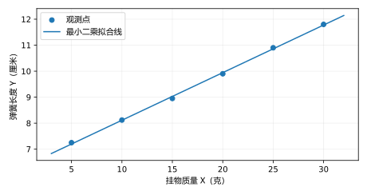

# 教材习题9：回归分析

%%
chapter: 第9章 回归分析
question_type: 回归分析｜一元线性回归
source: 概率论与数理统计（第四版）
paper_type: 教材习题
academic_year: 未标注
%%

### 概率教材-习9-题01
%%
chapter: 第9章 回归分析
question_type: 回归分析｜一元线性回归
source: 概率论与数理统计（第四版）
question_form: 计算题
ocr_status: 已做结构修复
%%

（过定点配直线）假定从某问题的实际背景确定：当自变量 $X$ 取值为 $x_0$ 时，因变量 $Y$ 取值 $y_0$ 才符合实际背景。设过定点 $(x_0,y_0)$ 的一元线性回归模型为

$$
Y_i=y_0+b(x_i-x_0)+\varepsilon_i,\quad i=1,2,\dots,n,
$$

其中 $\varepsilon_1,\dots,\varepsilon_n$ 相互独立，均服从 $N(0,\sigma^2)$。试由观测值 $(x_i,y_i)$ 用最小二乘法估计 $b$，并用矩估计法估计 $\sigma^2$。

> [!note]- 解答｜状态：已对照一致
> 记 $z_i=x_i-x_0,\ w_i=y_i-y_0$，模型写为 $w_i=bz_i+\varepsilon_i$。最小化 $Q(b)=\sum(w_i-bz_i)^2$，令导数为0，得
>
> $$
> \hat b=\frac{\sum_i(x_i-x_0)(y_i-y_0)}{\sum_i(x_i-x_0)^2}.
> $$
>
> 矩估计由 $E[(Y_i-y_0)^2]=b^2(x_i-x_0)^2+\sigma^2$ 对样本求平均并代入 $\hat b$，得
>
> $$
> \widehat{\sigma^2}_{\rm MOM}=\frac1n\sum_i(y_i-y_0)^2-\frac{\hat b^2}{n}\sum_i(x_i-x_0)^2.
> $$
>
> 与教材参考公式一致。
>
> 起手：先平移定点为原点，写出残差平方和对斜率求极小。
### 概率教材-习9-题02
%%
chapter: 第9章 回归分析
question_type: 回归分析｜一元线性回归
source: 概率论与数理统计（第四版）
question_form: 应用题
ocr_status: 已做结构修复
%%

在一定条件下测得石灰乳的相对密度 $X$ 与百分浓度 $Y$：

<table><tr><td>$x_i$</td><td>1.038</td><td>1.038 5</td><td>1.039</td><td>1.050</td><td>1.063</td><td>1.064</td></tr><tr><td>$y_i/%$</td><td>5.05</td><td>5.7</td><td>6.45</td><td>8.26</td><td>10.08</td><td>11.12</td></tr><tr><td>$x_i$</td><td>1.073</td><td>1.081</td><td>1.082</td><td>1.090</td><td>1.096</td><td>1.119</td></tr><tr><td>$y_i/%$</td><td>12.00</td><td>13.16</td><td>13.66</td><td>15.35</td><td>16.54</td><td>18.08</td></tr></table>

从物理化学意义上说，当石灰乳百分浓度为0时，其密度应为水的密度（等于1）。试由上述观测值求出 $Y$ 关于 $X$ 的、符合物理化学意义的线性回归关系式。

> [!note]- 解答｜状态：已对照一致
> 符合物理意义的直线通过 $(X,Y)=(1,0)$，令 $z_i=x_i-1$，最小二乘斜率
>
> $$
> \hat b=\frac{\sum z_i y_i}{\sum z_i^2}=162.9037.
> $$
>
> 所以 $Y$ 关于 $X$ 的约束回归式为 $\hat Y=162.9037(X-1)$，百分浓度单位为%。与参考答案一致。
>
> 起手：把物理约束写成回归直线通过 $(1,0)$，再拟合唯一斜率。
### 概率教材-习9-题03
%%
chapter: 第9章 回归分析
question_type: 回归分析｜一元线性回归
source: 概率论与数理统计（第四版）
question_form: 应用题
ocr_status: 已做结构修复
%%

以下列出了悬挂不同质量的弹簧的长度：

<table><tr><td>质量 $x_i/\mathrm g$</td><td>5</td><td>10</td><td>15</td><td>20</td><td>25</td><td>30</td></tr><tr><td>长度 $y_i/\mathrm{cm}$</td><td>7.25</td><td>8.12</td><td>8.95</td><td>9.90</td><td>10.9</td><td>11.8</td></tr></table>

(1) 画出散点图草图，直观上能否认为质量 $X$ 与长度 $Y$ 是线性相关的？

(2) 求长度 $Y$ 关于质量 $X$ 的经验线性回归方程。

> [!note]- 解答｜状态：已对照一致
> （1）散点随质量递增，近似落在一条上升直线附近，可直观认为线性关系合理。
>
> 
>
> （2）对数据计算 $S_{xx}=437.5,\ S_{xy}=80.10,\ \bar x=17.5,\bar y=9.4867$，得
>
> $$
> \hat b=S_{xy}/S_{xx}=0.1830857,\quad\hat a=\bar y-\hat b\bar x=6.282667.
> $$
>
> 经验回归方程为 $\hat Y=6.282667+0.1830857X$ cm。与教材参考答案一致。
>
> 起手：先看散点的方向与形状，再用 $S_{xy}/S_{xx}$ 求斜率。
### 概率教材-习9-题04
%%
chapter: 第9章 回归分析
question_type: 回归分析｜一元线性回归
source: 概率论与数理统计（第四版）
question_form: 综合题
ocr_status: 已对照 PDF 复核
%%

某公司为预测其产品回收率 $Y$，研究它与原材料有效成分 $X$ 的相关关系。现取得8对观测数据，计算得

$$
\sum_{i=1}^{8}x_i=52,\quad\sum_{i=1}^{8}y_i=228,\quad\sum_{i=1}^{8}x_i^2=478,\quad\sum_{i=1}^{8}y_i^2=7666,\quad\sum_{i=1}^{8}x_iy_i=1849.
$$

(1) 检验 $X$ 与 $Y$ 的线性相关关系是否显著（$\alpha=0.01$）；

(2) 求 $Y$ 关于 $X$ 的经验线性回归方程。

> [!note]- 解答｜状态：已对照一致
> 中心化统计量为 $S_{xx}=140,\ S_{yy}=1168,\ S_{xy}=367$。相关系数
>
> $$
> r=\frac{367}{\sqrt{140(1168)}}=0.9076.
> $$
>
> 检验 $H_0:\rho=0$ 对 $H_1:\rho\ne0$，等价回归显著性检验
>
> $$
> F=\frac{r^2}{1-r^2}(8-2)=28.030,\quad df=(1,6).
> $$
>
> $\alpha=0.01$ 临界值约13.745，拒绝 $H_0$，线性相关显著。回归系数 $\hat b=367/140=2.6214$，$\hat a=228/8-\hat b(52/8)=11.4607$，故 $\hat Y=11.4607+2.6214X$。与参考答案一致。
>
> 起手：从题给五个总和求中心化平方和、乘积和，再检验相关系数。
### 概率教材-习9-题05
%%
chapter: 第9章 回归分析
question_type: 回归分析｜一元线性回归
source: 概率论与数理统计（第四版）
question_form: 计算题
ocr_status: 已做结构修复
%%

假设一元线性回归的数学模型是 $Y=a+bx+\varepsilon$，且 $\varepsilon_1,\varepsilon_2,\dots,\varepsilon_n$ 独立同分布于 $N(0,\sigma^2)$。试计算 $a,b,\sigma^2$ 的最大似然估计。

> [!note]- 解答｜状态：与参考答案不一致（已裁决）
> 正态误差独立，似然最大化等价于最小化残差平方和。令
>
> $$
> \hat b=\frac{\sum(x_i-\bar x)(y_i-\bar y)}{\sum(x_i-\bar x)^2},\qquad \hat a=\bar y-\hat b\bar x.
> $$
>
> 最大似然方差估计为
>
> $$
> \widehat{\sigma^2}_{ML}=\frac1n\sum_{i=1}^n(y_i-\hat a-\hat b x_i)^2=\frac{SSE}{n}.
> $$
>
> 这是 MLE，不是无偏估计（无偏残差方差用 $SSE/(n-2)$）。教材答案给的方差式为 $n^{-1}\sum(y_i-\bar y)^2$，未扣除回归解释的平方和，和最大似然推导不符；按似然裁决采用残差平方和除以 $n$。
>
> 起手：先写正态回归的对数似然，分别对均值参数与方差参数最大化。
### 概率教材-习9-题06
%%
chapter: 第9章 回归分析
question_type: 回归分析｜一元线性回归
source: 概率论与数理统计（第四版）
question_form: 综合题
ocr_status: 已对照 PDF 复核
%%

考察硝酸钠的可溶性程度，在不同温度下观察100 mL水中溶解的硝酸钠质量，得到9组观测值，并计算得

$$
\sum_{i=1}^{9}x_i=234,\quad\sum_{i=1}^{9}y_i=811.3,
$$

$$
\sum_{i=1}^{9}x_i^2=10144,\quad\sum_{i=1}^{9}y_i^2=76218.1339,\quad\sum_{i=1}^{9}x_iy_i=24628.6.
$$

设 $Y_i=a+bx_i+\varepsilon_i$，其中 $\varepsilon_1,\dots,\varepsilon_9$ 相互独立，均服从 $N(0,\sigma^2)$。

(1) 求 $a,b$ 的最小二乘估计值和 $\sigma^2$ 的无偏估计值；

(2) 检验线性回归是否显著（$\alpha=0.01$）。

> [!note]- 解答｜状态：与参考答案不一致（已裁决）
> 由题给总和，$S_{xx}=4060,\ S_{xy}=3534.8,\ S_{yy}=3083.9461$。于是
>
> $$
> \hat b=3534.8/4060=0.87064,\quad \hat a=811.3/9-\hat b(234/9)=67.5078.
> $$
>
> 回归方程 $\hat Y=67.5078+0.87064X$，残差平方和 $SSE=S_{yy}-\hat bS_{xy}=6.4065$，无偏方差估计 $s^2=SSE/(9-2)=0.9152$。
> 检验 $H_0:\beta=0$ 对 $H_1:\beta\ne0$：$F=\hat b^2S_{xx}/(SSE/7)=3362.67,\ df=(1,7)$。临界值 $F_{0.99}(1,7)\approx12.25$，拒绝 $H_0$，回归显著。原书第249页给方差估计0.9561；按题给五个统计和，不提前舍入斜率，所得 $SSE/7=0.9152$。其F值3362.678与重算吻合，不能同时与0.9561配成同一平方和分解，故采用由原始统计和复算的0.9152。
>
> 起手：先由五个和式算 $S_{xx},S_{xy},S_{yy}$，再估系数和残差方差。
### 概率教材-习9-题07
%%
chapter: 第9章 回归分析
question_type: 回归分析｜多元线性回归
source: 概率论与数理统计（第四版）
question_form: 证明题
ocr_status: 已对照 PDF 复核
%%

通过原点 $O(0,0)$ 的二元线性回归模型为

$$
Y_i=b_1x_{i1}+b_2x_{i2}+\varepsilon_i,\quad i=1,2,\dots,n,
$$

其中 $\varepsilon_1,\dots,\varepsilon_n$ 相互独立，均服从 $N(0,\sigma^2)$。试由观测值 $(x_{i1},x_{i2},y_i)$（$i=1,2,\dots,n$）用最小二乘法推导估计参数 $b_1,b_2$ 的正规方程组。

> [!note]- 解答｜状态：已对照一致
> 令 $Q(b_1,b_2)=\sum_i(y_i-b_1x_{i1}-b_2x_{i2})^2$。分别对两参数求偏导并令0，正规方程为
>
> $$
> \begin{cases}
> b_1\sum_i x_{i1}^2+b_2\sum_i x_{i1}x_{i2}=\sum_i x_{i1}y_i,\\
> b_1\sum_i x_{i1}x_{i2}+b_2\sum_i x_{i2}^2=\sum_i x_{i2}y_i.
> \end{cases}
> $$
>
> 这就是通过原点模型的最小二乘正规方程，与教材参考答案一致。
>
> 起手：先写残差平方和，对 $b_1,b_2$ 分别求偏导。
### 概率教材-习9-题08
%%
chapter: 第9章 回归分析
question_type: 回归分析｜多元线性回归
source: 概率论与数理统计（第四版）
question_form: 综合题
ocr_status: 已对照 PDF 复核
%%

某化工公司产品产率 $Y$ 与反应温度 $X_1$、反应时间 $X_2$、反应物浓度 $X_3$ 有关，三者取值状态均以数字 $-1,1$ 表示。观测数据如下：

<table><tr><td>温度 $x_{i1}$</td><td>-1</td><td>-1</td><td>-1</td><td>-1</td><td>1</td><td>1</td><td>1</td><td>1</td></tr><tr><td>时间 $x_{i2}$</td><td>-1</td><td>-1</td><td>1</td><td>1</td><td>-1</td><td>-1</td><td>1</td><td>1</td></tr><tr><td>浓度 $x_{i3}$</td><td>-1</td><td>1</td><td>-1</td><td>1</td><td>-1</td><td>1</td><td>-1</td><td>1</td></tr><tr><td>产率 $y_i$</td><td>7.6</td><td>10.3</td><td>9.2</td><td>10.2</td><td>8.4</td><td>11.1</td><td>9.8</td><td>12.6</td></tr></table>

设 $Y=a+b_1x_1+b_2x_2+b_3x_3+\varepsilon$，$\varepsilon\sim N(0,\sigma^2)$。

(1) 求 $a,b_1,b_2,b_3$ 的最小二乘估计值和 $\sigma^2$ 的无偏估计值，写出经验线性回归方程；

(2) 检验线性回归是否显著（$\alpha=0.05$）。

> [!note]- 解答｜状态：与参考答案不一致（已裁决）
> 这是 $2^3$ 正交设计，截距为产率总均值，三个系数分别为 $x_j$ 与产率的乘积和除以8，得
>
> $$
> \hat a=9.9000,\quad\hat b_1=0.5750,\quad\hat b_2=0.5500,\quad\hat b_3=1.1500.
> $$
>
> 经验方程 $\hat Y=9.9+0.575x_1+0.55x_2+1.15x_3$。中心平方和 $SST=17.020$，回归平方和 $SSR=15.645$，$SSE=1.375$。无偏方差估计 $s^2=SSE/(8-4)=0.34375$。整体检验 $H_0:b_1=b_2=b_3=0$，$F=(SSR/3)/(SSE/4)=15.1709,\ df=(3,4)$，在 $\alpha=0.05$ 下显著（临界值约6.59）。原书第249页所列参数与 $F$ 值一致，但其 $s^2=0.229$ 与题给模型的残差自由度不符，采用 $SSE/4$ 重算值。
>
> 起手：利用正交设计的列平衡求系数，再由残差平方和与 $n-p$ 求无偏方差。
### 概率教材-习9-题09
%%
chapter: 第9章 回归分析
question_type: 回归分析｜多元线性回归
source: 概率论与数理统计（第四版）
question_form: 应用题
ocr_status: 已做结构修复
%%

某地区10年中，货运总量 $Y$（单位：$10^4\mathrm t$）、工业总产值 $X_1$（单位：$10^9$元）和农业总产值 $X_2$（单位：$10^9$元）的数据如下：

<table><tr><td>$y_i$</td><td>2.8</td><td>2.9</td><td>3.2</td><td>3.3</td><td>3.4</td></tr><tr><td>$x_{1i}$</td><td>25</td><td>27</td><td>29</td><td>32</td><td>34</td></tr><tr><td>$x_{2i}$</td><td>3.6</td><td>3.8</td><td>4.0</td><td>4.4</td><td>4.8</td></tr><tr><td>$y_i$</td><td>3.2</td><td>3.3</td><td>3.7</td><td>3.9</td><td>4.2</td></tr><tr><td>$x_{1i}$</td><td>36</td><td>35</td><td>39</td><td>42</td><td>45</td></tr><tr><td>$x_{2i}$</td><td>4.7</td><td>4.8</td><td>5.3</td><td>5.5</td><td>5.9</td></tr></table>

求货运总量 $Y$ 关于工业总产值 $X_1$、农业总产值 $X_2$ 的经验线性回归方程。

> [!note]- 解答｜状态：已对照一致
> 以工业、农业总产值为两个自变量，对10年数据求最小二乘解，得
>
> $$
> \hat Y=0.80544+0.0026698X_1+0.53263X_2.
> $$
>
> 其中 $Y$ 的单位为 $10^4\mathrm t$，$X_1,X_2$ 均以 $10^9$ 元计。回归系数由正规方程解得；与教材参考答案（$0.8054,\,2.6698\times10^{-3},\,0.5326$）一致。
>
> 起手：先将10组观测排成含截距和两个自变量的设计矩阵，再解最小二乘正规方程。
### 概率教材-习9-题10
%%
chapter: 第9章 回归分析
question_type: 回归分析｜非线性与多项式回归
source: 概率论与数理统计（第四版）
question_form: 应用题
ocr_status: 已做结构修复
%%

一种产品的单位成本 $Y$ 与制作数量 $X$ 相关，统计数据如下：

<table><tr><td>$x_i/10^3$件</td><td>1</td><td>2</td><td>3</td><td>5</td><td>10</td></tr><tr><td>$y_i$/元</td><td>10.15</td><td>5.52</td><td>4.08</td><td>2.85</td><td>2.11</td></tr><tr><td>$x_i/10^3$件</td><td>20</td><td>30</td><td>50</td><td>100</td><td>200</td></tr><tr><td>$y_i$/元</td><td>1.62</td><td>1.41</td><td>1.30</td><td>1.21</td><td>1.15</td></tr></table>

设模型 $Y=a+b\frac1x+\varepsilon$，$\varepsilon\sim N(0,\sigma^2)$。

(1) 求 $a,b$ 的最小二乘估计值和 $\sigma^2$ 的无偏估计值，并写出经验回归方程；

(2) 检验上述回归是否显著（$\alpha=0.01$）。

> [!note]- 解答｜状态：与参考答案不一致（已裁决）
> 令 $Z=1/X$，对 $Y$ 关于 $Z$ 做线性回归。题表的 $X$ 以千件计，因此式中 $X$ 取千件数值；若以件数 $X_{\mathrm{件}}$ 表示，斜率项等价为 $8976.211/X_{\mathrm{件}}$。计算得
>
> $$
> \hat a=1.118856,\quad\hat b=8.976211,\quad\hat Y=1.118856+\frac{8.976211}{X}.
> $$
>
> 残差平方和 $SSE=0.0273885$，故无偏方差估计 $s^2=SSE/(10-2)=0.00342357$。整体检验 $H_0:b=0$：$F=(SST-SSE)/(SSE/8)=21375.258,\ df=(1,8)$，大于 $F_{0.99}(1,8)=11.259$，回归显著。
> 原书第249页列系数与 $F$ 值均与重算一致；其 $\hat\sigma^2=0.003447$ 与题给数据直接计算的 $SSE/8$ 略有差异，采用重算值。
>
> 起手：先作倒数变换 $Z=1/X$，再按一元线性回归计算系数与残差平方和。
### 概率教材-习9-题11
%%
chapter: 第9章 回归分析
question_type: 回归分析｜非线性与多项式回归
source: 概率论与数理统计（第四版）
question_form: 综合题
ocr_status: 已做结构修复
%%

（同一个问题可建立不同形式的曲线回归方程）对例9.4.1的数据，曾求出形如 $y=a+b\ln x$ 的回归方程并做显著性检验。现要求：

(1) 对模型 $Y=a+b\sqrt x+\varepsilon$，求 $a,b,\sigma^2$ 的估计值，写出经验回归方程，并检验回归是否显著（$\alpha=0.01$）；

(2) 对模型 $Y=a+b\frac1x+\varepsilon$，完成同样的参数估计、经验方程和显著性检验（$\alpha=0.01$）；

(3) 比较 $y=a+b\ln x$、$y=a+b\sqrt x$、$y=a+b\frac1x$ 三种曲线回归的拟合程度，指出哪一种最好。提示：可比较相关系数绝对值或回归离差平方和。

> [!note]- 解答｜状态：与参考答案不一致（已裁决）
> 题干所指的是例9.4.1原表（教材第202页）：13组 $(X,Y)$ 为 $X=(2,3,4,5,7,8,10,11,14,15,16,18,19)$ 与金属含量 
>
> $$
> Y=(106.42,108.20,109.58,109.50,110.00,109.93,110.49,110.59,110.62,110.90,110.76,111.00,111.20)
> $$
>
> ；这些数值也见原书第202页例9.4.3重列的同组数据。按原表逐点重算。分别用 $Z=\sqrt X$、$Z=1/X$、$Z=\ln X$ 作线性回归；方差估计均用 $SSE/(13-2)$，显著性检验 $H_0:b=0$ 对 $H_1:b\ne0$，自由度 $(1,11)$。
> （1）$\hat Y=106.2992+1.19593\sqrt X$，$SSE=4.55075,\ s^2=0.41370,\ R=0.8864,\ F=40.335$，$F_{0.99}(1,11)\approx9.65$，回归显著。
> （2）$\hat Y=111.4903-9.84145/X$，$SSE=0.54254,\ s^2=0.04932,\ R=-0.9871,\ F=419.590$，回归显著。
> （3）三者均显著，但 $1/X$ 模型的 $|R|$ 最大且 $SSE$ 最小，拟合最好。
> 原书第249页参考答案列出的两组系数及相关系数与基于题给13对数据的最小二乘重算不符；重算同时得到对数模型 $R=0.9370$，并与原书第203页例9.4.3对同一原表的结果相符；原书第249页分别列 $(a,b)=(106.2880,1.1996)$、$(111.4270,-9.4380)$，与指定原表的重算结果不一致，采用源表重算结果。
>
> 起手：先从原始13对观测逐一变换自变量，再分别计算三组回归残差与相关系数。
### 概率教材-习9-题12
%%
chapter: 第9章 回归分析
question_type: 回归分析｜非线性与多项式回归
source: 概率论与数理统计（第四版）
question_form: 综合题
ocr_status: 已做结构修复
%%

1 kg某种油漆的干燥时间 $Y$ 与一种添加剂用量 $X$ 的数据如下：

<table><tr><td>$x_i/\mathrm g$</td><td>1</td><td>2</td><td>3</td><td>4</td><td>5</td><td>6</td><td>7</td><td>8</td></tr><tr><td>$y_i/\mathrm h$</td><td>7.2</td><td>6.7</td><td>4.7</td><td>3.7</td><td>4.7</td><td>4.2</td><td>5.2</td><td>5.7</td></tr></table>

设二次多项式模型 $Y_i=a+b_1x_i+b_2x_i^2+\varepsilon_i$（$i=1,2,\dots,8$），其中 $\varepsilon_1,\dots,\varepsilon_8$ 相互独立，均服从 $N(0,\sigma^2)$。

(1) 求 $a,b_1,b_2$ 的最小二乘估计值和 $\sigma^2$ 的无偏估计值，写出经验回归方程；

(2) 求复相关系数 $R^*$，并检验二次多项式回归是否显著（$\alpha=0.01$）。

> [!note]- 解答｜状态：与参考答案不一致（已裁决）
> 以 $1,X,X^2$ 为设计矩阵列作最小二乘回归，得到
>
> $$
> \hat a=9.244643,\quad\hat b_1=-2.014881,\quad\hat b_2=0.199405,
> $$
>
> $$
> \hat Y=9.244643-2.014881X+0.199405X^2.
> $$
>
> $SST=10.21875,\ SSR=8.717262,\ SSE=1.501488$，故无偏方差估计 $s^2=SSE/(8-3)=0.300298$。复相关系数 $R^*=\sqrt{SSR/SST}=0.92361$。整体检验 $H_0:b_1=b_2=0$：$F=(SSR/2)/(SSE/5)=14.5144,\ df=(2,5)$，而 $F_{0.99}(2,5)\approx13.27$，故在 $\alpha=0.01$ 下显著。原书第249页给出的系数近似一致，但 $s^2,R^*,F$ 的末值与精确重算略有差异，采用由平方和分解得到的数值。
>
> 起手：用 $X$ 与 $X^2$ 两列组成设计矩阵，解正规方程后核验 $SST=SSR+SSE$。
