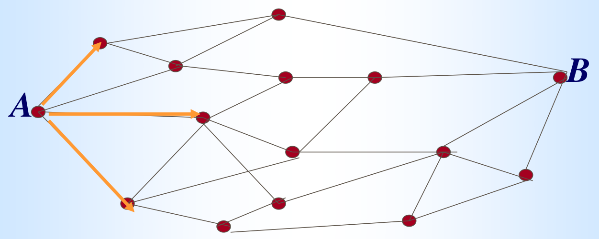

# 教师课件题面整理｜C1_4

%%
source: QQ1108911072｜C1_4.pdf
paper_type: 其他
academic_year: 未知
%%

### 教师课件-C1_4-001

%%
chapter: 第一章
question_type: 条件概率｜条件概率与贝叶斯
source: QQ1108911072｜C1_4.pdf
question_form: 简答题
ocr_status: 已对照 PDF 复核
%%

原题标识：课堂例“足球比赛胜负预测”；来源：[[概率论与数理统计/00_原材料/老师课件_QQ1108911072/第一章和第二章课件/C1_4.pdf|课件第1页]]

设 $B=\{\text{中国队上半场负}\}$，$A=\{\text{中国队最终获胜}\}$。分别考虑 $A$ 发生的可能性，以及已知 $B$ 发生时 $A$ 发生的可能性。

### 教师课件-C1_4-002

%%
chapter: 第一章
question_type: 条件概率｜条件概率与贝叶斯
source: QQ1108911072｜C1_4.pdf
question_form: 简答题
ocr_status: 已对照 PDF 复核
%%

原题标识：课堂问题；来源：[[概率论与数理统计/00_原材料/老师课件_QQ1108911072/第一章和第二章课件/C1_4.pdf|课件第3页]]

1. 判断题目所求的概率是否为条件概率。
2. 判断题目给出的概率数据是否为条件概率。

### 教师课件-C1_4-003

%%
chapter: 第一章
question_type: 条件概率｜条件概率与贝叶斯
source: QQ1108911072｜C1_4.pdf
question_form: 计算题
ocr_status: 已对照 PDF 复核
%%

原题标识：练习；来源：[[概率论与数理统计/00_原材料/老师课件_QQ1108911072/第一章和第二章课件/C1_4.pdf|课件第11页]]

袋中有 50 个球，其中 20 个黄色、30 个白色。两人依次随机各取 1 球，取后不放回。求第二人取到黄球的概率。

### 教师课件-C1_4-004

%%
chapter: 第一章
question_type: 条件概率｜条件概率与贝叶斯
source: QQ1108911072｜C1_4.pdf
question_form: 应用题
ocr_status: 已对照 PDF 复核
%%

原题标识：思考题第1问；来源：[[概率论与数理统计/00_原材料/老师课件_QQ1108911072/第一章和第二章课件/C1_4.pdf|课件第12页]]

枪支校验问题中，已知射手中靶，求他使用的是已校正枪支的概率。

### 教师课件-C1_4-005

%%
chapter: 第一章
question_type: 条件概率｜条件概率与贝叶斯
source: QQ1108911072｜C1_4.pdf
question_form: 应用题
ocr_status: 已对照 PDF 复核
%%

原题标识：思考题第2问（追究责任问题）；来源：[[概率论与数理统计/00_原材料/老师课件_QQ1108911072/第一章和第二章课件/C1_4.pdf|课件第12页]]

抽检中已发现一件次品，产品标志脱落，需要追究有关车间的责任。设 $A_i$ 表示产品来自第 $i$ 个车间，$B$ 表示产品为次品，计算 $P(A_i\mid B)$（$i=1,2,3,4$），并比较各概率。

### 教师课件-C1_4-006

%%
chapter: 第一章
question_type: 条件概率｜条件概率与贝叶斯
source: QQ1108911072｜C1_4.pdf
question_form: 简答题
ocr_status: 已对照 PDF 复核
%%

原题标识：课堂应用问题（结果与原因）；来源：[[概率论与数理统计/00_原材料/老师课件_QQ1108911072/第一章和第二章课件/C1_4.pdf|课件第13页]]

把事件 $A$ 看成结果，把事件 $B_1,B_2,\ldots,B_n$ 看成可能原因。已知 $A$ 发生时，如何找出最可能导致它发生的原因？

### 教师课件-C1_4-007

%%
chapter: 第一章
question_type: 条件概率｜条件概率与贝叶斯
source: QQ1108911072｜C1_4.pdf
question_form: 计算题
ocr_status: 已对照 PDF 复核
%%

原题标识：例1；来源：[[概率论与数理统计/00_原材料/老师课件_QQ1108911072/第一章和第二章课件/C1_4.pdf|课件第16页]]

100 件产品中有 5 件不合格，其中 3 件次品、2 件废品。任取 1 件，求：

1. 抽得废品的概率；
2. 已知抽得不合格品时，它是废品的概率。

### 教师课件-C1_4-008

%%
chapter: 第一章
question_type: 条件概率｜条件概率与贝叶斯
source: QQ1108911072｜C1_4.pdf
question_form: 计算题
ocr_status: 已对照 PDF 复核
%%

原题标识：例2；来源：[[概率论与数理统计/00_原材料/老师课件_QQ1108911072/第一章和第二章课件/C1_4.pdf|课件第19页]]

掷一枚硬币，直到出现 3 次正面才停止。已知恰好在第 6 次停止，求第 5 次也是正面的概率。

### 教师课件-C1_4-009

%%
chapter: 第一章
question_type: 条件概率｜条件概率与贝叶斯
source: QQ1108911072｜C1_4.pdf
question_form: 计算题
ocr_status: 已对照 PDF 复核
%%

原题标识：例3；来源：[[概率论与数理统计/00_原材料/老师课件_QQ1108911072/第一章和第二章课件/C1_4.pdf|课件第21页]]

甲、乙两人独立地对同一目标射击一次，命中率分别为 $0.6$ 和 $0.5$。已知目标被击中，求目标被甲击中的概率。

### 教师课件-C1_4-010

%%
chapter: 第一章
question_type: 条件概率｜条件概率与贝叶斯
source: QQ1108911072｜C1_4.pdf
question_form: 计算题
ocr_status: 已对照 PDF 复核
%%

原题标识：例4“抽签的公平性”；来源：[[概率论与数理统计/00_原材料/老师课件_QQ1108911072/第一章和第二章课件/C1_4.pdf|课件第23页]]

袋中有 10 个球，其中 9 个白球、1 个红球。10 人依次不放回地各取 1 球。求第 1 人、第 2 人和最后 1 人取到红球的概率。

### 教师课件-C1_4-011

%%
chapter: 第一章
question_type: 条件概率｜条件概率与贝叶斯
source: QQ1108911072｜C1_4.pdf
question_form: 计算题
ocr_status: 已对照 PDF 复核
%%

原题标识：例5“激烈空战”；来源：[[概率论与数理统计/00_原材料/老师课件_QQ1108911072/第一章和第二章课件/C1_4.pdf|课件第26页]]

两架飞机进行空战，甲机首先开火，击落乙机的概率为 $0.2$；若乙机未被击落，乙机还击并击落甲机的概率为 $0.3$；若甲机仍未被击落，甲机再次开火并击落乙机的概率为 $0.4$。求这几个回合中：

1. 甲机被击落的概率；
2. 乙机被击落的概率。

### 教师课件-C1_4-012

%%
chapter: 第一章
question_type: 条件概率｜条件概率与贝叶斯
source: QQ1108911072｜C1_4.pdf
question_form: 计算题
ocr_status: 已对照 PDF 复核
%%

原题标识：例6；来源：[[概率论与数理统计/00_原材料/老师课件_QQ1108911072/第一章和第二章课件/C1_4.pdf|课件第29页]]

甲盒中有 5 个红球、6 个白球；乙盒中有 3 个红球、4 个白球。抛一枚均匀硬币，正面时从甲盒任取 1 球，反面时从乙盒任取 1 球。求取出白球的概率。

### 教师课件-C1_4-013

%%
chapter: 第一章
question_type: 条件概率｜条件概率与贝叶斯
source: QQ1108911072｜C1_4.pdf
question_form: 计算题
ocr_status: 已对照 PDF 复核
%%

原题标识：例7；来源：[[概率论与数理统计/00_原材料/老师课件_QQ1108911072/第一章和第二章课件/C1_4.pdf|课件第32页]]

某工厂有 4 个车间生产同一种产品，产品分别占总产量的 $15\%、20\%、30\%、35\%$，各车间次品率依次为 $0.05、0.04、0.03、0.02$。现从出厂产品中任取 1 件，求取到次品的概率。

### 教师课件-C1_4-014

%%
chapter: 第一章
question_type: 条件概率｜条件概率与贝叶斯
source: QQ1108911072｜C1_4.pdf
question_form: 计算题
ocr_status: 已对照 PDF 复核
%%

原题标识：例8；来源：[[概率论与数理统计/00_原材料/老师课件_QQ1108911072/第一章和第二章课件/C1_4.pdf|课件第34页]]

袋中有 $n$ 个红球、$m$ 个白球。三人依次不放回地各取 1 球。分别求三人取得红球的概率。

### 教师课件-C1_4-015

%%
chapter: 第一章
question_type: 条件概率｜条件概率与贝叶斯
source: QQ1108911072｜C1_4.pdf
question_form: 综合题
ocr_status: 已对照 PDF 复核
%%

原题标识：例9及续例9；来源：[[概率论与数理统计/00_原材料/老师课件_QQ1108911072/第一章和第二章课件/C1_4.pdf|课件第37页]]、[[概率论与数理统计/00_原材料/老师课件_QQ1108911072/第一章和第二章课件/C1_4.pdf|课件第38页]]

8 支枪中有 3 支未经校正、5 支已校正。射手使用已校正枪时中靶概率为 $0.8$，使用未校正枪时中靶概率为 $0.3$。射手随机取 1 支枪射击，求：

1. 中靶的概率；
2. 已知中靶时，所用枪支已校正的概率。

### 教师课件-C1_4-016

%%
chapter: 第一章
question_type: 条件概率｜条件概率与贝叶斯
source: QQ1108911072｜C1_4.pdf
question_form: 应用题
ocr_status: 已对照 PDF 复核
%%

原题标识：例10；来源：[[概率论与数理统计/00_原材料/老师课件_QQ1108911072/第一章和第二章课件/C1_4.pdf|课件第39页]]

某工厂有 4 个车间生产同一种产品，产品分别占总产量的 $15\%、20\%、30\%、35\%$，各车间次品率依次为 $0.05、0.04、0.03、0.02$。现从出厂产品中任取 1 件，发现该产品为次品且标志脱落。应如何处理？

### 教师课件-C1_4-017

%%
chapter: 第一章
question_type: 条件概率｜条件概率与贝叶斯
source: QQ1108911072｜C1_4.pdf
question_form: 计算题
ocr_status: 已对照 PDF 复核
%%

原题标识：例11；来源：[[概率论与数理统计/00_原材料/老师课件_QQ1108911072/第一章和第二章课件/C1_4.pdf|课件第42页]]

某医院用一种方法诊断肝癌。设 $A$ 为确实患有肝癌，$B$ 为诊断为肝癌。已知

$$
P(A)=0.0004,\qquad P(B\mid A)=0.95,\qquad P(\overline{B}\mid\overline{A})=0.9.
$$

现有一名病人被诊断为患有肝癌，求其确实患病的概率 $P(A\mid B)$。

### 教师课件-C1_4-018

%%
chapter: 第一章
question_type: 条件概率｜条件概率与贝叶斯
source: QQ1108911072｜C1_4.pdf
question_form: 应用题
ocr_status: 已对照 PDF 复核
%%

原题标识：例13“办公系统信息传输问题”；来源：[[概率论与数理统计/00_原材料/老师课件_QQ1108911072/第一章和第二章课件/C1_4.pdf|课件第45页]]

某公司有 $n$ 个部门，每个部门配有一台计算机，各计算机之间需要传输数量不等的文件。若语音信号已从 $A$ 传输到 $B$，它是从哪一条通路传输过来的可能性最大？

