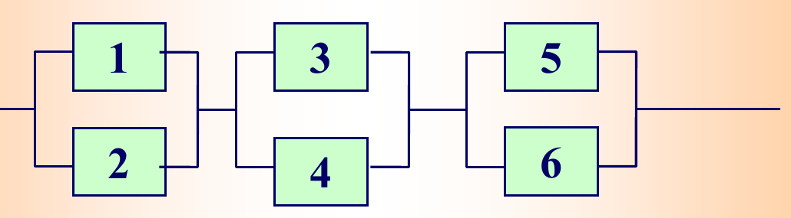

# 教师课件题面整理｜C1_5

%%
source: QQ1108911072｜C1_5.pdf
paper_type: 其他
academic_year: 未知
%%

### 教师课件-C1_5-001

%%
chapter: 第一章
question_type: 独立性｜独立事件与系统可靠性
source: QQ1108911072｜C1_5.pdf
question_form: 简答题
ocr_status: 已对照 PDF 复核
%%

原题标识：课堂问题；来源：[[概率论与数理统计/00_原材料/老师课件_QQ1108911072/第一章和第二章课件/C1_5.pdf|课件第4页]]

设 $A,B$ 是两个随机事件，且 $0<P(A)<1$。若 $P(B\mid A)=P(B\mid\overline{A})$，问 $A,B$ 是否相互独立？

### 教师课件-C1_5-002

%%
chapter: 第一章
question_type: 独立性｜独立事件与系统可靠性
source: QQ1108911072｜C1_5.pdf
question_form: 计算题
ocr_status: 已对照 PDF 复核
%%

原题标识：课堂问题“至少一个事件发生”；来源：[[概率论与数理统计/00_原材料/老师课件_QQ1108911072/第一章和第二章课件/C1_5.pdf|课件第7页]]、[[概率论与数理统计/00_原材料/老师课件_QQ1108911072/第一章和第二章课件/C1_5.pdf|课件第8页]]、[[概率论与数理统计/00_原材料/老师课件_QQ1108911072/第一章和第二章课件/C1_5.pdf|课件第9页]]

设 $0<P(A_i)=p_i<1$，求 $A_1,A_2,\ldots,A_n$ 中至少一个发生的概率：

1. 若 $A_1,A_2,\ldots,A_n$ 互不相容；
2. 若 $A_1,A_2,\ldots,A_n$ 相互独立。

### 教师课件-C1_5-003

%%
chapter: 第一章
question_type: 独立性｜独立事件与系统可靠性
source: QQ1108911072｜C1_5.pdf
question_form: 综合题
ocr_status: 已对照 PDF 复核
%%

原题标识：例1；来源：[[概率论与数理统计/00_原材料/老师课件_QQ1108911072/第一章和第二章课件/C1_5.pdf|课件第10页]]

同时掷两个均匀的正四面体一次，每个四面体的四个面分别标有号码 $1,2,3,4$。设：

- $A=\{$甲四面体向下的一面是偶数$\}$；
- $B=\{$乙四面体向下的一面是奇数$\}$；
- $C=\{$两个四面体向下的一面同为奇数或同为偶数$\}$。

判断 $A,B,C$ 是否两两独立、是否相互独立。

### 教师课件-C1_5-004

%%
chapter: 第一章
question_type: 独立性｜独立事件与系统可靠性
source: QQ1108911072｜C1_5.pdf
question_form: 计算题
ocr_status: 已对照 PDF 复核
%%

原题标识：例2；来源：[[概率论与数理统计/00_原材料/老师课件_QQ1108911072/第一章和第二章课件/C1_5.pdf|课件第14页]]

三个人独立地向同一目标射击，命中率分别为 $0.45,0.55,0.60$。求目标被击中的概率。

### 教师课件-C1_5-005

%%
chapter: 第一章
question_type: 独立性｜独立事件与系统可靠性
source: QQ1108911072｜C1_5.pdf
question_form: 计算题
ocr_status: 已对照 PDF 复核
%%

原题标识：例3；来源：[[概率论与数理统计/00_原材料/老师课件_QQ1108911072/第一章和第二章课件/C1_5.pdf|课件第16页]]

某人每次试验成功的概率为 $0.2$，不断重复独立试验。求进行 10 次、20 次试验时至少成功一次的概率。

### 教师课件-C1_5-006

%%
chapter: 第一章
question_type: 独立性｜独立事件与系统可靠性
source: QQ1108911072｜C1_5.pdf
question_form: 应用题
ocr_status: 已对照 PDF 复核
%%

原题标识：例4“可靠性问题”；来源：[[概率论与数理统计/00_原材料/老师课件_QQ1108911072/第一章和第二章课件/C1_5.pdf|课件第18页]]

有 6 个元件，每个元件在单位时间内正常工作的概率为 $0.9$，且各元件能否正常工作相互独立。系统由 3 组并联元件串联组成（见图）。求系统正常工作的概率。

