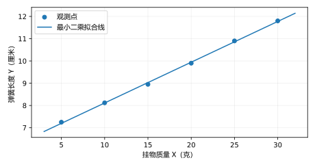

# 第09章 回归分析｜作业

%%
chapter: 第九章
question_type: 章节作业｜第九章
source: 夸克扫描王_第1章.pdf·第九章作业
paper_type: 其他
academic_year: 未知
%%

> 本章共 6 道题，按原题号整理。原 PDF 实际包含第1—9章作业；学年未注明。只收录题面，星号沿用原件。

### 概率作业-扫描f0ffa7e6-章9-题01

%%
chapter: 第九章
question_type: 回归分析｜一元线性回归
source: 夸克扫描王_第1章.pdf·第九章第1题·PDF第43页
question_form: 计算题
ocr_status: 已做结构修复
%%

以下列出了在不同挂物质量 $X(g)$ 下弹簧长度 $Y(cm)$ 的测量值，

| $x_i$ | 5 | 10 | 15 | 20 | 25 | 30 |
| --- | --- | --- | --- | --- | --- | --- |
| $y_i$ | 7.25 | 8.12 | 8.95 | 9.90 | 10.9 | 11.8 |

（1）由上述观测值，画出散点图草图，直观上能否认为质量 $X$ 与长度 $Y$ 是线性相关的？

（2）求 $Y$ 关于 $X$ 的经验线性回归方程；

（3）求挂物质量为 $60 \mathrm{~g}$ 时弹簧长度的预测值。

> [!note]- 解答｜状态：独立解答未对照
> （1）将六对数据画成散点图，点大致沿上升直线分布，可认为观测范围内具有近似线性关系。
>
> 
>
> （2）由数据得 $\bar x=17.5$克、$\bar y=9.48667$厘米，$S_{xx}=437.5$克$^2$、$S_{xy}=80.10$克·厘米。因此
>
> $$
> \hat b=\frac{80.10}{437.5}=0.1830857\text{厘米/克},\quad
> \hat a=\bar y-\hat b\bar x=6.282667\text{厘米}.
> $$
>
> 经验方程为 $\hat Y=6.282667+0.1830857X$。
>
> （3）代入 $X=60$克，$\hat Y\approx17.2678$厘米。60克超出原观测5—30克范围，这是外推结果，其可靠性还依赖线性关系在该范围继续成立。
>
> 自检：残差和与 $\sum x_ie_i$ 均为0（数值误差内）；拟合在5克、30克时约为7.198和11.775厘米，与端点接近。
>
> 起手：先画六个质量—长度观测点，再用中心积和除以自变量离差平方和求斜率。
### 概率作业-扫描f0ffa7e6-章9-题02

%%
chapter: 第九章
question_type: 回归分析｜一元线性回归
source: 夸克扫描王_第1章.pdf·第九章第2题·PDF第43页
question_form: 计算题
ocr_status: 已做结构修复
%%

某工厂为预测其产品回收率 $Y$，要研究它与原材料的有效成分 $X$ 之间的相关关系，现取得 8 对观测数据 $(x_{i}, y_{i})$，计算得：

$$
\sum_{i = 1}^{8} x_{i} = 52, \quad \sum_{i = 1}^{8} y_{i} = 228, \quad \sum_{i = 1}^{8} x_{i}^{2} = 478, \quad \sum_{i = 1}^{8} y_{i}^{2} = 7666, \quad \sum_{i = 1}^{8} x_{i} y_{i} = 1849.
$$

（1）检验 $X$ 与 $Y$ 的线性相关关系是否显著 ( $\alpha = 0.01$ )？

（2）求 $Y$ 关于 $X$ 的经验线性回归方程。

> [!note]- 解答｜状态：独立解答未对照
> （1）由题给统计和计算
>
> $$
> S_{xx}=478-\frac{52^2}{8}=140,\quad
> S_{yy}=7666-\frac{228^2}{8}=1168,\quad
> S_{xy}=1849-\frac{52\times228}{8}=367.
> $$
>
> 故 $r=367/\sqrt{140\times1168}\approx0.90757$。检验 $H_0:\rho=0$ 对 $H_1:\rho\ne0$，在常规正态线性相关模型下，
>
> $$
> t=\frac{r\sqrt6}{\sqrt{1-r^2}}\approx5.294,
> \qquad F=t^2\approx28.030.
> $$
>
> 自由度分别为6及 $(1,6)$，$F_{0.99}(1,6)=13.745$。故拒绝原假设，线性相关显著。
>
> （2）$\bar x=6.5$，$\bar y=28.5$，斜率 $\hat b=367/140=2.621429$，截距 $\hat a=11.460714$。经验方程为
>
> $$
> \hat Y=11.460714+2.621429X.
> $$
>
> 自检：$r$与斜率同为正数；$SSE=S_{yy}-S_{xy}^2/S_{xx}>0$，由它复算的F值一致。
>
> 起手：先把原始五个统计和转换为三个中心平方和与积和。
### 概率作业-扫描f0ffa7e6-章9-题03

%%
chapter: 第九章
question_type: 回归分析｜一元线性回归
source: 夸克扫描王_第1章.pdf·第九章第3题·PDF第44页
question_form: 计算题
ocr_status: 已做结构修复
%%

对一元线性正态回归模型

$$
Y_{i} = a + b x_{i} + \varepsilon_{i}, (i = 1, \dots , n) \quad \varepsilon_{i} \sim N (0, \sigma^{2}) \text{且相互独立}
$$

若 $Y_{i}$ 的观测值为 $y_{i} (i = 1, \cdots, n)$，求参数 $a, b$ 和 $\sigma^{2}$ 的极大似然估计值。

> [!note]- 解答｜状态：独立解答未对照
> 把 $x_i$ 看成固定设计，似然为
>
> $$
> L(a,b,\sigma^2)=(2\pi\sigma^2)^{-n/2}
> \exp\left[-\frac{1}{2\sigma^2}\sum_{i=1}^n(y_i-a-bx_i)^2\right].
> $$
>
> 先对 $a,b$ 最大化，等价于最小化残差平方和。若 $S_{xx}=\sum(x_i-\bar x)^2>0$，正规方程给出
>
> $$
> \hat b=\frac{\sum(x_i-\bar x)(y_i-\bar y)}{S_{xx}},\qquad
> \hat a=\bar y-\hat b\bar x.
> $$
>
> 将二者代回，对 $v=\sigma^2>0$ 的对数似然求导：
>
> $$
> \frac{\partial\ell}{\partial v}=-\frac n{2v}+\frac{SSE}{2v^2}=0,
> \qquad \widehat{\sigma^2}_{ML}=\frac{SSE}{n}.
> $$
>
> 这里 $SSE=\sum(y_i-\hat a-\hat bx_i)^2$。MLE的分母为 $n$；无偏残差方差的分母才为 $n-2$。若 $SSE=0$，在严格参数空间 $\sigma^2>0$ 内似然无有限最大点，仅在方差趋零时趋向边界上确界。
>
> 自检：拟合残差满足 $\sum e_i=\sum x_ie_i=0$，方差估计量纲为响应变量单位的平方。
>
> 起手：先写正态回归似然，把均值参数的极大化转成最小二乘问题。
### 概率作业-扫描f0ffa7e6-章9-题04

%%
chapter: 第九章
question_type: 回归分析｜非线性与多项式回归
source: 夸克扫描王_第1章.pdf·第九章第4题·PDF第44页
question_form: 计算题
ocr_status: 已做结构修复
%%

一种产品的单位成本$Y$与制作数量$X$相关，现得到一组统计数据

| $x_i$ | 1 | 2 | 3 | 5 | 10 | 20 | 30 | 50 | 100 | 200 |
| --- | --- | --- | --- | --- | --- | --- | --- | --- | --- | --- |
| $y_i$ | 10.15 | 5.52 | 4.08 | 2.85 | 2.11 | 1.62 | 1.41 | 1.30 | 1.21 | 1.15 |

根据这些数据，大致推断$X$与$Y$之间可建立形如

$$
Y = a + b \frac{1}{X} + \varepsilon , \quad \varepsilon \sim N (0, \sigma^{2})
$$

的模型。

（1）求未知参数 $a, b$ 的估计值和 $\sigma^2$ 的无偏估计值，并写出经验线性回归方程；

（2）检验上述回归是否显著 ( $\alpha = 0.01$ )？

> [!note]- 解答｜状态：独立解答未对照
> （1）令 $Z=1/X$。从十组观测求得
>
> $$
> S_{zz}=0.908247,\quad S_{yy}=73.2070,\quad S_{zy}=8.15262.
> $$
>
> 因此 $\hat b=S_{zy}/S_{zz}=8.976211$，$\hat a=1.118856$，经验方程为
>
> $$
> \hat Y=1.118856+\frac{8.976211}{X}.
> $$
>
> 残差平方和 $SSE=0.02738853$，$\sigma^2$ 的无偏估计为 $s^2=SSE/8=0.00342357$（成本单位的平方）。
>
> （2）检验 $H_0:b=0$ 对 $H_1:b\ne0$。统计量
>
> $$
> F=\frac{S_{yy}-SSE}{SSE/8}\approx21375.258,\qquad df=(1,8).
> $$
>
> 因 $F>F_{0.99}(1,8)=11.259$，故回归在0.01水平下显著。
>
> 自检：残差平方和为正且远小于总平方和，$S_{yy}=(S_{yy}-SSE)+SSE$；线性拟合使用的自变量是 $1/X$。
>
> 起手：先令 $Z=1/X$，对Y与Z按一元线性回归计算。
### 概率作业-扫描f0ffa7e6-章9-题05

%%
chapter: 第九章
question_type: 回归分析｜一元线性回归
source: 夸克扫描王_第1章.pdf·第九章第5题·PDF第45页
question_form: 计算题
ocr_status: 已做结构修复
%%

对某种产品进行一项腐蚀加工试验，得到腐蚀时间 $X$ (秒) 和腐蚀深度 $Y$ (毫米) 的数据见下表：

| $X$ | 5 | 5 | 10 | 20 | 30 | 40 | 50 | 60 | 65 | 90 | 120 |
| --- | --- | --- | --- | --- | --- | --- | --- | --- | --- | --- | --- |
| $Y$ | 4 | 6 | 8 | 13 | 16 | 17 | 19 | 25 | 25 | 29 | 46 |

假设 $Y$ 与 $X$ 之间符合一元线性回归模型 $Y = \beta_0 + \beta_1X + \varepsilon$

（1）试建立线性回归方程。

（2）在显著性水平 $\alpha = 0.01$ 下，检验 $H_{0} : \beta_{1} = 0$

> [!note]- 解答｜状态：独立解答未对照
> （1）十一组观测给出 $\bar x=45$秒、$\bar y=18.909091$毫米，$S_{xx}=13600$秒$^2$，$S_{xy}=4395$秒·毫米。故
>
> $$
> \hat\beta_1=\frac{4395}{13600}=0.3231618\text{毫米/秒},\qquad
> \hat\beta_0=4.3668115\text{毫米}.
> $$
>
> 经验方程为 $\hat Y=4.3668115+0.3231618X$。
>
> （2）在独立同方差正态误差的回归模型下检验 $H_0:\beta_1=0$ 对 $H_1:\beta_1\ne0$。由 $SSE=44.613135$ 得
>
> $$
> MSE=\frac{SSE}{9}=4.957015,\quad
> SE(\hat\beta_1)=\sqrt{\frac{MSE}{13600}}\approx0.019091,
> $$
>
> $$
> t=\frac{0.3231618}{0.019091}\approx16.927,\qquad df=9.
> $$
>
> 因 $|t|>t_{0.995,9}=3.250$，故拒绝原假设，斜率显著不为零。
>
> 自检：用平方和复算 $F=t^2\approx286.522$，自由度 $(1,9)$，得到相同结论。
>
> 起手：先求腐蚀时间的离差平方和及其与深度的中心积和，再检验回归斜率。
### 概率作业-扫描f0ffa7e6-章9-题06

%%
chapter: 第九章
question_type: 回归分析｜一元线性回归
source: 夸克扫描王_第1章.pdf·第九章第6题·PDF第45页
question_form: 计算题
ocr_status: 已做结构修复
%%

随机抽查了某企业的 10 家工厂，得到它们的产量 $x$ 与生产费用 $Y$ 的数据如下表：

| 工厂编号 | 1 | 2 | 3 | 4 | 5 | 6 | 7 | 8 | 9 | 10 |
| --- | --- | --- | --- | --- | --- | --- | --- | --- | --- | --- |
| 产量(千个) | 40 | 42 | 48 | 55 | 65 | 79 | 88 | 100 | 120 | 140 |
| 生产费用(千元) | 300 | 280 | 320 | 340 | 300 | 324 | 370 | 330 | 380 | 370 |

（1）试求生产费用对产量的经验线性回归方程，

（2）检验回归效果是否显著，预测 $x = 200$ 时生产费用的估计值。

> [!note]- 解答｜状态：独立解答未对照
> （1）十家工厂数据给出 $\bar x=77.7$千个、$\bar y=331.4$千元，$S_{xx}=10530.1$，$S_{xy}=8378.2$。故
>
> $$
> \hat b=0.79564297,\qquad \hat a=269.57854,
> \qquad \hat Y=269.57854+0.79564297x.
> $$
>
> 这里 $x$ 以千个计，$Y$ 以千元计。
>
> （2）按独立正态同方差误差模型，检验 $H_0:b=0$ 对 $H_1:b\ne0$。$SSE=3550.34410$，$SSR=6666.05590$，因此
>
> $$
> F=\frac{SSR}{SSE/8}=15.02064,\qquad df=(1,8),\qquad p\approx0.004704.
> $$
>
> 原题未给显著性水平，故一般判定为：当预设 $\alpha\ge0.004704$ 时拒绝 $H_0$；例如在0.05或0.01水平下均显著。
>
> 当 $x=200$千个时，预测费用 $\hat Y\approx428.7071$千元。这超出观测最大产量140千个，属于外推。
>
> 自检：$SSR+SSE=10216.4=SST$，且回归斜率为正，费用预测随产量增大。
>
> 起手：先由十对观测求中心积和与平方和，拟合后用残差均方检验回归。
