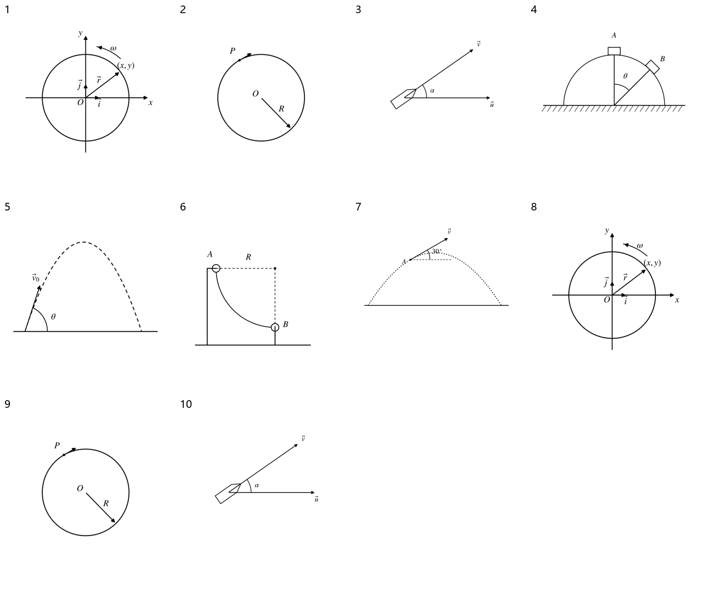

> 派生文件，可重新生成，勿手改。

# 上册逐章题图 · 01 运动学

仅处理上册已确认范围；先尝试原PDF提取，不清楚再重绘。原材料、原图只读保留；只改图片路径，保留原题号、锚点、题面、答案与OCR状态。

本章审查10个图片资产、10处引用。定性图未给出的尺寸/角度/比例不是测量数据。复用图不重复计为独立新图。

生成代码（过程产物未发布） · [映射与逐项核验](../../../../10_%E9%A2%98%E5%BA%93/_assets/%E4%B8%8A%E5%86%8C%E9%80%90%E7%AB%A0/01_%E8%BF%90%E5%8A%A8%E5%AD%A6/mapping.json) · 校验记录（过程产物未发布）

|编号|题号|原图|来源PDF页|处理|核验|
|---|---|---|---|---|---|
|001|习题册-章节02-题5|[56710dc37b0ff2c214115722cf7954059ef7434a15fac4166fccfcf82d86ed6a.jpg](../../../../10_%E9%A2%98%E5%BA%93/_assets/%E4%B9%A0%E9%A2%98%E5%86%8C/56710dc37b0ff2c214115722cf7954059ef7434a15fac4166fccfcf82d86ed6a.jpg)|3|redrawn [01-circle-position.svg](../../../../10_%E9%A2%98%E5%BA%93/_assets/%E4%B8%8A%E5%86%8C%E9%80%90%E7%AB%A0/01_%E8%BF%90%E5%8A%A8%E5%AD%A6/01-circle-position.svg)|原点O、x/y正方向、位置矢量r、(x,y)、单位矢量i/j和逆时针ω；无新增数值角度或刻度。|
|002|习题册-章节02-题6|[8429746b25da038c4de5e8cf5d50972d5b91c6a06469e778364bc51cafb9da2b.jpg](../../../../10_%E9%A2%98%E5%BA%93/_assets/%E4%B9%A0%E9%A2%98%E5%86%8C/8429746b25da038c4de5e8cf5d50972d5b91c6a06469e778364bc51cafb9da2b.jpg)|3|redrawn [02-circle-P.svg](../../../../10_%E9%A2%98%E5%BA%93/_assets/%E4%B8%8A%E5%86%8C%E9%80%90%E7%AB%A0/01_%E8%BF%90%E5%8A%A8%E5%AD%A6/02-circle-P.svg)|圆心O、P点、半径R；P点运动箭头顺时针，沿圆周切向。题给R=2m在题面中保留，图不添加刻度。|
|003|习题册-章节03-题4|[f09c0ad314372fce8fe4e1c4bcc8c1555d98c69aeb5cbfaa3e81fbdf08183d1f.jpg](../../../../10_%E9%A2%98%E5%BA%93/_assets/%E4%B9%A0%E9%A2%98%E5%86%8C/f09c0ad314372fce8fe4e1c4bcc8c1555d98c69aeb5cbfaa3e81fbdf08183d1f.jpg)|4|redrawn [03-boat-relative-velocity.svg](../../../../10_%E9%A2%98%E5%BA%93/_assets/%E4%B8%8A%E5%86%8C%E9%80%90%E7%AB%A0/01_%E8%BF%90%E5%8A%A8%E5%AD%A6/03-boat-relative-velocity.svg)|水流u水平向右，小船相对水速度v右上；α为u/v夹角；未添加合速度或具体角度。|
|004|15-16期中-选5|[79abfe425ca99b1cae69d899487fb5dd701872edb2fa120cd38b48735d3f4dd7.jpg](../../../../10_%E9%A2%98%E5%BA%93/_assets/%E5%8E%86%E5%B9%B4%E8%AF%95%E5%8D%B7%E5%90%88%E9%9B%86_2018-2024/79abfe425ca99b1cae69d899487fb5dd701872edb2fa120cd38b48735d3f4dd7.jpg)|11|redrawn [04-sphere-A-B.svg](../../../../10_%E9%A2%98%E5%BA%93/_assets/%E4%B8%8A%E5%86%8C%E9%80%90%E7%AB%A0/01_%E8%BF%90%E5%8A%A8%E5%AD%A6/04-sphere-A-B.svg)|A在球顶，B在右上球面；θ从竖直半径量起；球面固定。未增添力、速度或角度数值。|
|005|15-16期中-填1|[2d124d394329f06e473c2b71997703968c6cde6c6e3ac77080838cd56cc87ec4.jpg](../../../../10_%E9%A2%98%E5%BA%93/_assets/%E5%8E%86%E5%B9%B4%E8%AF%95%E5%8D%B7%E5%90%88%E9%9B%86_2018-2024/2d124d394329f06e473c2b71997703968c6cde6c6e3ac77080838cd56cc87ec4.jpg)|11|redrawn [05-projectile-launch.svg](../../../../10_%E9%A2%98%E5%BA%93/_assets/%E4%B8%8A%E5%86%8C%E9%80%90%E7%AB%A0/01_%E8%BF%90%E5%8A%A8%E5%AD%A6/05-projectile-launch.svg)|v0沿初始轨道切线向右上；θ相对水平线；题面指定角度基准为水平。原扫描角弧模糊，按原页文字确定；轨迹无定量高度、射程或角度。|
|006|22-23期中-填3|[1f6beba0551ca84c6f494f998d7275823e4c918d6611d91927060e9c6416e7b2.jpg](../../../../10_%E9%A2%98%E5%BA%93/_assets/%E6%9C%9F%E4%B8%AD%E8%AF%95%E5%8D%B7_2020-2025/1f6beba0551ca84c6f494f998d7275823e4c918d6611d91927060e9c6416e7b2.jpg)|10|redrawn [06-quarter-circle-track.svg](../../../../10_%E9%A2%98%E5%BA%93/_assets/%E4%B8%8A%E5%86%8C%E9%80%90%E7%AB%A0/01_%E8%BF%90%E5%8A%A8%E5%AD%A6/06-quarter-circle-track.svg)|A为圆弧左端、B为下端，R连接A与右上圆心；四分之一圆，A切线竖直、B切线水平。|
|007|23-24期中-填1|[820f7209653c871d4193a87bb46fc65bf6f485460855e38c5ced9dbcf6aa51a1.jpg](../../../../10_%E9%A2%98%E5%BA%93/_assets/%E6%9C%9F%E4%B8%AD%E8%AF%95%E5%8D%B7_2020-2025/820f7209653c871d4193a87bb46fc65bf6f485460855e38c5ced9dbcf6aa51a1.jpg)|6|redrawn [07-projectile-tangent-30deg.svg](../../../../10_%E9%A2%98%E5%BA%93/_assets/%E4%B8%8A%E5%86%8C%E9%80%90%E7%AB%A0/01_%E8%BF%90%E5%8A%A8%E5%AD%A6/07-projectile-tangent-30deg.svg)|A在上升支，速度v在A沿切线向右上，与水平30°；脚本约束斜率tan30°，无额外刻度。|
|008|5|[图5.png](../../../../%E5%A4%A7%E5%AD%A6%E7%89%A9%E7%90%86%E4%B9%A0%E9%A2%98%E5%86%8C%EF%BC%88%E4%B8%8A%EF%BC%89/_assets/02_%E4%B9%A0%E9%A2%98%E4%B8%80%20%E8%B4%A8%E7%82%B9%E8%BF%90%E5%8A%A8%E7%9A%84%E6%8F%8F%E8%BF%B0%EF%BC%88%E4%BA%8C%EF%BC%89/%E5%9B%BE5.png)|同一习题册对应题|reuse_redraw [01-circle-position.svg](../../../../10_%E9%A2%98%E5%BA%93/_assets/%E4%B8%8A%E5%86%8C%E9%80%90%E7%AB%A0/01_%E8%BF%90%E5%8A%A8%E5%AD%A6/01-circle-position.svg)|旧整理第02节题5，对照同一原PDF第3页，复用已核验图；保留原220显示宽度。|
|009|6|[图6.png](../../../../%E5%A4%A7%E5%AD%A6%E7%89%A9%E7%90%86%E4%B9%A0%E9%A2%98%E5%86%8C%EF%BC%88%E4%B8%8A%EF%BC%89/_assets/02_%E4%B9%A0%E9%A2%98%E4%B8%80%20%E8%B4%A8%E7%82%B9%E8%BF%90%E5%8A%A8%E7%9A%84%E6%8F%8F%E8%BF%B0%EF%BC%88%E4%BA%8C%EF%BC%89/%E5%9B%BE6.png)|同一习题册对应题|reuse_redraw [02-circle-P.svg](../../../../10_%E9%A2%98%E5%BA%93/_assets/%E4%B8%8A%E5%86%8C%E9%80%90%E7%AB%A0/01_%E8%BF%90%E5%8A%A8%E5%AD%A6/02-circle-P.svg)|旧整理第02节题6，对照同一原PDF第3页，复用已核验图；保留原220显示宽度。|
|010|4|[图4.png](../../../../%E5%A4%A7%E5%AD%A6%E7%89%A9%E7%90%86%E4%B9%A0%E9%A2%98%E5%86%8C%EF%BC%88%E4%B8%8A%EF%BC%89/_assets/03_%E4%B9%A0%E9%A2%98%E4%B8%89%20%E8%B4%A8%E7%82%B9%E8%BF%90%E5%8A%A8%E7%9A%84%E6%8F%8F%E8%BF%B0%EF%BC%88%E4%B8%89%EF%BC%89/%E5%9B%BE4.png)|同一习题册对应题|reuse_redraw [03-boat-relative-velocity.svg](../../../../10_%E9%A2%98%E5%BA%93/_assets/%E4%B8%8A%E5%86%8C%E9%80%90%E7%AB%A0/01_%E8%BF%90%E5%8A%A8%E5%AD%A6/03-boat-relative-velocity.svg)|旧整理第03节题4，对照同一原PDF第4页，复用已核验图；保留原220显示宽度。|

## 来源与引用文档

- 来源PDF（工作区原件）：大学物理习题册（上）.pdf；本章保留逐图原生裁图证据。
- 来源PDF（工作区原件）：大学物理I历年试卷合集_2018-2024.pdf；本章保留逐图原生裁图证据。
- 来源PDF（工作区原件）：大学物理I试卷_2024-2025.pdf；本章保留逐图原生裁图证据。
- [大学物理习题册_02_质点运动描述二_题面整理.md](../../../../10_%E9%A2%98%E5%BA%93/%E4%B9%A0%E9%A2%98%E5%86%8C/%E5%A4%A7%E5%AD%A6%E7%89%A9%E7%90%86%E4%B9%A0%E9%A2%98%E5%86%8C_02_%E8%B4%A8%E7%82%B9%E8%BF%90%E5%8A%A8%E6%8F%8F%E8%BF%B0%E4%BA%8C_%E9%A2%98%E9%9D%A2%E6%95%B4%E7%90%86.md)
- [大学物理习题册_03_质点运动描述三_题面整理.md](../../../../10_%E9%A2%98%E5%BA%93/%E4%B9%A0%E9%A2%98%E5%86%8C/%E5%A4%A7%E5%AD%A6%E7%89%A9%E7%90%86%E4%B9%A0%E9%A2%98%E5%86%8C_03_%E8%B4%A8%E7%82%B9%E8%BF%90%E5%8A%A8%E6%8F%8F%E8%BF%B0%E4%B8%89_%E9%A2%98%E9%9D%A2%E6%95%B4%E7%90%86.md)
- [2015-2016学年大学物理I期中题面整理.md](../../../../10_%E9%A2%98%E5%BA%93/%E5%8E%86%E5%B9%B4%E7%9C%9F%E9%A2%98/%E6%9C%9F%E4%B8%AD/2015-2016%E5%AD%A6%E5%B9%B4%E5%A4%A7%E5%AD%A6%E7%89%A9%E7%90%86I%E6%9C%9F%E4%B8%AD%E9%A2%98%E9%9D%A2%E6%95%B4%E7%90%86.md)
- [2022-2023学年大学物理I期中题面整理.md](../../../../10_%E9%A2%98%E5%BA%93/%E5%8E%86%E5%B9%B4%E7%9C%9F%E9%A2%98/%E6%9C%9F%E4%B8%AD/2022-2023%E5%AD%A6%E5%B9%B4%E5%A4%A7%E5%AD%A6%E7%89%A9%E7%90%86I%E6%9C%9F%E4%B8%AD%E9%A2%98%E9%9D%A2%E6%95%B4%E7%90%86.md)
- [2023-2024学年大学物理I期中题面整理.md](../../../../10_%E9%A2%98%E5%BA%93/%E5%8E%86%E5%B9%B4%E7%9C%9F%E9%A2%98/%E6%9C%9F%E4%B8%AD/2023-2024%E5%AD%A6%E5%B9%B4%E5%A4%A7%E5%AD%A6%E7%89%A9%E7%90%86I%E6%9C%9F%E4%B8%AD%E9%A2%98%E9%9D%A2%E6%95%B4%E7%90%86.md)
- [02_习题一 质点运动的描述（二）.md](../../../../%E5%A4%A7%E5%AD%A6%E7%89%A9%E7%90%86%E4%B9%A0%E9%A2%98%E5%86%8C%EF%BC%88%E4%B8%8A%EF%BC%89/02_%E4%B9%A0%E9%A2%98%E4%B8%80%20%E8%B4%A8%E7%82%B9%E8%BF%90%E5%8A%A8%E7%9A%84%E6%8F%8F%E8%BF%B0%EF%BC%88%E4%BA%8C%EF%BC%89.md)
- [03_习题三 质点运动的描述（三）.md](../../../../%E5%A4%A7%E5%AD%A6%E7%89%A9%E7%90%86%E4%B9%A0%E9%A2%98%E5%86%8C%EF%BC%88%E4%B8%8A%EF%BC%89/03_%E4%B9%A0%E9%A2%98%E4%B8%89%20%E8%B4%A8%E7%82%B9%E8%BF%90%E5%8A%A8%E7%9A%84%E6%8F%8F%E8%BF%B0%EF%BC%88%E4%B8%89%EF%BC%89.md)

## 前后对照

## 缩小黑白阅读

## 核验边界

本章已更新图的几何、方向与标注可确认。未给定的绘图布局参数不作定量读数。原图与PDF保留以便回查。

本次不改转换认证、原题OCR状态或解答；不声称整本旧转换人工验收已补齐。知识笔记若无图片引用，记录为无需替换，不改正文。

## 既有入库绑定问题

本章图片替换检查与S1校验通过；整份旧入库绑定校验存在本章之外的既有输出哈希失配，未擅自刷新这些记录。详见 validation.json 的 intake_verify。这里不宣称旧入库总验收通过。
