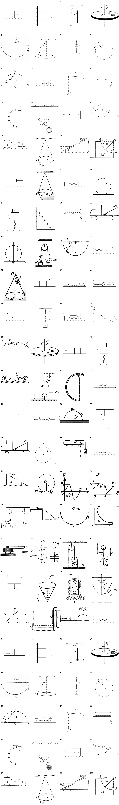

> 派生文件，可重新生成，勿手改。

# 上册逐章题图 · 02 动力学与守恒

仅处理上册已确认范围；先尝试原PDF提取，不清楚再重绘。原材料、原图只读保留；只改图片路径，保留原题号、锚点、题面、答案与OCR状态。

本章审查100个图片资产、100处引用。定性图未给出的尺寸/角度/比例不是测量数据。复用图不重复计为独立新图。

生成代码（过程产物未发布） · [映射与逐项核验](../../../../10_%E9%A2%98%E5%BA%93/_assets/%E4%B8%8A%E5%86%8C%E9%80%90%E7%AB%A0/02_%E5%8A%A8%E5%8A%9B%E5%AD%A6%E4%B8%8E%E5%AE%88%E6%81%92/mapping.json) · 校验记录（过程产物未发布）

|编号|题号|原图|来源PDF页|处理|核验|
|---|---|---|---|---|---|
|001|习题册-章节04-题2|[733927997d1ba7b7dcb5479003008087849253e8d8835b6dc6a1cb9b427ae638.jpg](../../../../10_%E9%A2%98%E5%BA%93/_assets/%E4%B9%A0%E9%A2%98%E5%86%8C/733927997d1ba7b7dcb5479003008087849253e8d8835b6dc6a1cb9b427ae638.jpg)|5|redrawn [001.svg](../../../../10_%E9%A2%98%E5%BA%93/_assets/%E4%B8%8A%E5%86%8C%E9%80%90%E7%AB%A0/02_%E5%8A%A8%E5%8A%9B%E5%AD%A6%E4%B8%8E%E5%AE%88%E6%81%92/001.svg)|两个接触物块m1/m2，两个F均水平向右，地面在下。|
|002|习题册-章节04-题3|[2d75e38d7c4e6bbb321349e4b4ac25a28223bca7d2ca6178207c685a8906cc0e.jpg](../../../../10_%E9%A2%98%E5%BA%93/_assets/%E4%B9%A0%E9%A2%98%E5%86%8C/2d75e38d7c4e6bbb321349e4b4ac25a28223bca7d2ca6178207c685a8906cc0e.jpg)|5|redrawn [002.svg](../../../../10_%E9%A2%98%E5%BA%93/_assets/%E4%B8%8A%E5%86%8C%E9%80%90%E7%AB%A0/02_%E5%8A%A8%E5%8A%9B%E5%AD%A6%E4%B8%8E%E5%AE%88%E6%81%92/002.svg)|A接触竖直墙，F水平向左指向A。|
|003|习题册-章节04-题5|[8b5f925314038ce1416a0441b581890c18159d3ea5b8cf3520bd2af3b7b7c389.jpg](../../../../10_%E9%A2%98%E5%BA%93/_assets/%E4%B9%A0%E9%A2%98%E5%86%8C/8b5f925314038ce1416a0441b581890c18159d3ea5b8cf3520bd2af3b7b7c389.jpg)|5|redrawn [003.svg](../../../../10_%E9%A2%98%E5%BA%93/_assets/%E4%B8%8A%E5%86%8C%E9%80%90%E7%AB%A0/02_%E5%8A%A8%E5%8A%9B%E5%AD%A6%E4%B8%8E%E5%AE%88%E6%81%92/003.svg)|定滑轮m1左挂、m2右挂；a2向下，未增加未知张力。|
|004|习题册-章节05-题1|[c2144120389e042f14cf54ba6f3ef9d83573df635f147e962d81b64c6c8d752d.jpg](../../../../10_%E9%A2%98%E5%BA%93/_assets/%E4%B9%A0%E9%A2%98%E5%86%8C/c2144120389e042f14cf54ba6f3ef9d83573df635f147e962d81b64c6c8d752d.jpg)|6|native_extraction [004-extracted.png](../../../../10_%E9%A2%98%E5%BA%93/_assets/%E4%B8%8A%E5%86%8C%E9%80%90%E7%AB%A0/02_%E5%8A%A8%E5%8A%9B%E5%AD%A6%E4%B8%8E%E5%AE%88%E6%81%92/004-extracted.png)|转盘O、A、R和ω；轴方向与原图一致，无新增量值。 原生像素提取，不放大插值、不改图中信息。|
|005|习题册-章节05-题2|[e541e07de73303f6eb17901e8862df75249532d1e9bf277ecc63f0b74663c104.jpg](../../../../10_%E9%A2%98%E5%BA%93/_assets/%E4%B9%A0%E9%A2%98%E5%86%8C/e541e07de73303f6eb17901e8862df75249532d1e9bf277ecc63f0b74663c104.jpg)|6|native_extraction [005-extracted.png](../../../../10_%E9%A2%98%E5%BA%93/_assets/%E4%B8%8A%E5%86%8C%E9%80%90%E7%AB%A0/02_%E5%8A%A8%E5%8A%9B%E5%AD%A6%E4%B8%8E%E5%AE%88%E6%81%92/005-extracted.png)|轴O、半圆C与P；保持原转动指向，不改手绘角。 原生像素提取，不放大插值、不改图中信息。|
|006|习题册-章节05-题3|[a76ba2300cd1b777355e648b10cc97f54c0055db8b11eb676217687a136cc24d.jpg](../../../../10_%E9%A2%98%E5%BA%93/_assets/%E4%B9%A0%E9%A2%98%E5%86%8C/a76ba2300cd1b777355e648b10cc97f54c0055db8b11eb676217687a136cc24d.jpg)|6|redrawn [006.svg](../../../../10_%E9%A2%98%E5%BA%93/_assets/%E4%B8%8A%E5%86%8C%E9%80%90%E7%AB%A0/02_%E5%8A%A8%E5%8A%9B%E5%AD%A6%E4%B8%8E%E5%AE%88%E6%81%92/006.svg)|锥摆m、l、θ相对竖直，轨迹水平圆的透视椭圆完整。|
|007|习题册-章节05-题4|[cb18360529a994bdfacf6d20b22321b82e015d30665050d41e8dab050f4c271a.jpg](../../../../10_%E9%A2%98%E5%BA%93/_assets/%E4%B9%A0%E9%A2%98%E5%86%8C/cb18360529a994bdfacf6d20b22321b82e015d30665050d41e8dab050f4c271a.jpg)|6|redrawn [007.svg](../../../../10_%E9%A2%98%E5%BA%93/_assets/%E4%B8%8A%E5%86%8C%E9%80%90%E7%AB%A0/02_%E5%8A%A8%E5%8A%9B%E5%AD%A6%E4%B8%8E%E5%AE%88%E6%81%92/007.svg)|O下两弹簧与m1/m2/m3，旁标A/B/C，x向下。|
|008|习题册-章节05-题6|[cd910e0b3abbb2c1380af2b50b5eeacb9f6521cc95aaac58ef5067b054ced38e.jpg](../../../../10_%E9%A2%98%E5%BA%93/_assets/%E4%B9%A0%E9%A2%98%E5%86%8C/cd910e0b3abbb2c1380af2b50b5eeacb9f6521cc95aaac58ef5067b054ced38e.jpg)|6|redrawn [008.svg](../../../../10_%E9%A2%98%E5%BA%93/_assets/%E4%B8%8A%E5%86%8C%E9%80%90%E7%AB%A0/02_%E5%8A%A8%E5%8A%9B%E5%AD%A6%E4%B8%8E%E5%AE%88%E6%81%92/008.svg)|圆周质量m、R与θ从竖直量起，v左下沿切线。|
|009|习题册-章节06-题4|[21651b6494db061b5fb419251671150328b05a8ecf86cb9801d7efb65f50721a.jpg](../../../../10_%E9%A2%98%E5%BA%93/_assets/%E4%B9%A0%E9%A2%98%E5%86%8C/21651b6494db061b5fb419251671150328b05a8ecf86cb9801d7efb65f50721a.jpg)|7|native_extraction [009-extracted.png](../../../../10_%E9%A2%98%E5%BA%93/_assets/%E4%B8%8A%E5%86%8C%E9%80%90%E7%AB%A0/02_%E5%8A%A8%E5%8A%9B%E5%AD%A6%E4%B8%8E%E5%AE%88%E6%81%92/009-extracted.png)|A/O/C在底线、B在顶点，R竖直、弹簧从A至B。 原生像素提取，不放大插值、不改图中信息。|
|010|习题册-章节06-题6|[965c8d6c73c1023086a365aa334e72a7d47ef1e8cd4e389aa275a783f780b116.jpg](../../../../10_%E9%A2%98%E5%BA%93/_assets/%E4%B9%A0%E9%A2%98%E5%86%8C/965c8d6c73c1023086a365aa334e72a7d47ef1e8cd4e389aa275a783f780b116.jpg)|7|redrawn [010.svg](../../../../10_%E9%A2%98%E5%BA%93/_assets/%E4%B8%8A%E5%86%8C%E9%80%90%E7%AB%A0/02_%E5%8A%A8%E5%8A%9B%E5%AD%A6%E4%B8%8E%E5%AE%88%E6%81%92/010.svg)|墙、A/B及m1/m2，k弹簧水平连接，无额外外力。|
|011|习题册-章节07-题4|[289a21d2cd19e4404321f73c77bd8c89fec09a86a31e4373114ae5ed8065f97b.jpg](../../../../10_%E9%A2%98%E5%BA%93/_assets/%E4%B9%A0%E9%A2%98%E5%86%8C/289a21d2cd19e4404321f73c77bd8c89fec09a86a31e4373114ae5ed8065f97b.jpg)|8|redrawn [011.svg](../../../../10_%E9%A2%98%E5%BA%93/_assets/%E4%B8%8A%E5%86%8C%E9%80%90%E7%AB%A0/02_%E5%8A%A8%E5%8A%9B%E5%AD%A6%E4%B8%8E%E5%AE%88%E6%81%92/011.svg)|O为两个弹簧公共端，A右、B下，l0水平、l竖直，k和m保留。|
|012|习题册-章节07-题5|[357ae32c3554409e79ad755321903673a7ecd36124f688ddd3d87ae5dac5fb1b.jpg](../../../../10_%E9%A2%98%E5%BA%93/_assets/%E4%B9%A0%E9%A2%98%E5%86%8C/357ae32c3554409e79ad755321903673a7ecd36124f688ddd3d87ae5dac5fb1b.jpg)|8|redrawn [012.svg](../../../../10_%E9%A2%98%E5%BA%93/_assets/%E4%B8%8A%E5%86%8C%E9%80%90%E7%AB%A0/02_%E5%8A%A8%E5%8A%9B%E5%AD%A6%E4%B8%8E%E5%AE%88%E6%81%92/012.svg)|链条过直角桌边，水平l-a、竖直a；链节数仅为示意。|
|013|习题册-章节07-题6|[81d3c9a442e00df39c13e2d4315cc1156ee604954113027db092fd73d2ca36f2.jpg](../../../../10_%E9%A2%98%E5%BA%93/_assets/%E4%B9%A0%E9%A2%98%E5%86%8C/81d3c9a442e00df39c13e2d4315cc1156ee604954113027db092fd73d2ca36f2.jpg)|8|redrawn [013.svg](../../../../10_%E9%A2%98%E5%BA%93/_assets/%E4%B8%8A%E5%86%8C%E9%80%90%E7%AB%A0/02_%E5%8A%A8%E5%8A%9B%E5%AD%A6%E4%B8%8E%E5%AE%88%E6%81%92/013.svg)|半圆槽开口向右，m在上口外，v0向左。|
|014|习题册-章节08-题1|[f11354077970a8eb93f27e2260fec9f5bdf0745d4970c09e29979e1861909cf6.jpg](../../../../10_%E9%A2%98%E5%BA%93/_assets/%E4%B9%A0%E9%A2%98%E5%86%8C/f11354077970a8eb93f27e2260fec9f5bdf0745d4970c09e29979e1861909cf6.jpg)|9|native_extraction [014-extracted.png](../../../../10_%E9%A2%98%E5%BA%93/_assets/%E4%B8%8A%E5%86%8C%E9%80%90%E7%AB%A0/02_%E5%8A%A8%E5%8A%9B%E5%AD%A6%E4%B8%8E%E5%AE%88%E6%81%92/014-extracted.png)|绳竖直、入射v0与绳夹角30°；保留原箭头和点体。 原生像素提取，不放大插值、不改图中信息。|
|015|习题册-章节08-题4|[d2fb8de51b5b8a062bbc8cdddd489aae5baa9bcb43c6d2b181be29274672ddf1.jpg](../../../../10_%E9%A2%98%E5%BA%93/_assets/%E4%B9%A0%E9%A2%98%E5%86%8C/d2fb8de51b5b8a062bbc8cdddd489aae5baa9bcb43c6d2b181be29274672ddf1.jpg)|9|redrawn [015.svg](../../../../10_%E9%A2%98%E5%BA%93/_assets/%E4%B8%8A%E5%86%8C%E9%80%90%E7%AB%A0/02_%E5%8A%A8%E5%8A%9B%E5%AD%A6%E4%B8%8E%E5%AE%88%E6%81%92/015.svg)|子弹向右先穿A后B，A/B贴合、地面保留。|
|016|习题册-章节08-题5|[980fe81280184bef31c19b2422b62d7a9b96324864ec546d40d48cd19b38a2f6.jpg](../../../../10_%E9%A2%98%E5%BA%93/_assets/%E4%B9%A0%E9%A2%98%E5%86%8C/980fe81280184bef31c19b2422b62d7a9b96324864ec546d40d48cd19b38a2f6.jpg)|9|native_extraction [016-extracted.png](../../../../10_%E9%A2%98%E5%BA%93/_assets/%E4%B8%8A%E5%86%8C%E9%80%90%E7%AB%A0/02_%E5%8A%A8%E5%8A%9B%E5%AD%A6%E4%B8%8E%E5%AE%88%E6%81%92/016-extracted.png)|x/y轴与O、A在横轴、B在曲线上；vA右上、vB向左。 原生像素提取，不放大插值、不改图中信息。|
|017|习题册-章节08-题6|[08bec4702a2377a9388bd572db909496150151fafa315d5d4c61e9f8307d4317.jpg](../../../../10_%E9%A2%98%E5%BA%93/_assets/%E4%B9%A0%E9%A2%98%E5%86%8C/08bec4702a2377a9388bd572db909496150151fafa315d5d4c61e9f8307d4317.jpg)|9|native_extraction [017-extracted.png](../../../../10_%E9%A2%98%E5%BA%93/_assets/%E4%B8%8A%E5%86%8C%E9%80%90%E7%AB%A0/02_%E5%8A%A8%E5%8A%9B%E5%AD%A6%E4%B8%8E%E5%AE%88%E6%81%92/017-extracted.png)|小车M、A点、L水平尺度、v0向右；后位置虚线保留。 原生像素提取，不放大插值、不改图中信息。|
|018|习题册-章节09-题2|[29bf4f5c12f270a4d48b04a93346a70051fb9917844cdf38ea14d6274dc90e55.jpg](../../../../10_%E9%A2%98%E5%BA%93/_assets/%E4%B9%A0%E9%A2%98%E5%86%8C/29bf4f5c12f270a4d48b04a93346a70051fb9917844cdf38ea14d6274dc90e55.jpg)|10|native_extraction [018-extracted.png](../../../../10_%E9%A2%98%E5%BA%93/_assets/%E4%B8%8A%E5%86%8C%E9%80%90%E7%AB%A0/02_%E5%8A%A8%E5%8A%9B%E5%AD%A6%E4%B8%8E%E5%AE%88%E6%81%92/018-extracted.png)|锥摆上支点、圆轨迹R、质量m和v切向。 原生像素提取，不放大插值、不改图中信息。|
|019|习题册-章节09-题5|[a5040d6c0973043c2c2e40d965febf5f7be59a74852d0d7c8400bdaba1ae7994.jpg](../../../../10_%E9%A2%98%E5%BA%93/_assets/%E4%B9%A0%E9%A2%98%E5%86%8C/a5040d6c0973043c2c2e40d965febf5f7be59a74852d0d7c8400bdaba1ae7994.jpg)|10|native_extraction [019-extracted.png](../../../../10_%E9%A2%98%E5%BA%93/_assets/%E4%B8%8A%E5%86%8C%E9%80%90%E7%AB%A0/02_%E5%8A%A8%E5%8A%9B%E5%AD%A6%E4%B8%8E%E5%AE%88%E6%81%92/019-extracted.png)|斜面θ、m入射v向右、杆长l、A/B及M保留。 原生像素提取，不放大插值、不改图中信息。|
|020|习题册-章节09-题6|[49f15f6bab03293c95c31ecf7e9bf68f220f68d96b605b27f6656635efe08be7.jpg](../../../../10_%E9%A2%98%E5%BA%93/_assets/%E4%B9%A0%E9%A2%98%E5%86%8C/49f15f6bab03293c95c31ecf7e9bf68f220f68d96b605b27f6656635efe08be7.jpg)|10|native_extraction [020-extracted.png](../../../../10_%E9%A2%98%E5%BA%93/_assets/%E4%B8%8A%E5%86%8C%E9%80%90%E7%AB%A0/02_%E5%8A%A8%E5%8A%9B%E5%AD%A6%E4%B8%8E%E5%AE%88%E6%81%92/020-extracted.png)|四分之一圆弧A/B、圆心O、半径R和底座M保留。 原生像素提取，不放大插值、不改图中信息。|
|021|11-12期中-选2|[d28b977eba75443ea54756aafe62bdbdb8785c5fe396c7e7fc3e0112ecf5832b.jpg](../../../../10_%E9%A2%98%E5%BA%93/_assets/%E5%8E%86%E5%B9%B4%E8%AF%95%E5%8D%B7%E5%90%88%E9%9B%86_2018-2024/d28b977eba75443ea54756aafe62bdbdb8785c5fe396c7e7fc3e0112ecf5832b.jpg)|15|redrawn [021.svg](../../../../10_%E9%A2%98%E5%BA%93/_assets/%E4%B8%8A%E5%86%8C%E9%80%90%E7%AB%A0/02_%E5%8A%A8%E5%8A%9B%E5%AD%A6%E4%B8%8E%E5%AE%88%E6%81%92/021.svg)|A叠在B上，F对A向右，B在地面上。|
|022|11-12期中-选4|[43c5e0f6754d4e710cd0be23c5a8bcad772449d63c14b4ed416149cad7eb2471.jpg](../../../../10_%E9%A2%98%E5%BA%93/_assets/%E5%8E%86%E5%B9%B4%E8%AF%95%E5%8D%B7%E5%90%88%E9%9B%86_2018-2024/43c5e0f6754d4e710cd0be23c5a8bcad772449d63c14b4ed416149cad7eb2471.jpg)|15|native_extraction [022-extracted.png](../../../../10_%E9%A2%98%E5%BA%93/_assets/%E4%B8%8A%E5%86%8C%E9%80%90%E7%AB%A0/02_%E5%8A%A8%E5%8A%9B%E5%AD%A6%E4%B8%8E%E5%AE%88%E6%81%92/022-extracted.png)|悬线与圆轨迹R、m和切向v，原生裁图文字可辨。 原生像素提取，不放大插值、不改图中信息。|
|023|11-12期中-选5|[890763f5f81fab026ea0849dcc0a124a1fb8c2b4a0f7fc9e6b1ed367fe1e7f09.jpg](../../../../10_%E9%A2%98%E5%BA%93/_assets/%E5%8E%86%E5%B9%B4%E8%AF%95%E5%8D%B7%E5%90%88%E9%9B%86_2018-2024/890763f5f81fab026ea0849dcc0a124a1fb8c2b4a0f7fc9e6b1ed367fe1e7f09.jpg)|15|redrawn [023.svg](../../../../10_%E9%A2%98%E5%BA%93/_assets/%E4%B8%8A%E5%86%8C%E9%80%90%E7%AB%A0/02_%E5%8A%A8%E5%8A%9B%E5%AD%A6%E4%B8%8E%E5%AE%88%E6%81%92/023.svg)|mA/mB间弹簧，地面水平，不添加外力。|
|024|11-12期中-选6|[92617a30b73658efd7ce6f07541e796d76573e2ae380e14f10751b45ca4e30bf.jpg](../../../../10_%E9%A2%98%E5%BA%93/_assets/%E5%8E%86%E5%B9%B4%E8%AF%95%E5%8D%B7%E5%90%88%E9%9B%86_2018-2024/92617a30b73658efd7ce6f07541e796d76573e2ae380e14f10751b45ca4e30bf.jpg)|15|redrawn [024.svg](../../../../10_%E9%A2%98%E5%BA%93/_assets/%E4%B8%8A%E5%86%8C%E9%80%90%E7%AB%A0/02_%E5%8A%A8%E5%8A%9B%E5%AD%A6%E4%B8%8E%E5%AE%88%E6%81%92/024.svg)|圆与x轴在O相切、y轴过圆心、R向右上。|
|025|11-12期中-选9|[80a1e8eb61816425d238beb4c80c47fbedf6923c9534363f4c9a03e144fd95c5.jpg](../../../../10_%E9%A2%98%E5%BA%93/_assets/%E5%8E%86%E5%B9%B4%E8%AF%95%E5%8D%B7%E5%90%88%E9%9B%86_2018-2024/80a1e8eb61816425d238beb4c80c47fbedf6923c9534363f4c9a03e144fd95c5.jpg)|15|redrawn [025.svg](../../../../10_%E9%A2%98%E5%BA%93/_assets/%E4%B8%8A%E5%86%8C%E9%80%90%E7%AB%A0/02_%E5%8A%A8%E5%8A%9B%E5%AD%A6%E4%B8%8E%E5%AE%88%E6%81%92/025.svg)|m在弹簧上方，高差h端点在物块底面与弹簧顶端。|
|026|11-12期中-选11|[ba3c2064faf99181eafef1071df9a03b23e251c0277038cf8abf632f082f89fb.jpg](../../../../10_%E9%A2%98%E5%BA%93/_assets/%E5%8E%86%E5%B9%B4%E8%AF%95%E5%8D%B7%E5%90%88%E9%9B%86_2018-2024/ba3c2064faf99181eafef1071df9a03b23e251c0277038cf8abf632f082f89fb.jpg)|16|retained_annotation|扫描图含手写受力标注，避免把手写答案混入重绘题设，保留原图。|
|027|11-12期中-选17|[926c17b9797620569a288a6be552a2fbb69343904de22c08f3384cc3616d131d.jpg](../../../../10_%E9%A2%98%E5%BA%93/_assets/%E5%8E%86%E5%B9%B4%E8%AF%95%E5%8D%B7%E5%90%88%E9%9B%86_2018-2024/926c17b9797620569a288a6be552a2fbb69343904de22c08f3384cc3616d131d.jpg)|16|redrawn [027.svg](../../../../10_%E9%A2%98%E5%BA%93/_assets/%E4%B8%8A%E5%86%8C%E9%80%90%E7%AB%A0/02_%E5%8A%A8%E5%8A%9B%E5%AD%A6%E4%B8%8E%E5%AE%88%E6%81%92/027.svg)|A为墙端、B为地端，θ相对竖直墙，不相对地面。|
|028|11-12期中-计1|[06dfe4348e42610eac412eb44b6cd7155c85fca84d754350c22be71f33826739.jpg](../../../../10_%E9%A2%98%E5%BA%93/_assets/%E5%8E%86%E5%B9%B4%E8%AF%95%E5%8D%B7%E5%90%88%E9%9B%86_2018-2024/06dfe4348e42610eac412eb44b6cd7155c85fca84d754350c22be71f33826739.jpg)|17|redrawn [028.svg](../../../../10_%E9%A2%98%E5%BA%93/_assets/%E4%B8%8A%E5%86%8C%E9%80%90%E7%AB%A0/02_%E5%8A%A8%E5%8A%9B%E5%AD%A6%E4%B8%8E%E5%AE%88%E6%81%92/028.svg)|链条水平l-a、竖直a，几何关系不变。|
|029|15-16期中-选2|[0cab9616f3ce2204d15e3227c4472ae718f2b1d8d142cd4270ceb8be378c5a06.jpg](../../../../10_%E9%A2%98%E5%BA%93/_assets/%E5%8E%86%E5%B9%B4%E8%AF%95%E5%8D%B7%E5%90%88%E9%9B%86_2018-2024/0cab9616f3ce2204d15e3227c4472ae718f2b1d8d142cd4270ceb8be378c5a06.jpg)|11|native_extraction [029-extracted.png](../../../../10_%E9%A2%98%E5%BA%93/_assets/%E4%B8%8A%E5%86%8C%E9%80%90%E7%AB%A0/02_%E5%8A%A8%E5%8A%9B%E5%AD%A6%E4%B8%8E%E5%AE%88%E6%81%92/029-extracted.png)|卡车斜面、m与θ，原题未给具体角度。 原生像素提取，不放大插值、不改图中信息。|
|030|15-16期中-选3|[59e279c560ce070a7ec1923f58f53c5ad57a2ebe8a0f4c9475da8b863504b9b6.jpg](../../../../10_%E9%A2%98%E5%BA%93/_assets/%E5%8E%86%E5%B9%B4%E8%AF%95%E5%8D%B7%E5%90%88%E9%9B%86_2018-2024/59e279c560ce070a7ec1923f58f53c5ad57a2ebe8a0f4c9475da8b863504b9b6.jpg)|11|redrawn [030.svg](../../../../10_%E9%A2%98%E5%BA%93/_assets/%E4%B8%8A%E5%86%8C%E9%80%90%E7%AB%A0/02_%E5%8A%A8%E5%8A%9B%E5%AD%A6%E4%B8%8E%E5%AE%88%E6%81%92/030.svg)|圆在O与x轴相切，y轴过圆心，R保持。|
|031|15-16期中-选4|[42bac148952364bbefe3676997209f3ec90d3b5bea72185d8660786a467b0188.jpg](../../../../10_%E9%A2%98%E5%BA%93/_assets/%E5%8E%86%E5%B9%B4%E8%AF%95%E5%8D%B7%E5%90%88%E9%9B%86_2018-2024/42bac148952364bbefe3676997209f3ec90d3b5bea72185d8660786a467b0188.jpg)|11|native_extraction [031-extracted.png](../../../../10_%E9%A2%98%E5%BA%93/_assets/%E4%B8%8A%E5%86%8C%E9%80%90%E7%AB%A0/02_%E5%8A%A8%E5%8A%9B%E5%AD%A6%E4%B8%8E%E5%AE%88%E6%81%92/031-extracted.png)|定滑轮、弹簧与M、绳端F向下、20cm尺寸保留。 原生像素提取，不放大插值、不改图中信息。|
|032|15-16期中-选6|[ff56aae141a4111bcb401f84ba8439fb274497eb1f2cf7af496d8037adb3eb28.jpg](../../../../10_%E9%A2%98%E5%BA%93/_assets/%E5%8E%86%E5%B9%B4%E8%AF%95%E5%8D%B7%E5%90%88%E9%9B%86_2018-2024/ff56aae141a4111bcb401f84ba8439fb274497eb1f2cf7af496d8037adb3eb28.jpg)|11|native_extraction [032-extracted.png](../../../../10_%E9%A2%98%E5%BA%93/_assets/%E4%B8%8A%E5%86%8C%E9%80%90%E7%AB%A0/02_%E5%8A%A8%E5%8A%9B%E5%AD%A6%E4%B8%8E%E5%AE%88%E6%81%92/032-extracted.png)|半圆弧A/C/O，半径R和θ基准为左水平线。 原生像素提取，不放大插值、不改图中信息。|
|033|15-16期中-填4|[9e58a8e54fc9e8ec2d052a78452dc771c8cc366d7429df60536e3b6d489b8872.jpg](../../../../10_%E9%A2%98%E5%BA%93/_assets/%E5%8E%86%E5%B9%B4%E8%AF%95%E5%8D%B7%E5%90%88%E9%9B%86_2018-2024/9e58a8e54fc9e8ec2d052a78452dc771c8cc366d7429df60536e3b6d489b8872.jpg)|12|redrawn [033.svg](../../../../10_%E9%A2%98%E5%BA%93/_assets/%E4%B8%8A%E5%86%8C%E9%80%90%E7%AB%A0/02_%E5%8A%A8%E5%8A%9B%E5%AD%A6%E4%B8%8E%E5%AE%88%E6%81%92/033.svg)|墙-弹簧k-物块m，F及x正向右，O在物块下。|
|034|15-16期中-问1|[8f9f5bc7d6a86ad6bae05668bc1d2af7e8b4998347b6d1b89fec1b9bfe0e545c.jpg](../../../../10_%E9%A2%98%E5%BA%93/_assets/%E5%8E%86%E5%B9%B4%E8%AF%95%E5%8D%B7%E5%90%88%E9%9B%86_2018-2024/8f9f5bc7d6a86ad6bae05668bc1d2af7e8b4998347b6d1b89fec1b9bfe0e545c.jpg)|12|native_extraction [034-extracted.png](../../../../10_%E9%A2%98%E5%BA%93/_assets/%E4%B8%8A%E5%86%8C%E9%80%90%E7%AB%A0/02_%E5%8A%A8%E5%8A%9B%E5%AD%A6%E4%B8%8E%E5%AE%88%E6%81%92/034-extracted.png)|圆锥O/H、l及θ相对竖直方向，不改旋转轴。 原生像素提取，不放大插值、不改图中信息。|
|035|16-17期中-选3|[3c14cdef2edef4a306bd53b550b393db0c67015c559327f80e80c7095386f908.jpg](../../../../10_%E9%A2%98%E5%BA%93/_assets/%E5%8E%86%E5%B9%B4%E8%AF%95%E5%8D%B7%E5%90%88%E9%9B%86_2018-2024/3c14cdef2edef4a306bd53b550b393db0c67015c559327f80e80c7095386f908.jpg)|6|redrawn [035.svg](../../../../10_%E9%A2%98%E5%BA%93/_assets/%E4%B8%8A%E5%86%8C%E9%80%90%E7%AB%A0/02_%E5%8A%A8%E5%8A%9B%E5%AD%A6%E4%B8%8E%E5%AE%88%E6%81%92/035.svg)|F作用在A右上角，θ相对向右水平基准。|
|036|16-17期中-选5|[7a232b7f9fb230d67bbd0350d8db07617580685717f09a4750bb0c37745fdfc8.jpg](../../../../10_%E9%A2%98%E5%BA%93/_assets/%E5%8E%86%E5%B9%B4%E8%AF%95%E5%8D%B7%E5%90%88%E9%9B%86_2018-2024/7a232b7f9fb230d67bbd0350d8db07617580685717f09a4750bb0c37745fdfc8.jpg)|6|redrawn [036.svg](../../../../10_%E9%A2%98%E5%BA%93/_assets/%E4%B8%8A%E5%86%8C%E9%80%90%E7%AB%A0/02_%E5%8A%A8%E5%8A%9B%E5%AD%A6%E4%B8%8E%E5%AE%88%E6%81%92/036.svg)|m1/m2由弹簧相连，左右F均向外。|
|037|16-17期中-选6|[0a565e13554592d5fb530a0b94c95e8119dab474677df5d5e4b9077d0e9e7ca2.jpg](../../../../10_%E9%A2%98%E5%BA%93/_assets/%E5%8E%86%E5%B9%B4%E8%AF%95%E5%8D%B7%E5%90%88%E9%9B%86_2018-2024/0a565e13554592d5fb530a0b94c95e8119dab474677df5d5e4b9077d0e9e7ca2.jpg)|6|redrawn [037.svg](../../../../10_%E9%A2%98%E5%BA%93/_assets/%E4%B8%8A%E5%86%8C%E9%80%90%E7%AB%A0/02_%E5%8A%A8%E5%8A%9B%E5%AD%A6%E4%B8%8E%E5%AE%88%E6%81%92/037.svg)|墙与弹簧连接M，小质量m自右向左以v入射。|
|038|16-17期中-计1|[80d4086cdf4d8027646f779e4126a44897d92856ecfd1485e6d7ba7e5319c9a0.jpg](../../../../10_%E9%A2%98%E5%BA%93/_assets/%E5%8E%86%E5%B9%B4%E8%AF%95%E5%8D%B7%E5%90%88%E9%9B%86_2018-2024/80d4086cdf4d8027646f779e4126a44897d92856ecfd1485e6d7ba7e5319c9a0.jpg)|7|redrawn [038.svg](../../../../10_%E9%A2%98%E5%BA%93/_assets/%E4%B8%8A%E5%86%8C%E9%80%90%E7%AB%A0/02_%E5%8A%A8%E5%8A%9B%E5%AD%A6%E4%B8%8E%E5%AE%88%E6%81%92/038.svg)|F自左上向右下压A，A/B接触；给定36.9°相对水平基准。|
|039|18-19期中-选2|[bb6f9e94d5611c2067862350096063a62547bab764c861ed3e8f3e3938912a0d.jpg](../../../../10_%E9%A2%98%E5%BA%93/_assets/%E5%8E%86%E5%B9%B4%E8%AF%95%E5%8D%B7%E5%90%88%E9%9B%86_2018-2024/bb6f9e94d5611c2067862350096063a62547bab764c861ed3e8f3e3938912a0d.jpg)|1|redrawn [039.svg](../../../../10_%E9%A2%98%E5%BA%93/_assets/%E4%B8%8A%E5%86%8C%E9%80%90%E7%AB%A0/02_%E5%8A%A8%E5%8A%9B%E5%AD%A6%E4%B8%8E%E5%AE%88%E6%81%92/039.svg)|A/B对应两段弹簧，刚度kA/kB，m在底部。|
|040|18-19期中-多选1|[7bbbc0f5b2c3a90ddd9a1a7ef6ccb4a6d0b821e611205051fc105e819b31304e.jpg](../../../../10_%E9%A2%98%E5%BA%93/_assets/%E5%8E%86%E5%B9%B4%E8%AF%95%E5%8D%B7%E5%90%88%E9%9B%86_2018-2024/7bbbc0f5b2c3a90ddd9a1a7ef6ccb4a6d0b821e611205051fc105e819b31304e.jpg)|1|redrawn [040.svg](../../../../10_%E9%A2%98%E5%BA%93/_assets/%E4%B8%8A%E5%86%8C%E9%80%90%E7%AB%A0/02_%E5%8A%A8%E5%8A%9B%E5%AD%A6%E4%B8%8E%E5%AE%88%E6%81%92/040.svg)|左壁A/m1、右B/m2，弹簧和上方约束绳均保留，无多余字母。|
|041|18-19期中-填3|[56fafdb0a88583d9d25a0096ddd5e7d0cd3d0daf60aabf9236eee67eb4c62508.jpg](../../../../10_%E9%A2%98%E5%BA%93/_assets/%E5%8E%86%E5%B9%B4%E8%AF%95%E5%8D%B7%E5%90%88%E9%9B%86_2018-2024/56fafdb0a88583d9d25a0096ddd5e7d0cd3d0daf60aabf9236eee67eb4c62508.jpg)|2|redrawn [041.svg](../../../../10_%E9%A2%98%E5%BA%93/_assets/%E4%B8%8A%E5%86%8C%E9%80%90%E7%AB%A0/02_%E5%8A%A8%E5%8A%9B%E5%AD%A6%E4%B8%8E%E5%AE%88%E6%81%92/041.svg)|定量折线F(0)=10N、F(10s)=0、F(20s)=-5N；轴F/N、t/s，虚线投影保留。|
|042|18-19期中-证1|[d0f033d31cd427636da35164e1444abc690b29095a65b965d7e7f407263c1489.jpg](../../../../10_%E9%A2%98%E5%BA%93/_assets/%E5%8E%86%E5%B9%B4%E8%AF%95%E5%8D%B7%E5%90%88%E9%9B%86_2018-2024/d0f033d31cd427636da35164e1444abc690b29095a65b965d7e7f407263c1489.jpg)|5|native_extraction [042-extracted.png](../../../../10_%E9%A2%98%E5%BA%93/_assets/%E4%B8%8A%E5%86%8C%E9%80%90%E7%AB%A0/02_%E5%8A%A8%E5%8A%9B%E5%AD%A6%E4%B8%8E%E5%AE%88%E6%81%92/042-extracted.png)|绳段a到b、va/vb、ds与f和α保留；不把任意曲线改成定量函数。 原生像素提取，不放大插值、不改图中信息。|
|043|20-21期中-选2|[7b9d11a45e471cf2792ac9f84fbcfe02511f3f8ecaa7e4ec827b2b9f49ee8c00.jpg](../../../../10_%E9%A2%98%E5%BA%93/_assets/%E6%9C%9F%E4%B8%AD%E8%AF%95%E5%8D%B7_2020-2025/7b9d11a45e471cf2792ac9f84fbcfe02511f3f8ecaa7e4ec827b2b9f49ee8c00.jpg)|13|native_extraction [043-extracted.png](../../../../10_%E9%A2%98%E5%BA%93/_assets/%E4%B8%8A%E5%86%8C%E9%80%90%E7%AB%A0/02_%E5%8A%A8%E5%8A%9B%E5%AD%A6%E4%B8%8E%E5%AE%88%E6%81%92/043-extracted.png)|转盘O、A、R及ω；不新增转向箭头。 原生像素提取，不放大插值、不改图中信息。|
|044|20-21期中-选3|[3bd4f29d8c2f37dda51156095b57dd66d9409a92d0b79eef048e57a918ce4839.jpg](../../../../10_%E9%A2%98%E5%BA%93/_assets/%E6%9C%9F%E4%B8%AD%E8%AF%95%E5%8D%B7_2020-2025/3bd4f29d8c2f37dda51156095b57dd66d9409a92d0b79eef048e57a918ce4839.jpg)|13|redrawn [044.svg](../../../../10_%E9%A2%98%E5%BA%93/_assets/%E4%B8%8A%E5%86%8C%E9%80%90%E7%AB%A0/02_%E5%8A%A8%E5%8A%9B%E5%AD%A6%E4%B8%8E%E5%AE%88%E6%81%92/044.svg)|子弹v向右指向固定画面中的物块，水平地面保留。|
|045|20-21期中-选4|[1b342101c7dc7a6767f7ac2bfcae6a13398b67215f3989d544d5caf5fa986b4b.jpg](../../../../10_%E9%A2%98%E5%BA%93/_assets/%E6%9C%9F%E4%B8%AD%E8%AF%95%E5%8D%B7_2020-2025/1b342101c7dc7a6767f7ac2bfcae6a13398b67215f3989d544d5caf5fa986b4b.jpg)|13|redrawn [045.svg](../../../../10_%E9%A2%98%E5%BA%93/_assets/%E4%B8%8A%E5%86%8C%E9%80%90%E7%AB%A0/02_%E5%8A%A8%E5%8A%9B%E5%AD%A6%E4%B8%8E%E5%AE%88%E6%81%92/045.svg)|物块m在弹簧上方，h为间隔，不补初速度。|
|046|20-21期中-选5|[784e6b04be0edb9085f44082736f9a226144f538091431443fd7b464ac474eb5.jpg](../../../../10_%E9%A2%98%E5%BA%93/_assets/%E6%9C%9F%E4%B8%AD%E8%AF%95%E5%8D%B7_2020-2025/784e6b04be0edb9085f44082736f9a226144f538091431443fd7b464ac474eb5.jpg)|13|native_extraction [046-extracted.png](../../../../10_%E9%A2%98%E5%BA%93/_assets/%E4%B8%8A%E5%86%8C%E9%80%90%E7%AB%A0/02_%E5%8A%A8%E5%8A%9B%E5%AD%A6%E4%B8%8E%E5%AE%88%E6%81%92/046-extracted.png)|P向右碰撞M/Q弹簧系统；各标号与原图一致。 原生像素提取，不放大插值、不改图中信息。|
|047|20-21期中-计3|[400ed2aa5ae221602b9d99ea35d0c027c7a6123cded6358e00a4ea41ec9dc035.jpg](../../../../10_%E9%A2%98%E5%BA%93/_assets/%E6%9C%9F%E4%B8%AD%E8%AF%95%E5%8D%B7_2020-2025/400ed2aa5ae221602b9d99ea35d0c027c7a6123cded6358e00a4ea41ec9dc035.jpg)|15|native_extraction [047-extracted.png](../../../../10_%E9%A2%98%E5%BA%93/_assets/%E4%B8%8A%E5%86%8C%E9%80%90%E7%AB%A0/02_%E5%8A%A8%E5%8A%9B%E5%AD%A6%E4%B8%8E%E5%AE%88%E6%81%92/047-extracted.png)|双滑轮绳路、m1/m2，T上、F左；按源图保留连接。 原生像素提取，不放大插值、不改图中信息。|
|048|20-21期中-证1|[76e73124721317da1ddde12121ec9c76ad37372eedbef5ff1cacf082c501864c.jpg](../../../../10_%E9%A2%98%E5%BA%93/_assets/%E6%9C%9F%E4%B8%AD%E8%AF%95%E5%8D%B7_2020-2025/76e73124721317da1ddde12121ec9c76ad37372eedbef5ff1cacf082c501864c.jpg)|16|native_extraction [048-extracted.png](../../../../10_%E9%A2%98%E5%BA%93/_assets/%E4%B8%8A%E5%86%8C%E9%80%90%E7%AB%A0/02_%E5%8A%A8%E5%8A%9B%E5%AD%A6%E4%B8%8E%E5%AE%88%E6%81%92/048-extracted.png)|m与v0向左入射半圆槽；原生裁图可辨，不补数值半径。 原生像素提取，不放大插值、不改图中信息。|
|049|22-23期中-选2|[24736d590520311d5125286c3c8769818d5bc55a05138c4ebe7d768c62425bef.jpg](../../../../10_%E9%A2%98%E5%BA%93/_assets/%E6%9C%9F%E4%B8%AD%E8%AF%95%E5%8D%B7_2020-2025/24736d590520311d5125286c3c8769818d5bc55a05138c4ebe7d768c62425bef.jpg)|9|redrawn [049.svg](../../../../10_%E9%A2%98%E5%BA%93/_assets/%E4%B8%8A%E5%86%8C%E9%80%90%E7%AB%A0/02_%E5%8A%A8%E5%8A%9B%E5%AD%A6%E4%B8%8E%E5%AE%88%E6%81%92/049.svg)|B左A右、弹簧连接，F向右施于A，x正向右。|
|050|22-23期中-选6|[396ad64c9cc0e6d1a9188759a933bcb7a6b0ad44dd6081028d326607cf33a922.jpg](../../../../10_%E9%A2%98%E5%BA%93/_assets/%E6%9C%9F%E4%B8%AD%E8%AF%95%E5%8D%B7_2020-2025/396ad64c9cc0e6d1a9188759a933bcb7a6b0ad44dd6081028d326607cf33a922.jpg)|9|redrawn [050.svg](../../../../10_%E9%A2%98%E5%BA%93/_assets/%E4%B8%8A%E5%86%8C%E9%80%90%E7%AB%A0/02_%E5%8A%A8%E5%8A%9B%E5%AD%A6%E4%B8%8E%E5%AE%88%E6%81%92/050.svg)|A上F右上，θ相对水平；不添加角度数值。|
|051|22-23期中-选8|[cc1f43c14fc66ec3a8e0d8b66640ab9080f5003d5a7901ff7a56b3b7ecee2891.jpg](../../../../10_%E9%A2%98%E5%BA%93/_assets/%E6%9C%9F%E4%B8%AD%E8%AF%95%E5%8D%B7_2020-2025/cc1f43c14fc66ec3a8e0d8b66640ab9080f5003d5a7901ff7a56b3b7ecee2891.jpg)|9|redrawn [051.svg](../../../../10_%E9%A2%98%E5%BA%93/_assets/%E4%B8%8A%E5%86%8C%E9%80%90%E7%AB%A0/02_%E5%8A%A8%E5%8A%9B%E5%AD%A6%E4%B8%8E%E5%AE%88%E6%81%92/051.svg)|两个球m1/m2、弹簧连接、两个F方向向外。|
|052|22-23期中-填1|[ec260f2550a94d973f699bb6956304d96dc57f5ba0027227b86c1b25f504c6c0.jpg](../../../../10_%E9%A2%98%E5%BA%93/_assets/%E6%9C%9F%E4%B8%AD%E8%AF%95%E5%8D%B7_2020-2025/ec260f2550a94d973f699bb6956304d96dc57f5ba0027227b86c1b25f504c6c0.jpg)|10|native_extraction [052-extracted.png](../../../../10_%E9%A2%98%E5%BA%93/_assets/%E4%B8%8A%E5%86%8C%E9%80%90%E7%AB%A0/02_%E5%8A%A8%E5%8A%9B%E5%AD%A6%E4%B8%8E%E5%AE%88%E6%81%92/052-extracted.png)|球面A顶点、B右上，θ相对竖直；保留本题原有比例。 原生像素提取，不放大插值、不改图中信息。|
|053|22-23期中-问2|[74dc1a4c5cfabe660f93a2d6b5dbd56dcb563ba726b7a90f315733150c30e60e.jpg](../../../../10_%E9%A2%98%E5%BA%93/_assets/%E6%9C%9F%E4%B8%AD%E8%AF%95%E5%8D%B7_2020-2025/74dc1a4c5cfabe660f93a2d6b5dbd56dcb563ba726b7a90f315733150c30e60e.jpg)|12|redrawn [053.svg](../../../../10_%E9%A2%98%E5%BA%93/_assets/%E4%B8%8A%E5%86%8C%E9%80%90%E7%AB%A0/02_%E5%8A%A8%E5%8A%9B%E5%AD%A6%E4%B8%8E%E5%AE%88%E6%81%92/053.svg)|定滑轮左右挂A/B，绳路不交叉，无额外运动箭头。|
|054|23-24期中-选4|[10c9fd05a2c763599c6e5a6c26b7ead0260917cd312e8bd707663174e12a6a00.jpg](../../../../10_%E9%A2%98%E5%BA%93/_assets/%E6%9C%9F%E4%B8%AD%E8%AF%95%E5%8D%B7_2020-2025/10c9fd05a2c763599c6e5a6c26b7ead0260917cd312e8bd707663174e12a6a00.jpg)|5|native_extraction [054-extracted.png](../../../../10_%E9%A2%98%E5%BA%93/_assets/%E4%B8%8A%E5%86%8C%E9%80%90%E7%AB%A0/02_%E5%8A%A8%E5%8A%9B%E5%AD%A6%E4%B8%8E%E5%AE%88%E6%81%92/054-extracted.png)|卡车、斜面θ、斜面上的m；力箭头按原图保留。 原生像素提取，不放大插值、不改图中信息。|
|055|23-24期中-选5|[805b560d0245c4b2cbe8e526b7ea3ec9e8829f4fd8f7f6d522eff9f1b9f822f5.jpg](../../../../10_%E9%A2%98%E5%BA%93/_assets/%E6%9C%9F%E4%B8%AD%E8%AF%95%E5%8D%B7_2020-2025/805b560d0245c4b2cbe8e526b7ea3ec9e8829f4fd8f7f6d522eff9f1b9f822f5.jpg)|5|redrawn [055.svg](../../../../10_%E9%A2%98%E5%BA%93/_assets/%E4%B8%8A%E5%86%8C%E9%80%90%E7%AB%A0/02_%E5%8A%A8%E5%8A%9B%E5%AD%A6%E4%B8%8E%E5%AE%88%E6%81%92/055.svg)|O为圆周下端，R从圆心向右上；x/y正方向保持。|
|056|23-24期中-选7|[9b958cff14f8d608f341ebc0cd7ad587343448ab024c7d8a27c9b47a77790204.jpg](../../../../10_%E9%A2%98%E5%BA%93/_assets/%E6%9C%9F%E4%B8%AD%E8%AF%95%E5%8D%B7_2020-2025/9b958cff14f8d608f341ebc0cd7ad587343448ab024c7d8a27c9b47a77790204.jpg)|5|native_extraction [056-extracted.png](../../../../10_%E9%A2%98%E5%BA%93/_assets/%E4%B8%8A%E5%86%8C%E9%80%90%E7%AB%A0/02_%E5%8A%A8%E5%8A%9B%E5%AD%A6%E4%B8%8E%E5%AE%88%E6%81%92/056-extracted.png)|动/定滑轮和A/B绳路；原生提取保持整条连接，不猜测绕线。 原生像素提取，不放大插值、不改图中信息。|
|057|23-24期中-选8|[adc2e9849279abc99adf94d9acc42c95ff9578df55d9da2b49b241ff2b9ce89d.jpg](../../../../10_%E9%A2%98%E5%BA%93/_assets/%E6%9C%9F%E4%B8%AD%E8%AF%95%E5%8D%B7_2020-2025/adc2e9849279abc99adf94d9acc42c95ff9578df55d9da2b49b241ff2b9ce89d.jpg)|5|redrawn [057.svg](../../../../10_%E9%A2%98%E5%BA%93/_assets/%E4%B8%8A%E5%86%8C%E9%80%90%E7%AB%A0/02_%E5%8A%A8%E5%8A%9B%E5%AD%A6%E4%B8%8E%E5%AE%88%E6%81%92/057.svg)|m1/m2水平弹簧连接，未添加外力或墙。|
|058|23-24期中-计2|[d3fb0b516228153e3d8656014ad885d30877a6099c1b1c6df0be4d645a107c98.jpg](../../../../10_%E9%A2%98%E5%BA%93/_assets/%E6%9C%9F%E4%B8%AD%E8%AF%95%E5%8D%B7_2020-2025/d3fb0b516228153e3d8656014ad885d30877a6099c1b1c6df0be4d645a107c98.jpg)|7|native_extraction [058-extracted.png](../../../../10_%E9%A2%98%E5%BA%93/_assets/%E4%B8%8A%E5%86%8C%E9%80%90%E7%AB%A0/02_%E5%8A%A8%E5%8A%9B%E5%AD%A6%E4%B8%8E%E5%AE%88%E6%81%92/058-extracted.png)|下倾斜面上的m、底座M与A、θ；不添加速度或力。 原生像素提取，不放大插值、不改图中信息。|
|059|23-24期中-计4|[376a124fcf4a5ed333d1bc35569fd1d6b7710c5fc602c1747ef6f0315609b105.jpg](../../../../10_%E9%A2%98%E5%BA%93/_assets/%E6%9C%9F%E4%B8%AD%E8%AF%95%E5%8D%B7_2020-2025/376a124fcf4a5ed333d1bc35569fd1d6b7710c5fc602c1747ef6f0315609b105.jpg)|7|native_extraction [059-extracted.png](../../../../10_%E9%A2%98%E5%BA%93/_assets/%E4%B8%8A%E5%86%8C%E9%80%90%E7%AB%A0/02_%E5%8A%A8%E5%8A%9B%E5%AD%A6%E4%B8%8E%E5%AE%88%E6%81%92/059-extracted.png)|圆轨迹虚线、圆心O、长度l、M底部，m向右入射。 原生像素提取，不放大插值、不改图中信息。|
|060|24-25期中-计1|[5509a71f6e3f963660ffd055cdeb54e4f405dbf8a9cfdae8e0fb1e3922a984eb.jpg](../../../../10_%E9%A2%98%E5%BA%93/_assets/%E6%9C%9F%E4%B8%AD%E8%AF%95%E5%8D%B7_2020-2025/5509a71f6e3f963660ffd055cdeb54e4f405dbf8a9cfdae8e0fb1e3922a984eb.jpg)|2|native_extraction [060-extracted.png](../../../../10_%E9%A2%98%E5%BA%93/_assets/%E4%B8%8A%E5%86%8C%E9%80%90%E7%AB%A0/02_%E5%8A%A8%E5%8A%9B%E5%AD%A6%E4%B8%8E%E5%AE%88%E6%81%92/060-extracted.png)|F/t图、F0、T/2、T与原曲线形状；题未给完整函数，采用原图提取，不擅自拟合为正弦或折线。 原生像素提取，不放大插值、不改图中信息。|
|061|24-25期中-计2|[8dc1db3e241d6e8e94bf529ed55eea77f10970a85b033f05a14898e64546a062.jpg](../../../../10_%E9%A2%98%E5%BA%93/_assets/%E6%9C%9F%E4%B8%AD%E8%AF%95%E5%8D%B7_2020-2025/8dc1db3e241d6e8e94bf529ed55eea77f10970a85b033f05a14898e64546a062.jpg)|2|native_extraction [061-extracted.png](../../../../10_%E9%A2%98%E5%BA%93/_assets/%E4%B8%8A%E5%86%8C%E9%80%90%E7%AB%A0/02_%E5%8A%A8%E5%8A%9B%E5%AD%A6%E4%B8%8E%E5%AE%88%E6%81%92/061-extracted.png)|坐标O/x/y、A/B和vA/vB及曲线；不以任意函数重建未知轨迹。 原生像素提取，不放大插值、不改图中信息。|
|062|24-25期中-计6|[3f3ea74389a3f9d3f2367c2e395b92f718a5cc14a33221126e94b3b0e694ca49.jpg](../../../../10_%E9%A2%98%E5%BA%93/_assets/%E6%9C%9F%E4%B8%AD%E8%AF%95%E5%8D%B7_2020-2025/3f3ea74389a3f9d3f2367c2e395b92f718a5cc14a33221126e94b3b0e694ca49.jpg)|4|retained_uncertain|源PDF扫描仍有无法可靠辨认的细小字迹；不猜测轴/点名，保留原图，待更清晰来源。|
|063|19-20期末-简1|[17a73421ac0e3f518a0009a7cc68d4b885657e9e09988de171ef689a602cfe6f.jpg](../../../../10_%E9%A2%98%E5%BA%93/_assets/%E5%8E%86%E5%B9%B4%E8%AF%95%E5%8D%B7%E5%90%88%E9%9B%86_2018-2024/17a73421ac0e3f518a0009a7cc68d4b885657e9e09988de171ef689a602cfe6f.jpg)|36|native_extraction [063-extracted.png](../../../../10_%E9%A2%98%E5%BA%93/_assets/%E4%B8%8A%E5%86%8C%E9%80%90%E7%AB%A0/02_%E5%8A%A8%E5%8A%9B%E5%AD%A6%E4%B8%8E%E5%AE%88%E6%81%92/063-extracted.png)|两个顶端滑轮、中央分支与θ、两侧m/2、右m；连接保持原像素。 原生像素提取，不放大插值、不改图中信息。|
|064|未标年份-期末二-选1|[05fa80baa7775cf339b0a1d4073c1200d5db3271acc74053ae09f8b9cfab0bf9.jpg](../../../../10_%E9%A2%98%E5%BA%93/_assets/%E5%8E%86%E5%B9%B4%E8%AF%95%E5%8D%B7%E5%90%88%E9%9B%86_2018-2024/05fa80baa7775cf339b0a1d4073c1200d5db3271acc74053ae09f8b9cfab0bf9.jpg)|50|native_extraction [064-extracted.png](../../../../10_%E9%A2%98%E5%BA%93/_assets/%E4%B8%8A%E5%86%8C%E9%80%90%E7%AB%A0/02_%E5%8A%A8%E5%8A%9B%E5%AD%A6%E4%B8%8E%E5%AE%88%E6%81%92/064-extracted.png)|人、绳、滑轮与船的几何连接；人物不是精确科学几何对象，保留清晰原图。 原生像素提取，不放大插值、不改图中信息。|
|065|未标年份-期末二-选4|[980b9d9c36b565bc5c554c518f1a2dedd99fc78d6b5d7ca4b80f1c274a9418c4.jpg](../../../../10_%E9%A2%98%E5%BA%93/_assets/%E5%8E%86%E5%B9%B4%E8%AF%95%E5%8D%B7%E5%90%88%E9%9B%86_2018-2024/980b9d9c36b565bc5c554c518f1a2dedd99fc78d6b5d7ca4b80f1c274a9418c4.jpg)|50|native_extraction [065-extracted.png](../../../../10_%E9%A2%98%E5%BA%93/_assets/%E4%B8%8A%E5%86%8C%E9%80%90%E7%AB%A0/02_%E5%8A%A8%E5%8A%9B%E5%AD%A6%E4%B8%8E%E5%AE%88%E6%81%92/065-extracted.png)|半圆转动轴O/C、ω与P，不新增角速度值。 原生像素提取，不放大插值、不改图中信息。|
|066|未标年份-期末二-选8|[03ada846401794c626ad548c8a1095d96b51a271ae9a99aa230d750cc35c2d50.jpg](../../../../10_%E9%A2%98%E5%BA%93/_assets/%E5%8E%86%E5%B9%B4%E8%AF%95%E5%8D%B7%E5%90%88%E9%9B%86_2018-2024/03ada846401794c626ad548c8a1095d96b51a271ae9a99aa230d750cc35c2d50.jpg)|51|native_extraction [066-extracted.png](../../../../10_%E9%A2%98%E5%BA%93/_assets/%E4%B8%8A%E5%86%8C%E9%80%90%E7%AB%A0/02_%E5%8A%A8%E5%8A%9B%E5%AD%A6%E4%B8%8E%E5%AE%88%E6%81%92/066-extracted.png)|上方m与弯曲轨道M、接触地面；原题无定量轨道函数，保留原轮廓。 原生像素提取，不放大插值、不改图中信息。|
|067|学习指导-第02章-例题-2-1|[p0001-0180_683.jpg](../../../../10_%E9%A2%98%E5%BA%93/_assets/%E5%AD%A6%E4%B9%A0%E6%8C%87%E5%AF%BC/p0001-0180_683.jpg)|28|native_extraction [067-extracted.png](../../../../10_%E9%A2%98%E5%BA%93/_assets/%E4%B8%8A%E5%86%8C%E9%80%90%E7%AB%A0/02_%E5%8A%A8%E5%8A%9B%E5%AD%A6%E4%B8%8E%E5%AE%88%E6%81%92/067-extracted.png)|A/B/C/D与小车滑轮连接，原生裁图清晰；没有补上未给力。 原生像素提取，不放大插值、不改图中信息。|
|068|学习指导-第02章-例题-2-1|[p0001-0180_364.jpg](../../../../10_%E9%A2%98%E5%BA%93/_assets/%E5%AD%A6%E4%B9%A0%E6%8C%87%E5%AF%BC/p0001-0180_364.jpg)|28|native_extraction [068-extracted.png](../../../../10_%E9%A2%98%E5%BA%93/_assets/%E4%B8%8A%E5%86%8C%E9%80%90%E7%AB%A0/02_%E5%8A%A8%E5%8A%9B%E5%AD%A6%E4%B8%8E%E5%AE%88%E6%81%92/068-extracted.png)|D/A/B受力的F、N1/N2、T、mg/Mg与坐标x/y、α；箭头清晰后直接提取，保持原符号。 原生像素提取，不放大插值、不改图中信息。|
|069|学习指导-第02章-例题-2-2|[p0001-0180_226.jpg](../../../../10_%E9%A2%98%E5%BA%93/_assets/%E5%AD%A6%E4%B9%A0%E6%8C%87%E5%AF%BC/p0001-0180_226.jpg)|29|native_extraction [069-extracted.png](../../../../10_%E9%A2%98%E5%BA%93/_assets/%E4%B8%8A%E5%86%8C%E9%80%90%E7%AB%A0/02_%E5%8A%A8%E5%8A%9B%E5%AD%A6%E4%B8%8E%E5%AE%88%E6%81%92/069-extracted.png)|上定滑轮、下动滑轮、人m1与平台m2；保持绳路和支点。 原生像素提取，不放大插值、不改图中信息。|
|070|学习指导-第02章-例题-2-2|[p0001-0180_381.jpg](../../../../10_%E9%A2%98%E5%BA%93/_assets/%E5%AD%A6%E4%B9%A0%E6%8C%87%E5%AF%BC/p0001-0180_381.jpg)|29|native_extraction [070-extracted.png](../../../../10_%E9%A2%98%E5%BA%93/_assets/%E4%B8%8A%E5%86%8C%E9%80%90%E7%AB%A0/02_%E5%8A%A8%E5%8A%9B%E5%AD%A6%E4%B8%8E%E5%AE%88%E6%81%92/070-extracted.png)|人受T2向上、N向上、m1g向下与a向上；原标注保留。 原生像素提取，不放大插值、不改图中信息。|
|071|学习指导-第02章-例题-2-2|[p0001-0180_233.jpg](../../../../10_%E9%A2%98%E5%BA%93/_assets/%E5%AD%A6%E4%B9%A0%E6%8C%87%E5%AF%BC/p0001-0180_233.jpg)|29|redrawn [071.svg](../../../../10_%E9%A2%98%E5%BA%93/_assets/%E4%B8%8A%E5%86%8C%E9%80%90%E7%AB%A0/02_%E5%8A%A8%E5%8A%9B%E5%AD%A6%E4%B8%8E%E5%AE%88%E6%81%92/071.svg)|横板两端T1/T2向上，N′与m2g向下；撇号保留。|
|072|学习指导-第02章-例题-2-3|[p0001-0180_630.jpg](../../../../10_%E9%A2%98%E5%BA%93/_assets/%E5%AD%A6%E4%B9%A0%E6%8C%87%E5%AF%BC/p0001-0180_630.jpg)|30|native_extraction [072-extracted.png](../../../../10_%E9%A2%98%E5%BA%93/_assets/%E4%B8%8A%E5%86%8C%E9%80%90%E7%AB%A0/02_%E5%8A%A8%E5%8A%9B%E5%AD%A6%E4%B8%8E%E5%AE%88%E6%81%92/072-extracted.png)|圆锥h、θ与转轴ω、小球；图中文字可辨，保留原几何。 原生像素提取，不放大插值、不改图中信息。|
|073|学习指导-第02章-例题-2-3|[01-cone-2-3-b.svg](../../../../10_%E9%A2%98%E5%BA%93/_assets/%E9%87%8D%E7%BB%98_%E4%B8%8A%E5%86%8C_%E6%89%B901/01-cone-2-3-b.svg)|同一习题册对应题|already_verified_svg|首批已核验SVG；现有引用和图文件完整，保留不重复修改。|
|074|学习指导-第02章-例题-2-3|[02-cone-2-3-c.svg](../../../../10_%E9%A2%98%E5%BA%93/_assets/%E9%87%8D%E7%BB%98_%E4%B8%8A%E5%86%8C_%E6%89%B901/02-cone-2-3-c.svg)|同一习题册对应题|already_verified_svg|首批已核验SVG；现有引用和图文件完整，保留不重复修改。|
|075|学习指导-第02章-例题-2-4|[p0001-0180_122.jpg](../../../../10_%E9%A2%98%E5%BA%93/_assets/%E5%AD%A6%E4%B9%A0%E6%8C%87%E5%AF%BC/p0001-0180_122.jpg)|31|native_extraction [075-extracted.png](../../../../10_%E9%A2%98%E5%BA%93/_assets/%E4%B8%8A%E5%86%8C%E9%80%90%E7%AB%A0/02_%E5%8A%A8%E5%8A%9B%E5%AD%A6%E4%B8%8E%E5%AE%88%E6%81%92/075-extracted.png)|旋转水银望远镜的星光、观察孔、水银与旋转台；原图剖面完整，文字可辨。 原生像素提取，不放大插值、不改图中信息。|
|076|学习指导-第02章-例题-2-4|[p0001-0180_099.jpg](../../../../10_%E9%A2%98%E5%BA%93/_assets/%E5%AD%A6%E4%B9%A0%E6%8C%87%E5%AF%BC/p0001-0180_099.jpg)|31|native_extraction [076-extracted.png](../../../../10_%E9%A2%98%E5%BA%93/_assets/%E4%B8%8A%E5%86%8C%E9%80%90%E7%AB%A0/02_%E5%8A%A8%E5%8A%9B%E5%AD%A6%E4%B8%8E%E5%AE%88%E6%81%92/076-extracted.png)|旋转液面O/x/y、ω、微元N/dmg与θ；保持力的方向和液面形状。 原生像素提取，不放大插值、不改图中信息。|
|077|学习指导-第02章-例题-2-8|[p0001-0180_987.jpg](../../../../10_%E9%A2%98%E5%BA%93/_assets/%E5%AD%A6%E4%B9%A0%E6%8C%87%E5%AF%BC/p0001-0180_987.jpg)|34|native_extraction [077-extracted.png](../../../../10_%E9%A2%98%E5%BA%93/_assets/%E4%B8%8A%E5%86%8C%E9%80%90%E7%AB%A0/02_%E5%8A%A8%E5%8A%9B%E5%AD%A6%E4%B8%8E%E5%AE%88%E6%81%92/077-extracted.png)|m入射v1水平向右，碰斜面后v2向上、M向右；方向按原图保留。 原生像素提取，不放大插值、不改图中信息。|
|078|学习指导-第02章-例题-2-10|[p0001-0180_813.jpg](../../../../10_%E9%A2%98%E5%BA%93/_assets/%E5%AD%A6%E4%B9%A0%E6%8C%87%E5%AF%BC/p0001-0180_813.jpg)|36|native_extraction [078-extracted.png](../../../../10_%E9%A2%98%E5%BA%93/_assets/%E4%B8%8A%E5%86%8C%E9%80%90%E7%AB%A0/02_%E5%8A%A8%E5%8A%9B%E5%AD%A6%E4%B8%8E%E5%AE%88%E6%81%92/078-extracted.png)|容器、虹吸管与h1/h2/h/dh尺寸端点；保留完整液面、管路及箭头。 原生像素提取，不放大插值、不改图中信息。|
|079|学习指导-第02章-例题-2-13|[p0001-0180_085.jpg](../../../../10_%E9%A2%98%E5%BA%93/_assets/%E5%AD%A6%E4%B9%A0%E6%8C%87%E5%AF%BC/p0001-0180_085.jpg)|37|native_extraction [079-extracted.png](../../../../10_%E9%A2%98%E5%BA%93/_assets/%E4%B8%8A%E5%86%8C%E9%80%90%E7%AB%A0/02_%E5%8A%A8%E5%8A%9B%E5%AD%A6%E4%B8%8E%E5%AE%88%E6%81%92/079-extracted.png)|m、弹簧、弯曲轨道及h，沿轨道v向上；不假设定量轨道函数。 原生像素提取，不放大插值、不改图中信息。|
|080|学习指导-第02章-习题-2-3|[p0001-0180_338.jpg](../../../../10_%E9%A2%98%E5%BA%93/_assets/%E5%AD%A6%E4%B9%A0%E6%8C%87%E5%AF%BC/p0001-0180_338.jpg)|44|redrawn [080.svg](../../../../10_%E9%A2%98%E5%BA%93/_assets/%E4%B8%8A%E5%86%8C%E9%80%90%E7%AB%A0/02_%E5%8A%A8%E5%8A%9B%E5%AD%A6%E4%B8%8E%E5%AE%88%E6%81%92/080.svg)|左墙、m1/A与m2/B，k弹簧连接，保留贴地关系。|
|081|2|[图2.png](../../../../%E5%A4%A7%E5%AD%A6%E7%89%A9%E7%90%86%E4%B9%A0%E9%A2%98%E5%86%8C%EF%BC%88%E4%B8%8A%EF%BC%89/_assets/04_%E4%B9%A0%E9%A2%98%E5%9B%9B%20%E8%B4%A8%E7%82%B9%E8%BF%90%E5%8A%A8%E7%9A%84%E6%8F%8F%E8%BF%B0%EF%BC%88%E5%9B%9B%EF%BC%89/%E5%9B%BE2.png)|同一习题册对应题|reuse_redraw [001.svg](../../../../10_%E9%A2%98%E5%BA%93/_assets/%E4%B8%8A%E5%86%8C%E9%80%90%E7%AB%A0/02_%E5%8A%A8%E5%8A%9B%E5%AD%A6%E4%B8%8E%E5%AE%88%E6%81%92/001.svg)|旧整理同一习题册图，对照源PDF相应页与资产001一致；复用已核验产物，保留显示宽度。|
|082|3|[图3.png](../../../../%E5%A4%A7%E5%AD%A6%E7%89%A9%E7%90%86%E4%B9%A0%E9%A2%98%E5%86%8C%EF%BC%88%E4%B8%8A%EF%BC%89/_assets/04_%E4%B9%A0%E9%A2%98%E5%9B%9B%20%E8%B4%A8%E7%82%B9%E8%BF%90%E5%8A%A8%E7%9A%84%E6%8F%8F%E8%BF%B0%EF%BC%88%E5%9B%9B%EF%BC%89/%E5%9B%BE3.png)|同一习题册对应题|reuse_redraw [002.svg](../../../../10_%E9%A2%98%E5%BA%93/_assets/%E4%B8%8A%E5%86%8C%E9%80%90%E7%AB%A0/02_%E5%8A%A8%E5%8A%9B%E5%AD%A6%E4%B8%8E%E5%AE%88%E6%81%92/002.svg)|旧整理同一习题册图，对照源PDF相应页与资产002一致；复用已核验产物，保留显示宽度。|
|083|5|[图5.png](../../../../%E5%A4%A7%E5%AD%A6%E7%89%A9%E7%90%86%E4%B9%A0%E9%A2%98%E5%86%8C%EF%BC%88%E4%B8%8A%EF%BC%89/_assets/04_%E4%B9%A0%E9%A2%98%E5%9B%9B%20%E8%B4%A8%E7%82%B9%E8%BF%90%E5%8A%A8%E7%9A%84%E6%8F%8F%E8%BF%B0%EF%BC%88%E5%9B%9B%EF%BC%89/%E5%9B%BE5.png)|同一习题册对应题|reuse_redraw [003.svg](../../../../10_%E9%A2%98%E5%BA%93/_assets/%E4%B8%8A%E5%86%8C%E9%80%90%E7%AB%A0/02_%E5%8A%A8%E5%8A%9B%E5%AD%A6%E4%B8%8E%E5%AE%88%E6%81%92/003.svg)|旧整理同一习题册图，对照源PDF相应页与资产003一致；复用已核验产物，保留显示宽度。|
|084|1|[图1.png](../../../../%E5%A4%A7%E5%AD%A6%E7%89%A9%E7%90%86%E4%B9%A0%E9%A2%98%E5%86%8C%EF%BC%88%E4%B8%8A%EF%BC%89/_assets/05_%E4%B9%A0%E9%A2%98%E4%BA%94%20%E8%B4%A8%E7%82%B9%E8%BF%90%E5%8A%A8%E7%9A%84%E6%8F%8F%E8%BF%B0%EF%BC%88%E4%BA%94%EF%BC%89/%E5%9B%BE1.png)|同一习题册对应题|reuse_extraction [004-extracted.png](../../../../10_%E9%A2%98%E5%BA%93/_assets/%E4%B8%8A%E5%86%8C%E9%80%90%E7%AB%A0/02_%E5%8A%A8%E5%8A%9B%E5%AD%A6%E4%B8%8E%E5%AE%88%E6%81%92/004-extracted.png)|旧整理同一习题册图，对照源PDF相应页与资产004一致；复用已核验产物，保留显示宽度。|
|085|2|[图2.png](../../../../%E5%A4%A7%E5%AD%A6%E7%89%A9%E7%90%86%E4%B9%A0%E9%A2%98%E5%86%8C%EF%BC%88%E4%B8%8A%EF%BC%89/_assets/05_%E4%B9%A0%E9%A2%98%E4%BA%94%20%E8%B4%A8%E7%82%B9%E8%BF%90%E5%8A%A8%E7%9A%84%E6%8F%8F%E8%BF%B0%EF%BC%88%E4%BA%94%EF%BC%89/%E5%9B%BE2.png)|同一习题册对应题|reuse_extraction [005-extracted.png](../../../../10_%E9%A2%98%E5%BA%93/_assets/%E4%B8%8A%E5%86%8C%E9%80%90%E7%AB%A0/02_%E5%8A%A8%E5%8A%9B%E5%AD%A6%E4%B8%8E%E5%AE%88%E6%81%92/005-extracted.png)|旧整理同一习题册图，对照源PDF相应页与资产005一致；复用已核验产物，保留显示宽度。|
|086|3|[图3.png](../../../../%E5%A4%A7%E5%AD%A6%E7%89%A9%E7%90%86%E4%B9%A0%E9%A2%98%E5%86%8C%EF%BC%88%E4%B8%8A%EF%BC%89/_assets/05_%E4%B9%A0%E9%A2%98%E4%BA%94%20%E8%B4%A8%E7%82%B9%E8%BF%90%E5%8A%A8%E7%9A%84%E6%8F%8F%E8%BF%B0%EF%BC%88%E4%BA%94%EF%BC%89/%E5%9B%BE3.png)|同一习题册对应题|reuse_redraw [006.svg](../../../../10_%E9%A2%98%E5%BA%93/_assets/%E4%B8%8A%E5%86%8C%E9%80%90%E7%AB%A0/02_%E5%8A%A8%E5%8A%9B%E5%AD%A6%E4%B8%8E%E5%AE%88%E6%81%92/006.svg)|旧整理同一习题册图，对照源PDF相应页与资产006一致；复用已核验产物，保留显示宽度。|
|087|4|[图4.png](../../../../%E5%A4%A7%E5%AD%A6%E7%89%A9%E7%90%86%E4%B9%A0%E9%A2%98%E5%86%8C%EF%BC%88%E4%B8%8A%EF%BC%89/_assets/05_%E4%B9%A0%E9%A2%98%E4%BA%94%20%E8%B4%A8%E7%82%B9%E8%BF%90%E5%8A%A8%E7%9A%84%E6%8F%8F%E8%BF%B0%EF%BC%88%E4%BA%94%EF%BC%89/%E5%9B%BE4.png)|同一习题册对应题|reuse_redraw [007.svg](../../../../10_%E9%A2%98%E5%BA%93/_assets/%E4%B8%8A%E5%86%8C%E9%80%90%E7%AB%A0/02_%E5%8A%A8%E5%8A%9B%E5%AD%A6%E4%B8%8E%E5%AE%88%E6%81%92/007.svg)|旧整理同一习题册图，对照源PDF相应页与资产007一致；复用已核验产物，保留显示宽度。|
|088|6|[图6.png](../../../../%E5%A4%A7%E5%AD%A6%E7%89%A9%E7%90%86%E4%B9%A0%E9%A2%98%E5%86%8C%EF%BC%88%E4%B8%8A%EF%BC%89/_assets/05_%E4%B9%A0%E9%A2%98%E4%BA%94%20%E8%B4%A8%E7%82%B9%E8%BF%90%E5%8A%A8%E7%9A%84%E6%8F%8F%E8%BF%B0%EF%BC%88%E4%BA%94%EF%BC%89/%E5%9B%BE6.png)|同一习题册对应题|reuse_redraw [008.svg](../../../../10_%E9%A2%98%E5%BA%93/_assets/%E4%B8%8A%E5%86%8C%E9%80%90%E7%AB%A0/02_%E5%8A%A8%E5%8A%9B%E5%AD%A6%E4%B8%8E%E5%AE%88%E6%81%92/008.svg)|旧整理同一习题册图，对照源PDF相应页与资产008一致；复用已核验产物，保留显示宽度。|
|089|4|[图4.png](../../../../%E5%A4%A7%E5%AD%A6%E7%89%A9%E7%90%86%E4%B9%A0%E9%A2%98%E5%86%8C%EF%BC%88%E4%B8%8A%EF%BC%89/_assets/06_%E4%B9%A0%E9%A2%98%E5%85%AD%20%E8%83%BD%E9%87%8F%E5%AE%88%E6%81%92%EF%BC%88%E4%B8%80%EF%BC%89/%E5%9B%BE4.png)|同一习题册对应题|reuse_extraction [009-extracted.png](../../../../10_%E9%A2%98%E5%BA%93/_assets/%E4%B8%8A%E5%86%8C%E9%80%90%E7%AB%A0/02_%E5%8A%A8%E5%8A%9B%E5%AD%A6%E4%B8%8E%E5%AE%88%E6%81%92/009-extracted.png)|旧整理同一习题册图，对照源PDF相应页与资产009一致；复用已核验产物，保留显示宽度。|
|090|6|[图6.png](../../../../%E5%A4%A7%E5%AD%A6%E7%89%A9%E7%90%86%E4%B9%A0%E9%A2%98%E5%86%8C%EF%BC%88%E4%B8%8A%EF%BC%89/_assets/06_%E4%B9%A0%E9%A2%98%E5%85%AD%20%E8%83%BD%E9%87%8F%E5%AE%88%E6%81%92%EF%BC%88%E4%B8%80%EF%BC%89/%E5%9B%BE6.png)|同一习题册对应题|reuse_redraw [010.svg](../../../../10_%E9%A2%98%E5%BA%93/_assets/%E4%B8%8A%E5%86%8C%E9%80%90%E7%AB%A0/02_%E5%8A%A8%E5%8A%9B%E5%AD%A6%E4%B8%8E%E5%AE%88%E6%81%92/010.svg)|旧整理同一习题册图，对照源PDF相应页与资产010一致；复用已核验产物，保留显示宽度。|
|091|4|[图4.png](../../../../%E5%A4%A7%E5%AD%A6%E7%89%A9%E7%90%86%E4%B9%A0%E9%A2%98%E5%86%8C%EF%BC%88%E4%B8%8A%EF%BC%89/_assets/07_%E4%B9%A0%E9%A2%98%E4%B8%83%20%E8%83%BD%E9%87%8F%E5%AE%88%E6%81%92%EF%BC%88%E4%BA%8C%EF%BC%89/%E5%9B%BE4.png)|同一习题册对应题|reuse_redraw [011.svg](../../../../10_%E9%A2%98%E5%BA%93/_assets/%E4%B8%8A%E5%86%8C%E9%80%90%E7%AB%A0/02_%E5%8A%A8%E5%8A%9B%E5%AD%A6%E4%B8%8E%E5%AE%88%E6%81%92/011.svg)|旧整理同一习题册图，对照源PDF相应页与资产011一致；复用已核验产物，保留显示宽度。|
|092|5|[图5.png](../../../../%E5%A4%A7%E5%AD%A6%E7%89%A9%E7%90%86%E4%B9%A0%E9%A2%98%E5%86%8C%EF%BC%88%E4%B8%8A%EF%BC%89/_assets/07_%E4%B9%A0%E9%A2%98%E4%B8%83%20%E8%83%BD%E9%87%8F%E5%AE%88%E6%81%92%EF%BC%88%E4%BA%8C%EF%BC%89/%E5%9B%BE5.png)|同一习题册对应题|reuse_redraw [012.svg](../../../../10_%E9%A2%98%E5%BA%93/_assets/%E4%B8%8A%E5%86%8C%E9%80%90%E7%AB%A0/02_%E5%8A%A8%E5%8A%9B%E5%AD%A6%E4%B8%8E%E5%AE%88%E6%81%92/012.svg)|旧整理同一习题册图，对照源PDF相应页与资产012一致；复用已核验产物，保留显示宽度。|
|093|6|[图6.png](../../../../%E5%A4%A7%E5%AD%A6%E7%89%A9%E7%90%86%E4%B9%A0%E9%A2%98%E5%86%8C%EF%BC%88%E4%B8%8A%EF%BC%89/_assets/07_%E4%B9%A0%E9%A2%98%E4%B8%83%20%E8%83%BD%E9%87%8F%E5%AE%88%E6%81%92%EF%BC%88%E4%BA%8C%EF%BC%89/%E5%9B%BE6.png)|同一习题册对应题|reuse_redraw [013.svg](../../../../10_%E9%A2%98%E5%BA%93/_assets/%E4%B8%8A%E5%86%8C%E9%80%90%E7%AB%A0/02_%E5%8A%A8%E5%8A%9B%E5%AD%A6%E4%B8%8E%E5%AE%88%E6%81%92/013.svg)|旧整理同一习题册图，对照源PDF相应页与资产013一致；复用已核验产物，保留显示宽度。|
|094|1|[图1.png](../../../../%E5%A4%A7%E5%AD%A6%E7%89%A9%E7%90%86%E4%B9%A0%E9%A2%98%E5%86%8C%EF%BC%88%E4%B8%8A%EF%BC%89/_assets/08_%E4%B9%A0%E9%A2%98%E5%85%AB%20%E5%8A%A8%E9%87%8F%E5%AE%88%E6%81%92%EF%BC%88%E4%B8%80%EF%BC%89/%E5%9B%BE1.png)|同一习题册对应题|reuse_extraction [014-extracted.png](../../../../10_%E9%A2%98%E5%BA%93/_assets/%E4%B8%8A%E5%86%8C%E9%80%90%E7%AB%A0/02_%E5%8A%A8%E5%8A%9B%E5%AD%A6%E4%B8%8E%E5%AE%88%E6%81%92/014-extracted.png)|旧整理同一习题册图，对照源PDF相应页与资产014一致；复用已核验产物，保留显示宽度。|
|095|4|[图4.png](../../../../%E5%A4%A7%E5%AD%A6%E7%89%A9%E7%90%86%E4%B9%A0%E9%A2%98%E5%86%8C%EF%BC%88%E4%B8%8A%EF%BC%89/_assets/08_%E4%B9%A0%E9%A2%98%E5%85%AB%20%E5%8A%A8%E9%87%8F%E5%AE%88%E6%81%92%EF%BC%88%E4%B8%80%EF%BC%89/%E5%9B%BE4.png)|同一习题册对应题|reuse_redraw [015.svg](../../../../10_%E9%A2%98%E5%BA%93/_assets/%E4%B8%8A%E5%86%8C%E9%80%90%E7%AB%A0/02_%E5%8A%A8%E5%8A%9B%E5%AD%A6%E4%B8%8E%E5%AE%88%E6%81%92/015.svg)|旧整理同一习题册图，对照源PDF相应页与资产015一致；复用已核验产物，保留显示宽度。|
|096|5|[图5.png](../../../../%E5%A4%A7%E5%AD%A6%E7%89%A9%E7%90%86%E4%B9%A0%E9%A2%98%E5%86%8C%EF%BC%88%E4%B8%8A%EF%BC%89/_assets/08_%E4%B9%A0%E9%A2%98%E5%85%AB%20%E5%8A%A8%E9%87%8F%E5%AE%88%E6%81%92%EF%BC%88%E4%B8%80%EF%BC%89/%E5%9B%BE5.png)|同一习题册对应题|reuse_extraction [016-extracted.png](../../../../10_%E9%A2%98%E5%BA%93/_assets/%E4%B8%8A%E5%86%8C%E9%80%90%E7%AB%A0/02_%E5%8A%A8%E5%8A%9B%E5%AD%A6%E4%B8%8E%E5%AE%88%E6%81%92/016-extracted.png)|旧整理同一习题册图，对照源PDF相应页与资产016一致；复用已核验产物，保留显示宽度。|
|097|6|[图6.png](../../../../%E5%A4%A7%E5%AD%A6%E7%89%A9%E7%90%86%E4%B9%A0%E9%A2%98%E5%86%8C%EF%BC%88%E4%B8%8A%EF%BC%89/_assets/08_%E4%B9%A0%E9%A2%98%E5%85%AB%20%E5%8A%A8%E9%87%8F%E5%AE%88%E6%81%92%EF%BC%88%E4%B8%80%EF%BC%89/%E5%9B%BE6.png)|同一习题册对应题|reuse_extraction [017-extracted.png](../../../../10_%E9%A2%98%E5%BA%93/_assets/%E4%B8%8A%E5%86%8C%E9%80%90%E7%AB%A0/02_%E5%8A%A8%E5%8A%9B%E5%AD%A6%E4%B8%8E%E5%AE%88%E6%81%92/017-extracted.png)|旧整理同一习题册图，对照源PDF相应页与资产017一致；复用已核验产物，保留显示宽度。|
|098|2|[图2.png](../../../../%E5%A4%A7%E5%AD%A6%E7%89%A9%E7%90%86%E4%B9%A0%E9%A2%98%E5%86%8C%EF%BC%88%E4%B8%8A%EF%BC%89/_assets/09_%E4%B9%A0%E9%A2%98%E4%B9%9D%20%E5%8A%A8%E9%87%8F%E5%AE%88%E6%81%92%EF%BC%88%E4%BA%8C%EF%BC%89/%E5%9B%BE2.png)|同一习题册对应题|reuse_extraction [018-extracted.png](../../../../10_%E9%A2%98%E5%BA%93/_assets/%E4%B8%8A%E5%86%8C%E9%80%90%E7%AB%A0/02_%E5%8A%A8%E5%8A%9B%E5%AD%A6%E4%B8%8E%E5%AE%88%E6%81%92/018-extracted.png)|旧整理同一习题册图，对照源PDF相应页与资产018一致；复用已核验产物，保留显示宽度。|
|099|5|[图5.png](../../../../%E5%A4%A7%E5%AD%A6%E7%89%A9%E7%90%86%E4%B9%A0%E9%A2%98%E5%86%8C%EF%BC%88%E4%B8%8A%EF%BC%89/_assets/09_%E4%B9%A0%E9%A2%98%E4%B9%9D%20%E5%8A%A8%E9%87%8F%E5%AE%88%E6%81%92%EF%BC%88%E4%BA%8C%EF%BC%89/%E5%9B%BE5.png)|同一习题册对应题|reuse_extraction [019-extracted.png](../../../../10_%E9%A2%98%E5%BA%93/_assets/%E4%B8%8A%E5%86%8C%E9%80%90%E7%AB%A0/02_%E5%8A%A8%E5%8A%9B%E5%AD%A6%E4%B8%8E%E5%AE%88%E6%81%92/019-extracted.png)|旧整理同一习题册图，对照源PDF相应页与资产019一致；复用已核验产物，保留显示宽度。|
|100|6|[图6.png](../../../../%E5%A4%A7%E5%AD%A6%E7%89%A9%E7%90%86%E4%B9%A0%E9%A2%98%E5%86%8C%EF%BC%88%E4%B8%8A%EF%BC%89/_assets/09_%E4%B9%A0%E9%A2%98%E4%B9%9D%20%E5%8A%A8%E9%87%8F%E5%AE%88%E6%81%92%EF%BC%88%E4%BA%8C%EF%BC%89/%E5%9B%BE6.png)|同一习题册对应题|reuse_extraction [020-extracted.png](../../../../10_%E9%A2%98%E5%BA%93/_assets/%E4%B8%8A%E5%86%8C%E9%80%90%E7%AB%A0/02_%E5%8A%A8%E5%8A%9B%E5%AD%A6%E4%B8%8E%E5%AE%88%E6%81%92/020-extracted.png)|旧整理同一习题册图，对照源PDF相应页与资产020一致；复用已核验产物，保留显示宽度。|

## 来源与引用文档

- 来源PDF（工作区原件）：`00_原材料\习题册\大学物理习题册（上）.pdf`；本章保留逐图原生裁图证据。
- 来源PDF（工作区原件）：`00_原材料\历年试卷\大学物理I历年试卷合集_2018-2024.pdf`；本章保留逐图原生裁图证据。
- 来源PDF（工作区原件）：`00_原材料\历年试卷\大学物理I试卷_2024-2025.pdf`；本章保留逐图原生裁图证据。
- [扫描件_普通高等教育十一五规划教材配套教辅.pdf](../../../../00_%E5%8E%9F%E6%9D%90%E6%96%99/%E6%89%AB%E6%8F%8F%E4%BB%B6_%E6%99%AE%E9%80%9A%E9%AB%98%E7%AD%89%E6%95%99%E8%82%B2%E5%8D%81%E4%B8%80%E4%BA%94%E8%A7%84%E5%88%92%E6%95%99%E6%9D%90%E9%85%8D%E5%A5%97%E6%95%99%E8%BE%85.pdf)
- [大学物理习题册_04_质点运动描述四_题面整理.md](../../../../10_%E9%A2%98%E5%BA%93/%E4%B9%A0%E9%A2%98%E5%86%8C/%E5%A4%A7%E5%AD%A6%E7%89%A9%E7%90%86%E4%B9%A0%E9%A2%98%E5%86%8C_04_%E8%B4%A8%E7%82%B9%E8%BF%90%E5%8A%A8%E6%8F%8F%E8%BF%B0%E5%9B%9B_%E9%A2%98%E9%9D%A2%E6%95%B4%E7%90%86.md)
- [大学物理习题册_05_质点运动描述五_题面整理.md](../../../../10_%E9%A2%98%E5%BA%93/%E4%B9%A0%E9%A2%98%E5%86%8C/%E5%A4%A7%E5%AD%A6%E7%89%A9%E7%90%86%E4%B9%A0%E9%A2%98%E5%86%8C_05_%E8%B4%A8%E7%82%B9%E8%BF%90%E5%8A%A8%E6%8F%8F%E8%BF%B0%E4%BA%94_%E9%A2%98%E9%9D%A2%E6%95%B4%E7%90%86.md)
- [大学物理习题册_06_能量守恒一_题面整理.md](../../../../10_%E9%A2%98%E5%BA%93/%E4%B9%A0%E9%A2%98%E5%86%8C/%E5%A4%A7%E5%AD%A6%E7%89%A9%E7%90%86%E4%B9%A0%E9%A2%98%E5%86%8C_06_%E8%83%BD%E9%87%8F%E5%AE%88%E6%81%92%E4%B8%80_%E9%A2%98%E9%9D%A2%E6%95%B4%E7%90%86.md)
- [大学物理习题册_07_能量守恒二_题面整理.md](../../../../10_%E9%A2%98%E5%BA%93/%E4%B9%A0%E9%A2%98%E5%86%8C/%E5%A4%A7%E5%AD%A6%E7%89%A9%E7%90%86%E4%B9%A0%E9%A2%98%E5%86%8C_07_%E8%83%BD%E9%87%8F%E5%AE%88%E6%81%92%E4%BA%8C_%E9%A2%98%E9%9D%A2%E6%95%B4%E7%90%86.md)
- [大学物理习题册_08_动量守恒一_题面整理.md](../../../../10_%E9%A2%98%E5%BA%93/%E4%B9%A0%E9%A2%98%E5%86%8C/%E5%A4%A7%E5%AD%A6%E7%89%A9%E7%90%86%E4%B9%A0%E9%A2%98%E5%86%8C_08_%E5%8A%A8%E9%87%8F%E5%AE%88%E6%81%92%E4%B8%80_%E9%A2%98%E9%9D%A2%E6%95%B4%E7%90%86.md)
- [大学物理习题册_09_动量守恒二_题面整理.md](../../../../10_%E9%A2%98%E5%BA%93/%E4%B9%A0%E9%A2%98%E5%86%8C/%E5%A4%A7%E5%AD%A6%E7%89%A9%E7%90%86%E4%B9%A0%E9%A2%98%E5%86%8C_09_%E5%8A%A8%E9%87%8F%E5%AE%88%E6%81%92%E4%BA%8C_%E9%A2%98%E9%9D%A2%E6%95%B4%E7%90%86.md)
- [2011-2012学年大学物理I期中题面整理.md](../../../../10_%E9%A2%98%E5%BA%93/%E5%8E%86%E5%B9%B4%E7%9C%9F%E9%A2%98/%E6%9C%9F%E4%B8%AD/2011-2012%E5%AD%A6%E5%B9%B4%E5%A4%A7%E5%AD%A6%E7%89%A9%E7%90%86I%E6%9C%9F%E4%B8%AD%E9%A2%98%E9%9D%A2%E6%95%B4%E7%90%86.md)
- [2015-2016学年大学物理I期中题面整理.md](../../../../10_%E9%A2%98%E5%BA%93/%E5%8E%86%E5%B9%B4%E7%9C%9F%E9%A2%98/%E6%9C%9F%E4%B8%AD/2015-2016%E5%AD%A6%E5%B9%B4%E5%A4%A7%E5%AD%A6%E7%89%A9%E7%90%86I%E6%9C%9F%E4%B8%AD%E9%A2%98%E9%9D%A2%E6%95%B4%E7%90%86.md)
- [2016-2017学年大学物理I期中题面整理.md](../../../../10_%E9%A2%98%E5%BA%93/%E5%8E%86%E5%B9%B4%E7%9C%9F%E9%A2%98/%E6%9C%9F%E4%B8%AD/2016-2017%E5%AD%A6%E5%B9%B4%E5%A4%A7%E5%AD%A6%E7%89%A9%E7%90%86I%E6%9C%9F%E4%B8%AD%E9%A2%98%E9%9D%A2%E6%95%B4%E7%90%86.md)
- [2018-2019学年大学物理I期中题面整理.md](../../../../10_%E9%A2%98%E5%BA%93/%E5%8E%86%E5%B9%B4%E7%9C%9F%E9%A2%98/%E6%9C%9F%E4%B8%AD/2018-2019%E5%AD%A6%E5%B9%B4%E5%A4%A7%E5%AD%A6%E7%89%A9%E7%90%86I%E6%9C%9F%E4%B8%AD%E9%A2%98%E9%9D%A2%E6%95%B4%E7%90%86.md)
- [2020-2021学年大学物理I期中题面整理.md](../../../../10_%E9%A2%98%E5%BA%93/%E5%8E%86%E5%B9%B4%E7%9C%9F%E9%A2%98/%E6%9C%9F%E4%B8%AD/2020-2021%E5%AD%A6%E5%B9%B4%E5%A4%A7%E5%AD%A6%E7%89%A9%E7%90%86I%E6%9C%9F%E4%B8%AD%E9%A2%98%E9%9D%A2%E6%95%B4%E7%90%86.md)
- [2022-2023学年大学物理I期中题面整理.md](../../../../10_%E9%A2%98%E5%BA%93/%E5%8E%86%E5%B9%B4%E7%9C%9F%E9%A2%98/%E6%9C%9F%E4%B8%AD/2022-2023%E5%AD%A6%E5%B9%B4%E5%A4%A7%E5%AD%A6%E7%89%A9%E7%90%86I%E6%9C%9F%E4%B8%AD%E9%A2%98%E9%9D%A2%E6%95%B4%E7%90%86.md)
- [2023-2024学年大学物理I期中题面整理.md](../../../../10_%E9%A2%98%E5%BA%93/%E5%8E%86%E5%B9%B4%E7%9C%9F%E9%A2%98/%E6%9C%9F%E4%B8%AD/2023-2024%E5%AD%A6%E5%B9%B4%E5%A4%A7%E5%AD%A6%E7%89%A9%E7%90%86I%E6%9C%9F%E4%B8%AD%E9%A2%98%E9%9D%A2%E6%95%B4%E7%90%86.md)
- [2024-2025学年大学物理I期中题面整理.md](../../../../10_%E9%A2%98%E5%BA%93/%E5%8E%86%E5%B9%B4%E7%9C%9F%E9%A2%98/%E6%9C%9F%E4%B8%AD/2024-2025%E5%AD%A6%E5%B9%B4%E5%A4%A7%E5%AD%A6%E7%89%A9%E7%90%86I%E6%9C%9F%E4%B8%AD%E9%A2%98%E9%9D%A2%E6%95%B4%E7%90%86.md)
- [2019-2020学年大学物理I期末题面整理.md](../../../../10_%E9%A2%98%E5%BA%93/%E5%8E%86%E5%B9%B4%E7%9C%9F%E9%A2%98/%E6%9C%9F%E6%9C%AB/2019-2020%E5%AD%A6%E5%B9%B4%E5%A4%A7%E5%AD%A6%E7%89%A9%E7%90%86I%E6%9C%9F%E6%9C%AB%E9%A2%98%E9%9D%A2%E6%95%B4%E7%90%86.md)
- [未标年份_大学物理上期末考题二题面整理.md](../../../../10_%E9%A2%98%E5%BA%93/%E5%8E%86%E5%B9%B4%E7%9C%9F%E9%A2%98/%E6%9C%9F%E6%9C%AB/%E6%9C%AA%E6%A0%87%E5%B9%B4%E4%BB%BD_%E5%A4%A7%E5%AD%A6%E7%89%A9%E7%90%86%E4%B8%8A%E6%9C%9F%E6%9C%AB%E8%80%83%E9%A2%98%E4%BA%8C%E9%A2%98%E9%9D%A2%E6%95%B4%E7%90%86.md)
- [学习指导_第02章_质点动力学_题面整理.md](../../../../10_%E9%A2%98%E5%BA%93/%E5%AD%A6%E4%B9%A0%E6%8C%87%E5%AF%BC/%E5%AD%A6%E4%B9%A0%E6%8C%87%E5%AF%BC_%E7%AC%AC02%E7%AB%A0_%E8%B4%A8%E7%82%B9%E5%8A%A8%E5%8A%9B%E5%AD%A6_%E9%A2%98%E9%9D%A2%E6%95%B4%E7%90%86.md)
- [04_习题四 质点运动的描述（四）.md](../../../../%E5%A4%A7%E5%AD%A6%E7%89%A9%E7%90%86%E4%B9%A0%E9%A2%98%E5%86%8C%EF%BC%88%E4%B8%8A%EF%BC%89/04_%E4%B9%A0%E9%A2%98%E5%9B%9B%20%E8%B4%A8%E7%82%B9%E8%BF%90%E5%8A%A8%E7%9A%84%E6%8F%8F%E8%BF%B0%EF%BC%88%E5%9B%9B%EF%BC%89.md)
- [05_习题五 质点运动的描述（五）.md](../../../../%E5%A4%A7%E5%AD%A6%E7%89%A9%E7%90%86%E4%B9%A0%E9%A2%98%E5%86%8C%EF%BC%88%E4%B8%8A%EF%BC%89/05_%E4%B9%A0%E9%A2%98%E4%BA%94%20%E8%B4%A8%E7%82%B9%E8%BF%90%E5%8A%A8%E7%9A%84%E6%8F%8F%E8%BF%B0%EF%BC%88%E4%BA%94%EF%BC%89.md)
- [06_习题六 能量守恒（一）.md](../../../../%E5%A4%A7%E5%AD%A6%E7%89%A9%E7%90%86%E4%B9%A0%E9%A2%98%E5%86%8C%EF%BC%88%E4%B8%8A%EF%BC%89/06_%E4%B9%A0%E9%A2%98%E5%85%AD%20%E8%83%BD%E9%87%8F%E5%AE%88%E6%81%92%EF%BC%88%E4%B8%80%EF%BC%89.md)
- [07_习题七 能量守恒（二）.md](../../../../%E5%A4%A7%E5%AD%A6%E7%89%A9%E7%90%86%E4%B9%A0%E9%A2%98%E5%86%8C%EF%BC%88%E4%B8%8A%EF%BC%89/07_%E4%B9%A0%E9%A2%98%E4%B8%83%20%E8%83%BD%E9%87%8F%E5%AE%88%E6%81%92%EF%BC%88%E4%BA%8C%EF%BC%89.md)
- [08_习题八 动量守恒（一）.md](../../../../%E5%A4%A7%E5%AD%A6%E7%89%A9%E7%90%86%E4%B9%A0%E9%A2%98%E5%86%8C%EF%BC%88%E4%B8%8A%EF%BC%89/08_%E4%B9%A0%E9%A2%98%E5%85%AB%20%E5%8A%A8%E9%87%8F%E5%AE%88%E6%81%92%EF%BC%88%E4%B8%80%EF%BC%89.md)
- [09_习题九 动量守恒（二）.md](../../../../%E5%A4%A7%E5%AD%A6%E7%89%A9%E7%90%86%E4%B9%A0%E9%A2%98%E5%86%8C%EF%BC%88%E4%B8%8A%EF%BC%89/09_%E4%B9%A0%E9%A2%98%E4%B9%9D%20%E5%8A%A8%E9%87%8F%E5%AE%88%E6%81%92%EF%BC%88%E4%BA%8C%EF%BC%89.md)

## 前后对照

## 缩小黑白阅读

## 核验边界

100个资产逐项审查。第062图回查PDF后细小字迹仍不可靠，保留原图；第026图含手写受力标注，保留而不把手写解答改写为题设。第073/074图为首批已核验SVG，保持。复杂结构中原生提取已清楚的使用PNG，不把栅格图包装为假SVG。未给出的角度、力大小、链节数与比例仅为定性布局。

本次不改转换认证、原题OCR状态或解答；不声称整本旧转换人工验收已补齐。知识笔记若无图片引用，记录为无需替换，不改正文。

## 既有入库绑定问题

本章图片替换检查与S1校验通过；整份旧入库绑定校验存在本章之外的既有输出哈希失配，未擅自刷新这些记录。详见 validation.json 的 intake_verify。这里不宣称旧入库总验收通过。
