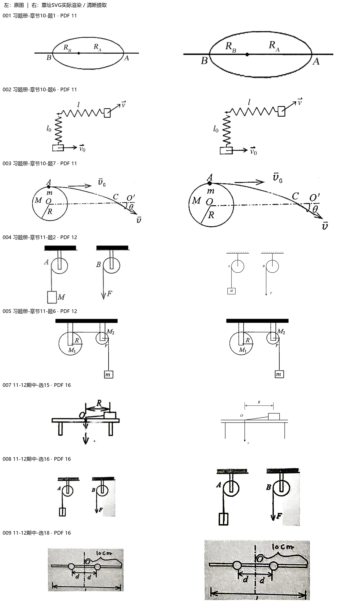
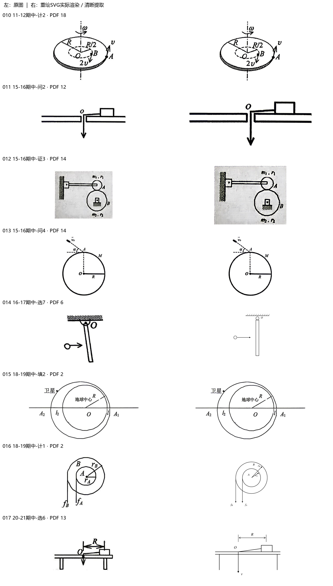
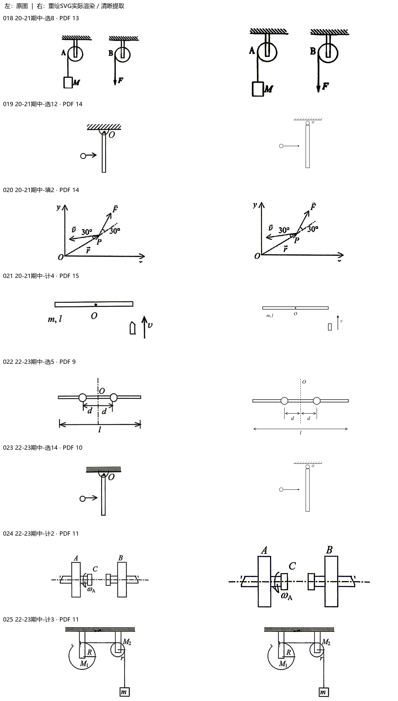
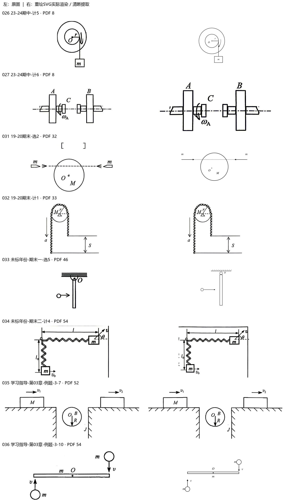
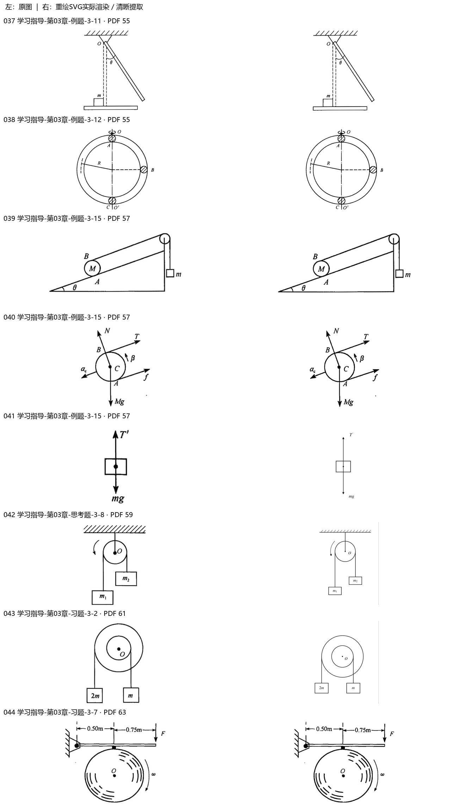
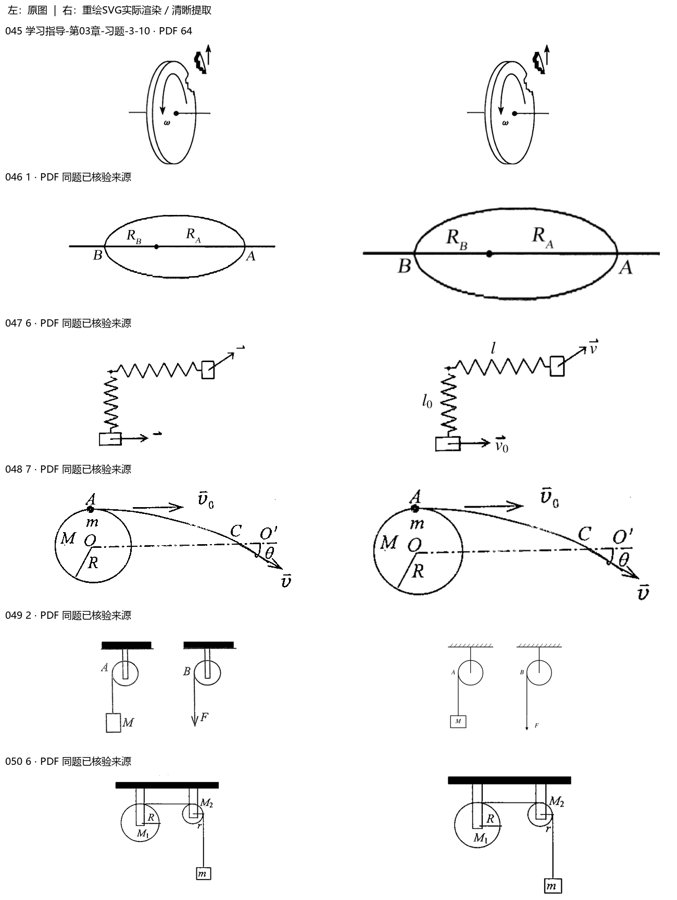
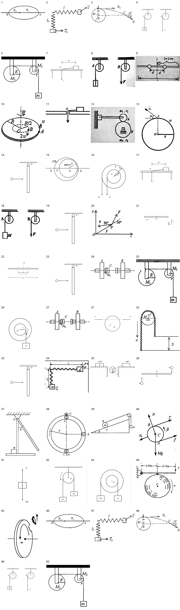

> 派生文件，可重新生成，勿手改。

# 上册逐章题图 · 03 角动量与刚体

仅处理上册已确认范围；先尝试原PDF提取，不清楚再重绘。原材料、原图只读保留；只改图片路径，保留原题号、锚点、题面、答案与OCR状态。

本章审查51个图片资产、52处引用。定性图未给出的尺寸/角度/比例不是测量数据。复用图不重复计为独立新图。

[生成代码](../../../../10_%E9%A2%98%E5%BA%93/_assets/%E4%B8%8A%E5%86%8C%E9%80%90%E7%AB%A0/03_%E8%A7%92%E5%8A%A8%E9%87%8F%E4%B8%8E%E5%88%9A%E4%BD%93/generate.py) · [映射与逐项核验](../../../../10_%E9%A2%98%E5%BA%93/_assets/%E4%B8%8A%E5%86%8C%E9%80%90%E7%AB%A0/03_%E8%A7%92%E5%8A%A8%E9%87%8F%E4%B8%8E%E5%88%9A%E4%BD%93/mapping.json) · [校验记录](validation.json)

|编号|题号|原图|来源PDF页|处理|核验|
|---|---|---|---|---|---|
|001|习题册-章节10-题1|[b794051d67e64cc80c2da1c4b97e417d67107c239a94bcd205aaa1cdf32b0820.jpg](../../../../10_%E9%A2%98%E5%BA%93/_assets/%E4%B9%A0%E9%A2%98%E5%86%8C/b794051d67e64cc80c2da1c4b97e417d67107c239a94bcd205aaa1cdf32b0820.jpg)|11|native_extraction [001-extracted.png](../../../../10_%E9%A2%98%E5%BA%93/_assets/%E4%B8%8A%E5%86%8C%E9%80%90%E7%AB%A0/03_%E8%A7%92%E5%8A%A8%E9%87%8F%E4%B8%8E%E5%88%9A%E4%BD%93/001-extracted.png)|椭圆A/B、RA/RB和中心点，未引入数值偏心率。 原生提取，无放大插值或新增标注。|
|002|习题册-章节10-题6|[f73a2775fdac99dd10da3578d606acaa91d7bdd4cbc90d50438e4ca9cf8a3ca5.jpg](../../../../10_%E9%A2%98%E5%BA%93/_assets/%E4%B9%A0%E9%A2%98%E5%86%8C/f73a2775fdac99dd10da3578d606acaa91d7bdd4cbc90d50438e4ca9cf8a3ca5.jpg)|11|native_extraction [002-extracted.png](../../../../10_%E9%A2%98%E5%BA%93/_assets/%E4%B8%8A%E5%86%8C%E9%80%90%E7%AB%A0/03_%E8%A7%92%E5%8A%A8%E9%87%8F%E4%B8%8E%E5%88%9A%E4%BD%93/002-extracted.png)|转角弹簧的水平l、竖直l0、v0向右与末态v右上；保持原图标注。 原生提取，无放大插值或新增标注。|
|003|习题册-章节10-题7|[298d75c338a5bb3c837e87d4c6e2b32f5c0cdaebc86e8c55d8d6fe870640905b.jpg](../../../../10_%E9%A2%98%E5%BA%93/_assets/%E4%B9%A0%E9%A2%98%E5%86%8C/298d75c338a5bb3c837e87d4c6e2b32f5c0cdaebc86e8c55d8d6fe870640905b.jpg)|11|native_extraction [003-extracted.png](../../../../10_%E9%A2%98%E5%BA%93/_assets/%E4%B8%8A%E5%86%8C%E9%80%90%E7%AB%A0/03_%E8%A7%92%E5%8A%A8%E9%87%8F%E4%B8%8E%E5%88%9A%E4%BD%93/003-extracted.png)|圆M/O/R，A上质点m以v0向右，C/O′/θ与末态v右下。 原生提取，无放大插值或新增标注。|
|004|习题册-章节11-题2|[0f4032424386dc3a97eeb3fba82d2c4363dfd1fb0041afc7329570756b2f3167.jpg](../../../../10_%E9%A2%98%E5%BA%93/_assets/%E4%B9%A0%E9%A2%98%E5%86%8C/0f4032424386dc3a97eeb3fba82d2c4363dfd1fb0041afc7329570756b2f3167.jpg)|12|redrawn [004.svg](../../../../10_%E9%A2%98%E5%BA%93/_assets/%E4%B8%8A%E5%86%8C%E9%80%90%E7%AB%A0/03_%E8%A7%92%E5%8A%A8%E9%87%8F%E4%B8%8E%E5%88%9A%E4%BD%93/004.svg)|A/B两固定滑轮；左挂M，右绳端受F向下。|
|005|习题册-章节11-题6|[19c8864032e57d883c7cffd4b17a4ee0e0e5290e2a87e1d17770060d3012d2ca.jpg](../../../../10_%E9%A2%98%E5%BA%93/_assets/%E4%B9%A0%E9%A2%98%E5%86%8C/19c8864032e57d883c7cffd4b17a4ee0e0e5290e2a87e1d17770060d3012d2ca.jpg)|12|native_extraction [005-extracted.png](../../../../10_%E9%A2%98%E5%BA%93/_assets/%E4%B8%8A%E5%86%8C%E9%80%90%E7%AB%A0/03_%E8%A7%92%E5%8A%A8%E9%87%8F%E4%B8%8E%E5%88%9A%E4%BD%93/005-extracted.png)|两轮M1/M2与R/r，皮带与右端悬物m的完整连接保留。 原生提取，无放大插值或新增标注。|
|006|习题册-章节12-题2|[de7ef44fd6baedc0ed769b40bd167b944ee7ce7be60c8641cf4b063b36eb6bf4.jpg](../../../../10_%E9%A2%98%E5%BA%93/_assets/%E4%B9%A0%E9%A2%98%E5%86%8C/de7ef44fd6baedc0ed769b40bd167b944ee7ce7be60c8641cf4b063b36eb6bf4.jpg)|13|retained_clear|本图已有清晰的人工整理示意；原有v/2与v、O及杆图可读，按排除已清楚图的规则保留。旧版含题面文字，不裁掉或擅自移除。|
|007|11-12期中-选15|[043780e762fa85e9091c4465e7868f4dddf14eec88217b7b4b1a264041b16132.jpg](../../../../10_%E9%A2%98%E5%BA%93/_assets/%E5%8E%86%E5%B9%B4%E8%AF%95%E5%8D%B7%E5%90%88%E9%9B%86_2018-2024/043780e762fa85e9091c4465e7868f4dddf14eec88217b7b4b1a264041b16132.jpg)|16|redrawn [007.svg](../../../../10_%E9%A2%98%E5%BA%93/_assets/%E4%B8%8A%E5%86%8C%E9%80%90%E7%AB%A0/03_%E8%A7%92%E5%8A%A8%E9%87%8F%E4%B8%8E%E5%88%9A%E4%BD%93/007.svg)|桌洞O至桌上物块距离R；绳端速度v竖直向下。|
|008|11-12期中-选16|[b8a6e2fcb663ec7dca0b3a655249fc5be8c7b8d4606214e054505de1135e29b1.jpg](../../../../10_%E9%A2%98%E5%BA%93/_assets/%E5%8E%86%E5%B9%B4%E8%AF%95%E5%8D%B7%E5%90%88%E9%9B%86_2018-2024/b8a6e2fcb663ec7dca0b3a655249fc5be8c7b8d4606214e054505de1135e29b1.jpg)|16|native_extraction [008-extracted.png](../../../../10_%E9%A2%98%E5%BA%93/_assets/%E4%B8%8A%E5%86%8C%E9%80%90%E7%AB%A0/03_%E8%A7%92%E5%8A%A8%E9%87%8F%E4%B8%8E%E5%88%9A%E4%BD%93/008-extracted.png)|A/B两定滑轮，右F向下，左挂物；不添加原图未标质量。 原生提取，无放大插值或新增标注。|
|009|11-12期中-选18|[f1984682d026269b0cf94c8d98c211cdac3d43132f3c447fa7b179b8f160af89.jpg](../../../../10_%E9%A2%98%E5%BA%93/_assets/%E5%8E%86%E5%B9%B4%E8%AF%95%E5%8D%B7%E5%90%88%E9%9B%86_2018-2024/f1984682d026269b0cf94c8d98c211cdac3d43132f3c447fa7b179b8f160af89.jpg)|16|native_extraction [009-extracted.png](../../../../10_%E9%A2%98%E5%BA%93/_assets/%E4%B8%8A%E5%86%8C%E9%80%90%E7%AB%A0/03_%E8%A7%92%E5%8A%A8%E9%87%8F%E4%B8%8E%E5%88%9A%E4%BD%93/009-extracted.png)|细杆中央转轴O，d左右对称，原图10cm及总长l尺寸保留。 原生提取，无放大插值或新增标注。|
|010|11-12期中-计2|[96cf36ceb69be748f481cdc811680fa17bb28b5f1acf4918a6f3c240dab1ffa3.jpg](../../../../10_%E9%A2%98%E5%BA%93/_assets/%E5%8E%86%E5%B9%B4%E8%AF%95%E5%8D%B7%E5%90%88%E9%9B%86_2018-2024/96cf36ceb69be748f481cdc811680fa17bb28b5f1acf4918a6f3c240dab1ffa3.jpg)|18|native_extraction [010-extracted.png](../../../../10_%E9%A2%98%E5%BA%93/_assets/%E4%B8%8A%E5%86%8C%E9%80%90%E7%AB%A0/03_%E8%A7%92%E5%8A%A8%E9%87%8F%E4%B8%8E%E5%88%9A%E4%BD%93/010-extracted.png)|转盘O、A、B、R/R/2、ω与v/2v的方向按原像素保留。 原生提取，无放大插值或新增标注。|
|011|15-16期中-问2|[ba2efb8e5206cc1e6d2513a6243baac85f5f0bd087ef775a27b0ad3850a05b30.jpg](../../../../10_%E9%A2%98%E5%BA%93/_assets/%E5%8E%86%E5%B9%B4%E8%AF%95%E5%8D%B7%E5%90%88%E9%9B%86_2018-2024/ba2efb8e5206cc1e6d2513a6243baac85f5f0bd087ef775a27b0ad3850a05b30.jpg)|12|native_extraction [011-extracted.png](../../../../10_%E9%A2%98%E5%BA%93/_assets/%E4%B8%8A%E5%86%8C%E9%80%90%E7%AB%A0/03_%E8%A7%92%E5%8A%A8%E9%87%8F%E4%B8%8E%E5%88%9A%E4%BD%93/011-extracted.png)|O处桌洞、细绳下垂箭头与桌上块；不补R或未知力。 原生提取，无放大插值或新增标注。|
|012|15-16期中-证3|[2673a6f9e0202aeb9df0eaaeaa264e21270817d0a1424a9f4fb09dad02a5572c.jpg](../../../../10_%E9%A2%98%E5%BA%93/_assets/%E5%8E%86%E5%B9%B4%E8%AF%95%E5%8D%B7%E5%90%88%E9%9B%86_2018-2024/2673a6f9e0202aeb9df0eaaeaa264e21270817d0a1424a9f4fb09dad02a5572c.jpg)|14|native_extraction [012-extracted.png](../../../../10_%E9%A2%98%E5%BA%93/_assets/%E4%B8%8A%E5%86%8C%E9%80%90%E7%AB%A0/03_%E8%A7%92%E5%8A%A8%E9%87%8F%E4%B8%8E%E5%88%9A%E4%BD%93/012-extracted.png)|左壁铰接杆、接触圆轮A/B及质量半径，保留轮间接触关系。 原生提取，无放大插值或新增标注。|
|013|15-16期中-问4|[18dfb09358f42a9c8ece5c5312da0eb470fdc03ccf85feb044400fb8fc3fd690.jpg](../../../../10_%E9%A2%98%E5%BA%93/_assets/%E5%8E%86%E5%B9%B4%E8%AF%95%E5%8D%B7%E5%90%88%E9%9B%86_2018-2024/18dfb09358f42a9c8ece5c5312da0eb470fdc03ccf85feb044400fb8fc3fd690.jpg)|14|native_extraction [013-extracted.png](../../../../10_%E9%A2%98%E5%BA%93/_assets/%E4%B8%8A%E5%86%8C%E9%80%90%E7%AB%A0/03_%E8%A7%92%E5%8A%A8%E9%87%8F%E4%B8%8E%E5%88%9A%E4%BD%93/013-extracted.png)|圆M、O/R、A在顶部，入射v0及α相对水平，不更换角度基准。 原生提取，无放大插值或新增标注。|
|014|16-17期中-选7|[d3ab3474aef8ab87a39e98da179de1e841137b2baf56bcc6546d0bc2f7e50da6.jpg](../../../../10_%E9%A2%98%E5%BA%93/_assets/%E5%8E%86%E5%B9%B4%E8%AF%95%E5%8D%B7%E5%90%88%E9%9B%86_2018-2024/d3ab3474aef8ab87a39e98da179de1e841137b2baf56bcc6546d0bc2f7e50da6.jpg)|6|redrawn [014.svg](../../../../10_%E9%A2%98%E5%BA%93/_assets/%E4%B8%8A%E5%86%8C%E9%80%90%E7%AB%A0/03_%E8%A7%92%E5%8A%A8%E9%87%8F%E4%B8%8E%E5%88%9A%E4%BD%93/014.svg)|顶端O固定杆，小球自左向右碰杆；未添加碰后方向。|
|015|18-19期中-填2|[e8c9a236578c59d50a3c7b77024125fd5c059e7e40116dc15ef159e73dd087ea.jpg](../../../../10_%E9%A2%98%E5%BA%93/_assets/%E5%8E%86%E5%B9%B4%E8%AF%95%E5%8D%B7%E5%90%88%E9%9B%86_2018-2024/e8c9a236578c59d50a3c7b77024125fd5c059e7e40116dc15ef159e73dd087ea.jpg)|2|native_extraction [015-extracted.png](../../../../10_%E9%A2%98%E5%BA%93/_assets/%E4%B8%8A%E5%86%8C%E9%80%90%E7%AB%A0/03_%E8%A7%92%E5%8A%A8%E9%87%8F%E4%B8%8E%E5%88%9A%E4%BD%93/015-extracted.png)|卫星椭圆和地心O、R，A1/A2、l1/l2保持原图，不将椭圆改为同心圆。 原生提取，无放大插值或新增标注。|
|016|18-19期中-计1|[d061d8c727b236d1f34286223f234ac69b5355190db9e61167f19552d974a6d0.jpg](../../../../10_%E9%A2%98%E5%BA%93/_assets/%E5%8E%86%E5%B9%B4%E8%AF%95%E5%8D%B7%E5%90%88%E9%9B%86_2018-2024/d061d8c727b236d1f34286223f234ac69b5355190db9e61167f19552d974a6d0.jpg)|2|redrawn [016.svg](../../../../10_%E9%A2%98%E5%BA%93/_assets/%E4%B8%8A%E5%86%8C%E9%80%90%E7%AB%A0/03_%E8%A7%92%E5%8A%A8%E9%87%8F%E4%B8%8E%E5%88%9A%E4%BD%93/016.svg)|同轴A/B和rA/rB；两条切线fA/fB均向下，切点对应内外半径。|
|017|20-21期中-选6|[4960e31e14a21a703bbd0a215770512cbd152c03b565c0afec19bf1284353d5b.jpg](../../../../10_%E9%A2%98%E5%BA%93/_assets/%E6%9C%9F%E4%B8%AD%E8%AF%95%E5%8D%B7_2020-2025/4960e31e14a21a703bbd0a215770512cbd152c03b565c0afec19bf1284353d5b.jpg)|13|redrawn [017.svg](../../../../10_%E9%A2%98%E5%BA%93/_assets/%E4%B8%8A%E5%86%8C%E9%80%90%E7%AB%A0/03_%E8%A7%92%E5%8A%A8%E9%87%8F%E4%B8%8E%E5%88%9A%E4%BD%93/017.svg)|O处绳穿桌洞、R至桌上物块，v向下；图与来源一致。|
|018|20-21期中-选8|[039cb4d321ffaabf93905b6a5c3d630f2826a43f33793af547581e8fce3b3487.jpg](../../../../10_%E9%A2%98%E5%BA%93/_assets/%E6%9C%9F%E4%B8%AD%E8%AF%95%E5%8D%B7_2020-2025/039cb4d321ffaabf93905b6a5c3d630f2826a43f33793af547581e8fce3b3487.jpg)|13|native_extraction [018-extracted.png](../../../../10_%E9%A2%98%E5%BA%93/_assets/%E4%B8%8A%E5%86%8C%E9%80%90%E7%AB%A0/03_%E8%A7%92%E5%8A%A8%E9%87%8F%E4%B8%8E%E5%88%9A%E4%BD%93/018-extracted.png)|两定滑轮A/B、左M与右F向下；本题图独立提取。 原生提取，无放大插值或新增标注。|
|019|20-21期中-选12|[228deb2e29e16af494aab4a14849b5d4dff73061a7759ffa9b7b6655dfb8954a.jpg](../../../../10_%E9%A2%98%E5%BA%93/_assets/%E6%9C%9F%E4%B8%AD%E8%AF%95%E5%8D%B7_2020-2025/228deb2e29e16af494aab4a14849b5d4dff73061a7759ffa9b7b6655dfb8954a.jpg)|14|redrawn [019.svg](../../../../10_%E9%A2%98%E5%BA%93/_assets/%E4%B8%8A%E5%86%8C%E9%80%90%E7%AB%A0/03_%E8%A7%92%E5%8A%A8%E9%87%8F%E4%B8%8E%E5%88%9A%E4%BD%93/019.svg)|竖直杆O铰接，小球向右碰撞。|
|020|20-21期中-填2|[bd406cfc637e393fe26190b9386c985f6724a8495a7cfd4a00c75f0e1da17e8f.jpg](../../../../10_%E9%A2%98%E5%BA%93/_assets/%E6%9C%9F%E4%B8%AD%E8%AF%95%E5%8D%B7_2020-2025/bd406cfc637e393fe26190b9386c985f6724a8495a7cfd4a00c75f0e1da17e8f.jpg)|14|native_extraction [020-extracted.png](../../../../10_%E9%A2%98%E5%BA%93/_assets/%E4%B8%8A%E5%86%8C%E9%80%90%E7%AB%A0/03_%E8%A7%92%E5%8A%A8%E9%87%8F%E4%B8%8E%E5%88%9A%E4%BD%93/020-extracted.png)|O/x/y、r至P、v向左下、F右上与两处30°；原生裁图保持角度关系。 原生提取，无放大插值或新增标注。|
|021|20-21期中-计4|[4ead90fef2a2a1c37648fe99b3711c8d18a3b6987159a3e6ddcf2059e88ae313.jpg](../../../../10_%E9%A2%98%E5%BA%93/_assets/%E6%9C%9F%E4%B8%AD%E8%AF%95%E5%8D%B7_2020-2025/4ead90fef2a2a1c37648fe99b3711c8d18a3b6987159a3e6ddcf2059e88ae313.jpg)|15|redrawn [021.svg](../../../../10_%E9%A2%98%E5%BA%93/_assets/%E4%B8%8A%E5%86%8C%E9%80%90%E7%AB%A0/03_%E8%A7%92%E5%8A%A8%E9%87%8F%E4%B8%8E%E5%88%9A%E4%BD%93/021.svg)|m,l标杆、中心O、右侧入射v向上；未加入未知角度或距离。|
|022|22-23期中-选5|[087477c2601d0446a9bff66b8a8b2103db98a11bc8c0e0a5f64bdc68d3a80f4f.jpg](../../../../10_%E9%A2%98%E5%BA%93/_assets/%E6%9C%9F%E4%B8%AD%E8%AF%95%E5%8D%B7_2020-2025/087477c2601d0446a9bff66b8a8b2103db98a11bc8c0e0a5f64bdc68d3a80f4f.jpg)|9|redrawn [022.svg](../../../../10_%E9%A2%98%E5%BA%93/_assets/%E4%B8%8A%E5%86%8C%E9%80%90%E7%AB%A0/03_%E8%A7%92%E5%8A%A8%E9%87%8F%E4%B8%8E%E5%88%9A%E4%BD%93/022.svg)|两球相对中心O对称，d在左右，l为整杆长，轴竖直虚线。|
|023|22-23期中-选14|[2bbf94de0165a9b00082891e9cbe10669c6c53bf018bb9643fd7eab5af095f5f.jpg](../../../../10_%E9%A2%98%E5%BA%93/_assets/%E6%9C%9F%E4%B8%AD%E8%AF%95%E5%8D%B7_2020-2025/2bbf94de0165a9b00082891e9cbe10669c6c53bf018bb9643fd7eab5af095f5f.jpg)|10|redrawn [023.svg](../../../../10_%E9%A2%98%E5%BA%93/_assets/%E4%B8%8A%E5%86%8C%E9%80%90%E7%AB%A0/03_%E8%A7%92%E5%8A%A8%E9%87%8F%E4%B8%8E%E5%88%9A%E4%BD%93/023.svg)|上O铰接杆，左球向右；支点与方向不变。|
|024|22-23期中-计2|[53ab953f56e6eb79607c8efc03a3c830c0b0362220dc1a5d1eb6e0b8071ade35.jpg](../../../../10_%E9%A2%98%E5%BA%93/_assets/%E6%9C%9F%E4%B8%AD%E8%AF%95%E5%8D%B7_2020-2025/53ab953f56e6eb79607c8efc03a3c830c0b0362220dc1a5d1eb6e0b8071ade35.jpg)|11|native_extraction [024-extracted.png](../../../../10_%E9%A2%98%E5%BA%93/_assets/%E4%B8%8A%E5%86%8C%E9%80%90%E7%AB%A0/03_%E8%A7%92%E5%8A%A8%E9%87%8F%E4%B8%8E%E5%88%9A%E4%BD%93/024-extracted.png)|同轴轮A/B/C、角速度ωA与离合连接，保留三维透视。 原生提取，无放大插值或新增标注。|
|025|22-23期中-计3|[7b518f2648a2601b9971981e0de403337195ff8fc0f2af9db74989e8fa644fe5.jpg](../../../../10_%E9%A2%98%E5%BA%93/_assets/%E6%9C%9F%E4%B8%AD%E8%AF%95%E5%8D%B7_2020-2025/7b518f2648a2601b9971981e0de403337195ff8fc0f2af9db74989e8fa644fe5.jpg)|11|native_extraction [025-extracted.png](../../../../10_%E9%A2%98%E5%BA%93/_assets/%E4%B8%8A%E5%86%8C%E9%80%90%E7%AB%A0/03_%E8%A7%92%E5%8A%A8%E9%87%8F%E4%B8%8E%E5%88%9A%E4%BD%93/025-extracted.png)|M1/M2双轮、R/r、m悬挂与皮带接触，原图完整。 原生提取，无放大插值或新增标注。|
|026|23-24期中-计5|[35007276554e2ecac4a4a0ab1d3df584938e27c8d77609eb5e2c825d5027e94f.jpg](../../../../10_%E9%A2%98%E5%BA%93/_assets/%E6%9C%9F%E4%B8%AD%E8%AF%95%E5%8D%B7_2020-2025/35007276554e2ecac4a4a0ab1d3df584938e27c8d77609eb5e2c825d5027e94f.jpg)|8|redrawn [026.svg](../../../../10_%E9%A2%98%E5%BA%93/_assets/%E4%B8%8A%E5%86%8C%E9%80%90%E7%AB%A0/03_%E8%A7%92%E5%8A%A8%E9%87%8F%E4%B8%8E%E5%88%9A%E4%BD%93/026.svg)|O圆轮内半径r；绳自内轮右切点悬挂m，顺时针箭头保留。|
|027|23-24期中-计6|[a08f21dfe830d01855af729afdcafda36be13bc2bfdb8dd9a2ec526b44f2c25e.jpg](../../../../10_%E9%A2%98%E5%BA%93/_assets/%E6%9C%9F%E4%B8%AD%E8%AF%95%E5%8D%B7_2020-2025/a08f21dfe830d01855af729afdcafda36be13bc2bfdb8dd9a2ec526b44f2c25e.jpg)|8|native_extraction [027-extracted.png](../../../../10_%E9%A2%98%E5%BA%93/_assets/%E4%B8%8A%E5%86%8C%E9%80%90%E7%AB%A0/03_%E8%A7%92%E5%8A%A8%E9%87%8F%E4%B8%8E%E5%88%9A%E4%BD%93/027-extracted.png)|A/B/C与ωA同轴连接，保留本题来源图。 原生提取，无放大插值或新增标注。|
|028|24-25期中-选6|[0e10def54b747083dc602eed806c58c9c68c33efacd9d2ae7d7cba03b3ac489c.jpg](../../../../10_%E9%A2%98%E5%BA%93/_assets/%E6%9C%9F%E4%B8%AD%E8%AF%95%E5%8D%B7_2020-2025/0e10def54b747083dc602eed806c58c9c68c33efacd9d2ae7d7cba03b3ac489c.jpg)|1|retained_uncertain|源扫描仍含不可靠的细小标记或相邻题图边界；保留原图，不猜测轴/字母或拆分归属。|
|029|24-25期中-计4|[199ab07268cfcdea5925ae360810f4d409ccbcbe9f92d407786cbeb92ad85cf8.jpg](../../../../10_%E9%A2%98%E5%BA%93/_assets/%E6%9C%9F%E4%B8%AD%E8%AF%95%E5%8D%B7_2020-2025/199ab07268cfcdea5925ae360810f4d409ccbcbe9f92d407786cbeb92ad85cf8.jpg)|3|retained_uncertain|源扫描仍含不可靠的细小标记或相邻题图边界；保留原图，不猜测轴/字母或拆分归属。|
|030|24-25期中-计5|[92f0ce36a40a87a44f573ccab044c787a11613304607831d4352d0b49809ff2b.jpg](../../../../10_%E9%A2%98%E5%BA%93/_assets/%E6%9C%9F%E4%B8%AD%E8%AF%95%E5%8D%B7_2020-2025/92f0ce36a40a87a44f573ccab044c787a11613304607831d4352d0b49809ff2b.jpg)|3|retained_uncertain|源扫描仍含不可靠的细小标记或相邻题图边界；保留原图，不猜测轴/字母或拆分归属。|
|031|19-20期末-选2|[6c687c9225367c1873001cac96b1326eabdd1db3575d86f9b63c2578419d8f77.jpg](../../../../10_%E9%A2%98%E5%BA%93/_assets/%E5%8E%86%E5%B9%B4%E8%AF%95%E5%8D%B7%E5%90%88%E9%9B%86_2018-2024/6c687c9225367c1873001cac96b1326eabdd1db3575d86f9b63c2578419d8f77.jpg)|32|redrawn [031.svg](../../../../10_%E9%A2%98%E5%BA%93/_assets/%E4%B8%8A%E5%86%8C%E9%80%90%E7%AB%A0/03_%E8%A7%92%E5%8A%A8%E9%87%8F%E4%B8%8E%E5%88%9A%E4%BD%93/031.svg)|圆M及O，左右两m沿同一直线相向入射；入射线不强行通过圆心。|
|032|19-20期末-计1|[0fc5521219a75979543dbaf18353c0c777f5e6bb836bc1f215c4d9258d48bc6a.jpg](../../../../10_%E9%A2%98%E5%BA%93/_assets/%E5%8E%86%E5%B9%B4%E8%AF%95%E5%8D%B7%E5%90%88%E9%9B%86_2018-2024/0fc5521219a75979543dbaf18353c0c777f5e6bb836bc1f215c4d9258d48bc6a.jpg)|33|native_extraction [032-extracted.png](../../../../10_%E9%A2%98%E5%BA%93/_assets/%E4%B8%8A%E5%86%8C%E9%80%90%E7%AB%A0/03_%E8%A7%92%E5%8A%A8%E9%87%8F%E4%B8%8E%E5%88%9A%E4%BD%93/032-extracted.png)|轮M/r、链条、a向下与s竖直尺度；原生像素保留链路。 原生提取，无放大插值或新增标注。|
|033|未标年份-期末一-选5|[9a5c42a819020db9b4d0adb82996708e86ef1f52d597d5324c73d6ef56e5c04e.jpg](../../../../10_%E9%A2%98%E5%BA%93/_assets/%E5%8E%86%E5%B9%B4%E8%AF%95%E5%8D%B7%E5%90%88%E9%9B%86_2018-2024/9a5c42a819020db9b4d0adb82996708e86ef1f52d597d5324c73d6ef56e5c04e.jpg)|46|redrawn [033.svg](../../../../10_%E9%A2%98%E5%BA%93/_assets/%E4%B8%8A%E5%86%8C%E9%80%90%E7%AB%A0/03_%E8%A7%92%E5%8A%A8%E9%87%8F%E4%B8%8E%E5%88%9A%E4%BD%93/033.svg)|O上支点、竖直杆、左球向右。|
|034|未标年份-期末二-计4|[6109a79d369d91d52c935e71e479b0f4ed650af4f61dea2f4c8c2ba9c798a710.jpg](../../../../10_%E9%A2%98%E5%BA%93/_assets/%E5%8E%86%E5%B9%B4%E8%AF%95%E5%8D%B7%E5%90%88%E9%9B%86_2018-2024/6109a79d369d91d52c935e71e479b0f4ed650af4f61dea2f4c8c2ba9c798a710.jpg)|54|native_extraction [034-extracted.png](../../../../10_%E9%A2%98%E5%BA%93/_assets/%E4%B8%8A%E5%86%8C%E9%80%90%E7%AB%A0/03_%E8%A7%92%E5%8A%A8%E9%87%8F%E4%B8%8E%E5%88%9A%E4%BD%93/034-extracted.png)|O端直角弹簧、水平l、竖直l0、m、v0和v/θ；未知夹角不拟合。 原生提取，无放大插值或新增标注。|
|035|学习指导-第03章-例题-3-7|[p0001-0180_665.jpg](../../../../10_%E9%A2%98%E5%BA%93/_assets/%E5%AD%A6%E4%B9%A0%E6%8C%87%E5%AF%BC/p0001-0180_665.jpg)|52|native_extraction [035-extracted.png](../../../../10_%E9%A2%98%E5%BA%93/_assets/%E4%B8%8A%E5%86%8C%E9%80%90%E7%AB%A0/03_%E8%A7%92%E5%8A%A8%E9%87%8F%E4%B8%8E%E5%88%9A%E4%BD%93/035-extracted.png)|左右M、v1/v2向右，中央转轮O/B/R/J；平台缺口与轮接触保留。 原生提取，无放大插值或新增标注。|
|036|学习指导-第03章-例题-3-10|[p0001-0180_755.jpg](../../../../10_%E9%A2%98%E5%BA%93/_assets/%E5%AD%A6%E4%B9%A0%E6%8C%87%E5%AF%BC/p0001-0180_755.jpg)|54|redrawn [036.svg](../../../../10_%E9%A2%98%E5%BA%93/_assets/%E4%B8%8A%E5%86%8C%E9%80%90%E7%AB%A0/03_%E8%A7%92%E5%8A%A8%E9%87%8F%E4%B8%8E%E5%88%9A%E4%BD%93/036.svg)|杆中O、质量m；左下球向上，右上球向下，两个速度v方向相反。|
|037|学习指导-第03章-例题-3-11|[p0001-0180_646.jpg](../../../../10_%E9%A2%98%E5%BA%93/_assets/%E5%AD%A6%E4%B9%A0%E6%8C%87%E5%AF%BC/p0001-0180_646.jpg)|55|native_extraction [037-extracted.png](../../../../10_%E9%A2%98%E5%BA%93/_assets/%E4%B8%8A%E5%86%8C%E9%80%90%E7%AB%A0/03_%E8%A7%92%E5%8A%A8%E9%87%8F%E4%B8%8E%E5%88%9A%E4%BD%93/037-extracted.png)|顶端铰接杆O、θ相对竖直，底部m与台面，保留原位置关系。 原生提取，无放大插值或新增标注。|
|038|学习指导-第03章-例题-3-12|[p0001-0180_607.jpg](../../../../10_%E9%A2%98%E5%BA%93/_assets/%E5%AD%A6%E4%B9%A0%E6%8C%87%E5%AF%BC/p0001-0180_607.jpg)|55|native_extraction [038-extracted.png](../../../../10_%E9%A2%98%E5%BA%93/_assets/%E4%B8%8A%E5%86%8C%E9%80%90%E7%AB%A0/03_%E8%A7%92%E5%8A%A8%E9%87%8F%E4%B8%8E%E5%88%9A%E4%BD%93/038-extracted.png)|圆环A/B/C及O/O′轴、R和圆周位置，精细标线原生保留。 原生提取，无放大插值或新增标注。|
|039|学习指导-第03章-例题-3-15|[p0001-0180_511.jpg](../../../../10_%E9%A2%98%E5%BA%93/_assets/%E5%AD%A6%E4%B9%A0%E6%8C%87%E5%AF%BC/p0001-0180_511.jpg)|57|native_extraction [039-extracted.png](../../../../10_%E9%A2%98%E5%BA%93/_assets/%E4%B8%8A%E5%86%8C%E9%80%90%E7%AB%A0/03_%E8%A7%92%E5%8A%A8%E9%87%8F%E4%B8%8E%E5%88%9A%E4%BD%93/039-extracted.png)|斜面θ、圆柱M、接触A、上接点B、悬物m与滑轮绳路不变。 原生提取，无放大插值或新增标注。|
|040|学习指导-第03章-例题-3-15|[p0001-0180_1013.jpg](../../../../10_%E9%A2%98%E5%BA%93/_assets/%E5%AD%A6%E4%B9%A0%E6%8C%87%E5%AF%BC/p0001-0180_1013.jpg)|57|native_extraction [040-extracted.png](../../../../10_%E9%A2%98%E5%BA%93/_assets/%E4%B8%8A%E5%86%8C%E9%80%90%E7%AB%A0/03_%E8%A7%92%E5%8A%A8%E9%87%8F%E4%B8%8E%E5%88%9A%E4%BD%93/040-extracted.png)|圆C，N左上、T右上、f右上、Mg下、ac左下，β转向及A/B位置保留；不改变力方向。 原生提取，无放大插值或新增标注。|
|041|学习指导-第03章-例题-3-15|[p0001-0180_637.jpg](../../../../10_%E9%A2%98%E5%BA%93/_assets/%E5%AD%A6%E4%B9%A0%E6%8C%87%E5%AF%BC/p0001-0180_637.jpg)|57|redrawn [041.svg](../../../../10_%E9%A2%98%E5%BA%93/_assets/%E4%B8%8A%E5%86%8C%E9%80%90%E7%AB%A0/03_%E8%A7%92%E5%8A%A8%E9%87%8F%E4%B8%8E%E5%88%9A%E4%BD%93/041.svg)|T′向上，mg向下；撇号及作用点保留。|
|042|学习指导-第03章-思考题-3-8|[p0001-0180_051.jpg](../../../../10_%E9%A2%98%E5%BA%93/_assets/%E5%AD%A6%E4%B9%A0%E6%8C%87%E5%AF%BC/p0001-0180_051.jpg)|59|redrawn [042.svg](../../../../10_%E9%A2%98%E5%BA%93/_assets/%E4%B8%8A%E5%86%8C%E9%80%90%E7%AB%A0/03_%E8%A7%92%E5%8A%A8%E9%87%8F%E4%B8%8E%E5%88%9A%E4%BD%93/042.svg)|固定轮O、左m1低、右m2高，转动箭头为逆时针。|
|043|学习指导-第03章-习题-3-2|[p0001-0180_397.jpg](../../../../10_%E9%A2%98%E5%BA%93/_assets/%E5%AD%A6%E4%B9%A0%E6%8C%87%E5%AF%BC/p0001-0180_397.jpg)|61|redrawn [043.svg](../../../../10_%E9%A2%98%E5%BA%93/_assets/%E4%B8%8A%E5%86%8C%E9%80%90%E7%AB%A0/03_%E8%A7%92%E5%8A%A8%E9%87%8F%E4%B8%8E%E5%88%9A%E4%BD%93/043.svg)|内外同轴轮O，左外轮悬2m、右内轮悬m；不臆定半径比。|
|044|学习指导-第03章-习题-3-7|[p0001-0180_231.jpg](../../../../10_%E9%A2%98%E5%BA%93/_assets/%E5%AD%A6%E4%B9%A0%E6%8C%87%E5%AF%BC/p0001-0180_231.jpg)|63|native_extraction [044-extracted.png](../../../../10_%E9%A2%98%E5%BA%93/_assets/%E4%B8%8A%E5%86%8C%E9%80%90%E7%AB%A0/03_%E8%A7%92%E5%8A%A8%E9%87%8F%E4%B8%8E%E5%88%9A%E4%BD%93/044-extracted.png)|杠杆左支点、0.50m与0.75m分段、右F向下、接触圆轮O与ω方向；量距端点不变。 原生提取，无放大插值或新增标注。|
|045|学习指导-第03章-习题-3-10|[p0001-0180_724.jpg](../../../../10_%E9%A2%98%E5%BA%93/_assets/%E5%AD%A6%E4%B9%A0%E6%8C%87%E5%AF%BC/p0001-0180_724.jpg)|64|native_extraction [045-extracted.png](../../../../10_%E9%A2%98%E5%BA%93/_assets/%E4%B8%8A%E5%86%8C%E9%80%90%E7%AB%A0/03_%E8%A7%92%E5%8A%A8%E9%87%8F%E4%B8%8E%E5%88%9A%E4%BD%93/045-extracted.png)|转动轮及ω方向、轴线和制动接触物；原题没有给定形状函数，保留细节。 原生提取，无放大插值或新增标注。|
|046|1|[图1.png](../../../../%E5%A4%A7%E5%AD%A6%E7%89%A9%E7%90%86%E4%B9%A0%E9%A2%98%E5%86%8C%EF%BC%88%E4%B8%8A%EF%BC%89/_assets/10_%E4%B9%A0%E9%A2%98%E5%8D%81%20%E8%A7%92%E5%8A%A8%E9%87%8F%E5%AE%88%E6%81%92%EF%BC%88%E4%B8%80%EF%BC%89/%E5%9B%BE1.png)|同一习题册对应题|reuse_extraction [001-extracted.png](../../../../10_%E9%A2%98%E5%BA%93/_assets/%E4%B8%8A%E5%86%8C%E9%80%90%E7%AB%A0/03_%E8%A7%92%E5%8A%A8%E9%87%8F%E4%B8%8E%E5%88%9A%E4%BD%93/001-extracted.png)|旧整理对应同一习题册源页，与资产001一致；共用核验产物，保留原显示宽度。|
|047|6|[图6.png](../../../../%E5%A4%A7%E5%AD%A6%E7%89%A9%E7%90%86%E4%B9%A0%E9%A2%98%E5%86%8C%EF%BC%88%E4%B8%8A%EF%BC%89/_assets/10_%E4%B9%A0%E9%A2%98%E5%8D%81%20%E8%A7%92%E5%8A%A8%E9%87%8F%E5%AE%88%E6%81%92%EF%BC%88%E4%B8%80%EF%BC%89/%E5%9B%BE6.png)|同一习题册对应题|reuse_extraction [002-extracted.png](../../../../10_%E9%A2%98%E5%BA%93/_assets/%E4%B8%8A%E5%86%8C%E9%80%90%E7%AB%A0/03_%E8%A7%92%E5%8A%A8%E9%87%8F%E4%B8%8E%E5%88%9A%E4%BD%93/002-extracted.png)|旧整理对应同一习题册源页，与资产002一致；共用核验产物，保留原显示宽度。|
|048|7|[图7.png](../../../../%E5%A4%A7%E5%AD%A6%E7%89%A9%E7%90%86%E4%B9%A0%E9%A2%98%E5%86%8C%EF%BC%88%E4%B8%8A%EF%BC%89/_assets/10_%E4%B9%A0%E9%A2%98%E5%8D%81%20%E8%A7%92%E5%8A%A8%E9%87%8F%E5%AE%88%E6%81%92%EF%BC%88%E4%B8%80%EF%BC%89/%E5%9B%BE7.png)|同一习题册对应题|reuse_extraction [003-extracted.png](../../../../10_%E9%A2%98%E5%BA%93/_assets/%E4%B8%8A%E5%86%8C%E9%80%90%E7%AB%A0/03_%E8%A7%92%E5%8A%A8%E9%87%8F%E4%B8%8E%E5%88%9A%E4%BD%93/003-extracted.png)|旧整理对应同一习题册源页，与资产003一致；共用核验产物，保留原显示宽度。|
|049|2|[图1.png](../../../../%E5%A4%A7%E5%AD%A6%E7%89%A9%E7%90%86%E4%B9%A0%E9%A2%98%E5%86%8C%EF%BC%88%E4%B8%8A%EF%BC%89/_assets/11_%E4%B9%A0%E9%A2%98%E5%8D%81%E4%B8%80%20%E8%A7%92%E5%8A%A8%E9%87%8F%E5%AE%88%E6%81%92%EF%BC%88%E4%BA%8C%EF%BC%89/%E5%9B%BE1.png)|同一习题册对应题|reuse_redraw [004.svg](../../../../10_%E9%A2%98%E5%BA%93/_assets/%E4%B8%8A%E5%86%8C%E9%80%90%E7%AB%A0/03_%E8%A7%92%E5%8A%A8%E9%87%8F%E4%B8%8E%E5%88%9A%E4%BD%93/004.svg)|旧整理对应同一习题册源页，与资产004一致；共用核验产物，保留原显示宽度。|
|050|6|[图2.png](../../../../%E5%A4%A7%E5%AD%A6%E7%89%A9%E7%90%86%E4%B9%A0%E9%A2%98%E5%86%8C%EF%BC%88%E4%B8%8A%EF%BC%89/_assets/11_%E4%B9%A0%E9%A2%98%E5%8D%81%E4%B8%80%20%E8%A7%92%E5%8A%A8%E9%87%8F%E5%AE%88%E6%81%92%EF%BC%88%E4%BA%8C%EF%BC%89/%E5%9B%BE2.png)|同一习题册对应题|reuse_extraction [005-extracted.png](../../../../10_%E9%A2%98%E5%BA%93/_assets/%E4%B8%8A%E5%86%8C%E9%80%90%E7%AB%A0/03_%E8%A7%92%E5%8A%A8%E9%87%8F%E4%B8%8E%E5%88%9A%E4%BD%93/005-extracted.png)|旧整理对应同一习题册源页，与资产005一致；共用核验产物，保留原显示宽度。|
|051|2|[图1_重做.png](../../../../%E5%A4%A7%E5%AD%A6%E7%89%A9%E7%90%86%E4%B9%A0%E9%A2%98%E5%86%8C%EF%BC%88%E4%B8%8A%EF%BC%89/_assets/12_%E4%B9%A0%E9%A2%98%E5%8D%81%E4%BA%8C%20%E8%A7%92%E5%8A%A8%E9%87%8F%E5%AE%88%E6%81%92%EF%BC%88%E4%B8%89%EF%BC%89/%E5%9B%BE1_%E9%87%8D%E5%81%9A.png)|同一习题册对应题|retained_clear|本图已有清晰的人工整理示意；原有v/2与v、O及杆图可读，按排除已清楚图的规则保留。旧版含题面文字，不裁掉或擅自移除。|

## 来源与引用文档

- 来源PDF（工作区原件）：`00_原材料\习题册\大学物理习题册（上）.pdf`；本章保留逐图原生裁图证据。
- 来源PDF（工作区原件）：`00_原材料\历年试卷\大学物理I历年试卷合集_2018-2024.pdf`；本章保留逐图原生裁图证据。
- 来源PDF（工作区原件）：`00_原材料\历年试卷\大学物理I试卷_2024-2025.pdf`；本章保留逐图原生裁图证据。
- [扫描件_普通高等教育十一五规划教材配套教辅.pdf](../../../../00_%E5%8E%9F%E6%9D%90%E6%96%99/%E6%89%AB%E6%8F%8F%E4%BB%B6_%E6%99%AE%E9%80%9A%E9%AB%98%E7%AD%89%E6%95%99%E8%82%B2%E5%8D%81%E4%B8%80%E4%BA%94%E8%A7%84%E5%88%92%E6%95%99%E6%9D%90%E9%85%8D%E5%A5%97%E6%95%99%E8%BE%85.pdf)
- [大学物理习题册_10_角动量守恒一_题面整理.md](../../../../10_%E9%A2%98%E5%BA%93/%E4%B9%A0%E9%A2%98%E5%86%8C/%E5%A4%A7%E5%AD%A6%E7%89%A9%E7%90%86%E4%B9%A0%E9%A2%98%E5%86%8C_10_%E8%A7%92%E5%8A%A8%E9%87%8F%E5%AE%88%E6%81%92%E4%B8%80_%E9%A2%98%E9%9D%A2%E6%95%B4%E7%90%86.md)
- [大学物理习题册_11_角动量守恒（二）_题面整理.md](../../../../10_%E9%A2%98%E5%BA%93/%E4%B9%A0%E9%A2%98%E5%86%8C/%E5%A4%A7%E5%AD%A6%E7%89%A9%E7%90%86%E4%B9%A0%E9%A2%98%E5%86%8C_11_%E8%A7%92%E5%8A%A8%E9%87%8F%E5%AE%88%E6%81%92%EF%BC%88%E4%BA%8C%EF%BC%89_%E9%A2%98%E9%9D%A2%E6%95%B4%E7%90%86.md)
- [大学物理习题册_12_角动量守恒（三）_题面整理.md](../../../../10_%E9%A2%98%E5%BA%93/%E4%B9%A0%E9%A2%98%E5%86%8C/%E5%A4%A7%E5%AD%A6%E7%89%A9%E7%90%86%E4%B9%A0%E9%A2%98%E5%86%8C_12_%E8%A7%92%E5%8A%A8%E9%87%8F%E5%AE%88%E6%81%92%EF%BC%88%E4%B8%89%EF%BC%89_%E9%A2%98%E9%9D%A2%E6%95%B4%E7%90%86.md)
- [2011-2012学年大学物理I期中题面整理.md](../../../../10_%E9%A2%98%E5%BA%93/%E5%8E%86%E5%B9%B4%E7%9C%9F%E9%A2%98/%E6%9C%9F%E4%B8%AD/2011-2012%E5%AD%A6%E5%B9%B4%E5%A4%A7%E5%AD%A6%E7%89%A9%E7%90%86I%E6%9C%9F%E4%B8%AD%E9%A2%98%E9%9D%A2%E6%95%B4%E7%90%86.md)
- [2015-2016学年大学物理I期中题面整理.md](../../../../10_%E9%A2%98%E5%BA%93/%E5%8E%86%E5%B9%B4%E7%9C%9F%E9%A2%98/%E6%9C%9F%E4%B8%AD/2015-2016%E5%AD%A6%E5%B9%B4%E5%A4%A7%E5%AD%A6%E7%89%A9%E7%90%86I%E6%9C%9F%E4%B8%AD%E9%A2%98%E9%9D%A2%E6%95%B4%E7%90%86.md)
- [2016-2017学年大学物理I期中题面整理.md](../../../../10_%E9%A2%98%E5%BA%93/%E5%8E%86%E5%B9%B4%E7%9C%9F%E9%A2%98/%E6%9C%9F%E4%B8%AD/2016-2017%E5%AD%A6%E5%B9%B4%E5%A4%A7%E5%AD%A6%E7%89%A9%E7%90%86I%E6%9C%9F%E4%B8%AD%E9%A2%98%E9%9D%A2%E6%95%B4%E7%90%86.md)
- [2018-2019学年大学物理I期中题面整理.md](../../../../10_%E9%A2%98%E5%BA%93/%E5%8E%86%E5%B9%B4%E7%9C%9F%E9%A2%98/%E6%9C%9F%E4%B8%AD/2018-2019%E5%AD%A6%E5%B9%B4%E5%A4%A7%E5%AD%A6%E7%89%A9%E7%90%86I%E6%9C%9F%E4%B8%AD%E9%A2%98%E9%9D%A2%E6%95%B4%E7%90%86.md)
- [2020-2021学年大学物理I期中题面整理.md](../../../../10_%E9%A2%98%E5%BA%93/%E5%8E%86%E5%B9%B4%E7%9C%9F%E9%A2%98/%E6%9C%9F%E4%B8%AD/2020-2021%E5%AD%A6%E5%B9%B4%E5%A4%A7%E5%AD%A6%E7%89%A9%E7%90%86I%E6%9C%9F%E4%B8%AD%E9%A2%98%E9%9D%A2%E6%95%B4%E7%90%86.md)
- [2022-2023学年大学物理I期中题面整理.md](../../../../10_%E9%A2%98%E5%BA%93/%E5%8E%86%E5%B9%B4%E7%9C%9F%E9%A2%98/%E6%9C%9F%E4%B8%AD/2022-2023%E5%AD%A6%E5%B9%B4%E5%A4%A7%E5%AD%A6%E7%89%A9%E7%90%86I%E6%9C%9F%E4%B8%AD%E9%A2%98%E9%9D%A2%E6%95%B4%E7%90%86.md)
- [2023-2024学年大学物理I期中题面整理.md](../../../../10_%E9%A2%98%E5%BA%93/%E5%8E%86%E5%B9%B4%E7%9C%9F%E9%A2%98/%E6%9C%9F%E4%B8%AD/2023-2024%E5%AD%A6%E5%B9%B4%E5%A4%A7%E5%AD%A6%E7%89%A9%E7%90%86I%E6%9C%9F%E4%B8%AD%E9%A2%98%E9%9D%A2%E6%95%B4%E7%90%86.md)
- [2024-2025学年大学物理I期中题面整理.md](../../../../10_%E9%A2%98%E5%BA%93/%E5%8E%86%E5%B9%B4%E7%9C%9F%E9%A2%98/%E6%9C%9F%E4%B8%AD/2024-2025%E5%AD%A6%E5%B9%B4%E5%A4%A7%E5%AD%A6%E7%89%A9%E7%90%86I%E6%9C%9F%E4%B8%AD%E9%A2%98%E9%9D%A2%E6%95%B4%E7%90%86.md)
- [2019-2020学年大学物理I期末题面整理.md](../../../../10_%E9%A2%98%E5%BA%93/%E5%8E%86%E5%B9%B4%E7%9C%9F%E9%A2%98/%E6%9C%9F%E6%9C%AB/2019-2020%E5%AD%A6%E5%B9%B4%E5%A4%A7%E5%AD%A6%E7%89%A9%E7%90%86I%E6%9C%9F%E6%9C%AB%E9%A2%98%E9%9D%A2%E6%95%B4%E7%90%86.md)
- [未标年份_大学物理上期末考题一题面整理.md](../../../../10_%E9%A2%98%E5%BA%93/%E5%8E%86%E5%B9%B4%E7%9C%9F%E9%A2%98/%E6%9C%9F%E6%9C%AB/%E6%9C%AA%E6%A0%87%E5%B9%B4%E4%BB%BD_%E5%A4%A7%E5%AD%A6%E7%89%A9%E7%90%86%E4%B8%8A%E6%9C%9F%E6%9C%AB%E8%80%83%E9%A2%98%E4%B8%80%E9%A2%98%E9%9D%A2%E6%95%B4%E7%90%86.md)
- [未标年份_大学物理上期末考题二题面整理.md](../../../../10_%E9%A2%98%E5%BA%93/%E5%8E%86%E5%B9%B4%E7%9C%9F%E9%A2%98/%E6%9C%9F%E6%9C%AB/%E6%9C%AA%E6%A0%87%E5%B9%B4%E4%BB%BD_%E5%A4%A7%E5%AD%A6%E7%89%A9%E7%90%86%E4%B8%8A%E6%9C%9F%E6%9C%AB%E8%80%83%E9%A2%98%E4%BA%8C%E9%A2%98%E9%9D%A2%E6%95%B4%E7%90%86.md)
- [学习指导_第03章_刚体力学_题面整理.md](../../../../10_%E9%A2%98%E5%BA%93/%E5%AD%A6%E4%B9%A0%E6%8C%87%E5%AF%BC/%E5%AD%A6%E4%B9%A0%E6%8C%87%E5%AF%BC_%E7%AC%AC03%E7%AB%A0_%E5%88%9A%E4%BD%93%E5%8A%9B%E5%AD%A6_%E9%A2%98%E9%9D%A2%E6%95%B4%E7%90%86.md)
- [10_习题十 角动量守恒（一）.md](../../../../%E5%A4%A7%E5%AD%A6%E7%89%A9%E7%90%86%E4%B9%A0%E9%A2%98%E5%86%8C%EF%BC%88%E4%B8%8A%EF%BC%89/10_%E4%B9%A0%E9%A2%98%E5%8D%81%20%E8%A7%92%E5%8A%A8%E9%87%8F%E5%AE%88%E6%81%92%EF%BC%88%E4%B8%80%EF%BC%89.md)
- [11_习题十一 角动量守恒（二）.md](../../../../%E5%A4%A7%E5%AD%A6%E7%89%A9%E7%90%86%E4%B9%A0%E9%A2%98%E5%86%8C%EF%BC%88%E4%B8%8A%EF%BC%89/11_%E4%B9%A0%E9%A2%98%E5%8D%81%E4%B8%80%20%E8%A7%92%E5%8A%A8%E9%87%8F%E5%AE%88%E6%81%92%EF%BC%88%E4%BA%8C%EF%BC%89.md)
- [12_习题十二 角动量守恒（三）.md](../../../../%E5%A4%A7%E5%AD%A6%E7%89%A9%E7%90%86%E4%B9%A0%E9%A2%98%E5%86%8C%EF%BC%88%E4%B8%8A%EF%BC%89/12_%E4%B9%A0%E9%A2%98%E5%8D%81%E4%BA%8C%20%E8%A7%92%E5%8A%A8%E9%87%8F%E5%AE%88%E6%81%92%EF%BC%88%E4%B8%89%EF%BC%89.md)

## 前后对照

## 缩小黑白阅读

## 核验边界

第028/029/030图原扫描包含低清标注或相邻题图边界，未能可靠消除歧义，保留原图并列为未解决项。第006与051已有清晰人工示意或混有题面文字，保留。无题设的半径比、杆长比、角度与力大小均不据绘图测量。

本次不改转换认证、原题OCR状态或解答；不声称整本旧转换人工验收已补齐。知识笔记若无图片引用，记录为无需替换，不改正文。

## 既有入库绑定问题

本章图片替换检查与S1校验通过；整份旧入库绑定校验存在本章之外的既有输出哈希失配，未擅自刷新这些记录。详见 validation.json 的 intake_verify。这里不宣称旧入库总验收通过。
