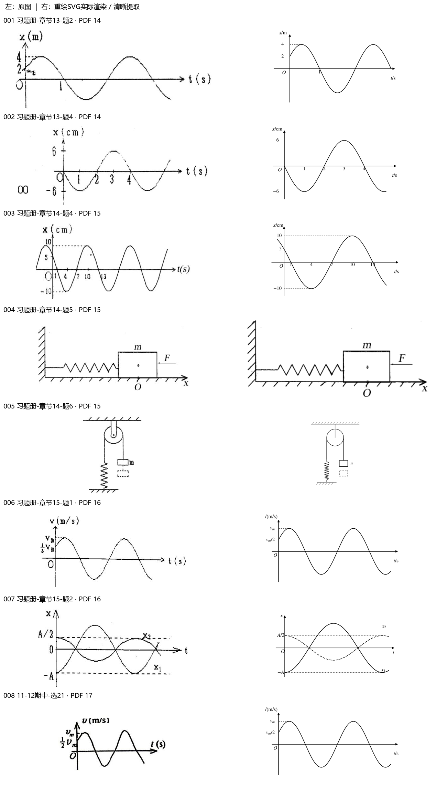
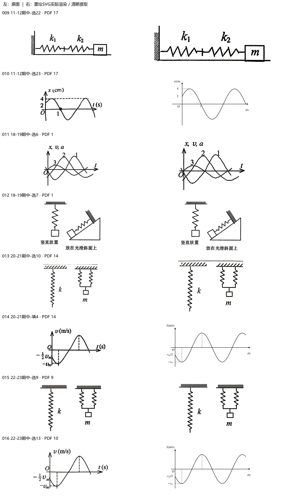
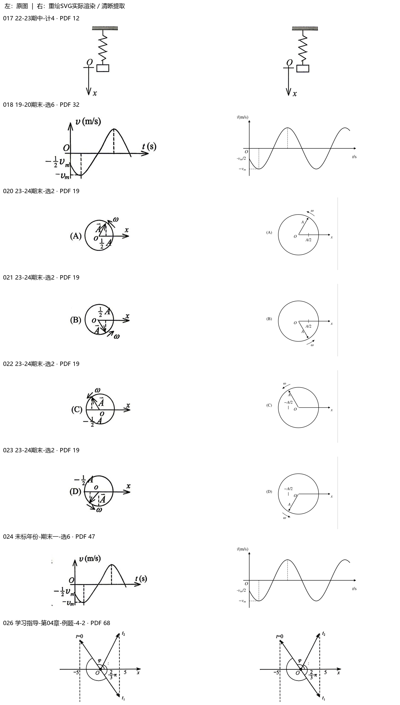
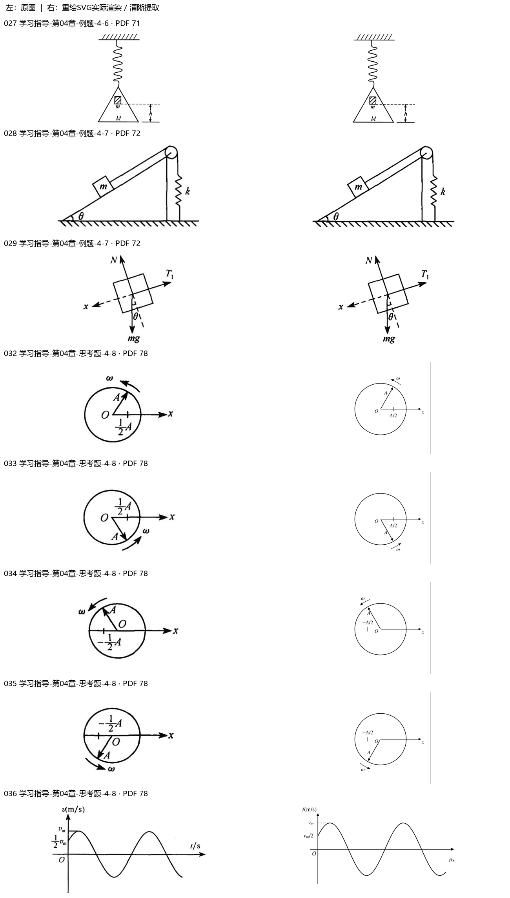
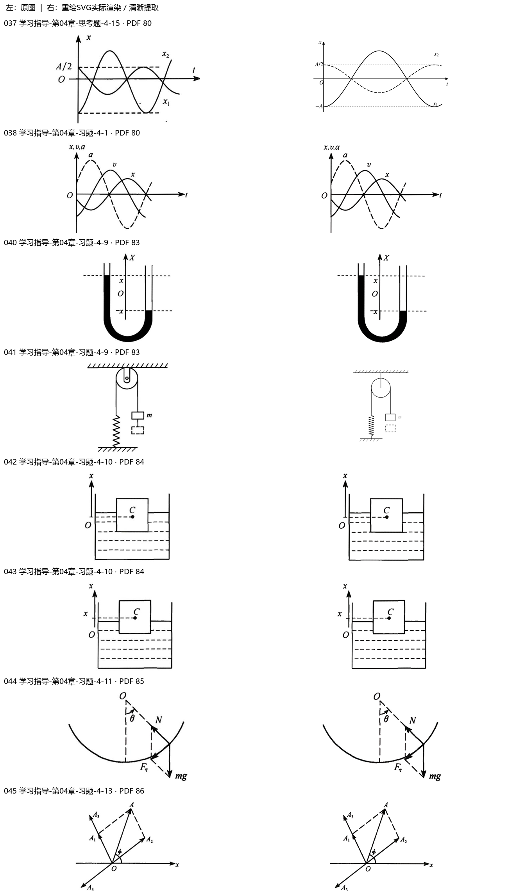
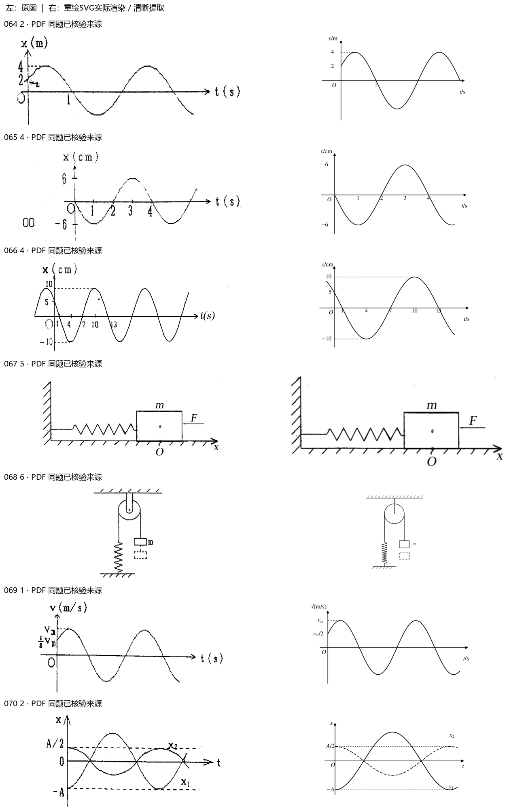
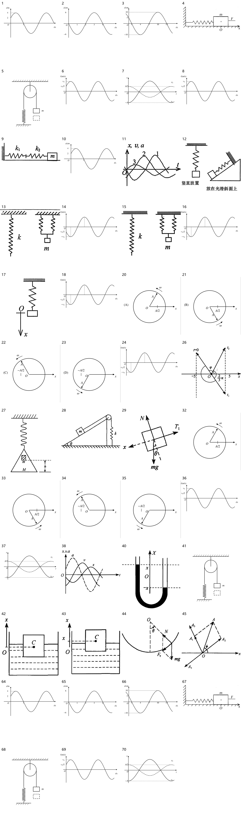

> 派生文件，可重新生成，勿手改。

# 上册逐章题图 · 04 振动

仅处理上册已确认范围；先尝试原PDF提取，不清楚再重绘。原材料、原图只读保留；只改图片路径，保留原题号、锚点、题面、答案与OCR状态。

本章审查70个图片资产、71处引用。定性图未给出的尺寸/角度/比例不是测量数据。复用图不重复计为独立新图。

[生成代码](../../../../10_%E9%A2%98%E5%BA%93/_assets/%E4%B8%8A%E5%86%8C%E9%80%90%E7%AB%A0/04_%E6%8C%AF%E5%8A%A8/generate.py) · [映射与逐项核验](../../../../10_%E9%A2%98%E5%BA%93/_assets/%E4%B8%8A%E5%86%8C%E9%80%90%E7%AB%A0/04_%E6%8C%AF%E5%8A%A8/mapping.json) · [校验记录](validation.json)

|编号|题号|原图|来源PDF页|处理|核验|
|---|---|---|---|---|---|
|001|习题册-章节13-题2|[cc987054c146a48ec6adf0c937a16c00b23bab6552b64e840739c1f107d6c546.jpg](../../../../10_%E9%A2%98%E5%BA%93/_assets/%E4%B9%A0%E9%A2%98%E5%86%8C/cc987054c146a48ec6adf0c937a16c00b23bab6552b64e840739c1f107d6c546.jpg)|14|redrawn [001.svg](../../../../10_%E9%A2%98%E5%BA%93/_assets/%E4%B8%8A%E5%86%8C%E9%80%90%E7%AB%A0/04_%E6%8C%AF%E5%8A%A8/001.svg)|定量：x/m，幅度4，初位移2且先向上，t=1s向下过零。按约束绘制4cos(5πt/6-π/3)，不将答案周期写入图。|
|002|习题册-章节13-题4|[f68bc045adfa88737ab87cec38578b1dac46a1135b4b7e9078e29e06842bf1d3.jpg](../../../../10_%E9%A2%98%E5%BA%93/_assets/%E4%B9%A0%E9%A2%98%E5%86%8C/f68bc045adfa88737ab87cec38578b1dac46a1135b4b7e9078e29e06842bf1d3.jpg)|14|redrawn [002.svg](../../../../10_%E9%A2%98%E5%BA%93/_assets/%E4%B8%8A%E5%86%8C%E9%80%90%E7%AB%A0/04_%E6%8C%AF%E5%8A%A8/002.svg)|定量：x/cm、t/s，振幅6；0过零向下，1/3为谷/峰，2/4过零，按-6sin(πt/2)重建。|
|003|习题册-章节14-题4|[f7282b4d58c82b654d17d022a794552081a044ec9c6f38b81681309fa12d994e.jpg](../../../../10_%E9%A2%98%E5%BA%93/_assets/%E4%B9%A0%E9%A2%98%E5%86%8C/f7282b4d58c82b654d17d022a794552081a044ec9c6f38b81681309fa12d994e.jpg)|15|redrawn [003.svg](../../../../10_%E9%A2%98%E5%BA%93/_assets/%E4%B8%8A%E5%86%8C%E9%80%90%E7%AB%A0/04_%E6%8C%AF%E5%8A%A8/003.svg)|定量：幅度10cm、初位移5cm向下；1/7/13s过零、4s谷、10s峰；按10cos(πt/6+π/3)重建。|
|004|习题册-章节14-题5|[de5ba0a812896e275130f1fc852bd54e065e53900adcfa14f3f99b256bd68679.jpg](../../../../10_%E9%A2%98%E5%BA%93/_assets/%E4%B9%A0%E9%A2%98%E5%86%8C/de5ba0a812896e275130f1fc852bd54e065e53900adcfa14f3f99b256bd68679.jpg)|15|native_extraction [004-extracted.png](../../../../10_%E9%A2%98%E5%BA%93/_assets/%E4%B8%8A%E5%86%8C%E9%80%90%E7%AB%A0/04_%E6%8C%AF%E5%8A%A8/004-extracted.png)|墙-弹簧-物块m、O/x及F标记，原箭头不清时不擅自改变其线形，保持原像素。 原生裁图，不插值放大。|
|005|习题册-章节14-题6|[abb48843952d51eb6b5ee2c7807a5a339d2b1ac574877ade477f96cd5316384d.jpg](../../../../10_%E9%A2%98%E5%BA%93/_assets/%E4%B9%A0%E9%A2%98%E5%86%8C/abb48843952d51eb6b5ee2c7807a5a339d2b1ac574877ade477f96cd5316384d.jpg)|15|redrawn [005.svg](../../../../10_%E9%A2%98%E5%BA%93/_assets/%E4%B8%8A%E5%86%8C%E9%80%90%E7%AB%A0/04_%E6%8C%AF%E5%8A%A8/005.svg)|定滑轮右挂m与下方虚线位置，左绳连接竖直弹簧，支点与连接未变。|
|006|习题册-章节15-题1|[c88914bcdb004d3f27968da45b03b268d8ba1ed6d13fe54318f3cbf70da1f4aa.jpg](../../../../10_%E9%A2%98%E5%BA%93/_assets/%E4%B9%A0%E9%A2%98%E5%86%8C/c88914bcdb004d3f27968da45b03b268d8ba1ed6d13fe54318f3cbf70da1f4aa.jpg)|16|redrawn [006.svg](../../../../10_%E9%A2%98%E5%BA%93/_assets/%E4%B8%8A%E5%86%8C%E9%80%90%E7%AB%A0/04_%E6%8C%AF%E5%8A%A8/006.svg)|定性速度曲线：初v=vm/2且上升；纵轴v/(m/s)、横轴t/s，无数字时间刻度，不假定周期数值。|
|007|习题册-章节15-题2|[d3cceb5d0c4cb9da347218fc2c1ffd5388bbc1a76c88f881d668b5ba070524cb.jpg](../../../../10_%E9%A2%98%E5%BA%93/_assets/%E4%B9%A0%E9%A2%98%E5%86%8C/d3cceb5d0c4cb9da347218fc2c1ffd5388bbc1a76c88f881d668b5ba070524cb.jpg)|16|redrawn [007.svg](../../../../10_%E9%A2%98%E5%BA%93/_assets/%E4%B8%8A%E5%86%8C%E9%80%90%E7%AB%A0/04_%E6%8C%AF%E5%8A%A8/007.svg)|定性叠加曲线：x1起始-A、x2起始A/2，同频反相；x2改虚线以便黑白辨认，无数值周期。|
|008|11-12期中-选21|[4c321022dac83e63e3abf441aec1535f65d34f53e1b6995ffecc5c547b0a3310.jpg](../../../../10_%E9%A2%98%E5%BA%93/_assets/%E5%8E%86%E5%B9%B4%E8%AF%95%E5%8D%B7%E5%90%88%E9%9B%86_2018-2024/4c321022dac83e63e3abf441aec1535f65d34f53e1b6995ffecc5c547b0a3310.jpg)|17|reuse_redraw [006.svg](../../../../10_%E9%A2%98%E5%BA%93/_assets/%E4%B8%8A%E5%86%8C%E9%80%90%E7%AB%A0/04_%E6%8C%AF%E5%8A%A8/006.svg)|与已核验资产006的给定标注、初态和方向相同；复用产物，原文/显示宽度保留。|
|009|11-12期中-选22|[02f01804c7882cabbdd24c8349fac295eac2070567cfdd56a8743548904c935e.jpg](../../../../10_%E9%A2%98%E5%BA%93/_assets/%E5%8E%86%E5%B9%B4%E8%AF%95%E5%8D%B7%E5%90%88%E9%9B%86_2018-2024/02f01804c7882cabbdd24c8349fac295eac2070567cfdd56a8743548904c935e.jpg)|17|native_extraction [009-extracted.png](../../../../10_%E9%A2%98%E5%BA%93/_assets/%E4%B8%8A%E5%86%8C%E9%80%90%E7%AB%A0/04_%E6%8C%AF%E5%8A%A8/009-extracted.png)|墙、串联k1/k2弹簧及m，连接可辨。 原生裁图，不插值放大。|
|010|11-12期中-选23|[3c582ef7b232ffe9078ffc6c535dd2ca4c07cf7dce498c7d9baf129371cdd190.jpg](../../../../10_%E9%A2%98%E5%BA%93/_assets/%E5%8E%86%E5%B9%B4%E8%AF%95%E5%8D%B7%E5%90%88%E9%9B%86_2018-2024/3c582ef7b232ffe9078ffc6c535dd2ca4c07cf7dce498c7d9baf129371cdd190.jpg)|17|redrawn [010.svg](../../../../10_%E9%A2%98%E5%BA%93/_assets/%E4%B8%8A%E5%86%8C%E9%80%90%E7%AB%A0/04_%E6%8C%AF%E5%8A%A8/010.svg)|定量：x/cm、振幅4、初位移2、t=1s向下过零，约束同第001图，单位保留为cm。|
|011|18-19期中-选6|[9fa01f5710da713e100a2d3cd33605127de68ea9625bfa5bf8c6a9dbd3d1e09b.jpg](../../../../10_%E9%A2%98%E5%BA%93/_assets/%E5%8E%86%E5%B9%B4%E8%AF%95%E5%8D%B7%E5%90%88%E9%9B%86_2018-2024/9fa01f5710da713e100a2d3cd33605127de68ea9625bfa5bf8c6a9dbd3d1e09b.jpg)|1|native_extraction [011-extracted.png](../../../../10_%E9%A2%98%E5%BA%93/_assets/%E4%B8%8A%E5%86%8C%E9%80%90%E7%AB%A0/04_%E6%8C%AF%E5%8A%A8/011-extracted.png)|纵轴x/v/a、横轴t，编号1/2/3和三曲线关系保持；不把编号当物理单位。 原生裁图，不插值放大。|
|012|18-19期中-选7|[c971b62b2c7da0250030363383c814eccb9cf6d29ae52a7fab844727fd14bdb3.jpg](../../../../10_%E9%A2%98%E5%BA%93/_assets/%E5%8E%86%E5%B9%B4%E8%AF%95%E5%8D%B7%E5%90%88%E9%9B%86_2018-2024/c971b62b2c7da0250030363383c814eccb9cf6d29ae52a7fab844727fd14bdb3.jpg)|1|native_extraction [012-extracted.png](../../../../10_%E9%A2%98%E5%BA%93/_assets/%E4%B8%8A%E5%86%8C%E9%80%90%E7%AB%A0/04_%E6%8C%AF%E5%8A%A8/012-extracted.png)|竖直弹簧与斜面弹簧两图及中文放置说明完整；不添加斜角数值。 原生裁图，不插值放大。|
|013|20-21期中-选10|[7eb6844acb1ed5d05d8f8ecfaf38d4c64bd33788758fd452717a7ed9f93cc292.jpg](../../../../10_%E9%A2%98%E5%BA%93/_assets/%E6%9C%9F%E4%B8%AD%E8%AF%95%E5%8D%B7_2020-2025/7eb6844acb1ed5d05d8f8ecfaf38d4c64bd33788758fd452717a7ed9f93cc292.jpg)|14|native_extraction [013-extracted.png](../../../../10_%E9%A2%98%E5%BA%93/_assets/%E4%B8%8A%E5%86%8C%E9%80%90%E7%AB%A0/04_%E6%8C%AF%E5%8A%A8/013-extracted.png)|左单弹簧k、右并联两弹簧及m，保持串并联拓扑。 原生裁图，不插值放大。|
|014|20-21期中-填4|[6c07330c2cf3d5727a0ee85d4ad242eebc0e8cefa8f2ddb7f6c88524b465261d.jpg](../../../../10_%E9%A2%98%E5%BA%93/_assets/%E6%9C%9F%E4%B8%AD%E8%AF%95%E5%8D%B7_2020-2025/6c07330c2cf3d5727a0ee85d4ad242eebc0e8cefa8f2ddb7f6c88524b465261d.jpg)|14|redrawn [014.svg](../../../../10_%E9%A2%98%E5%BA%93/_assets/%E4%B8%8A%E5%86%8C%E9%80%90%E7%AB%A0/04_%E6%8C%AF%E5%8A%A8/014.svg)|定性速度曲线：初-vm/2且继续下降，谷-vm、峰vm；极值投影虚线保留，无数值时间或周期。|
|015|22-23期中-选9|[c500934efcf9ecaf44c6ef1c58b7415cab1242edaee04e105ab2684f5cdeadd5.jpg](../../../../10_%E9%A2%98%E5%BA%93/_assets/%E6%9C%9F%E4%B8%AD%E8%AF%95%E5%8D%B7_2020-2025/c500934efcf9ecaf44c6ef1c58b7415cab1242edaee04e105ab2684f5cdeadd5.jpg)|9|native_extraction [015-extracted.png](../../../../10_%E9%A2%98%E5%BA%93/_assets/%E4%B8%8A%E5%86%8C%E9%80%90%E7%AB%A0/04_%E6%8C%AF%E5%8A%A8/015-extracted.png)|弹簧切分与并联示意，k/m及支架完整。 原生裁图，不插值放大。|
|016|22-23期中-选13|[8c9b11f1deb58f2a7e8190c299c944e8c7975be3f5f6fb38e707c708a5c84c91.jpg](../../../../10_%E9%A2%98%E5%BA%93/_assets/%E6%9C%9F%E4%B8%AD%E8%AF%95%E5%8D%B7_2020-2025/8c9b11f1deb58f2a7e8190c299c944e8c7975be3f5f6fb38e707c708a5c84c91.jpg)|10|reuse_redraw [014.svg](../../../../10_%E9%A2%98%E5%BA%93/_assets/%E4%B8%8A%E5%86%8C%E9%80%90%E7%AB%A0/04_%E6%8C%AF%E5%8A%A8/014.svg)|与已核验资产014的给定标注、初态和方向相同；复用产物，原文/显示宽度保留。|
|017|22-23期中-计4|[38cfa297a1f5843ebea728c9da63dc537326611545846a640829987517709c1d.jpg](../../../../10_%E9%A2%98%E5%BA%93/_assets/%E6%9C%9F%E4%B8%AD%E8%AF%95%E5%8D%B7_2020-2025/38cfa297a1f5843ebea728c9da63dc537326611545846a640829987517709c1d.jpg)|12|native_extraction [017-extracted.png](../../../../10_%E9%A2%98%E5%BA%93/_assets/%E4%B8%8A%E5%86%8C%E9%80%90%E7%AB%A0/04_%E6%8C%AF%E5%8A%A8/017-extracted.png)|竖直弹簧、O参考位和x向下，质块与轴位置不变。 原生裁图，不插值放大。|
|018|19-20期末-选6|[b87aa123b73b9e2ba28239f8e6ba0a0f92ff8064a757a0a424bb95ee732ef498.jpg](../../../../10_%E9%A2%98%E5%BA%93/_assets/%E5%8E%86%E5%B9%B4%E8%AF%95%E5%8D%B7%E5%90%88%E9%9B%86_2018-2024/b87aa123b73b9e2ba28239f8e6ba0a0f92ff8064a757a0a424bb95ee732ef498.jpg)|32|reuse_redraw [014.svg](../../../../10_%E9%A2%98%E5%BA%93/_assets/%E4%B8%8A%E5%86%8C%E9%80%90%E7%AB%A0/04_%E6%8C%AF%E5%8A%A8/014.svg)|与已核验资产014的给定标注、初态和方向相同；复用产物，原文/显示宽度保留。|
|019|22-23期末-选3|[5dcdda5ee64be65c6d29612043efcdbe7f7f765e832c3d56d9cffe961fe13e8d.jpg](../../../../10_%E9%A2%98%E5%BA%93/_assets/%E5%8E%86%E5%B9%B4%E8%AF%95%E5%8D%B7%E5%90%88%E9%9B%86_2018-2024/5dcdda5ee64be65c6d29612043efcdbe7f7f765e832c3d56d9cffe961fe13e8d.jpg)|23|retained_uncertain|源扫描有手写叠加或刻度边界歧义；保留原图，不补函数或拆分题目归属。|
|020|23-24期末-选2|[f810df5d2a7931444fcaabb5a6a17c5a386e63773135a7447d1af3a554606773.jpg](../../../../10_%E9%A2%98%E5%BA%93/_assets/%E5%8E%86%E5%B9%B4%E8%AF%95%E5%8D%B7%E5%90%88%E9%9B%86_2018-2024/f810df5d2a7931444fcaabb5a6a17c5a386e63773135a7447d1af3a554606773.jpg)|19|redrawn [020.svg](../../../../10_%E9%A2%98%E5%BA%93/_assets/%E4%B8%8A%E5%86%8C%E9%80%90%E7%AB%A0/04_%E6%8C%AF%E5%8A%A8/020.svg)|旋转矢量A、O/x、±A/2投影与逆时针ω逐项核对；未把选项图改成正确答案。 选项括号与字母保留。|
|021|23-24期末-选2|[29742d1c54d52ba53bd35b8065a1abaa6419e94e81a4d3bec8800887f37ccab5.jpg](../../../../10_%E9%A2%98%E5%BA%93/_assets/%E5%8E%86%E5%B9%B4%E8%AF%95%E5%8D%B7%E5%90%88%E9%9B%86_2018-2024/29742d1c54d52ba53bd35b8065a1abaa6419e94e81a4d3bec8800887f37ccab5.jpg)|19|redrawn [021.svg](../../../../10_%E9%A2%98%E5%BA%93/_assets/%E4%B8%8A%E5%86%8C%E9%80%90%E7%AB%A0/04_%E6%8C%AF%E5%8A%A8/021.svg)|旋转矢量A、O/x、±A/2投影与逆时针ω逐项核对；未把选项图改成正确答案。 选项括号与字母保留。|
|022|23-24期末-选2|[07b9aac78e08e2e50802b4a5538cc6164b6f5ff03fc16f4cd94e23185ebe368e.jpg](../../../../10_%E9%A2%98%E5%BA%93/_assets/%E5%8E%86%E5%B9%B4%E8%AF%95%E5%8D%B7%E5%90%88%E9%9B%86_2018-2024/07b9aac78e08e2e50802b4a5538cc6164b6f5ff03fc16f4cd94e23185ebe368e.jpg)|19|redrawn [022.svg](../../../../10_%E9%A2%98%E5%BA%93/_assets/%E4%B8%8A%E5%86%8C%E9%80%90%E7%AB%A0/04_%E6%8C%AF%E5%8A%A8/022.svg)|旋转矢量A、O/x、±A/2投影与逆时针ω逐项核对；未把选项图改成正确答案。 选项括号与字母保留。|
|023|23-24期末-选2|[602f8d508ec60f5321259a69019f042e0c7cb150732225af65da203471d3e14f.jpg](../../../../10_%E9%A2%98%E5%BA%93/_assets/%E5%8E%86%E5%B9%B4%E8%AF%95%E5%8D%B7%E5%90%88%E9%9B%86_2018-2024/602f8d508ec60f5321259a69019f042e0c7cb150732225af65da203471d3e14f.jpg)|19|redrawn [023.svg](../../../../10_%E9%A2%98%E5%BA%93/_assets/%E4%B8%8A%E5%86%8C%E9%80%90%E7%AB%A0/04_%E6%8C%AF%E5%8A%A8/023.svg)|旋转矢量A、O/x、±A/2投影与逆时针ω逐项核对；未把选项图改成正确答案。 选项括号与字母保留。|
|024|未标年份-期末一-选6|[d08316bc35a43768719b6c274cbdc8dede6676fd75712363fad1cc9183487a47.jpg](../../../../10_%E9%A2%98%E5%BA%93/_assets/%E5%8E%86%E5%B9%B4%E8%AF%95%E5%8D%B7%E5%90%88%E9%9B%86_2018-2024/d08316bc35a43768719b6c274cbdc8dede6676fd75712363fad1cc9183487a47.jpg)|47|reuse_redraw [014.svg](../../../../10_%E9%A2%98%E5%BA%93/_assets/%E4%B8%8A%E5%86%8C%E9%80%90%E7%AB%A0/04_%E6%8C%AF%E5%8A%A8/014.svg)|与已核验资产014的给定标注、初态和方向相同；复用产物，原文/显示宽度保留。|
|025|未标年份-期末二-选10|[14310921d5668c06e338a8e6634672c7ba94c65c7e5aaa90809b924639ef0b8b.jpg](../../../../10_%E9%A2%98%E5%BA%93/_assets/%E5%8E%86%E5%B9%B4%E8%AF%95%E5%8D%B7%E5%90%88%E9%9B%86_2018-2024/14310921d5668c06e338a8e6634672c7ba94c65c7e5aaa90809b924639ef0b8b.jpg)|51|retained_uncertain|源扫描有手写叠加或刻度边界歧义；保留原图，不补函数或拆分题目归属。|
|026|学习指导-第04章-例题-4-2|[p0001-0180_540.jpg](../../../../10_%E9%A2%98%E5%BA%93/_assets/%E5%AD%A6%E4%B9%A0%E6%8C%87%E5%AF%BC/p0001-0180_540.jpg)|68|native_extraction [026-extracted.png](../../../../10_%E9%A2%98%E5%BA%93/_assets/%E4%B8%8A%E5%86%8C%E9%80%90%E7%AB%A0/04_%E6%8C%AF%E5%8A%A8/026-extracted.png)|旋转矢量图的t=0/t1/t2、-5/5、2π/3与φ按原图保持，弧线不猜测重配。 原生裁图，不插值放大。|
|027|学习指导-第04章-例题-4-6|[p0001-0180_654.jpg](../../../../10_%E9%A2%98%E5%BA%93/_assets/%E5%AD%A6%E4%B9%A0%E6%8C%87%E5%AF%BC/p0001-0180_654.jpg)|71|native_extraction [027-extracted.png](../../../../10_%E9%A2%98%E5%BA%93/_assets/%E4%B8%8A%E5%86%8C%E9%80%90%E7%AB%A0/04_%E6%8C%AF%E5%8A%A8/027-extracted.png)|弹簧挂盘M与内部m、h的端点，不将示意比例当尺寸。 原生裁图，不插值放大。|
|028|学习指导-第04章-例题-4-7|[p0001-0180_1036.jpg](../../../../10_%E9%A2%98%E5%BA%93/_assets/%E5%AD%A6%E4%B9%A0%E6%8C%87%E5%AF%BC/p0001-0180_1036.jpg)|72|native_extraction [028-extracted.png](../../../../10_%E9%A2%98%E5%BA%93/_assets/%E4%B8%8A%E5%86%8C%E9%80%90%E7%AB%A0/04_%E6%8C%AF%E5%8A%A8/028-extracted.png)|斜面θ、m与滑轮及弹簧k的绳路完整。 原生裁图，不插值放大。|
|029|学习指导-第04章-例题-4-7|[p0001-0180_896.jpg](../../../../10_%E9%A2%98%E5%BA%93/_assets/%E5%AD%A6%E4%B9%A0%E6%8C%87%E5%AF%BC/p0001-0180_896.jpg)|72|native_extraction [029-extracted.png](../../../../10_%E9%A2%98%E5%BA%93/_assets/%E4%B8%8A%E5%86%8C%E9%80%90%E7%AB%A0/04_%E6%8C%AF%E5%8A%A8/029-extracted.png)|N左上、T1右上、mg向下、x沿斜面向左下，θ相对竖直，按原图保留。 原生裁图，不插值放大。|
|030|学习指导-第04章-例题-4-7|[03-pulley-4-7.svg](../../../../10_%E9%A2%98%E5%BA%93/_assets/%E9%87%8D%E7%BB%98_%E4%B8%8A%E5%86%8C_%E6%89%B901/03-pulley-4-7.svg)|同一习题册对应题|already_verified_svg|首批SVG与引用存在，保持不重复替换。|
|031|学习指导-第04章-思考题-4-7|[04-vibration-4-7.svg](../../../../10_%E9%A2%98%E5%BA%93/_assets/%E9%87%8D%E7%BB%98_%E4%B8%8A%E5%86%8C_%E6%89%B901/04-vibration-4-7.svg)|同一习题册对应题|already_verified_svg|首批SVG与引用存在，保持不重复替换。|
|032|学习指导-第04章-思考题-4-8|[p0001-0180_984.jpg](../../../../10_%E9%A2%98%E5%BA%93/_assets/%E5%AD%A6%E4%B9%A0%E6%8C%87%E5%AF%BC/p0001-0180_984.jpg)|78|redrawn [032.svg](../../../../10_%E9%A2%98%E5%BA%93/_assets/%E4%B8%8A%E5%86%8C%E9%80%90%E7%AB%A0/04_%E6%8C%AF%E5%8A%A8/032.svg)|旋转矢量A、O/x、±A/2投影与逆时针ω逐项核对；未把选项图改成正确答案。|
|033|学习指导-第04章-思考题-4-8|[p0001-0180_071.jpg](../../../../10_%E9%A2%98%E5%BA%93/_assets/%E5%AD%A6%E4%B9%A0%E6%8C%87%E5%AF%BC/p0001-0180_071.jpg)|78|redrawn [033.svg](../../../../10_%E9%A2%98%E5%BA%93/_assets/%E4%B8%8A%E5%86%8C%E9%80%90%E7%AB%A0/04_%E6%8C%AF%E5%8A%A8/033.svg)|旋转矢量A、O/x、±A/2投影与逆时针ω逐项核对；未把选项图改成正确答案。|
|034|学习指导-第04章-思考题-4-8|[p0001-0180_901.jpg](../../../../10_%E9%A2%98%E5%BA%93/_assets/%E5%AD%A6%E4%B9%A0%E6%8C%87%E5%AF%BC/p0001-0180_901.jpg)|78|redrawn [034.svg](../../../../10_%E9%A2%98%E5%BA%93/_assets/%E4%B8%8A%E5%86%8C%E9%80%90%E7%AB%A0/04_%E6%8C%AF%E5%8A%A8/034.svg)|旋转矢量A、O/x、±A/2投影与逆时针ω逐项核对；未把选项图改成正确答案。|
|035|学习指导-第04章-思考题-4-8|[p0001-0180_773.jpg](../../../../10_%E9%A2%98%E5%BA%93/_assets/%E5%AD%A6%E4%B9%A0%E6%8C%87%E5%AF%BC/p0001-0180_773.jpg)|78|redrawn [035.svg](../../../../10_%E9%A2%98%E5%BA%93/_assets/%E4%B8%8A%E5%86%8C%E9%80%90%E7%AB%A0/04_%E6%8C%AF%E5%8A%A8/035.svg)|旋转矢量A、O/x、±A/2投影与逆时针ω逐项核对；未把选项图改成正确答案。|
|036|学习指导-第04章-思考题-4-8|[p0001-0180_862.jpg](../../../../10_%E9%A2%98%E5%BA%93/_assets/%E5%AD%A6%E4%B9%A0%E6%8C%87%E5%AF%BC/p0001-0180_862.jpg)|78|reuse_redraw [006.svg](../../../../10_%E9%A2%98%E5%BA%93/_assets/%E4%B8%8A%E5%86%8C%E9%80%90%E7%AB%A0/04_%E6%8C%AF%E5%8A%A8/006.svg)|与已核验资产006的给定标注、初态和方向相同；复用产物，原文/显示宽度保留。|
|037|学习指导-第04章-思考题-4-15|[p0001-0180_129.jpg](../../../../10_%E9%A2%98%E5%BA%93/_assets/%E5%AD%A6%E4%B9%A0%E6%8C%87%E5%AF%BC/p0001-0180_129.jpg)|80|reuse_redraw [007.svg](../../../../10_%E9%A2%98%E5%BA%93/_assets/%E4%B8%8A%E5%86%8C%E9%80%90%E7%AB%A0/04_%E6%8C%AF%E5%8A%A8/007.svg)|与已核验资产007的给定标注、初态和方向相同；复用产物，原文/显示宽度保留。|
|038|学习指导-第04章-习题-4-1|[p0001-0180_763.jpg](../../../../10_%E9%A2%98%E5%BA%93/_assets/%E5%AD%A6%E4%B9%A0%E6%8C%87%E5%AF%BC/p0001-0180_763.jpg)|80|native_extraction [038-extracted.png](../../../../10_%E9%A2%98%E5%BA%93/_assets/%E4%B8%8A%E5%86%8C%E9%80%90%E7%AB%A0/04_%E6%8C%AF%E5%8A%A8/038-extracted.png)|同轴x/v/a与t；三曲线相位、a虚线、v/x实线及标识保持。 原生裁图，不插值放大。|
|039|学习指导-第04章-习题-4-5|[p0001-0180_291.jpg](../../../../10_%E9%A2%98%E5%BA%93/_assets/%E5%AD%A6%E4%B9%A0%E6%8C%87%E5%AF%BC/p0001-0180_291.jpg)|82|retained_clear|原图已有清晰线条、文字、轴标和可辨曲线；按排除已清楚图的要求保留。彩色图的点名、投影线或频率差仍可辨，不把色彩当唯一物理依据。|
|040|学习指导-第04章-习题-4-9|[p0001-0180_109.jpg](../../../../10_%E9%A2%98%E5%BA%93/_assets/%E5%AD%A6%E4%B9%A0%E6%8C%87%E5%AF%BC/p0001-0180_109.jpg)|83|native_extraction [040-extracted.png](../../../../10_%E9%A2%98%E5%BA%93/_assets/%E4%B8%8A%E5%86%8C%E9%80%90%E7%AB%A0/04_%E6%8C%AF%E5%8A%A8/040-extracted.png)|U管左右液面相反，竖直X正向上，O与+x/-x虚线端点不变。 原生裁图，不插值放大。|
|041|学习指导-第04章-习题-4-9|[p0001-0180_840.jpg](../../../../10_%E9%A2%98%E5%BA%93/_assets/%E5%AD%A6%E4%B9%A0%E6%8C%87%E5%AF%BC/p0001-0180_840.jpg)|83|reuse_redraw [005.svg](../../../../10_%E9%A2%98%E5%BA%93/_assets/%E4%B8%8A%E5%86%8C%E9%80%90%E7%AB%A0/04_%E6%8C%AF%E5%8A%A8/005.svg)|与已核验资产005的给定标注、初态和方向相同；复用产物，原文/显示宽度保留。|
|042|学习指导-第04章-习题-4-10|[p0001-0180_1124.jpg](../../../../10_%E9%A2%98%E5%BA%93/_assets/%E5%AD%A6%E4%B9%A0%E6%8C%87%E5%AF%BC/p0001-0180_1124.jpg)|84|native_extraction [042-extracted.png](../../../../10_%E9%A2%98%E5%BA%93/_assets/%E4%B8%8A%E5%86%8C%E9%80%90%E7%AB%A0/04_%E6%8C%AF%E5%8A%A8/042-extracted.png)|浮体C与液面、O及坐标x/虚线位置保留，未添加原图没有的数值密度。 原生裁图，不插值放大。|
|043|学习指导-第04章-习题-4-10|[p0001-0180_816.jpg](../../../../10_%E9%A2%98%E5%BA%93/_assets/%E5%AD%A6%E4%B9%A0%E6%8C%87%E5%AF%BC/p0001-0180_816.jpg)|84|native_extraction [043-extracted.png](../../../../10_%E9%A2%98%E5%BA%93/_assets/%E4%B8%8A%E5%86%8C%E9%80%90%E7%AB%A0/04_%E6%8C%AF%E5%8A%A8/043-extracted.png)|浮体向上偏移x、C、液面与O关系保持。 原生裁图，不插值放大。|
|044|学习指导-第04章-习题-4-11|[p0001-0180_621.jpg](../../../../10_%E9%A2%98%E5%BA%93/_assets/%E5%AD%A6%E4%B9%A0%E6%8C%87%E5%AF%BC/p0001-0180_621.jpg)|85|native_extraction [044-extracted.png](../../../../10_%E9%A2%98%E5%BA%93/_assets/%E4%B8%8A%E5%86%8C%E9%80%90%E7%AB%A0/04_%E6%8C%AF%E5%8A%A8/044-extracted.png)|曲面O/θ、N、Fτ与mg方向及接触点保持，不把未知曲线强制改成抛物线。 原生裁图，不插值放大。|
|045|学习指导-第04章-习题-4-13|[p0001-0180_283.jpg](../../../../10_%E9%A2%98%E5%BA%93/_assets/%E5%AD%A6%E4%B9%A0%E6%8C%87%E5%AF%BC/p0001-0180_283.jpg)|86|native_extraction [045-extracted.png](../../../../10_%E9%A2%98%E5%BA%93/_assets/%E4%B8%8A%E5%86%8C%E9%80%90%E7%AB%A0/04_%E6%8C%AF%E5%8A%A8/045-extracted.png)|A1/A2/A3与合矢量A、O/x、φ及虚线平行四边形连接保留。 原生裁图，不插值放大。|
|046|清华题库-振动-176|[ee9efcc0fb62bcb543182b7dfdcf2989b49e0274e094e004a5512bb3d6733999.jpg](../../../../10_%E9%A2%98%E5%BA%93/_assets/%E6%B8%85%E5%8D%8E%E9%A2%98%E5%BA%93/ee9efcc0fb62bcb543182b7dfdcf2989b49e0274e094e004a5512bb3d6733999.jpg)|8|retained_clear|原图已有清晰线条、文字、轴标和可辨曲线；按排除已清楚图的要求保留。彩色图的点名、投影线或频率差仍可辨，不把色彩当唯一物理依据。|
|047|清华题库-振动-183|[ff13e81bf283b3dd0e2b9214e152b847d8d95ac5c5dec1355797c2fe46d2bea0.jpg](../../../../10_%E9%A2%98%E5%BA%93/_assets/%E6%B8%85%E5%8D%8E%E9%A2%98%E5%BA%93/ff13e81bf283b3dd0e2b9214e152b847d8d95ac5c5dec1355797c2fe46d2bea0.jpg)|9|retained_clear|原图已有清晰线条、文字、轴标和可辨曲线；按排除已清楚图的要求保留。彩色图的点名、投影线或频率差仍可辨，不把色彩当唯一物理依据。|
|048|清华题库-振动-184|[d02ea7999681e0c591940722d7aad32aa799fff9cc215cea88df9e4a2adbd9d0.jpg](../../../../10_%E9%A2%98%E5%BA%93/_assets/%E6%B8%85%E5%8D%8E%E9%A2%98%E5%BA%93/d02ea7999681e0c591940722d7aad32aa799fff9cc215cea88df9e4a2adbd9d0.jpg)|9|retained_clear|原图已有清晰线条、文字、轴标和可辨曲线；按排除已清楚图的要求保留。彩色图的点名、投影线或频率差仍可辨，不把色彩当唯一物理依据。|
|049|清华题库-振动-184|[01ab32ef7527829b18fca6837ec33c7f35e71fefbed056e83bf55bac7ebe17ab.jpg](../../../../10_%E9%A2%98%E5%BA%93/_assets/%E6%B8%85%E5%8D%8E%E9%A2%98%E5%BA%93/01ab32ef7527829b18fca6837ec33c7f35e71fefbed056e83bf55bac7ebe17ab.jpg)|9|retained_clear|原图已有清晰线条、文字、轴标和可辨曲线；按排除已清楚图的要求保留。彩色图的点名、投影线或频率差仍可辨，不把色彩当唯一物理依据。|
|050|清华题库-振动-184|[8241b3d97dfb4f2a96837ba5552a0a8c2a9fca8089bdda5d83e34854cfd7e346.jpg](../../../../10_%E9%A2%98%E5%BA%93/_assets/%E6%B8%85%E5%8D%8E%E9%A2%98%E5%BA%93/8241b3d97dfb4f2a96837ba5552a0a8c2a9fca8089bdda5d83e34854cfd7e346.jpg)|9|retained_clear|原图已有清晰线条、文字、轴标和可辨曲线；按排除已清楚图的要求保留。彩色图的点名、投影线或频率差仍可辨，不把色彩当唯一物理依据。|
|051|清华题库-振动-184|[0ca3a1bed804377cb53ea91529bd4da7d45c21576415cbd5f8f36581ceb5af21.jpg](../../../../10_%E9%A2%98%E5%BA%93/_assets/%E6%B8%85%E5%8D%8E%E9%A2%98%E5%BA%93/0ca3a1bed804377cb53ea91529bd4da7d45c21576415cbd5f8f36581ceb5af21.jpg)|9|retained_clear|原图已有清晰线条、文字、轴标和可辨曲线；按排除已清楚图的要求保留。彩色图的点名、投影线或频率差仍可辨，不把色彩当唯一物理依据。|
|052|清华题库-振动-186|[ddc447271225baf3beefaeeba4f6606b500f463ffee711ab9b2db2c8157f343a.jpg](../../../../10_%E9%A2%98%E5%BA%93/_assets/%E6%B8%85%E5%8D%8E%E9%A2%98%E5%BA%93/ddc447271225baf3beefaeeba4f6606b500f463ffee711ab9b2db2c8157f343a.jpg)|10|retained_clear|原图已有清晰线条、文字、轴标和可辨曲线；按排除已清楚图的要求保留。彩色图的点名、投影线或频率差仍可辨，不把色彩当唯一物理依据。|
|053|清华题库-振动-187|[bbe7b83b1b5e5feb6d6731d83fa4275c3526d7401452c61c5422daa89c4d3245.jpg](../../../../10_%E9%A2%98%E5%BA%93/_assets/%E6%B8%85%E5%8D%8E%E9%A2%98%E5%BA%93/bbe7b83b1b5e5feb6d6731d83fa4275c3526d7401452c61c5422daa89c4d3245.jpg)|10|retained_clear|原图已有清晰线条、文字、轴标和可辨曲线；按排除已清楚图的要求保留。彩色图的点名、投影线或频率差仍可辨，不把色彩当唯一物理依据。|
|054|清华题库-振动-188|[7615d14041e4dc9fce37abb6feb432c1ba8bfc9a58817fe753806f74bb03cca9.jpg](../../../../10_%E9%A2%98%E5%BA%93/_assets/%E6%B8%85%E5%8D%8E%E9%A2%98%E5%BA%93/7615d14041e4dc9fce37abb6feb432c1ba8bfc9a58817fe753806f74bb03cca9.jpg)|10|retained_clear|原图已有清晰线条、文字、轴标和可辨曲线；按排除已清楚图的要求保留。彩色图的点名、投影线或频率差仍可辨，不把色彩当唯一物理依据。|
|055|清华题库-振动-188|[c8edb1589cdbed4ce77f81c0af5418ff6d54e43c8adb6718c2ab181180a7f41f.jpg](../../../../10_%E9%A2%98%E5%BA%93/_assets/%E6%B8%85%E5%8D%8E%E9%A2%98%E5%BA%93/c8edb1589cdbed4ce77f81c0af5418ff6d54e43c8adb6718c2ab181180a7f41f.jpg)|10|retained_clear|原图已有清晰线条、文字、轴标和可辨曲线；按排除已清楚图的要求保留。彩色图的点名、投影线或频率差仍可辨，不把色彩当唯一物理依据。|
|056|清华题库-振动-196|[5eb75de0097f4fde06afdc889d0cd164c41a7c41c75f1a2f238217c64a6e5c11.jpg](../../../../10_%E9%A2%98%E5%BA%93/_assets/%E6%B8%85%E5%8D%8E%E9%A2%98%E5%BA%93/5eb75de0097f4fde06afdc889d0cd164c41a7c41c75f1a2f238217c64a6e5c11.jpg)|12|retained_clear|原图已有清晰线条、文字、轴标和可辨曲线；按排除已清楚图的要求保留。彩色图的点名、投影线或频率差仍可辨，不把色彩当唯一物理依据。|
|057|清华题库-振动-205|[6aae6dee9d873ef9c99b6ca14b5791589dc542fa389d97ccfed939c093b4dd15.jpg](../../../../10_%E9%A2%98%E5%BA%93/_assets/%E6%B8%85%E5%8D%8E%E9%A2%98%E5%BA%93/6aae6dee9d873ef9c99b6ca14b5791589dc542fa389d97ccfed939c093b4dd15.jpg)|13|retained_clear|原图已有清晰线条、文字、轴标和可辨曲线；按排除已清楚图的要求保留。彩色图的点名、投影线或频率差仍可辨，不把色彩当唯一物理依据。|
|058|清华题库-振动-206|[2e950416c76c42feb8270dcf9499732b41ba0bc43365798121a6c0583bcbe82e.jpg](../../../../10_%E9%A2%98%E5%BA%93/_assets/%E6%B8%85%E5%8D%8E%E9%A2%98%E5%BA%93/2e950416c76c42feb8270dcf9499732b41ba0bc43365798121a6c0583bcbe82e.jpg)|14|retained_clear|原图已有清晰线条、文字、轴标和可辨曲线；按排除已清楚图的要求保留。彩色图的点名、投影线或频率差仍可辨，不把色彩当唯一物理依据。|
|059|清华题库-振动-207|[94ec456e7616d169318a5fc6bd1ecd3270544c26795f34a0f32a22fb8b9fef97.jpg](../../../../10_%E9%A2%98%E5%BA%93/_assets/%E6%B8%85%E5%8D%8E%E9%A2%98%E5%BA%93/94ec456e7616d169318a5fc6bd1ecd3270544c26795f34a0f32a22fb8b9fef97.jpg)|14|retained_clear|原图已有清晰线条、文字、轴标和可辨曲线；按排除已清楚图的要求保留。彩色图的点名、投影线或频率差仍可辨，不把色彩当唯一物理依据。|
|060|清华题库-振动-208|[cefae6734b9098448bf68752800d2140db6a8a5977f41456c5609cc054947834.jpg](../../../../10_%E9%A2%98%E5%BA%93/_assets/%E6%B8%85%E5%8D%8E%E9%A2%98%E5%BA%93/cefae6734b9098448bf68752800d2140db6a8a5977f41456c5609cc054947834.jpg)|14|retained_clear|原图已有清晰线条、文字、轴标和可辨曲线；按排除已清楚图的要求保留。彩色图的点名、投影线或频率差仍可辨，不把色彩当唯一物理依据。|
|061|清华题库-振动-209|[481778016a61ec7d6d82765aec4a8e08661d2e65c6aa0e2b923f75d32ac471a2.jpg](../../../../10_%E9%A2%98%E5%BA%93/_assets/%E6%B8%85%E5%8D%8E%E9%A2%98%E5%BA%93/481778016a61ec7d6d82765aec4a8e08661d2e65c6aa0e2b923f75d32ac471a2.jpg)|15|retained_clear|原图已有清晰线条、文字、轴标和可辨曲线；按排除已清楚图的要求保留。彩色图的点名、投影线或频率差仍可辨，不把色彩当唯一物理依据。|
|062|清华题库-振动-210|[0be01d6992c08bbc8441e7779c989ddd489eb573546b4989fb19b8bf1aa09d6d.jpg](../../../../10_%E9%A2%98%E5%BA%93/_assets/%E6%B8%85%E5%8D%8E%E9%A2%98%E5%BA%93/0be01d6992c08bbc8441e7779c989ddd489eb573546b4989fb19b8bf1aa09d6d.jpg)|15|retained_clear|原图已有清晰线条、文字、轴标和可辨曲线；按排除已清楚图的要求保留。彩色图的点名、投影线或频率差仍可辨，不把色彩当唯一物理依据。|
|063|清华题库-振动-226|[6b963e3a34b559210677be0162ecfd7fba6e1e8c290fc6aa1ba93b386f734d12.jpg](../../../../10_%E9%A2%98%E5%BA%93/_assets/%E6%B8%85%E5%8D%8E%E9%A2%98%E5%BA%93/6b963e3a34b559210677be0162ecfd7fba6e1e8c290fc6aa1ba93b386f734d12.jpg)|17|retained_clear|原图已有清晰线条、文字、轴标和可辨曲线；按排除已清楚图的要求保留。彩色图的点名、投影线或频率差仍可辨，不把色彩当唯一物理依据。|
|064|2|[图1.png](../../../../%E5%A4%A7%E5%AD%A6%E7%89%A9%E7%90%86%E4%B9%A0%E9%A2%98%E5%86%8C%EF%BC%88%E4%B8%8A%EF%BC%89/_assets/13_%E4%B9%A0%E9%A2%98%E5%8D%81%E4%B8%89%20%E6%8C%AF%E5%8A%A8%EF%BC%88%E4%B8%80%EF%BC%89/%E5%9B%BE1.png)|同一习题册对应题|reuse_redraw [001.svg](../../../../10_%E9%A2%98%E5%BA%93/_assets/%E4%B8%8A%E5%86%8C%E9%80%90%E7%AB%A0/04_%E6%8C%AF%E5%8A%A8/001.svg)|与已核验资产001的给定标注、初态和方向相同；复用产物，原文/显示宽度保留。|
|065|4|[图2.png](../../../../%E5%A4%A7%E5%AD%A6%E7%89%A9%E7%90%86%E4%B9%A0%E9%A2%98%E5%86%8C%EF%BC%88%E4%B8%8A%EF%BC%89/_assets/13_%E4%B9%A0%E9%A2%98%E5%8D%81%E4%B8%89%20%E6%8C%AF%E5%8A%A8%EF%BC%88%E4%B8%80%EF%BC%89/%E5%9B%BE2.png)|同一习题册对应题|reuse_redraw [002.svg](../../../../10_%E9%A2%98%E5%BA%93/_assets/%E4%B8%8A%E5%86%8C%E9%80%90%E7%AB%A0/04_%E6%8C%AF%E5%8A%A8/002.svg)|与已核验资产002的给定标注、初态和方向相同；复用产物，原文/显示宽度保留。|
|066|4|[图1.png](../../../../%E5%A4%A7%E5%AD%A6%E7%89%A9%E7%90%86%E4%B9%A0%E9%A2%98%E5%86%8C%EF%BC%88%E4%B8%8A%EF%BC%89/_assets/14_%E4%B9%A0%E9%A2%98%E5%8D%81%E5%9B%9B%20%E6%8C%AF%E5%8A%A8%EF%BC%88%E4%BA%8C%EF%BC%89/%E5%9B%BE1.png)|同一习题册对应题|reuse_redraw [003.svg](../../../../10_%E9%A2%98%E5%BA%93/_assets/%E4%B8%8A%E5%86%8C%E9%80%90%E7%AB%A0/04_%E6%8C%AF%E5%8A%A8/003.svg)|与已核验资产003的给定标注、初态和方向相同；复用产物，原文/显示宽度保留。|
|067|5|[图2.png](../../../../%E5%A4%A7%E5%AD%A6%E7%89%A9%E7%90%86%E4%B9%A0%E9%A2%98%E5%86%8C%EF%BC%88%E4%B8%8A%EF%BC%89/_assets/14_%E4%B9%A0%E9%A2%98%E5%8D%81%E5%9B%9B%20%E6%8C%AF%E5%8A%A8%EF%BC%88%E4%BA%8C%EF%BC%89/%E5%9B%BE2.png)|同一习题册对应题|reuse_extraction [004-extracted.png](../../../../10_%E9%A2%98%E5%BA%93/_assets/%E4%B8%8A%E5%86%8C%E9%80%90%E7%AB%A0/04_%E6%8C%AF%E5%8A%A8/004-extracted.png)|与已核验资产004的给定标注、初态和方向相同；复用产物，原文/显示宽度保留。|
|068|6|[图3.png](../../../../%E5%A4%A7%E5%AD%A6%E7%89%A9%E7%90%86%E4%B9%A0%E9%A2%98%E5%86%8C%EF%BC%88%E4%B8%8A%EF%BC%89/_assets/14_%E4%B9%A0%E9%A2%98%E5%8D%81%E5%9B%9B%20%E6%8C%AF%E5%8A%A8%EF%BC%88%E4%BA%8C%EF%BC%89/%E5%9B%BE3.png)|同一习题册对应题|reuse_redraw [005.svg](../../../../10_%E9%A2%98%E5%BA%93/_assets/%E4%B8%8A%E5%86%8C%E9%80%90%E7%AB%A0/04_%E6%8C%AF%E5%8A%A8/005.svg)|与已核验资产005的给定标注、初态和方向相同；复用产物，原文/显示宽度保留。|
|069|1|[图1.png](../../../../%E5%A4%A7%E5%AD%A6%E7%89%A9%E7%90%86%E4%B9%A0%E9%A2%98%E5%86%8C%EF%BC%88%E4%B8%8A%EF%BC%89/_assets/15_%E4%B9%A0%E9%A2%98%E5%8D%81%E4%BA%94%20%E6%8C%AF%E5%8A%A8%EF%BC%88%E4%B8%89%EF%BC%89/%E5%9B%BE1.png)|同一习题册对应题|reuse_redraw [006.svg](../../../../10_%E9%A2%98%E5%BA%93/_assets/%E4%B8%8A%E5%86%8C%E9%80%90%E7%AB%A0/04_%E6%8C%AF%E5%8A%A8/006.svg)|与已核验资产006的给定标注、初态和方向相同；复用产物，原文/显示宽度保留。|
|070|2|[图2.png](../../../../%E5%A4%A7%E5%AD%A6%E7%89%A9%E7%90%86%E4%B9%A0%E9%A2%98%E5%86%8C%EF%BC%88%E4%B8%8A%EF%BC%89/_assets/15_%E4%B9%A0%E9%A2%98%E5%8D%81%E4%BA%94%20%E6%8C%AF%E5%8A%A8%EF%BC%88%E4%B8%89%EF%BC%89/%E5%9B%BE2.png)|同一习题册对应题|reuse_redraw [007.svg](../../../../10_%E9%A2%98%E5%BA%93/_assets/%E4%B8%8A%E5%86%8C%E9%80%90%E7%AB%A0/04_%E6%8C%AF%E5%8A%A8/007.svg)|与已核验资产007的给定标注、初态和方向相同；复用产物，原文/显示宽度保留。|

## 来源与引用文档

- 来源PDF（工作区原件）：`00_原材料\习题册\大学物理习题册（上）.pdf`；本章保留逐图原生裁图证据。
- 来源PDF（工作区原件）：`00_原材料\历年试卷\大学物理I历年试卷合集_2018-2024.pdf`；本章保留逐图原生裁图证据。
- 来源PDF（工作区原件）：`00_原材料\历年试卷\大学物理I试卷_2024-2025.pdf`；本章保留逐图原生裁图证据。
- [扫描件_普通高等教育十一五规划教材配套教辅.pdf](../../../../00_%E5%8E%9F%E6%9D%90%E6%96%99/%E6%89%AB%E6%8F%8F%E4%BB%B6_%E6%99%AE%E9%80%9A%E9%AB%98%E7%AD%89%E6%95%99%E8%82%B2%E5%8D%81%E4%B8%80%E4%BA%94%E8%A7%84%E5%88%92%E6%95%99%E6%9D%90%E9%85%8D%E5%A5%97%E6%95%99%E8%BE%85.pdf)
- 来源PDF（工作区原件）：`90_缓存\清华题库章节拆分\清华题库_相对论_机械振动_机械波_光学_题目页p031-p083.pdf`；本章保留逐图原生裁图证据。
- [大学物理习题册_13_振动（一）_题面整理.md](../../../../10_%E9%A2%98%E5%BA%93/%E4%B9%A0%E9%A2%98%E5%86%8C/%E5%A4%A7%E5%AD%A6%E7%89%A9%E7%90%86%E4%B9%A0%E9%A2%98%E5%86%8C_13_%E6%8C%AF%E5%8A%A8%EF%BC%88%E4%B8%80%EF%BC%89_%E9%A2%98%E9%9D%A2%E6%95%B4%E7%90%86.md)
- [大学物理习题册_14_振动（二）_题面整理.md](../../../../10_%E9%A2%98%E5%BA%93/%E4%B9%A0%E9%A2%98%E5%86%8C/%E5%A4%A7%E5%AD%A6%E7%89%A9%E7%90%86%E4%B9%A0%E9%A2%98%E5%86%8C_14_%E6%8C%AF%E5%8A%A8%EF%BC%88%E4%BA%8C%EF%BC%89_%E9%A2%98%E9%9D%A2%E6%95%B4%E7%90%86.md)
- [大学物理习题册_15_振动（三）_题面整理.md](../../../../10_%E9%A2%98%E5%BA%93/%E4%B9%A0%E9%A2%98%E5%86%8C/%E5%A4%A7%E5%AD%A6%E7%89%A9%E7%90%86%E4%B9%A0%E9%A2%98%E5%86%8C_15_%E6%8C%AF%E5%8A%A8%EF%BC%88%E4%B8%89%EF%BC%89_%E9%A2%98%E9%9D%A2%E6%95%B4%E7%90%86.md)
- [2011-2012学年大学物理I期中题面整理.md](../../../../10_%E9%A2%98%E5%BA%93/%E5%8E%86%E5%B9%B4%E7%9C%9F%E9%A2%98/%E6%9C%9F%E4%B8%AD/2011-2012%E5%AD%A6%E5%B9%B4%E5%A4%A7%E5%AD%A6%E7%89%A9%E7%90%86I%E6%9C%9F%E4%B8%AD%E9%A2%98%E9%9D%A2%E6%95%B4%E7%90%86.md)
- [2018-2019学年大学物理I期中题面整理.md](../../../../10_%E9%A2%98%E5%BA%93/%E5%8E%86%E5%B9%B4%E7%9C%9F%E9%A2%98/%E6%9C%9F%E4%B8%AD/2018-2019%E5%AD%A6%E5%B9%B4%E5%A4%A7%E5%AD%A6%E7%89%A9%E7%90%86I%E6%9C%9F%E4%B8%AD%E9%A2%98%E9%9D%A2%E6%95%B4%E7%90%86.md)
- [2020-2021学年大学物理I期中题面整理.md](../../../../10_%E9%A2%98%E5%BA%93/%E5%8E%86%E5%B9%B4%E7%9C%9F%E9%A2%98/%E6%9C%9F%E4%B8%AD/2020-2021%E5%AD%A6%E5%B9%B4%E5%A4%A7%E5%AD%A6%E7%89%A9%E7%90%86I%E6%9C%9F%E4%B8%AD%E9%A2%98%E9%9D%A2%E6%95%B4%E7%90%86.md)
- [2022-2023学年大学物理I期中题面整理.md](../../../../10_%E9%A2%98%E5%BA%93/%E5%8E%86%E5%B9%B4%E7%9C%9F%E9%A2%98/%E6%9C%9F%E4%B8%AD/2022-2023%E5%AD%A6%E5%B9%B4%E5%A4%A7%E5%AD%A6%E7%89%A9%E7%90%86I%E6%9C%9F%E4%B8%AD%E9%A2%98%E9%9D%A2%E6%95%B4%E7%90%86.md)
- [2019-2020学年大学物理I期末题面整理.md](../../../../10_%E9%A2%98%E5%BA%93/%E5%8E%86%E5%B9%B4%E7%9C%9F%E9%A2%98/%E6%9C%9F%E6%9C%AB/2019-2020%E5%AD%A6%E5%B9%B4%E5%A4%A7%E5%AD%A6%E7%89%A9%E7%90%86I%E6%9C%9F%E6%9C%AB%E9%A2%98%E9%9D%A2%E6%95%B4%E7%90%86.md)
- [2022-2023学年大学物理I期末题面整理.md](../../../../10_%E9%A2%98%E5%BA%93/%E5%8E%86%E5%B9%B4%E7%9C%9F%E9%A2%98/%E6%9C%9F%E6%9C%AB/2022-2023%E5%AD%A6%E5%B9%B4%E5%A4%A7%E5%AD%A6%E7%89%A9%E7%90%86I%E6%9C%9F%E6%9C%AB%E9%A2%98%E9%9D%A2%E6%95%B4%E7%90%86.md)
- [2023-2024学年大学物理I期末题面整理.md](../../../../10_%E9%A2%98%E5%BA%93/%E5%8E%86%E5%B9%B4%E7%9C%9F%E9%A2%98/%E6%9C%9F%E6%9C%AB/2023-2024%E5%AD%A6%E5%B9%B4%E5%A4%A7%E5%AD%A6%E7%89%A9%E7%90%86I%E6%9C%9F%E6%9C%AB%E9%A2%98%E9%9D%A2%E6%95%B4%E7%90%86.md)
- [未标年份_大学物理上期末考题一题面整理.md](../../../../10_%E9%A2%98%E5%BA%93/%E5%8E%86%E5%B9%B4%E7%9C%9F%E9%A2%98/%E6%9C%9F%E6%9C%AB/%E6%9C%AA%E6%A0%87%E5%B9%B4%E4%BB%BD_%E5%A4%A7%E5%AD%A6%E7%89%A9%E7%90%86%E4%B8%8A%E6%9C%9F%E6%9C%AB%E8%80%83%E9%A2%98%E4%B8%80%E9%A2%98%E9%9D%A2%E6%95%B4%E7%90%86.md)
- [未标年份_大学物理上期末考题二题面整理.md](../../../../10_%E9%A2%98%E5%BA%93/%E5%8E%86%E5%B9%B4%E7%9C%9F%E9%A2%98/%E6%9C%9F%E6%9C%AB/%E6%9C%AA%E6%A0%87%E5%B9%B4%E4%BB%BD_%E5%A4%A7%E5%AD%A6%E7%89%A9%E7%90%86%E4%B8%8A%E6%9C%9F%E6%9C%AB%E8%80%83%E9%A2%98%E4%BA%8C%E9%A2%98%E9%9D%A2%E6%95%B4%E7%90%86.md)
- [学习指导_第04章_振动学基础_题面整理.md](../../../../10_%E9%A2%98%E5%BA%93/%E5%AD%A6%E4%B9%A0%E6%8C%87%E5%AF%BC/%E5%AD%A6%E4%B9%A0%E6%8C%87%E5%AF%BC_%E7%AC%AC04%E7%AB%A0_%E6%8C%AF%E5%8A%A8%E5%AD%A6%E5%9F%BA%E7%A1%80_%E9%A2%98%E9%9D%A2%E6%95%B4%E7%90%86.md)
- [清华题库_第04章_机械振动_题面整理.md](../../../../10_%E9%A2%98%E5%BA%93/%E6%B8%85%E5%8D%8E%E9%A2%98%E5%BA%93/%E6%B8%85%E5%8D%8E%E9%A2%98%E5%BA%93_%E7%AC%AC04%E7%AB%A0_%E6%9C%BA%E6%A2%B0%E6%8C%AF%E5%8A%A8_%E9%A2%98%E9%9D%A2%E6%95%B4%E7%90%86.md)
- [13_习题十三 振动（一）.md](../../../../%E5%A4%A7%E5%AD%A6%E7%89%A9%E7%90%86%E4%B9%A0%E9%A2%98%E5%86%8C%EF%BC%88%E4%B8%8A%EF%BC%89/13_%E4%B9%A0%E9%A2%98%E5%8D%81%E4%B8%89%20%E6%8C%AF%E5%8A%A8%EF%BC%88%E4%B8%80%EF%BC%89.md)
- [14_习题十四 振动（二）.md](../../../../%E5%A4%A7%E5%AD%A6%E7%89%A9%E7%90%86%E4%B9%A0%E9%A2%98%E5%86%8C%EF%BC%88%E4%B8%8A%EF%BC%89/14_%E4%B9%A0%E9%A2%98%E5%8D%81%E5%9B%9B%20%E6%8C%AF%E5%8A%A8%EF%BC%88%E4%BA%8C%EF%BC%89.md)
- [15_习题十五 振动（三）.md](../../../../%E5%A4%A7%E5%AD%A6%E7%89%A9%E7%90%86%E4%B9%A0%E9%A2%98%E5%86%8C%EF%BC%88%E4%B8%8A%EF%BC%89/15_%E4%B9%A0%E9%A2%98%E5%8D%81%E4%BA%94%20%E6%8C%AF%E5%8A%A8%EF%BC%88%E4%B8%89%EF%BC%89.md)

## 前后对照

## 缩小黑白阅读

## 核验边界

第019/025图存在手写叠加或刻度歧义，保留原图。本章区分有数字刻度的定量曲线和没有时间刻度的定性波形；后者源码的相位参数只服务绘图，不是题目提供的周期。清晰原图、首批SVG不重复转换。

本次不改转换认证、原题OCR状态或解答；不声称整本旧转换人工验收已补齐。知识笔记若无图片引用，记录为无需替换，不改正文。
