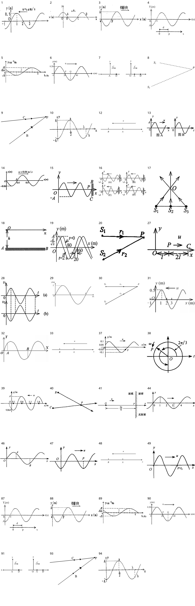

> 派生文件，可重新生成，勿手改。

# 上册逐章题图 · 05 波动

仅处理上册已确认范围；先尝试原PDF提取，不清楚再重绘。原材料、原图只读保留；只改图片路径，保留原题号、锚点、题面、答案与OCR状态。

本章审查94个图片资产、95处引用。定性图未给出的尺寸/角度/比例不是测量数据。复用图不重复计为独立新图。

生成代码（过程产物未发布） · [映射与逐项核验](../../../../10_%E9%A2%98%E5%BA%93/_assets/%E4%B8%8A%E5%86%8C%E9%80%90%E7%AB%A0/05_%E6%B3%A2%E5%8A%A8/mapping.json) · 校验记录（过程产物未发布）

|编号|题号|原图|来源PDF页|处理|核验|
|---|---|---|---|---|---|
|001|习题册-章节19-题1|[ccc41403a76bb6e1e585007ac302cf30b05378a46c954f621ad98cdd031a67b1.jpg](../../../../10_%E9%A2%98%E5%BA%93/_assets/%E4%B9%A0%E9%A2%98%E5%86%8C/ccc41403a76bb6e1e585007ac302cf30b05378a46c954f621ad98cdd031a67b1.jpg)|20|native_extraction [001-extracted.png](../../../../10_%E9%A2%98%E5%BA%93/_assets/%E4%B8%8A%E5%86%8C%E9%80%90%E7%AB%A0/05_%E6%B3%A2%E5%8A%A8/001-extracted.png)|回查原PDF裁图，保留坐标单位、原有点名、传播箭头与波峰/波谷/过零相位；不拟合未给定的周期、振幅或比例，保留复合图全部子图。原生提取不插值放大。|
|002|习题册-章节19-题2|[b5b575c79b5366f51b15b7fc8b297a6fe9e9f6d60cf4e3756d14d2c85933ab1c.jpg](../../../../10_%E9%A2%98%E5%BA%93/_assets/%E4%B9%A0%E9%A2%98%E5%86%8C/b5b575c79b5366f51b15b7fc8b297a6fe9e9f6d60cf4e3756d14d2c85933ab1c.jpg)|20|native_extraction [002-extracted.png](../../../../10_%E9%A2%98%E5%BA%93/_assets/%E4%B8%8A%E5%86%8C%E9%80%90%E7%AB%A0/05_%E6%B3%A2%E5%8A%A8/002-extracted.png)|回查原PDF裁图，保留坐标单位、原有点名、传播箭头与波峰/波谷/过零相位；不拟合未给定的周期、振幅或比例，保留复合图全部子图。原生提取不插值放大。|
|003|习题册-章节19-题4|[0ee27d26ec89beca5518f6375093612bbfd938cf939cfb7508ed653b6adaddf5.jpg](../../../../10_%E9%A2%98%E5%BA%93/_assets/%E4%B9%A0%E9%A2%98%E5%86%8C/0ee27d26ec89beca5518f6375093612bbfd938cf939cfb7508ed653b6adaddf5.jpg)|20|native_extraction [003-extracted.png](../../../../10_%E9%A2%98%E5%BA%93/_assets/%E4%B8%8A%E5%86%8C%E9%80%90%E7%AB%A0/05_%E6%B3%A2%E5%8A%A8/003-extracted.png)|回查原PDF裁图，保留坐标单位、原有点名、传播箭头与波峰/波谷/过零相位；不拟合未给定的周期、振幅或比例，保留复合图全部子图。原生提取不插值放大。|
|004|习题册-章节19-题5|[61fae53c9548881185ddf3eff82c640f78601301d1b2a35df552ef4af80736b5.jpg](../../../../10_%E9%A2%98%E5%BA%93/_assets/%E4%B9%A0%E9%A2%98%E5%86%8C/61fae53c9548881185ddf3eff82c640f78601301d1b2a35df552ef4af80736b5.jpg)|20|native_extraction [004-extracted.png](../../../../10_%E9%A2%98%E5%BA%93/_assets/%E4%B8%8A%E5%86%8C%E9%80%90%E7%AB%A0/05_%E6%B3%A2%E5%8A%A8/004-extracted.png)|回查原PDF裁图，保留坐标单位、原有点名、传播箭头与波峰/波谷/过零相位；不拟合未给定的周期、振幅或比例，保留复合图全部子图。原生提取不插值放大。|
|005|习题册-章节19-题6|[28b2b60669e8dcc2436b9e377cd846a1eafaebaa06932c726a8c14ae9b384365.jpg](../../../../10_%E9%A2%98%E5%BA%93/_assets/%E4%B9%A0%E9%A2%98%E5%86%8C/28b2b60669e8dcc2436b9e377cd846a1eafaebaa06932c726a8c14ae9b384365.jpg)|20|native_extraction [005-extracted.png](../../../../10_%E9%A2%98%E5%BA%93/_assets/%E4%B8%8A%E5%86%8C%E9%80%90%E7%AB%A0/05_%E6%B3%A2%E5%8A%A8/005-extracted.png)|回查原PDF裁图，保留坐标单位、原有点名、传播箭头与波峰/波谷/过零相位；不拟合未给定的周期、振幅或比例，保留复合图全部子图。原生提取不插值放大。|
|006|习题册-章节20-题5|[d25dc0ca3e70f96d02e7369878a1362999685383aa59da8f9cf608637e51bb24.jpg](../../../../10_%E9%A2%98%E5%BA%93/_assets/%E4%B9%A0%E9%A2%98%E5%86%8C/d25dc0ca3e70f96d02e7369878a1362999685383aa59da8f9cf608637e51bb24.jpg)|21|native_extraction [006-extracted.png](../../../../10_%E9%A2%98%E5%BA%93/_assets/%E4%B8%8A%E5%86%8C%E9%80%90%E7%AB%A0/05_%E6%B3%A2%E5%8A%A8/006-extracted.png)|回查原PDF裁图，保留坐标单位、原有点名、传播箭头与波峰/波谷/过零相位；不拟合未给定的周期、振幅或比例，保留复合图全部子图。原生提取不插值放大。|
|007|习题册-章节20-题6|[7533bfd4cc6aa43554045a68b8db03ace342859ed04f3f379facae799f3b765a.jpg](../../../../10_%E9%A2%98%E5%BA%93/_assets/%E4%B9%A0%E9%A2%98%E5%86%8C/7533bfd4cc6aa43554045a68b8db03ace342859ed04f3f379facae799f3b765a.jpg)|21|native_extraction [007-extracted.png](../../../../10_%E9%A2%98%E5%BA%93/_assets/%E4%B8%8A%E5%86%8C%E9%80%90%E7%AB%A0/05_%E6%B3%A2%E5%8A%A8/007-extracted.png)|回查原PDF裁图，保留坐标单位、原有点名、传播箭头与波峰/波谷/过零相位；不拟合未给定的周期、振幅或比例，保留复合图全部子图。原生提取不插值放大。|
|008|习题册-章节21-题1|[b05367dbd99c7c32425ec6c36e578719f2e1aef5c417bafcbddbd285932d6acd.jpg](../../../../10_%E9%A2%98%E5%BA%93/_assets/%E4%B9%A0%E9%A2%98%E5%86%8C/b05367dbd99c7c32425ec6c36e578719f2e1aef5c417bafcbddbd285932d6acd.jpg)|22|native_extraction [008-extracted.png](../../../../10_%E9%A2%98%E5%BA%93/_assets/%E4%B8%8A%E5%86%8C%E9%80%90%E7%AB%A0/05_%E6%B3%A2%E5%8A%A8/008-extracted.png)|回查原PDF裁图，保留坐标单位、原有点名、传播箭头与波峰/波谷/过零相位；不拟合未给定的周期、振幅或比例，保留复合图全部子图。原生提取不插值放大。|
|009|习题册-章节21-题6|[48f512ac1f17260e023cbd742d72b8a69ed13ef4175b4b6263dfc999e338018e.jpg](../../../../10_%E9%A2%98%E5%BA%93/_assets/%E4%B9%A0%E9%A2%98%E5%86%8C/48f512ac1f17260e023cbd742d72b8a69ed13ef4175b4b6263dfc999e338018e.jpg)|22|native_extraction [009-extracted.png](../../../../10_%E9%A2%98%E5%BA%93/_assets/%E4%B8%8A%E5%86%8C%E9%80%90%E7%AB%A0/05_%E6%B3%A2%E5%8A%A8/009-extracted.png)|回查原PDF裁图，保留坐标单位、原有点名、传播箭头与波峰/波谷/过零相位；不拟合未给定的周期、振幅或比例，保留复合图全部子图。原生提取不插值放大。|
|010|习题册-章节22-题1|[181eeda720b1207a26821545acb928f7681b9f9ee02bd3a6f800dbd0d3aa6dd9.jpg](../../../../10_%E9%A2%98%E5%BA%93/_assets/%E4%B9%A0%E9%A2%98%E5%86%8C/181eeda720b1207a26821545acb928f7681b9f9ee02bd3a6f800dbd0d3aa6dd9.jpg)|23|native_extraction [010-extracted.png](../../../../10_%E9%A2%98%E5%BA%93/_assets/%E4%B8%8A%E5%86%8C%E9%80%90%E7%AB%A0/05_%E6%B3%A2%E5%8A%A8/010-extracted.png)|回查原PDF裁图，保留坐标单位、原有点名、传播箭头与波峰/波谷/过零相位；不拟合未给定的周期、振幅或比例，保留复合图全部子图。原生提取不插值放大。|
|011|16-17期末-选2|[79d0af64d1804f0a26814b126bb7d6eca62cfa8ec387e10220d92572e04f1854.jpg](../../../../10_%E9%A2%98%E5%BA%93/_assets/%E5%8E%86%E5%B9%B4%E8%AF%95%E5%8D%B7%E5%90%88%E9%9B%86_2018-2024/79d0af64d1804f0a26814b126bb7d6eca62cfa8ec387e10220d92572e04f1854.jpg)|同一习题册对应题|retained_uncertain|保留原图：来源尚未完整定位、手写批注叠加，或旧资产包含多图/公式题面边界；不把批注当给定量，也不删题面文字。|
|012|16-17期末-计2|[3b7a1e246e7c6a9f9c5bf7a5e3347588c8c2c7170a6d1c220ed83b41bd029846.jpg](../../../../10_%E9%A2%98%E5%BA%93/_assets/%E5%8E%86%E5%B9%B4%E8%AF%95%E5%8D%B7%E5%90%88%E9%9B%86_2018-2024/3b7a1e246e7c6a9f9c5bf7a5e3347588c8c2c7170a6d1c220ed83b41bd029846.jpg)|43|redrawn [012.svg](../../../../10_%E9%A2%98%E5%BA%93/_assets/%E4%B8%8A%E5%86%8C%E9%80%90%E7%AB%A0/05_%E6%B3%A2%E5%8A%A8/012.svg)|B在A左侧、x正向右、u箭头向左，未标注未知距离或速度大小。|
|013|18-19期末-选1|[c7caf6f0c7ac6db94a001305b76f74cf5a73d0a1288f33bbeb9341c9b645e678.jpg](../../../../10_%E9%A2%98%E5%BA%93/_assets/%E5%8E%86%E5%B9%B4%E8%AF%95%E5%8D%B7%E5%90%88%E9%9B%86_2018-2024/c7caf6f0c7ac6db94a001305b76f74cf5a73d0a1288f33bbeb9341c9b645e678.jpg)|38|native_extraction [013-extracted.png](../../../../10_%E9%A2%98%E5%BA%93/_assets/%E4%B8%8A%E5%86%8C%E9%80%90%E7%AB%A0/05_%E6%B3%A2%E5%8A%A8/013-extracted.png)|回查原PDF裁图，保留坐标单位、原有点名、传播箭头与波峰/波谷/过零相位；不拟合未给定的周期、振幅或比例，保留复合图全部子图。原生提取不插值放大。|
|014|18-19期末-计1|[3c725e3a642c9b0b5b672464543f73acd8b11e3531bc14b5763515444dee40f2.jpg](../../../../10_%E9%A2%98%E5%BA%93/_assets/%E5%8E%86%E5%B9%B4%E8%AF%95%E5%8D%B7%E5%90%88%E9%9B%86_2018-2024/3c725e3a642c9b0b5b672464543f73acd8b11e3531bc14b5763515444dee40f2.jpg)|39|native_extraction [014-extracted.png](../../../../10_%E9%A2%98%E5%BA%93/_assets/%E4%B8%8A%E5%86%8C%E9%80%90%E7%AB%A0/05_%E6%B3%A2%E5%8A%A8/014-extracted.png)|回查原PDF裁图，保留坐标单位、原有点名、传播箭头与波峰/波谷/过零相位；不拟合未给定的周期、振幅或比例，保留复合图全部子图。原生提取不插值放大。|
|015|19-20期末-选3|[3a7494c0b4b3727ad20db2ab27410daec77125929051ba315c05b179e4ef9891.jpg](../../../../10_%E9%A2%98%E5%BA%93/_assets/%E5%8E%86%E5%B9%B4%E8%AF%95%E5%8D%B7%E5%90%88%E9%9B%86_2018-2024/3a7494c0b4b3727ad20db2ab27410daec77125929051ba315c05b179e4ef9891.jpg)|32|native_extraction [015-extracted.png](../../../../10_%E9%A2%98%E5%BA%93/_assets/%E4%B8%8A%E5%86%8C%E9%80%90%E7%AB%A0/05_%E6%B3%A2%E5%8A%A8/015-extracted.png)|回查原PDF裁图，保留坐标单位、原有点名、传播箭头与波峰/波谷/过零相位；不拟合未给定的周期、振幅或比例，保留复合图全部子图。原生提取不插值放大。|
|016|19-20期末-选3|[8553f66d2e0032e5e43b838bc178968f8fe385b241983c72b6bf03f4050846f1.jpg](../../../../10_%E9%A2%98%E5%BA%93/_assets/%E5%8E%86%E5%B9%B4%E8%AF%95%E5%8D%B7%E5%90%88%E9%9B%86_2018-2024/8553f66d2e0032e5e43b838bc178968f8fe385b241983c72b6bf03f4050846f1.jpg)|32|native_extraction [016-extracted.png](../../../../10_%E9%A2%98%E5%BA%93/_assets/%E4%B8%8A%E5%86%8C%E9%80%90%E7%AB%A0/05_%E6%B3%A2%E5%8A%A8/016-extracted.png)|回查原PDF裁图，保留坐标单位、原有点名、传播箭头与波峰/波谷/过零相位；不拟合未给定的周期、振幅或比例，保留复合图全部子图。原生提取不插值放大。|
|017|20-21期末-计1|[1a37c8085fa21f2dd0a11058b0eeaa672d7818716d815db6a47327a31b93bd6e.jpg](../../../../10_%E9%A2%98%E5%BA%93/_assets/%E5%8E%86%E5%B9%B4%E8%AF%95%E5%8D%B7%E5%90%88%E9%9B%86_2018-2024/1a37c8085fa21f2dd0a11058b0eeaa672d7818716d815db6a47327a31b93bd6e.jpg)|28|native_extraction [017-extracted.png](../../../../10_%E9%A2%98%E5%BA%93/_assets/%E4%B8%8A%E5%86%8C%E9%80%90%E7%AB%A0/05_%E6%B3%A2%E5%8A%A8/017-extracted.png)|回查原PDF裁图，保留坐标单位、原有点名、传播箭头与波峰/波谷/过零相位；不拟合未给定的周期、振幅或比例，保留复合图全部子图。原生提取不插值放大。|
|018|20-21期末-计2|[3fe6bd0a6e4f4a9a47084496419123a948c4225df4b9996e3006a985ba25f409.jpg](../../../../10_%E9%A2%98%E5%BA%93/_assets/%E5%8E%86%E5%B9%B4%E8%AF%95%E5%8D%B7%E5%90%88%E9%9B%86_2018-2024/3fe6bd0a6e4f4a9a47084496419123a948c4225df4b9996e3006a985ba25f409.jpg)|28|native_extraction [018-extracted.png](../../../../10_%E9%A2%98%E5%BA%93/_assets/%E4%B8%8A%E5%86%8C%E9%80%90%E7%AB%A0/05_%E6%B3%A2%E5%8A%A8/018-extracted.png)|回查原PDF裁图，保留坐标单位、原有点名、传播箭头与波峰/波谷/过零相位；不拟合未给定的周期、振幅或比例，保留复合图全部子图。原生提取不插值放大。|
|019|20-21期末-析1|[08355bdf34d0afc8024440b7c31160eb9968dfeeeafd40550ed6196575c2bdd2.jpg](../../../../10_%E9%A2%98%E5%BA%93/_assets/%E5%8E%86%E5%B9%B4%E8%AF%95%E5%8D%B7%E5%90%88%E9%9B%86_2018-2024/08355bdf34d0afc8024440b7c31160eb9968dfeeeafd40550ed6196575c2bdd2.jpg)|30|native_extraction [019-extracted.png](../../../../10_%E9%A2%98%E5%BA%93/_assets/%E4%B8%8A%E5%86%8C%E9%80%90%E7%AB%A0/05_%E6%B3%A2%E5%8A%A8/019-extracted.png)|回查原PDF裁图，保留坐标单位、原有点名、传播箭头与波峰/波谷/过零相位；不拟合未给定的周期、振幅或比例，保留复合图全部子图。原生提取不插值放大。|
|020|22-23期末-选2|[8a33403acaa6c9e6b991c02e3d5d4bc914e53991a4e703091ccc2b370db1d93f.jpg](../../../../10_%E9%A2%98%E5%BA%93/_assets/%E5%8E%86%E5%B9%B4%E8%AF%95%E5%8D%B7%E5%90%88%E9%9B%86_2018-2024/8a33403acaa6c9e6b991c02e3d5d4bc914e53991a4e703091ccc2b370db1d93f.jpg)|23|native_extraction [020-extracted.png](../../../../10_%E9%A2%98%E5%BA%93/_assets/%E4%B8%8A%E5%86%8C%E9%80%90%E7%AB%A0/05_%E6%B3%A2%E5%8A%A8/020-extracted.png)|回查原PDF裁图，保留坐标单位、原有点名、传播箭头与波峰/波谷/过零相位；不拟合未给定的周期、振幅或比例，保留复合图全部子图。原生提取不插值放大。|
|021|22-23期末-选4|[5dcdda5ee64be65c6d29612043efcdbe7f7f765e832c3d56d9cffe961fe13e8d.jpg](../../../../10_%E9%A2%98%E5%BA%93/_assets/%E5%8E%86%E5%B9%B4%E8%AF%95%E5%8D%B7%E5%90%88%E9%9B%86_2018-2024/5dcdda5ee64be65c6d29612043efcdbe7f7f765e832c3d56d9cffe961fe13e8d.jpg)|23|retained_uncertain|保留原图：来源尚未完整定位、手写批注叠加，或旧资产包含多图/公式题面边界；不把批注当给定量，也不删题面文字。|
|022|22-23期末-选5|[8a6f7b42ddc09472a06c5c03a2b379b6f419809df8cecbcb0edd3a08cda75ead.jpg](../../../../10_%E9%A2%98%E5%BA%93/_assets/%E5%8E%86%E5%B9%B4%E8%AF%95%E5%8D%B7%E5%90%88%E9%9B%86_2018-2024/8a6f7b42ddc09472a06c5c03a2b379b6f419809df8cecbcb0edd3a08cda75ead.jpg)|23|retained_uncertain|保留原图：来源尚未完整定位、手写批注叠加，或旧资产包含多图/公式题面边界；不把批注当给定量，也不删题面文字。|
|023|22-23期末-选5|[9d98fc0b1bf187b8b4fd5477843b02f3a26957639dfbb701921de4c496e02055.jpg](../../../../10_%E9%A2%98%E5%BA%93/_assets/%E5%8E%86%E5%B9%B4%E8%AF%95%E5%8D%B7%E5%90%88%E9%9B%86_2018-2024/9d98fc0b1bf187b8b4fd5477843b02f3a26957639dfbb701921de4c496e02055.jpg)|23|retained_uncertain|保留原图：来源尚未完整定位、手写批注叠加，或旧资产包含多图/公式题面边界；不把批注当给定量，也不删题面文字。|
|024|22-23期末-选5|[dd8b3240cbed2bc66b2bf6d92ac13ff4fa29550ffe9578a28c4159a250dd65de.jpg](../../../../10_%E9%A2%98%E5%BA%93/_assets/%E5%8E%86%E5%B9%B4%E8%AF%95%E5%8D%B7%E5%90%88%E9%9B%86_2018-2024/dd8b3240cbed2bc66b2bf6d92ac13ff4fa29550ffe9578a28c4159a250dd65de.jpg)|23|retained_uncertain|保留原图：来源尚未完整定位、手写批注叠加，或旧资产包含多图/公式题面边界；不把批注当给定量，也不删题面文字。|
|025|22-23期末-选5|[32904d8cc10d08da3f67b23b6766ceaf500d1830e13943d3b59acdfbafb96f4e.jpg](../../../../10_%E9%A2%98%E5%BA%93/_assets/%E5%8E%86%E5%B9%B4%E8%AF%95%E5%8D%B7%E5%90%88%E9%9B%86_2018-2024/32904d8cc10d08da3f67b23b6766ceaf500d1830e13943d3b59acdfbafb96f4e.jpg)|23|retained_uncertain|保留原图：来源尚未完整定位、手写批注叠加，或旧资产包含多图/公式题面边界；不把批注当给定量，也不删题面文字。|
|026|22-23期末-选5|[301a6841b1588605b1b02cef09a83b351a4e5e52bc505757fbf4962724d820a5.jpg](../../../../10_%E9%A2%98%E5%BA%93/_assets/%E5%8E%86%E5%B9%B4%E8%AF%95%E5%8D%B7%E5%90%88%E9%9B%86_2018-2024/301a6841b1588605b1b02cef09a83b351a4e5e52bc505757fbf4962724d820a5.jpg)|23|retained_uncertain|保留原图：来源尚未完整定位、手写批注叠加，或旧资产包含多图/公式题面边界；不把批注当给定量，也不删题面文字。|
|027|23-24期末-选15|[53ad0eb67c5b98a7cb02c89fe55f908e7363e1729adcd3a3eabcb6e22c2db1ad.jpg](../../../../10_%E9%A2%98%E5%BA%93/_assets/%E5%8E%86%E5%B9%B4%E8%AF%95%E5%8D%B7%E5%90%88%E9%9B%86_2018-2024/53ad0eb67c5b98a7cb02c89fe55f908e7363e1729adcd3a3eabcb6e22c2db1ad.jpg)|20|native_extraction [027-extracted.png](../../../../10_%E9%A2%98%E5%BA%93/_assets/%E4%B8%8A%E5%86%8C%E9%80%90%E7%AB%A0/05_%E6%B3%A2%E5%8A%A8/027-extracted.png)|回查原PDF裁图，保留坐标单位、原有点名、传播箭头与波峰/波谷/过零相位；不拟合未给定的周期、振幅或比例，保留复合图全部子图。原生提取不插值放大。|
|028|23-24期末-填4|[a756dd85272d11f51a8e1b950567cd81acc906dc816711dff81b768935aa3de9.jpg](../../../../10_%E9%A2%98%E5%BA%93/_assets/%E5%8E%86%E5%B9%B4%E8%AF%95%E5%8D%B7%E5%90%88%E9%9B%86_2018-2024/a756dd85272d11f51a8e1b950567cd81acc906dc816711dff81b768935aa3de9.jpg)|21|native_extraction [028-extracted.png](../../../../10_%E9%A2%98%E5%BA%93/_assets/%E4%B8%8A%E5%86%8C%E9%80%90%E7%AB%A0/05_%E6%B3%A2%E5%8A%A8/028-extracted.png)|回查原PDF裁图，保留坐标单位、原有点名、传播箭头与波峰/波谷/过零相位；不拟合未给定的周期、振幅或比例，保留复合图全部子图。原生提取不插值放大。|
|029|23-24期末-计1|[9079e1beb1c3847404c88868a8f37480e516676167aa3ff0570a2fc53d9f5e42.jpg](../../../../10_%E9%A2%98%E5%BA%93/_assets/%E5%8E%86%E5%B9%B4%E8%AF%95%E5%8D%B7%E5%90%88%E9%9B%86_2018-2024/9079e1beb1c3847404c88868a8f37480e516676167aa3ff0570a2fc53d9f5e42.jpg)|21|redrawn [029.svg](../../../../10_%E9%A2%98%E5%BA%93/_assets/%E4%B8%8A%E5%86%8C%E9%80%90%E7%AB%A0/05_%E6%B3%A2%E5%8A%A8/029.svg)|定量029：y/cm、t/s，幅度2，初态过零向上，2s向下过零、4s向上过零；函数2sin(πt/2)逐项断言。|
|030|24-25期末-选2|[779c79f3e58916a8cb4f6c6a916b9bf4c3c4519be4e5a272459ce1e34624308d.jpg](../../../../10_%E9%A2%98%E5%BA%93/_assets/2024-2025%E6%9C%9F%E6%9C%AB%E6%88%AA%E5%9B%BE/779c79f3e58916a8cb4f6c6a916b9bf4c3c4519be4e5a272459ce1e34624308d.jpg)|2|redrawn [030.svg](../../../../10_%E9%A2%98%E5%BA%93/_assets/%E4%B8%8A%E5%86%8C%E9%80%90%E7%AB%A0/05_%E6%B3%A2%E5%8A%A8/030.svg)|S1/S2到P两条传播箭头、r1/r2与点名保留；几何夹角和距离仅为布局。|
|031|24-25期末-选4|[16be46a3834d4e42097532e21e240b5c9fc4851c73a95143f3bf2a68b0586e02.jpg](../../../../10_%E9%A2%98%E5%BA%93/_assets/2024-2025%E6%9C%9F%E6%9C%AB%E6%88%AA%E5%9B%BE/16be46a3834d4e42097532e21e240b5c9fc4851c73a95143f3bf2a68b0586e02.jpg)|4|native_extraction [031-extracted.png](../../../../10_%E9%A2%98%E5%BA%93/_assets/%E4%B8%8A%E5%86%8C%E9%80%90%E7%AB%A0/05_%E6%B3%A2%E5%8A%A8/031-extracted.png)|回查原PDF裁图，保留坐标单位、原有点名、传播箭头与波峰/波谷/过零相位；不拟合未给定的周期、振幅或比例，保留复合图全部子图。原生提取不插值放大。|
|032|24-25期末-选10|[7c91888448a8a521cf02a0810da3b76b918311ebd29fe0df326d4e724eab826d.jpg](../../../../10_%E9%A2%98%E5%BA%93/_assets/2024-2025%E6%9C%9F%E6%9C%AB%E6%88%AA%E5%9B%BE/7c91888448a8a521cf02a0810da3b76b918311ebd29fe0df326d4e724eab826d.jpg)|10|native_extraction [032-extracted.png](../../../../10_%E9%A2%98%E5%BA%93/_assets/%E4%B8%8A%E5%86%8C%E9%80%90%E7%AB%A0/05_%E6%B3%A2%E5%8A%A8/032-extracted.png)|回查原PDF裁图，保留坐标单位、原有点名、传播箭头与波峰/波谷/过零相位；不拟合未给定的周期、振幅或比例，保留复合图全部子图。原生提取不插值放大。|
|033|24-25期末-计2|[b02ab72c19518b9009f4fce9814ee738684951f03a86bdb695ac6498fc7d57f3.jpg](../../../../10_%E9%A2%98%E5%BA%93/_assets/2024-2025%E6%9C%9F%E6%9C%AB%E6%88%AA%E5%9B%BE/b02ab72c19518b9009f4fce9814ee738684951f03a86bdb695ac6498fc7d57f3.jpg)|16|redrawn [033.svg](../../../../10_%E9%A2%98%E5%BA%93/_assets/%E4%B8%8A%E5%86%8C%E9%80%90%E7%AB%A0/05_%E6%B3%A2%E5%8A%A8/033.svg)|B在A左侧、x正向右、u箭头向左，未标注未知距离或速度大小。|
|034|未标年份-期末一-选8|[f9747342e5209e5c8225e9fab57622e1d0b5df96e20772c587bc9a51f6bd067d.jpg](../../../../10_%E9%A2%98%E5%BA%93/_assets/%E5%8E%86%E5%B9%B4%E8%AF%95%E5%8D%B7%E5%90%88%E9%9B%86_2018-2024/f9747342e5209e5c8225e9fab57622e1d0b5df96e20772c587bc9a51f6bd067d.jpg)|47|retained_uncertain|保留原图：来源尚未完整定位、手写批注叠加，或旧资产包含多图/公式题面边界；不把批注当给定量，也不删题面文字。|
|035|未标年份-期末一-计1|[0d1f3426d04ef66129ef356f8ddc71f9fd0cc795687dda0279357e12709890d4.jpg](../../../../10_%E9%A2%98%E5%BA%93/_assets/%E5%8E%86%E5%B9%B4%E8%AF%95%E5%8D%B7%E5%90%88%E9%9B%86_2018-2024/0d1f3426d04ef66129ef356f8ddc71f9fd0cc795687dda0279357e12709890d4.jpg)|48|retained_uncertain|保留原图：来源尚未完整定位、手写批注叠加，或旧资产包含多图/公式题面边界；不把批注当给定量，也不删题面文字。|
|036|未标年份-期末二-选14|[f956cebd3144b49d516ce5306a400ee35781051badafa8693eba6c571da4ec22.jpg](../../../../10_%E9%A2%98%E5%BA%93/_assets/%E5%8E%86%E5%B9%B4%E8%AF%95%E5%8D%B7%E5%90%88%E9%9B%86_2018-2024/f956cebd3144b49d516ce5306a400ee35781051badafa8693eba6c571da4ec22.jpg)|51|retained_uncertain|保留原图：来源尚未完整定位、手写批注叠加，或旧资产包含多图/公式题面边界；不把批注当给定量，也不删题面文字。|
|037|学习指导-第05章-例题-5-3|[p0001-0180_060.jpg](../../../../10_%E9%A2%98%E5%BA%93/_assets/%E5%AD%A6%E4%B9%A0%E6%8C%87%E5%AF%BC/p0001-0180_060.jpg)|93|native_extraction [037-extracted.png](../../../../10_%E9%A2%98%E5%BA%93/_assets/%E4%B8%8A%E5%86%8C%E9%80%90%E7%AB%A0/05_%E6%B3%A2%E5%8A%A8/037-extracted.png)|回查原PDF裁图，保留坐标单位、原有点名、传播箭头与波峰/波谷/过零相位；不拟合未给定的周期、振幅或比例，保留复合图全部子图。原生提取不插值放大。|
|038|学习指导-第05章-例题-5-3|[p0001-0180_888.jpg](../../../../10_%E9%A2%98%E5%BA%93/_assets/%E5%AD%A6%E4%B9%A0%E6%8C%87%E5%AF%BC/p0001-0180_888.jpg)|93|native_extraction [038-extracted.png](../../../../10_%E9%A2%98%E5%BA%93/_assets/%E4%B8%8A%E5%86%8C%E9%80%90%E7%AB%A0/05_%E6%B3%A2%E5%8A%A8/038-extracted.png)|回查原PDF裁图，保留坐标单位、原有点名、传播箭头与波峰/波谷/过零相位；不拟合未给定的周期、振幅或比例，保留复合图全部子图。原生提取不插值放大。|
|039|学习指导-第05章-例题-5-6|[p0001-0180_1071.jpg](../../../../10_%E9%A2%98%E5%BA%93/_assets/%E5%AD%A6%E4%B9%A0%E6%8C%87%E5%AF%BC/p0001-0180_1071.jpg)|95|native_extraction [039-extracted.png](../../../../10_%E9%A2%98%E5%BA%93/_assets/%E4%B8%8A%E5%86%8C%E9%80%90%E7%AB%A0/05_%E6%B3%A2%E5%8A%A8/039-extracted.png)|回查原PDF裁图，保留坐标单位、原有点名、传播箭头与波峰/波谷/过零相位；不拟合未给定的周期、振幅或比例，保留复合图全部子图。原生提取不插值放大。|
|040|学习指导-第05章-例题-5-6|[p0001-0180_827.jpg](../../../../10_%E9%A2%98%E5%BA%93/_assets/%E5%AD%A6%E4%B9%A0%E6%8C%87%E5%AF%BC/p0001-0180_827.jpg)|95|native_extraction [040-extracted.png](../../../../10_%E9%A2%98%E5%BA%93/_assets/%E4%B8%8A%E5%86%8C%E9%80%90%E7%AB%A0/05_%E6%B3%A2%E5%8A%A8/040-extracted.png)|回查原PDF裁图，保留坐标单位、原有点名、传播箭头与波峰/波谷/过零相位；不拟合未给定的周期、振幅或比例，保留复合图全部子图。原生提取不插值放大。|
|041|学习指导-第05章-例题-5-7|[p0001-0180_972.jpg](../../../../10_%E9%A2%98%E5%BA%93/_assets/%E5%AD%A6%E4%B9%A0%E6%8C%87%E5%AF%BC/p0001-0180_972.jpg)|96|native_extraction [041-extracted.png](../../../../10_%E9%A2%98%E5%BA%93/_assets/%E4%B8%8A%E5%86%8C%E9%80%90%E7%AB%A0/05_%E6%B3%A2%E5%8A%A8/041-extracted.png)|回查原PDF裁图，保留坐标单位、原有点名、传播箭头与波峰/波谷/过零相位；不拟合未给定的周期、振幅或比例，保留复合图全部子图。原生提取不插值放大。|
|042|学习指导-第05章-思考题-5-10|[05-wave-5-10-a.svg](../../../../10_%E9%A2%98%E5%BA%93/_assets/%E9%87%8D%E7%BB%98_%E4%B8%8A%E5%86%8C_%E6%89%B901/05-wave-5-10-a.svg)|同一习题册对应题|already_verified_svg|首批已核验SVG，保持引用。|
|043|学习指导-第05章-思考题-5-10|[06-wave-5-10-b.svg](../../../../10_%E9%A2%98%E5%BA%93/_assets/%E9%87%8D%E7%BB%98_%E4%B8%8A%E5%86%8C_%E6%89%B901/06-wave-5-10-b.svg)|同一习题册对应题|already_verified_svg|首批已核验SVG，保持引用。|
|044|学习指导-第05章-思考题-5-11|[p0001-0180_1091.jpg](../../../../10_%E9%A2%98%E5%BA%93/_assets/%E5%AD%A6%E4%B9%A0%E6%8C%87%E5%AF%BC/p0001-0180_1091.jpg)|102|native_extraction [044-extracted.png](../../../../10_%E9%A2%98%E5%BA%93/_assets/%E4%B8%8A%E5%86%8C%E9%80%90%E7%AB%A0/05_%E6%B3%A2%E5%8A%A8/044-extracted.png)|回查原PDF裁图，保留坐标单位、原有点名、传播箭头与波峰/波谷/过零相位；不拟合未给定的周期、振幅或比例，保留复合图全部子图。原生提取不插值放大。|
|045|学习指导-第05章-思考题-5-13|[07-wave-5-13.svg](../../../../10_%E9%A2%98%E5%BA%93/_assets/%E9%87%8D%E7%BB%98_%E4%B8%8A%E5%86%8C_%E6%89%B901/07-wave-5-13.svg)|同一习题册对应题|already_verified_svg|首批已核验SVG，保持引用。|
|046|学习指导-第05章-思考题-5-15|[p0001-0180_004.jpg](../../../../10_%E9%A2%98%E5%BA%93/_assets/%E5%AD%A6%E4%B9%A0%E6%8C%87%E5%AF%BC/p0001-0180_004.jpg)|103|native_extraction [046-extracted.png](../../../../10_%E9%A2%98%E5%BA%93/_assets/%E4%B8%8A%E5%86%8C%E9%80%90%E7%AB%A0/05_%E6%B3%A2%E5%8A%A8/046-extracted.png)|回查原PDF裁图，保留坐标单位、原有点名、传播箭头与波峰/波谷/过零相位；不拟合未给定的周期、振幅或比例，保留复合图全部子图。原生提取不插值放大。|
|047|学习指导-第05章-习题-5-3|[p0001-0180_810.jpg](../../../../10_%E9%A2%98%E5%BA%93/_assets/%E5%AD%A6%E4%B9%A0%E6%8C%87%E5%AF%BC/p0001-0180_810.jpg)|106|native_extraction [047-extracted.png](../../../../10_%E9%A2%98%E5%BA%93/_assets/%E4%B8%8A%E5%86%8C%E9%80%90%E7%AB%A0/05_%E6%B3%A2%E5%8A%A8/047-extracted.png)|回查原PDF裁图，保留坐标单位、原有点名、传播箭头与波峰/波谷/过零相位；不拟合未给定的周期、振幅或比例，保留复合图全部子图。原生提取不插值放大。|
|048|学习指导-第05章-习题-5-4|[p0001-0180_1132.jpg](../../../../10_%E9%A2%98%E5%BA%93/_assets/%E5%AD%A6%E4%B9%A0%E6%8C%87%E5%AF%BC/p0001-0180_1132.jpg)|107|redrawn [048.svg](../../../../10_%E9%A2%98%E5%BA%93/_assets/%E4%B8%8A%E5%86%8C%E9%80%90%E7%AB%A0/05_%E6%B3%A2%E5%8A%A8/048.svg)|B在A左侧、x正向右、u箭头向左，未标注未知距离或速度大小。|
|049|学习指导-第05章-习题-5-5|[p0001-0180_1099.jpg](../../../../10_%E9%A2%98%E5%BA%93/_assets/%E5%AD%A6%E4%B9%A0%E6%8C%87%E5%AF%BC/p0001-0180_1099.jpg)|107|native_extraction [049-extracted.png](../../../../10_%E9%A2%98%E5%BA%93/_assets/%E4%B8%8A%E5%86%8C%E9%80%90%E7%AB%A0/05_%E6%B3%A2%E5%8A%A8/049-extracted.png)|回查原PDF裁图，保留坐标单位、原有点名、传播箭头与波峰/波谷/过零相位；不拟合未给定的周期、振幅或比例，保留复合图全部子图。原生提取不插值放大。|
|050|学习指导-第05章-习题-5-6|[08-wave-5-6.svg](../../../../10_%E9%A2%98%E5%BA%93/_assets/%E9%87%8D%E7%BB%98_%E4%B8%8A%E5%86%8C_%E6%89%B901/08-wave-5-6.svg)|同一习题册对应题|already_verified_svg|首批已核验SVG，保持引用。|
|051|清华题库-波动-227|[c7908efe9f80cafa62637c18453b6cae11b55aacd5f33ce95c30ea3b7a7d8804.jpg](../../../../10_%E9%A2%98%E5%BA%93/_assets/%E6%B8%85%E5%8D%8E%E9%A2%98%E5%BA%93/c7908efe9f80cafa62637c18453b6cae11b55aacd5f33ce95c30ea3b7a7d8804.jpg)|18|retained_clear|清华题库原图的点名、坐标、箭头和投影可辨；无需转换，黑白仍有几何/线形区分。|
|052|清华题库-波动-227|[d9223264820e64a29dc4d6639cc637965adb0777c1222bdf04ddabe5863d3041.jpg](../../../../10_%E9%A2%98%E5%BA%93/_assets/%E6%B8%85%E5%8D%8E%E9%A2%98%E5%BA%93/d9223264820e64a29dc4d6639cc637965adb0777c1222bdf04ddabe5863d3041.jpg)|18|retained_clear|清华题库原图的点名、坐标、箭头和投影可辨；无需转换，黑白仍有几何/线形区分。|
|053|清华题库-波动-227|[3980dc741bb93b0120ebe89810cf60478a556c78161aafe413aa17d5faaeafb4.jpg](../../../../10_%E9%A2%98%E5%BA%93/_assets/%E6%B8%85%E5%8D%8E%E9%A2%98%E5%BA%93/3980dc741bb93b0120ebe89810cf60478a556c78161aafe413aa17d5faaeafb4.jpg)|18|retained_clear|清华题库原图的点名、坐标、箭头和投影可辨；无需转换，黑白仍有几何/线形区分。|
|054|清华题库-波动-227|[aae7f27fc8ff070313c1dfeaa27df9b5a2790910e7c1d6cb1919bd1f91b86316.jpg](../../../../10_%E9%A2%98%E5%BA%93/_assets/%E6%B8%85%E5%8D%8E%E9%A2%98%E5%BA%93/aae7f27fc8ff070313c1dfeaa27df9b5a2790910e7c1d6cb1919bd1f91b86316.jpg)|18|retained_clear|清华题库原图的点名、坐标、箭头和投影可辨；无需转换，黑白仍有几何/线形区分。|
|055|清华题库-波动-228|[bb25343191c8e7e59bd70fedb1f908b4e27694cea54edde03dfb1ec2c04150d4.jpg](../../../../10_%E9%A2%98%E5%BA%93/_assets/%E6%B8%85%E5%8D%8E%E9%A2%98%E5%BA%93/bb25343191c8e7e59bd70fedb1f908b4e27694cea54edde03dfb1ec2c04150d4.jpg)|19|retained_clear|清华题库原图的点名、坐标、箭头和投影可辨；无需转换，黑白仍有几何/线形区分。|
|056|清华题库-波动-234|[308caa748b45bab3988f6e7e6f3f518b5d564e6ce80f84513b977d4973908ba8.jpg](../../../../10_%E9%A2%98%E5%BA%93/_assets/%E6%B8%85%E5%8D%8E%E9%A2%98%E5%BA%93/308caa748b45bab3988f6e7e6f3f518b5d564e6ce80f84513b977d4973908ba8.jpg)|20|retained_clear|清华题库原图的点名、坐标、箭头和投影可辨；无需转换，黑白仍有几何/线形区分。|
|057|清华题库-波动-235|[fe4153ae41a20c5ff193ac430a6f83815fc4763331b6b2714ca4c4dfc99cd2ab.jpg](../../../../10_%E9%A2%98%E5%BA%93/_assets/%E6%B8%85%E5%8D%8E%E9%A2%98%E5%BA%93/fe4153ae41a20c5ff193ac430a6f83815fc4763331b6b2714ca4c4dfc99cd2ab.jpg)|20|retained_clear|清华题库原图的点名、坐标、箭头和投影可辨；无需转换，黑白仍有几何/线形区分。|
|058|清华题库-波动-238|[17b57bb9acde074164e7920f8d85dcc1e224bf76879b2eda664b6f0e854b0c8d.jpg](../../../../10_%E9%A2%98%E5%BA%93/_assets/%E6%B8%85%E5%8D%8E%E9%A2%98%E5%BA%93/17b57bb9acde074164e7920f8d85dcc1e224bf76879b2eda664b6f0e854b0c8d.jpg)|21|retained_clear|清华题库原图的点名、坐标、箭头和投影可辨；无需转换，黑白仍有几何/线形区分。|
|059|清华题库-波动-239|[d919e7790d5dcaf68ad02285ece31c84353ed8b7733d39e0e3a2da0c686d206d.jpg](../../../../10_%E9%A2%98%E5%BA%93/_assets/%E6%B8%85%E5%8D%8E%E9%A2%98%E5%BA%93/d919e7790d5dcaf68ad02285ece31c84353ed8b7733d39e0e3a2da0c686d206d.jpg)|21|retained_clear|清华题库原图的点名、坐标、箭头和投影可辨；无需转换，黑白仍有几何/线形区分。|
|060|清华题库-波动-240|[8f0aa7aae9b38cbcbced62fb8335bbd098ac93929bee153a9d0133be4131cf57.jpg](../../../../10_%E9%A2%98%E5%BA%93/_assets/%E6%B8%85%E5%8D%8E%E9%A2%98%E5%BA%93/8f0aa7aae9b38cbcbced62fb8335bbd098ac93929bee153a9d0133be4131cf57.jpg)|21|retained_clear|清华题库原图的点名、坐标、箭头和投影可辨；无需转换，黑白仍有几何/线形区分。|
|061|清华题库-波动-241|[09585fd18e98fc4770956260bee862b0e1e30a123ea8d1d8624c40d2894c0c2c.jpg](../../../../10_%E9%A2%98%E5%BA%93/_assets/%E6%B8%85%E5%8D%8E%E9%A2%98%E5%BA%93/09585fd18e98fc4770956260bee862b0e1e30a123ea8d1d8624c40d2894c0c2c.jpg)|22|retained_clear|清华题库原图的点名、坐标、箭头和投影可辨；无需转换，黑白仍有几何/线形区分。|
|062|清华题库-波动-242|[16f0c7d3fdd76222b1b932696136008bd4bb8053e861bc01aa0f78eda999b3b0.jpg](../../../../10_%E9%A2%98%E5%BA%93/_assets/%E6%B8%85%E5%8D%8E%E9%A2%98%E5%BA%93/16f0c7d3fdd76222b1b932696136008bd4bb8053e861bc01aa0f78eda999b3b0.jpg)|22|retained_clear|清华题库原图的点名、坐标、箭头和投影可辨；无需转换，黑白仍有几何/线形区分。|
|063|清华题库-波动-243|[591ebaeacb27cc2af80c7aef45a19556a71471bb67f4f2c96705cb9c850ca492.jpg](../../../../10_%E9%A2%98%E5%BA%93/_assets/%E6%B8%85%E5%8D%8E%E9%A2%98%E5%BA%93/591ebaeacb27cc2af80c7aef45a19556a71471bb67f4f2c96705cb9c850ca492.jpg)|22|retained_clear|清华题库原图的点名、坐标、箭头和投影可辨；无需转换，黑白仍有几何/线形区分。|
|064|清华题库-波动-244|[86f364babae2806b206bb1342e30d7a6458240a6508523af3aadbcd512d7341c.jpg](../../../../10_%E9%A2%98%E5%BA%93/_assets/%E6%B8%85%E5%8D%8E%E9%A2%98%E5%BA%93/86f364babae2806b206bb1342e30d7a6458240a6508523af3aadbcd512d7341c.jpg)|23|retained_clear|清华题库原图的点名、坐标、箭头和投影可辨；无需转换，黑白仍有几何/线形区分。|
|065|清华题库-波动-246|[58c986dbb53a96fe29cb32588feff7a473c685a425fa4d066c770f9300e401d5.jpg](../../../../10_%E9%A2%98%E5%BA%93/_assets/%E6%B8%85%E5%8D%8E%E9%A2%98%E5%BA%93/58c986dbb53a96fe29cb32588feff7a473c685a425fa4d066c770f9300e401d5.jpg)|23|retained_clear|清华题库原图的点名、坐标、箭头和投影可辨；无需转换，黑白仍有几何/线形区分。|
|066|清华题库-波动-248|[c208384e229cd6fb4858df93c8cad654c85ff881bac6548890a477baf58a94a7.jpg](../../../../10_%E9%A2%98%E5%BA%93/_assets/%E6%B8%85%E5%8D%8E%E9%A2%98%E5%BA%93/c208384e229cd6fb4858df93c8cad654c85ff881bac6548890a477baf58a94a7.jpg)|24|retained_clear|清华题库原图的点名、坐标、箭头和投影可辨；无需转换，黑白仍有几何/线形区分。|
|067|清华题库-波动-252|[f7a447e8f1ecaf87e929b0c5affbb7ca4b1040620926c86ebc3949773e4052cf.jpg](../../../../10_%E9%A2%98%E5%BA%93/_assets/%E6%B8%85%E5%8D%8E%E9%A2%98%E5%BA%93/f7a447e8f1ecaf87e929b0c5affbb7ca4b1040620926c86ebc3949773e4052cf.jpg)|25|retained_clear|清华题库原图的点名、坐标、箭头和投影可辨；无需转换，黑白仍有几何/线形区分。|
|068|清华题库-波动-253|[1f6312d970b85a7b5a8325d7f654775bb41a1a57edb4bc4292a9a7f2fb32ca96.jpg](../../../../10_%E9%A2%98%E5%BA%93/_assets/%E6%B8%85%E5%8D%8E%E9%A2%98%E5%BA%93/1f6312d970b85a7b5a8325d7f654775bb41a1a57edb4bc4292a9a7f2fb32ca96.jpg)|25|retained_clear|清华题库原图的点名、坐标、箭头和投影可辨；无需转换，黑白仍有几何/线形区分。|
|069|清华题库-波动-254|[483beb02bf70b78debbea9f12af20bd391e316fc1d2975ec87569a15f755ffa6.jpg](../../../../10_%E9%A2%98%E5%BA%93/_assets/%E6%B8%85%E5%8D%8E%E9%A2%98%E5%BA%93/483beb02bf70b78debbea9f12af20bd391e316fc1d2975ec87569a15f755ffa6.jpg)|25|retained_clear|清华题库原图的点名、坐标、箭头和投影可辨；无需转换，黑白仍有几何/线形区分。|
|070|清华题库-波动-255|[e08c80636c16e60c2485424e524c2e94cdac3ff280bab13dcea2ee1637f2f209.jpg](../../../../10_%E9%A2%98%E5%BA%93/_assets/%E6%B8%85%E5%8D%8E%E9%A2%98%E5%BA%93/e08c80636c16e60c2485424e524c2e94cdac3ff280bab13dcea2ee1637f2f209.jpg)|26|retained_clear|清华题库原图的点名、坐标、箭头和投影可辨；无需转换，黑白仍有几何/线形区分。|
|071|清华题库-波动-268|[1048849325d43f7ad086d4d0213137c4f7571de48b8d2ae1b46e651a6dae5c77.jpg](../../../../10_%E9%A2%98%E5%BA%93/_assets/%E6%B8%85%E5%8D%8E%E9%A2%98%E5%BA%93/1048849325d43f7ad086d4d0213137c4f7571de48b8d2ae1b46e651a6dae5c77.jpg)|27|retained_clear|清华题库原图的点名、坐标、箭头和投影可辨；无需转换，黑白仍有几何/线形区分。|
|072|清华题库-波动-269|[3717c14a3264f1f1542b3e9b1c09060cd954aa74f4e1d821e73c565f3703dcf3.jpg](../../../../10_%E9%A2%98%E5%BA%93/_assets/%E6%B8%85%E5%8D%8E%E9%A2%98%E5%BA%93/3717c14a3264f1f1542b3e9b1c09060cd954aa74f4e1d821e73c565f3703dcf3.jpg)|28|retained_clear|清华题库原图的点名、坐标、箭头和投影可辨；无需转换，黑白仍有几何/线形区分。|
|073|清华题库-波动-276|[52afb226bd8fc47107554ee644fa4d7ada48af3df105fe295ed4fd335eb99a42.jpg](../../../../10_%E9%A2%98%E5%BA%93/_assets/%E6%B8%85%E5%8D%8E%E9%A2%98%E5%BA%93/52afb226bd8fc47107554ee644fa4d7ada48af3df105fe295ed4fd335eb99a42.jpg)|29|retained_clear|清华题库原图的点名、坐标、箭头和投影可辨；无需转换，黑白仍有几何/线形区分。|
|074|清华题库-波动-278|[5fa93666a56e590b07256045dcf55d844220e6caa2555bb62bed3e38f44deb69.jpg](../../../../10_%E9%A2%98%E5%BA%93/_assets/%E6%B8%85%E5%8D%8E%E9%A2%98%E5%BA%93/5fa93666a56e590b07256045dcf55d844220e6caa2555bb62bed3e38f44deb69.jpg)|29|retained_clear|清华题库原图的点名、坐标、箭头和投影可辨；无需转换，黑白仍有几何/线形区分。|
|075|清华题库-波动-279|[01eedcb4122825ee066f58d74499651aec70e03192fe264a1a7a86b4c7b48cf6.jpg](../../../../10_%E9%A2%98%E5%BA%93/_assets/%E6%B8%85%E5%8D%8E%E9%A2%98%E5%BA%93/01eedcb4122825ee066f58d74499651aec70e03192fe264a1a7a86b4c7b48cf6.jpg)|29|retained_clear|清华题库原图的点名、坐标、箭头和投影可辨；无需转换，黑白仍有几何/线形区分。|
|076|清华题库-波动-281|[23cedba5e2815092194a75ce3c716eb1fbfa1df289fe5bf994f72e3de8573fd3.jpg](../../../../10_%E9%A2%98%E5%BA%93/_assets/%E6%B8%85%E5%8D%8E%E9%A2%98%E5%BA%93/23cedba5e2815092194a75ce3c716eb1fbfa1df289fe5bf994f72e3de8573fd3.jpg)|30|retained_clear|清华题库原图的点名、坐标、箭头和投影可辨；无需转换，黑白仍有几何/线形区分。|
|077|清华题库-波动-283|[daf1110803c842c3d39bc71c2bb08ee7b9520c4198f1bde9a45f4bbcdfb0fd86.jpg](../../../../10_%E9%A2%98%E5%BA%93/_assets/%E6%B8%85%E5%8D%8E%E9%A2%98%E5%BA%93/daf1110803c842c3d39bc71c2bb08ee7b9520c4198f1bde9a45f4bbcdfb0fd86.jpg)|30|retained_clear|清华题库原图的点名、坐标、箭头和投影可辨；无需转换，黑白仍有几何/线形区分。|
|078|清华题库-波动-284|[5591c718705e0cd1298943e870bf0f5d24903f1f6a0528872e1d09d741b664fa.jpg](../../../../10_%E9%A2%98%E5%BA%93/_assets/%E6%B8%85%E5%8D%8E%E9%A2%98%E5%BA%93/5591c718705e0cd1298943e870bf0f5d24903f1f6a0528872e1d09d741b664fa.jpg)|30|retained_clear|清华题库原图的点名、坐标、箭头和投影可辨；无需转换，黑白仍有几何/线形区分。|
|079|清华题库-波动-286|[cc5358d0c6ac8e1f6ee76980392685e07de5e80f64fcbe31c6b071f979dbdcc4.jpg](../../../../10_%E9%A2%98%E5%BA%93/_assets/%E6%B8%85%E5%8D%8E%E9%A2%98%E5%BA%93/cc5358d0c6ac8e1f6ee76980392685e07de5e80f64fcbe31c6b071f979dbdcc4.jpg)|31|retained_clear|清华题库原图的点名、坐标、箭头和投影可辨；无需转换，黑白仍有几何/线形区分。|
|080|清华题库-波动-300|[49459ebc40cc63a8443c4b9ad8564e116aa20a7630ec32930bc6a485f0707c29.jpg](../../../../10_%E9%A2%98%E5%BA%93/_assets/%E6%B8%85%E5%8D%8E%E9%A2%98%E5%BA%93/49459ebc40cc63a8443c4b9ad8564e116aa20a7630ec32930bc6a485f0707c29.jpg)|33|retained_clear|清华题库原图的点名、坐标、箭头和投影可辨；无需转换，黑白仍有几何/线形区分。|
|081|清华题库-波动-301|[004c0a93780e82f4bdb05627711a49db06f91eb65ec703477322f7b788945f62.jpg](../../../../10_%E9%A2%98%E5%BA%93/_assets/%E6%B8%85%E5%8D%8E%E9%A2%98%E5%BA%93/004c0a93780e82f4bdb05627711a49db06f91eb65ec703477322f7b788945f62.jpg)|33|retained_clear|清华题库原图的点名、坐标、箭头和投影可辨；无需转换，黑白仍有几何/线形区分。|
|082|清华题库-波动-303|[1b6883b7cc0d1fd48928aa353dea9b41088b04b2b90438eef066bb3e92f6f039.jpg](../../../../10_%E9%A2%98%E5%BA%93/_assets/%E6%B8%85%E5%8D%8E%E9%A2%98%E5%BA%93/1b6883b7cc0d1fd48928aa353dea9b41088b04b2b90438eef066bb3e92f6f039.jpg)|34|retained_clear|清华题库原图的点名、坐标、箭头和投影可辨；无需转换，黑白仍有几何/线形区分。|
|083|清华题库-波动-305|[fdd5cca8bc90a1b56218798ba2d421d64adc2fc8bd64ae2d277514cfab3aef72.jpg](../../../../10_%E9%A2%98%E5%BA%93/_assets/%E6%B8%85%E5%8D%8E%E9%A2%98%E5%BA%93/fdd5cca8bc90a1b56218798ba2d421d64adc2fc8bd64ae2d277514cfab3aef72.jpg)|34|retained_clear|清华题库原图的点名、坐标、箭头和投影可辨；无需转换，黑白仍有几何/线形区分。|
|084|清华题库-波动-306|[1fd8b091b4a0f995ab530b73a6262281fc2e247d1be2345bb663502337330a63.jpg](../../../../10_%E9%A2%98%E5%BA%93/_assets/%E6%B8%85%E5%8D%8E%E9%A2%98%E5%BA%93/1fd8b091b4a0f995ab530b73a6262281fc2e247d1be2345bb663502337330a63.jpg)|35|retained_clear|清华题库原图的点名、坐标、箭头和投影可辨；无需转换，黑白仍有几何/线形区分。|
|085|清华题库-波动-308|[16a23ab8d2d2fc6ba46f1e6fcc1ee143081d74aa554421d8cc9b98351e0bd4e2.jpg](../../../../10_%E9%A2%98%E5%BA%93/_assets/%E6%B8%85%E5%8D%8E%E9%A2%98%E5%BA%93/16a23ab8d2d2fc6ba46f1e6fcc1ee143081d74aa554421d8cc9b98351e0bd4e2.jpg)|35|retained_clear|清华题库原图的点名、坐标、箭头和投影可辨；无需转换，黑白仍有几何/线形区分。|
|086|2|[图1_2.png](../../../../%E5%A4%A7%E5%AD%A6%E7%89%A9%E7%90%86%E4%B9%A0%E9%A2%98%E5%86%8C%EF%BC%88%E4%B8%8A%EF%BC%89/_assets/19_%E4%B9%A0%E9%A2%98%E5%8D%81%E4%B9%9D%20%E6%B3%A2%E5%8A%A8%EF%BC%88%E4%B8%80%EF%BC%89/%E5%9B%BE1_2.png)|同一习题册对应题|retained_uncertain|保留原图：来源尚未完整定位、手写批注叠加，或旧资产包含多图/公式题面边界；不把批注当给定量，也不删题面文字。|
|087|4|[图4.png](../../../../%E5%A4%A7%E5%AD%A6%E7%89%A9%E7%90%86%E4%B9%A0%E9%A2%98%E5%86%8C%EF%BC%88%E4%B8%8A%EF%BC%89/_assets/19_%E4%B9%A0%E9%A2%98%E5%8D%81%E4%B9%9D%20%E6%B3%A2%E5%8A%A8%EF%BC%88%E4%B8%80%EF%BC%89/%E5%9B%BE4.png)|同一习题册对应题|reuse_extraction [004-extracted.png](../../../../10_%E9%A2%98%E5%BA%93/_assets/%E4%B8%8A%E5%86%8C%E9%80%90%E7%AB%A0/05_%E6%B3%A2%E5%8A%A8/004-extracted.png)|与同一习题册对应题004核对；保留题号及原文，复用其原PDF裁图。|
|088|5|[图5.png](../../../../%E5%A4%A7%E5%AD%A6%E7%89%A9%E7%90%86%E4%B9%A0%E9%A2%98%E5%86%8C%EF%BC%88%E4%B8%8A%EF%BC%89/_assets/19_%E4%B9%A0%E9%A2%98%E5%8D%81%E4%B9%9D%20%E6%B3%A2%E5%8A%A8%EF%BC%88%E4%B8%80%EF%BC%89/%E5%9B%BE5.png)|同一习题册对应题|reuse_extraction [003-extracted.png](../../../../10_%E9%A2%98%E5%BA%93/_assets/%E4%B8%8A%E5%86%8C%E9%80%90%E7%AB%A0/05_%E6%B3%A2%E5%8A%A8/003-extracted.png)|与同一习题册对应题003核对；保留题号及原文，复用其原PDF裁图。|
|089|6|[图6.png](../../../../%E5%A4%A7%E5%AD%A6%E7%89%A9%E7%90%86%E4%B9%A0%E9%A2%98%E5%86%8C%EF%BC%88%E4%B8%8A%EF%BC%89/_assets/19_%E4%B9%A0%E9%A2%98%E5%8D%81%E4%B9%9D%20%E6%B3%A2%E5%8A%A8%EF%BC%88%E4%B8%80%EF%BC%89/%E5%9B%BE6.png)|同一习题册对应题|reuse_extraction [005-extracted.png](../../../../10_%E9%A2%98%E5%BA%93/_assets/%E4%B8%8A%E5%86%8C%E9%80%90%E7%AB%A0/05_%E6%B3%A2%E5%8A%A8/005-extracted.png)|与同一习题册对应题005核对；保留题号及原文，复用其原PDF裁图。|
|090|5|[图5.png](../../../../%E5%A4%A7%E5%AD%A6%E7%89%A9%E7%90%86%E4%B9%A0%E9%A2%98%E5%86%8C%EF%BC%88%E4%B8%8A%EF%BC%89/_assets/20_%E4%B9%A0%E9%A2%98%E4%BA%8C%E5%8D%81%20%E6%B3%A2%E5%8A%A8%EF%BC%88%E4%BA%8C%EF%BC%89/%E5%9B%BE5.png)|同一习题册对应题|reuse_extraction [006-extracted.png](../../../../10_%E9%A2%98%E5%BA%93/_assets/%E4%B8%8A%E5%86%8C%E9%80%90%E7%AB%A0/05_%E6%B3%A2%E5%8A%A8/006-extracted.png)|与同一习题册对应题006核对；保留题号及原文，复用其原PDF裁图。|
|091|6|[图6.png](../../../../%E5%A4%A7%E5%AD%A6%E7%89%A9%E7%90%86%E4%B9%A0%E9%A2%98%E5%86%8C%EF%BC%88%E4%B8%8A%EF%BC%89/_assets/20_%E4%B9%A0%E9%A2%98%E4%BA%8C%E5%8D%81%20%E6%B3%A2%E5%8A%A8%EF%BC%88%E4%BA%8C%EF%BC%89/%E5%9B%BE6.png)|同一习题册对应题|reuse_extraction [007-extracted.png](../../../../10_%E9%A2%98%E5%BA%93/_assets/%E4%B8%8A%E5%86%8C%E9%80%90%E7%AB%A0/05_%E6%B3%A2%E5%8A%A8/007-extracted.png)|与同一习题册对应题007核对；保留题号及原文，复用其原PDF裁图。|
|092|1|[图1.png](../../../../%E5%A4%A7%E5%AD%A6%E7%89%A9%E7%90%86%E4%B9%A0%E9%A2%98%E5%86%8C%EF%BC%88%E4%B8%8A%EF%BC%89/_assets/21_%E4%B9%A0%E9%A2%98%E4%BA%8C%E4%B8%80%20%E6%B3%A2%E5%8A%A8%EF%BC%88%E4%B8%89%EF%BC%89/%E5%9B%BE1.png)|同一习题册对应题|retained_uncertain|保留原图：来源尚未完整定位、手写批注叠加，或旧资产包含多图/公式题面边界；不把批注当给定量，也不删题面文字。|
|093|6|[图6.png](../../../../%E5%A4%A7%E5%AD%A6%E7%89%A9%E7%90%86%E4%B9%A0%E9%A2%98%E5%86%8C%EF%BC%88%E4%B8%8A%EF%BC%89/_assets/21_%E4%B9%A0%E9%A2%98%E4%BA%8C%E4%B8%80%20%E6%B3%A2%E5%8A%A8%EF%BC%88%E4%B8%89%EF%BC%89/%E5%9B%BE6.png)|同一习题册对应题|reuse_extraction [009-extracted.png](../../../../10_%E9%A2%98%E5%BA%93/_assets/%E4%B8%8A%E5%86%8C%E9%80%90%E7%AB%A0/05_%E6%B3%A2%E5%8A%A8/009-extracted.png)|与同一习题册对应题009核对；保留题号及原文，复用其原PDF裁图。|
|094|1|[图1.png](../../../../%E5%A4%A7%E5%AD%A6%E7%89%A9%E7%90%86%E4%B9%A0%E9%A2%98%E5%86%8C%EF%BC%88%E4%B8%8A%EF%BC%89/_assets/22_%E4%B9%A0%E9%A2%98%E4%BA%8C%E4%BA%8C%20%E6%B3%A2%E5%8A%A8%EF%BC%88%E5%9B%9B%EF%BC%89/%E5%9B%BE1.png)|同一习题册对应题|reuse_extraction [010-extracted.png](../../../../10_%E9%A2%98%E5%BA%93/_assets/%E4%B8%8A%E5%86%8C%E9%80%90%E7%AB%A0/05_%E6%B3%A2%E5%8A%A8/010-extracted.png)|与同一习题册对应题010核对；保留题号及原文，复用其原PDF裁图。|

## 来源与引用文档

- 来源PDF（工作区原件）：`00_原材料\习题册\大学物理习题册（上）.pdf`；本章保留逐图原生裁图证据。
- 来源PDF（工作区原件）：`00_原材料\历年试卷\大学物理I历年试卷合集_2018-2024.pdf`；本章保留逐图原生裁图证据。
- [扫描件_普通高等教育十一五规划教材配套教辅.pdf](../../../../00_%E5%8E%9F%E6%9D%90%E6%96%99/%E6%89%AB%E6%8F%8F%E4%BB%B6_%E6%99%AE%E9%80%9A%E9%AB%98%E7%AD%89%E6%95%99%E8%82%B2%E5%8D%81%E4%B8%80%E4%BA%94%E8%A7%84%E5%88%92%E6%95%99%E6%9D%90%E9%85%8D%E5%A5%97%E6%95%99%E8%BE%85.pdf)
- 来源PDF（工作区原件）：`90_缓存\扫描整理\2024-2025期末\2024-2025学年大学物理I期末_方向校正合并.pdf`；本章保留逐图原生裁图证据。
- 来源PDF（工作区原件）：`90_缓存\清华题库章节拆分\清华题库_相对论_机械振动_机械波_光学_题目页p031-p083.pdf`；本章保留逐图原生裁图证据。
- [大学物理习题册_19_波动（一）_题面整理.md](../../../../10_%E9%A2%98%E5%BA%93/%E4%B9%A0%E9%A2%98%E5%86%8C/%E5%A4%A7%E5%AD%A6%E7%89%A9%E7%90%86%E4%B9%A0%E9%A2%98%E5%86%8C_19_%E6%B3%A2%E5%8A%A8%EF%BC%88%E4%B8%80%EF%BC%89_%E9%A2%98%E9%9D%A2%E6%95%B4%E7%90%86.md)
- [大学物理习题册_20_波动（二）_题面整理.md](../../../../10_%E9%A2%98%E5%BA%93/%E4%B9%A0%E9%A2%98%E5%86%8C/%E5%A4%A7%E5%AD%A6%E7%89%A9%E7%90%86%E4%B9%A0%E9%A2%98%E5%86%8C_20_%E6%B3%A2%E5%8A%A8%EF%BC%88%E4%BA%8C%EF%BC%89_%E9%A2%98%E9%9D%A2%E6%95%B4%E7%90%86.md)
- [大学物理习题册_21_波动（三）_题面整理.md](../../../../10_%E9%A2%98%E5%BA%93/%E4%B9%A0%E9%A2%98%E5%86%8C/%E5%A4%A7%E5%AD%A6%E7%89%A9%E7%90%86%E4%B9%A0%E9%A2%98%E5%86%8C_21_%E6%B3%A2%E5%8A%A8%EF%BC%88%E4%B8%89%EF%BC%89_%E9%A2%98%E9%9D%A2%E6%95%B4%E7%90%86.md)
- [大学物理习题册_22_波动（四）_题面整理.md](../../../../10_%E9%A2%98%E5%BA%93/%E4%B9%A0%E9%A2%98%E5%86%8C/%E5%A4%A7%E5%AD%A6%E7%89%A9%E7%90%86%E4%B9%A0%E9%A2%98%E5%86%8C_22_%E6%B3%A2%E5%8A%A8%EF%BC%88%E5%9B%9B%EF%BC%89_%E9%A2%98%E9%9D%A2%E6%95%B4%E7%90%86.md)
- [2016-2017学年大学物理I期末题面整理.md](../../../../10_%E9%A2%98%E5%BA%93/%E5%8E%86%E5%B9%B4%E7%9C%9F%E9%A2%98/%E6%9C%9F%E6%9C%AB/2016-2017%E5%AD%A6%E5%B9%B4%E5%A4%A7%E5%AD%A6%E7%89%A9%E7%90%86I%E6%9C%9F%E6%9C%AB%E9%A2%98%E9%9D%A2%E6%95%B4%E7%90%86.md)
- [2018-2019学年大学物理I期末题面整理.md](../../../../10_%E9%A2%98%E5%BA%93/%E5%8E%86%E5%B9%B4%E7%9C%9F%E9%A2%98/%E6%9C%9F%E6%9C%AB/2018-2019%E5%AD%A6%E5%B9%B4%E5%A4%A7%E5%AD%A6%E7%89%A9%E7%90%86I%E6%9C%9F%E6%9C%AB%E9%A2%98%E9%9D%A2%E6%95%B4%E7%90%86.md)
- [2019-2020学年大学物理I期末题面整理.md](../../../../10_%E9%A2%98%E5%BA%93/%E5%8E%86%E5%B9%B4%E7%9C%9F%E9%A2%98/%E6%9C%9F%E6%9C%AB/2019-2020%E5%AD%A6%E5%B9%B4%E5%A4%A7%E5%AD%A6%E7%89%A9%E7%90%86I%E6%9C%9F%E6%9C%AB%E9%A2%98%E9%9D%A2%E6%95%B4%E7%90%86.md)
- [2020-2021学年大学物理I期末题面整理.md](../../../../10_%E9%A2%98%E5%BA%93/%E5%8E%86%E5%B9%B4%E7%9C%9F%E9%A2%98/%E6%9C%9F%E6%9C%AB/2020-2021%E5%AD%A6%E5%B9%B4%E5%A4%A7%E5%AD%A6%E7%89%A9%E7%90%86I%E6%9C%9F%E6%9C%AB%E9%A2%98%E9%9D%A2%E6%95%B4%E7%90%86.md)
- [2022-2023学年大学物理I期末题面整理.md](../../../../10_%E9%A2%98%E5%BA%93/%E5%8E%86%E5%B9%B4%E7%9C%9F%E9%A2%98/%E6%9C%9F%E6%9C%AB/2022-2023%E5%AD%A6%E5%B9%B4%E5%A4%A7%E5%AD%A6%E7%89%A9%E7%90%86I%E6%9C%9F%E6%9C%AB%E9%A2%98%E9%9D%A2%E6%95%B4%E7%90%86.md)
- [2023-2024学年大学物理I期末题面整理.md](../../../../10_%E9%A2%98%E5%BA%93/%E5%8E%86%E5%B9%B4%E7%9C%9F%E9%A2%98/%E6%9C%9F%E6%9C%AB/2023-2024%E5%AD%A6%E5%B9%B4%E5%A4%A7%E5%AD%A6%E7%89%A9%E7%90%86I%E6%9C%9F%E6%9C%AB%E9%A2%98%E9%9D%A2%E6%95%B4%E7%90%86.md)
- [2024-2025学年大学物理I期末题面整理.md](../../../../10_%E9%A2%98%E5%BA%93/%E5%8E%86%E5%B9%B4%E7%9C%9F%E9%A2%98/%E6%9C%9F%E6%9C%AB/2024-2025%E5%AD%A6%E5%B9%B4%E5%A4%A7%E5%AD%A6%E7%89%A9%E7%90%86I%E6%9C%9F%E6%9C%AB%E9%A2%98%E9%9D%A2%E6%95%B4%E7%90%86.md)
- [未标年份_大学物理上期末考题一题面整理.md](../../../../10_%E9%A2%98%E5%BA%93/%E5%8E%86%E5%B9%B4%E7%9C%9F%E9%A2%98/%E6%9C%9F%E6%9C%AB/%E6%9C%AA%E6%A0%87%E5%B9%B4%E4%BB%BD_%E5%A4%A7%E5%AD%A6%E7%89%A9%E7%90%86%E4%B8%8A%E6%9C%9F%E6%9C%AB%E8%80%83%E9%A2%98%E4%B8%80%E9%A2%98%E9%9D%A2%E6%95%B4%E7%90%86.md)
- [未标年份_大学物理上期末考题二题面整理.md](../../../../10_%E9%A2%98%E5%BA%93/%E5%8E%86%E5%B9%B4%E7%9C%9F%E9%A2%98/%E6%9C%9F%E6%9C%AB/%E6%9C%AA%E6%A0%87%E5%B9%B4%E4%BB%BD_%E5%A4%A7%E5%AD%A6%E7%89%A9%E7%90%86%E4%B8%8A%E6%9C%9F%E6%9C%AB%E8%80%83%E9%A2%98%E4%BA%8C%E9%A2%98%E9%9D%A2%E6%95%B4%E7%90%86.md)
- [学习指导_第05章_波动学基础_题面整理.md](../../../../10_%E9%A2%98%E5%BA%93/%E5%AD%A6%E4%B9%A0%E6%8C%87%E5%AF%BC/%E5%AD%A6%E4%B9%A0%E6%8C%87%E5%AF%BC_%E7%AC%AC05%E7%AB%A0_%E6%B3%A2%E5%8A%A8%E5%AD%A6%E5%9F%BA%E7%A1%80_%E9%A2%98%E9%9D%A2%E6%95%B4%E7%90%86.md)
- [清华题库_第05章_机械波_题面整理.md](../../../../10_%E9%A2%98%E5%BA%93/%E6%B8%85%E5%8D%8E%E9%A2%98%E5%BA%93/%E6%B8%85%E5%8D%8E%E9%A2%98%E5%BA%93_%E7%AC%AC05%E7%AB%A0_%E6%9C%BA%E6%A2%B0%E6%B3%A2_%E9%A2%98%E9%9D%A2%E6%95%B4%E7%90%86.md)
- [19_习题十九 波动（一）.md](../../../../%E5%A4%A7%E5%AD%A6%E7%89%A9%E7%90%86%E4%B9%A0%E9%A2%98%E5%86%8C%EF%BC%88%E4%B8%8A%EF%BC%89/19_%E4%B9%A0%E9%A2%98%E5%8D%81%E4%B9%9D%20%E6%B3%A2%E5%8A%A8%EF%BC%88%E4%B8%80%EF%BC%89.md)
- [20_习题二十 波动（二）.md](../../../../%E5%A4%A7%E5%AD%A6%E7%89%A9%E7%90%86%E4%B9%A0%E9%A2%98%E5%86%8C%EF%BC%88%E4%B8%8A%EF%BC%89/20_%E4%B9%A0%E9%A2%98%E4%BA%8C%E5%8D%81%20%E6%B3%A2%E5%8A%A8%EF%BC%88%E4%BA%8C%EF%BC%89.md)
- [21_习题二一 波动（三）.md](../../../../%E5%A4%A7%E5%AD%A6%E7%89%A9%E7%90%86%E4%B9%A0%E9%A2%98%E5%86%8C%EF%BC%88%E4%B8%8A%EF%BC%89/21_%E4%B9%A0%E9%A2%98%E4%BA%8C%E4%B8%80%20%E6%B3%A2%E5%8A%A8%EF%BC%88%E4%B8%89%EF%BC%89.md)
- [22_习题二二 波动（四）.md](../../../../%E5%A4%A7%E5%AD%A6%E7%89%A9%E7%90%86%E4%B9%A0%E9%A2%98%E5%86%8C%EF%BC%88%E4%B8%8A%EF%BC%89/22_%E4%B9%A0%E9%A2%98%E4%BA%8C%E4%BA%8C%20%E6%B3%A2%E5%8A%A8%EF%BC%88%E5%9B%9B%EF%BC%89.md)

## 前后对照

## 缩小黑白阅读

## 核验边界

011尚未完整定位原PDF；034—036原PDF裁图仍带邻近印刷碎片，保留原图待独立重绘；021—026有手写叠加，086为两图合并，092含公式/题面边界，均保留原图。清晰题库原图不转换。原PDF仍模糊的标注保持原像素，不猜测精确函数；029定量曲线与其余定性几何严格分开。

本次不改转换认证、原题OCR状态或解答；不声称整本旧转换人工验收已补齐。知识笔记若无图片引用，记录为无需替换，不改正文。

## 既有入库绑定问题

本章图片替换检查与S1校验通过；旧入库绑定仍有既有哈希或锚点失配。逐字回退图片路径后与本章修改前文件完全相同，原锚点未改；未擅自刷新旧锚点或无关输出记录。详见 validation.json 的 intake_verify。这里不宣称旧入库总验收通过。
