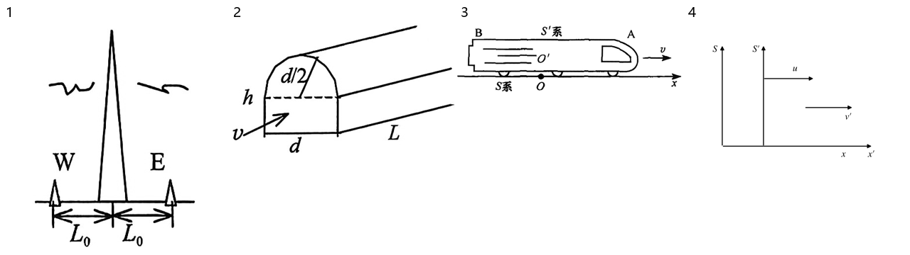

> 派生文件，可重新生成，勿手改。

# 上册逐章题图 · 06 相对论

仅处理上册已确认范围；先尝试原PDF提取，不清楚再重绘。原材料、原图只读保留；只改图片路径，保留原题号、锚点、题面、答案与OCR状态。

本章审查4个图片资产、4处引用。定性图未给出的尺寸/角度/比例不是测量数据。复用图不重复计为独立新图。

生成代码（过程产物未发布） · [映射与逐项核验](../../../../10_%E9%A2%98%E5%BA%93/_assets/%E4%B8%8A%E5%86%8C%E9%80%90%E7%AB%A0/06_%E7%9B%B8%E5%AF%B9%E8%AE%BA/mapping.json) · 校验记录（过程产物未发布）

|编号|题号|原图|来源PDF页|处理|核验|
|---|---|---|---|---|---|
|001|23-24期末-填2|[bac626ccedfd93a38d81d1da44b9052a6f9376bb5c99c577c6830edfe43fc424.jpg](../../../../10_%E9%A2%98%E5%BA%93/_assets/%E5%8E%86%E5%B9%B4%E8%AF%95%E5%8D%B7%E5%90%88%E9%9B%86_2018-2024/bac626ccedfd93a38d81d1da44b9052a6f9376bb5c99c577c6830edfe43fc424.jpg)|21|native_extraction [001-extracted.png](../../../../10_%E9%A2%98%E5%BA%93/_assets/%E4%B8%8A%E5%86%8C%E9%80%90%E7%AB%A0/06_%E7%9B%B8%E5%AF%B9%E8%AE%BA/001-extracted.png)|W/E两端、中心高塔与两个L0尺寸保持，不添加高度或发射时间。|
|002|23-24期末-计4|[cc80e457792fb6f0932a3be4a0d7a717b93dd54fc7731e5226983583b1d2a3fd.jpg](../../../../10_%E9%A2%98%E5%BA%93/_assets/%E5%8E%86%E5%B9%B4%E8%AF%95%E5%8D%B7%E5%90%88%E9%9B%86_2018-2024/cc80e457792fb6f0932a3be4a0d7a717b93dd54fc7731e5226983583b1d2a3fd.jpg)|22|native_extraction [002-extracted.png](../../../../10_%E9%A2%98%E5%BA%93/_assets/%E4%B8%8A%E5%86%8C%E9%80%90%E7%AB%A0/06_%E7%9B%B8%E5%AF%B9%E8%AE%BA/002-extracted.png)|隧道截面半圆d/2、宽d、高h、长L及v向右上按源图保持；透视图不当作定量比例。|
|003|学习指导-第06章-例题-6-1|[p0001-0180_046.jpg](../../../../10_%E9%A2%98%E5%BA%93/_assets/%E5%AD%A6%E4%B9%A0%E6%8C%87%E5%AF%BC/p0001-0180_046.jpg)|117|native_extraction [003-extracted.png](../../../../10_%E9%A2%98%E5%BA%93/_assets/%E4%B8%8A%E5%86%8C%E9%80%90%E7%AB%A0/06_%E7%9B%B8%E5%AF%B9%E8%AE%BA/003-extracted.png)|车头A右、车尾B左、S/S′、O/O′、v向右及x正向右保持。|
|004|学习指导-第06章-例题-6-6|[p0001-0180_180.jpg](../../../../10_%E9%A2%98%E5%BA%93/_assets/%E5%AD%A6%E4%B9%A0%E6%8C%87%E5%AF%BC/p0001-0180_180.jpg)|119|redrawn [004.svg](../../../../10_%E9%A2%98%E5%BA%93/_assets/%E4%B8%8A%E5%86%8C%E9%80%90%E7%AB%A0/06_%E7%9B%B8%E5%AF%B9%E8%AE%BA/004.svg)|S与S′竖轴、共线x/x′正向右，u与v′均向右；箭长和参考系间距为定性布局，未增加y轴名称或原点标号。|

## 来源与引用文档

- 来源PDF（工作区原件）：`00_原材料\历年试卷\大学物理I历年试卷合集_2018-2024.pdf`；本章保留逐图原生裁图证据。
- [扫描件_普通高等教育十一五规划教材配套教辅.pdf](../../../../00_%E5%8E%9F%E6%9D%90%E6%96%99/%E6%89%AB%E6%8F%8F%E4%BB%B6_%E6%99%AE%E9%80%9A%E9%AB%98%E7%AD%89%E6%95%99%E8%82%B2%E5%8D%81%E4%B8%80%E4%BA%94%E8%A7%84%E5%88%92%E6%95%99%E6%9D%90%E9%85%8D%E5%A5%97%E6%95%99%E8%BE%85.pdf)
- [2023-2024学年大学物理I期末题面整理.md](../../../../10_%E9%A2%98%E5%BA%93/%E5%8E%86%E5%B9%B4%E7%9C%9F%E9%A2%98/%E6%9C%9F%E6%9C%AB/2023-2024%E5%AD%A6%E5%B9%B4%E5%A4%A7%E5%AD%A6%E7%89%A9%E7%90%86I%E6%9C%9F%E6%9C%AB%E9%A2%98%E9%9D%A2%E6%95%B4%E7%90%86.md)
- [学习指导_第06章_狭义相对论_题面整理.md](../../../../10_%E9%A2%98%E5%BA%93/%E5%AD%A6%E4%B9%A0%E6%8C%87%E5%AF%BC/%E5%AD%A6%E4%B9%A0%E6%8C%87%E5%AF%BC_%E7%AC%AC06%E7%AB%A0_%E7%8B%AD%E4%B9%89%E7%9B%B8%E5%AF%B9%E8%AE%BA_%E9%A2%98%E9%9D%A2%E6%95%B4%E7%90%86.md)

## 前后对照

## 缩小黑白阅读

## 核验边界

仅按上册已有参考系和隧道/车厢图处理，无新增下册内容。无未解决的点名或箭头歧义；透视比例不作为尺寸。

本次不改转换认证、原题OCR状态或解答；不声称整本旧转换人工验收已补齐。知识笔记若无图片引用，记录为无需替换，不改正文。
