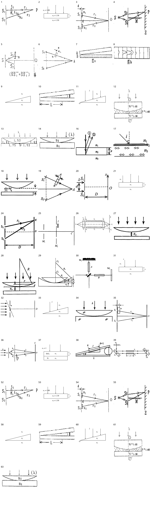

> 派生文件，可重新生成，勿手改。

# 上册逐章题图 · 13 干涉

仅处理上册已确认范围；先尝试原PDF提取，不清楚再重绘。原材料、原图只读保留；只改图片路径，保留原题号、锚点、题面、答案与OCR状态。

本章审查64个图片资产、64处引用。定性图未给出的尺寸/角度/比例不是测量数据。复用图不重复计为独立新图。

生成代码（过程产物未发布） · [映射与逐项核验](../../../../10_%E9%A2%98%E5%BA%93/_assets/%E4%B8%8A%E5%86%8C%E9%80%90%E7%AB%A0/13_%E5%B9%B2%E6%B6%89/mapping.json) · 校验记录（过程产物未发布）

|编号|题号|原图|来源PDF页|处理|核验|
|---|---|---|---|---|---|
|001|习题册-章节25-题1|[bbbfd2898c74798ec58cbf1e7f462889078dee6d634aca4ab879e06521768050.jpg](../../../../10_%E9%A2%98%E5%BA%93/_assets/%E4%B9%A0%E9%A2%98%E5%86%8C/bbbfd2898c74798ec58cbf1e7f462889078dee6d634aca4ab879e06521768050.jpg)|26|native_extraction [001-extracted.png](../../../../10_%E9%A2%98%E5%BA%93/_assets/%E4%B8%8A%E5%86%8C%E9%80%90%E7%AB%A0/13_%E5%B9%B2%E6%B6%89/001-extracted.png)|原PDF原生裁图，逐项核对光路连接、传播箭头、折射率所在介质、厚度端点及点名；保留复杂透视/干涉装置几何，不从示意比例推定数值。|
|002|习题册-章节25-题3|[101ed2d29f82a5c834f7070754ea75dafafda0991e4eee3cefc7811996387410.jpg](../../../../10_%E9%A2%98%E5%BA%93/_assets/%E4%B9%A0%E9%A2%98%E5%86%8C/101ed2d29f82a5c834f7070754ea75dafafda0991e4eee3cefc7811996387410.jpg)|26|redrawn [002.svg](../../../../10_%E9%A2%98%E5%BA%93/_assets/%E4%B8%8A%E5%86%8C%E9%80%90%E7%AB%A0/13_%E5%B9%B2%E6%B6%89/002.svg)|平行薄膜上中下介质、e的厚度端点与向下入射核对；002数值n1=1.00/n2=1.30/n3=1.50；037保留SiO2/Si和n1=1，不添加λ。其余图保留原有λ。|
|003|习题册-章节25-题5|[9ecd026064a1be35b36fc3814917981d065f5c042ca1b9df373c2ca88b62f851.jpg](../../../../10_%E9%A2%98%E5%BA%93/_assets/%E4%B9%A0%E9%A2%98%E5%86%8C/9ecd026064a1be35b36fc3814917981d065f5c042ca1b9df373c2ca88b62f851.jpg)|26|native_extraction [003-extracted.png](../../../../10_%E9%A2%98%E5%BA%93/_assets/%E4%B8%8A%E5%86%8C%E9%80%90%E7%AB%A0/13_%E5%B9%B2%E6%B6%89/003-extracted.png)|原PDF原生裁图，逐项核对光路连接、传播箭头、折射率所在介质、厚度端点及点名；保留复杂透视/干涉装置几何，不从示意比例推定数值。|
|004|习题册-章节26-题2|[2e570a69dbfb53f242160ad94d9ce4b255fbded6c4a5ee29ffc6e72d4fce93b2.jpg](../../../../10_%E9%A2%98%E5%BA%93/_assets/%E4%B9%A0%E9%A2%98%E5%86%8C/2e570a69dbfb53f242160ad94d9ce4b255fbded6c4a5ee29ffc6e72d4fce93b2.jpg)|27|native_extraction [004-extracted.png](../../../../10_%E9%A2%98%E5%BA%93/_assets/%E4%B8%8A%E5%86%8C%E9%80%90%E7%AB%A0/13_%E5%B9%B2%E6%B6%89/004-extracted.png)|原PDF原生裁图，逐项核对光路连接、传播箭头、折射率所在介质、厚度端点及点名；保留复杂透视/干涉装置几何，不从示意比例推定数值。|
|005|习题册-章节26-题3|[86c44eb5642c942860811e9bb1726846edd60faef86eec0bde6206c1bac79e87.jpg](../../../../10_%E9%A2%98%E5%BA%93/_assets/%E4%B9%A0%E9%A2%98%E5%86%8C/86c44eb5642c942860811e9bb1726846edd60faef86eec0bde6206c1bac79e87.jpg)|27|native_extraction [005-extracted.png](../../../../10_%E9%A2%98%E5%BA%93/_assets/%E4%B8%8A%E5%86%8C%E9%80%90%E7%AB%A0/13_%E5%B9%B2%E6%B6%89/005-extracted.png)|原PDF原生裁图，逐项核对光路连接、传播箭头、折射率所在介质、厚度端点及点名；保留复杂透视/干涉装置几何，不从示意比例推定数值。|
|006|习题册-章节26-题4|[11cd5b81c849317b505abf0d13400f714d5ffa96a5a16c5561bf81e4021ac2ee.jpg](../../../../10_%E9%A2%98%E5%BA%93/_assets/%E4%B9%A0%E9%A2%98%E5%86%8C/11cd5b81c849317b505abf0d13400f714d5ffa96a5a16c5561bf81e4021ac2ee.jpg)|27|native_extraction [006-extracted.png](../../../../10_%E9%A2%98%E5%BA%93/_assets/%E4%B8%8A%E5%86%8C%E9%80%90%E7%AB%A0/13_%E5%B9%B2%E6%B6%89/006-extracted.png)|原PDF原生裁图，逐项核对光路连接、传播箭头、折射率所在介质、厚度端点及点名；保留复杂透视/干涉装置几何，不从示意比例推定数值。|
|007|习题册-章节27-题2|[f70989531a58c634544b064192298a51570d0bcaf885b545dd10e10e880f40ef.jpg](../../../../10_%E9%A2%98%E5%BA%93/_assets/%E4%B9%A0%E9%A2%98%E5%86%8C/f70989531a58c634544b064192298a51570d0bcaf885b545dd10e10e880f40ef.jpg)|28|native_extraction [007-extracted.png](../../../../10_%E9%A2%98%E5%BA%93/_assets/%E4%B8%8A%E5%86%8C%E9%80%90%E7%AB%A0/13_%E5%B9%B2%E6%B6%89/007-extracted.png)|原PDF原生裁图，逐项核对光路连接、传播箭头、折射率所在介质、厚度端点及点名；保留复杂透视/干涉装置几何，不从示意比例推定数值。|
|008|习题册-章节27-题2|[92f530020749f95953bd7be8d5e23bd0594fac060dcdf9d3602fd05b8bf4f639.jpg](../../../../10_%E9%A2%98%E5%BA%93/_assets/%E4%B9%A0%E9%A2%98%E5%86%8C/92f530020749f95953bd7be8d5e23bd0594fac060dcdf9d3602fd05b8bf4f639.jpg)|28|native_extraction [008-extracted.png](../../../../10_%E9%A2%98%E5%BA%93/_assets/%E4%B8%8A%E5%86%8C%E9%80%90%E7%AB%A0/13_%E5%B9%B2%E6%B6%89/008-extracted.png)|原PDF原生裁图，逐项核对光路连接、传播箭头、折射率所在介质、厚度端点及点名；保留复杂透视/干涉装置几何，不从示意比例推定数值。|
|009|习题册-章节27-题3|[2f47828b9755f84593ad97f4867415cabeb4b55f3b74e80b5dfc5895d7ce45f9.jpg](../../../../10_%E9%A2%98%E5%BA%93/_assets/%E4%B9%A0%E9%A2%98%E5%86%8C/2f47828b9755f84593ad97f4867415cabeb4b55f3b74e80b5dfc5895d7ce45f9.jpg)|28|redrawn [009.svg](../../../../10_%E9%A2%98%E5%BA%93/_assets/%E4%B8%8A%E5%86%8C%E9%80%90%E7%AB%A0/13_%E5%B9%B2%E6%B6%89/009.svg)|劈尖零厚度在左、厚端在右；n1在上、n2在楔内、n3在下；011/033向下入射λ，011左端O保留。角度与厚度不添加数值。|
|010|习题册-章节27-题4|[97fc17c9ff564287ce471a6cf5d906cefda34cb7517f53a67c328ef4dc7d06be.jpg](../../../../10_%E9%A2%98%E5%BA%93/_assets/%E4%B9%A0%E9%A2%98%E5%86%8C/97fc17c9ff564287ce471a6cf5d906cefda34cb7517f53a67c328ef4dc7d06be.jpg)|28|native_extraction [010-extracted.png](../../../../10_%E9%A2%98%E5%BA%93/_assets/%E4%B8%8A%E5%86%8C%E9%80%90%E7%AB%A0/13_%E5%B9%B2%E6%B6%89/010-extracted.png)|原PDF原生裁图，逐项核对光路连接、传播箭头、折射率所在介质、厚度端点及点名；保留复杂透视/干涉装置几何，不从示意比例推定数值。|
|011|习题册-章节27-题5|[ce4c1a6da6d594e87df859b65d73639a007048cb3296b9c9f54b9a60ebe65dad.jpg](../../../../10_%E9%A2%98%E5%BA%93/_assets/%E4%B9%A0%E9%A2%98%E5%86%8C/ce4c1a6da6d594e87df859b65d73639a007048cb3296b9c9f54b9a60ebe65dad.jpg)|28|redrawn [011.svg](../../../../10_%E9%A2%98%E5%BA%93/_assets/%E4%B8%8A%E5%86%8C%E9%80%90%E7%AB%A0/13_%E5%B9%B2%E6%B6%89/011.svg)|劈尖零厚度在左、厚端在右；n1在上、n2在楔内、n3在下；011/033向下入射λ，011左端O保留。角度与厚度不添加数值。|
|012|习题册-章节28-题1|[7d3c4566300493a7328e00af25dbc3093970662dafced3658e2a65b3342c7ba9.jpg](../../../../10_%E9%A2%98%E5%BA%93/_assets/%E4%B9%A0%E9%A2%98%E5%86%8C/7d3c4566300493a7328e00af25dbc3093970662dafced3658e2a65b3342c7ba9.jpg)|29|native_extraction [012-extracted.png](../../../../10_%E9%A2%98%E5%BA%93/_assets/%E4%B8%8A%E5%86%8C%E9%80%90%E7%AB%A0/13_%E5%B9%B2%E6%B6%89/012-extracted.png)|原PDF原生裁图，逐项核对光路连接、传播箭头、折射率所在介质、厚度端点及点名；保留复杂透视/干涉装置几何，不从示意比例推定数值。|
|013|习题册-章节28-题2|[71afc3752dd8d0e53da412feee742a10a27eaeacbc31076610921aeca4ce5ea2.jpg](../../../../10_%E9%A2%98%E5%BA%93/_assets/%E4%B9%A0%E9%A2%98%E5%86%8C/71afc3752dd8d0e53da412feee742a10a27eaeacbc31076610921aeca4ce5ea2.jpg)|29|native_extraction [013-extracted.png](../../../../10_%E9%A2%98%E5%BA%93/_assets/%E4%B8%8A%E5%86%8C%E9%80%90%E7%AB%A0/13_%E5%B9%B2%E6%B6%89/013-extracted.png)|原PDF原生裁图，逐项核对光路连接、传播箭头、折射率所在介质、厚度端点及点名；保留复杂透视/干涉装置几何，不从示意比例推定数值。|
|014|习题册-章节28-题5|[d164bbce3a166fc5445034063bbbb3b49cba6df8d07a12d35def05cf4872a6df.jpg](../../../../10_%E9%A2%98%E5%BA%93/_assets/%E4%B9%A0%E9%A2%98%E5%86%8C/d164bbce3a166fc5445034063bbbb3b49cba6df8d07a12d35def05cf4872a6df.jpg)|29|native_extraction [014-extracted.png](../../../../10_%E9%A2%98%E5%BA%93/_assets/%E4%B8%8A%E5%86%8C%E9%80%90%E7%AB%A0/13_%E5%B9%B2%E6%B6%89/014-extracted.png)|原PDF原生裁图，逐项核对光路连接、传播箭头、折射率所在介质、厚度端点及点名；保留复杂透视/干涉装置几何，不从示意比例推定数值。|
|015|习题册-章节28-题6|[ce2175b89f4e14d12e7458f64dfacff483dd507887a3f452900f873ee8644ec3.jpg](../../../../10_%E9%A2%98%E5%BA%93/_assets/%E4%B9%A0%E9%A2%98%E5%86%8C/ce2175b89f4e14d12e7458f64dfacff483dd507887a3f452900f873ee8644ec3.jpg)|29|retained_uncertain|保留原图：细小暗环标号难辨、复合图边界、已有手写标记或邻近文字混入；不猜改折射率、环级次或删掉文字说明。|
|016|20-21期末-选5|[98aac52a95e1d076dbbceb40c370cc13d80918e5112a4273c009f1e279e4af7e.jpg](../../../../10_%E9%A2%98%E5%BA%93/_assets/%E5%8E%86%E5%B9%B4%E8%AF%95%E5%8D%B7%E5%90%88%E9%9B%86_2018-2024/98aac52a95e1d076dbbceb40c370cc13d80918e5112a4273c009f1e279e4af7e.jpg)|27|native_extraction [016-extracted.png](../../../../10_%E9%A2%98%E5%BA%93/_assets/%E4%B8%8A%E5%86%8C%E9%80%90%E7%AB%A0/13_%E5%B9%B2%E6%B6%89/016-extracted.png)|原PDF原生裁图，逐项核对光路连接、传播箭头、折射率所在介质、厚度端点及点名；保留复杂透视/干涉装置几何，不从示意比例推定数值。|
|017|20-21期末-计4|[91b7cb7775827f7cda05dc6d4cf753dbb8166864b7d13fb174100b6a172ad42d.jpg](../../../../10_%E9%A2%98%E5%BA%93/_assets/%E5%8E%86%E5%B9%B4%E8%AF%95%E5%8D%B7%E5%90%88%E9%9B%86_2018-2024/91b7cb7775827f7cda05dc6d4cf753dbb8166864b7d13fb174100b6a172ad42d.jpg)|29|native_extraction [017-extracted.png](../../../../10_%E9%A2%98%E5%BA%93/_assets/%E4%B8%8A%E5%86%8C%E9%80%90%E7%AB%A0/13_%E5%B9%B2%E6%B6%89/017-extracted.png)|原PDF原生裁图，逐项核对光路连接、传播箭头、折射率所在介质、厚度端点及点名；保留复杂透视/干涉装置几何，不从示意比例推定数值。|
|018|20-21期末-计5|[5e334c137d217459bca6e94e6d5cbf1cb541999e8eeaee9e7b8c1d4b8276bdf5.jpg](../../../../10_%E9%A2%98%E5%BA%93/_assets/%E5%8E%86%E5%B9%B4%E8%AF%95%E5%8D%B7%E5%90%88%E9%9B%86_2018-2024/5e334c137d217459bca6e94e6d5cbf1cb541999e8eeaee9e7b8c1d4b8276bdf5.jpg)|29|native_extraction [018-extracted.png](../../../../10_%E9%A2%98%E5%BA%93/_assets/%E4%B8%8A%E5%86%8C%E9%80%90%E7%AB%A0/13_%E5%B9%B2%E6%B6%89/018-extracted.png)|原PDF原生裁图，逐项核对光路连接、传播箭头、折射率所在介质、厚度端点及点名；保留复杂透视/干涉装置几何，不从示意比例推定数值。|
|019|23-24期末-填3|[63c7ae6a5e8faf7b6a09e2a0cf08014b3fe1cf408f97390e0983b15e5a708e06.jpg](../../../../10_%E9%A2%98%E5%BA%93/_assets/%E5%8E%86%E5%B9%B4%E8%AF%95%E5%8D%B7%E5%90%88%E9%9B%86_2018-2024/63c7ae6a5e8faf7b6a09e2a0cf08014b3fe1cf408f97390e0983b15e5a708e06.jpg)|21|native_extraction [019-extracted.png](../../../../10_%E9%A2%98%E5%BA%93/_assets/%E4%B8%8A%E5%86%8C%E9%80%90%E7%AB%A0/13_%E5%B9%B2%E6%B6%89/019-extracted.png)|原PDF原生裁图，逐项核对光路连接、传播箭头、折射率所在介质、厚度端点及点名；保留复杂透视/干涉装置几何，不从示意比例推定数值。|
|020|23-24期末-计3|[4f3f588c54409f4e79ad6e97bd8b77dc5e76e4031bccfe4c053bd15237e5ff48.jpg](../../../../10_%E9%A2%98%E5%BA%93/_assets/%E5%8E%86%E5%B9%B4%E8%AF%95%E5%8D%B7%E5%90%88%E9%9B%86_2018-2024/4f3f588c54409f4e79ad6e97bd8b77dc5e76e4031bccfe4c053bd15237e5ff48.jpg)|22|native_extraction [020-extracted.png](../../../../10_%E9%A2%98%E5%BA%93/_assets/%E4%B8%8A%E5%86%8C%E9%80%90%E7%AB%A0/13_%E5%B9%B2%E6%B6%89/020-extracted.png)|原PDF原生裁图，逐项核对光路连接、传播箭头、折射率所在介质、厚度端点及点名；保留复杂透视/干涉装置几何，不从示意比例推定数值。|
|021|24-25期末-选9|[d1c76e3e5a97a3bf54fa5307fb9c9fbfc04ad50424d035d7ec2992ae22a81016.jpg](../../../../10_%E9%A2%98%E5%BA%93/_assets/2024-2025%E6%9C%9F%E6%9C%AB%E6%88%AA%E5%9B%BE/d1c76e3e5a97a3bf54fa5307fb9c9fbfc04ad50424d035d7ec2992ae22a81016.jpg)|9|redrawn [021.svg](../../../../10_%E9%A2%98%E5%BA%93/_assets/%E4%B8%8A%E5%86%8C%E9%80%90%E7%AB%A0/13_%E5%B9%B2%E6%B6%89/021.svg)|平行薄膜上中下介质、e的厚度端点与向下入射核对；002数值n1=1.00/n2=1.30/n3=1.50；037保留SiO2/Si和n1=1，不添加λ。其余图保留原有λ。|
|022|24-25期末-计4|[f6d529dd8428adbcf5a7c57f04e60e27a2a44cd98236ae65f15d0d0a94316eb3.jpg](../../../../10_%E9%A2%98%E5%BA%93/_assets/2024-2025%E6%9C%9F%E6%9C%AB%E6%88%AA%E5%9B%BE/f6d529dd8428adbcf5a7c57f04e60e27a2a44cd98236ae65f15d0d0a94316eb3.jpg)|18|retained_uncertain|保留原图：细小暗环标号难辨、复合图边界、已有手写标记或邻近文字混入；不猜改折射率、环级次或删掉文字说明。|
|023|未标年份-期末二-选15|[e5b7c8c39c2a9d986e85f0a4861eb0a2437543907f0fb1eb21d3c396c9772606.jpg](../../../../10_%E9%A2%98%E5%BA%93/_assets/%E5%8E%86%E5%B9%B4%E8%AF%95%E5%8D%B7%E5%90%88%E9%9B%86_2018-2024/e5b7c8c39c2a9d986e85f0a4861eb0a2437543907f0fb1eb21d3c396c9772606.jpg)|51|retained_uncertain|保留原图：细小暗环标号难辨、复合图边界、已有手写标记或邻近文字混入；不猜改折射率、环级次或删掉文字说明。|
|024|未标年份-期末二-计2|[7903ccb067c452cde1f3d4bf3384b0e0cf83a5de0d13e5c74083efa6594ac392.jpg](../../../../10_%E9%A2%98%E5%BA%93/_assets/%E5%8E%86%E5%B9%B4%E8%AF%95%E5%8D%B7%E5%90%88%E9%9B%86_2018-2024/7903ccb067c452cde1f3d4bf3384b0e0cf83a5de0d13e5c74083efa6594ac392.jpg)|53|native_extraction [024-extracted.png](../../../../10_%E9%A2%98%E5%BA%93/_assets/%E4%B8%8A%E5%86%8C%E9%80%90%E7%AB%A0/13_%E5%B9%B2%E6%B6%89/024-extracted.png)|原PDF原生裁图，逐项核对光路连接、传播箭头、折射率所在介质、厚度端点及点名；保留复杂透视/干涉装置几何，不从示意比例推定数值。|
|025|学习指导-第13章-例题-13-1|[p0181-0360_409.jpg](../../../../10_%E9%A2%98%E5%BA%93/_assets/%E5%AD%A6%E4%B9%A0%E6%8C%87%E5%AF%BC/p0181-0360_409.jpg)|279|native_extraction [025-extracted.png](../../../../10_%E9%A2%98%E5%BA%93/_assets/%E4%B8%8A%E5%86%8C%E9%80%90%E7%AB%A0/13_%E5%B9%B2%E6%B6%89/025-extracted.png)|原PDF原生裁图，逐项核对光路连接、传播箭头、折射率所在介质、厚度端点及点名；保留复杂透视/干涉装置几何，不从示意比例推定数值。|
|026|学习指导-第13章-例题-13-3|[p0181-0360_085.jpg](../../../../10_%E9%A2%98%E5%BA%93/_assets/%E5%AD%A6%E4%B9%A0%E6%8C%87%E5%AF%BC/p0181-0360_085.jpg)|280|native_extraction [026-extracted.png](../../../../10_%E9%A2%98%E5%BA%93/_assets/%E4%B8%8A%E5%86%8C%E9%80%90%E7%AB%A0/13_%E5%B9%B2%E6%B6%89/026-extracted.png)|原PDF原生裁图，逐项核对光路连接、传播箭头、折射率所在介质、厚度端点及点名；保留复杂透视/干涉装置几何，不从示意比例推定数值。|
|027|学习指导-第13章-例题-13-6|[p0181-0360_610.jpg](../../../../10_%E9%A2%98%E5%BA%93/_assets/%E5%AD%A6%E4%B9%A0%E6%8C%87%E5%AF%BC/p0181-0360_610.jpg)|281|native_extraction [027-extracted.png](../../../../10_%E9%A2%98%E5%BA%93/_assets/%E4%B8%8A%E5%86%8C%E9%80%90%E7%AB%A0/13_%E5%B9%B2%E6%B6%89/027-extracted.png)|原PDF原生裁图，逐项核对光路连接、传播箭头、折射率所在介质、厚度端点及点名；保留复杂透视/干涉装置几何，不从示意比例推定数值。|
|028|学习指导-第13章-例题-13-6|[p0181-0360_735.jpg](../../../../10_%E9%A2%98%E5%BA%93/_assets/%E5%AD%A6%E4%B9%A0%E6%8C%87%E5%AF%BC/p0181-0360_735.jpg)|281|native_extraction [028-extracted.png](../../../../10_%E9%A2%98%E5%BA%93/_assets/%E4%B8%8A%E5%86%8C%E9%80%90%E7%AB%A0/13_%E5%B9%B2%E6%B6%89/028-extracted.png)|原PDF原生裁图，逐项核对光路连接、传播箭头、折射率所在介质、厚度端点及点名；保留复杂透视/干涉装置几何，不从示意比例推定数值。|
|029|学习指导-第13章-例题-13-7|[p0181-0360_156.jpg](../../../../10_%E9%A2%98%E5%BA%93/_assets/%E5%AD%A6%E4%B9%A0%E6%8C%87%E5%AF%BC/p0181-0360_156.jpg)|282|native_extraction [029-extracted.png](../../../../10_%E9%A2%98%E5%BA%93/_assets/%E4%B8%8A%E5%86%8C%E9%80%90%E7%AB%A0/13_%E5%B9%B2%E6%B6%89/029-extracted.png)|原PDF原生裁图，逐项核对光路连接、传播箭头、折射率所在介质、厚度端点及点名；保留复杂透视/干涉装置几何，不从示意比例推定数值。|
|030|学习指导-第13章-例题-13-8|[p0181-0360_567.jpg](../../../../10_%E9%A2%98%E5%BA%93/_assets/%E5%AD%A6%E4%B9%A0%E6%8C%87%E5%AF%BC/p0181-0360_567.jpg)|283|native_extraction [030-extracted.png](../../../../10_%E9%A2%98%E5%BA%93/_assets/%E4%B8%8A%E5%86%8C%E9%80%90%E7%AB%A0/13_%E5%B9%B2%E6%B6%89/030-extracted.png)|原PDF原生裁图，逐项核对光路连接、传播箭头、折射率所在介质、厚度端点及点名；保留复杂透视/干涉装置几何，不从示意比例推定数值。|
|031|学习指导-第13章-思考题-13-2|[p0181-0360_241.jpg](../../../../10_%E9%A2%98%E5%BA%93/_assets/%E5%AD%A6%E4%B9%A0%E6%8C%87%E5%AF%BC/p0181-0360_241.jpg)|283|redrawn [031.svg](../../../../10_%E9%A2%98%E5%BA%93/_assets/%E4%B8%8A%E5%86%8C%E9%80%90%E7%AB%A0/13_%E5%B9%B2%E6%B6%89/031.svg)|平行薄膜上中下介质、e的厚度端点与向下入射核对；002数值n1=1.00/n2=1.30/n3=1.50；037保留SiO2/Si和n1=1，不添加λ。其余图保留原有λ。|
|032|学习指导-第13章-思考题-13-5|[p0181-0360_1144.jpg](../../../../10_%E9%A2%98%E5%BA%93/_assets/%E5%AD%A6%E4%B9%A0%E6%8C%87%E5%AF%BC/p0181-0360_1144.jpg)|284|native_extraction [032-extracted.png](../../../../10_%E9%A2%98%E5%BA%93/_assets/%E4%B8%8A%E5%86%8C%E9%80%90%E7%AB%A0/13_%E5%B9%B2%E6%B6%89/032-extracted.png)|原PDF原生裁图，逐项核对光路连接、传播箭头、折射率所在介质、厚度端点及点名；保留复杂透视/干涉装置几何，不从示意比例推定数值。|
|033|学习指导-第13章-思考题-13-9|[p0181-0360_840.jpg](../../../../10_%E9%A2%98%E5%BA%93/_assets/%E5%AD%A6%E4%B9%A0%E6%8C%87%E5%AF%BC/p0181-0360_840.jpg)|285|redrawn [033.svg](../../../../10_%E9%A2%98%E5%BA%93/_assets/%E4%B8%8A%E5%86%8C%E9%80%90%E7%AB%A0/13_%E5%B9%B2%E6%B6%89/033.svg)|劈尖零厚度在左、厚端在右；n1在上、n2在楔内、n3在下；011/033向下入射λ，011左端O保留。角度与厚度不添加数值。|
|034|学习指导-第13章-思考题-13-10|[p0181-0360_101.jpg](../../../../10_%E9%A2%98%E5%BA%93/_assets/%E5%AD%A6%E4%B9%A0%E6%8C%87%E5%AF%BC/p0181-0360_101.jpg)|285|native_extraction [034-extracted.png](../../../../10_%E9%A2%98%E5%BA%93/_assets/%E4%B8%8A%E5%86%8C%E9%80%90%E7%AB%A0/13_%E5%B9%B2%E6%B6%89/034-extracted.png)|原PDF原生裁图，逐项核对光路连接、传播箭头、折射率所在介质、厚度端点及点名；保留复杂透视/干涉装置几何，不从示意比例推定数值。|
|035|学习指导-第13章-习题-13-2|[p0181-0360_727.jpg](../../../../10_%E9%A2%98%E5%BA%93/_assets/%E5%AD%A6%E4%B9%A0%E6%8C%87%E5%AF%BC/p0181-0360_727.jpg)|287|native_extraction [035-extracted.png](../../../../10_%E9%A2%98%E5%BA%93/_assets/%E4%B8%8A%E5%86%8C%E9%80%90%E7%AB%A0/13_%E5%B9%B2%E6%B6%89/035-extracted.png)|原PDF原生裁图，逐项核对光路连接、传播箭头、折射率所在介质、厚度端点及点名；保留复杂透视/干涉装置几何，不从示意比例推定数值。|
|036|学习指导-第13章-习题-13-4|[p0181-0360_193.jpg](../../../../10_%E9%A2%98%E5%BA%93/_assets/%E5%AD%A6%E4%B9%A0%E6%8C%87%E5%AF%BC/p0181-0360_193.jpg)|287|native_extraction [036-extracted.png](../../../../10_%E9%A2%98%E5%BA%93/_assets/%E4%B8%8A%E5%86%8C%E9%80%90%E7%AB%A0/13_%E5%B9%B2%E6%B6%89/036-extracted.png)|原PDF原生裁图，逐项核对光路连接、传播箭头、折射率所在介质、厚度端点及点名；保留复杂透视/干涉装置几何，不从示意比例推定数值。|
|037|学习指导-第13章-习题-13-5|[p0181-0360_333.jpg](../../../../10_%E9%A2%98%E5%BA%93/_assets/%E5%AD%A6%E4%B9%A0%E6%8C%87%E5%AF%BC/p0181-0360_333.jpg)|288|redrawn [037.svg](../../../../10_%E9%A2%98%E5%BA%93/_assets/%E4%B8%8A%E5%86%8C%E9%80%90%E7%AB%A0/13_%E5%B9%B2%E6%B6%89/037.svg)|平行薄膜上中下介质、e的厚度端点与向下入射核对；002数值n1=1.00/n2=1.30/n3=1.50；037保留SiO2/Si和n1=1，不添加λ。其余图保留原有λ。|
|038|学习指导-第13章-习题-13-8|[p0181-0360_443.jpg](../../../../10_%E9%A2%98%E5%BA%93/_assets/%E5%AD%A6%E4%B9%A0%E6%8C%87%E5%AF%BC/p0181-0360_443.jpg)|290|native_extraction [038-extracted.png](../../../../10_%E9%A2%98%E5%BA%93/_assets/%E4%B8%8A%E5%86%8C%E9%80%90%E7%AB%A0/13_%E5%B9%B2%E6%B6%89/038-extracted.png)|原PDF原生裁图，逐项核对光路连接、传播箭头、折射率所在介质、厚度端点及点名；保留复杂透视/干涉装置几何，不从示意比例推定数值。|
|039|学习指导-第13章-习题-13-14|[p0181-0360_813.jpg](../../../../10_%E9%A2%98%E5%BA%93/_assets/%E5%AD%A6%E4%B9%A0%E6%8C%87%E5%AF%BC/p0181-0360_813.jpg)|293|native_extraction [039-extracted.png](../../../../10_%E9%A2%98%E5%BA%93/_assets/%E4%B8%8A%E5%86%8C%E9%80%90%E7%AB%A0/13_%E5%B9%B2%E6%B6%89/039-extracted.png)|原PDF原生裁图，逐项核对光路连接、传播箭头、折射率所在介质、厚度端点及点名；保留复杂透视/干涉装置几何，不从示意比例推定数值。|
|040|清华题库-光学-310|[45bd8975dd941607bccc1804621b9a13d7d2e6bd74098685ada4a221035b45b0.jpg](../../../../10_%E9%A2%98%E5%BA%93/_assets/%E6%B8%85%E5%8D%8E%E9%A2%98%E5%BA%93/45bd8975dd941607bccc1804621b9a13d7d2e6bd74098685ada4a221035b45b0.jpg)|36|retained_clear|原题库图的折射率、光路、箭头和界面清楚；已有几何/标注支持黑白辨认，不重复转换。|
|041|清华题库-光学-311|[fc331af1700d44069d05dd30fd03330d6dfc3bf90da0f841e1229362fad25495.jpg](../../../../10_%E9%A2%98%E5%BA%93/_assets/%E6%B8%85%E5%8D%8E%E9%A2%98%E5%BA%93/fc331af1700d44069d05dd30fd03330d6dfc3bf90da0f841e1229362fad25495.jpg)|36|retained_clear|原题库图的折射率、光路、箭头和界面清楚；已有几何/标注支持黑白辨认，不重复转换。|
|042|清华题库-光学-316|[5d9ec35ecebf5208e34eecc26b5b010d94d5d39a712b3b170b9457eb9b797bad.jpg](../../../../10_%E9%A2%98%E5%BA%93/_assets/%E6%B8%85%E5%8D%8E%E9%A2%98%E5%BA%93/5d9ec35ecebf5208e34eecc26b5b010d94d5d39a712b3b170b9457eb9b797bad.jpg)|37|retained_clear|原题库图的折射率、光路、箭头和界面清楚；已有几何/标注支持黑白辨认，不重复转换。|
|043|清华题库-光学-318|[9e2c86e5d0c80b2164bc310c1cbeeee97a61d68254f37340ae3043f340e97931.jpg](../../../../10_%E9%A2%98%E5%BA%93/_assets/%E6%B8%85%E5%8D%8E%E9%A2%98%E5%BA%93/9e2c86e5d0c80b2164bc310c1cbeeee97a61d68254f37340ae3043f340e97931.jpg)|38|retained_clear|原题库图的折射率、光路、箭头和界面清楚；已有几何/标注支持黑白辨认，不重复转换。|
|044|清华题库-光学-321|[be90c0c3b34de05e102b5bd1127b8304f0c3bc440fc207ee051b3bd5a7f92f76.jpg](../../../../10_%E9%A2%98%E5%BA%93/_assets/%E6%B8%85%E5%8D%8E%E9%A2%98%E5%BA%93/be90c0c3b34de05e102b5bd1127b8304f0c3bc440fc207ee051b3bd5a7f92f76.jpg)|39|retained_clear|原题库图的折射率、光路、箭头和界面清楚；已有几何/标注支持黑白辨认，不重复转换。|
|045|清华题库-光学-322|[9309be3431dc25ba3f2a7005833de3d48123c259abcc89d3b50ea764d02af6b6.jpg](../../../../10_%E9%A2%98%E5%BA%93/_assets/%E6%B8%85%E5%8D%8E%E9%A2%98%E5%BA%93/9309be3431dc25ba3f2a7005833de3d48123c259abcc89d3b50ea764d02af6b6.jpg)|39|retained_clear|原题库图的折射率、光路、箭头和界面清楚；已有几何/标注支持黑白辨认，不重复转换。|
|046|清华题库-光学-359|[f147709c60b7cb9af67cbc3be6f0276cf07da8654c21f3d0a8f78b639a122922.jpg](../../../../10_%E9%A2%98%E5%BA%93/_assets/%E6%B8%85%E5%8D%8E%E9%A2%98%E5%BA%93/f147709c60b7cb9af67cbc3be6f0276cf07da8654c21f3d0a8f78b639a122922.jpg)|46|retained_clear|原题库图的折射率、光路、箭头和界面清楚；已有几何/标注支持黑白辨认，不重复转换。|
|047|清华题库-光学-365|[8ac60c223c998b23e71906df42229af2c93b9672d3e5842770fb1eb7f25df22c.jpg](../../../../10_%E9%A2%98%E5%BA%93/_assets/%E6%B8%85%E5%8D%8E%E9%A2%98%E5%BA%93/8ac60c223c998b23e71906df42229af2c93b9672d3e5842770fb1eb7f25df22c.jpg)|47|retained_clear|原题库图的折射率、光路、箭头和界面清楚；已有几何/标注支持黑白辨认，不重复转换。|
|048|清华题库-光学-369|[410e2d195d5c0f6159aedf68fff7810fce20586988f6ee9fbb87d34c5a9e22f2.jpg](../../../../10_%E9%A2%98%E5%BA%93/_assets/%E6%B8%85%E5%8D%8E%E9%A2%98%E5%BA%93/410e2d195d5c0f6159aedf68fff7810fce20586988f6ee9fbb87d34c5a9e22f2.jpg)|48|retained_clear|原题库图的折射率、光路、箭头和界面清楚；已有几何/标注支持黑白辨认，不重复转换。|
|049|清华题库-光学-369|[6613a96a383f59b097c25318301ea9c078ed8c2f88ac54ce62681d7d29263c89.jpg](../../../../10_%E9%A2%98%E5%BA%93/_assets/%E6%B8%85%E5%8D%8E%E9%A2%98%E5%BA%93/6613a96a383f59b097c25318301ea9c078ed8c2f88ac54ce62681d7d29263c89.jpg)|48|retained_clear|原题库图的折射率、光路、箭头和界面清楚；已有几何/标注支持黑白辨认，不重复转换。|
|050|清华题库-光学-371|[25e6cdde107019c408b2cab7a5578c9d9ef48a55ed0281777ffb31603d68c46d.jpg](../../../../10_%E9%A2%98%E5%BA%93/_assets/%E6%B8%85%E5%8D%8E%E9%A2%98%E5%BA%93/25e6cdde107019c408b2cab7a5578c9d9ef48a55ed0281777ffb31603d68c46d.jpg)|48|retained_clear|原题库图的折射率、光路、箭头和界面清楚；已有几何/标注支持黑白辨认，不重复转换。|
|051|清华题库-光学-399|[2f43af15ccf470dfc1e409e857a8a6a5871b543cf366c83c7e2fd07f39c0b903.jpg](../../../../10_%E9%A2%98%E5%BA%93/_assets/%E6%B8%85%E5%8D%8E%E9%A2%98%E5%BA%93/2f43af15ccf470dfc1e409e857a8a6a5871b543cf366c83c7e2fd07f39c0b903.jpg)|52|retained_clear|原题库图的折射率、光路、箭头和界面清楚；已有几何/标注支持黑白辨认，不重复转换。|
|052|1|[图1.png](../../../../%E5%A4%A7%E5%AD%A6%E7%89%A9%E7%90%86%E4%B9%A0%E9%A2%98%E5%86%8C%EF%BC%88%E4%B8%8A%EF%BC%89/_assets/25_%E4%B9%A0%E9%A2%98%E4%BA%8C%E5%8D%81%E4%BA%94%20%E5%85%89%E7%9A%84%E5%B9%B2%E6%B6%89%EF%BC%88%E4%B8%80%EF%BC%89/%E5%9B%BE1.png)|同一习题册对应题|reuse_extraction [001-extracted.png](../../../../10_%E9%A2%98%E5%BA%93/_assets/%E4%B8%8A%E5%86%8C%E9%80%90%E7%AB%A0/13_%E5%B9%B2%E6%B6%89/001-extracted.png)|对照同一习题册001的光路、折射率与符号，复用核验产物，保留旧题号。|
|053|3|[图3.png](../../../../%E5%A4%A7%E5%AD%A6%E7%89%A9%E7%90%86%E4%B9%A0%E9%A2%98%E5%86%8C%EF%BC%88%E4%B8%8A%EF%BC%89/_assets/25_%E4%B9%A0%E9%A2%98%E4%BA%8C%E5%8D%81%E4%BA%94%20%E5%85%89%E7%9A%84%E5%B9%B2%E6%B6%89%EF%BC%88%E4%B8%80%EF%BC%89/%E5%9B%BE3.png)|同一习题册对应题|reuse_redraw [002.svg](../../../../10_%E9%A2%98%E5%BA%93/_assets/%E4%B8%8A%E5%86%8C%E9%80%90%E7%AB%A0/13_%E5%B9%B2%E6%B6%89/002.svg)|对照同一习题册002的光路、折射率与符号，复用核验产物，保留旧题号。|
|054|5|[图5.png](../../../../%E5%A4%A7%E5%AD%A6%E7%89%A9%E7%90%86%E4%B9%A0%E9%A2%98%E5%86%8C%EF%BC%88%E4%B8%8A%EF%BC%89/_assets/25_%E4%B9%A0%E9%A2%98%E4%BA%8C%E5%8D%81%E4%BA%94%20%E5%85%89%E7%9A%84%E5%B9%B2%E6%B6%89%EF%BC%88%E4%B8%80%EF%BC%89/%E5%9B%BE5.png)|同一习题册对应题|reuse_extraction [003-extracted.png](../../../../10_%E9%A2%98%E5%BA%93/_assets/%E4%B8%8A%E5%86%8C%E9%80%90%E7%AB%A0/13_%E5%B9%B2%E6%B6%89/003-extracted.png)|对照同一习题册003的光路、折射率与符号，复用核验产物，保留旧题号。|
|055|2|[图2.png](../../../../%E5%A4%A7%E5%AD%A6%E7%89%A9%E7%90%86%E4%B9%A0%E9%A2%98%E5%86%8C%EF%BC%88%E4%B8%8A%EF%BC%89/_assets/26_%E4%B9%A0%E9%A2%98%E4%BA%8C%E5%8D%81%E5%85%AD%20%E5%85%89%E7%9A%84%E5%B9%B2%E6%B6%89%EF%BC%88%E4%BA%8C%EF%BC%89/%E5%9B%BE2.png)|同一习题册对应题|reuse_extraction [004-extracted.png](../../../../10_%E9%A2%98%E5%BA%93/_assets/%E4%B8%8A%E5%86%8C%E9%80%90%E7%AB%A0/13_%E5%B9%B2%E6%B6%89/004-extracted.png)|对照同一习题册004的光路、折射率与符号，复用核验产物，保留旧题号。|
|056|3|[图3_4.png](../../../../%E5%A4%A7%E5%AD%A6%E7%89%A9%E7%90%86%E4%B9%A0%E9%A2%98%E5%86%8C%EF%BC%88%E4%B8%8A%EF%BC%89/_assets/26_%E4%B9%A0%E9%A2%98%E4%BA%8C%E5%8D%81%E5%85%AD%20%E5%85%89%E7%9A%84%E5%B9%B2%E6%B6%89%EF%BC%88%E4%BA%8C%EF%BC%89/%E5%9B%BE3_4.png)|同一习题册对应题|retained_uncertain|保留原图：细小暗环标号难辨、复合图边界、已有手写标记或邻近文字混入；不猜改折射率、环级次或删掉文字说明。|
|057|2|[图2.png](../../../../%E5%A4%A7%E5%AD%A6%E7%89%A9%E7%90%86%E4%B9%A0%E9%A2%98%E5%86%8C%EF%BC%88%E4%B8%8A%EF%BC%89/_assets/27_%E4%B9%A0%E9%A2%98%E4%BA%8C%E5%8D%81%E4%B8%83%20%E5%85%89%E7%9A%84%E5%B9%B2%E6%B6%89%EF%BC%88%E4%B8%89%EF%BC%89/%E5%9B%BE2.png)|同一习题册对应题|retained_uncertain|保留原图：细小暗环标号难辨、复合图边界、已有手写标记或邻近文字混入；不猜改折射率、环级次或删掉文字说明。|
|058|3|[图3.png](../../../../%E5%A4%A7%E5%AD%A6%E7%89%A9%E7%90%86%E4%B9%A0%E9%A2%98%E5%86%8C%EF%BC%88%E4%B8%8A%EF%BC%89/_assets/27_%E4%B9%A0%E9%A2%98%E4%BA%8C%E5%8D%81%E4%B8%83%20%E5%85%89%E7%9A%84%E5%B9%B2%E6%B6%89%EF%BC%88%E4%B8%89%EF%BC%89/%E5%9B%BE3.png)|同一习题册对应题|reuse_redraw [009.svg](../../../../10_%E9%A2%98%E5%BA%93/_assets/%E4%B8%8A%E5%86%8C%E9%80%90%E7%AB%A0/13_%E5%B9%B2%E6%B6%89/009.svg)|对照同一习题册009的光路、折射率与符号，复用核验产物，保留旧题号。|
|059|4|[图4.png](../../../../%E5%A4%A7%E5%AD%A6%E7%89%A9%E7%90%86%E4%B9%A0%E9%A2%98%E5%86%8C%EF%BC%88%E4%B8%8A%EF%BC%89/_assets/27_%E4%B9%A0%E9%A2%98%E4%BA%8C%E5%8D%81%E4%B8%83%20%E5%85%89%E7%9A%84%E5%B9%B2%E6%B6%89%EF%BC%88%E4%B8%89%EF%BC%89/%E5%9B%BE4.png)|同一习题册对应题|reuse_extraction [010-extracted.png](../../../../10_%E9%A2%98%E5%BA%93/_assets/%E4%B8%8A%E5%86%8C%E9%80%90%E7%AB%A0/13_%E5%B9%B2%E6%B6%89/010-extracted.png)|对照同一习题册010的光路、折射率与符号，复用核验产物，保留旧题号。|
|060|5|[图5.png](../../../../%E5%A4%A7%E5%AD%A6%E7%89%A9%E7%90%86%E4%B9%A0%E9%A2%98%E5%86%8C%EF%BC%88%E4%B8%8A%EF%BC%89/_assets/27_%E4%B9%A0%E9%A2%98%E4%BA%8C%E5%8D%81%E4%B8%83%20%E5%85%89%E7%9A%84%E5%B9%B2%E6%B6%89%EF%BC%88%E4%B8%89%EF%BC%89/%E5%9B%BE5.png)|同一习题册对应题|reuse_redraw [011.svg](../../../../10_%E9%A2%98%E5%BA%93/_assets/%E4%B8%8A%E5%86%8C%E9%80%90%E7%AB%A0/13_%E5%B9%B2%E6%B6%89/011.svg)|对照同一习题册011的光路、折射率与符号，复用核验产物，保留旧题号。|
|061|1|[图1.png](../../../../%E5%A4%A7%E5%AD%A6%E7%89%A9%E7%90%86%E4%B9%A0%E9%A2%98%E5%86%8C%EF%BC%88%E4%B8%8A%EF%BC%89/_assets/28_%E4%B9%A0%E9%A2%98%E4%BA%8C%E5%8D%81%E5%85%AB%20%E5%85%89%E7%9A%84%E5%B9%B2%E6%B6%89%EF%BC%88%E5%9B%9B%EF%BC%89/%E5%9B%BE1.png)|同一习题册对应题|reuse_extraction [012-extracted.png](../../../../10_%E9%A2%98%E5%BA%93/_assets/%E4%B8%8A%E5%86%8C%E9%80%90%E7%AB%A0/13_%E5%B9%B2%E6%B6%89/012-extracted.png)|对照同一习题册012的光路、折射率与符号，复用核验产物，保留旧题号。|
|062|2|[图2.png](../../../../%E5%A4%A7%E5%AD%A6%E7%89%A9%E7%90%86%E4%B9%A0%E9%A2%98%E5%86%8C%EF%BC%88%E4%B8%8A%EF%BC%89/_assets/28_%E4%B9%A0%E9%A2%98%E4%BA%8C%E5%8D%81%E5%85%AB%20%E5%85%89%E7%9A%84%E5%B9%B2%E6%B6%89%EF%BC%88%E5%9B%9B%EF%BC%89/%E5%9B%BE2.png)|同一习题册对应题|retained_uncertain|保留原图：细小暗环标号难辨、复合图边界、已有手写标记或邻近文字混入；不猜改折射率、环级次或删掉文字说明。|
|063|5|[图5.png](../../../../%E5%A4%A7%E5%AD%A6%E7%89%A9%E7%90%86%E4%B9%A0%E9%A2%98%E5%86%8C%EF%BC%88%E4%B8%8A%EF%BC%89/_assets/28_%E4%B9%A0%E9%A2%98%E4%BA%8C%E5%8D%81%E5%85%AB%20%E5%85%89%E7%9A%84%E5%B9%B2%E6%B6%89%EF%BC%88%E5%9B%9B%EF%BC%89/%E5%9B%BE5.png)|同一习题册对应题|reuse_extraction [014-extracted.png](../../../../10_%E9%A2%98%E5%BA%93/_assets/%E4%B8%8A%E5%86%8C%E9%80%90%E7%AB%A0/13_%E5%B9%B2%E6%B6%89/014-extracted.png)|对照同一习题册014的光路、折射率与符号，复用核验产物，保留旧题号。|
|064|6|[图6.png](../../../../%E5%A4%A7%E5%AD%A6%E7%89%A9%E7%90%86%E4%B9%A0%E9%A2%98%E5%86%8C%EF%BC%88%E4%B8%8A%EF%BC%89/_assets/28_%E4%B9%A0%E9%A2%98%E4%BA%8C%E5%8D%81%E5%85%AB%20%E5%85%89%E7%9A%84%E5%B9%B2%E6%B6%89%EF%BC%88%E5%9B%9B%EF%BC%89/%E5%9B%BE6.png)|同一习题册对应题|retained_uncertain|保留原图：细小暗环标号难辨、复合图边界、已有手写标记或邻近文字混入；不猜改折射率、环级次或删掉文字说明。|

## 来源与引用文档

- 来源PDF（工作区原件）：`00_原材料\习题册\大学物理习题册（上）.pdf`；本章保留逐图原生裁图证据。
- 来源PDF（工作区原件）：`00_原材料\历年试卷\大学物理I历年试卷合集_2018-2024.pdf`；本章保留逐图原生裁图证据。
- [扫描件_普通高等教育十一五规划教材配套教辅.pdf](../../../../00_%E5%8E%9F%E6%9D%90%E6%96%99/%E6%89%AB%E6%8F%8F%E4%BB%B6_%E6%99%AE%E9%80%9A%E9%AB%98%E7%AD%89%E6%95%99%E8%82%B2%E5%8D%81%E4%B8%80%E4%BA%94%E8%A7%84%E5%88%92%E6%95%99%E6%9D%90%E9%85%8D%E5%A5%97%E6%95%99%E8%BE%85.pdf)
- 来源PDF（工作区原件）：`90_缓存\扫描整理\2024-2025期末\2024-2025学年大学物理I期末_方向校正合并.pdf`；本章保留逐图原生裁图证据。
- 来源PDF（工作区原件）：`90_缓存\清华题库章节拆分\清华题库_相对论_机械振动_机械波_光学_题目页p031-p083.pdf`；本章保留逐图原生裁图证据。
- [大学物理习题册_25_光的干涉（一）_题面整理.md](../../../../10_%E9%A2%98%E5%BA%93/%E4%B9%A0%E9%A2%98%E5%86%8C/%E5%A4%A7%E5%AD%A6%E7%89%A9%E7%90%86%E4%B9%A0%E9%A2%98%E5%86%8C_25_%E5%85%89%E7%9A%84%E5%B9%B2%E6%B6%89%EF%BC%88%E4%B8%80%EF%BC%89_%E9%A2%98%E9%9D%A2%E6%95%B4%E7%90%86.md)
- [大学物理习题册_26_光的干涉（二）_题面整理.md](../../../../10_%E9%A2%98%E5%BA%93/%E4%B9%A0%E9%A2%98%E5%86%8C/%E5%A4%A7%E5%AD%A6%E7%89%A9%E7%90%86%E4%B9%A0%E9%A2%98%E5%86%8C_26_%E5%85%89%E7%9A%84%E5%B9%B2%E6%B6%89%EF%BC%88%E4%BA%8C%EF%BC%89_%E9%A2%98%E9%9D%A2%E6%95%B4%E7%90%86.md)
- [大学物理习题册_27_光的干涉（三）_题面整理.md](../../../../10_%E9%A2%98%E5%BA%93/%E4%B9%A0%E9%A2%98%E5%86%8C/%E5%A4%A7%E5%AD%A6%E7%89%A9%E7%90%86%E4%B9%A0%E9%A2%98%E5%86%8C_27_%E5%85%89%E7%9A%84%E5%B9%B2%E6%B6%89%EF%BC%88%E4%B8%89%EF%BC%89_%E9%A2%98%E9%9D%A2%E6%95%B4%E7%90%86.md)
- [大学物理习题册_28_光的干涉（四）_题面整理.md](../../../../10_%E9%A2%98%E5%BA%93/%E4%B9%A0%E9%A2%98%E5%86%8C/%E5%A4%A7%E5%AD%A6%E7%89%A9%E7%90%86%E4%B9%A0%E9%A2%98%E5%86%8C_28_%E5%85%89%E7%9A%84%E5%B9%B2%E6%B6%89%EF%BC%88%E5%9B%9B%EF%BC%89_%E9%A2%98%E9%9D%A2%E6%95%B4%E7%90%86.md)
- [2020-2021学年大学物理I期末题面整理.md](../../../../10_%E9%A2%98%E5%BA%93/%E5%8E%86%E5%B9%B4%E7%9C%9F%E9%A2%98/%E6%9C%9F%E6%9C%AB/2020-2021%E5%AD%A6%E5%B9%B4%E5%A4%A7%E5%AD%A6%E7%89%A9%E7%90%86I%E6%9C%9F%E6%9C%AB%E9%A2%98%E9%9D%A2%E6%95%B4%E7%90%86.md)
- [2023-2024学年大学物理I期末题面整理.md](../../../../10_%E9%A2%98%E5%BA%93/%E5%8E%86%E5%B9%B4%E7%9C%9F%E9%A2%98/%E6%9C%9F%E6%9C%AB/2023-2024%E5%AD%A6%E5%B9%B4%E5%A4%A7%E5%AD%A6%E7%89%A9%E7%90%86I%E6%9C%9F%E6%9C%AB%E9%A2%98%E9%9D%A2%E6%95%B4%E7%90%86.md)
- [2024-2025学年大学物理I期末题面整理.md](../../../../10_%E9%A2%98%E5%BA%93/%E5%8E%86%E5%B9%B4%E7%9C%9F%E9%A2%98/%E6%9C%9F%E6%9C%AB/2024-2025%E5%AD%A6%E5%B9%B4%E5%A4%A7%E5%AD%A6%E7%89%A9%E7%90%86I%E6%9C%9F%E6%9C%AB%E9%A2%98%E9%9D%A2%E6%95%B4%E7%90%86.md)
- [未标年份_大学物理上期末考题二题面整理.md](../../../../10_%E9%A2%98%E5%BA%93/%E5%8E%86%E5%B9%B4%E7%9C%9F%E9%A2%98/%E6%9C%9F%E6%9C%AB/%E6%9C%AA%E6%A0%87%E5%B9%B4%E4%BB%BD_%E5%A4%A7%E5%AD%A6%E7%89%A9%E7%90%86%E4%B8%8A%E6%9C%9F%E6%9C%AB%E8%80%83%E9%A2%98%E4%BA%8C%E9%A2%98%E9%9D%A2%E6%95%B4%E7%90%86.md)
- [学习指导_第13章_光的干涉_题面整理.md](../../../../10_%E9%A2%98%E5%BA%93/%E5%AD%A6%E4%B9%A0%E6%8C%87%E5%AF%BC/%E5%AD%A6%E4%B9%A0%E6%8C%87%E5%AF%BC_%E7%AC%AC13%E7%AB%A0_%E5%85%89%E7%9A%84%E5%B9%B2%E6%B6%89_%E9%A2%98%E9%9D%A2%E6%95%B4%E7%90%86.md)
- [清华题库_第06章_光学_题面整理.md](../../../../10_%E9%A2%98%E5%BA%93/%E6%B8%85%E5%8D%8E%E9%A2%98%E5%BA%93/%E6%B8%85%E5%8D%8E%E9%A2%98%E5%BA%93_%E7%AC%AC06%E7%AB%A0_%E5%85%89%E5%AD%A6_%E9%A2%98%E9%9D%A2%E6%95%B4%E7%90%86.md)
- [25_习题二十五 光的干涉（一）.md](../../../../%E5%A4%A7%E5%AD%A6%E7%89%A9%E7%90%86%E4%B9%A0%E9%A2%98%E5%86%8C%EF%BC%88%E4%B8%8A%EF%BC%89/25_%E4%B9%A0%E9%A2%98%E4%BA%8C%E5%8D%81%E4%BA%94%20%E5%85%89%E7%9A%84%E5%B9%B2%E6%B6%89%EF%BC%88%E4%B8%80%EF%BC%89.md)
- [26_习题二十六 光的干涉（二）.md](../../../../%E5%A4%A7%E5%AD%A6%E7%89%A9%E7%90%86%E4%B9%A0%E9%A2%98%E5%86%8C%EF%BC%88%E4%B8%8A%EF%BC%89/26_%E4%B9%A0%E9%A2%98%E4%BA%8C%E5%8D%81%E5%85%AD%20%E5%85%89%E7%9A%84%E5%B9%B2%E6%B6%89%EF%BC%88%E4%BA%8C%EF%BC%89.md)
- [27_习题二十七 光的干涉（三）.md](../../../../%E5%A4%A7%E5%AD%A6%E7%89%A9%E7%90%86%E4%B9%A0%E9%A2%98%E5%86%8C%EF%BC%88%E4%B8%8A%EF%BC%89/27_%E4%B9%A0%E9%A2%98%E4%BA%8C%E5%8D%81%E4%B8%83%20%E5%85%89%E7%9A%84%E5%B9%B2%E6%B6%89%EF%BC%88%E4%B8%89%EF%BC%89.md)
- [28_习题二十八 光的干涉（四）.md](../../../../%E5%A4%A7%E5%AD%A6%E7%89%A9%E7%90%86%E4%B9%A0%E9%A2%98%E5%86%8C%EF%BC%88%E4%B8%8A%EF%BC%89/28_%E4%B9%A0%E9%A2%98%E4%BA%8C%E5%8D%81%E5%85%AB%20%E5%85%89%E7%9A%84%E5%B9%B2%E6%B6%89%EF%BC%88%E5%9B%9B%EF%BC%89.md)

## 前后对照

## 缩小黑白阅读

## 核验边界

015/064暗环标注仍不够清晰，022有既有笔迹，023混有邻近竖线，056/057复合图与062文字边界保留原图。未改动题面中的折射率或答案状态。

本次不改转换认证、原题OCR状态或解答；不声称整本旧转换人工验收已补齐。知识笔记若无图片引用，记录为无需替换，不改正文。

## 既有入库绑定问题

本章图片替换检查与S1校验通过；旧入库绑定仍有既有哈希或锚点失配。逐字回退图片路径后与本章修改前文件完全相同，原锚点未改；未擅自刷新旧锚点或无关输出记录。详见 validation.json 的 intake_verify。这里不宣称旧入库总验收通过。
