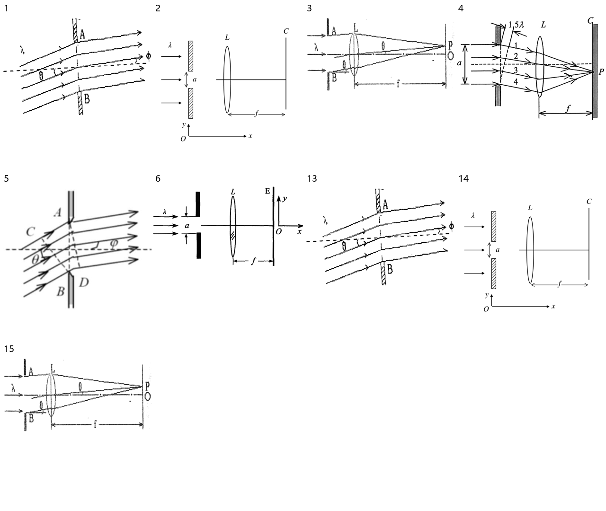

> 派生文件，可重新生成，勿手改。

# 上册逐章题图 · 14 衍射

仅处理上册已确认范围；先尝试原PDF提取，不清楚再重绘。原材料、原图只读保留；只改图片路径，保留原题号、锚点、题面、答案与OCR状态。

本章审查15个图片资产、15处引用。定性图未给出的尺寸/角度/比例不是测量数据。复用图不重复计为独立新图。

生成代码（过程产物未发布） · [映射与逐项核验](../../../../10_%E9%A2%98%E5%BA%93/_assets/%E4%B8%8A%E5%86%8C%E9%80%90%E7%AB%A0/14_%E8%A1%8D%E5%B0%84/mapping.json) · 校验记录（过程产物未发布）

|编号|题号|原图|来源PDF页|处理|核验|
|---|---|---|---|---|---|
|001|习题册-章节29-题5|[f769ce83fbebb154473ddf83ded87cdb99b02ced44dd9eaa3f930d8507c4881b.jpg](../../../../10_%E9%A2%98%E5%BA%93/_assets/%E4%B9%A0%E9%A2%98%E5%86%8C/f769ce83fbebb154473ddf83ded87cdb99b02ced44dd9eaa3f930d8507c4881b.jpg)|30|native_extraction [001-extracted.png](../../../../10_%E9%A2%98%E5%BA%93/_assets/%E4%B8%8A%E5%86%8C%E9%80%90%E7%AB%A0/14_%E8%A1%8D%E5%B0%84/001-extracted.png)|从原PDF原生提取；逐项核对入射θ/衍射φ、A/B或C/D点名、光线传播箭头，透镜L与屏、焦距f；保留原图各子图和1—4编号，不添加精确角度。|
|002|习题册-章节30-题1|[dfffc8f2c7d0d18c4d3a3ee0fe739e928c6f764892f2967eb0a16af9e027a519.jpg](../../../../10_%E9%A2%98%E5%BA%93/_assets/%E4%B9%A0%E9%A2%98%E5%86%8C/dfffc8f2c7d0d18c4d3a3ee0fe739e928c6f764892f2967eb0a16af9e027a519.jpg)|31|redrawn [002.svg](../../../../10_%E9%A2%98%E5%BA%93/_assets/%E4%B8%8A%E5%86%8C%E9%80%90%E7%AB%A0/14_%E8%A1%8D%E5%B0%84/002.svg)|λ从左向右，缝宽a位于两挡板间，L凸透镜居中、C屏在右，f从透镜至屏；独立Oxy坐标x右y上。无额外光线或数值焦距。|
|003|习题册-章节30-题3|[5d91cea7116c1886861618e41372f0822a4116665ef661f9f5baa0fd9077e8b7.jpg](../../../../10_%E9%A2%98%E5%BA%93/_assets/%E4%B9%A0%E9%A2%98%E5%86%8C/5d91cea7116c1886861618e41372f0822a4116665ef661f9f5baa0fd9077e8b7.jpg)|31|native_extraction [003-extracted.png](../../../../10_%E9%A2%98%E5%BA%93/_assets/%E4%B8%8A%E5%86%8C%E9%80%90%E7%AB%A0/14_%E8%A1%8D%E5%B0%84/003-extracted.png)|从原PDF原生提取；逐项核对入射θ/衍射φ、A/B或C/D点名、光线传播箭头，透镜L与屏、焦距f；保留原图各子图和1—4编号，不添加精确角度。|
|004|19-20期末-简2|[90c1929ea62f42a3f89badcc9e5653195b0ab837fb85af134caa9c1ce37e9e8a.jpg](../../../../10_%E9%A2%98%E5%BA%93/_assets/%E5%8E%86%E5%B9%B4%E8%AF%95%E5%8D%B7%E5%90%88%E9%9B%86_2018-2024/90c1929ea62f42a3f89badcc9e5653195b0ab837fb85af134caa9c1ce37e9e8a.jpg)|37|native_extraction [004-extracted.png](../../../../10_%E9%A2%98%E5%BA%93/_assets/%E4%B8%8A%E5%86%8C%E9%80%90%E7%AB%A0/14_%E8%A1%8D%E5%B0%84/004-extracted.png)|从原PDF原生提取；逐项核对入射θ/衍射φ、A/B或C/D点名、光线传播箭头，透镜L与屏、焦距f；保留原图各子图和1—4编号，不添加精确角度。|
|005|24-25期末-计7|[4d73c0d1ae6ad2ed301ccf49e872b1f23d9acf3b2e7515e124e91e1172db9b96.jpg](../../../../10_%E9%A2%98%E5%BA%93/_assets/2024-2025%E6%9C%9F%E6%9C%AB%E6%88%AA%E5%9B%BE/4d73c0d1ae6ad2ed301ccf49e872b1f23d9acf3b2e7515e124e91e1172db9b96.jpg)|20|native_extraction [005-extracted.png](../../../../10_%E9%A2%98%E5%BA%93/_assets/%E4%B8%8A%E5%86%8C%E9%80%90%E7%AB%A0/14_%E8%A1%8D%E5%B0%84/005-extracted.png)|从原PDF原生提取；逐项核对入射θ/衍射φ、A/B或C/D点名、光线传播箭头，透镜L与屏、焦距f；保留原图各子图和1—4编号，不添加精确角度。|
|006|学习指导-第14章-思考题-14-10|[p0181-0360_495.jpg](../../../../10_%E9%A2%98%E5%BA%93/_assets/%E5%AD%A6%E4%B9%A0%E6%8C%87%E5%AF%BC/p0181-0360_495.jpg)|300|native_extraction [006-extracted.png](../../../../10_%E9%A2%98%E5%BA%93/_assets/%E4%B8%8A%E5%86%8C%E9%80%90%E7%AB%A0/14_%E8%A1%8D%E5%B0%84/006-extracted.png)|从原PDF原生提取；逐项核对入射θ/衍射φ、A/B或C/D点名、光线传播箭头，透镜L与屏、焦距f；保留原图各子图和1—4编号，不添加精确角度。|
|007|清华题库-光学-332|[9cc332a0c5076c377cab22192d53e27fde481caa7e03d09220a5558f5c5394a8.jpg](../../../../10_%E9%A2%98%E5%BA%93/_assets/%E6%B8%85%E5%8D%8E%E9%A2%98%E5%BA%93/9cc332a0c5076c377cab22192d53e27fde481caa7e03d09220a5558f5c5394a8.jpg)|41|retained_clear|原图的缝、光路、透镜、屏与f清晰，轴标、点名和虚线支持黑白阅读，按要求保留。|
|008|清华题库-光学-333|[a650622339bcd4bcb1a45721de721d80245c8ee3a5e1de6950a23db14563ac86.jpg](../../../../10_%E9%A2%98%E5%BA%93/_assets/%E6%B8%85%E5%8D%8E%E9%A2%98%E5%BA%93/a650622339bcd4bcb1a45721de721d80245c8ee3a5e1de6950a23db14563ac86.jpg)|41|retained_clear|原图的缝、光路、透镜、屏与f清晰，轴标、点名和虚线支持黑白阅读，按要求保留。|
|009|清华题库-光学-340|[9b1df3926ba54145c817119f6b1390dce10118bcd68cc4c45b6c15148855e453.jpg](../../../../10_%E9%A2%98%E5%BA%93/_assets/%E6%B8%85%E5%8D%8E%E9%A2%98%E5%BA%93/9b1df3926ba54145c817119f6b1390dce10118bcd68cc4c45b6c15148855e453.jpg)|43|retained_clear|原图的缝、光路、透镜、屏与f清晰，轴标、点名和虚线支持黑白阅读，按要求保留。|
|010|清华题库-光学-341|[ac726a0b1fbd29322375a465f482151e20eae3c658d494ad9336065b11fefb69.jpg](../../../../10_%E9%A2%98%E5%BA%93/_assets/%E6%B8%85%E5%8D%8E%E9%A2%98%E5%BA%93/ac726a0b1fbd29322375a465f482151e20eae3c658d494ad9336065b11fefb69.jpg)|43|retained_clear|原图的缝、光路、透镜、屏与f清晰，轴标、点名和虚线支持黑白阅读，按要求保留。|
|011|清华题库-光学-342|[5cd49064b48c69e159853852eae06e96b490f1e15d6a40392dac6b223c6fd617.jpg](../../../../10_%E9%A2%98%E5%BA%93/_assets/%E6%B8%85%E5%8D%8E%E9%A2%98%E5%BA%93/5cd49064b48c69e159853852eae06e96b490f1e15d6a40392dac6b223c6fd617.jpg)|43|retained_clear|原图的缝、光路、透镜、屏与f清晰，轴标、点名和虚线支持黑白阅读，按要求保留。|
|012|清华题库-光学-388|[ed9253f8e56476a0d7fde3f1d1e5954d17797859af1994af8a4b8a550f193d83.jpg](../../../../10_%E9%A2%98%E5%BA%93/_assets/%E6%B8%85%E5%8D%8E%E9%A2%98%E5%BA%93/ed9253f8e56476a0d7fde3f1d1e5954d17797859af1994af8a4b8a550f193d83.jpg)|50|retained_clear|原图的缝、光路、透镜、屏与f清晰，轴标、点名和虚线支持黑白阅读，按要求保留。|
|013|5|[图5.png](../../../../%E5%A4%A7%E5%AD%A6%E7%89%A9%E7%90%86%E4%B9%A0%E9%A2%98%E5%86%8C%EF%BC%88%E4%B8%8A%EF%BC%89/_assets/29_%E4%B9%A0%E9%A2%98%E4%BA%8C%E5%8D%81%E4%B9%9D%20%E5%85%89%E7%9A%84%E8%A1%8D%E5%B0%84%EF%BC%88%E4%B8%80%EF%BC%89/%E5%9B%BE5.png)|同一习题册对应题|reuse_extraction [001-extracted.png](../../../../10_%E9%A2%98%E5%BA%93/_assets/%E4%B8%8A%E5%86%8C%E9%80%90%E7%AB%A0/14_%E8%A1%8D%E5%B0%84/001-extracted.png)|同一习题册对应题的光路、角标、坐标及屏位置核对，复用产物。|
|014|1|[图1.png](../../../../%E5%A4%A7%E5%AD%A6%E7%89%A9%E7%90%86%E4%B9%A0%E9%A2%98%E5%86%8C%EF%BC%88%E4%B8%8A%EF%BC%89/_assets/30_%E4%B9%A0%E9%A2%98%E4%B8%89%E5%8D%81%20%E5%85%89%E7%9A%84%E8%A1%8D%E5%B0%84%EF%BC%88%E4%BA%8C%EF%BC%89/%E5%9B%BE1.png)|同一习题册对应题|reuse_redraw [002.svg](../../../../10_%E9%A2%98%E5%BA%93/_assets/%E4%B8%8A%E5%86%8C%E9%80%90%E7%AB%A0/14_%E8%A1%8D%E5%B0%84/002.svg)|同一习题册对应题的光路、角标、坐标及屏位置核对，复用产物。|
|015|3|[图3.png](../../../../%E5%A4%A7%E5%AD%A6%E7%89%A9%E7%90%86%E4%B9%A0%E9%A2%98%E5%86%8C%EF%BC%88%E4%B8%8A%EF%BC%89/_assets/30_%E4%B9%A0%E9%A2%98%E4%B8%89%E5%8D%81%20%E5%85%89%E7%9A%84%E8%A1%8D%E5%B0%84%EF%BC%88%E4%BA%8C%EF%BC%89/%E5%9B%BE3.png)|同一习题册对应题|reuse_extraction [003-extracted.png](../../../../10_%E9%A2%98%E5%BA%93/_assets/%E4%B8%8A%E5%86%8C%E9%80%90%E7%AB%A0/14_%E8%A1%8D%E5%B0%84/003-extracted.png)|同一习题册对应题的光路、角标、坐标及屏位置核对，复用产物。|

## 来源与引用文档

- 来源PDF（工作区原件）：`00_原材料\习题册\大学物理习题册（上）.pdf`；本章保留逐图原生裁图证据。
- 来源PDF（工作区原件）：`00_原材料\历年试卷\大学物理I历年试卷合集_2018-2024.pdf`；本章保留逐图原生裁图证据。
- [扫描件_普通高等教育十一五规划教材配套教辅.pdf](../../../../00_%E5%8E%9F%E6%9D%90%E6%96%99/%E6%89%AB%E6%8F%8F%E4%BB%B6_%E6%99%AE%E9%80%9A%E9%AB%98%E7%AD%89%E6%95%99%E8%82%B2%E5%8D%81%E4%B8%80%E4%BA%94%E8%A7%84%E5%88%92%E6%95%99%E6%9D%90%E9%85%8D%E5%A5%97%E6%95%99%E8%BE%85.pdf)
- 来源PDF（工作区原件）：`90_缓存\扫描整理\2024-2025期末\2024-2025学年大学物理I期末_方向校正合并.pdf`；本章保留逐图原生裁图证据。
- 来源PDF（工作区原件）：`90_缓存\清华题库章节拆分\清华题库_相对论_机械振动_机械波_光学_题目页p031-p083.pdf`；本章保留逐图原生裁图证据。
- [大学物理习题册_29_光的衍射（一）_题面整理.md](../../../../10_%E9%A2%98%E5%BA%93/%E4%B9%A0%E9%A2%98%E5%86%8C/%E5%A4%A7%E5%AD%A6%E7%89%A9%E7%90%86%E4%B9%A0%E9%A2%98%E5%86%8C_29_%E5%85%89%E7%9A%84%E8%A1%8D%E5%B0%84%EF%BC%88%E4%B8%80%EF%BC%89_%E9%A2%98%E9%9D%A2%E6%95%B4%E7%90%86.md)
- [大学物理习题册_30_光的衍射（二）_题面整理.md](../../../../10_%E9%A2%98%E5%BA%93/%E4%B9%A0%E9%A2%98%E5%86%8C/%E5%A4%A7%E5%AD%A6%E7%89%A9%E7%90%86%E4%B9%A0%E9%A2%98%E5%86%8C_30_%E5%85%89%E7%9A%84%E8%A1%8D%E5%B0%84%EF%BC%88%E4%BA%8C%EF%BC%89_%E9%A2%98%E9%9D%A2%E6%95%B4%E7%90%86.md)
- [2019-2020学年大学物理I期末题面整理.md](../../../../10_%E9%A2%98%E5%BA%93/%E5%8E%86%E5%B9%B4%E7%9C%9F%E9%A2%98/%E6%9C%9F%E6%9C%AB/2019-2020%E5%AD%A6%E5%B9%B4%E5%A4%A7%E5%AD%A6%E7%89%A9%E7%90%86I%E6%9C%9F%E6%9C%AB%E9%A2%98%E9%9D%A2%E6%95%B4%E7%90%86.md)
- [2024-2025学年大学物理I期末题面整理.md](../../../../10_%E9%A2%98%E5%BA%93/%E5%8E%86%E5%B9%B4%E7%9C%9F%E9%A2%98/%E6%9C%9F%E6%9C%AB/2024-2025%E5%AD%A6%E5%B9%B4%E5%A4%A7%E5%AD%A6%E7%89%A9%E7%90%86I%E6%9C%9F%E6%9C%AB%E9%A2%98%E9%9D%A2%E6%95%B4%E7%90%86.md)
- [学习指导_第14章_光的衍射_题面整理.md](../../../../10_%E9%A2%98%E5%BA%93/%E5%AD%A6%E4%B9%A0%E6%8C%87%E5%AF%BC/%E5%AD%A6%E4%B9%A0%E6%8C%87%E5%AF%BC_%E7%AC%AC14%E7%AB%A0_%E5%85%89%E7%9A%84%E8%A1%8D%E5%B0%84_%E9%A2%98%E9%9D%A2%E6%95%B4%E7%90%86.md)
- [清华题库_第06章_光学_题面整理.md](../../../../10_%E9%A2%98%E5%BA%93/%E6%B8%85%E5%8D%8E%E9%A2%98%E5%BA%93/%E6%B8%85%E5%8D%8E%E9%A2%98%E5%BA%93_%E7%AC%AC06%E7%AB%A0_%E5%85%89%E5%AD%A6_%E9%A2%98%E9%9D%A2%E6%95%B4%E7%90%86.md)
- [29_习题二十九 光的衍射（一）.md](../../../../%E5%A4%A7%E5%AD%A6%E7%89%A9%E7%90%86%E4%B9%A0%E9%A2%98%E5%86%8C%EF%BC%88%E4%B8%8A%EF%BC%89/29_%E4%B9%A0%E9%A2%98%E4%BA%8C%E5%8D%81%E4%B9%9D%20%E5%85%89%E7%9A%84%E8%A1%8D%E5%B0%84%EF%BC%88%E4%B8%80%EF%BC%89.md)
- [30_习题三十 光的衍射（二）.md](../../../../%E5%A4%A7%E5%AD%A6%E7%89%A9%E7%90%86%E4%B9%A0%E9%A2%98%E5%86%8C%EF%BC%88%E4%B8%8A%EF%BC%89/30_%E4%B9%A0%E9%A2%98%E4%B8%89%E5%8D%81%20%E5%85%89%E7%9A%84%E8%A1%8D%E5%B0%84%EF%BC%88%E4%BA%8C%EF%BC%89.md)

## 前后对照

## 缩小黑白阅读

## 核验边界

无新增物理参数。定性光路不作为折射角、缝宽或焦距的测量比例；已清楚题库图保留。

本次不改转换认证、原题OCR状态或解答；不声称整本旧转换人工验收已补齐。知识笔记若无图片引用，记录为无需替换，不改正文。

## 既有入库绑定问题

本章图片替换检查与S1校验通过；旧入库绑定仍有既有哈希或锚点失配。逐字回退图片路径后与本章修改前文件完全相同，原锚点未改；未擅自刷新旧锚点或无关输出记录。详见 validation.json 的 intake_verify。这里不宣称旧入库总验收通过。
