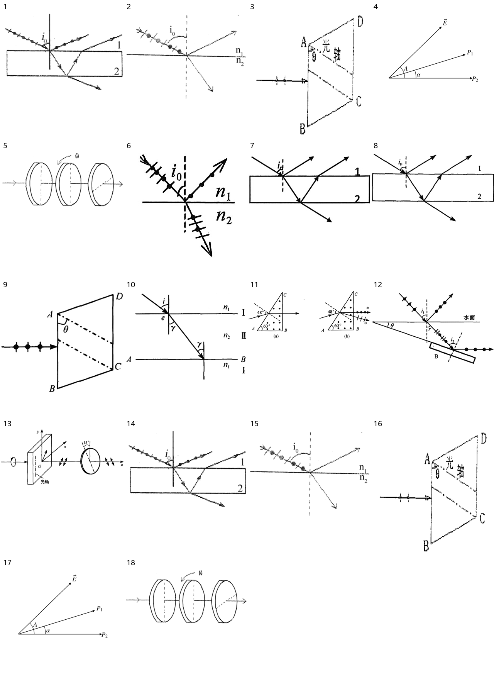

> 派生文件，可重新生成，勿手改。

# 上册逐章题图 · 15 偏振

仅处理上册已确认范围；先尝试原PDF提取，不清楚再重绘。原材料、原图只读保留；只改图片路径，保留原题号、锚点、题面、答案与OCR状态。

本章审查18个图片资产、18处引用。定性图未给出的尺寸/角度/比例不是测量数据。复用图不重复计为独立新图。

生成代码（过程产物未发布） · [映射与逐项核验](../../../../10_%E9%A2%98%E5%BA%93/_assets/%E4%B8%8A%E5%86%8C%E9%80%90%E7%AB%A0/15_%E5%81%8F%E6%8C%AF/mapping.json) · 校验记录（过程产物未发布）

|编号|题号|原图|来源PDF页|处理|核验|
|---|---|---|---|---|---|
|001|习题册-章节23-题2|[86dad9abdcb297c5a318560dfb662a950ca3abdb0aa016f3b93a61397517dc0f.jpg](../../../../10_%E9%A2%98%E5%BA%93/_assets/%E4%B9%A0%E9%A2%98%E5%86%8C/86dad9abdcb297c5a318560dfb662a950ca3abdb0aa016f3b93a61397517dc0f.jpg)|24|native_extraction [001-extracted.png](../../../../10_%E9%A2%98%E5%BA%93/_assets/%E4%B8%8A%E5%86%8C%E9%80%90%E7%AB%A0/15_%E5%81%8F%E6%8C%AF/001-extracted.png)|原PDF原生提取，保留偏振用点/短线而非颜色，核对法线、入射/反射/折射方向、i0/i1/i2、n1/n2及光轴或转动ω；原有48°/60°/15°只在其原图保留，未推广到其他示意。|
|002|习题册-章节23-题3|[2fdf56d9388faf8fb035e1c249252411b35a3c50d96d8e104029cc4adf7efbaa.jpg](../../../../10_%E9%A2%98%E5%BA%93/_assets/%E4%B9%A0%E9%A2%98%E5%86%8C/2fdf56d9388faf8fb035e1c249252411b35a3c50d96d8e104029cc4adf7efbaa.jpg)|24|native_extraction [002-extracted.png](../../../../10_%E9%A2%98%E5%BA%93/_assets/%E4%B8%8A%E5%86%8C%E9%80%90%E7%AB%A0/15_%E5%81%8F%E6%8C%AF/002-extracted.png)|原PDF原生提取，保留偏振用点/短线而非颜色，核对法线、入射/反射/折射方向、i0/i1/i2、n1/n2及光轴或转动ω；原有48°/60°/15°只在其原图保留，未推广到其他示意。|
|003|习题册-章节24-题2|[eec43191a1ace19ee2ca8771f5cb817b90b90995b8b2a485c51a752d9d91aec9.jpg](../../../../10_%E9%A2%98%E5%BA%93/_assets/%E4%B9%A0%E9%A2%98%E5%86%8C/eec43191a1ace19ee2ca8771f5cb817b90b90995b8b2a485c51a752d9d91aec9.jpg)|25|native_extraction [003-extracted.png](../../../../10_%E9%A2%98%E5%BA%93/_assets/%E4%B8%8A%E5%86%8C%E9%80%90%E7%AB%A0/15_%E5%81%8F%E6%8C%AF/003-extracted.png)|原PDF原生提取，保留偏振用点/短线而非颜色，核对法线、入射/反射/折射方向、i0/i1/i2、n1/n2及光轴或转动ω；原有48°/60°/15°只在其原图保留，未推广到其他示意。|
|004|习题册-章节24-题6|[29f2083432b6b0928bea914d7f530dd9ee10d4b8cb9f1509ed5d0d5a9cd35731.jpg](../../../../10_%E9%A2%98%E5%BA%93/_assets/%E4%B9%A0%E9%A2%98%E5%86%8C/29f2083432b6b0928bea914d7f530dd9ee10d4b8cb9f1509ed5d0d5a9cd35731.jpg)|25|redrawn [004.svg](../../../../10_%E9%A2%98%E5%BA%93/_assets/%E4%B8%8A%E5%86%8C%E9%80%90%E7%AB%A0/15_%E5%81%8F%E6%8C%AF/004.svg)|E在上、P1居中、P2水平向右；角A为E与P2夹角、α为P1与P2夹角，矢量E箭头保留；不把内部绘图角标为题目给定值。|
|005|习题册-章节24-题7|[29523c4b6c804c1959eda35a32183df79f1268b0b22b3b914a9337f83902644a.jpg](../../../../10_%E9%A2%98%E5%BA%93/_assets/%E4%B9%A0%E9%A2%98%E5%86%8C/29523c4b6c804c1959eda35a32183df79f1268b0b22b3b914a9337f83902644a.jpg)|25|native_extraction [005-extracted.png](../../../../10_%E9%A2%98%E5%BA%93/_assets/%E4%B8%8A%E5%86%8C%E9%80%90%E7%AB%A0/15_%E5%81%8F%E6%8C%AF/005-extracted.png)|原PDF原生提取，保留偏振用点/短线而非颜色，核对法线、入射/反射/折射方向、i0/i1/i2、n1/n2及光轴或转动ω；原有48°/60°/15°只在其原图保留，未推广到其他示意。|
|006|20-21期末-填6|[235ef93245dbbb1735e29ffef2440447049f66686ecfe0b4477384937b34c3ab.jpg](../../../../10_%E9%A2%98%E5%BA%93/_assets/%E5%8E%86%E5%B9%B4%E8%AF%95%E5%8D%B7%E5%90%88%E9%9B%86_2018-2024/235ef93245dbbb1735e29ffef2440447049f66686ecfe0b4477384937b34c3ab.jpg)|28|native_extraction [006-extracted.png](../../../../10_%E9%A2%98%E5%BA%93/_assets/%E4%B8%8A%E5%86%8C%E9%80%90%E7%AB%A0/15_%E5%81%8F%E6%8C%AF/006-extracted.png)|原PDF原生提取，保留偏振用点/短线而非颜色，核对法线、入射/反射/折射方向、i0/i1/i2、n1/n2及光轴或转动ω；原有48°/60°/15°只在其原图保留，未推广到其他示意。|
|007|未标年份-期末二-选18|[4b24848d2f76fd1e18cc7530f2ff7d8740a87a760dc5f5e2fc6ffc7850a9ac39.jpg](../../../../10_%E9%A2%98%E5%BA%93/_assets/%E5%8E%86%E5%B9%B4%E8%AF%95%E5%8D%B7%E5%90%88%E9%9B%86_2018-2024/4b24848d2f76fd1e18cc7530f2ff7d8740a87a760dc5f5e2fc6ffc7850a9ac39.jpg)|52|native_extraction [007-extracted.png](../../../../10_%E9%A2%98%E5%BA%93/_assets/%E4%B8%8A%E5%86%8C%E9%80%90%E7%AB%A0/15_%E5%81%8F%E6%8C%AF/007-extracted.png)|原PDF原生提取，保留偏振用点/短线而非颜色，核对法线、入射/反射/折射方向、i0/i1/i2、n1/n2及光轴或转动ω；原有48°/60°/15°只在其原图保留，未推广到其他示意。|
|008|学习指导-第15章-思考题-15-9|[p0181-0360_942.jpg](../../../../10_%E9%A2%98%E5%BA%93/_assets/%E5%AD%A6%E4%B9%A0%E6%8C%87%E5%AF%BC/p0181-0360_942.jpg)|313|native_extraction [008-extracted.png](../../../../10_%E9%A2%98%E5%BA%93/_assets/%E4%B8%8A%E5%86%8C%E9%80%90%E7%AB%A0/15_%E5%81%8F%E6%8C%AF/008-extracted.png)|原PDF原生提取，保留偏振用点/短线而非颜色，核对法线、入射/反射/折射方向、i0/i1/i2、n1/n2及光轴或转动ω；原有48°/60°/15°只在其原图保留，未推广到其他示意。|
|009|学习指导-第15章-思考题-15-10|[p0181-0360_1026.jpg](../../../../10_%E9%A2%98%E5%BA%93/_assets/%E5%AD%A6%E4%B9%A0%E6%8C%87%E5%AF%BC/p0181-0360_1026.jpg)|314|native_extraction [009-extracted.png](../../../../10_%E9%A2%98%E5%BA%93/_assets/%E4%B8%8A%E5%86%8C%E9%80%90%E7%AB%A0/15_%E5%81%8F%E6%8C%AF/009-extracted.png)|原PDF原生提取，保留偏振用点/短线而非颜色，核对法线、入射/反射/折射方向、i0/i1/i2、n1/n2及光轴或转动ω；原有48°/60°/15°只在其原图保留，未推广到其他示意。|
|010|学习指导-第15章-习题-15-1|[p0181-0360_208.jpg](../../../../10_%E9%A2%98%E5%BA%93/_assets/%E5%AD%A6%E4%B9%A0%E6%8C%87%E5%AF%BC/p0181-0360_208.jpg)|314|native_extraction [010-extracted.png](../../../../10_%E9%A2%98%E5%BA%93/_assets/%E4%B8%8A%E5%86%8C%E9%80%90%E7%AB%A0/15_%E5%81%8F%E6%8C%AF/010-extracted.png)|原PDF原生提取，保留偏振用点/短线而非颜色，核对法线、入射/反射/折射方向、i0/i1/i2、n1/n2及光轴或转动ω；原有48°/60°/15°只在其原图保留，未推广到其他示意。|
|011|学习指导-第15章-习题-15-7|[p0181-0360_643.jpg](../../../../10_%E9%A2%98%E5%BA%93/_assets/%E5%AD%A6%E4%B9%A0%E6%8C%87%E5%AF%BC/p0181-0360_643.jpg)|317|native_extraction [011-extracted.png](../../../../10_%E9%A2%98%E5%BA%93/_assets/%E4%B8%8A%E5%86%8C%E9%80%90%E7%AB%A0/15_%E5%81%8F%E6%8C%AF/011-extracted.png)|原PDF原生提取，保留偏振用点/短线而非颜色，核对法线、入射/反射/折射方向、i0/i1/i2、n1/n2及光轴或转动ω；原有48°/60°/15°只在其原图保留，未推广到其他示意。|
|012|学习指导-第15章-习题-15-7|[p0181-0360_113.jpg](../../../../10_%E9%A2%98%E5%BA%93/_assets/%E5%AD%A6%E4%B9%A0%E6%8C%87%E5%AF%BC/p0181-0360_113.jpg)|317|native_extraction [012-extracted.png](../../../../10_%E9%A2%98%E5%BA%93/_assets/%E4%B8%8A%E5%86%8C%E9%80%90%E7%AB%A0/15_%E5%81%8F%E6%8C%AF/012-extracted.png)|原PDF原生提取，保留偏振用点/短线而非颜色，核对法线、入射/反射/折射方向、i0/i1/i2、n1/n2及光轴或转动ω；原有48°/60°/15°只在其原图保留，未推广到其他示意。|
|013|学习指导-第15章-习题-15-10|[p0181-0360_984.jpg](../../../../10_%E9%A2%98%E5%BA%93/_assets/%E5%AD%A6%E4%B9%A0%E6%8C%87%E5%AF%BC/p0181-0360_984.jpg)|318|native_extraction [013-extracted.png](../../../../10_%E9%A2%98%E5%BA%93/_assets/%E4%B8%8A%E5%86%8C%E9%80%90%E7%AB%A0/15_%E5%81%8F%E6%8C%AF/013-extracted.png)|原PDF原生提取，保留偏振用点/短线而非颜色，核对法线、入射/反射/折射方向、i0/i1/i2、n1/n2及光轴或转动ω；原有48°/60°/15°只在其原图保留，未推广到其他示意。|
|014|2|[图2.png](../../../../%E5%A4%A7%E5%AD%A6%E7%89%A9%E7%90%86%E4%B9%A0%E9%A2%98%E5%86%8C%EF%BC%88%E4%B8%8A%EF%BC%89/_assets/23_%E4%B9%A0%E9%A2%98%E4%BA%8C%E5%8D%81%E4%B8%89%20%E5%85%89%E7%9A%84%E5%81%8F%E6%8C%AF%EF%BC%88%E4%B8%80%EF%BC%89/%E5%9B%BE2.png)|同一习题册对应题|reuse_extraction [001-extracted.png](../../../../10_%E9%A2%98%E5%BA%93/_assets/%E4%B8%8A%E5%86%8C%E9%80%90%E7%AB%A0/15_%E5%81%8F%E6%8C%AF/001-extracted.png)|同一习题册对应题，偏振点/短线、光轴、界面和角标核对后复用产物。|
|015|3|[图3.png](../../../../%E5%A4%A7%E5%AD%A6%E7%89%A9%E7%90%86%E4%B9%A0%E9%A2%98%E5%86%8C%EF%BC%88%E4%B8%8A%EF%BC%89/_assets/23_%E4%B9%A0%E9%A2%98%E4%BA%8C%E5%8D%81%E4%B8%89%20%E5%85%89%E7%9A%84%E5%81%8F%E6%8C%AF%EF%BC%88%E4%B8%80%EF%BC%89/%E5%9B%BE3.png)|同一习题册对应题|reuse_extraction [002-extracted.png](../../../../10_%E9%A2%98%E5%BA%93/_assets/%E4%B8%8A%E5%86%8C%E9%80%90%E7%AB%A0/15_%E5%81%8F%E6%8C%AF/002-extracted.png)|同一习题册对应题，偏振点/短线、光轴、界面和角标核对后复用产物。|
|016|2|[图2.png](../../../../%E5%A4%A7%E5%AD%A6%E7%89%A9%E7%90%86%E4%B9%A0%E9%A2%98%E5%86%8C%EF%BC%88%E4%B8%8A%EF%BC%89/_assets/24_%E4%B9%A0%E9%A2%98%E4%BA%8C%E5%8D%81%E5%9B%9B%20%E5%85%89%E7%9A%84%E5%81%8F%E6%8C%AF%EF%BC%88%E4%BA%8C%EF%BC%89/%E5%9B%BE2.png)|同一习题册对应题|reuse_extraction [003-extracted.png](../../../../10_%E9%A2%98%E5%BA%93/_assets/%E4%B8%8A%E5%86%8C%E9%80%90%E7%AB%A0/15_%E5%81%8F%E6%8C%AF/003-extracted.png)|同一习题册对应题，偏振点/短线、光轴、界面和角标核对后复用产物。|
|017|6|[图6.png](../../../../%E5%A4%A7%E5%AD%A6%E7%89%A9%E7%90%86%E4%B9%A0%E9%A2%98%E5%86%8C%EF%BC%88%E4%B8%8A%EF%BC%89/_assets/24_%E4%B9%A0%E9%A2%98%E4%BA%8C%E5%8D%81%E5%9B%9B%20%E5%85%89%E7%9A%84%E5%81%8F%E6%8C%AF%EF%BC%88%E4%BA%8C%EF%BC%89/%E5%9B%BE6.png)|同一习题册对应题|reuse_redraw [004.svg](../../../../10_%E9%A2%98%E5%BA%93/_assets/%E4%B8%8A%E5%86%8C%E9%80%90%E7%AB%A0/15_%E5%81%8F%E6%8C%AF/004.svg)|同一习题册对应题，偏振点/短线、光轴、界面和角标核对后复用产物。|
|018|7|[图7.png](../../../../%E5%A4%A7%E5%AD%A6%E7%89%A9%E7%90%86%E4%B9%A0%E9%A2%98%E5%86%8C%EF%BC%88%E4%B8%8A%EF%BC%89/_assets/24_%E4%B9%A0%E9%A2%98%E4%BA%8C%E5%8D%81%E5%9B%9B%20%E5%85%89%E7%9A%84%E5%81%8F%E6%8C%AF%EF%BC%88%E4%BA%8C%EF%BC%89/%E5%9B%BE7.png)|同一习题册对应题|reuse_extraction [005-extracted.png](../../../../10_%E9%A2%98%E5%BA%93/_assets/%E4%B8%8A%E5%86%8C%E9%80%90%E7%AB%A0/15_%E5%81%8F%E6%8C%AF/005-extracted.png)|同一习题册对应题，偏振点/短线、光轴、界面和角标核对后复用产物。|

## 来源与引用文档

- 来源PDF（工作区原件）：`00_原材料\习题册\大学物理习题册（上）.pdf`；本章保留逐图原生裁图证据。
- 来源PDF（工作区原件）：`00_原材料\历年试卷\大学物理I历年试卷合集_2018-2024.pdf`；本章保留逐图原生裁图证据。
- [扫描件_普通高等教育十一五规划教材配套教辅.pdf](../../../../00_%E5%8E%9F%E6%9D%90%E6%96%99/%E6%89%AB%E6%8F%8F%E4%BB%B6_%E6%99%AE%E9%80%9A%E9%AB%98%E7%AD%89%E6%95%99%E8%82%B2%E5%8D%81%E4%B8%80%E4%BA%94%E8%A7%84%E5%88%92%E6%95%99%E6%9D%90%E9%85%8D%E5%A5%97%E6%95%99%E8%BE%85.pdf)
- [大学物理习题册_23_光的偏振（一）_题面整理.md](../../../../10_%E9%A2%98%E5%BA%93/%E4%B9%A0%E9%A2%98%E5%86%8C/%E5%A4%A7%E5%AD%A6%E7%89%A9%E7%90%86%E4%B9%A0%E9%A2%98%E5%86%8C_23_%E5%85%89%E7%9A%84%E5%81%8F%E6%8C%AF%EF%BC%88%E4%B8%80%EF%BC%89_%E9%A2%98%E9%9D%A2%E6%95%B4%E7%90%86.md)
- [大学物理习题册_24_光的偏振（二）_题面整理.md](../../../../10_%E9%A2%98%E5%BA%93/%E4%B9%A0%E9%A2%98%E5%86%8C/%E5%A4%A7%E5%AD%A6%E7%89%A9%E7%90%86%E4%B9%A0%E9%A2%98%E5%86%8C_24_%E5%85%89%E7%9A%84%E5%81%8F%E6%8C%AF%EF%BC%88%E4%BA%8C%EF%BC%89_%E9%A2%98%E9%9D%A2%E6%95%B4%E7%90%86.md)
- [2020-2021学年大学物理I期末题面整理.md](../../../../10_%E9%A2%98%E5%BA%93/%E5%8E%86%E5%B9%B4%E7%9C%9F%E9%A2%98/%E6%9C%9F%E6%9C%AB/2020-2021%E5%AD%A6%E5%B9%B4%E5%A4%A7%E5%AD%A6%E7%89%A9%E7%90%86I%E6%9C%9F%E6%9C%AB%E9%A2%98%E9%9D%A2%E6%95%B4%E7%90%86.md)
- [未标年份_大学物理上期末考题二题面整理.md](../../../../10_%E9%A2%98%E5%BA%93/%E5%8E%86%E5%B9%B4%E7%9C%9F%E9%A2%98/%E6%9C%9F%E6%9C%AB/%E6%9C%AA%E6%A0%87%E5%B9%B4%E4%BB%BD_%E5%A4%A7%E5%AD%A6%E7%89%A9%E7%90%86%E4%B8%8A%E6%9C%9F%E6%9C%AB%E8%80%83%E9%A2%98%E4%BA%8C%E9%A2%98%E9%9D%A2%E6%95%B4%E7%90%86.md)
- [学习指导_第15章_光的偏振_题面整理.md](../../../../10_%E9%A2%98%E5%BA%93/%E5%AD%A6%E4%B9%A0%E6%8C%87%E5%AF%BC/%E5%AD%A6%E4%B9%A0%E6%8C%87%E5%AF%BC_%E7%AC%AC15%E7%AB%A0_%E5%85%89%E7%9A%84%E5%81%8F%E6%8C%AF_%E9%A2%98%E9%9D%A2%E6%95%B4%E7%90%86.md)
- [23_习题二十三 光的偏振（一）.md](../../../../%E5%A4%A7%E5%AD%A6%E7%89%A9%E7%90%86%E4%B9%A0%E9%A2%98%E5%86%8C%EF%BC%88%E4%B8%8A%EF%BC%89/23_%E4%B9%A0%E9%A2%98%E4%BA%8C%E5%8D%81%E4%B8%89%20%E5%85%89%E7%9A%84%E5%81%8F%E6%8C%AF%EF%BC%88%E4%B8%80%EF%BC%89.md)
- [24_习题二十四 光的偏振（二）.md](../../../../%E5%A4%A7%E5%AD%A6%E7%89%A9%E7%90%86%E4%B9%A0%E9%A2%98%E5%86%8C%EF%BC%88%E4%B8%8A%EF%BC%89/24_%E4%B9%A0%E9%A2%98%E4%BA%8C%E5%8D%81%E5%9B%9B%20%E5%85%89%E7%9A%84%E5%81%8F%E6%8C%AF%EF%BC%88%E4%BA%8C%EF%BC%89.md)

## 前后对照

## 缩小黑白阅读

## 核验边界

004角标原印字为A，按原样保留，没有擅改为其他希腊字母。复杂偏振点线、晶体光轴与立体图使用原PDF原生提取。

本次不改转换认证、原题OCR状态或解答；不声称整本旧转换人工验收已补齐。知识笔记若无图片引用，记录为无需替换，不改正文。

[全上册覆盖与待核清单](全册覆盖.md)
