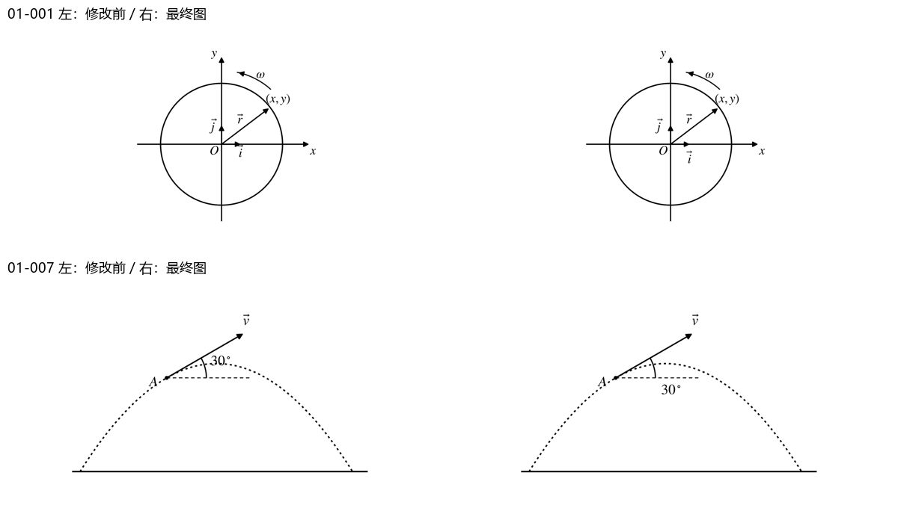

# 第01章｜图片可读性与链接复核

逐图检查文字与线条重叠、箭头与单位遮挡、裁边、缩放阅读及题图归属；不是仅检查文件存在。原图保留，原材料与学习记录只读。

检查12个图片资产、15处引用；修正2图。

[逐图核验](逐图核验.json) · [阅读预览](阅读预览.html)

|图号|结果|确认及处理|
|---|---|---|
|001|fixed|单位矢量符号与坐标轴分离，保留箭头方向。|
|002|pass|已查看当前图及引用题目；标注、裁边与图线清楚，未发现遮挡或错挂。|
|003|pass|已查看当前图及引用题目；标注、裁边与图线清楚，未发现遮挡或错挂。|
|004|pass|已查看当前图及引用题目；标注、裁边与图线清楚，未发现遮挡或错挂。|
|005|pass|已查看当前图及引用题目；标注、裁边与图线清楚，未发现遮挡或错挂。|
|006|pass|已查看当前图及引用题目；标注、裁边与图线清楚，未发现遮挡或错挂。|
|007|fixed|30°标注移到水平辅助线下方，避开轨迹并保留完整虚线。|
|008|pass|已查看当前图及引用题目；标注、裁边与图线清楚，未发现遮挡或错挂。|
|009|pass|已查看当前图及引用题目；标注、裁边与图线清楚，未发现遮挡或错挂。|
|010|pass|已查看当前图及引用题目；标注、裁边与图线清楚，未发现遮挡或错挂。|
|011|pass|已查看当前图及引用题目；标注、裁边与图线清楚，未发现遮挡或错挂。|
|012|pass|已查看当前图及引用题目；标注、裁边与图线清楚，未发现遮挡或错挂。|

S1题库校验及共享链接/哈希校验通过后提交；图中文字的布局调整不改变已知物理关系。源扫描确实无法辨认的内容明确保留不确定性，不补猜测值。
