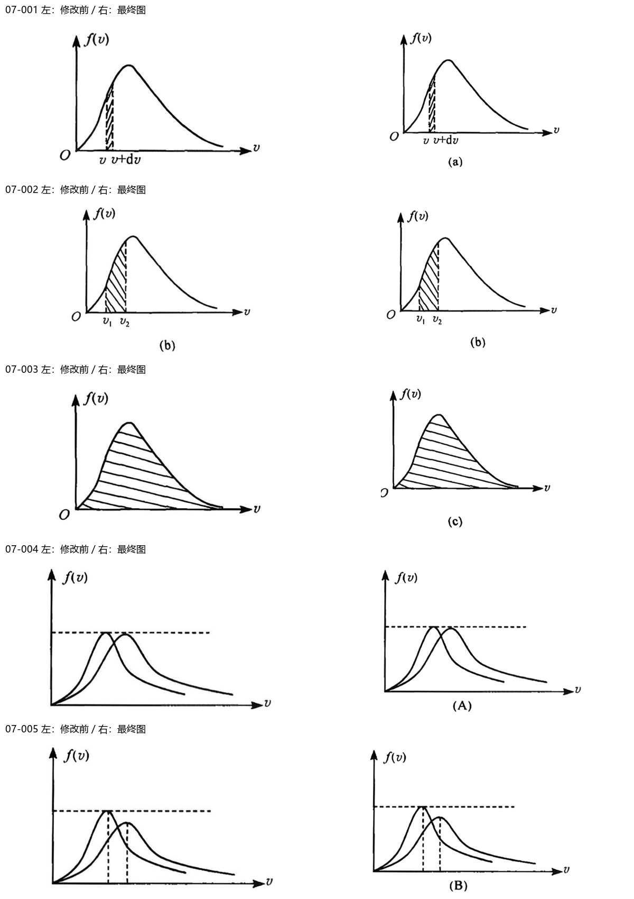
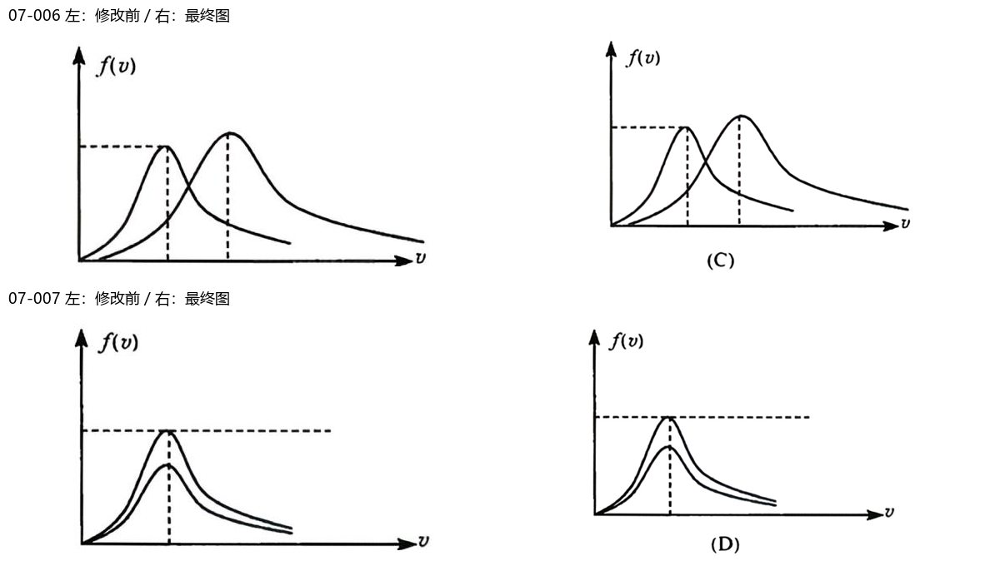

# 第07章｜图片可读性与链接复核

逐图检查文字与线条重叠、箭头与单位遮挡、裁边、缩放阅读及题图归属；不是仅检查文件存在。原图保留，原材料与学习记录只读。

检查7个图片资产、7处引用；修正7图。

[逐图核验](逐图核验.json) · [阅读预览](阅读预览.html)

|图号|结果|确认及处理|
|---|---|---|
|001|fixed|从原PDF重裁完整(a)图，补回子图字母并留足速率标注边距。|
|002|fixed|从原PDF重裁(b)图，统一完整字母与白边。|
|003|fixed|从原PDF重裁完整(c)图，补回子图字母，保持积分区域。|
|004|fixed|补回原图(A)选项字母，避免四张曲线连排时选项归属不明。|
|005|fixed|补回原图(B)选项字母，保留峰高与垂线关系。|
|006|fixed|补回原图(C)选项字母，保留峰高与峰位关系。|
|007|fixed|补回原图(D)选项字母，保留共用峰位垂线。|

S1题库校验及共享链接/哈希校验通过后提交；图中文字的布局调整不改变已知物理关系。源扫描确实无法辨认的内容明确保留不确定性，不补猜测值。
