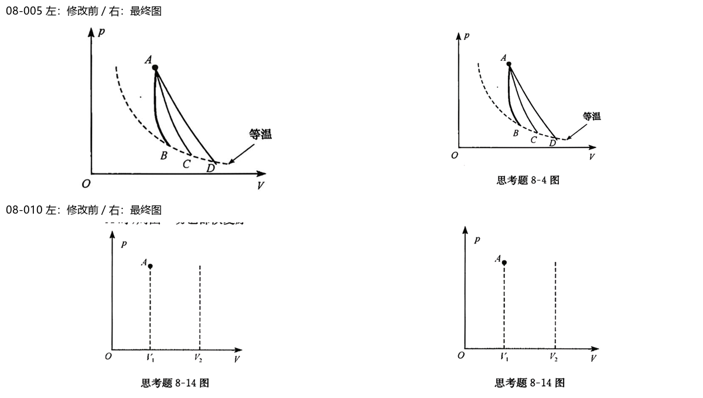

# 第08章｜图片可读性与链接复核

逐图检查文字与线条重叠、箭头与单位遮挡、裁边、缩放阅读及题图归属；不是仅检查文件存在。原图保留，原材料与学习记录只读。

检查16个图片资产、17处引用；修正2图。

[逐图核验](逐图核验.json) · [阅读预览](阅读预览.html)

|图号|结果|确认及处理|
|---|---|---|
|001|pass|主代理查看原尺寸与缩小图；图线、标注及题目归属可确认。|
|002|pass|主代理查看原尺寸与缩小图；图线、标注及题目归属可确认。|
|003|pass|主代理查看原尺寸与缩小图；图线、标注及题目归属可确认。|
|004|pass|主代理查看原尺寸与缩小图；图线、标注及题目归属可确认。|
|005|fixed|重裁原PDF，恢复右侧完整“等温”标注及原图题号，四条曲线不变。|
|006|pass|主代理查看原尺寸与缩小图；图线、标注及题目归属可确认。|
|007|pass|主代理查看原尺寸与缩小图；图线、标注及题目归属可确认。|
|008|pass|主代理查看原尺寸与缩小图；图线、标注及题目归属可确认。|
|009|pass|主代理查看原尺寸与缩小图；图线、标注及题目归属可确认。|
|010|fixed|收紧图上边界，去掉邻近正文残片，保留p轴箭头与完整题图。|
|011|pass|主代理查看原尺寸与缩小图；图线、标注及题目归属可确认。|
|012|pass|主代理查看原尺寸与缩小图；图线、标注及题目归属可确认。|
|013|pass|主代理查看原尺寸与缩小图；图线、标注及题目归属可确认。|
|014|pass|主代理查看原尺寸与缩小图；图线、标注及题目归属可确认。|
|015|pass|主代理查看原尺寸与缩小图；图线、标注及题目归属可确认。|
|016|pass|主代理查看原尺寸与缩小图；图线、标注及题目归属可确认。|

S1题库校验及共享链接/哈希校验通过后提交；图中文字的布局调整不改变已知物理关系。源扫描确实无法辨认的内容明确保留不确定性，不补猜测值。
