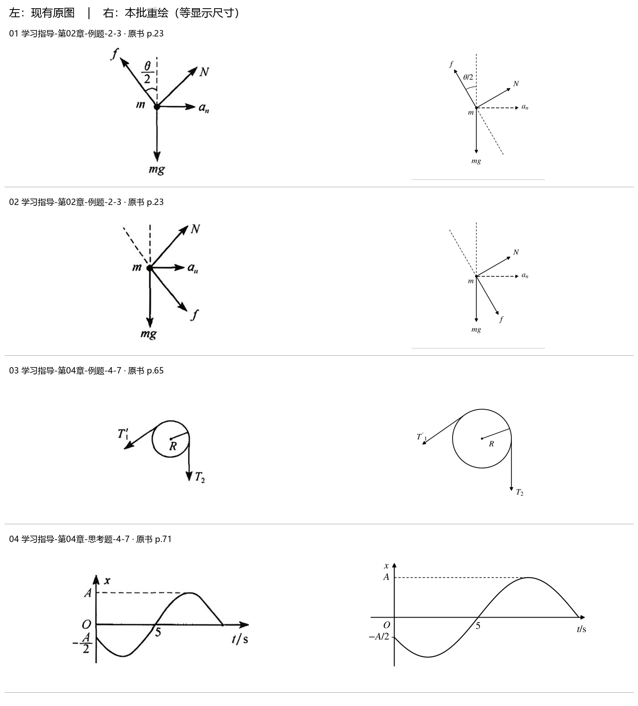
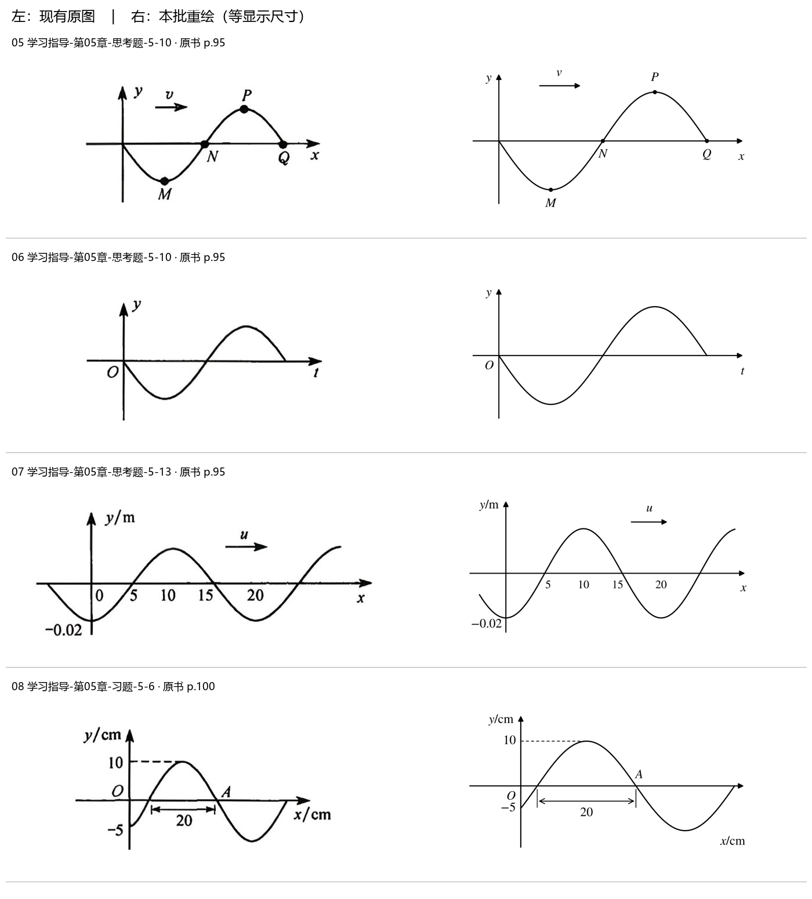
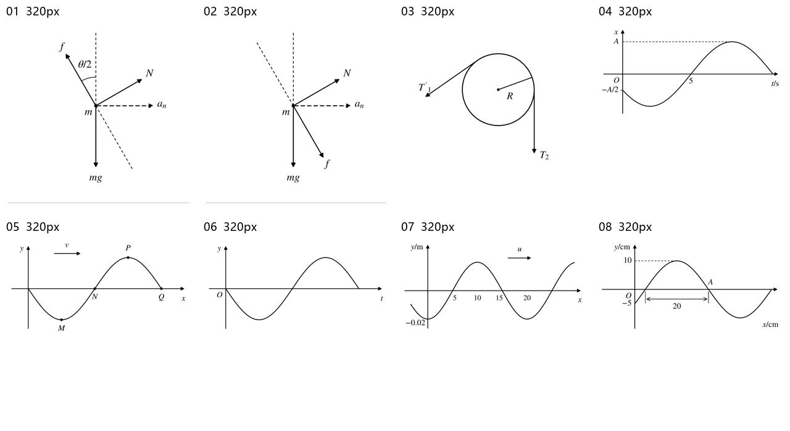

> 派生文件，可重新生成，勿手改。

# 上册图像重绘 · 首批 8 张

范围依据：上册索引所含力学、振动与波动；只更新学习指导第02、04、05章的8处图片引用。原材料和旧图保留，题号、锚点、题面、答案与 OCR 状态保持。

交付：8 张重绘（5 张定性示意、3 张题设约束曲线），清晰提取直接采用 0 张。已尝试原PDF原生图像提取，细小文字与线条仍发虚；保留 source-*.png 作为对照证据。

可复现源文件：[generate.py](../../../10_题库/_assets/重绘_上册_批01/generate.py)；[机器可读映射与逐项核验](../../../10_题库/_assets/重绘_上册_批01/mapping.json)。运行需要 Python、NumPy、Matplotlib。SVG 文字转轮廓以保证无字体环境正常显示；文字与参数仍在 Python 源文件中可编辑。

## 候选台账与核验

|序号|题号 / 子图|原书页 / PDF页|旧图 / 分辨率|原生提取分辨率|性质与结论|
|---|---|---|---|---|---|
|01|学习指导-第02章-例题-2-3 / 01-cone-2-3-b|23 / 30|[p0001-0180_147.jpg](../../../10_题库/_assets/学习指导/p0001-0180_147.jpg) 232×298|345×444|定性示意；重绘通过|
|02|学习指导-第02章-例题-2-3 / 02-cone-2-3-c|23 / 30|[p0001-0180_686.jpg](../../../10_题库/_assets/学习指导/p0001-0180_686.jpg) 187×276|278×412|定性示意；重绘通过|
|03|学习指导-第04章-例题-4-7 / 03-pulley-4-7|65 / 72|[p0001-0180_090.jpg](../../../10_题库/_assets/学习指导/p0001-0180_090.jpg) 209×165|312×248|定性示意；重绘通过|
|04|学习指导-第04章-思考题-4-7 / 04-vibration-4-7|71 / 78|[p0001-0180_1150.jpg](../../../10_题库/_assets/学习指导/p0001-0180_1150.jpg) 392×203|587×305|题设约束的定量曲线；重绘通过|
|05|学习指导-第05章-思考题-5-10 / 05-wave-5-10-a|95 / 102|[p0001-0180_975.jpg](../../../10_题库/_assets/学习指导/p0001-0180_975.jpg) 412×209|617×311|定性示意；重绘通过|
|06|学习指导-第05章-思考题-5-10 / 06-wave-5-10-b|95 / 102|[p0001-0180_1009.jpg](../../../10_题库/_assets/学习指导/p0001-0180_1009.jpg) 412×220|617×329|定性示意；重绘通过|
|07|学习指导-第05章-思考题-5-13 / 07-wave-5-13|95 / 102|[p0001-0180_093.jpg](../../../10_题库/_assets/学习指导/p0001-0180_093.jpg) 584×231|872×343|题设约束的定量曲线；重绘通过|
|08|学习指导-第05章-习题-5-6 / 08-wave-5-6|100 / 107|[p0001-0180_1077.jpg](../../../10_题库/_assets/学习指导/p0001-0180_1077.jpg) 445×220|666×329|题设约束的定量曲线；重绘通过|

初筛排除：第04章习题4-5串联弹簧图 `p0001-0180_291.jpg`，原书75页/PDF82页，595×143，k₁、k₂及串联连接本身可辨，保留原图。初筛引用清单共48处，公式碎片、页码、纯文字与已清楚图不进入本批。

## 逐张核验

### 01 学习指导-第02章-例题-2-3

引用文档：[学习指导_第02章_质点动力学_题面整理.md](../../../10_题库/学习指导/学习指导_第02章_质点动力学_题面整理.md)。原图问题：低分辨率扫描裁图；细小文字、箭头或曲线边缘发虚。

m 为作用点；N 垂直锥壁且朝右上；f 沿壁朝左上；mg 竖直向下；a_n 向右。题设 θ=60°，图中保留 θ/2。力箭长不表示力大小；加速度用虚线箭头区分。

原生PDF裁图：[source-147.png](source-147.png)；新图：[SVG](../../../10_题库/_assets/重绘_上册_批01/01-cone-2-3-b.svg) / [PNG](../../../10_题库/_assets/重绘_上册_批01/01-cone-2-3-b.png)。

### 02 学习指导-第02章-例题-2-3

引用文档：[学习指导_第02章_质点动力学_题面整理.md](../../../10_题库/学习指导/学习指导_第02章_质点动力学_题面整理.md)。原图问题：低分辨率扫描裁图；细小文字、箭头或曲线边缘发虚。

m 为作用点；N 朝右上；f 沿壁朝右下，与(b)反向；mg 向下；a_n 向右。参考锥壁与 N 垂直。箭长不表示力大小。

原生PDF裁图：[source-686.png](source-686.png)；新图：[SVG](../../../10_题库/_assets/重绘_上册_批01/02-cone-2-3-c.svg) / [PNG](../../../10_题库/_assets/重绘_上册_批01/02-cone-2-3-c.png)。

### 03 学习指导-第04章-例题-4-7

引用文档：[学习指导_第04章_振动学基础_题面整理.md](../../../10_题库/学习指导/学习指导_第04章_振动学基础_题面整理.md)。原图问题：低分辨率扫描裁图；细小文字、箭头或曲线边缘发虚。

T′₁ 的撇号保留，沿左上接触点切线朝左下；T₂ 在右端切点竖直向下；R 自圆心至圆周。未添加力、数值半径或 θ；布局倾角仅为定性。

原生PDF裁图：[source-090.png](source-090.png)；新图：[SVG](../../../10_题库/_assets/重绘_上册_批01/03-pulley-4-7.svg) / [PNG](../../../10_题库/_assets/重绘_上册_批01/03-pulley-4-7.png)。

### 04 学习指导-第04章-思考题-4-7

引用文档：[学习指导_第04章_振动学基础_题面整理.md](../../../10_题库/学习指导/学习指导_第04章_振动学基础_题面整理.md)。原图问题：低分辨率扫描裁图；细小文字、箭头或曲线边缘发虚。

纵轴 x、横轴 t/s；x(0)=-A/2 且初始向负向运动；首次向上过零为 5 s；正峰 A。用 x/A=cos(πt/6+2π/3) 生成，不添加振幅数值或答案周期标注。

原生PDF裁图：[source-1150.png](source-1150.png)；新图：[SVG](../../../10_题库/_assets/重绘_上册_批01/04-vibration-4-7.svg) / [PNG](../../../10_题库/_assets/重绘_上册_批01/04-vibration-4-7.png)。

### 05 学习指导-第05章-思考题-5-10

引用文档：[学习指导_第05章_波动学基础_题面整理.md](../../../10_题库/学习指导/学习指导_第05章_波动学基础_题面整理.md)。原图问题：低分辨率扫描裁图；细小文字、箭头或曲线边缘发虚。

纵轴 y、横轴 x；v 向右；原点处波形向下；M 波谷、N 上穿零、P 波峰、Q 下穿零。无刻度，无数值振幅、波长、时间或相位。

原生PDF裁图：[source-975.png](source-975.png)；新图：[SVG](../../../10_题库/_assets/重绘_上册_批01/05-wave-5-10-a.svg) / [PNG](../../../10_题库/_assets/重绘_上册_批01/05-wave-5-10-a.png)。

### 06 学习指导-第05章-思考题-5-10

引用文档：[学习指导_第05章_波动学基础_题面整理.md](../../../10_题库/学习指导/学习指导_第05章_波动学基础_题面整理.md)。原图问题：低分辨率扫描裁图；细小文字、箭头或曲线边缘发虚。

纵轴 y、横轴 t，O 在原点；从零位移先向负向运动，随后上穿零、正峰、下穿零。与(a)统一画法；无数值振幅、周期或相位。

原生PDF裁图：[source-1009.png](source-1009.png)；新图：[SVG](../../../10_题库/_assets/重绘_上册_批01/06-wave-5-10-b.svg) / [PNG](../../../10_题库/_assets/重绘_上册_批01/06-wave-5-10-b.png)。

### 07 学习指导-第05章-思考题-5-13

引用文档：[学习指导_第05章_波动学基础_题面整理.md](../../../10_题库/学习指导/学习指导_第05章_波动学基础_题面整理.md)。原图问题：低分辨率扫描裁图；细小文字、箭头或曲线边缘发虚。

对应 t=3 s 截面；y/m、x 保持原标注，传播 u 向右；x=0、20 处谷值 -0.02 m，5、15 处过零，10 处波峰。由原图约束生成 y=-0.02 cos(πx/10)，x 按题面 SI 解释为米，未增改轴单位字样。

原生PDF裁图：[source-093.png](source-093.png)；新图：[SVG](../../../10_题库/_assets/重绘_上册_批01/07-wave-5-13.svg) / [PNG](../../../10_题库/_assets/重绘_上册_批01/07-wave-5-13.png)。

### 08 学习指导-第05章-习题-5-6

引用文档：[学习指导_第05章_波动学基础_题面整理.md](../../../10_题库/学习指导/学习指导_第05章_波动学基础_题面整理.md)。原图问题：低分辨率扫描裁图；细小文字、箭头或曲线边缘发虚。

对应 t=1/3 s 截面；y/cm、x/cm；原点位移 -5 cm、空间斜率正，波峰 10 cm；相邻过零点间距 20 cm；A 为下降过零处点名。由约束生成 y/cm=10 sin(π(x/cm)/20-π/6)，未将 20 误作波长；传播方向在题面，原图无箭头，未新增。

原生PDF裁图：[source-1077.png](source-1077.png)；新图：[SVG](../../../10_题库/_assets/重绘_上册_批01/08-wave-5-6.svg) / [PNG](../../../10_题库/_assets/重绘_上册_批01/08-wave-5-6.png)。

## 前后对照

## 缩小与黑白检查

## 不确定性与边界

- 本批8图的点名、方向、标注和约束均可在原页确认，无未解决的图义不确定性。定性图无数值比例；力箭头长短、滑轮图倾角、无刻度波形的幅宽不能当作测量值。
- 圆锥图按题设θ=60°表达几何关系，原扫描线条的手绘角度不作测量依据。a_n 为加速度，以虚线箭头与力区分；未增加一项力。
- 5-10两图仅表示定性波形/振动曲线；源码内部的单位化参数服务绘制，不是题目给出的振幅、波长、周期或初相。
- 旧转换 completion 校验通过，但缓存缺少 reports/llm_readthrough_acceptance.md；本次直接复核原PDF相关页，不消费中间转换文本，不补写旧转换验收或声称整本转换质量闭合。
- 原标签词表未变，无新增知识范围、题型或解答；S8知识笔记未变，S8 digest 不受影响。

## 校验记录

见 [validation.json](validation.json)。与本次相关的S1校验、原图/原PDF哈希、引用替换反向比较、跳转目标、SVG独立渲染与分享仓库依赖校验分别记录；旧转换人工验收缺失单独保留。
