# 大学物理习题册

## （上册）

电子科技大学物理电子学院

## 片区 选课号 姓名

## 习题一 质点运动的描述（一）

1．一质点在平面上运动，已知质点位置矢量的表示式为

$$
\vec {r} = a t ^ {2} \vec {i} + b t ^ {2} \vec {j} (\text {其中} a 、 b \text {为常量})
$$

则该质点作

（A）匀速直线运动.

（B）变速直线运动.

（C）抛物线运动.

（D）一般曲线运动. [ ]

2．质点作半径为R的变速圆周运动时的加速度大小为（v表示任一时刻质点的速率）

（A） $\frac { \mathrm { d } v } { \mathrm { d } t } .$

（B） ${ \frac { v ^ { 2 } } { R } } .$

（C） $\frac { \mathrm { d } v } { \mathrm { d } t } { + } \frac { v ^ { 2 } } { R } .$

（D） $\left[ \left( \frac { \mathrm { d } v } { \mathrm { d } t } \right) ^ { 2 } + \left( \frac { v ^ { 4 } } { R ^ { 2 } } \right) \right] ^ { 1 / 2 }$

3．已知质点运动方程为

$$
\vec {r} = (5 + 2 t - \frac {1}{2} t ^ {2}) \vec {i} + (4 t + \frac {1}{3} t ^ {3}) \vec {j} \quad (\mathrm{SI})
$$

当 $t = 2 s$ 时， $\vec { a } =$

4．一质点沿 x轴作直线运动，它的运动学方程为 $x = 3 + 5 t + 6 t ^ { 2 } - t ^ { 3 }$ (SI)

则（1）质点在 $t = 0$ 时刻的速度 $\vec{v}_0 =$

（2）加速度为零时，该质点的速度v

5．一物体悬挂在弹簧上作竖直振动，其加速度为 $a=-ky$，式中 k 为常量，y 是以平衡位置为原点所测得的坐标. 假定振动的物体在坐标 $y_0$ 处的速度为 $v_0$，试求速度 $v$ 与坐标 $y$ 的函数关系式.

6．有一质点沿x轴作直线运动，t 时刻的坐标为

$$
x = 4.5 t ^ {2} - 2 t ^ {3} \tag {SI}
$$

（1）第2秒内的平均速度；

（2）第2秒末的瞬时速度；

（3）第2秒内的路程.

# 片区 选课号 姓名

## 习题一 质点运动的描述（二）

1．对于沿曲线运动的物体，以下几种说法中哪一种是正确的：

（A）切向加速度必不为零.  
（B）法向加速度必不为零（拐点处除外）.  
（C）由于速度沿切线方向，法向分速度必为零，因此法向加速度必为零.  
（D）若物体作匀速率运动，其总加速度必为零.  
（E）若物体的加速度a为恒矢量，它一定作匀变速率运动.

[ ]

2．一质点在平面上作一般曲线运动，其瞬时速度为 $\vec{v}$，瞬时速率为 $v$，一段时间内的平均速度为 $\bar{\vec{v}}$，平均速率为 $\bar{v}$，它们之间的关系必定有：

（A） $|\vec{v}|=v,\ |\bar{\vec{v}}|=\bar{v}$.

（B） $|\vec{v}|\ne v,\ |\bar{\vec{v}}|=\bar{v}$.

（C） $|\vec{v}|\ne v,\ |\bar{\vec{v}}|\ne\bar{v}$.

（D） $|\vec{v}|=v,\ |\bar{\vec{v}}|\ne\bar{v}$.

3．一质点沿半径为 R 的圆周运动，其路程S随时间 t 变化的规律为

$$
S = b t - \frac {1}{2} c t ^ {2} \quad (\mathrm{SI})
$$

其中 $b$、$c$ 为大于零的常数，且 $b^2>Rc$.

（1）质点运动的切向加速度 $a_t=$，法向加速度 $a_n=$

（2）质点运动经过 $t=$ 时， $|a_t|=a_n$.

4．以一定初速度斜向上抛出一个物体，若忽略空气阻力，当该物体的速度 $\vec{v}$ 与水平的夹角为 $\theta$ 时，它的切向加速度 $a_t$ 的大小为，法向加速度 $|a_n|$ 的大小为

5．（1）对于在 xy 平面内，以原点 O 为圆心作匀速圆周运动的质点，试用半径 r、角速度 $\omega$ 和单位矢量i 、 j 表示其 t 时刻的位置矢量.已知在t = 0时， $y = 0 , x = r$ ，角速度 $\omega$ 如图所示；

（2）由（1）导出速度 $\vec{v}$ 与加速度 $\vec{a}$ 的矢量表达式；  
（3）试证加速度指向圆心.

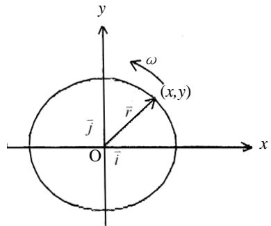

text_image

y
ω
(x,y)
r̄
j̄
O
ī
x

6．如图所示，质点 $P$ 在水平面内沿一半径为 $R=2\,\mathrm{m}$ 的圆轨道转动，转动的角速度与时间 $t$ 的函数关系为 $\omega=kt^2$（$k$ 为常量）. 已知 $t=2\,\mathrm{s}$ 时，质点 $P$ 的速度值为 $32\,\mathrm{m/s}$. 试求 $t=1\,\mathrm{s}$ 时，质点 $P$ 的速度与加速度的大小.

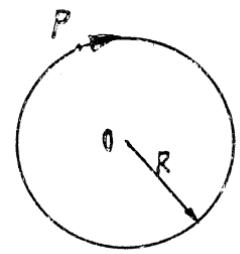

## 片区 选课号 姓名

## 习题三 质点运动的描述（三）

1．某物体的运动规律为 $\mathrm{d}v/\mathrm{d}t=-kv^2t$，式中的 $k$ 为大于零的常数. 当 $t=0$ 时，初速为 $v_0$，则速度 $v$ 与时间 $t$ 的函数关系是

（A） $v=\frac{1}{2}kt^2+v_0$.

（B） $v=-\frac{1}{2}kt^2+v_0$.

（C） $\frac{1}{v}=\frac{kt^2}{2}+\frac{1}{v_0}$.

（D） $\frac{1}{v}=-\frac{kt^2}{2}+\frac{1}{v_0}$.

[ ]

2．在相对地面静止的坐标系内，A、B 二船都以 $2 m \cdot s ^ { - 1 }$ 的速率匀速行驶，A 船沿 x轴正向，B 船沿 y 轴正向. 今在 A 船上设置与静止坐标系方向相同的坐标系（x、y 方向单位矢用i 、 j 表示），那么在A船上的坐标系中，B船的速度（以 $m \cdot s ^ { - 1 }$ 为单位）为

（A） $2 \vec { i } + 2 \vec { j }$

（B） $- 2 \vec { i } + 2 \vec { j }$ .

（C） $- 2 { \vec { i } } - 2 { \vec { j } } .$

（D） $2 \vec { i } - 2 \vec { j }$

[ ]

3．设质点的运动学方程为 $\vec{r}=R\cos(\omega t)\vec{i}+R\sin(\omega t)\vec{j}$（式中 $R$、$\omega$ 皆为常量），则质点的 $\vec{v}=$，$\mathrm{d}\vec{v}/\mathrm{d}t=$

4．如图所示，小船以相对于水的速度 $\vec{v}$ 与水流方向成 $\alpha$ 角开行，若水流速度为 $\vec{u}$，则小船相对于岸的速度的大小为，与水流方向的夹角为

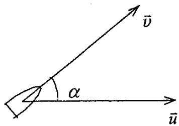

text_image

v̄
α
ū

5．河水自西向东流动，速度为10km/ h，一轮船在水中航行，船相对于河水的船向为北偏西 30°，相对于河水的航速为 20km/h. 此时风向为正西，风速为 10km/h，试求在船上观察到的烟囱冒出的烟缕的飘向.（设烟离开烟囱后很快就获得与风相同的速度）

6．一飞机驾驶员想往正北方向航行，而风以 60km/h 的速度由东向西刮来，如果飞机的航速（在静止空气中的速率）为 180km/h，试问驾驶员应取什么航向？飞机相对于地面的速率为多少？试用矢量图说明。

## 片区 选课号 姓名

## 习题四 质点运动的描述（四）

## 一、选择题（共 6分）

1．（本题 3 分）0614

在电梯中用弹簧秤称物体的重量. 当电梯静止时，称得一个物体重量为 500N. 当电梯作匀速变速运动时，称得其重量为 400N，则该电梯的加速度是

（A）大小为0.2g，方向向上.  
（B）大小为 0.8g，方向向上.  
（C）大小为 0.2g，方向向下.  
（D）大小为 0.8g，方向向下.

[ ]

2．光滑的水平桌面上放有两块相互接触的滑块，质量分别为 $m_1$ 和 $m_2$，且 $m_1<m_2$. 今对两滑块施加相同的水平作用力，如图所示. 设在运动过程中，两滑块不离开，则两滑块之间的相互作用力 N 应有

（A） N = 0.

（B） $0 < N < F .$

（C） $F < N < 2 F .$

（D） $N > 2 F .$

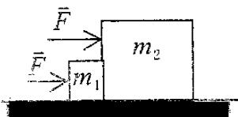

## 二、填空题（共 6分）

3．沿水平方向的外力 F 将物体 A 压在竖直墙上，由于物体与墙之间有摩擦力，此时物体保持静止，并设其所受静摩擦力为 f0，若外力增至 2F，则此时物体所受静摩擦力为

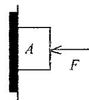

## 4．（本题 3 分）0526

倾角为 30°的一个斜面体放置在水平桌面上，一个质量为 2kg 的物体沿斜面下滑，下滑的加速度为 $3.0\,\mathrm{m/s^2}$.若此时斜面体静止在桌面上不动，则斜面体与桌面间的静摩擦力 f=

5．一条轻绳跨过一轻滑轮（滑轮与轴间摩擦可忽略），在绳的一端挂一质量为 m1的物体，在另一侧有一质量为 m2的环，求当环相对于绳以恒定的加速度 $a_2$ 沿绳向下滑动时，物体和环相对地面的加速度各是多少？环与绳间的摩擦力多大？

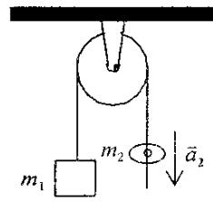

6．质量为 m 的子弹以速度 v0水平射入沙土中，设子弹所受阻力与速度反向，大小与速度成正比，比例系数为K，忽略子弹的重力，求：

（1）子弹射入沙土后，速度随时间变化的函数式.  
（2）子弹进入沙土的最大深度.

# 片区 选课号 姓名

## 习题五 质点运动的描述（五）

1．在作匀速转动的水平转台上，与转轴相距 R 处有一体积很小的工件 A，如图所示. 设工件与转台间静摩擦系数为 $\mu _ { s }$ ， 若使工件在转台上无滑动，则转台的角速度 $\omega$ 应满足

（A） $\omega \leq \sqrt { \frac { \mu _ { s } g } { R } } .$

（B） $\omega \leq \sqrt { \frac { 3 \mu _ { s } g } { 2 R } } .$

（C） $\omega \leq \sqrt{\frac{3\mu_s g}{R}}$.

（D） $\omega \leq 2 { \sqrt { \frac { \mu _ { s } g } { R } } } .$ . [ ]

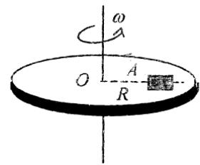

text_image

ω
O
A
R

2．（本题 3 分）0024

一光滑的内表面半径为 10cm 的半球形碗，以匀角速度绕其对称轴OC旋转. 已知放在碗内表面上的一个小球P相对于碗静止，其位置高于碗底 4cm，则由此可推知碗旋转的角速度约为

（A）13 rad/s.

（A） $17\,\mathrm{rad/s}$.

（C）10 $\mathrm { r a d } / \mathrm { s } .$

（D）18 rad/s. [ ]

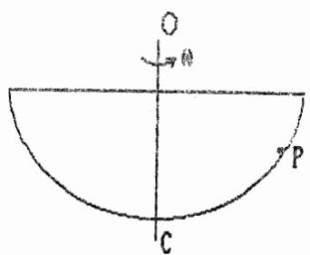

text_image

O
→
P
C

3．（本题 3 分）0351

一圆锥摆摆长为 l、摆锤质量为 m，在水平面上作匀速圆周运动，摆线与铅直线夹角 $\theta$，则

（1）摆线的张力T=

（2）摆锤的速率v=

4．质量分别为 $m_1$、$m_2$、$m_3$ 的三个物体 A、B、C，用一根细绳和两根轻弹簧连接并悬于固定点 O，如图. 取向下为 x 轴正向，开始时系统处于平衡状态，后将细绳剪断，则在刚剪断瞬时，物体 B 的加速度 $\vec{a}_B=$；物体 A 的加速度 $\vec{a}_A=$

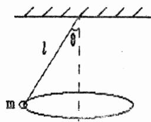

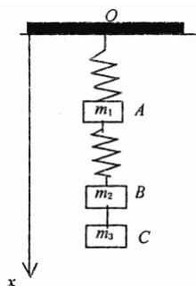

text_image

O
m₁ A
m₂ B
m₃ C
x

5．（本题 5 分）0028

一水平放置的飞轮可绕通过中心的竖直轴转动，飞轮的辐条上装有一个小滑块，它可在辐条上无摩擦地滑动. 一轻弹簧一端固定在飞轮转轴上，另一端与滑块联接. 当飞轮以角速度 $\omega$ 旋转时，弹簧的长度为原来的 f 倍，已知 $\omega = \omega _ { \mathrm { 0 } }$ 时， $f = f _ { 0 }$ ，求 $\omega$ 与 $f$ 的函数关系.

6．质量为 $m$ 的物体系在长度为 $R$ 的绳子的一个端点上，在竖直平面内绕绳子另一端点（固定）作圆周运动. 设t 时刻物体瞬时速度的大小为 v，绳子与竖直向上的方向成 $\theta$ 角，如图所示.

（1）求 t 时刻绳中的张力 T 和物体的切向加速度 $a_t$；

（2）说明在物体运动过程中 $a_t$ 的大小和方向如何变化？

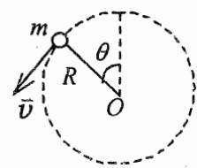

# 片区 选课号 姓名

## 习题六 能量守恒（一）

1．对功的概念有以下几种说法：

（1）保守力作正功时，系统内相应的势能增加.

（2）质点运动经一闭合路径，保守力对质点作的功为零.

（3）作用力和反作用力大小相等、方向相反，所以两者所作功的代数和必为零. 在上述说法中：

（A）（1）、（2）是正确.

（B）（2）、（3）是正确的.

（C）只有（2）是正确的.

（D）只有（3）是正确的. [ ]

2．（本题

一个质点同时在几个力作用下的位移为：

$$
\Delta \vec {r} = 4 \vec {i} - 5 \vec {j} + 6 \vec {k} \tag {SI}
$$

其中一个力为恒力 $\vec{F}=3\vec{i}-5\vec{j}+9\vec{k}\quad(\mathrm{SI})$，则此力在该位移过程中所作的功为

（A）67J.

（B）91J.

（C）17J.

（D） -67 J.

[ ]

3．小球 A和B的质量相同，B球原来静止，A 以速度u与B作对心碰撞. 这两球碰撞后的速度 $v_1$ 和 $v_2$ 的可能值是

（A） $- u , 2 u .$

（B） $u / 4 , 3 u / 4 .$ .

（C） $- u / 4 , 5 u / 4 .$ .

（D） ${ \frac { 1 } { 2 } } u , - u { \sqrt { 3 } } / 2 .$

[ ]

4．（本题 3 分）5022

一弹簧原长 $l_0=0.1\,\mathrm{m}$，倔强系数 k=50N/m，其一端固定在半径为 R=0.1m 的半圆环的端点 A，另一端与另一套在半圆环上的小环相连. 在把小环由半圆环中点 B 移到另一端C 的过程中，弹簧的拉力对小环所作的功为 J.

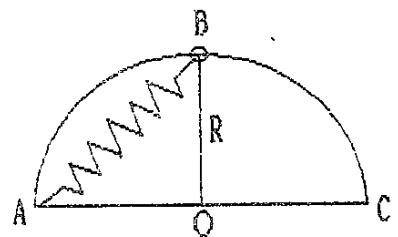

text_image

B
R
A
O
C

1．（本题 10 分）0422

一质量为m 的质点在XOY平面上运动，其位置矢量为

$$
\vec {r} = a \cos \omega t \vec {i} + b \sin \omega t \vec {j} \quad (\mathrm{SI})
$$

式中 a、b、  是正值常数，且 a>b.

（1）求质点在 A 点（a, 0）时和 B 点（0, b）时的动能；

（2）求质点所受的作用力 $\vec{F}$ 以及当质点从 A 点运动到 B 点的过程中 $\vec{F}$ 的分力 $F_x$ 和 $F_y$ 分别作的功.

2．（本题 10 分）0183

两个质量分别为 $m_1$ 和 $m_2$的木块 A 和 B，用一个质量忽略不计、倔强系数为 k 的弹簧联接起来，放置在光滑水平面上，使 A紧靠墙壁，如图所示，用力推木块 B使弹簧压缩 x0，然后释放. 已知 $m _ { 1 } = m , m _ { 2 } = 3 m ,$ ，求：

（1）释放后，A、B两木块速度相等时的瞬时速度的大小；

（2）释放后，弹簧的最大伸长量.

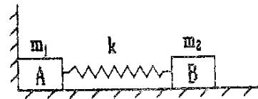

# 片区 选课号 姓名

## 习题七 能量守恒（二）

1．有一劲度系数为 k 的轻弹簧，原长为 $l_0$，将它吊在天花板上. 当它下端挂一托盘平衡时，其长度变为 $l_1$. 然后在托盘中放一重物，弹簧长度变为 $l_2$，则由 $l_1$ 伸长至 $l_2$ 的过程中，弹性力所作的功为

（A） $- \int _ { l _ { 1 } } ^ { l _ { 2 } } k x { \mathrm d } x .$

（B） $\int _ { l _ { 1 } } ^ { l _ { 2 } } k x \mathrm { d } x .$

（C） $- \int _ { l _ { 1 } - l _ { 0 } } ^ { l _ { 2 } - l _ { 0 } } k x { \mathrm { d } } x .$

（D） $\int _ { l _ { 1 } - l _ { 0 } } ^ { l _ { 2 } - l _ { 0 } } k x { \mathrm { d } } x .$ 2 0 l l -

2．（本题 3 分）5408

关于机械能守恒条件和动量守恒条件有以下几种说法，其中正确的是

（A）不受外力作用的系统，其动量和机械能必然同时守恒.  
（B）所受合外力为零，内力都是保守力的系统，其机械能必然守恒.  
（C）不受外力，而内力都是保守力的系统，其动量和机械能必然同时守恒.  
（D）外力对一个系统做的功为零，则该系统的机械能和动量必然同时守恒.

[ ]

3．（本题 5 分）0415

质量 m=1kg的物体，在坐标原点处从静止出发在水平面内沿 X轴运动，其所受合力方向与运动方向相同，合力大小为 $F = 3 + 2 x ( \mathrm { S I } )$ ，那么，物体在开始运动的 3m 内，合力所作功 W= ；且 x=3m 时，其速率 v=

4．如图所示，质量为 m 的小球系在劲度系数为 k的轻弹簧一端，弹簧的另一端固定在 O点. 开始时弹簧在水平位置 A，处于自然状态，原长为 l0. 小球由位置A释放，下落到 O点正下方位置 B时 ， 弹 簧 的 长 度 为 l，则小球到达 B 点 时 的 速 度 大 小 为Bv =

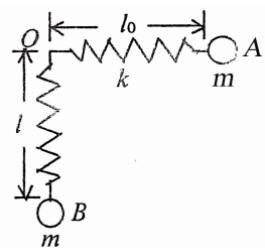

text_image

l
k
A
m
B
l0

5．一链条总长为l，质量为 m，放在桌面上，并使其部分下垂，下垂一段的长度为a. 设链条与桌面之间的滑动摩擦系数为 $\mu$. 令链条由静止开始运动，则

（1）到链条刚离开桌面的过程中，摩擦力对链条作了多少功？  
（2）链条刚离开桌面时的速率是多少？

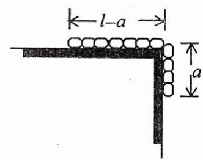

text_image

l-a
a

6．（本题 10 分）0194

在光滑的水平桌面上，平放有如图所示的固定半圆形屏障. 质量为 $m$ 的滑块以初速度 $v_0$ 沿切线方向进入屏障内，滑块与屏障间的摩擦系数为 $\mu$. 试证明当滑块从屏障另一端滑出时，摩擦力所作的功为

$$
W = \frac {1}{2} m v _ {0} ^ {2} (e ^ {- 2 \mu \pi} - 1)
$$

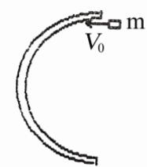

# 片区 选课号 姓名

## 习题八 动量守恒（一）

## 1．（本题 3 分）0384

质量为 20g的子弹，以 400m/s 的速率沿图示方向射入一原来静止的质量为 $980\,\mathrm{g}$ 的摆球中，摆线长度不可伸缩. 子弹射入后与摆球一起运动的速率为

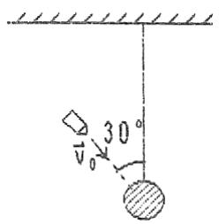

（A）4m/s.

（B）8m/s.

（C）2m/s.

（D）7m/s.

[ ]

2．质量为 20g 的子弹沿 X 轴正向以 500m/s 的速率射入一木块后，与木块一起仍沿 X轴正向以50m/s 的速率前进，在此过程中木块所受冲量的大小为

（A）$9\,\mathrm{N\cdot s}$.

（B）$-9\,\mathrm{N\cdot s}$.

（C）$10\,\mathrm{N\cdot s}$.

（D）$-10\,\mathrm{N\cdot s}$.

[ ]

3．一质量为 m 的物体，原来以速率 v 向北运动，它突然受到外力打击，变为向西运动，速率仍为 v，则外力的冲量大小为 ，方向为

## 4．（本题 5 分）0062

两块并排的木块 A 和 B，质量分别为 $m_1$ 和 $m_2$，静止地放置在光滑的水平面上，一子弹水平地穿过两木块，设子弹穿过两木块所用的时间分别为 $\Delta t _ { 1 }$ 和 $\Delta t _ { 2 }$ ，木块对子弹的阻力为恒力 F，则子弹穿出后，木块 A 的速度大小为 ，木块 B 的速度大小为

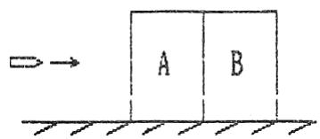

## 5．（本题 5 分）0376

一质点的运动轨迹如图所示. 已知质点的质量为 20g，在 A、B二位置处的速率都为20m/s， $\vec{v}_A$ 与 $x$ 轴成 $45^\circ$ 角，$\vec{v}_B$ 垂直于 $y$ 轴，求质点由 A点到B点这段时间内，作用在质点上外力的总冲量.

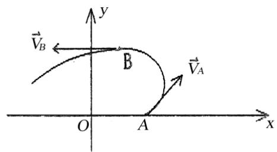

text_image

y
B
O A x
\vec{V}_A
\vec{V}_B

## 6．（本题 10 分）0186

如图所示，一辆质量为 M 的平顶小车在光滑水平轨道上以速度 $v_0$ 作匀速直线运动.今在车顶的前部边缘A处轻轻放上一质量为 m 的小物体，物体相对地面的速度为零. 设物体与车顶之间的摩擦系数为 $\mu$，为使物体不致于从顶上滑出去，问车顶的长度 L 最短应为多少？

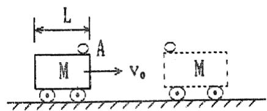

text_image

L
A
M → v₀
M

## 片区 选课号 姓名

## 习题九 动量守恒（二）

1．（本题 3 分）0379

在水平冰面上以一定速度向东行驶的炮车，向东南（斜向上）方向发射一炮弹，对于炮车和炮弹这一系统，在此过程中（忽略冰面摩擦力及空气阻力）

（A）总动量守恒.  
（B）总动量在炮身前进的方向上的分量守恒，其它方向动量不守恒.  
（C）总动量在水平面上任意方向的分量守恒，竖直方向分量不守恒.  
（D）总动量在任何方向的分量均不守恒.

[ ]

2．如图所示，圆锥摆的摆球质量为 $m$，速率为 $v$，圆半径为 $R$，当摆球在轨道上运动半周时，摆球所受重力冲量的大小为

（A） $2mv$  
（B） $\sqrt{(2mv)^2+(mg\pi R/v)^2}$.  
（C） $\pi Rmg/v$.  
（D）0.

[ ]

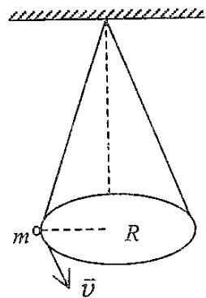

text_image

m
R
v̄

3．（本题 5 分）0371

一颗子弹在枪筒里前进时所受的合力大小为

$$
F = 400 - \frac{4\times10^5}{3}t \tag {SI}
$$

子弹从枪口射出时的速率为 $300\,\mathrm{m\cdot s^{-1}}$ . 假设子弹离开枪口时合力刚好为零，则

（1）子弹走完枪筒全长所用的时间 $t=$  
（2）子弹在枪筒中所受力的冲量 $I=$ ，  
（3）子弹的质量 $m=$

4．一质量为 m的物体，以初速 $\vec{v}_0$ 从地面抛出，抛射角 $\theta=30^\circ$ ，如忽略空气阻力，

则从抛出到刚要接触地面的过程中

（1）物体动量增量的大小为  
（2）物体动量增量的方向为

5．（本题 5 分）0395

质量为 $M$ 的木块在光滑的固定斜面上，由 A 点从静止开始下滑，当经过路程 l 运动到 B 点时，木块被一颗水平飞来的子弹射中，子弹立即陷入木块内. 设子弹的质量为 m，速度为 $v$，求子弹射中木块后，子弹与木块的共同速度.

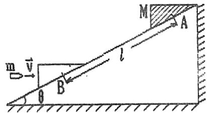

text_image

m
v
θ
B
l
M
A

6．质量为 $M$、半径为 $R$ 的 $1/4$ 圆周的光滑弧形滑块，静止在光滑桌面上，今有质量为m的物体由弧的上端A点静止滑下，试求当 m滑到最低点B时，

（1）$m$ 相对于 $M$ 的速度 $v$ 及 $M$ 对地的速度 $V$；  
（2）$M$ 对 $m$ 的作用力 $N$.

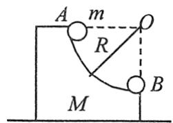

## 片区 选课号 姓名

## 习题十 角动量守恒（一）

1．（本题 3 分）0193

一人造地球卫星到地球中心的最大距离和最小距离分别是 $R _ { A }$ 和 $R _ { B } ,$ ，设卫星对应的角动量分别是 $L _ { A } , \ L _ { B } ,$ ，动能分别是 $E _ { K A } , ~ E _ { K B } ,$ ，则应有

（A） $L _ { \scriptscriptstyle B } > L _ { \scriptscriptstyle A } , E _ { \scriptscriptstyle K B } > E _ { \scriptscriptstyle K A } .$

（B） $L _ { \scriptscriptstyle B } > L _ { \scriptscriptstyle A } , E _ { \scriptscriptstyle K B } = E _ { \scriptscriptstyle K A } .$

（C） $L _ { \scriptscriptstyle B } = L _ { \scriptscriptstyle A } , E _ { \scriptscriptstyle K B } = E _ { \scriptscriptstyle K A } .$

（D） $L _ { \scriptscriptstyle B } < L _ { \scriptscriptstyle A } , E _ { \scriptscriptstyle K B } = E _ { \scriptscriptstyle K A }$

（E） $L _ { \scriptscriptstyle B } = L _ { \scriptscriptstyle A } , E _ { \scriptscriptstyle K B } > E _ { \scriptscriptstyle K A } .$

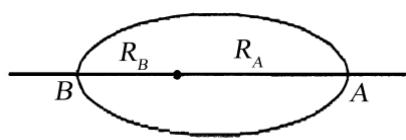

2．（本题 3 分）0172

一力学系统由两个质点组成，它们之间只有引力作用. 若两质点所受外力的矢量和为零，则此系统

（A）动量、机械能以及对一轴的角动量都守恒.  
（B）动量、机械能守恒，但角动量是否守恒不能断定.  
（C）动量守恒，但机械能和角动量守恒与否不能断定.  
（D）动量和角动量守恒，但机械能是否守恒不能断定. [ ]

3．（本题 3 分）5638

质量为 $m$ 的质点以速度 $v$ 沿一直线运动，则它对直线外垂直距离为 d的一点角动量大小是

4．（本题 3 分）0404

地球的质量为 m，太阳的质量为 M，地心与日心的距离为 R，引力常数为 G，则地球绕太阳作圆周运动的轨道角动量为 L=

5．（本题 5 分）0724

一质量为 m 的质点沿着一条空间曲线运动，该曲线在直角坐标系下的定义式为$\vec{r}=a\cos(\omega t)\vec{i}+b\sin(\omega t)\vec{j}$ ，其中 $a$、$b$、$\omega$ 皆为常数，则此质点所受的对原点的力矩 $\vec{M}=$；该质点对原点的角动量 $\vec{L}=$

6．（本题 5 分）0320

在一光滑水平面上，有一轻弹簧，一端固定，一端连接一质量 $m=1\,\mathrm{kg}$ 的滑块，如图所示. 弹簧自然长度 $l_0=0.2\,\mathrm{m}$，倔强系数 $k=100\,\mathrm{N\cdot m^{-1}}$. 设 $t=0$ 时，弹簧长度为 $l_0$，滑块速度 $v_0=5\,\mathrm{m\cdot s^{-1}}$，方向与弹簧垂直. 在某一时刻，弹簧位于与初始位置垂直的位置，长度 $l = 0 . 5 m .$ 求该时刻滑块速度v的大小和方向.

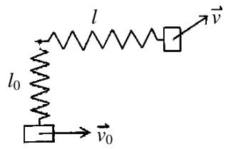

text_image

l
l₀
v
v₀

7．小球 A，自地球的北极点以速度 $\vec{v}_0$ 在质量为 M、半径为 R 的地球表面水平切向向右飞出，如图所示，地心参考系中轴 $OO'$ 与 $\vec{v}_0$ 平行，小球 A 的运动轨道与轴 OO’相交于距 O 为 3R 的 C 点．不考虑空气阻力，求小球 A 在 C 点的速度 $\vec{v}$ 与 $\vec{v}_0$ 之间的夹角 $\theta$ .

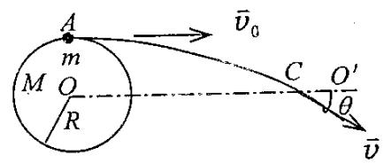

text_image

A
m
M O
R
C O'
θ
v̄₀
v̄

## 片区 选课号 姓名

## 习题十一 角动量守恒（二）

1．（本题 3 分）0289

关于刚体对轴的转动惯量，下列说法中正确的是

（A）只取决于刚体的质量，与质量的空间分布和轴的位置无关。  
（B）取决于刚体的质量和质量的空间分布，与轴的位置无关。  
（C）取决于刚体的质量、质量的空间分布和轴的位置  
（D）只取决于转轴的位置，与刚体的质量和质量的空间分布无关。

[ ]

2．如图所示，A B为两个相同的绕着轻绳的定滑轮．A滑轮挂一质量为M的物体，B 滑轮受拉力 F，而且 $F=Mg$. 设 A、B 两滑轮的角加速度分别为 $\beta _ { \scriptscriptstyle A }$ 和 $\beta _ { { } _ { B } }$ ，不计滑轮轴的摩擦，则有

（A） $\beta _ { { } _ { A } } = \beta _ { { } _ { B } }$

（B） $\beta _ { A } > \beta _ { B } .$

（C） $\beta _ { { } _ { A } } < \beta _ { { } _ { B } }$

（D）开始时 $\beta _ { { } _ { A } } = \beta _ { { } _ { B } }$ ，以后 $\beta _ { { } _ { A } } < \beta _ { { } _ { B } }$ .

[ ]

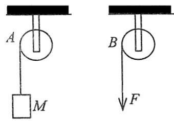

text_image

A
M
B
F

3．一定滑轮质量为 M、半径为 R，对水平轴的转动惯量 $J=\frac{1}{2}MR^2$ . 在滑轮的边缘绕一细绳，绳的下端挂一物体. 绳的质量可以忽略且不能伸长，滑轮与轴承间无摩擦. 物体下落的加速度为 a，则绳中的张力T=

4．（本题 3 分）0240

一飞轮以 600rev/min 的转速旋转，转动惯量为 $2 . 5 \mathrm { k g } \cdot \mathrm { m } ^ { 2 } ,$ ，现加一恒定的制动车矩使飞轮在 1s 内停止转动，则该恒定制动力矩的大小 M=

5．（本题 5 分）0783

一质量 $m=6.00\,\mathrm{kg}$、长 $l=1.00\,\mathrm{m}$ 的匀质棒，放在水平桌面上，可绕通过其中心的竖直固定轴转动，对轴的转动惯量 $J=ml^2/12$. $t=0$ 时棒的角速度 $\omega_0=10.0\,\mathrm{rad\cdot s^{-1}}$ . 由于受到恒定的阻力矩的作用，$t=20\,\mathrm{s}$ 时，棒停止运动. 求：

（1）棒的角加速度的大小；  
（2）棒所受阻力矩的大小；  
（3）从 $t=0$ 到 $t=10\,\mathrm{s}$ 时间内棒转过的角度.

6．质量为 $M_1=24\,\mathrm{kg}$ 的圆轮，可绕水平光滑固定轴转动，一轻绳绕于轮上，另一端通过质量为 $M_2=5\,\mathrm{kg}$ 的圆盘形定滑轮悬有 $m=10\,\mathrm{kg}$ 的物体. 求当重物由静止开始下降了 $h=0.5\,\mathrm{m}$ 时，

（1）物体的速度；

（2）绳中张力.

（设绳与定滑轮间无相对滑动，圆轮、定滑轮绕通过轮心且垂直于横截面的水平光滑轴的转动惯量分别为 $J_1=\frac{1}{2}M_1R^2$，$J_2=\frac{1}{2}M_2r^2$）

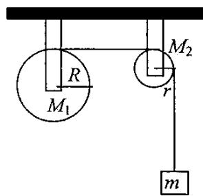

text_image

R
M₁
M₂
r
m

## 片区 选课号 姓名

## 习题十二 角动量守恒（三）

1．（本题 3 分）0294

刚体角动量守恒的充分而必要的条件是

（A）刚体不受外力矩的作用.  
（B）刚体所受合外力矩为零.  
（C）刚体所受的合外力和合外力矩均为零.  
（D）刚体的转动惯量和角速度均保持不变. [ ]

2．如图所示，一静止的均匀细棒，长为L、质量为 M，可绕通过棒的端点且垂直于棒长的光滑固定轴 O 在水平面内转动，转动惯量为 $\frac { 1 } { 3 } M L ^ { 2 } .$ . 一质量为 m、速率为 v 的子弹在水平面内沿与棒垂直的方向射出并穿出棒的自由端，设穿过棒后子弹的速率为 $u=\frac{1}{2}v$， 则此时棒的角速度应为

（A） $\frac { m v } { M L }$

（B） $\frac { 3 m v } { 2 M L }$

（C） ${ \frac { 5 m v } { 3 M L } } .$

（D） $\frac { 7 m v } { 4 M L }$

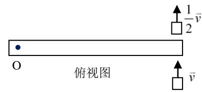

text_image

俯视图
O
↑ 1/2 v̅
↑ v̅

3．（本题 3 分）0681

两个质量都为 100kg 的人，站在一质量为 $2 0 0 \mathrm { k g } ,$ 、半径为 3m 的水平转台的直径两端．转台的固定转轴通过其中心且垂直于台面．初始时，转台每 5s 转一圈．当这两人以相同的快慢走到转台的中心时，转台的角速度 $\omega =$ . （已知转台对转轴的转动惯量 $J = { \frac { 1 } { 2 } } M R ^ { 2 }$ ，计算时忽略转台在转轴处的摩擦）.

4．（本题 3 分）0125

一飞轮以角速度 $\omega _ { 0 }$ 绕轴旋转，飞轮对轴的转动惯量为 $J _ { 1 } ;$ ；另一静止飞轮突然被啮合到同一个轴上，该飞轮对轴的转动惯量为前者的二倍. 啮合后整个系统的角速度=

5．一杆长 $l=50\,\mathrm{cm}$，可绕通过其上端的水平光滑固定轴 $O$ 在竖直平面内转动，相对于 $O$ 轴的转动惯量 $J=5\,\mathrm{kg\cdot m^2}$. 原来杆静止并自然下垂. 若在杆的下端水平射入质量 $m=0.01\,\mathrm{kg}$、速率为 $v=400\,\mathrm{m/s}$ 的子弹并嵌入杆内，则杆的角速度为 $\omega=$

## 片区 选课号 姓名

## 习题十三 振动（一）

1．一质点沿 x轴作简谐振动，振动方程为

$$
x = 4\times10^{-2}\cos (2 \pi t + \frac {1}{3} \pi) \tag {SI}
$$

从$t=0$ 时刻起，到质点位置在 $x=-2\,\mathrm{cm}$ 处，且向 x轴正方向运动的最短时间间隔为

（A）1 / 8 .s

（B） $1 / 4 s .$

（C）1 / 2 .s

（D） $1 / 3 s .$

（E）1 / 6 .s

[ ]

2．一简谐振动曲线如图所示，则振动周期是

（A）2.62s.

（B）2.40s.

（C）0.42s.

（D）0.382s.

[ ]

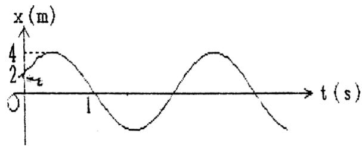

line chart

| t (s) | x (m) |
|-------|-------|
| 0     | 0     |
| 2     | 4     |
| 1     | 0     |
| >1    | <4    |

3．一物体作简谐振动，其振动方程为

$$
x = 0.04\cos (5 \pi t / 3 - \frac {1}{2} \pi) \tag {SI}
$$

（1）此简谐振动的周期T= ，

（2）当 t=0.6s 时物体的速度 v=

4． 一 简 谐 振 动 曲 线 如 图 所 示 ， 试 由 图 确 定 在 t =2 秒 时 刻 质 点 的 位 移为 ，速度为

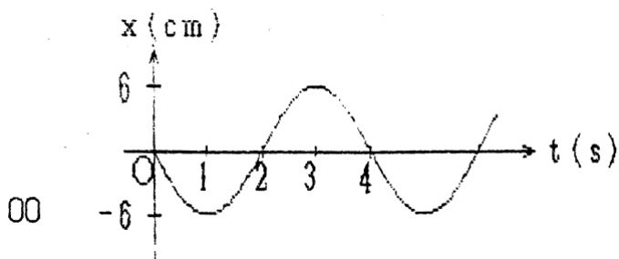

line chart

| t (s) | x (cm) |
|-------|--------|
| 0     | 0      |
| 1     | -6     |
| 2     | 0      |
| 3     | 6      |
| 4     | 0      |

5．一物体作简谐振动，其速度最大值 $v_m=3\times10^{-2}\,\mathrm{m/s}$ ，其振幅 $A=2\times10^{-2}\,\mathrm{m}$ . 若 t=0时，物体位于平衡位置且向 x 轴的负方向运动. 求：

（1）振动周期T；  
（2）加速度的最大值 $a _ { m } ;$  
（3）振动方程的数值式.

6．一轻弹簧在 60N 的拉力下伸长 30cm. 现把质量为 4kg的物体悬挂在该弹簧的下端并使之静止，再把物体向下拉10cm，然后由静止释放并开始计时. 求

（1）物体的振动方程，  
（2）物体在平衡位置上方5cm 时弹簧对物体的拉力，  
（3）物体从第一次越过平衡位置时刻起到它运动到上方 5cm 处所需要的最短时间.

# 片区 选课号 姓名

## 习题十四 振动（二）

1．一质点在x轴上作简谐振动，振幅 A=4cm，周期 T=2s，其平衡位置取作坐标原点. 若 t=0 时刻质点第一次通过 $x=-2\,\mathrm{cm}$ 处，且向 x 轴负方向运动，则质点第二次通过$x=-2\,\mathrm{cm}$ 处的时刻为

（A）1s.

（B）(2/3)s.

（C）(4/3)s.

（D）2s.

[ ]

2．弹簧振子在光滑水平面上作简谐振动时，弹性力在半个周期内所作的功为

（A） $k A ^ { 2 }$

（B） ${ \frac { 1 } { 2 } } k A ^ { 2 } .$ .

（C） $( 1 / 4 ) k A ^ { 2 }$ .

（D）0.

[ ]

3．一质点作简谐振动，速度最大值 $U _ { _ { m } } = 5 \mathrm { c m / s } ,$ , 振幅 $\mathbf { A } = 2 \mathbf { c m }$ . 若令速度具有正最大值的那一时刻为t =0，则振动表达式为

4．一简谐振动用余弦函数表示，其振动曲线如图所示，则此简谐振动的三个特征量为 $A=$；$\omega=$；$\varphi=$

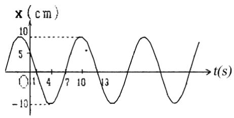

line chart

| t(s) | x (cm) |
|------|--------|
| 0    | 5      |
| 4    | -10    |
| 7    | 5      |
| 10   | 10     |
| 13   | -10    |

5．如图，有一水平弹簧振子，弹簧的倔强系数 $k=24\,\mathrm{N/m}$ ，重物的质量 $m=6\,\mathrm{kg}$ ，重物静止在平衡位置上. 设以一水平恒力 $F=10\,\mathrm{N}$ 向左作用于物体（不计摩擦），使之由平衡位置向左运动了0.05m，此时撤去力 F. 当重物运动到左方最远位置时开始计时，求物体的运动方程.

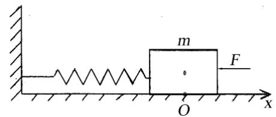

text_image

m
F
O
x

6．（本题 10 分）0321

一定滑轮的半径为 R，转动惯量为 J，绳的一端系一质量为 m的物体，另一端与一固定的轻弹簧相连，如图所示. 设弹簧的倔强系数为k，绳与滑轮间无滑动，且忽略轴的摩擦力及空气阻力. 现将物体 m 从平衡位置拉下一微小距离后放手，证明物体作简谐振动，并求出其角频率.

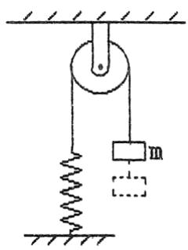

text_image

Diagram of a mechanical system with a mass suspended by a spring and connected to a fixed support, showing equilibrium position.

## 片区 选课号 姓名

## 习题十五 振动（三）

1．一质点作简谐振动。其运动速度与时间的曲线如图所示. 若质点的振动规律用余弦函数描述. 则其初位相应为

（A） $\pi/6$.

（B） $5\pi/6$.

（C） $-5\pi/6$.

（D） $-\pi/6$.

（E） $-2\pi/3$.

[ ]

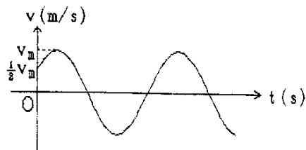

line chart

| t (s) | v (m/s) |
|-------|---------|
| 0     | 0       |
| 300   | 0.5     |
| 600   | -0.5    |
| 900   | 0.5     |

2．图中所画的是两个简谐振动的振动曲线. 若这两个简谐振动可叠加，则合成的余弦振动的初相为

（A） ${ \frac { 1 } { 2 } } \pi .$

（B） $\pi$.

（C） $\frac { 3 } { 2 } \pi$ .

（D）0.

[ ]

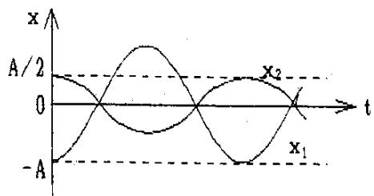

line chart

| t    | x1   | x2   |
| ---- | ---- | ---- |
| 0    | -A   | 0    |
| 0.5  | 0    | 2    |
| 1    | -A   | 0    |
| 1.5  | 0    | -2   |
| 2    | -A   | 0    |

3．一物体同时参与同一直线上的两个简谐振动：

$$
x_1=0.05 \cos (4 \pi t + \frac {1}{3} \pi) \tag {SI}
$$

$$
x_2=0.03 \cos (4 \pi t - 2 \pi / 3) \tag {SI}
$$

合成振动的振幅为 $\underline{\qquad}\,\mathrm{m}$.

4．一质点同时参与了三个简谐振动，它们的振动方程分别为

$$
x _ {1} = A \cos (\omega t + \pi / 3)
$$

$$
x _ {2} = A \cos (\omega t + 5 \pi / 3)
$$

$$
x _ {3} = A \cos (\omega t + \pi)
$$

其合成运动的运动方程为 $x=$

5．一个轻弹簧在 60N 的拉力作用下可伸长 30cm. 现将一物体悬挂在弹簧的下端并在它上面放一小物体，它们的总质量为 4kg. 待其静止后再把物体向下拉10cm，然后释放，问：

（1）此小物体是停在振动物体上面还是离开它？

（2）如果使放在振动物体上的小物体与振动物体分离，则振幅 A 需满足何条件？二者在何位置开始分离？

6．两个同方向简谐振动的振动方程分别为

$$
x_1=5\times10^{-2}\cos(10t + 3 \pi / 4) \tag {SI}
$$

$$
x_2=6\times10^{-2}\cos(10t + \pi / 4) \tag {SI}
$$

求合振动方程.

## 片区 选课号 姓名

## 习题十六 相对论（一）

1．（本题 3 分）5613

关于同时性有人提出以下一些结论，其中哪个是正确的?

（A）在一惯性系同时发生的两个事件，在另一惯性系一定不同时发生.  
（B）在一惯性系不同地点同时发生的两个事件，在另一惯性系一定同时发生.  
（C）在一惯性系同一地点同时发生的两个事件，在另一惯性系一定同时发生.  
（D）在一惯性系不同地点不同时发生的两个事件，在另一惯性系一定不同时发生.

[ ]

2．（本题 3 分）4184

在狭义相对论中，下列说法中哪些是正确的?

（1）一切运动物体相对于观察者的速度都不能大于真空中的光速  
（2）质量、长度、时间的测量结果都是随物体与观察者的相对运动状态而改变的  
（3）在一惯性系中发生于同一时刻，不同地点的两个事件在其他一切惯性系中也是同时发生的.  
（4）惯性系中的观察者观察一个与他作匀速相对运动的时钟时，会看到这时钟比与他相对静止的相同的时钟走得慢些

（A）（1），（3），（4）.  
（B）（1），（2），（4）.  
（C）（1），（2），（3）.  
（D）（2），（3），（4）.

[ ]

3．（本题 3 分）4362

静止时边长为 50cm 的立方体，当它沿着与它的一个棱边平行的方向相对于地面以匀速度 $2 . 4 \times 1 0 ^ { 8 } m \cdot s ^ { - 1 }$ 运动时，在地面上测得它的体积是

4．（本题 3 分）5616

一列高速火车以速度 u驶过车站时，停在站台上的观察者观察到固定在站台上相距1m 的两只机械手在车厢上同时划出两个痕迹，则车厢上的观察者应测出这两个痕迹之间的距离为

5．（本题 10 分）5359

观测者甲和乙分别静止于两个惯性参照系 $K$ 和 $K'$中，甲测得在同一地点发生的两个事件的时间间隔为 $4\,\mathrm{s}$，而乙测得这两个事件的时间间隔为 $5\,\mathrm{s}$，求：

（1）$K'$ 相对于 $K$ 的运动速度.  
（2）乙测得这两个事件发生的地点的距离.

6．（本题 5 分）5358

观测者甲和乙分别静止于两个惯性系 $K$ 和 $K'$（$K'$ 系相对于 $K$ 作平行于 $X$ 轴的匀速运动）中．甲测得在 X 轴上两点发生的两个事件的空间间隔和时间间隔分别为 $500\,\mathrm{m}$ 和 $2\times10^{-7}\,\mathrm{s}$ ，而乙测得这两个事件是同时发生的. 问：K’系相对于K 系以多大速度运动?

# 片区 选课号 姓名

## 习题十七 相对论（二）

1．（本题 3 分）4724

$\alpha$ 粒子在加速器中被加速，当其质量为静止质量的 3倍时，其动能为静止能量的

（A）2 倍.

（B）3 倍.

（C）4 倍.

（D）5 倍.

[ ]

2．（本题 3 分）4725

把一个静止质量为 $m_0$的粒子，由静止加速到$v=0.6c$ （c 为真空中光速）需作的功等于

（A） $0.18m_0c^2$.

（B） $0.25m_0c^2$.

（C） $0.36m_0c^2$.

（D） $1.25m_0c^2$.

[ ]

3．（本题 3 分）4167

$\mu$ 子是一种基本粒子，在相对于 $\mu$ 子静止的坐标系中测得其寿命为 $\tau _ { 0 } = 2 \times 1 0 ^ { - 6 } s$ . 如果 $\mu$ 子相对于地球的速度为 $v=0.988c$ （c为真空中光速），则在地球坐标系中测出的 $\mu$ 子的寿命 $\tau=$

4．（本题 5 分）4734

匀质细棒静止时的质量为 $m _ { 0 } ,$ ，长度为 $l_0$，当它沿棒长方向作高速的匀速直线运动时，测得它的长为 $l$，那么，该棒的运动速度 v= ，该棒所具有的动能$E _ { k }$ =

5．（本题 3 分）8015

下列几种说法：

（1）所有惯性系对物体基本规律都是等价的.

（2）在真空中，光的速度与光的频率、光源的运动状态无关.

（3）在任何惯性系中，光在真空中沿任何方向的传播速度都相同.其中哪些说法是正确的？

（A）只有（1）、（2）是正确的.

（B）只有（1）、（3）是正确的.

（C）只有（2）、（3）是正确的.

（D）三种说法都是正确的.

5．（本题 5 分）4170

一体积为 $V_0$、质量为 $m_0$ 的立方体沿其一棱的方向相对于观察者 $A$ 以速度 $v$ 运动. 求：观察者A测得其密度是多少？

6．（本题 5 分）4603

某一宇宙射线中的介子的动能 $E _ { k } = 7 M _ { 0 } c ^ { 2 } ;$ ，其中 $M _ { 0 }$ 是介子的静止质量. 试求在实验室中观察到它的寿命是它的固有寿命的多少倍.

# 片区 选课号 姓名

## 习题十八 相对论（三）

1．本题（3 分）4173

设某微观粒子的总能量是它的静止能量的 K 倍，则其运动速度的大小为（以 c表示真空中的光速）

（A） $\frac{c}{K-1}$ .$

（B） $\frac { c } { K } \sqrt { 1 - K ^ { 2 } } .$ .

（C） $\frac { c } { K } \sqrt { K ^ { 2 } - 1 } .$

（D） $\frac { c } { K + 1 } \sqrt { K ( K + 2 ) } .$

[ ]

2．（本题 3 分）4376

在参照 S 中，有两个静止质量都是m0的粒子A 和B，分别以速度 v 沿同一直线相向运动，相碰后合在一起成为一个粒子，则其静止质量 M0的值为

（A） $2 m _ { 0 } .$

（B） $2m_0\sqrt{1-(v/c)^2}$.

（C） $\frac{m_0}{2}\sqrt{1-(v/c)^2}$ .

（D） $\frac{2m_0}{\sqrt{1-(v/c)^2}}$.（c表示真空中光速）

[ ]

3．（本题 3 分）4172

一宇宙飞船相对地球以 0.8c（c表示真空中光速）的速度飞行. 一光脉冲从船尾传到船头. 飞船上的观察者测得飞船长为 90m，地球上的观察者测得光脉冲从船尾发出和到达船头两个事件的空间间隔为

（A）90m.

（B）54m.

（C） $2 7 0 \mathrm { m } .$

（D） $1 5 0 \mathrm { m } .$

[ ]

4．（本题 3 分）4171

两个惯性系中的观察者O和O’以 0.6c（c表示真空中光速）的相对速度互相接近. 如果 O 测得两者的初始距离是 20m. 则 $O'$ 测得两者经过时间 $\Delta t=\underline{\qquad}\,\mathrm{s}$ 后相遇.

5．（本题 5 分）5230

要使电子的速度从 $v_1=1.2\times10^8\,\mathrm{m/s}$ 增加到 $v_2=2.4\times10^8\,\mathrm{m/s}$ 必须对它作多少功？

（电子静止质量 $m_e=9.11\times10^{-31}\,\mathrm{kg}$ ）

6．（本题 5 分）4245

由于相对论效应，如果粒子的能量增加，粒子在磁场中的回旋周期将随能量的增加而增大，计算动能为 $10^4\,\mathrm{MeV}$的质子在磁感应强度为 $1\,\mathrm{T}$的磁场中的回旋周期.

（质子的静止质量为 $1.67\times10^{-27}\,\mathrm{kg}$, $1\,\mathrm{eV}=1.6\times10^{-18}\,\mathrm{J}$） ）

## 片区 选课号 姓名

## 习题十九 波动（一）

1．一沿 x轴负方向传播的平面简谐波在 $t=2\,\mathrm{s}$ 时的波形曲线如图所示，则原点O的振动方程为

（A） $y = 0 . 5 0 \cos ( \pi t + \frac { \pi } { 2 } ) ,$

(SI).

（B） $y = 0 . 5 0 \cos ( \frac { \pi } { 2 } t - \frac { \pi } { 2 } ) ,$

(SI).

（C） $y=0.50\cos(\frac{\pi}{2}t+\frac{\pi}{2})$,

(SI).

（D） $y=0.50\cos(\frac{\pi}{4}t+\frac{\pi}{2})$,

(SI).

[ ]

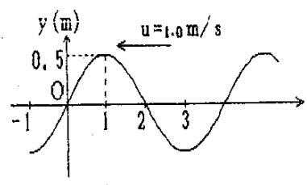

line chart

| x    | y (m) |
| ---- | ----- |
| -1   | 0     |
| 0    | 0     |
| 1    | 0.5   |
| 2    | 0     |
| 3    | -1    |

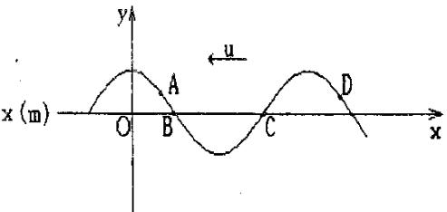

text_image

x (m)
O
A
B
C
D
y
u
x

2．横波以波速 u 沿 x 轴负方向传播. t 时刻波形曲线如图. 则该时刻

（A）A点振动速度大于零.

（B）B 点静止不动.

（C）C 点向下运动.

（D）D点振动速度小于零.

[ ]

3．一平面简谐波 沿 x 轴负方向传播. 已知 $x=-1\,\mathrm{m}$ 处质点的振动 方程为$y = A \cos ( \omega t + \phi )$ ，若波速为u，则此波的波动方程为

4．图示一平面简谐波在$t=2\,\mathrm{s}$ 时刻的波形图，波的振幅为 0.2m，周期为 4s，则图中p点处质点的振动方程为

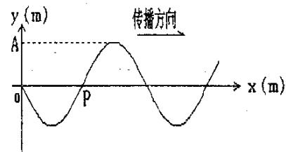

text_image

y (m)
传播方向
A
P
x (m)

5．一平面简谐波沿Ox 轴的负方向传播，波长为 $\lambda$，$P$ 处质点的振动规律如图所示.

（1）求P 处质点的振动方程；  
（2）求此波的波动方程;  
（3）若图中 $d = { \frac { 1 } { 2 } } \lambda$ ，求O处质点的振动方程.

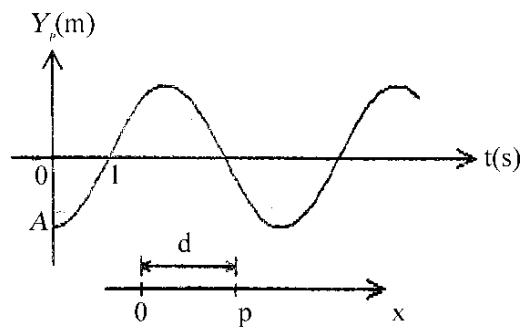

line chart

| t(s) | Y_p(m) |
|------|--------|
| 0    | A      |
| 1    | ~1.5   |
| d    | ~0     |
| p    | ~1.5   |
| x    | ~1.5   |

6．一简谐波沿Ox轴正方向传播，波长 $\lambda=4\,\mathrm{m}$，周期 $T=4\,\mathrm{s}$ ，已知x=0处质点的振动曲线如图所示，

（1）写出x=0处质点的振动方程；  
（2）写出波的表达式；  
（3）画出 $t=1\,\mathrm{s}$ 时刻的波形曲线.

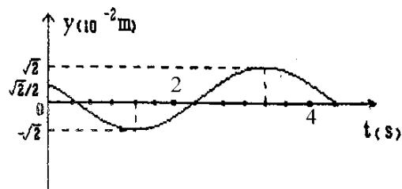

line chart

| t (s) | y (10⁻² m) |
|-------|------------|
| 0     | √2         |
| 2     | -√2        |
| 4     | 0          |

## 片区 选课号 姓名

## 习题二十 波动（二）

1．一平面简谐波在弹性媒质中传播，在媒质质元从平衡位置运动到最大位移处的过程中：

（A）它的动能转换成势能.  
（B）它的势能转换成动能.  
（C）它从相邻的一段质元获得能量其能量逐渐增大.  
（D）它把自己的能量传给相邻的一段质元，其能量逐渐减小.

[ ]

2．一平面简谐波在弹性媒质中传播，在某一瞬时，媒质中某质元正处于平衡位置，此时它的能量是

（A）动能为零，势能最大.

（B）动能为零，势能为零.

（C）动能最大，势能最大.

（D）动能最大，势能为零.

[ ]

3．在同一媒质中两列频率相同的平面简谐波的强度之比 $I_1/I_2=16$ ，则这两列波的 振幅之比是 $A _ { 1 } / A _ { 2 } =$

4．在截面积为 S 的圆管中，有一列平面简谐波在传播，其波的表达式为$y = A \cos ( \omega t - 2 \pi x / \lambda )$ ，管中波的平均能量密度是 w，则通过截面积 S 的平均能流是

5．如图为一平面简谐波在 t=0 时刻的波形图，试画出 P 处质点与 Q 处质点的振动曲线，然后写出相应的振动方程. 其中波速$u=20\,\mathrm{m/s}$.

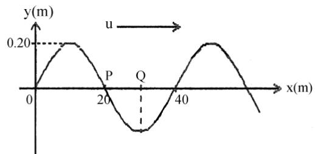

line chart

| x(m) | y(m) |
|------|------|
| 0    | 0.20 |
| 20   | -0.20 |
| 40   | 0.20 |

6．（本题 10 分）5201

一平面简谐波在介质中以速度 $c=20\,\mathrm{m/s}$ 自左向右传播. 已知在传播路径上的某点 A的振动方程为

$$
y = 3 \cos (4 \pi t - \pi) \tag {SI}
$$

另一点 $D$ 在 $A$ 点右方 $9$ 米处.

（1）若取 x 轴方向向左，并以 A 为坐标原点，试写出波动方程，并求出 D 点的振动方程.  
（2）若取 x 轴方向向右，以 A 点左方 5 米处的 O 点为 x 轴原点，重新写出波动方程D点的振动方程.

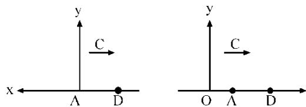

text_image

y
C
x ← A D
y
C
O A D

# 片区 选课号 姓名

## 习题二一 波动（三）

1．如图所示， $S _ { 1 }$ 和 $S _ { 2 }$ 为两相干波源，它们的振动方向均垂直于图面，发出波长为 $\lambda$ 的简谐波，P 点是两列波相遇区域中的一点，已知 $\overline { { S _ { 1 } P } } = 2 \lambda ~ , ~ \overline { { S _ { 2 } P } } = 2 . 2 \lambda$ ，两列波在 P 点发生相消干涉. 若 S1的振动方程为 $y _ { 1 } = A \cos ( 2 \pi t + \frac { 1 } { 2 } )$ ，则 S2的振动方程为

（A） $y _ { 2 } = A \cos ( 2 \pi t - \frac { 1 } { 2 } \pi ) .$

（B） $y _ { 2 } = A \cos ( 2 \pi t - \pi ) .$ .

（C） $y_2=A\cos(2\pi t+\frac{1}{2}\pi)$.

（D） $y _ { 2 } = A \cos ( 2 \pi t - 0 . 1 \pi ) .$ .

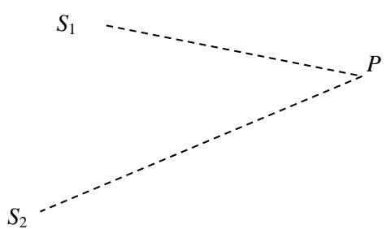

text_image

S₁
P
S₂

[ ]

2．$S_1$ 和 $S_2$ 是波长均为 $\lambda$ 的两个相干波的波源，相距 $3\lambda/4$，$S_1$ 的位相比 $S_2$ 超前 $\frac{1}{2}\pi$. .若两波单独传播时，在过 $S _ { 1 }$ 和 $S _ { 2 }$ 的直线上各点的强度相同，不随距离变化，且两波的强度都是 $I _ { 0 } ,$ ，则在 S1、S2连线上 S1外侧和 S2外侧各点，合成波的强度分别是

（A） $4 I _ { 0 } , 4 I _ { 0 } .$

（B） 0, 0.

（C） $0 , 4 I _ { 0 } .$

（D） $4 I _ { 0 } , 0 .$

[ ]

3．两个相干点波源 $S _ { 1 }$ 和 $S _ { 2 }$ ，它们的振动方程分别是 $y _ { 1 } = A \cos ( \omega t + \frac { 1 } { 2 } \pi )$ 和$y _ { 2 } = A \cos ( \omega t - \frac { 1 } { 2 } \pi ) .$ 波从 $S_1$ 传到 $P$ 点经过的路程等于 2 个波长，从 $S_2$ 传到 $P$ 点经过的路程等于 $7/2$ 个波长. 设两波波速相同，在传播过程中振动幅不衰减，则两波传到 P 点的振动的合振幅为

4．在简谐驻波中，同一个波节两侧的两个媒质元（在距该波节二分之一波长的范围内）的振动相位差是

5．两列余弦波沿Ox轴传播，波动方程分别为

$$
y_1=0.06 \cos [ \frac {1}{2} \pi (0.02x - 8.0t) ] \quad (\mathrm{SI})
$$

$$
y_2=0.06 \cos [ \frac {1}{2} \pi (0.02x + 8.0t) ] \quad (\mathrm{SI})
$$

试确定Ox轴上合振幅为 0.06m 的那些点的位置.

6．（本题 5 分）3437

如图所示，两列相干波在P点相遇. 一列波在B点引起的振动是

$y _ { 1 0 } = 3 \times 1 0 ^ { - 3 } \cos 2 \pi t \qquad \mathrm { ( S I ) } ;$ ；另一列波在 C 点引起的振动是

$y _ { 2 0 } = 3 { \times } 1 0 ^ { - 3 } \cos ( 2 \pi t + \frac { 1 } { 2 } \pi )$ (SI) $\overline { { B P } } = 0 . 4 5 \mathrm { m } , \overline { { C P } } = 0 . 3 0 \mathrm { m }$ ，两波的传播速度$\mathrm { { u { = } 0 . 2 0 m / s } }$ ，不考虑传播途中振幅的减小，求 P点的合振动的振动方程.

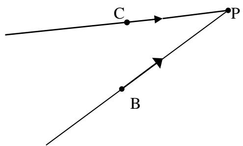

text_image

C
P
B

## 片区 选课号 姓名

## 习题二二 波动（四）

1．某时刻驻波波形曲线如图所示，则 a、b 两点的位相差是

（A） $\pi$. （B） ${ \frac { 1 } { 2 } } \pi .$ （C） $5 \pi / 4 .$ （D） 0. [ ]

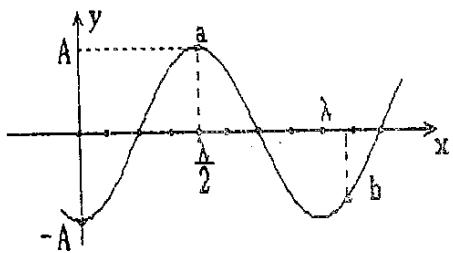

text_image

A
a
λ
x
- A
b

2．若在弦线上的驻波表达式是 $y=0.20\sin 2\pi x\cos 20\pi t\quad(\mathrm{SI})$. 则形成该驻波的两个反向进行的行波为：

（A） $y _ { 1 } = 0 . 1 0 \cos [ 2 \pi ( 1 0 t - x ) + \frac { 1 } { 2 } \pi ]$

$$
y _ {2} = 0. 1 0 \cos [ 2 \pi (1 0 t + x) + \frac {1}{2} \pi ] (\mathrm{SI})
$$

（B） $y _ { 1 } = 0 . 1 0 \mathrm { c o s } [ 2 \pi ( 1 0 t - x ) - 0 . 2 5 \pi ]$

$$
y _ {2} = 0. 1 0 \cos [ 2 \pi (1 0 t + x) + 0. 7 5 \pi ] (\mathrm{SI})
$$

（C） $y _ { 1 } = 0 . 1 0 \cos [ 2 \pi ( 1 0 t - x ) + \frac { 1 } { 2 } \pi ]$

$$
y _ {2} = 0. 1 0 \cos [ 2 \pi (1 0 t + x) - \frac {1}{2} \pi ] (\mathrm{SI})
$$

（D） $y _ { 1 } = 0 . 1 0 \cos [ 2 \pi ( 1 0 t - x ) + 0 . 7 5 \pi ]$

$$
y _ {2} = 0. 1 0 \cos [ 2 \pi (1 0 t + x) + 0. 7 5 \pi ] (\mathrm{SI}) \quad [ ]
$$

3．已知一平面简谐波的表达式为 $y = A \cos ( D t - E x )$ ，式中A、D、E为正值恒量，则在传播方向上相距为 a的两点的位相差为

4．设平面简谐波沿 x轴传播时在x=0处发生反射，反射波的表达式为

$$
y _ {2} = A \cos [ 2\pi(\nu t-x/\lambda) + \frac {1}{2} \pi ]
$$

已知反射点为一自由端，则由入射波和反射波形成的驻波的波节位置的坐标为

5．一列横波在绳索上传播，其表达式为 $y_1=0.05\cos\left[2\pi\left(\frac{t}{0.05}-\frac{x}{4}\right)\right]\quad(\mathrm{SI})$

（1）现有另一列横波（振幅也是 0.05m）与上述已知横波在绳索上形成驻波. 设这一横波在 x=0 处与已知横波同位相，写出该波的方程.

（2）写出绳索上的驻波方程；写出各波节的位置坐标表达式；并写出离原点最近的四个波节的坐标数值.

## 片区 选课号 姓名

## 习题二十三 光的偏振（一）

## 1．（本题 3 分）3369

三个偏振片 $P_1$、$P_2$ 与 $P_3$堆叠在一起， $P _ { 1 }$ 与 $P _ { 3 }$ 的偏振化方向相互垂直， $P_2$ 与 $P_1$的偏振化方向的夹角为 $30^\circ$ . 强度为 $I _ { 0 }$ 的自然光垂直入射于偏振片 $P _ { 1 } ,$ ，并依次透过偏振片 $P_1$、$P_2$ 与 $P_3$ ，若不考虑偏振片的吸收和反射，则通过三个偏振片后的光强为

（A） $I _ { 0 } / 4 .$

（B） $3 I _ { 0 } / 8 .$

（C） $3 I _ { 0 } / 3 2 .$

（D） $I _ { 0 } / 1 6 .$

[ ]

## 2．（本题 3 分）3544

一束自然光自空气射向一块平板玻璃（如图），设入射角等于布儒斯特角 $i_0$ ，则在界面2的反射光

（A）是自然光.  
（B）是完全偏振光且光矢量的振动方向垂直于入射面.  
（C）是完全偏振光且光矢量的振动方向平行于入射面.  
（D）是部分偏振光.

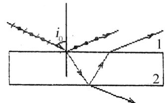

text_image

i₀
1
2

[ ]

## 3．（本题 3 分）3367

当一束自然光以布儒斯特角i 入射到两种介质的分界面（垂直于纸面）上时，画出图中反射光和折射光的光矢量振动方程.

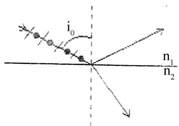

text_image

i₀
n₁
n₂

## 4．（本题 5 分）3236

一束平行的自然光，以 $60^\circ$ 角入射到平玻璃表面上. 若反射光束是完全偏振的，则透射光束的折射角是 ；玻璃的折射率为

## 5.（本题 10 分）3231

将三个偏振光叠放在一起，第二个与第三个的偏振化方向分别与第一个的偏振化方向成 45°和 90°角.

（1）强度为I0的自然光垂直入射到这一块偏振片上，试求经每一偏振片后的光强和偏振状态.  
（2）如果将第二个偏振片抽走，情况又如何？

## 6．（本题 5 分）3645

两个偏振片叠在一起，在它们的偏振化方向成 $\alpha_1=30^\circ$时，观测一束单色自然光. 又在 $\alpha_2=45^\circ$ 时，观测另一束单色自然光. 若两次所测得的透射光强度相等，求两次入射自然光的强度之比.

## 片区 选课号 姓名

## 习题二十四 光的偏振（二）

## 1．（本题 3 分）3246

一束光是自然光和线偏振光的混合光，让它垂直通过一偏振片. 若以此入射光为轴旋转偏振片，测得透射光强度最大值是最小值的 5 倍，那么入射光束中自然光与线偏振光的光强比值为

（A）1/2. （B）1/5. （C）1/3. （D）2/3. [ ]

## 2．（本题 3 分）5330

ABCD 为一块方解解的一个截面，AB为垂直于纸面的晶体平面与纸面的交线. 光轴方向在纸面内且与 $AB$ 成一锐角 $\theta$，如图所示. 一束平行的单色自然光垂直于 AB端面入射. 在方解石内折射光分解为 o光和e光，o 光和 e 光的

（A）传播方向相同，电场强度的振动方向互相垂直.  
（B）传播方向相同，电场强度的振动方向不互相垂直.  
（C）传播方向不同，电场强度的振动方向互相垂直.  
（D）传播方向不同，电场强度的振动方向不互相垂直.

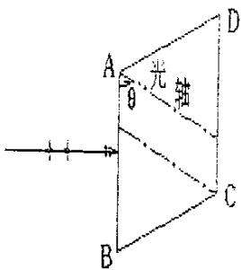

text_image

A
θ
光轴
B
C
D

[ ]

## 3．（本题 3 分）3548

一束自然光通过两个偏振片，若两偏振片的偏振化方向间夹角由 $\alpha _ { 1 }$ 转到 $\alpha _ { 2 }$ ，且不考虑吸收，则转动前后透射光强度之比为

## 4．（本题 3 分）3649

在双折射晶体内部，有某种特定方向称为晶体的光轴. 光在晶体内沿光轴传播时，$o$ 光和 $e$ 光的传播速度相等.

## 5．（本题 3 分）3250

假设某一介质对于空气的临界角是 45°，则光从空气射向此介质时的布儒斯特角是

## 6．（本题 10 分）3776

由两个偏振片（其偏振化方向分别为 $P_1$ 和 $P_2$）叠在一起，$P_1$ 与 $P_2$ 的夹角为 $\alpha$. 一束线偏振光垂直入射在偏振片上. 已知入射光的光矢量振动方向 $\vec{E}$ 与 $P_2$ 的夹角为 $A$（取锐角），$A$ 角保持不变，如图. 现转动 $P_1$，但保持 $P_1$ 与 $\vec{E}$、$P_2$ 的夹角都不超过 $A$（即 $P_1$ 夹在 $\vec{E}$ 和 $P_2$ 之间，见图）. 求 $\alpha$ 等于何值时出射光强为极值；此极值是极大还是极小？

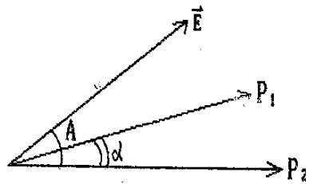

text_image

E
A
α
P₁
P₂

## 7．（本题 5 分）3232

有三个偏振光堆叠在一起，第一块与第三块的偏振化方向相互垂直，第二块和第一块的偏振化方向相互平行，然后第二块偏振片以恒定角速度 $\omega$ 绕光传播的方向旋转，如图所示. 设入射自然光的光强为 $I_0$. 试证明：此自然光通过这一系统后，出射光的光强为 $I=I_0(1-\cos 4\omega t)/16$.

natural_image

Diagram of three circular objects with dashed centerlines and rotation arrow, no text or symbols present

## 片区 选课号 姓名

## 习题二十五 光的干涉（一）

1．（本题 3 分）3611

如图，$S_1$、$S_2$ 是两个相干光源，它们到 $P$ 点的距离分别为 $r_1$ 和 $r_2$. 路径 $S_1P$ 垂直穿过一块厚度为 $t_1$、折射率为 $n_1$ 的介质板，路径 $S_2P$ 垂直穿过厚度为 $t_2$、折射率为 $n_2$ 的另一介质板，其余部分可看作真空，这两条路径的光程差等于

（A） $( r _ { 2 } + n _ { 2 } t _ { 2 } ) - ( r _ { 1 } + n _ { 1 } t _ { 1 } )$  
（B） $[ r _ { 2 } + ( n _ { 2 } - 1 ) t _ { 2 } ] - [ r _ { 1 } + ( n _ { 1 } - 1 ) t _ { 1 } ]$  
（C） $( r _ { 2 } - n _ { 2 } t _ { 2 } ) - ( r _ { 1 } - n _ { 1 } t _ { 1 } )$  
（D） $n _ { 2 } t _ { 2 } - n _ { 1 } t _ { 1 }$

2．（本题 3 分）3162

在真空中波长为 $\lambda$ 的单色光，在折射率为 $n$ 的透明介质中从 $A$ 沿某路径传播到 $B$，若 $A$、$B$ 两点位相差为 $3\pi$，则此路径 $AB$ 的光程为

（A）$1.5\lambda$. （B）$1.5n\lambda$. （C）$3\lambda$. （D）$1.5\lambda/n$. [ ]

3．（本题 3 分）3619

波长为 $\lambda$ 的单色光垂直照射如图所示的透明薄膜. 膜厚度为 $e$，两束反射光的光程差 $\delta=$

text_image

n₁ =1.00
n₂ =1.30
n₃ =1.50

4．（本题 3 分）3378

光强均为 $I_0$ 的两束相干光相遇而发生干涉时，在相遇区域内有可能出现的最大光强是

5．（本题 10 分）3613

在图示的双缝干涉实验中，若用薄玻璃片（折射率 $n_1=1.4$）覆盖缝 $S_1$，用同样厚度的玻璃片（但折射率 $n_2=1.7$）覆盖缝 $S_2$，将使屏上原来未放玻璃时的中央明条纹所在处 $O$ 变为第五级明纹. 设单色光波长 $\lambda=4800\,\mathrm{\AA}$，求玻璃片的厚度 $d$（可认为光线垂直穿过玻璃片）.

text_image

d
S₁ n₁ r₁
d
S₂ n₂ r₂ O

6．（本题 5 分）3181

白色平行光垂直入射到间距为 $a=0.25\,\mathrm{mm}$ 的双缝上，距缝 $50\,\mathrm{cm}$ 处放置屏幕，分别求第一级和第五级明纹彩色带的宽度. （设白光的波长范围是从 $4000\,\mathrm{\AA}$ 到 $7600\,\mathrm{\AA}$）. 这里说的“彩色带宽度”指两个极端波长的同级明纹中心之间的距离.

## 片区 选课号 姓名

## 习题二十六 光的干涉（二）

## 1．（本题 3 分）3498

在双缝干涉实验中，入射光的波长为 $\lambda$，用玻璃纸遮住双缝中的一个缝，若玻璃纸中光程比相同厚度的空气的光程大 $2.5\lambda$，则屏上原来的明纹处

（A）仍为明条纹；

（B）变为暗条纹；

（C）既非明纹也非暗纹；

（D）无法确定是明纹，还是暗纹.

[ ]

## 2．（本题 3 分）3174

在双缝干涉实验中，屏幕 $E$ 上的 $P$ 点处是明条纹. 若将缝 $S_1$ 盖住，并在 $S_1S_2$ 连线的垂直平分面处放一反射镜 $M$，如图所示，则此时

text_image

S
S₁
S₂
M
P
E

（A）P点处仍为明条纹.

（B）不能确定P点处是明条纹还是暗条纹.

（C）P点处为暗条纹.

（D）无干涉条纹.

[ ]

## 3．（本题 3 分）3177

如图，在双缝干涉实验中，若把一厚度为 $e$、折射率为 $n$ 的薄云母片覆盖在 $S_1$ 缝上，中央明条纹将向______移动；覆盖云母片后，两束相干光至原中央明纹 $O$ 处的光程差为______

## 4．（本题 5 分）3167

如图所示，假设有两个同相的相干点光源 $S_1$ 和 $S_2$，发出波长为 $\lambda$ 的光. $A$ 是它们连线的中垂直线上的一点. 若在 $S_1$ 与 $A$ 之间插入厚度为 $e$、折射率为 $n$ 的薄玻璃片，则两光源发出的光在 $A$ 点的位相差 $\Delta\varphi=$______. 若已知 $\lambda=5000\,\mathrm{\AA}$，$n=1.5$，$A$ 点恰为第四级明纹中心，则 $e=$______ $\mathrm{\AA}$.

## 5．（本题 10 分）3658

白光垂直照射到空气中一厚度为 $e=3800\,\mathrm{\AA}$ 的肥皂膜上，肥皂膜的折射率 $n=1.33$，在可见光的范围内（$4000\,\mathrm{\AA}$–$7600\,\mathrm{\AA}$），哪些波长的光在反射中增强？

## 6．（本题 10 分）3182

在双缝干涉实验中，波长 $\lambda=5500\,\mathrm{\AA}$ 的单色平行光垂直入射到缝间距 $a=2\times10^{-4}\,\mathrm{m}$ 的双缝上，屏到双缝的距离 $D=2\,\mathrm{m}$. 求：

（1）中央明纹两侧的两条第10级明纹中心的间距；

（2）用一厚度为 $e = 6 . 6 { \times } 1 0 ^ { - 6 } \mathrm { m }$ 、折射率为 n=1.58 的云母片覆盖一缝后，零级明纹将移到原来的第几级明纹处？

# 片区 选课号 姓名

## 习题二十七 光的干涉（三）

1．（本题 3 分）5208

在玻璃（折射率 $n_3=1.60$）表面镀一层 MgF$_2$（折射率 $n_2=1.38$）薄膜作为增透膜. 为了使波长为 $5000\,\mathrm{\AA}$ 的光从空气（$n_1=1.00$）正入射时尽可能少反射，MgF$_2$ 薄膜的最少厚度应是

（A）$1250\,\mathrm{\AA}$. （B）$1810\,\mathrm{\AA}$. （C）$2500\,\mathrm{\AA}$. （D）$781\,\mathrm{\AA}$. （E）$906\,\mathrm{\AA}$. [ ]

2．（本题 3 分）3508

如图a所示，一光学平板玻璃A与待测工件B之间形成空气劈尖，用波长 $\lambda = 5 0 0 \mathrm { n m }$ $\left( 1 \mathrm { { n m } = 1 0 ^ { - 9 } \mathrm { { m } } } \right)$ ）的单色光垂直照射. 看到的反射光的干涉条纹如图 b所示. 有些条纹弯曲部分的顶点恰好与其右边条纹的直线部分的切线相切. 则工件的上表面缺陷是

（A）不平处为凸起纹，最大高度为 500nm.  
（B）不平处为凸起纹，最大高度为 250nm.  
（C）不平处为凹槽，最大深度为500nm.  
（D）不平处为凹槽，最大深度为 250nm.

3．（本题 3 分）3621

用波长为 $\lambda$ 的单色光垂直照射如图所示的、折射率为 $n_2$ 的劈尖薄膜（$n_1>n_2,\ n_3>n_2$），观测反射光干涉. 从劈尖顶开始，第 2 条明条纹对应的膜厚度为 $e=$

4．（本题 3 分）3511

用波长为 $\lambda$ 的单色光垂直照射到空气劈尖上，从反射光中观察干涉条纹，距顶点为 $L$ 处是暗条纹. 使劈尖角 $\theta$ 连续变大，直到该点处再次出现暗条纹为止. 劈尖角的改变量 $\Delta\theta$ 是

5．（本题 5 分）3707

波长为 $\lambda$ 的单色光垂直照射到折射率为 $n_2$ 的劈尖薄膜上，如图所示，图中 $n_1<n_2<n_3$，观察反射光形成的干涉条纹.

（1）从劈尖顶部 $O$ 开始向右数起，第五条暗纹中心所对应的薄膜厚度 $e_5$ 是多少？  
（2）相邻的二明纹所对应的薄膜厚度之差是多少？

text_image

n₁
λ
n₂
n₃
0

6．（本题 10 分）3349

用波长为 $\lambda=600\,\mathrm{nm}$（$1\,\mathrm{nm}=10^{-9}\,\mathrm{m}$）的光垂直照射由两块平玻璃板构成的空气劈尖薄膜，劈尖角 $\theta=2\times10^{-4}\,\mathrm{rad}$. 改变劈尖角，相邻两明条纹间距缩小了 $\Delta l=1.0\,\mathrm{mm}$，求劈尖角的改变量 $\Delta\theta$.

## 片区 选课号 姓名

## 习题二十八 光的干涉（四）

## 1．（本题 3 分）3507

如图所示，平板玻璃和凸透镜构成牛顿环装置，全部浸入 $n=1.60$ 的液体中，凸透镜可沿 $OO'$ 移动，用波长 $\lambda=500\,\mathrm{nm}$ 的单色光垂直入射. 从上向下观察，看到中心是一个暗斑，此时凸透镜顶点距平板玻璃的距离最少是

（A）78.1nm

（B）74.4nm

（C）156.3nm

（D）148.8nm

（E）0

[ ]

text_image

n = 1.60
n = 1.60
n = 1.58

## 2．（本题 3 分）3185

在图示三种透明材料构成的牛顿环装置中，用单色光垂直照射，在反射光中看到干涉条纹，则在接触点 P处形成的圆斑为

（A）全明.

（B）全暗.

（C）右半部明，左半部暗.

（D）右半部暗，左半部明.

[ ]

  
（图中数字为各处的折射率）

## 3．（本题 3 分）3201

若在迈克耳孙干涉仪的可动反射镜 $M$ 移动 $0.620\,\mathrm{nm}$ 的过程中，观察到干涉条纹移动了 2300 条，则所用光波的波长为______ $\mathrm{\AA}$.

## 4．（本题 3 分）3517

在迈克耳孙干涉仪的一支光路上，垂直于光路放入折射率为 n、厚度为h的透明介质薄膜. 与未放入此薄膜时相比较，两光束光程差的改变量为

## 5．（本题 10 分）3197

在如图所示的牛顿环装置中，把玻璃平凸透镜和平面玻璃（设玻璃折射率 $n_1=1.50$）之间的空气（$n_2=1.00$）改换成水（$n_2'=1.33$），求第 $k$ 个暗环半径的相对改变量 $(r_k-r_k')/r_k$.

## 6．（本题 10 分）5211

一平凸透镜放在一平晶上，以波长 $\lambda=5893\,\mathrm{\AA}$ 的单色光垂直照射于其上，测量反射光的牛顿环. 测得从中央数起第 $k$ 个暗环的弦长为 $l_k=3.00\,\mathrm{mm}$，第（$k+5$）个暗环的弦长为 $l_{k+5}=4.6\,\mathrm{mm}$，如图所示. 求平凸透镜的球面的曲率半径 $R$.

text_image

第(K+5)循环
第k个循环
0
r_{k+5}
d
r_k
l_k
l_{k+5}

## 片区 选课号 姓名

## 习题二十九 光的衍射（一）

## 1．（本题 3 分）3353

在单缝夫琅和费衍射实验中，波长为 $\lambda$ 的单色光垂直入射在宽度为 $a=4\lambda$ 的单缝上，对应于衍射角为 $30^\circ$ 的方向，单缝处波阵面可分成的半波带数目为

（A）2 个.

（B）4 个.

（C）6 个.

（D）8 个.

[ ]

## 2．（本题 3 分）3520

根据惠更斯-菲涅耳原理，若已知光在某时刻的波阵面为 S，则S的前方某点P的光强度决定于波阵面 S上所有面积元发出的子波各自传到 P点的

（A）振动振幅之和.

（B）光强之和.

（C）振动振幅之和的平方.

（D）振动的相干叠加.

[ ]

## 3．（本题 5 分）3207

在单缝的夫琅和费衍射实验中，屏上第三级暗纹对应的单缝处波面可划分为______个半波带，若将缝宽缩小一半，原来第三级暗纹处将是______纹。

## 4．（本题 3 分）3524

平行单色光垂直入射在缝宽为 $a=0.15\,\mathrm{mm}$ 的单缝上. 缝后有焦距为 $f=400\,\mathrm{mm}$ 的凸透镜，在其焦平面上放置观察屏幕. 现测得屏幕上中央明条纹两侧的两个第三级暗纹之间的距离为 $8\,\mathrm{mm}$，则入射光的波长为 $\lambda=$______

## 5．（本题 5 分）3743

如图所示，设波长为 $\lambda$ 的平面波沿与单缝平面法线成 $\theta$ 角的方向入射，单缝 $AB$ 的宽度为 $a$，观察夫琅和费衍射. 试求出各极小值（即各暗条纹）的衍射角 $\Phi$.

text_image

λ
θ
A
φ
B

## 6．（本题 5 分）3359

波长为 $\lambda=600\,\mathrm{nm}$（$1\,\mathrm{nm}=10^{-9}\,\mathrm{m}$）的单色光垂直入射到宽度为 $a=0.10\,\mathrm{mm}$ 的单缝上，观察夫琅和费衍射图样，透镜焦距 $f=1.0\,\mathrm{m}$，屏在透镜的焦平面处. 求：

（1）中央衍射明条纹的宽度 $\Delta x _ { 0 }$ ；  
（2）第二级暗纹离透镜焦点的距离 $x_2$.

## 片区 选课号 姓名

## 习题三十 光的衍射（二）

1．（本题 3 分）5649

在如图所示的夫琅和费衍射装置中，将单缝宽度 a稍稍变窄，同时使会聚透镜 L 沿y轴正方向作微小位移，则屏幕C 上的中央衍射条纹将

text_image

λ
a
y
O
x
L
C
f

（A）变宽，同时向上移动.  
（B）变宽，同时向下移动.  
（C）变宽，不移动.  
（D）变窄，同时向上移动.  
（E）变窄，不移动. [ ]

2．（本题 3 分）3212

一束平行单色光垂直入射在光栅上，当光栅常数（a+b）为下列哪种情况时（a代表每条缝的宽度），k=3、6、9等级次的主极大均不出现？

（A） $\mathrm { a } + \mathrm { b } { = } 2 \mathrm { a } .$

（B）a+b=3a.

（C）a+b=4a.

（D） $\mathrm { a + b } { = } 6 \mathrm { a } .$

[ ]

3．（本题 3 分）5219

波长为 $\lambda=4800\,\mathrm{\AA}$ 的平行光垂直照射到宽度为 $a=0.40\,\mathrm{mm}$ 的单缝上，单缝后透镜的焦距为 $f=60\,\mathrm{cm}$，当单缝两边缘点 $A$、$B$ 射向 $P$ 点的两条光线在 $P$ 点的相位差为 $\pi$ 时，$P$ 点离透镜焦点 $O$ 的距离等于

text_image

A
L
θ
λ
θ
B
f
P
O

4．（本题 3 分）3362

某单色光垂直入射到一个每毫米有 800条刻线的光栅上，如果第一级谱线的衍射角为30°，则入射光的波长应为

5．（本题 10 分）5535

波长范围在 $450$–$650\,\mathrm{nm}$ 之间的复色平行光垂直照射在每厘米有 5000 条刻线的光栅上，屏幕放在透镜的焦面处，屏上第二级光谱各色光在屏上所占范围的宽度为 $35.1\,\mathrm{cm}$. 求透镜的焦距 $f$.

$$
(1 \mathrm{nm} = 1 0 ^ {- 9} \mathrm{m})
$$

6．（本题 10 分）3531

将一束波长 $\lambda=5890\,\mathrm{\AA}$ 的平行钠光垂直入射在 1 厘米有 5000 条刻痕的平面衍射光栅上，光栅的透光缝宽度 $a$ 与其间距 $b$ 相等，求：

（1）光线垂直入射时，能看到几条谱线？是哪几级？

（2）若光线以与光栅平面法线的夹角 $\theta=30^\circ$ 的方向入射时，能看到几条谱线？是哪几级？

## 片区 选课号 姓名

## 习题三一 光的衍射（三）

1．（本题 3 分）3636

波长 $\lambda=5500\,\mathrm{\AA}$ 的单色光垂直入射于光栅常数 $d=2\times10^{-4}\,\mathrm{cm}$ 的平面衍射光栅上，可能观察到的光谱线的最大级次为

（A）2.

（B）3.

（C）4.

（D）5.

[ ]

2．（本题 3 分）5534

设光栅平面、透镜均与屏幕平行. 则当入射的平行单色光从垂直于光栅平面入射变为斜入射时，能观察到的光谱线的最高级数 $k$

（A）变小.

（B）变大.

（C）不变.

（D）的改变无法确定. [ ]

3．（本题 3 分）3638

波长为 $5000\,\mathrm{\AA}$ 的单色光垂直入射到光栅常数为 $1.0\times10^{-4}\,\mathrm{cm}$ 的平面衍射光栅上，第一级衍射主极大所对应的衍射角 $\varphi=$______

4．（本题 5 分）3217

一束单色光垂直入射在光栅上，衍射光谱中共出现 5 条明纹. 若已知此光栅缝宽度与不透明部分宽度相等，那么在中央明纹一侧的两条明纹分别是第______级和第______级谱线.

5．（本题 10 分）3211

（1）在单缝夫琅和费衍射实验中，垂直入射的光有两种波长，$\lambda_1=4000\,\mathrm{\AA}$，$\lambda_2=7600\,\mathrm{\AA}$. 已知单缝宽度 $a=1.0\times10^{-2}\,\mathrm{cm}$，透镜焦距 $f=50\,\mathrm{cm}$. 求两种光第一级衍射明纹中心之间的距离.  
（2）若用光栅常数 $d=1.0\times10^{-3}\,\mathrm{cm}$ 的光栅替换单缝，其他条件和上一问相同，求两种光第一级主极大之间的距离.

6．（本题 10 分）3221

一束平行光垂直入射到某个光栅上，该光束有两种波长的光，$\lambda_1=4400\,\mathrm{\AA}$，$\lambda_2=6600\,\mathrm{\AA}$. 实验发现，两种波长的谱线（不计中央明纹）第二次重合于衍射角 $\Phi=60^\circ$ 的方向上. 求此光栅的光栅常数 $d$.

