2．如图所示，圆锥摆的摆球质量为 m，速率为v，圆半径为R，当摆球在轨道上运动半周时，摆球所受重力冲量的大小为

（A） 2 . mv  
（B） $\sqrt { \left( 2 m \nu \right) ^ { 2 } + \left( m g \pi R / \nu \right) ^ { 2 } } .$  
（C） Rmg v/ .  
（D）0.

[ ]

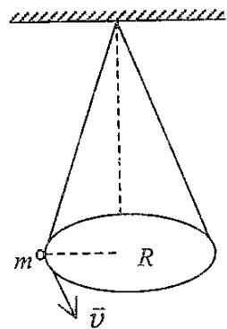

text_image

m
R
v̄

3．（本题 5 分）0371

一颗子弹在枪筒里前进时所受的合力大小为

$$
F = 4 0 0 - \frac {4 \times 1 0 ^ {5}}{3} t \tag {SI}
$$

子弹从枪口射出时的速率为 $3 0 0 m \cdot s ^ { - 1 }$ . 假设子弹离开枪口时合力刚好为零，则

（1）子弹走完枪筒全长所用的时间 $t=$  
（2）子弹在枪筒中所受力的冲量 $I=$ ，  
（3）子弹的质量 $m=$

4．一质量为 m的物体，以初速 $\vec { \nu } _ { 0 } \mathcal { N }$ 地面抛出，抛射角 $\mid \theta = 3 0 ^ { \circ }$ ，如忽略空气阻力，

则从抛出到刚要接触地面的过程中

（1）物体动量增量的大小为  
（2）物体动量增量的方向为

5．（本题 5 分）0395

质量为M的木块在光滑的固定斜面上，由 A 点从静止开始下滑，当经过路程 l 运动到 B 点时，木块被一颗水平飞来的子弹射中，子弹立即陷入木块内. 设子弹的质量为 m，速度为v，求子弹射中木块后，子弹与木块的共同速度.

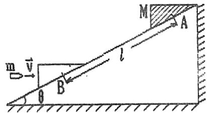

text_image

m
v
θ
B
l
M
A

6．质量为 M 半径为 R 的 1/4 圆周的光滑弧形滑块，静止在光滑桌面上，今有质量为m的物体由弧的上端A点静止滑下，试求当 m滑到最低点B时，

（1）m相对于M的速度 v及M对地的速度 V；  
（2）M对m的作用力 N.

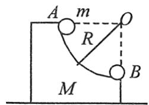

## 片区 选课号 姓名

## 习题十 角动量守恒（一）

1．（本题 3 分）0193

一人造地球卫星到地球中心的最大距离和最小距离分别是 $R _ { A }$ 和 $R _ { B } ,$ ，设卫星对应的角动量分别是 $L _ { A } , \ L _ { B } ,$ ，动能分别是 $E _ { K A } , ~ E _ { K B } ,$ ，则应有

（A） $L _ { \scriptscriptstyle B } > L _ { \scriptscriptstyle A } , E _ { \scriptscriptstyle K B } > E _ { \scriptscriptstyle K A } .$

（B） $L _ { \scriptscriptstyle B } > L _ { \scriptscriptstyle A } , E _ { \scriptscriptstyle K B } = E _ { \scriptscriptstyle K A } .$

（C） $L _ { \scriptscriptstyle B } = L _ { \scriptscriptstyle A } , E _ { \scriptscriptstyle K B } = E _ { \scriptscriptstyle K A } .$

（D） $L _ { \scriptscriptstyle B } < L _ { \scriptscriptstyle A } , E _ { \scriptscriptstyle K B } = E _ { \scriptscriptstyle K A }$

（E） $L _ { \scriptscriptstyle B } = L _ { \scriptscriptstyle A } , E _ { \scriptscriptstyle K B } > E _ { \scriptscriptstyle K A } .$

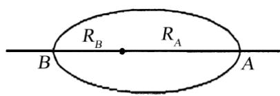

2．（本题 3 分）0172

一力学系统由两个质点组成，它们之间只有引力作用. 若两质点所受外力的矢量和为零，则此系统

（A）动量、机械能以及对一轴的角动量都守恒.  
（B）动量、机械能守恒，但角动量是否守恒不能断定.  
（C）动量守恒，但机械能和角动量守恒与否不能断定.  
（D）动量和角动量守恒，但机械能是否守恒不能断定. [ ]

3．（本题 3 分）5638

质量为 m 的质点以速度v沿一直线运动，则它对直线外垂直距离为 d的一点角动量大小是

4．（本题 3 分）0404

地球的质量为 m，太阳的质量为 M，地心与日心的距离为 R，引力常数为 G，则地球绕太阳作圆周运动的轨道角动量为 L=

5．（本题 5 分）0724

一质量为 m 的质点沿着一条空间曲线运动，该曲线在直角坐标系下的定义式为$\vec{r}=a\cos(\omega t)\vec{i}+b\sin(\omega t)\vec{j}$ ，其中 a、b、 皆为常数，则此质点所受的对原点的力矩$\overset { \vartriangle } { M }$ = ；该质点对原点的角动量L=

6．（本题 5 分）0320

在一光滑水平面上，有一轻弹簧，一端固定，一端连接一质量 $m = 1 \mathrm { k g }$ 的滑块，如图所示. 弹簧自然长度 $l _ { 0 } = 0 . 2 \mathrm { m }$ ，倔强系数 $k = 1 0 0 N \cdot m ^ { - 1 } \nmid _ { \mathbb { X } } ^ { \mathcal { n } } t = 0 \not \parallel \tilde { \cdot } \mathrm { ~ J ~ }$ ，弹簧长度为 $l _ { 0 } ,$ 滑块速度 $\nu _ { 0 } = 5 m \cdot s ^ { - 1 }$ ，方向与弹簧垂直. 在某一时刻，弹簧位于与初始位置垂直的位置，长度 $l = 0 . 5 m .$ 求该时刻滑块速度v的大小和方向.

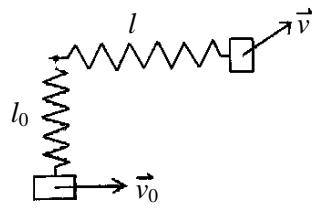

text_image

l
l₀
v
v₀

7．小球 A，自地球的北极点以速度 $\vec { \nu } _ { 0 } \mathrm { ~ . ~ }$ 在质量为 M、半径为 R 的地球表面水平切向向右飞出，如图所示，地心参考系中轴 OO’与v 平行，小球 A 的运动轨道与轴 OO’相交于距 O 为 3R 的 C 点．不考虑空气阻力，求小球 A 在 C 点的速度莎v与 $\vec { \nu } _ { 0 }$ 之间的夹角 .

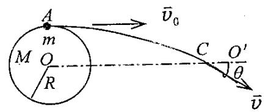

text_image

A
m
M O
R
C O'
θ
v̄₀
v̄

## 片区 选课号 姓名

## 习题十一 角动量守恒（二）

1．（本题 3 分）0289

关于刚体对轴的转动惯量，下列说法中正确的是

（A）只取决于刚体的质量，与质量的空间分布和轴的位置无关。  
（B）取决于刚体的质量和质量的空间分布，与轴的位置无关。  
（C）取决于刚体的质量、质量的空阂分布和轴的位置  
（D）只取决于转轴的位置，与刚体的质量和质量的空间分布无关。

[ ]

2．如图所示，A B为两个相同的绕着轻绳的定滑轮．A滑轮挂一质量为M的物体，B 滑轮受拉力 F，而且 $F { \mathrm { = M g . } }$ 设 A、B 两滑轮的角加速度分别为 $\beta _ { \scriptscriptstyle A }$ 和 $\beta _ { { } _ { B } }$ ，不计滑轮轴的摩擦，则有

（A） $\beta _ { { } _ { A } } = \beta _ { { } _ { B } }$

（B） $\beta _ { A } > \beta _ { B } .$

（C） $\beta _ { { } _ { A } } < \beta _ { { } _ { B } }$

（D）开始时 $\beta _ { { } _ { A } } = \beta _ { { } _ { B } }$ ，以后 $\beta _ { { } _ { A } } < \beta _ { { } _ { B } }$ .

[ ]

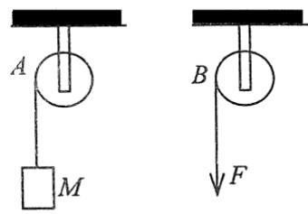

text_image

A
M
B
F

3．一定滑轮质量为 M、半径为 R，对水平轴的转动惯量 $\displaystyle { \mathrm { : } J = \frac { 1 } { 2 } M R ^ { 2 } }$ . 在滑轮的边缘2绕一细绳，绳的下端挂一物体. 绳的质量可以忽略且不能伸长，滑轮与轴承间无摩擦. 物体下落的加速度为 a，则绳中的张力T=

4．（本题 3 分）0240

一飞轮以 600rev/min 的转速旋转，转动惯量为 $2 . 5 \mathrm { k g } \cdot \mathrm { m } ^ { 2 } ,$ ，现加一恒定的制动车矩使飞轮在 1s 内停止转动，则该恒定制动力矩的大小 M=

5．（本题 5 分）0783

一质量 $\mathrm { m { = } 6 . 0 0 k g . ~ k { = } 1 . 0 0 m }$ 的匀质棒，放在水平桌面上，可绕通过其中心的竖直固定轴转动，对轴的转动惯量 $J { = } m l ^ { 2 } / 1 2 . ~ t { = } 0$ 时棒的角速度 $\omega _ { \mathrm { 0 } } = 1 0 . 0 \mathrm { r a d { \cdot } s ^ { - 1 } }$ . 由于受到恒定的阻力矩的作用，$t=20\,\mathrm{s}$ 时，棒停止运动. 求：

（1）棒的角加速度的大小；  
（2）棒所受阻力矩的大小；  
（3）从 $t=0$ 到 $t=10\,\mathrm{s}$ 时间内棒转过的角度.

6．质量为 $M _ { \mathrm { 1 } } = 2 4 \mathrm { k g }$ 的圆轮，可绕水平光滑固定轴转动，一轻绳绕于轮上，另一端通过质量为 $M _ { 2 } { = } 5 \mathrm { k g }$ 的圆盘形定滑轮悬有 $m { = } 1 0 \mathrm { k g }$ 的物体. 求当重物由静止开始下降了$h { = } 0 . 5 \mathrm { m }$ 时，

（1）物体的速度；

（2）绳中张力.

（设绳与定滑轮间无相对滑动，圆轮、定滑轮绕通过轮心且垂直于横截面的水平光$J _ { _ { 1 } } = \frac { 1 } { 2 } .$ 2 1 , M R $J _ { { } _ { 2 } } = \frac { 1 } { 2 } M _ { { } _ { 2 } } r ^ { 2 } )$ ）

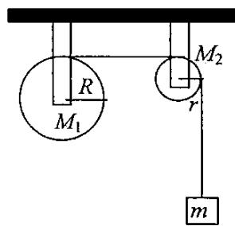

text_image

R
M₁
M₂
r
m

## 片区 选课号 姓名

$m { = } 0 . 0 1 \mathrm { k g } , $ 、速率为 $\nu = 4 0 0 \mathrm { m / s }$ 的子弹并嵌入杆内，则杆的角速度为 =

## 习题十二 角动量守恒（三）

1．（本题 3 分）0294

刚体角动量守恒的充分而必要的条件是

（A）刚体不受外力矩的作用.  
（B）刚体所受合外力矩为零.  
（C）刚体所受的合外力和合外力矩均为零.  
（D）刚体的转动惯量和角速度均保持不变. [ ]

2．如图所示，一静止的均匀细棒，长为L、质量为 M，可绕通过棒的端点且垂直于棒长的光滑固定轴 O 在水平面内转动，转动惯量为 $\frac { 1 } { 3 } M L ^ { 2 } .$ . 一质量为 m、速率为 v 的子弹在水平面内沿与棒垂直的方向射出并穿出棒的自由端，设穿过棒后子弹的速率为 $u=\frac{1}{2}\nu$ 则此时棒的角速度应为

（A） $\frac { m \nu } { M L }$

（B） $\frac { 3 m \nu } { 2 M L }$

（C） ${ \frac { 5 m \nu } { 3 M L } } .$

（D） $\frac { 7 m \nu } { 4 M L }$

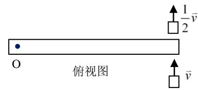

text_image

俯视图
O
↑ 1/2 v̅
↑ v̅

3．（本题 3 分）0681

两个质量都为 100kg 的人，站在一质量为 $2 0 0 \mathrm { k g } ,$ 、半径为 3m 的水平转台的直径两端．转台的固定转轴通过其中心且垂直于台面．初始时，转台每 5s 转一圈．当这两人以相同的快慢走到转台的中心时，转台的角速度 $\omega =$ . （已知转台对转轴的转动惯量 $J = { \frac { 1 } { 2 } } M R ^ { 2 }$ ，计算时忽略转台在转轴处的摩擦）.

4．（本题 3 分）0125

一飞轮以角速度 $\omega _ { 0 }$ 绕轴旋转，飞轮对轴的转动惯量为 $J _ { 1 } ;$ ；另一静止飞轮突然被啮合到同一个轴上，该飞轮对轴的转动惯量为前者的二倍. 啮合后整个系统的角速度=

5．一杆长 l=50cm，可绕通过其上端的水平光滑固定轴 O在竖直平面内转动，相对于O 轴的转动惯量 $J = 5\,\mathrm{kg\cdot m^2}$ . 原来杆静止并自然下垂. 若在杆的下端水平射入质量

## 片区 选课号 姓名

## 习题十三 振动（一）

1．一质点沿 x轴作简谐振动，振动方程为

$$
x = 4 \times 1 0 ^ {- 2} \cos (2 \pi t + \frac {1}{3} \pi) \tag {SI}
$$

从$t=0$ 时刻起，到质点位置在 $x = - 2 \mathrm { c m }$ 处，且向 x轴正方向运动的最短时间间隔为

（A）1 / 8 .s

（B） $1 / 4 s .$

（C）1 / 2 .s

（D） $1 / 3 s .$

（E）1 / 6 .s

[ ]

2．一简谐振动曲线如图所示，则振动周期是

（A）2.62s.

（B）2.40s.

（C）0.42s.

（D）0.382s.

[ ]

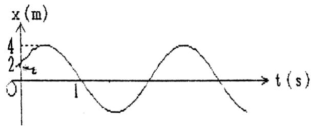

line chart

| t (s) | x (m) |
|-------|-------|
| 0     | 0     |
| 2     | 4     |
| 1     | 0     |
| >1    | <4    |

3．一物体作简谐振动，其振动方程为

$$
x = 0. 0 4 \cos (5 \pi t / 3 - \frac {1}{2} \pi) \tag {SI}
$$

（1）此简谐振动的周期T= ，

（2）当 t=0.6s 时物体的速度 v=

4． 一 简 谐 振 动 曲 线 如 图 所 示 ， 试 由 图 确 定 在 t =2 秒 时 刻 质 点 的 位 移为 ，速度为

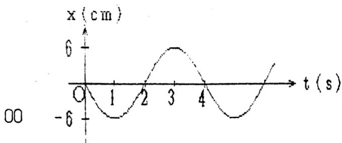

line chart

| t (s) | x (cm) |
|-------|--------|
| 0     | 0      |
| 1     | -6     |
| 2     | 0      |
| 3     | 6      |
| 4     | 0      |

5．一物体作简谐振动，其速度最大值 $\nu _ { m } = 3 { \times } 1 0 ^ { - 2 } \mathrm { m / s }$ ，其振幅 $A = 2 { \times } 1 0 ^ { - 2 } \mathrm { m }$ . 若 t=0时，物体位于平衡位置且向 x 轴的负方向运动. 求：

（1）振动周期T；  
（2）加速度的最大值 $a _ { m } ;$  
（3）振动方程的数值式.

6．一轻弹簧在 60N 的拉力下伸长 30cm. 现把质量为 4kg的物体悬挂在该弹簧的下端并使之静止，再把物体向下拉10cm，然后由静止释放并开始计时. 求

（1）物体的振动方程，  
（2）物体在平衡位置上方5cm 时弹簧对物体的拉力，  
（3）物体从第一次越过平衡位置时刻起到它运动到上方 5cm 处所需要的最短时间.

# 片区 选课号 姓名

## 习题十四 振动（二）

1．一质点在x轴上作简谐振动，振幅 A=4cm，周期 T=2s，其平衡位置取作坐标原点. 若 t=0 时刻质点第一次通过 $x = - 2 \mathrm { c m }$ 处，且向 x 轴负方向运动，则质点第二次通过$x = - 2 \mathrm { c m }$ 处的时刻为

（A）1s.

（B）(2/3)s.

（C）(4/3)s.

（D）2s.

[ ]

2．弹簧振子在光滑水平面上作简谐振动时，弹性力在半个周期内所作的功为

（A） $k A ^ { 2 }$

（B） ${ \frac { 1 } { 2 } } k A ^ { 2 } .$ .

（C） $( 1 / 4 ) k A ^ { 2 }$ .

（D）0.

[ ]

3．一质点作简谐振动，速度最大值 $U _ { _ { m } } = 5 \mathrm { c m / s } ,$ , 振幅 $\mathbf { A } = 2 \mathbf { c m }$ . 若令速度具有正最大值的那一时刻为t =0，则振动表达式为

4．一简谐振动用余弦函数表示，其振动曲线如图所示，则此简谐振动的三个特征量为 A= ； = ； =

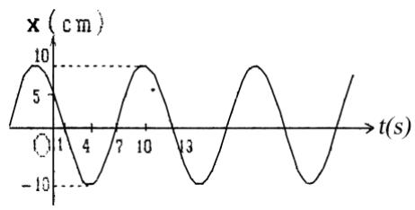

line chart

| t(s) | x (cm) |
|------|--------|
| 0    | 5      |
| 4    | -10    |
| 7    | 5      |
| 10   | 10     |
| 13   | -10    |

5．如图，有一水平弹簧振子，弹簧的倔强系数 $k = 2 4 N / m$ ，重物的质量 $m = 6 k g$ ，重物静止在平衡位置上. 设以一水平恒力 $F = 1 0 N$ 向左作用于物体（不计摩擦），使之由平衡位置向左运动了0.05m，此时撤去力 F. 当重物运动到左方最远位置时开始计时，求物体的运动方程.

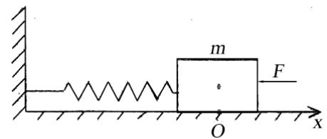

text_image

m
F
O
x

6．（本题 10 分）0321

一定滑轮的半径为 R，转动惯量为 J，绳的一端系一质量为 m的物体，另一端与一固定的轻弹簧相连，如图所示. 设弹簧的倔强系数为k，绳与滑轮间无滑动，且忽略轴的摩擦力及空气阻力. 现将物体 m 从平衡位置拉下一微小距离后放手，证明物体作简谐振动，并求出其角频率.

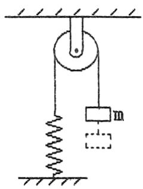

text_image

Diagram of a mechanical system with a mass suspended by a spring and connected to a fixed support, showing equilibrium position.

## 片区 选课号 姓名

## 习题十五 振动（三）

1．一质点作简谐振动。其运动速度与时间的曲线如图所示. 若质点的振动规律用余弦函数描述. 则其初位相应为

（A） / 6 .

（B） 5 / 6  .

（C） -5 / 6  .

（D） - / 6 .

（E） -2 / 3.

[ ]

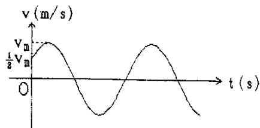

line chart

| t (s) | v (m/s) |
|-------|---------|
| 0     | 0       |
| 300   | 0.5     |
| 600   | -0.5    |
| 900   | 0.5     |

2．图中所画的是两个简谐振动的振动曲线. 若这两个简谐振动可叠加，则合成的余弦振动的初相为

（A） ${ \frac { 1 } { 2 } } \pi .$

（B） .

（C） $\frac { 3 } { 2 } \pi$ .

（D）0.

[ ]

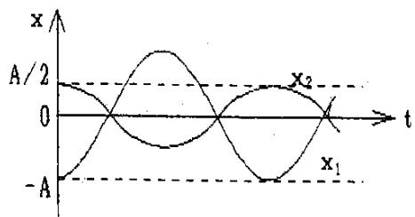

line chart

| t    | x1   | x2   |
| ---- | ---- | ---- |
| 0    | -A   | 0    |
| 0.5  | 0    | 2    |
| 1    | -A   | 0    |
| 1.5  | 0    | -2   |
| 2    | -A   | 0    |

3．一物体同时参与同一直线上的两个简谐振动：

$$
x _ {1} = 0. 0 5 \cos (4 \pi t + \frac {1}{3} \pi) \tag {SI}
$$

$$
x _ {2} = 0. 0 3 \cos (4 \pi t - 2 \pi / 3) \tag {SI}
$$

合成振动的振幅为 m.

4．一质点同时参与了三个简谐振动，它们的振动方程分别为

$$
x _ {1} = A \cos (\omega t + \pi / 3)
$$

$$
x _ {2} = A \cos (\omega t + 5 \pi / 3)
$$

$$
x _ {3} = A \cos (\omega t + \pi)
$$

其合成运动的运动方程为x=

5．一个轻弹簧在 60N 的拉力作用下可伸长 30cm. 现将一物体悬挂在弹簧的下端并在它上面放一小物体，它们的总质量为 4kg. 待其静止后再把物体向下拉10cm，然后释放，问：

（1）此小物体是停在振动物体上面还是离开它？

（2）如果使放在振动物体上的小物体与振动物体分离，则振幅 A 需满足何条件？二者在何位置开始分离？

6．两个同方向简谐振动的振动方程分别为

$$
x _ {1} = 5 \times 1 0 ^ {- 2} \cos (1 0 t + 3 \pi / 4) \tag {SI}
$$

$$
x _ {2} = 6 \times 1 0 ^ {- 2} \cos (1 0 t + \pi / 4) \tag {SI}
$$

求合振动方程.

## 片区 选课号 姓名

## 习题十六 相对论（一）

1．（本题 3 分）5613

关于同时性有人提出以下一些结论，其中哪个是正确的?

（A）在一惯性系同时发生的两个事件，在另一惯性系一定不同时发生.  
（B）在一惯性系不同地点同时发生的两个事件，在另一惯性系一定同时发生.  
（C）在一惯性系同一地点同时发生的两个事件，在另一惯性系一定同时发生.  
（D）在一惯性系不同地点不同时发生的两个事件，在另一惯性系一定不同时发生.

[ ]

2．（本题 3 分）4184

在狭义相对论中，下列说法中哪些是正确的?

（1）一切运动物体相对于观察者的速度都不能大于真空中的光速  
（2）质量、长度、时间的测量结果都是随物体与观察者的相对运动状态而改变的  
（3）在一惯性系中发生于同一时刻，不同地点的两个事件在其他一切惯性系中也是同时发生的.  
（4）惯性系中的观察者观察一个与他作匀速相对运动的时钟时，会看到这时钟比与他相对静止的相同的时钟走得慢些

（A）（1），（3），（4）.  
（B）（1），（2），（4）.  
（C）（1），（2），（3）.  
（D）（2），（3），（4）.

[ ]

3．（本题 3 分）4362

静止时边长为 50cm 的立方体，当它沿着与它的一个棱边平行的方向相对于地面以匀速度 $2 . 4 \times 1 0 ^ { 8 } m \cdot s ^ { - 1 }$ 运动时，在地面上测得它的体积是

4．（本题 3 分）5616

一列高速火车以速度 u驶过车站时，停在站台上的观察者观察到固定在站台上相距1m 的两只机械手在车厢上同时划出两个痕迹，则车厢上的观察者应测出这两个痕迹之间的距离为

5．（本题 10 分）5359

