观测者甲和乙分别静止于两个惯性参照系 K 和K’中，甲测得在同一地点发生的两个事件的时间间隔为4s，而乙测得这两个事件的时间间隔为 5s，求：

（1）K’相对于K 的运动速度.  
（2）乙测得这两个事件发生的地点的距离.

6．（本题 5 分）5358

观测者甲和乙分别静止于两个惯性系K和K’(K’系相对于K 作平行于X轴的匀速运动)中．甲测得在 X 轴上两点发生的两个事件的空间间隔和时间间隔分别为 500m 和72 10 s ，而乙测得这两个事件是同时发生的. 问：K’系相对于K 系以多大速度运动?

# 片区 选课号 姓名

## 习题十七 相对论（二）

1．（本题 3 分）4724

粒子在加速器中被加速，当其质量为静止质量的 3倍时，其动能为静止能量的

（A）2 倍.

（B）3 倍.

（C）4 倍.

（D）5 倍.

[ ]

2．（本题 3 分）4725

把一个静止质量为 m0的粒子，由静止加速到v c0.6 （c 为真空中光速）需作的功等于

（A）0.18 ${ \mathrm { m o c } } ^ { 2 } .$

（B） $0 . 2 5 { \mathrm { ~ m o c } } ^ { 2 } .$

（C） $0 . 3 6 \mathrm { m o } ^ { 2 } .$

（D） $1 { , } 2 5 \mathrm { m o c } ^ { 2 } .$

[ ]

3．（本题 3 分）4167

子是一种基本粒子，在相对于 子静止的坐标系中测得其寿命为 $\tau _ { 0 } = 2 \times 1 0 ^ { - 6 } s$ . 如果 子相对于地球的速度为v c0.988 （c为真空中光速），则在地球坐标系中测出的 子的寿命 

4．（本题 5 分）4734

匀质细棒静止时的质量为 $m _ { 0 } ,$ ，长度为l0，当它沿棒长方向作高速的匀速直线运动时，测得它的长为 l，那么，该棒的运动速度 v= ，该棒所具有的动能$E _ { k }$ 

5．（本题 3 分）8015

下列几种说法：

（1）所有惯性系对物体基本规律都是等价的.

（2）在真空中，光的速度与光的频率、光源的运动状态无关.

（3）在任何惯性系中，光在真空中沿任何方向的传播速度都相同.其中哪些说法是正确的？

（A）只有（1）、（2）是正确的.

（B）只有（1）、（3）是正确的.

（C）只有（2）、（3）是正确的.

（D）三种说法都是正确的.

5．（本题 5 分）4170

一体积为v0，质量为m0的立方体沿其一棱的方向相对于观察者A以速度v运动. 求：观察者A测得其密度是多少？

6．（本题 5 分）4603

某一宇宙射线中的介子的动能 $E _ { k } = 7 M _ { 0 } c ^ { 2 } ;$ ，其中 $M _ { 0 }$ 是介子的静止质量. 试求在实验室中观察到它的寿命是它的固有寿命的多少倍.

# 片区 选课号 姓名

## 习题十八 相对论（三）

1．本题（3 分）4173

设某微观粒子的总能量是它的静止能量的 K 倍，则其运动速度的大小为（以 c表示真空中的光速）

（A） ${ \frac { c } { K - 1 } } .$

（B） $\frac { c } { K } \sqrt { 1 - K ^ { 2 } } .$ .

（C） $\frac { c } { K } \sqrt { K ^ { 2 } - 1 } .$

（D） $\frac { c } { K + 1 } \sqrt { K ( K + 2 ) } .$

[ ]

2．（本题 3 分）4376

在参照 S 中，有两个静止质量都是m0的粒子A 和B，分别以速度 v 沿同一直线相向运动，相碰后合在一起成为一个粒子，则其静止质量 M0的值为

（A） $2 m _ { 0 } .$

（B） $2 m _ { \mathrm { 0 } } { \sqrt { 1 - \left( \nu / c \right) ^ { 2 } } } .$

（C） $\frac { m _ { 0 } } { 2 } \sqrt { 1 - \left( \nu / c \right) ^ { 2 } }$ .

（D） $\frac { 2 m _ { 0 } } { \sqrt { 1 - \left( \nu / c \right) ^ { 2 } } }$ 2  m .（c表示真空中光速）

[ ]

3．（本题 3 分）4172

一宇宙飞船相对地球以 0.8c（c表示真空中光速）的速度飞行. 一光脉冲从船尾传到船头. 飞船上的观察者测得飞船长为 90m，地球上的观察者测得光脉冲从船尾发出和到达船头两个事件的空间间隔为

（A）90m.

（B）54m.

（C） $2 7 0 \mathrm { m } .$

（D） $1 5 0 \mathrm { m } .$

[ ]

4．（本题 3 分）4171

两个惯性系中的观察者O和O’以 0.6c（c表示真空中光速）的相对速度互相接近. 如果 O 测得两者的初始距离是 20m. 则 O’测得两者经过时间 t s 后相遇.

5．（本题 5 分）5230

要使电子的速度从 $\nu _ { 1 } = 1 . 2 { \times } 1 0 ^ { 8 } \mathrm { m } / \mathrm { s }$ 增加到 $\nu _ { 2 } = 2 . 4 { \times } 1 0 ^ { 8 } \mathrm { m } / \mathrm { s }$ 必须对它作多少功？

（电子静止质量 $m _ { e } = 9 . 1 1 \times 1 0 ^ { - 3 1 } \mathrm { k g } ~ $ ）

6．（本题 5 分）4245

由于相对论效应，如果粒子的能量增加，粒子在磁场中的回旋周期将随能量的增加而增大，计算动能为104Mev的质子在磁感应强度为1T的磁场中的回旋周期.

（质子的静止质量为 $1 . 6 7 \times 1 0 ^ { - 2 7 }$ kg, $\mathrm { l e v } = 1 . 6 { \times } 1 0 ^ { - 1 8 } J \ )$ ）

## 片区 选课号 姓名

## 习题十九 波动（一）

1．一沿 x轴负方向传播的平面简谐波在t s2 时的波形曲线如图所示，则原点O的振动方程为

（A） $y = 0 . 5 0 \cos ( \pi t + \frac { \pi } { 2 } ) ,$

(SI).

（B） $y = 0 . 5 0 \cos ( \frac { \pi } { 2 } t - \frac { \pi } { 2 } ) ,$

(SI).

（C） $y = 0 . 5 0 \cos ( \frac \pi 2 t + \frac \pi 2 ) ,$ 

(SI).

$y = 0 . 5 0 \cos ( \frac { \pi } { 4 } t + \frac { \pi } { 2 } ) ,$

(SI).

[ ]

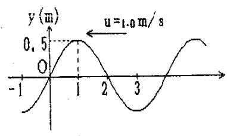

line chart

| x    | y (m) |
| ---- | ----- |
| -1   | 0     |
| 0    | 0     |
| 1    | 0.5   |
| 2    | 0     |
| 3    | -1    |

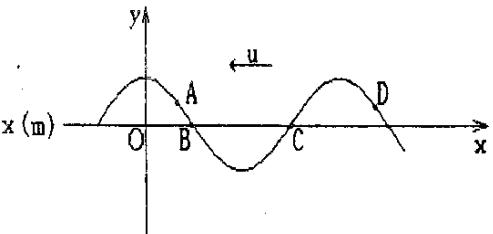

text_image

x (m)
O
A
B
C
D
y
u
x

2．横波以波速 u 沿 x 轴负方向传播. t 时刻波形曲线如图. 则该时刻

（A）A点振动速度大于零.

（B）B 点静止不动.

（C）C 点向下运动.

（D）D点振动速度小于零.

[ ]

3．一平面简谐波 沿 x 轴负方向传播. 已知 x 1m 处质点的振动 方程为$y = A \cos ( \omega t + \phi )$ ，若波速为u，则此波的波动方程为

4．图示一平面简谐波在t s2 时刻的波形图，波的振幅为 0.2m，周期为 4s，则图中p点处质点的振动方程为

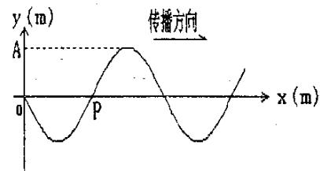

text_image

y (m)
传播方向
A
P
x (m)

5．一平面简谐波沿Ox 轴的负方向传播，波长为 ，P处质点的振动规律如图所示.

（1）求P 处质点的振动方程；  
（2）求此波的波动方程;  
（3）若图中 $d = { \frac { 1 } { 2 } } \lambda$ ，求O处质点的振动方程.

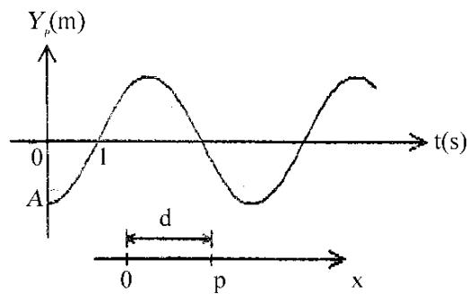

line chart

| t(s) | Y_p(m) |
|------|--------|
| 0    | A      |
| 1    | ~1.5   |
| d    | ~0     |
| p    | ~1.5   |
| x    | ~1.5   |

6．一简谐波沿Ox轴正方向传播，波长 4m，周期T s4 ，已知x=0处质点的振动曲线如图所示，

（1）写出x=0处质点的振动方程；  
（2）写出波的表达式；  
（3）画出t s1 时刻的波形曲线.

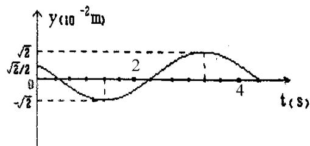

line chart

| t (s) | y (10⁻² m) |
|-------|------------|
| 0     | √2         |
| 2     | -√2        |
| 4     | 0          |

## 片区 选课号 姓名

## 习题二十 波动（二）

1．一平面简谐波在弹性媒质中传播，在媒质质元从平衡位置运动到最大位移处的过程中：

（A）它的动能转换成势能.  
（B）它的势能转换成动能.  
（C）它从相邻的一段质元获得能量其能量逐渐增大.  
（D）它把自己的能量传给相邻的一段质元，其能量逐渐减小.

[ ]

2．一平面简谐波在弹性媒质中传播，在某一瞬时，媒质中某质元正处于平衡位置，此时它的能量是

（A）动能为零，势能最大.

（B）动能为零，势能为零.

（C）动能最大，势能最大.

（D）动能最大，势能为零.

[ ]

3．在同一媒质中两列频率相同的平面简谐波的强度之比 $I _ { 1 } / I _ { 2 } = 1 6$ ，则这两列波的 振幅之比是 $A _ { 1 } / A _ { 2 } =$

4．在截面积为 S 的圆管中，有一列平面简谐波在传播，其波的表达式为$y = A \cos ( \omega t - 2 \pi x / \lambda )$ ，管中波的平均能量密度是 w，则通过截面积 S 的平均能源是

5．如图为一平面简谐波在 t=0 时刻的波形图，试画出 P 处质点与 Q 处质点的振动曲线，然后写出相应的振动方程. 其中波速u 20m/ s.

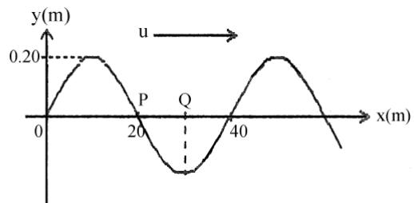

line chart

| x(m) | y(m) |
|------|------|
| 0    | 0.20 |
| 20   | -0.20 |
| 40   | 0.20 |

6．（本题 10 分）5201

一平面简谐波在介质中以速度 c=20m/s 自左向右传播. 已知在传播路径上的某点 A的振动方程为

$$
y = 3 \cos (4 \pi t - \pi) \tag {SI}
$$

另一点D在A点右方9米处.

（1）若取 x 轴方向向左，并以 A 为坐标原点，试写出波动方程，并求出 D 点的振动方程.  
（2）若取 x 轴方向向右，以 A 点左方 5 米处的 O 点为 x 轴原点，重新写出波动方程D点的振动方程.

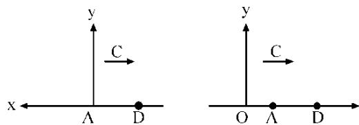

text_image

y
C
x ← A D
y
C
O A D

# 片区 选课号 姓名

## 习题二一 波动（三）

1．如图所示， $S _ { 1 }$ 和 $S _ { 2 }$ 为两相干波源，它们的振动方向均垂直于图面，发出波长为的简谐波，P 点是两列波相遇区域中的一点，已知 $\overline { { S _ { 1 } P } } = 2 \lambda ~ , ~ \overline { { S _ { 2 } P } } = 2 . 2 \lambda$ ，两列波在 P 点发生相消干涉. 若 S1的振动方程为 $y _ { 1 } = A \cos ( 2 \pi t + \frac { 1 } { 2 } )$ ，则 S2的振动方程为

（A） $y _ { 2 } = A \cos ( 2 \pi t - \frac { 1 } { 2 } \pi ) .$

（B） $y _ { 2 } = A \cos ( 2 \pi t - \pi ) .$ .

$y _ { 2 } = A \cos ( 2 \pi t + { \frac { 1 } { 2 } } \pi ) .$

（D） $y _ { 2 } = A \cos ( 2 \pi t - 0 . 1 \pi ) .$ .

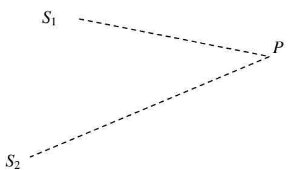

text_image

S₁
P
S₂

[ ]

2．S1 和 S2 是波长均为  的两个相干波的波源，相距3 / 4  ，S1 的位相比 S2 超前 $\boldsymbol { \mathfrak { f } } \frac { 1 } { 2 } \boldsymbol { \pi } .$ .若两波单独传播时，在过 $S _ { 1 }$ 和 $S _ { 2 }$ 的直线上各点的强度相同，不随距离变化，且两波的强度都是 $I _ { 0 } ,$ ，则在 S1、S2连线上 S1外侧和 S2外侧各点，合成波的强度分别是

（A） $4 I _ { 0 } , 4 I _ { 0 } .$

（B） 0, 0.

（C） $0 , 4 I _ { 0 } .$

（D） $4 I _ { 0 } , 0 .$

[ ]

3．两个相干点波源 $S _ { 1 }$ 和 $S _ { 2 }$ ，它们的振动方程分别是 $y _ { 1 } = A \cos ( \omega t + \frac { 1 } { 2 } \pi )$ 和$y _ { 2 } = A \cos ( \omega t - \frac { 1 } { 2 } \pi ) .$ 波从 S1传到 P 点经过的路程等于 2 个波的路程等于 7/2 个波长. 设两波波速相同，在传播过程中振动幅不衰减，则两波传到 P 点的振动的合振幅为

4．在简谐驻波中，同一个波节两侧的两个媒质元（在距该波节二分之一波长的范围内）的振动相位差是

5．两列余弦波沿Ox轴传播，波动方程分别为

$$
y _ {1} = 0. 0 6 \cos [ \frac {1}{2} \pi (0. 0 2 x - 8. 0 t) ] \quad (\mathrm{SI})
$$

$$
y _ {2} = 0. 0 6 \cos [ \frac {1}{2} \pi (0. 0 2 x + 8. 0 t) ] \quad (\mathrm{SI})
$$

试确定Ox轴上合振幅为 0.06m 的那些点的位置.

6．（本题 5 分）3437

如图所示，两列相干波在P点相遇. 一列波在B点引起的振动是

$y _ { 1 0 } = 3 \times 1 0 ^ { - 3 } \cos 2 \pi t \qquad \mathrm { ( S I ) } ;$ ；另一列波在 C 点引起的振动是

$y _ { 2 0 } = 3 { \times } 1 0 ^ { - 3 } \cos ( 2 \pi t + \frac { 1 } { 2 } \pi )$ (SI) $\overline { { B P } } = 0 . 4 5 \mathrm { m } , \overline { { C P } } = 0 . 3 0 \mathrm { m }$ ，两波的传播速度$\mathrm { { u { = } 0 . 2 0 m / s } }$ ，不考虑传播途中振幅的减小，求 P点的合振动的振动方程.

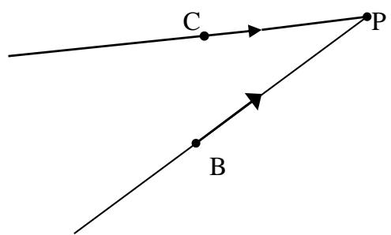

text_image

C
P
B

## 片区 选课号 姓名

## 习题二二 波动（四）

1．某时刻驻波波形曲线如图所示，则 a、b 两点的位相差是

（A） . （B） ${ \frac { 1 } { 2 } } \pi .$ （C） $5 \pi / 4 .$ （D） 0. [ ]

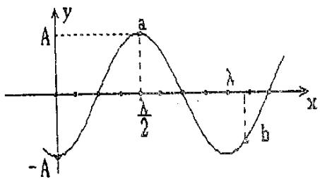

text_image

A
a
λ
x
- A
b

2．若在弦线上的驻波表达式是 y t 0.20sin 2 cos 20 （SI）. 则形成该驻波的两个反向进行的行波为：

（A） $y _ { 1 } = 0 . 1 0 \cos [ 2 \pi ( 1 0 t - x ) + \frac { 1 } { 2 } \pi ]$

$$
y _ {2} = 0. 1 0 \cos [ 2 \pi (1 0 t + x) + \frac {1}{2} \pi ] (\mathrm{SI})
$$

（B） $y _ { 1 } = 0 . 1 0 \mathrm { c o s } [ 2 \pi ( 1 0 t - x ) - 0 . 2 5 \pi ]$

$$
y _ {2} = 0. 1 0 \cos [ 2 \pi (1 0 t + x) + 0. 7 5 \pi ] (\mathrm{SI})
$$

（C） $y _ { 1 } = 0 . 1 0 \cos [ 2 \pi ( 1 0 t - x ) + \frac { 1 } { 2 } \pi ]$

$$
y _ {2} = 0. 1 0 \cos [ 2 \pi (1 0 t + x) - \frac {1}{2} \pi ] (\mathrm{SI})
$$

（D） $y _ { 1 } = 0 . 1 0 \cos [ 2 \pi ( 1 0 t - x ) + 0 . 7 5 \pi ]$

$$
y _ {2} = 0. 1 0 \cos [ 2 \pi (1 0 t + x) + 0. 7 5 \pi ] (\mathrm{SI}) \quad [ ]
$$

3．已知一平面简谐波的表达式为 $y = A \cos ( D t - E x )$ ，式中A、D、E为正值恒量，则在传播方向上相距为 a的两点的位相差为

4．设平面简谐波沿 x轴传播时在x=0处发生反射，反射波的表达式为

$$
y _ {2} = A \cos [ 2 \pi (v t - x / \lambda) + \frac {1}{2} \pi ]
$$

已知反射点为一自由端，则由入射波和反射波形成的驻波的波节位置的坐标为

5．一列横波在绳索上传播，其表达式为 $y _ { 1 } = 0 . 0 5 \cos [ 2 \pi ( \frac { t } { 0 . 0 5 } - \frac { x } { 4 } ) ]$ )] [SI]x

（1）现有另一列横波（振幅也是 0.05m）与上述已知横波在绳索上形成驻波. 设这一横波在 x=0 处与已知横波同位相，写出该波的方程.

（2）写出绳索上的驻波方程；各出各波节的位置坐标表达式；并写出离原点最近的四个波节的坐标数值.

## 片区 选课号 姓名

## 习题二十三 光的偏振（一）

## 1．（本题 3 分）3369

三个偏振片 $P _ { 1 } ,$ ，P2与P3堆叠在一起， $P _ { 1 }$ 与 $P _ { 3 }$ 的偏振化方向相互垂直， $P _ { 2 }$ 与 P1的偏振化方向的夹角为 $3 0 ^ { \circ }$ . 强度为 $I _ { 0 }$ 的自然光垂直入射于偏振片 $P _ { 1 } ,$ ，并依次透过偏振片$P _ { 1 } .$ 、 $P _ { 2 }$ 与 $P _ { 3 } ,$ ，若不考虑偏振片的吸收和反射，则通过三个偏振片后的光强为

（A） $I _ { 0 } / 4 .$

（B） $3 I _ { 0 } / 8 .$

（C） $3 I _ { 0 } / 3 2 .$

（D） $I _ { 0 } / 1 6 .$

[ ]

## 2．（本题 3 分）3544

一束自然光自空气射向一块平板玻璃（如图），设入射角等于布儒斯特角 i ，则在界面2的反射光

（A）是自然光.  
（B）是完全偏振光且光矢量的振动方向垂直于入射面.  
（C）是完全偏振光且光矢量的振动方向平行于入射面.  
（D）是部分偏振光.

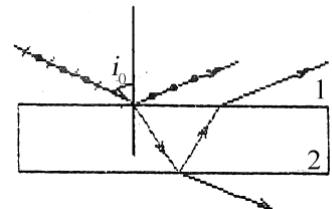

text_image

i₀
1
2

[ ]

## 3．（本题 3 分）3367

当一束自然光以布儒斯特角i 入射到两种介质的分界面（垂直于纸面）上时，画出图中反射光和折射光的光矢量振动方程.

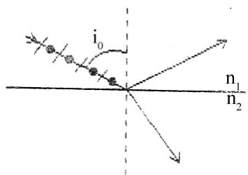

text_image

i₀
n₁
n₂

## 4．（本题 5 分）3236

一束平行的自然光，以 ${ { \bf 6 0 } ^ { \circ } }$ 角入射到平玻璃表面上. 若反射光束是完全偏振的，则透射光束的折射角是 ；玻璃的折射率为

## 5.（本题 10 分）3231

将三个偏振光叠放在一起，第二个与第三个的偏振化方向分别与第一个的偏振化方向成 45°和 90°角.

（1）强度为I0的自然光垂直入射到这一块偏振片上，试求经每一偏振片后的光强和偏振状态.  
（2）如果将第二个偏振片抽走，情况又如何？

## 6．（本题 5 分）3645

两个偏振片叠在一起，在它们的偏振化方向成 $\alpha _ { \mathrm { 1 } } = 3 0 ^ { \circ }$ °时，观测一束单色自然光. 又在 $\alpha _ { 2 } = 4 5 ^ { \circ }$ 时，观测另一束单色自然光. 若两次所测得的透射光强度相等，求两次入射自然光的强度之比.

## 片区 选课号 姓名

## 习题二十四 光的偏振（二）

## 1．（本题 3 分）3246

一束光是自然光和线偏振光的混合光，让它垂直通过一偏振片. 若以此入射光为轴旋转偏振片，测得透射光强度最大值是最小值的 5 倍，那么入射光束中自然光与线偏振光的光强比值为

（A）1/2. （B）1/5. （C）1/3. （D）2/3. [ ]

## 2．（本题 3 分）5330

ABCD 为一块方解解的一个截面，AB为垂直于纸面的晶体平面与纸面的交线. 光轴方向在纸面内且与 AB 成一锐角 ，如图所示. 一束平行的单色自然光垂直于 AB端面入射. 在方解石内折射光分解为 o光和e光，o 光和 e 光的

（A）传播方向相同，电场强度的振动方向互相垂直.  
（B）传播方向相同，电场强度的振动方向不互相垂直.  
（C）传播方向不同，电场强度的振动方向互相垂直.  
（D）传播方向不同，电场强度的振动方向不互相垂直.

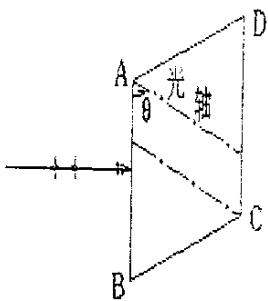

text_image

A
θ
光轴
B
C
D

[ ]

## 3．（本题 3 分）3548

一束自然光通过两个偏振片，若两偏振片的偏振化方向间夹角由 $\alpha _ { 1 }$ 转到 $\alpha _ { 2 }$ ，且不考虑吸收，则转动前后透射光强度之比为

## 4．（本题 3 分）3649

在双折射晶体内部，有某种特定方向称为晶体的光轴. 光在晶体内沿光轴传播时，和 光的传播速度相等.

## 5．（本题 3 分）3250

假设某一介质对于空气的临界角是 45°，则光从空气射向此介质时的布儒斯特角是

## 6．（本题 10 分）3776

由两个偏振片（其偏振化方向分别烟 $P _ { 1 }$ 和 $P _ { 2 } )$ 叠在一起， $P _ { 1 }$ 与 $P _ { 2 }$ 的夹角为 . 一束线偏振光垂直入射在偏振片上. 已知入射光的光矢量振动方向与 $P _ { 2 }$ 的夹角为A（取锐角），A 角保持不变，如图. 现转动 $P _ { 1 } ,$ ，但保持 $P _ { 1 }$ 与 E 、 $P _ { 2 }$ 的夹角都不超过 A（即 P1夹在E和 $P _ { 2 }$ 之间， $\mathbb { E } \mathbb { E }$ 图）. 求 等于何值时出射光强为极值；此极值是极大还是极小？

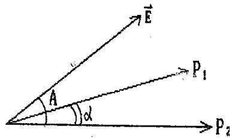

text_image

E
A
α
P₁
P₂

## 7．（本题 5 分）3232

