有三个偏振光堆叠在一起，第一块与第三块的偏振化方向相互垂直，第二块和第一块的偏振化方向相互平行，然后第二块偏振片以恒定角速度 绕光传播的方向旋转，如图所示. 设入射自然光的光强为 $I _ { 0 } .$ 试证明：此自然光通过这一系统后，出射光的光强为$I = I _ { 0 } ( 1 - \cos { 4 \omega t } ) / 1 6$ .

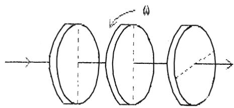

natural_image

Diagram of three circular objects with dashed centerlines and rotation arrow, no text or symbols present

## 片区 选课号 姓名

## 习题二十五 光的干涉（一）

1．（本题 3 分）3611

如图，S1、S2是两个相干光源，它们到P点的距离分别为 r1和r2。路径S1 P垂直穿过一块厚度为 t ，折射率为n 的介质板，路径S P 垂直穿过厚度为t ，折射率为n 的另一介质板，其余部分可看作真空，这两条路径的光程差等于

（A） $( r _ { 2 } + n _ { 2 } t _ { 2 } ) - ( r _ { 1 } + n _ { 1 } t _ { 1 } )$  
（B） $[ r _ { 2 } + ( n _ { 2 } - 1 ) t _ { 2 } ] - [ r _ { 1 } + ( n _ { 1 } - 1 ) t _ { 1 } ]$  
（C） $( r _ { 2 } - n _ { 2 } t _ { 2 } ) - ( r _ { 1 } - n _ { 1 } t _ { 1 } )$  
（D） $n _ { 2 } t _ { 2 } - n _ { 1 } t _ { 1 }$

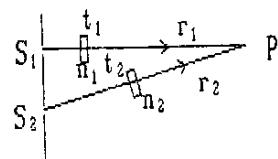

2．（本题 3 分）3162

在真空中波长为 的单色光，在折射率为n的透明介质中从 A沿某路径传播到B，若A、B 两点位相差为3 ，则此路径AB的光程为

（A）1.5 . （B）1.5 n . （C）3 . （D）1.5 . [ ]

3．（本题 3 分）3619

波长为 的单色光垂直照射如图所示的透明薄膜. 膜厚度为e，两束反射光的光程差$\delta =$

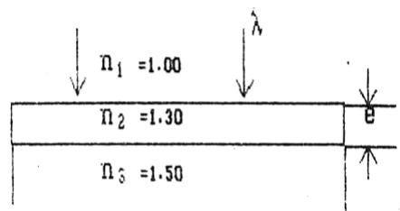

text_image

n₁ =1.00
n₂ =1.30
n₃ =1.50

4．（本题 3 分）3378

光强均为 I0的两束相干光相遇而发生干涉时，在相遇区域内有可能出现的最大光强是

5．（本题 10 分）3613

在图示的双缝干涉实验中，若用薄玻璃片（折射率n 1.4）覆盖缝 S1，用同样厚度的玻璃片（但折射率 $n _ { 2 } { = } 1 . 7 )$ 覆盖缝 $S _ { 2 } ,$ ，将使屏上原来未放玻璃时的中央明条纹所在处O 变为第五级明纹. 设单色光波长 $\lambda = 4 8 0 0 \mathrm { ^ { o } A }$ ，求玻璃片的厚度 d（可认为光线垂直穿过玻璃片）.

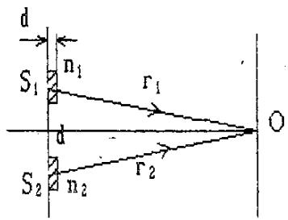

text_image

d
S₁ n₁ r₁
d
S₂ n₂ r₂ O

6．（本题 5 分）3181

白色平行光垂直入射到间距为a=0.25mm 的双缝上，距缝50cm 处放置屏幕，分别求第一级和第五级明纹彩色带的宽度. （设白光的波长范围是从 $4 0 0 0 \mathrm { \AA } ^ { \mathrm { ~ ~ } }$ 到 $7 6 0 0 \mathrm { \AA } ~ )$ ）. 这里说的“彩色带宽度”指两个极端波长的同级明纹中心之间的距离.）

## 片区 选课号 姓名

## 习题二十六 光的干涉（二）

## 1．（本题 3 分）3498

在双缝干涉实验中，入射光的波长为 ，用玻璃纸遮住双缝中的一个缝，若玻璃纸中光程比相同厚度的空气的光程大 2.5 ，则屏上原来的明纹处

（A）仍为明条纹；

（B）变为暗条纹；

（C）既非明纹也非暗纹；

（D）无法确定是明纹，还是暗纹.

[ ]

## 2．（本题 3 分）3174

在双缝干涉实验中，屏幕 E上的P点处是明条纹. 若将缝S 盖住，并在 S S 连线的垂直平分面处放一反射镜 M，如图所示，则此时

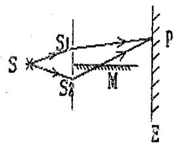

text_image

S
S₁
S₂
M
P
E

（A）P点处仍为明条纹.

（B）不能确定P点处是明条纹还是暗条纹.

（C）P点处为暗条纹.

（D）无干涉条纹.

[ ]

## 3．（本题 3 分）3177

如图，在双缝干涉实验中，若把一厚度为 e、折射率为 n的薄云母片覆盖在S 缝上，中央明条纹将向 移动；覆盖云母片后，两束相干光至原中央明纹 O处的光程差为

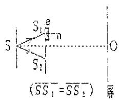

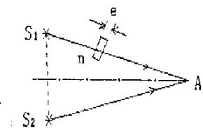

## 4．（本题 5 分）3167

如图所示，假设有两个同相的相干点光源 S 和 S ，发出波长为 的光. A是它们连线的中垂直线上的一点. 若在S1与A之间插入厚度为 e、折射率为n的薄玻璃片，则两光源发出的光在 A 点的位相差  . 若已知  5000 A ，n=1.5，A 点o恰为第四级明纹中心，则 e= A .

## 5．（本题 10 分）3658

白光垂直照射到空气中一厚度为 $\mathrm { e } { = } 3 8 0 0 \mathring \mathrm { A }$ 的肥皂膜上，肥皂膜的折射率 n=1.33，在可见光的范围内 $( 4 0 0 0 \overset { \circ } { \mathbf { A } } - 7 6 0 0 \overset { \circ } { \mathbf { A } } )$ ），哪些波长的光在反射中增强？

## 6．（本题 10 分）3182

在双缝干涉实验中，波长 $\lambda = 5 5 0 0 \mathrm { ~ \AA ~ }$ 的单色平行光垂直入射到缝间 $\boldsymbol { \mathrm { E } } a = 2 \times 1 0 ^ { - 4 }$ 4 的双缝上，屏到双缝的距离D=2m. 求：

（1）中央明纹两侧的两条第10级明纹中心的间距；

（2）用一厚度为 $e = 6 . 6 { \times } 1 0 ^ { - 6 } \mathrm { m }$ 、折射率为 n=1.58 的云母片覆盖一缝后，零级明纹将移到原来的第几级明纹处？

# 片区 选课号 姓名

## 习题二十七 光的干涉（三）

1．（本题 3 分）5208

在玻璃（折射率 $n _ { 3 } = 1 . 6 0 \ )$ ）表面镀一层 MgF2（折射率 $n _ { 2 } = 1 . 3 8 \ )$ ）薄膜作为增透膜. 为了使波长为 $5 0 0 0 \mathrm { \AA }$ 的光从空气 $\left( \begin{array} { l l l } { n _ { 1 } = 1 . 0 0 } \end{array} \right)$ ）正入射时尽可能少反射，MgF2薄膜的最少厚度应是

（A） $1 2 5 0 \mathrm { \AA } ^ { \mathrm { ~ ~ } }$ . （B） $1 8 1 0 \mathrm { \AA } ^ { \mathrm { ~ o ~ } }$ （C） $2 5 0 0 \mathrm { \AA } ^ { \mathrm { ~ ~ } }$ . （D） $\mathrm { 7 8 1 \mathring { A } }$ （E） $9 0 6 \overset { \circ } { \mathbf { A } } [ \mathrm { ~ \textbf ~ { ~ \textbf ~ { ~ \textbf ~ { ~ \textbf { ~ ~ } ~ } ~ } ~ } ~ } ]$

2．（本题 3 分）3508

如图a所示，一光学平板玻璃A与待测工件B之间形成空气劈尖，用波长 $\lambda = 5 0 0 \mathrm { n m }$ $\left( 1 \mathrm { { n m } = 1 0 ^ { - 9 } \mathrm { { m } } } \right)$ ）的单色光垂直照射. 看到的反射光的干涉条纹如图 b所示. 有些条纹弯曲部分的顶点恰好与其右边条纹的直线部分的切线相切. 则工件的上表面缺陷是

（A）不平处为凸起纹，最大高度为 500nm.  
（B）不平处为凸起纹，最大高度为 250nm.  
（C）不平处为凹槽，最大深度为500nm.  
（D）不平处为凹槽，最大深度为 250nm.

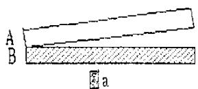

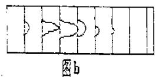

3．（本题 3 分）3621

用波长为 的单色光垂直照射如图所示的、折射率为 n2的劈尖薄膜 $( n _ { 1 } > n _ { 2 } , n _ { 3 } > n _ { 2 } )$ ，观测反射光干涉. 从劈尖顶开始，第2条明条纹对应的膜厚度为e 

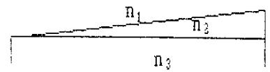

4．（本题 3 分）3511

用波长为 的单色光垂直照射到空气劈尖上，从反射光中观察干涉条纹，距顶点为L 处是暗条纹. 使劈尖角 连续变大，直到该点处再次出现暗条纹为止. 劈尖角的改变量  是

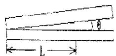

5．（本题 5 分）3707

波长为 的单色光垂直照射到折射率为 n2 的劈尖薄膜上，如图所示，图中 $n _ { 1 } < n _ { 2 } < n _ { 3 }$ ，观察反射光形成的干涉条纹.

（1）从劈尖顶部 o 开始向右数起，第五条暗纹中心所对应的薄膜厚度 $\cdot e _ { 5 }$ 是多少？  
（2）相邻的二明纹所对应的薄膜厚度之差是多少？

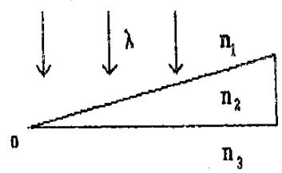

text_image

n₁
λ
n₂
n₃
0

6．（本题 10 分）3349

用波长为 $\lambda = 6 0 0 \mathrm { n m } \left( 1 \mathrm { n m } = 1 0 ^ { - 9 } \mathrm { m } \right)$ 的光垂直照射由两块平玻璃板构成的空气劈尖薄膜，劈尖角 $\theta = 2 { \times } 1 0 ^ { - 4 } \mathrm { r a d }$ . 改变劈尖角，相邻两明条纹间距缩小了 $\Delta l = 1 . 0 \mathrm { m m }$ ，求壁尖角的改变量 .

## 片区 选课号 姓名

## 习题二十八 光的干涉（四）

## 1．（本题 3 分）3507

如图所示，平板玻璃和凸透镜构成牛顿环装置，全部浸入n 1.60 的液体中，凸透镜可沿OO’移动，用波长 500nm的单色光垂直入射. 从上向下观察，看到中心是一个暗斑，此时凸透镜顶点距平板玻璃的距离最少是

（A）78.1nm

（B）74.4nm

（C）156.3nm

（D）148.8nm

（E）0

[ ]

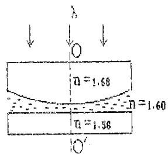

text_image

n = 1.60
n = 1.60
n = 1.58

## 2．（本题 3 分）3185

在图示三种透明材料构成的牛顿环装置中，用单色光垂直照射，在反射光中看到干涉条纹，则在接触点 P处形成的圆斑为

（A）全明.

（B）全暗.

（C）右半部明，左半部暗.

（D）右半部暗，左半部明.

[ ]

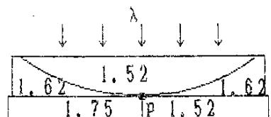  
（图中数字为各处的折射率）

## 3．（本题 3 分）3201

若在迈克耳孙干涉仪的可动反射镜 M 移动0.620nm 的过程中，观察到干涉条纹移动了2300 条，则所用光波的波为 oA .

## 4．（本题 3 分）3517

在迈克耳孙干涉仪的一支光路上，垂直于光路放入折射率为 n、厚度为h的透明介质薄膜. 与未放入此薄膜时相比较，两光束光程差的改变量为

## 5．（本题 10 分）3197

在如图所示的牛顿环装置中，把玻璃平凸透镜和平面玻璃（设玻璃折射率 $n _ { \mathrm { { 1 } } } = 1 5 0 ~ )$ ）之间的空气 $( n _ { 2 } = 1 0 0 )$ ）改换成水 $( n _ { \ 2 } ^ { \prime } = 1 . 3 3 \ )$ ），求第 k 个暗环半径的相对改变量$( r _ { k } - r _ { \ k } ^ { \prime } ) / r _ { k }$ .

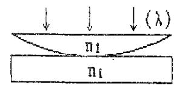

## 6．（本题 10 分）5211

一平凸透镜放在一平晶上，以波长 $\gimel \lambda = 5 8 9 3 \mathring { \mathrm { ~ A ~ } }$ 的单色光垂直照射于其上，测量反射光的牛顿环. 测得从中央数起第 k 个暗环的弦长为 $l _ { k } = 3 . 0 0 \mathrm { m m }$ ，第（k+5）个暗环的弦长为 $\mid l _ { k + 5 } = 4 . 6 \mathrm { m m }$ ，如图所示. 求平凸透镜的球面的曲率半径 R.

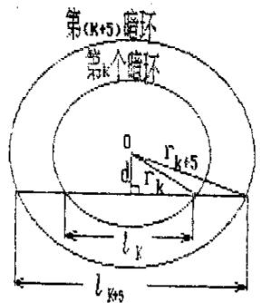

text_image

第(K+5)循环
第k个循环
0
r_{k+5}
d
r_k
l_k
l_{k+5}

## 片区 选课号 姓名

## 习题二十九 光的衍射（一）

## 1．（本题 3 分）3353

在单缝夫琅和费衍射实验中，波长为 的单色光垂直入射在宽度为 a=4 的单缝上，对应于衍射角为 30°的方向，，单缝处波阵面可分成的半波带数目为

（A）2 个.

（B）4 个.

（C）6 个.

（D）8 个.

[ ]

## 2．（本题 3 分）3520

根据惠更斯-菲涅耳原理，若已知光在某时刻的波阵面为 S，则S的前方某点P的光强度决定于波阵面 S上所有面积元发出的子波各自传到 P点的

（A）振动振幅之和.

（B）光强之和.

（C）振动振幅之和的平方.

（D）振动的相干叠加.

[ ]

## 3．（本题 5 分）3207

在单缝的夫琅和费衍射实验中，屏上第三级暗纹对应的单缝处波面可划分为个半波带，若将缝宽缩小一半，原来第三级暗纹处将是纹。

## 4．（本题 3 分）3524

平行单色光垂直入射在缝宽为a=0.15mm的单缝上. 缝后有焦距为f=400mm的凸透镜，在其焦平面上放置观察屏幕. 现测得屏幕上中央明条纹两侧的两个第三级暗纹之间的距离为 8mm，则入射光的波长为 =

## 5．（本题 5 分）3743

如图所示，设波长为 的平面波沿与单缝平面法线成 角的方向入射，单缝 AB的宽度为 a，观察夫琅和费衍射. 试求出各极小值（即各暗条纹）的衍射角.

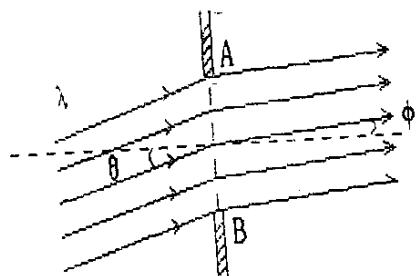

text_image

λ
θ
A
φ
B

## 6．（本题 5 分）3359

波长为 $6 0 0 \mathrm { n m \ ( \Omega 1 n m = 1 0 ^ { - 9 } m ) }$ 的单色光垂直入射到宽度为a  0.10 mm的单缝上，观察夫琅和费衍射图样，透镜焦距f=1.0m，屏在透镜的焦平面处. 求：

（1）中央衍射明条纹的宽度 $\Delta x _ { 0 }$ ；  
（2）第二级暗纹离透镜焦点的距离 2x .

## 片区 选课号 姓名

## 习题三十 光的衍射（二）

1．（本题 3 分）5649

在如图所示的夫琅和费衍射装置中，将单缝宽度 a稍稍变窄，同时使会聚透镜 L 沿y轴正方向作微小位移，则屏幕C 上的中央衍射条纹将

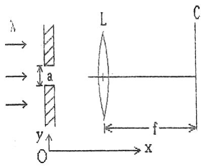

text_image

λ
a
y
O
x
L
C
f

（A）变宽，同时向上移动.  
（B）变宽，同时向下移动.  
（C）变宽，不移动.  
（D）变窄，同时向上移动.  
（E）变窄，不移动. [ ]

2．（本题 3 分）3212

一束平行单色光垂直入射在光栅上，当光栅常数（a+b）为下列哪种情况时（a代表每条缝的宽度），k=3、6、9等级次的主极大均不出现？

（A） $\mathrm { a } + \mathrm { b } { = } 2 \mathrm { a } .$

（B）a+b=3a.

（C）a+b=4a.

（D） $\mathrm { a + b } { = } 6 \mathrm { a } .$

[ ]

3．（本题 3 分）5219

波长为 $\lambda = 4 8 0 0 \mathrm { ^ { o } A }$ 的平行光垂直照射到宽度为a=0.40mm 的单缝上，单缝后透镜的焦距为 $f { = } 6 0 \mathrm { c m } ,$ ，当单缝两边缘点 A、B 射向 P 点的两条光线在 P 点的相位差为  时，P 点离透镜焦点 O 的距离等于

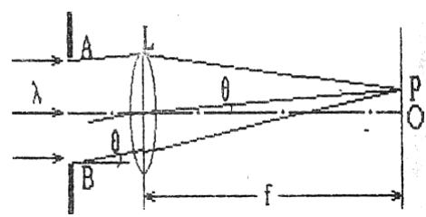

text_image

A
L
θ
λ
θ
B
f
P
O

4．（本题 3 分）3362

某单色光垂直入射到一个每毫米有 800条刻线的光栅上，如果第一级谱线的衍射角为30°，则入射光的波长应为

5．（本题 10 分）5535

波长范围在450\~650nm 之间的复色平行光垂直照射在每厘米有 5000条刻线的光栅上，屏幕放在透镜的焦面处，屏上第二级光谱各色光在屏上所占范围的宽度为 35.1cm. 求透镜的焦距 f.

$$
(1 \mathrm{nm} = 1 0 ^ {- 9} \mathrm{m})
$$

6．（本题 10 分）3531

将一束波长 $\lambda { = } 5 8 9 0 \mathrm { \overset { o } { A } }$ 的平行钠光垂直入射在1厘米有5000条刻痕的平面衍射光栅上，光栅的透光缝宽度a与其间距b相等，求：

（1）光线垂直入射时，能看到几条谱线？是哪几级？

（2）若光线以与光栅平面法线的夹角 $\theta = 3 0 ^ { \circ }$ °的方向入射时，能看到几条谱线？是哪几级？

## 片区 选课号 姓名

## 习题三一 光的衍射（三）

1．（本题 3 分）3636

波长 $\lambda { = } 5 5 0 0 \mathrm { ^ { \circ } A }$ 的单色光垂直入射于光栅常数 $\mathrm { d } = 2 { \times } 1 0 ^ { - 4 } \mathrm { c m }$ 的平面衍射光栅上，可能观察到的光谱线的最大级次为

（A）2.

（B）3.

（C）4.

（D）5.

[ ]

2．（本题 3 分）5534

设光栅平面、透镜均与屏蔽平行. 则当入射的平行单色光从垂直于光栅平面入射变为斜入射时，能观察到的光谱线的最高级数 k

（A）变小.

（B）变大.

（C）不变.

（D）的改变无法确定. [ ]

3．（本题 3 分）3638

波长为 $5 0 0 0 ^ { \circ } \mathrm { { \AA } }$ 的单色光垂直入射到光栅常数为 $1 . 0 { \times } 1 0 ^ { - 4 } \mathrm { c m }$ 的平面衍射光栅上，第一级衍射主极大所对应的衍射角 

4．（本题 5 分）3217

一束单色光垂直入射在光栅上，衍射光谱中共出现 5条明纹. 若已知此光栅缝宽度与不透明部分宽度相等，那么在中央明纹一侧的两条明纹分别是第 级和第 级谱线.

5．（本题 10 分）3211

（1）在单缝夫琅和费衍射实验中，垂直入射的光有两种波长， $\lambda _ { 1 } = 4 0 0 0 \mathrm { ^ { o } A }$ ，$\lambda _ { 2 } = 7 6 0 0 \mathrm { ^ { \circ } A }$ . 已知单缝宽度 $a = 1 . 0 { \times } 1 0 ^ { - 2 } \mathrm { c m }$ ，透镜焦距 $f = 5 0 \mathrm { c m }$ . 求两种光第一级衍射明纹中心之间的距离.  
（2）若用光栅常数 $\mathsf { d } = 1 . 0 { \times } 1 0 ^ { - 3 } \mathrm { c m }$ 的光栅替换单缝，其他条件和上一问相同，求两种光第一级主极大之间的距离.

6．（本题 10 分）3221

一束平行光垂直入射到某个光栅上，该光束有两种波长的光，， $\lambda _ { 1 } = 4 4 0 0 \mathrm { ^ { o } A }$ ，$\lambda _ { 2 } = 6 6 0 0 \mathrm { ^ { o } A }$ . 实验发现，两种波长的谱线（不计中央明纹）第二次重合于衍射角 $\Phi = 6 0 ^ { \circ }$ 的方向上. 求此光栅的光栅常数d.