# 大学物理习题册

## （上册）

电子科技大学物理电子学院

## 片区 选课号 姓名

## 习题一 质点运动的描述（一）

1．一质点在平面上运动，已知质点位置矢量的表示式为

$$
\vec {r} = a t ^ {2} \vec {i} + b t ^ {2} \vec {j} (\text {其中} a 、 b \text {为常量})
$$

则该质点作

（A）匀速直线运动.

（B）变速直线运动.

（C）抛物线运动.

（D）一般曲线运动. [ ]

2．质点作半径为R的变速圆周运动时的加速度大小为（v表示任一时刻质点的速率）

（A） $\frac { \mathrm { d } v } { \mathrm { d } t } .$

（B） ${ \frac { v ^ { 2 } } { R } } .$

（C） $\frac { \mathrm { d } v } { \mathrm { d } t } { + } \frac { v ^ { 2 } } { R } .$

（D） $\left[ \left( \frac { \mathrm { d } v } { \mathrm { d } t } \right) ^ { 2 } + \left( \frac { v ^ { 4 } } { R ^ { 2 } } \right) \right] ^ { 1 / 2 }$

3．已知质点运动方程为

$$
\vec {r} = (5 + 2 t - \frac {1}{2} t ^ {2}) \vec {i} + (4 t + \frac {1}{3} t ^ {3}) \vec {j} \quad (\mathrm{SI})
$$

当 $t = 2 s$ 时， $\vec { a } =$

4．一质点沿 x轴作直线运动，它的运动学方程为 $x = 3 + 5 t + 6 t ^ { 2 } - t ^ { 3 }$ (SI)

则（1）质点在 $t = 0$ 时刻的速度 $\vec{v}_0 =$

（2）加速度为零时，该质点的速度v

5．一物体悬挂在弹簧上作竖直振动，其加速度为 $a=-ky$，式中 k 为常量，y 是以平衡位置为原点所测得的坐标. 假定振动的物体在坐标 $y_0$ 处的速度为 $v_0$，试求速度 $v$ 与坐标 $y$ 的函数关系式.

6．有一质点沿x轴作直线运动，t 时刻的坐标为

$$
x = 4.5 t ^ {2} - 2 t ^ {3} \tag {SI}
$$

（1）第2秒内的平均速度；

（2）第2秒末的瞬时速度；

（3）第2秒内的路程.

# 片区 选课号 姓名

## 习题一 质点运动的描述（二）

1．对于沿曲线运动的物体，以下几种说法中哪一种是正确的：

（A）切向加速度必不为零.  
（B）法向加速度必不为零（拐点处除外）.  
（C）由于速度沿切线方向，法向分速度必为零，因此法向加速度必为零.  
（D）若物体作匀速率运动，其总加速度必为零.  
（E）若物体的加速度a为恒矢量，它一定作匀变速率运动.

[ ]

2．一质点在平面上作一般曲线运动，其瞬时速度为 $\vec{v}$，瞬时速率为 $v$，一段时间内的平均速度为 $\bar{\vec{v}}$，平均速率为 $\bar{v}$，它们之间的关系必定有：

（A） $|\vec{v}|=v,\ |\bar{\vec{v}}|=\bar{v}$.

（B） $|\vec{v}|\ne v,\ |\bar{\vec{v}}|=\bar{v}$.

（C） $|\vec{v}|\ne v,\ |\bar{\vec{v}}|\ne\bar{v}$.

（D） $|\vec{v}|=v,\ |\bar{\vec{v}}|\ne\bar{v}$.

3．一质点沿半径为 R 的圆周运动，其路程S随时间 t 变化的规律为

$$
S = b t - \frac {1}{2} c t ^ {2} \quad (\mathrm{SI})
$$

其中 $b$、$c$ 为大于零的常数，且 $b^2>Rc$.

（1）质点运动的切向加速度 $a_t=$，法向加速度 $a_n=$

（2）质点运动经过 $t=$ 时， $|a_t|=a_n$.

4．以一定初速度斜向上抛出一个物体，若忽略空气阻力，当该物体的速度 $\vec{v}$ 与水平的夹角为 $\theta$ 时，它的切向加速度 $a_t$ 的大小为，法向加速度 $|a_n|$ 的大小为

5．（1）对于在 xy 平面内，以原点 O 为圆心作匀速圆周运动的质点，试用半径 r、角速度 $\omega$ 和单位矢量i 、 j 表示其 t 时刻的位置矢量.已知在t = 0时， $y = 0 , x = r$ ，角速度 $\omega$ 如图所示；

（2）由（1）导出速度 $\vec{v}$ 与加速度 $\vec{a}$ 的矢量表达式；  
（3）试证加速度指向圆心.

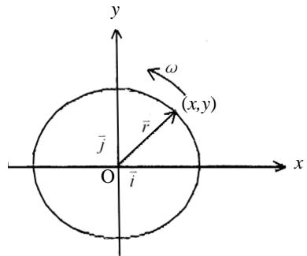

text_image

y
ω
(x,y)
r̄
j̄
O
ī
x

6．如图所示，质点 $P$ 在水平面内沿一半径为 $R=2\,\mathrm{m}$ 的圆轨道转动，转动的角速度与时间 $t$ 的函数关系为 $\omega=kt^2$（$k$ 为常量）. 已知 $t=2\,\mathrm{s}$ 时，质点 $P$ 的速度值为 $32\,\mathrm{m/s}$. 试求 $t=1\,\mathrm{s}$ 时，质点 $P$ 的速度与加速度的大小.

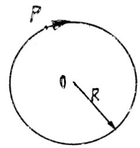

## 片区 选课号 姓名

## 习题三 质点运动的描述（三）

1．某物体的运动规律为 $\mathrm{d}v/\mathrm{d}t=-kv^2t$，式中的 $k$ 为大于零的常数. 当 $t=0$ 时，初速为 $v_0$，则速度 $v$ 与时间 $t$ 的函数关系是

（A） $v=\frac{1}{2}kt^2+v_0$.

（B） $v=-\frac{1}{2}kt^2+v_0$.

（C） $\frac{1}{v}=\frac{kt^2}{2}+\frac{1}{v_0}$.

（D） $\frac{1}{v}=-\frac{kt^2}{2}+\frac{1}{v_0}$.

[ ]

2．在相对地面静止的坐标系内，A、B 二船都以 $2 m \cdot s ^ { - 1 }$ 的速率匀速行驶，A 船沿 x轴正向，B 船沿 y 轴正向. 今在 A 船上设置与静止坐标系方向相同的坐标系（x、y 方向单位矢用i 、 j 表示），那么在A船上的坐标系中，B船的速度（以 $m \cdot s ^ { - 1 }$ 为单位）为

（A） $2 \vec { i } + 2 \vec { j }$

（B） $- 2 \vec { i } + 2 \vec { j }$ .

（C） $- 2 { \vec { i } } - 2 { \vec { j } } .$

（D） $2 \vec { i } - 2 \vec { j }$

[ ]

3．设质点的运动学方程为 $\vec{r}=R\cos(\omega t)\vec{i}+R\sin(\omega t)\vec{j}$（式中 $R$、$\omega$ 皆为常量），则质点的 $\vec{v}=$，$\mathrm{d}\vec{v}/\mathrm{d}t=$

4．如图所示，小船以相对于水的速度 $\vec{v}$ 与水流方向成 $\alpha$ 角开行，若水流速度为 $\vec{u}$，则小船相对于岸的速度的大小为，与水流方向的夹角为

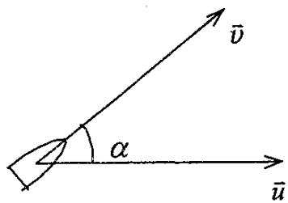

text_image

v̄
α
ū

5．河水自西向东流动，速度为10km/ h，一轮船在水中航行，船相对于河水的船向为北偏西 30°，相对于河水的航速为 20km/h. 此时风向为正西，风速为 10km/h，试求在船上观察到的烟囱冒出的烟缕的飘向.（设烟离开烟囱后很快就获得与风相同的速度）

6．一飞机驾驶员想往正北方向航行，而风以 60km/h 的速度由东向西刮来，如果飞机的航速（在静止空气中的速率）为 180km/h，试问驾驶员应取什么航向？飞机相对于地面的速率为多少？试用矢量图说明。

## 片区 选课号 姓名

## 习题四 质点运动的描述（四）

## 一、选择题（共 6分）

1．（本题 3 分）0614

在电梯中用弹簧秤称物体的重量. 当电梯静止时，称得一个物体重量为 500N. 当电梯作匀速变速运动时，称得其重量为 400N，则该电梯的加速度是

（A）大小为0.2g，方向向上.  
（B）大小为 0.8g，方向向上.  
（C）大小为 0.2g，方向向下.  
（D）大小为 0.8g，方向向下.

[ ]

2．光滑的水平桌面上放有两块相互接触的滑块，质量分别为 $m_1$ 和 $m_2$，且 $m_1<m_2$. 今对两滑块施加相同的水平作用力，如图所示. 设在运动过程中，两滑块不离开，则两滑块之间的相互作用力 N 应有

（A） N = 0.

（B） $0 < N < F .$

（C） $F < N < 2 F .$

（D） $N > 2 F .$

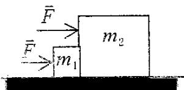

## 二、填空题（共 6分）

3．沿水平方向的外力 F 将物体 A 压在竖直墙上，由于物体与墙之间有摩擦力，此时物体保持静止，并设其所受静摩擦力为 f0，若外力增至 2F，则此时物体所受静摩擦力为

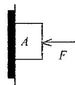

## 4．（本题 3 分）0526

倾角为 30°的一个斜面体放置在水平桌面上，一个质量为 2kg 的物体沿斜面下滑，下滑的加速度为 $3.0\,\mathrm{m/s^2}$.若此时斜面体静止在桌面上不动，则斜面体与桌面间的静摩擦力 f=

5．一条轻绳跨过一轻滑轮（滑轮与轴间摩擦可忽略），在绳的一端挂一质量为 m1的物体，在另一侧有一质量为 m2的环，求当环相对于绳以恒定的加速度 $a_2$ 沿绳向下滑动时，物体和环相对地面的加速度各是多少？环与绳间的摩擦力多大？

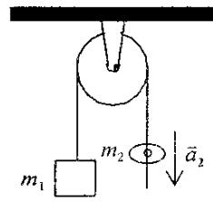

6．质量为 m 的子弹以速度 v0水平射入沙土中，设子弹所受阻力与速度反向，大小与速度成正比，比例系数为K，忽略子弹的重力，求：

（1）子弹射入沙土后，速度随时间变化的函数式.  
（2）子弹进入沙土的最大深度.

# 片区 选课号 姓名

## 习题五 质点运动的描述（五）

1．在作匀速转动的水平转台上，与转轴相距 R 处有一体积很小的工件 A，如图所示. 设工件与转台间静摩擦系数为 $\mu _ { s }$ ， 若使工件在转台上无滑动，则转台的角速度 $\omega$ 应满足

（A） $\omega \leq \sqrt { \frac { \mu _ { s } g } { R } } .$

（B） $\omega \leq \sqrt { \frac { 3 \mu _ { s } g } { 2 R } } .$

（C） $\omega \leq \sqrt{\frac{3\mu_s g}{R}}$.

（D） $\omega \leq 2 { \sqrt { \frac { \mu _ { s } g } { R } } } .$ . [ ]

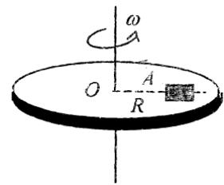

text_image

ω
O
A
R

2．（本题 3 分）0024

一光滑的内表面半径为 10cm 的半球形碗，以匀角速度绕其对称轴OC旋转. 已知放在碗内表面上的一个小球P相对于碗静止，其位置高于碗底 4cm，则由此可推知碗旋转的角速度约为

（A）13 rad/s.

（A） $17\,\mathrm{rad/s}$.

（C）10 $\mathrm { r a d } / \mathrm { s } .$

（D）18 rad/s. [ ]

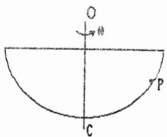

text_image

O
→
P
C

3．（本题 3 分）0351

一圆锥摆摆长为 l、摆锤质量为 m，在水平面上作匀速圆周运动，摆线与铅直线夹角 $\theta$，则

（1）摆线的张力T=

（2）摆锤的速率v=

4．质量分别为 $m_1$、$m_2$、$m_3$ 的三个物体 A、B、C，用一根细绳和两根轻弹簧连接并悬于固定点 O，如图. 取向下为 x 轴正向，开始时系统处于平衡状态，后将细绳剪断，则在刚剪断瞬时，物体 B 的加速度 $\vec{a}_B=$；物体 A 的加速度 $\vec{a}_A=$

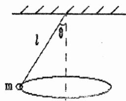

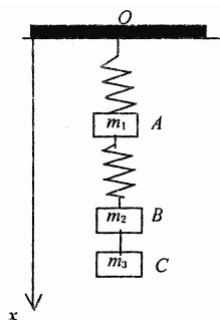

text_image

O
m₁ A
m₂ B
m₃ C
x

5．（本题 5 分）0028

一水平放置的飞轮可绕通过中心的竖直轴转动，飞轮的辐条上装有一个小滑块，它可在辐条上无摩擦地滑动. 一轻弹簧一端固定在飞轮转轴上，另一端与滑块联接. 当飞轮以角速度 $\omega$ 旋转时，弹簧的长度为原来的 f 倍，已知 $\omega = \omega _ { \mathrm { 0 } }$ 时， $f = f _ { 0 }$ ，求 $\omega$ 与 $f$ 的函数关系.

6．质量为 $m$ 的物体系在长度为 $R$ 的绳子的一个端点上，在竖直平面内绕绳子另一端点（固定）作圆周运动. 设t 时刻物体瞬时速度的大小为 v，绳子与竖直向上的方向成 $\theta$ 角，如图所示.

（1）求 t 时刻绳中的张力 T 和物体的切向加速度 $a_t$；

（2）说明在物体运动过程中 $a_t$ 的大小和方向如何变化？

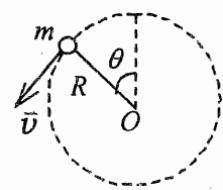

# 片区 选课号 姓名

## 习题六 能量守恒（一）

1．对功的概念有以下几种说法：

（1）保守力作正功时，系统内相应的势能增加.

（2）质点运动经一闭合路径，保守力对质点作的功为零.

（3）作用力和反作用力大小相等、方向相反，所以两者所作功的代数和必为零. 在上述说法中：

（A）（1）、（2）是正确.

（B）（2）、（3）是正确的.

（C）只有（2）是正确的.

（D）只有（3）是正确的. [ ]

2．（本题

一个质点同时在几个力作用下的位移为：

$$
\Delta \vec {r} = 4 \vec {i} - 5 \vec {j} + 6 \vec {k} \tag {SI}
$$

其中一个力为恒力 $\vec{F}=3\vec{i}-5\vec{j}+9\vec{k}\quad(\mathrm{SI})$，则此力在该位移过程中所作的功为

（A）67J.

（B）91J.

（C）17J.

（D） -67 J.

[ ]

3．小球 A和B的质量相同，B球原来静止，A 以速度u与B作对心碰撞. 这两球碰撞后的速度 $v_1$ 和 $v_2$ 的可能值是

（A） $- u , 2 u .$

（B） $u / 4 , 3 u / 4 .$ .

（C） $- u / 4 , 5 u / 4 .$ .

（D） ${ \frac { 1 } { 2 } } u , - u { \sqrt { 3 } } / 2 .$

[ ]

4．（本题 3 分）5022

一弹簧原长 $l_0=0.1\,\mathrm{m}$，倔强系数 k=50N/m，其一端固定在半径为 R=0.1m 的半圆环的端点 A，另一端与另一套在半圆环上的小环相连. 在把小环由半圆环中点 B 移到另一端C 的过程中，弹簧的拉力对小环所作的功为 J.

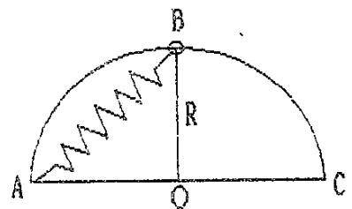

text_image

B
R
A
O
C

1．（本题 10 分）0422

一质量为m 的质点在XOY平面上运动，其位置矢量为

$$
\vec {r} = a \cos \omega t \vec {i} + b \sin \omega t \vec {j} \quad (\mathrm{SI})
$$

式中 a、b、  是正值常数，且 a>b.

（1）求质点在 A 点（a, 0）时和 B 点（0, b）时的动能；

（2）求质点所受的作用力 $\vec{F}$ 以及当质点从 A 点运动到 B 点的过程中 $\vec{F}$ 的分力 $F_x$ 和 $F_y$ 分别作的功.

2．（本题 10 分）0183

两个质量分别为 $m_1$ 和 $m_2$的木块 A 和 B，用一个质量忽略不计、倔强系数为 k 的弹簧联接起来，放置在光滑水平面上，使 A紧靠墙壁，如图所示，用力推木块 B使弹簧压缩 x0，然后释放. 已知 $m _ { 1 } = m , m _ { 2 } = 3 m ,$ ，求：

（1）释放后，A、B两木块速度相等时的瞬时速度的大小；

（2）释放后，弹簧的最大伸长量.

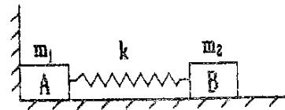

# 片区 选课号 姓名

## 习题七 能量守恒（二）

1．有一劲度系数为 k 的轻弹簧，原长为 $l_0$，将它吊在天花板上. 当它下端挂一托盘平衡时，其长度变为 $l_1$. 然后在托盘中放一重物，弹簧长度变为 $l_2$，则由 $l_1$ 伸长至 $l_2$ 的过程中，弹性力所作的功为

（A） $- \int _ { l _ { 1 } } ^ { l _ { 2 } } k x { \mathrm d } x .$

（B） $\int _ { l _ { 1 } } ^ { l _ { 2 } } k x \mathrm { d } x .$

（C） $- \int _ { l _ { 1 } - l _ { 0 } } ^ { l _ { 2 } - l _ { 0 } } k x { \mathrm { d } } x .$

（D） $\int _ { l _ { 1 } - l _ { 0 } } ^ { l _ { 2 } - l _ { 0 } } k x { \mathrm { d } } x .$ 2 0 l l -

2．（本题 3 分）5408

关于机械能守恒条件和动量守恒条件有以下几种说法，其中正确的是

（A）不受外力作用的系统，其动量和机械能必然同时守恒.  
（B）所受合外力为零，内力都是保守力的系统，其机械能必然守恒.  
（C）不受外力，而内力都是保守力的系统，其动量和机械能必然同时守恒.  
（D）外力对一个系统做的功为零，则该系统的机械能和动量必然同时守恒.

[ ]

3．（本题 5 分）0415

质量 m=1kg的物体，在坐标原点处从静止出发在水平面内沿 X轴运动，其所受合力方向与运动方向相同，合力大小为 $F = 3 + 2 x ( \mathrm { S I } )$ ，那么，物体在开始运动的 3m 内，合力所作功 W= ；且 x=3m 时，其速率 v=

4．如图所示，质量为 m 的小球系在劲度系数为 k的轻弹簧一端，弹簧的另一端固定在 O点. 开始时弹簧在水平位置 A，处于自然状态，原长为 l0. 小球由位置A释放，下落到 O点正下方位置 B时 ， 弹 簧 的 长 度 为 l，则小球到达 B 点 时 的 速 度 大 小 为Bv =

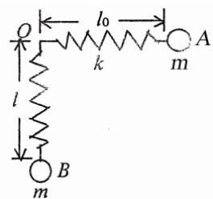

text_image

l
k
A
m
B
l0

5．一链条总长为l，质量为 m，放在桌面上，并使其部分下垂，下垂一段的长度为a. 设链条与桌面之间的滑动摩擦系数为 $\mu$. 令链条由静止开始运动，则

（1）到链条刚离开桌面的过程中，摩擦力对链条作了多少功？  
（2）链条刚离开桌面时的速率是多少？

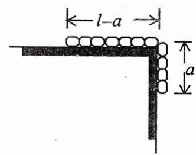

text_image

l-a
a

6．（本题 10 分）0194

在光滑的水平桌面上，平放有如图所示的固定半圆形屏障. 质量为 $m$ 的滑块以初速度 $v_0$ 沿切线方向进入屏障内，滑块与屏障间的摩擦系数为 $\mu$. 试证明当滑块从屏障另一端滑出时，摩擦力所作的功为

$$
W = \frac {1}{2} m v _ {0} ^ {2} (e ^ {- 2 \mu \pi} - 1)
$$

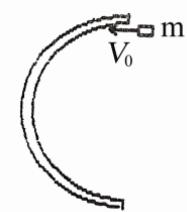

# 片区 选课号 姓名

## 习题八 动量守恒（一）

## 1．（本题 3 分）0384

质量为 20g的子弹，以 400m/s 的速率沿图示方向射入一原来静止的质量为 $980\,\mathrm{g}$ 的摆球中，摆线长度不可伸缩. 子弹射入后与摆球一起运动的速率为

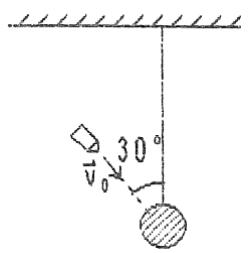

（A）4m/s.

（B）8m/s.

（C）2m/s.

（D）7m/s.

[ ]

2．质量为 20g 的子弹沿 X 轴正向以 500m/s 的速率射入一木块后，与木块一起仍沿 X轴正向以50m/s 的速率前进，在此过程中木块所受冲量的大小为

（A）$9\,\mathrm{N\cdot s}$.

（B）$-9\,\mathrm{N\cdot s}$.

（C）$10\,\mathrm{N\cdot s}$.

（D）$-10\,\mathrm{N\cdot s}$.

[ ]

3．一质量为 m 的物体，原来以速率 v 向北运动，它突然受到外力打击，变为向西运动，速率仍为 v，则外力的冲量大小为 ，方向为

## 4．（本题 5 分）0062

两块并排的木块 A 和 B，质量分别为 $m_1$ 和 $m_2$，静止地放置在光滑的水平面上，一子弹水平地穿过两木块，设子弹穿过两木块所用的时间分别为 $\Delta t _ { 1 }$ 和 $\Delta t _ { 2 }$ ，木块对子弹的阻力为恒力 F，则子弹穿出后，木块 A 的速度大小为 ，木块 B 的速度大小为

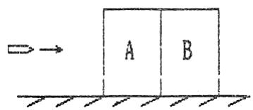

## 5．（本题 5 分）0376

一质点的运动轨迹如图所示. 已知质点的质量为 20g，在 A、B二位置处的速率都为20m/s， $\vec{v}_A$ 与 $x$ 轴成 $45^\circ$ 角，$\vec{v}_B$ 垂直于 $y$ 轴，求质点由 A点到B点这段时间内，作用在质点上外力的总冲量.

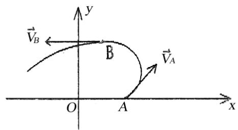

text_image

y
B
O A x
\vec{V}_A
\vec{V}_B

## 6．（本题 10 分）0186

如图所示，一辆质量为 M 的平顶小车在光滑水平轨道上以速度 $v_0$ 作匀速直线运动.今在车顶的前部边缘A处轻轻放上一质量为 m 的小物体，物体相对地面的速度为零. 设物体与车顶之间的摩擦系数为 $\mu$，为使物体不致于从顶上滑出去，问车顶的长度 L 最短应为多少？

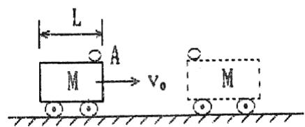

text_image

L
A
M → v₀
M

## 片区 选课号 姓名

## 习题九 动量守恒（二）

1．（本题 3 分）0379

在水平冰面上以一定速度向东行驶的炮车，向东南（斜向上）方向发射一炮弹，对于炮车和炮弹这一系统，在此过程中（忽略冰面摩擦力及空气阻力）

（A）总动量守恒.  
（B）总动量在炮身前进的方向上的分量守恒，其它方向动量不守恒.  
（C）总动量在水平面上任意方向的分量守恒，竖直方向分量不守恒.  
（D）总动量在任何方向的分量均不守恒.

[ ]

