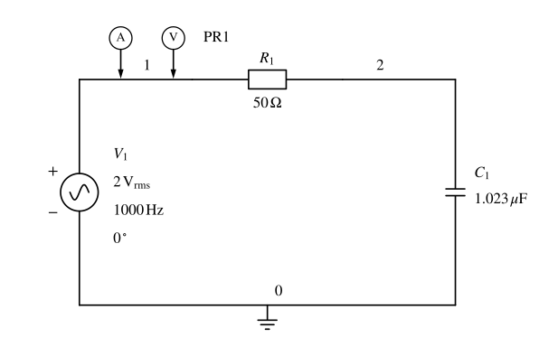

# 仿真作业1 RC 串联阻抗

%%
source: 仿真作业1.docx
paper_type: 作业
academic_year: 未知
%%

> 来源：[教师 Word 原件](../00_原材料/作业原件/仿真作业1.docx)。仅整理题面和原图；学号变量保留，表格留空。

### 仿真作业-1

%%
chapter: 第三章
question_type: 交流电路｜RC串联阻抗
source: 仿真作业1.docx
question_form: 综合题
ocr_status: 待复核
%%

如图1所示，R2和C1串联。R2=50欧姆，C1=学号后四位（单位nF），通过仿真分析,在不同频率情况下，RC串联的阻抗：

（1）理论计算该RC电路的阻抗；

（2）通过仿真得到该RC电路的阻抗，截图仿真结果，并完成下表；

| 信号频率 | 100Hz | 1KHz | 10KHz | 100KHz | 1MHz | 10MHz | 100MHz |
| --- | --- | --- | --- | --- | --- | --- | --- |
| ZR+C |  |  |  |  |  |  |  |

（2）结论分析。

图1

仿真作业提交：

完成仿真报告（word文档，主要内容包括：仿真题目要求、 仿真数据（截图）、仿真结论分析）。

**原件核对说明：** 原文写 R2=50 欧姆，原图标 R1=50Ω；原图 C1=1.023μF、V1=2Vrms/1000Hz 是原件中的示例显示。保留正文“C1=学号后四位（单位 nF）”，不以图中示例替代。原文“结论分析”序号重复为（2），照录。电阻编号与图文参数适用关系待教师确认。
