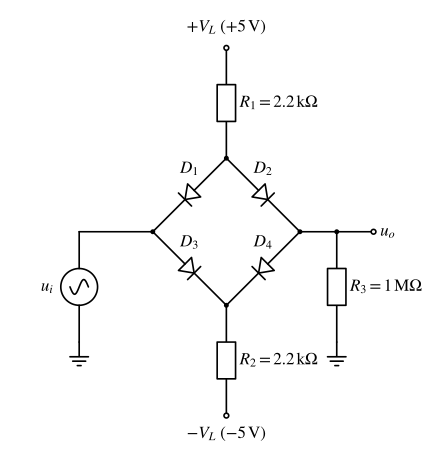
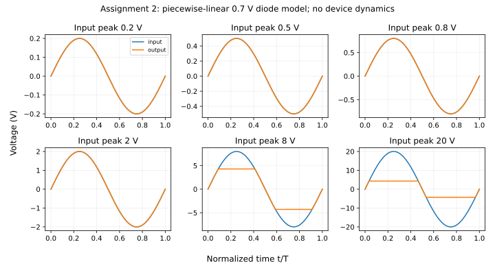

# 仿真作业2 二极管电路输入输出

%%
source: 仿真作业2.docx
paper_type: 作业
academic_year: 未知
%%

> 来源：[教师 Word 原件](../00_原材料/作业原件/仿真作业2.docx)。仅整理题面和原图；学号变量保留，表格留空。

### 仿真作业-2

%%
chapter: 第五章
question_type: 二极管｜限幅整流与应用
source: 仿真作业2.docx
question_form: 综合题
ocr_status: 已做结构修复
%%

如图所示，ui为交流正弦输入信号，频率为（学号后三位）kHz，通过仿真，分析ui分别为0.2V、0.5V、0.8V、2V、8V、20V时，输出uo的情况。

仿真作业提交：

（1） 完成仿真报告（word文档，主要内容包括：仿真题目要求、 仿真数据（截图）、仿真结论分析）。

（2）以姓名+学号的方式，发送邮件到助教邮箱474104857@qq.com

（3）在课程结束后一周之内提交仿真报告。

**原件核对说明：** 原文没有说明输入电压是峰值还是有效值，照录 V，不擅加 pk/rms。PNG 为原始 EMF 的渲染副本，未改画电路。

[原始 EMF 电路图](assets/simulation/sim-2-2351f0eeb823.emf)

> [!note]- 解答｜状态：独立解答未对照
>
> 原图不是普通无偏置整流桥：上、下节点分别经2.2kΩ接+5V、-5V，输入与输出位于桥的另外两端，负载为1MΩ。采用四管相同0.7V恒压降、忽略结电容和反向恢复的准静态模型，令 $V_c=(5-0.7)/(1+2.2\,\mathrm{k}\Omega/1\,\mathrm{M}\Omega)=4.29056\,\mathrm V$，有
> $$u_o=\begin{cases}-V_c,&u_i<-V_c,\\u_i,&|u_i|\le V_c,\\V_c,&u_i>V_c.\end{cases}$$
> 小输入时偏置使四管均可导通，两个二极管压降在输入到输出的路径相互抵消，所以0.2V输入仍能跟随，不能机械套“不到0.7V完全无输出”。正峰超过限幅时，输出由+5V、2.2kΩ及上右管供电；负峰对称。有限1MΩ负载使幅值从空载4.3V降到4.29056V。
>
> 本轮实际对四管16种导通组合列节点方程，逐点检查导通电流非负、截止管不正偏；以 $u_i=A\sin(2\pi t/T)$ 运行六档峰值，得到：
>
> | 假定输入为峰值A / V | 0.2 | 0.5 | 0.8 | 2 | 8 | 20 |
> | --- | ---: | ---: | ---: | ---: | ---: | ---: |
> | 恒压降模型输出峰值 / V | 0.2 | 0.5 | 0.8 | 2 | 4.29056 | 4.29056 |
>
> 
>
> 若原题给值是有效值，先令 $A=\sqrt2U_{i,rms}$ 再代入，不能把上表当作有效值结果。学号后三位记作 $m$，$f=m\,\mathrm{kHz}$；本模型结果只随归一化时间变化，没有器件高频效应，不能据此宣称任意学号频率下原管模型都相同。原题没有给器件型号/模型及pk/rms口径，原Multisim仿真、截图和个人报告仍未完成。
>
> 自检：数值节点解与上述分段式最大差小于 $10^{-8}\,\mathrm V$；输出为奇对称，增大输入只延长削顶区。
>
> 起手：先画清±5V偏置电流路径，再声明输入峰值/有效值和采用的二极管模型。
