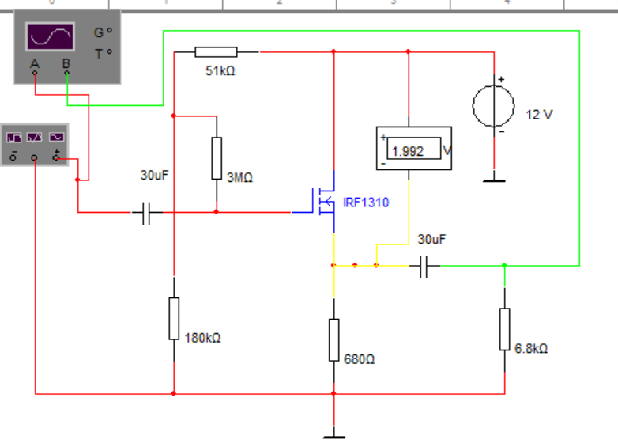

# 仿真作业4 共漏极放大电路仿真

%%
source: 仿真作业4-5-6.docx
paper_type: 作业
academic_year: 未知
%%

> 来源：[教师 Word 原件](../00_原材料/作业原件/仿真作业4-5-6.docx)。仅整理题面和原图；学号变量保留，表格留空。

### 仿真作业-4

%%
chapter: 第六章
question_type: FET｜基本放大电路
source: 仿真作业4-5-6.docx
question_form: 综合题
ocr_status: 已做结构修复
%%

如图1所示，为共漏极放大电路，输入信号为交流正弦信号，频率为（学号后三位）kHz。通过函数发生器产生信号作为ui.

通过仿真， ui分别为50mVpk 、500mVpk、2000mVpk时，输出信号uo的情况。并通过仿真分析该电路的放大倍数Aui。

图1

仿真作业提交：

完成仿真报告（word文档，主要内容包括：仿真题目要求、 仿真数据（截图）、仿真结论分析）。

**原件核对说明：** 电路图中的仪表 1.992 V 和示波器图标属于教师原件的静态画面，不是本次仿真数据或作业结果。学号参数及 mVpk 原样保留。
