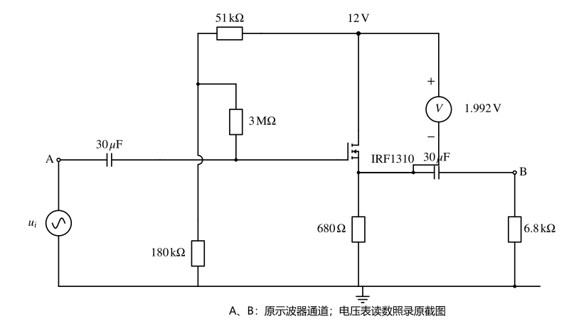

# 仿真作业4 共漏极放大电路仿真

%%
source: 仿真作业4-5-6.docx
paper_type: 作业
academic_year: 未知
%%

> 来源：[教师 Word 原件](../00_原材料/作业原件/仿真作业4-5-6.docx)。仅整理题面和原图；学号变量保留，表格留空。

### 仿真作业-4

%%
chapter: 第六章
question_type: FET｜基本放大电路
source: 仿真作业4-5-6.docx
question_form: 综合题
ocr_status: 已做结构修复
%%

如图1所示，为共漏极放大电路，输入信号为交流正弦信号，频率为（学号后三位）kHz。通过函数发生器产生信号作为ui.

通过仿真， ui分别为50mVpk 、500mVpk、2000mVpk时，输出信号uo的情况。并通过仿真分析该电路的放大倍数Aui。

图1

仿真作业提交：

完成仿真报告（word文档，主要内容包括：仿真题目要求、 仿真数据（截图）、仿真结论分析）。

**原件核对说明：** 电路图中的仪表 1.992 V 和示波器图标属于教师原件的静态画面，不是本次仿真数据或作业结果。学号参数及 mVpk 原样保留。

> [!note]- 解答｜状态：独立解答未对照
>
> 设学号频率为 $f=m\,\mathrm{kHz}$，保留 $m$。先求门极直流偏置：栅极电流近似零，3MΩ上无直流压降，故
> $$V_{GQ}=12\frac{180}{51+180}=9.35065\,\mathrm V.$$
> 源极电位须由原IRF1310模型的转移特性与 $I_D=V_S/(680\,\Omega)$ 联立，再检查恒流区和功耗；不能把原图仪表1.992V当作本轮测量或直接当作 $V_{GS}$。原图电压表接在漏源之间，其示例值若按 $V_{DS}=1.992$ 解读会给 $V_S=10.008$、$V_{GS}<0$，不能据此建立增强型NMOS的正常导通Q点，须回到器件模型/接线核对。
>
> 若在已确认的Q点、忽略 $r_{ds}$ 与体效应、30μF耦合电容在目标频率近似短路，则 $R_S'=680\parallel6800=618.18\,\Omega$，小信号电压增益为
> $$A_{ui}\approx\frac{g_mR_S'}{1+g_mR_S'},\qquad0<A_{ui}<1.$$
> 对应50mVpk、500mVpk、2000mVpk，在线性范围内输出峰值分别为 $0.05A_{ui}$、$0.5A_{ui}$、$2A_{ui}$ V。大信号是否失真须对瞬时 $V_{GS},V_{DS}$ 和正负摆幅逐点检查，不能仅乘同一个小信号增益。
>
> 输入栅极看到的偏置电阻近似为 $3\,\mathrm{M}\Omega+(51\parallel180)\,\mathrm{k}\Omega=3.03974\,\mathrm{M}\Omega$。低频应把两只30μF和源阻抗、输出电阻一起计入；高频须加入原MOS电容。因此缺少原器件模型与学号频率时只能给上述参数解，不能给唯一的数值增益或三幅真实输出截图。
>
> 自检：$g_m\to0$ 时增益趋0，$g_mR_S'\gg1$ 时趋1；跟随器同相但不保证2Vpk仍不失真。本轮没有运行IRF1310器件级仿真。
>
> 起手：先求栅偏置、核实器件Q点，再用该Q点的跨导求小信号增益。
