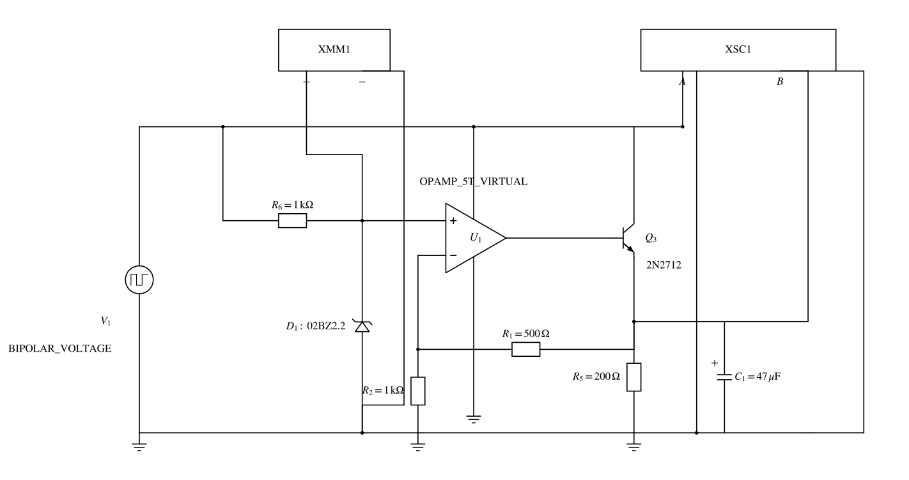

# 仿真作业5 负反馈的应用——直流线性稳压电源综合仿真

%%
source: 仿真作业4-5-6.docx
paper_type: 作业
academic_year: 未知
%%

> 来源：[教师 Word 原件](../00_原材料/作业原件/仿真作业4-5-6.docx)。仅整理题面和原图；学号变量保留，表格留空。

### 仿真作业-5

%%
chapter: 第九章
question_type: 直流电源｜串联型稳压反馈
source: 仿真作业4-5-6.docx
question_form: 综合题
ocr_status: 已做结构修复
%%

如图所示，图2为电压串联负反馈的典型电路（直流电源电路），晶体管Q3为调整管，Q3的发射极为电压输出。即使在输入电源V1存在电压波动的情况下，该电路能够实现输出电压的稳定。通过设置V1为具有直流偏置的交流激励源，来模拟电源的电压波动，频率为100kHz

通过仿真分析，在V1幅度波动分别为0.5Vpk，1Vpk，2Vpk请看下的电压输出，并截图保存；

仿真分析D1的电压值；

当V1幅度波动2V的时候，仿真分析C1电容值分别为10pF、1nF、1uF、47uF条件下的输出电压波动情况。

并进行总结分析。

图2

仿真作业提交：

完成仿真报告（word文档，主要内容包括：仿真题目要求、 仿真数据（截图）、仿真结论分析）。

**原件核对说明：** 原句“2Vpk请看下的电压输出”照录，不据此补造条件；直流偏置数值未给出，保持未指定。末项原文写“2V”，未擅加峰值或有效值说明。

> [!note]- 解答｜状态：独立解答未对照
>
> 原图稳压基准为D1（标02BZ2.2），经1kΩ从输入供电；输出经500Ω与1kΩ分压送反相端，故在D1稳定于 $U_Z$、运放与Q3在线性区且环路稳定时，
> $$U_O=\left(1+\frac{500}{1000}\right)U_Z=1.5U_Z.$$
> 若型号标记对应2.2V基准，则理想基准结果为3.3V；该2.2V是模型假设，实际D1电压须由器件伏安特性和 $I_Z\approx(V_{in}-U_Z)/(1\,\mathrm{k}\Omega)$ 求得并检查允许电流与功耗。
>
> 输出负载200Ω的电流约 $3.3/200=16.5\,\mathrm{mA}$，还要供采样支路约 $3.3/1500=2.2\,\mathrm{mA}$。调整管的发射极总电流约18.7mA，基极驱动不能漏掉采样支路。最低输入应同时给Q3、运放输出和参考支路留余量；未给输入直流偏置，无法保证0.5/1/2Vpk波动的谷值都在稳压区。
>
> 可把输入写成 $V_{in}(t)=V_0+a\sin(2\pi10^5t)$，$a=0.5,1,2$ V；原图激励符号另标BIPOLAR_VOLTAGE，正弦是正文“具有直流偏置的交流”下的一种待确认设置，不能冒充原文件已指定波形。必须声明 $V_0$、波形与器件模型后才运行。
>
> 稳定小信号下，输出电容导纳为 $j2\pi fC_1$。100kHz时10pF、1nF、1μF、47μF的容抗分别约159kΩ、1.59kΩ、1.59Ω、0.0339Ω；大电容通常减小高频输出阻抗，但同时改变环路极点。不能仅凭容抗断言原运放与Q3无条件稳定或给出准确纹波幅度。理想无限带宽运放、理想固定基准会预测输出恒为3.3V，因而无法替代本题有限器件仿真比较C的任务。
>
> 自检：采样节点应为输出的2/3；输出上升使反相端上升、驱动减小，反馈方向正确。本轮只完成参数与工况分析，没有运行原2N2712及OPAMP_5T_VIRTUAL模型，不提供虚构数据或截图。
>
> 起手：先指定输入直流偏置并检验谷值余量，再设置三档纹波和四档电容逐一仿真。
