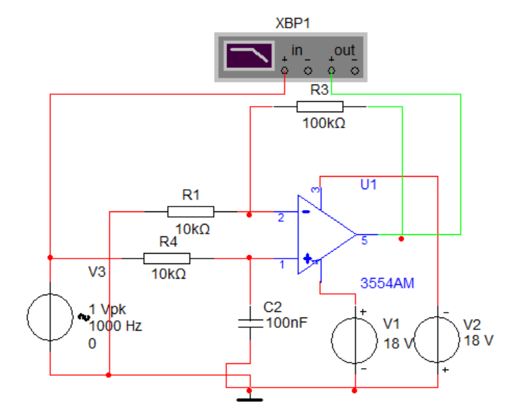
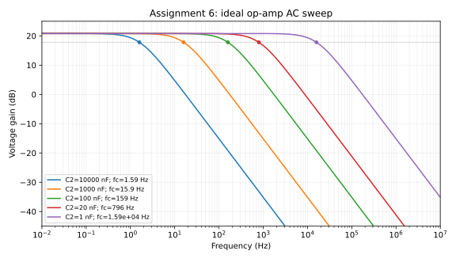

# 仿真作业6 低通有源滤波器

%%
source: 仿真作业4-5-6.docx
paper_type: 作业
academic_year: 未知
%%

> 来源：[教师 Word 原件](../00_原材料/作业原件/仿真作业4-5-6.docx)。仅整理题面和原图；学号变量保留，表格留空。

### 仿真作业-6

%%
chapter: 第七章
question_type: 运放｜有源滤波器判断
source: 仿真作业4-5-6.docx
question_form: 综合题
ocr_status: 已做结构修复
%%

如图1所示为有源低通滤波器，通过仿真分析不同电容值条件下的幅频响应，给出幅频响应曲线，并找出截止频率。

| C2 | 10uF | 1uF | 0.1uF | 20nF | 1nF |
| --- | --- | --- | --- | --- | --- |
| -3dB截止频率 |  |  |  |  |  |

图1

思考题： 分析有源滤波与无源滤波的区别？（提示：从带负载能力、信号输入范围、噪声等方面进行分析）

仿真作业提交：

完成仿真报告（word文档，主要内容包括：仿真题目要求、 仿真数据（截图）、仿真结论分析）。

**原件核对说明：** 原图 C2=100nF 是原件的初始示例，题面要求按表中五种 C2 分别仿真；空白截止频率表不填写。

> [!note]- 解答｜状态：独立解答未对照
>
> 原图 $R_1=10\,\mathrm{k}\Omega$ 左端通过竖线接地；它与输入横线交叉处没有连接点，不能误接为反相输入信号。$R_3=100\,\mathrm{k}\Omega$ 是反馈电阻，$R_4=10\,\mathrm{k}\Omega$ 与 $C_2$ 在同相端构成RC低通。
>
> 在理想运放、线性小信号AC模型中，
> $$H(j2\pi f)=\frac{1+R_3/R_1}{1+j2\pi fR_4C_2}=\frac{11}{1+j2\pi f(10\,\mathrm{k}\Omega)C_2}.$$
> 通带增益为11，即20.83dB。截止频率相对于这个通带下降3dB，增益幅值为 $11/\sqrt2\approx7.778$，并不是绝对幅度等于0.707。
>
> 本轮实际用上述复数传函进行数值AC扫频，并检查五个截止点的幅值比；得到下表与曲线。表中是**理想模型预测**，原题待填仿真表保持原样，未把理论数值冒充3554AM器件模型或Multisim实测截图。
>
> | C2 | 10μF | 1μF | 0.1μF | 20nF | 1nF |
> | --- | ---: | ---: | ---: | ---: | ---: |
> | 理想模型 $f_c=1/(2\pi R_4C_2)$ / Hz | 1.5915 | 15.915 | 159.15 | 795.77 | 15915 |
>
> 
>
> 自检：C缩小10倍，截止频率提高10倍；低频增益为11，高频以每十倍频-20dB衰减，各 $f_c$ 点均为通带的 $1/\sqrt2$。图中示例1000Hz信号并不是对全部C都位于通带。
>
> 思考题：有源级可隔离RC网络与负载并提供增益，输入、输出范围受运放电源、共模范围、输出摆幅/电流限制；有源器件自身引入噪声及有限增益带宽。无源RC不需供电、可处理范围由器件额定值决定，但有插入损耗且截止频率易受源阻抗与负载影响。两者都存在电阻热噪声，不能说无源完全无噪声。
>
> 完成原作业仍需在原3554AM模型中复现五次AC扫频、保留数据与截图并检查高频偏差；当前环境未运行该器件模型，不能宣布其实际截止频率与理想表完全一致。
>
> 起手：先确认R1接地的交叉线没有结点，再分开计算同相增益11与输入RC的截止频率。
