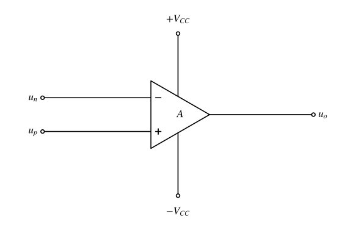
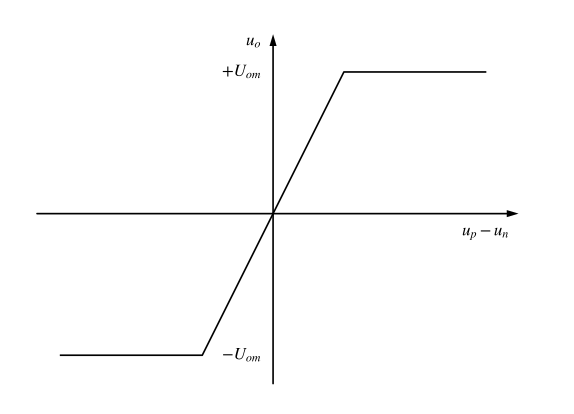

# 电子线路期末复习：复习要求与来源

原始来源：电脑 Downloads 中的 `夸克扫描王_电子线路期末复习.pdf`，14 页，SHA-256 `163e41f39e8da610b91858c4f05e27a7b1bd7bed66c3ed8d890cc7aae55f42b8`。原文件只读。下方原扫描页为从原 PDF 渲染的副本；题库展示电路图已另行重绘，原页始终保留作对照。

转换重新经 MinerU 解析、1/1 段 LLM 复读及 14/14 页视觉核对，再由技能脚本写出并验证 completion。题面以原扫描为准，原稿答案不构成本次 S9 核验解答。

[[电路分析/10_题库/电子线路期末复习_题面整理|去重后的题面入口]]

[原始 PDF](assets/电子线路期末复习/source.pdf) · [认证转换全文](../90_缓存/pdf-to-markdown/夸克扫描王_电子线路期末复习/夸克扫描王_电子线路期末复习.md) · 严格核验记录（过程产物未发布）

> S2已按当前成惠历年期末卷范围重算并核验（13卷114题）；这份手写复习资料不计入该真题频率。后续改变统计范围或题库输入时须再次重算。

[全部重绘图与中文说明](电子线路期末复习_电路图重绘说明.md)

## 半导体二极管复习要求
① 掌握二极管单向导通特性，利用单向导通特性分析整流、检波、限幅电路的输出波形等。分析方法：a) 图解法；b) 等效电路法和微变等效电路。

② 二极管的三种数学模型。（原稿此处仅列标题和括号，未展开。）

③ 稳压二极管及稳压电路。

## 基本放大电路复习要求
1. 晶体管的工作原理及电流放大作用，晶体管的共射特性曲线。
   温度对晶体管特性及参数的影响。（原稿此行标“8”。）
2. 场效应管（JFET、MOSFET）的工作原理、转移特性和输出特性。
3. 放大电路的工作原理。
4. 晶体管放大电路的三种接法及各自特点。
5. 场效应管放大电路的三种接法，尤其是共源、共漏。
6. 基本放大电路的分析方法，尤其是用等效电路法：静态分析和动态分析，求参数值，画等效电路。
7. 差分放大电路的分析。
8. 功率放大电路。
9. 负反馈及深度负反馈放大倍数分析，负反馈对放大电路性能的影响。

（也可以比较学习一下放大电路中正反馈的产生条件。）

补充要求（原 B23）：关于基本放大电路的分析和计算，参考 PPT 上的例题。此项是复习指示，不虚构成一条可作答习题。

## 集成运放复习要求
1. 集成运算放大电路的组成及各部分的作用。

说明：集成运放电路（也可以说是多级放大电路）由前面的基本放大电路组成。

- 第一级要求输入电阻高、电压放大倍数大、抑制零点漂移，因此需要双端输入的高性能差分放大电路。
- 中间级需要电压放大倍数大的基本放大电路，可采用共射或共源。
- 输出级需要输出电压线性范围宽、输出电阻小（带载能力强）、非线性失真小，故需采用互补输出电路（功率放大电路）。
- 偏置电路。
- 保护电路。

上述各级电路集成在一起，形成集成运算放大器。

2. 集成运算放大器的电压传输特性（掌握）。
3. 利用“虚短”和“虚断”分析集成运算放大器在线性区的应用及电路设计。

① PPT 和教学大纲中要求的运算电路要掌握。
② 有源滤波电路的分析。
③ 仪表放大器。
☆4. 利用集成运放在非线性区的特性进行电路分析：① 简单比较器电路的分析及输出波形；② 迟滞比较器。

## 去重口径
逐项对照现有题面、参数与相应题图。相同任务或完全包含的子问复用旧锚点；仅同知识点、参数不同或追问不同保留为新题。C5 与 E7-11 拓扑相同，但等阻条件与选择题设定不同，保留参数特例。C4 与 E7-13 图和求解目标一致，复用旧锚点；B20 与 E6-18 偏置拓扑及追问不同，保留。

续查原照片后，C14题干的负载符号确定为R_L，已修正原R2误录并解除待复核；C3右侧接线已找回，但上方反馈电阻仍未标值。2026-11-07续查A7输出两只反串稳压管连接明确，所问输出范围不依赖输入保护用途，按原图保留同向输入管后解除A7的待复核；当前本资料A4、C3共2题待复核；不以重绘清晰或同构课件示例替代原始条件完整性。A7 原参考答案涂改、B14 原参考值疑点仅保留在原页，不导入题库解答。

## 来源题目覆盖

| 原题编号 | PDF页 | 处理 | 题库位置 |
|---|---:|---|---|
| A1 | 1 | 新入库 | [[电路分析/10_题库/电子线路期末复习_题面整理#电子复习-A1|电子复习-A1]] |
| A2 | 1 | 新入库 | [[电路分析/10_题库/电子线路期末复习_题面整理#电子复习-A2|电子复习-A2]] |
| A3 | 1 | 新入库 | [[电路分析/10_题库/电子线路期末复习_题面整理#电子复习-A3|电子复习-A3]] |
| A4 | 1 | 新入库 | [[电路分析/10_题库/电子线路期末复习_题面整理#电子复习-A4|电子复习-A4]] |
| A5 | 1 | 新入库 | [[电路分析/10_题库/电子线路期末复习_题面整理#电子复习-A5|电子复习-A5]] |
| A6 | 1 | 新入库 | [[电路分析/10_题库/电子线路期末复习_题面整理#电子复习-A6|电子复习-A6]] |
| A7 | 2 | 新入库 | [[电路分析/10_题库/电子线路期末复习_题面整理#电子复习-A7|电子复习-A7]] |
| A8 | 2 | 新入库 | [[电路分析/10_题库/电子线路期末复习_题面整理#电子复习-A8|电子复习-A8]] |
| A9 | 2 | 新入库 | [[电路分析/10_题库/电子线路期末复习_题面整理#电子复习-A9|电子复习-A9]] |
| B1 | 3 | 新入库 | [[电路分析/10_题库/电子线路期末复习_题面整理#电子复习-B1|电子复习-B1]] |
| B2 | 3 | 新入库 | [[电路分析/10_题库/电子线路期末复习_题面整理#电子复习-B2|电子复习-B2]] |
| B3 | 4 | 复用：同一 N 沟道增强型 MOS 恒流区外部条件，旧题还要求模型 | [[电路分析/10_题库/成惠团队期末卷_5-9章/2018-2019第二学期期末_5-9章题面整理.md#成惠-18-19第二期末-简1|成惠-18-19第二期末-简1]] |
| B4 | 4 | 复用：同一 N 增强型 MOS 三极管区/饱和区分界条件 | [[电路分析/10_题库/成惠团队期末卷_5-9章/2017-2018电路分析与电子线路期末_5-9章题面整理.md#成惠-17-18期末-填6|成惠-17-18期末-填6]] |
| B5 | 4 | 新入库 | [[电路分析/10_题库/电子线路期末复习_题面整理#电子复习-B5|电子复习-B5]] |
| B6 | 4 | 新入库 | [[电路分析/10_题库/电子线路期末复习_题面整理#电子复习-B6|电子复习-B6]] |
| B7 | 4 | 新入库 | [[电路分析/10_题库/电子线路期末复习_题面整理#电子复习-B7|电子复习-B7]] |
| B8 | 4 | 新入库 | [[电路分析/10_题库/电子线路期末复习_题面整理#电子复习-B8|电子复习-B8]] |
| B9 | 4 | 新入库 | [[电路分析/10_题库/电子线路期末复习_题面整理#电子复习-B9|电子复习-B9]] |
| B10 | 4 | 新入库 | [[电路分析/10_题库/电子线路期末复习_题面整理#电子复习-B10|电子复习-B10]] |
| B11 | 4 | 新入库 | [[电路分析/10_题库/电子线路期末复习_题面整理#电子复习-B11|电子复习-B11]] |
| B12 | 4 | 新入库 | [[电路分析/10_题库/电子线路期末复习_题面整理#电子复习-B12|电子复习-B12]] |
| B13 | 4 | 新入库 | [[电路分析/10_题库/电子线路期末复习_题面整理#电子复习-B13|电子复习-B13]] |
| B14 | 4 | 新入库 | [[电路分析/10_题库/电子线路期末复习_题面整理#电子复习-B14|电子复习-B14]] |
| B15 | 5 | 新入库 | [[电路分析/10_题库/电子线路期末复习_题面整理#电子复习-B15|电子复习-B15]] |
| B16 | 5 | 新入库 | [[电路分析/10_题库/电子线路期末复习_题面整理#电子复习-B16|电子复习-B16]] |
| B17 | 5 | 复用：稳定静态点和改善动态性能两个子问已完整包含 | [[电路分析/10_题库/成惠团队期末卷_5-9章/2016-2017模拟电路期末A_5-9章题面整理.md#成惠-16-17模电期末A-填5|成惠-16-17模电期末A-填5]] |
| B18 | 5 | 新入库 | [[电路分析/10_题库/电子线路期末复习_题面整理#电子复习-B18|电子复习-B18]] |
| B19 | 5 | 新入库 | [[电路分析/10_题库/电子线路期末复习_题面整理#电子复习-B19|电子复习-B19]] |
| B20 | 6 | 新入库 | [[电路分析/10_题库/电子线路期末复习_题面整理#电子复习-B20|电子复习-B20]] |
| B21 | 6 | 新入库 | [[电路分析/10_题库/电子线路期末复习_题面整理#电子复习-B21|电子复习-B21]] |
| B22 | 6 | 新入库 | [[电路分析/10_题库/电子线路期末复习_题面整理#电子复习-B22|电子复习-B22]] |
| B24 | 8 | 新入库 | [[电路分析/10_题库/电子线路期末复习_题面整理#电子复习-B24|电子复习-B24]] |
| C1 | 13 | 新入库 | [[电路分析/10_题库/电子线路期末复习_题面整理#电子复习-C1|电子复习-C1]] |
| C2 | 13 | 新入库 | [[电路分析/10_题库/电子线路期末复习_题面整理#电子复习-C2|电子复习-C2]] |
| C3 | 13 | 新入库 | [[电路分析/10_题库/电子线路期末复习_题面整理#电子复习-C3|电子复习-C3]] |
| C4 | 13 | 复用：已逐图核对，同一双输入 RC 电路及输出关系，选择项不构成新任务 | [[电路分析/10_题库/第7章课后习题_题面整理.md#章节卷-E7-13|章节卷-E7-13]] |
| C5 | 10 | 新入库 | [[电路分析/10_题库/电子线路期末复习_题面整理#电子复习-C5|电子复习-C5]] |
| C6 | 10 | 复用：同一理想运放输入电阻、输出电阻和开环增益指标 | [[电路分析/10_题库/成惠团队期末卷_5-9章/2018-2019电路分析与模拟电路期末A_5-9章题面整理.md#成惠-18-19电模期末A-简5|成惠-18-19电模期末A-简5]] |
| C7 | 10 | 复用：同一多级放大器耦合方式填空 | [[电路分析/10_题库/成惠团队期末卷_5-9章/2015-2016模拟电路期末A_5-9章题面整理.md#成惠-15-16模电期末A-填1|成惠-15-16模电期末A-填1]] |
| C8 | 10 | 复用：与本扫描 B21 相同电路、相同五个参数、相同静态电压目标 | [[电路分析/10_题库/电子线路期末复习_题面整理#电子复习-B21|电子复习-B21]] |
| C9 | 10 | 新入库 | [[电路分析/10_题库/电子线路期末复习_题面整理#电子复习-C9|电子复习-C9]] |
| C10 | 9 | 复用：同一集成运放内部组成填空 | [[电路分析/10_题库/成惠团队期末卷_5-9章/2015-2016模拟电路期末A_5-9章题面整理.md#成惠-15-16模电期末A-填2|成惠-15-16模电期末A-填2]] |
| C11 | 9 | 新入库 | [[电路分析/10_题库/电子线路期末复习_题面整理#电子复习-C11|电子复习-C11]] |
| C12 | 9 | 新入库 | [[电路分析/10_题库/电子线路期末复习_题面整理#电子复习-C12|电子复习-C12]] |
| C13 | 9 | 新入库 | [[电路分析/10_题库/电子线路期末复习_题面整理#电子复习-C13|电子复习-C13]] |
| C14 | 9 | 新入库 | [[电路分析/10_题库/电子线路期末复习_题面整理#电子复习-C14|电子复习-C14]] |
| C15 | 9 | 新入库 | [[电路分析/10_题库/电子线路期末复习_题面整理#电子复习-C15|电子复习-C15]] |
| C16 | 9 | 复用：有源与无源滤波区别，原页边注重复要求 | [[电路分析/10_题库/成惠团队期末卷_5-9章/2016-2017模拟电路期末A_5-9章题面整理.md#成惠-16-17模电期末A-简2|成惠-16-17模电期末A-简2]] |

## 原扫描页

原页包含原作者参考答案与批注，只作出处，未验证答案正确性。

- [第 1 页](assets/电子线路期末复习/page-01.png)
- [第 2 页](assets/电子线路期末复习/page-02.png)
- [第 3 页](assets/电子线路期末复习/page-03.png)
- [第 4 页](assets/电子线路期末复习/page-04.png)
- [第 5 页](assets/电子线路期末复习/page-05.png)
- [第 6 页](assets/电子线路期末复习/page-06.png)
- [第 7 页](assets/电子线路期末复习/page-07.png)
- [第 8 页](assets/电子线路期末复习/page-08.png)
- [第 9 页](assets/电子线路期末复习/page-09.png)
- [第 10 页](assets/电子线路期末复习/page-10.png)
- [第 11 页](assets/电子线路期末复习/page-11.png)
- [第 12 页](assets/电子线路期末复习/page-12.png)
- [第 13 页](assets/电子线路期末复习/page-13.png)
- [第 14 页](assets/电子线路期末复习/page-14.png)