# 电子线路期末复习：电路图重绘说明

> 后续核验：B19、B20、B21、C2、C5、C9、C12–C15已由[首批10张核验稿](首批10张重绘图_核验报告.md)替换。以下保留此前草稿记录；A4、A7、C3原图信息存疑，题面恢复原图，候选重建稿不作为已确认连接依据。

共 21 张矢量图，覆盖原材料内的电路、输入波形、空白输出坐标、运放符号及传输特性。重复题 C4、C8 也保留重绘图作原题对照。所有说明使用中文，数学符号和器件编号沿用题干。

[题面入口](电子线路期末复习_题面整理.md) · [复习要求与原始来源](电子线路期末复习_复习要求与来源.md)

## 连接与重建规则

导线绕开器件轮廓和文字；连接分支标实心点，不连接的导线尽量改道。每张电路都执行了运放内部穿线检查，并作视觉复查。重绘只改善读图，不填入输出波形或题目答案。

A4、A7、C3、C14 的原始不确定性仍保留，见各图说明。其中 C3 是按题意重建的候选图，不能用于反向证明原扫描的缺失接法。

## 文件与原页

题库直接嵌入 SVG，可缩放查看。发布内容只包含矢量图，不包含绘图工作脚本；原始 PDF、扫描页和旧裁图保留。

## A4：二极管工作状态

左支路电源值原图未给，使用 E 表示未知，不补数值。

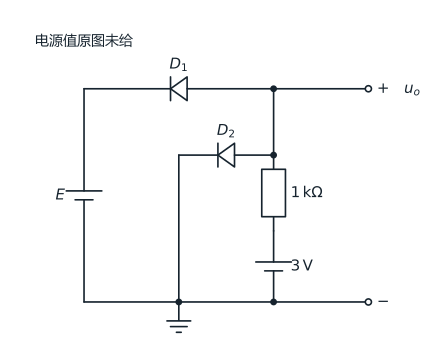

[矢量图](assets/电子线路期末复习/redrawn/A4.svg) · [原扫描第 1 页](assets/电子线路期末复习/page-01.png)

## A7：运放与双向稳压限幅

输入保护 D1/D2 原笔画方向模糊，按反并联输入限幅用途重建；输出稳压管按原图反向串联。此项为题意重建，非原图极性已确认。

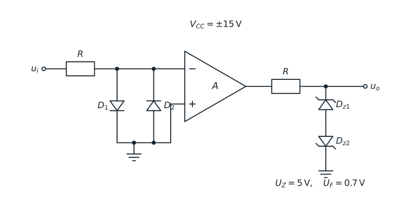

[矢量图](assets/电子线路期末复习/redrawn/A7.svg) · [原扫描第 2 页](assets/电子线路期末复习/page-02.png)

## A9：二极管与输入波形

保留 R 与 R0 为符号参数；二极管按题设恒压降 1 V 模型，未画输出答案。

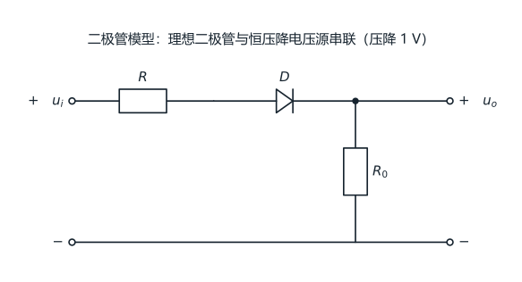

[矢量图](assets/电子线路期末复习/redrawn/A9.svg) · [原扫描第 2 页](assets/电子线路期末复习/page-02.png)

## A9-wave：输入三角波与空白输出坐标

仅输入波形；下方输出坐标保留空白。

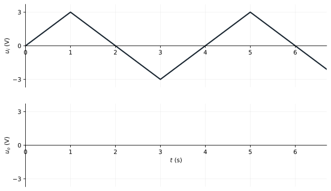

[矢量图](assets/电子线路期末复习/redrawn/A9-wave.svg) · [原扫描第 2 页](assets/电子线路期末复习/page-02.png)

## B19-a：共射电路等效变换 (a)

保留原图变换前的集电极电阻与并联支路；变换后的 UCC 与 R 留作题目未知量。

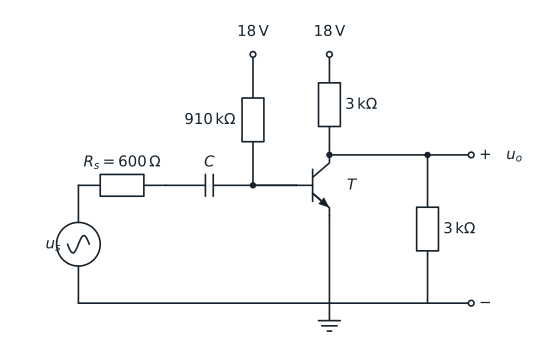

[矢量图](assets/电子线路期末复习/redrawn/B19-a.svg) · [原扫描第 5 页](assets/电子线路期末复习/page-05.png)

## B19-b：共射电路等效变换 (b)

保留原图变换前的集电极电阻与并联支路；变换后的 UCC 与 R 留作题目未知量。

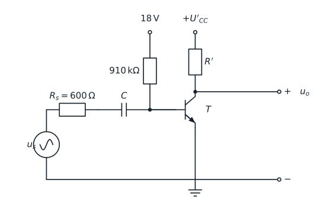

[矢量图](assets/电子线路期末复习/redrawn/B19-b.svg) · [原扫描第 5 页](assets/电子线路期末复习/page-05.png)

## B20：分压偏置共射放大电路

保留原图 Rb2 上、Rb1 下的编号。

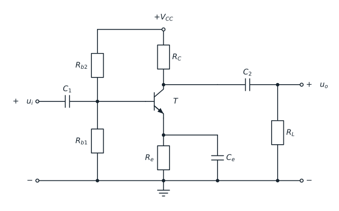

[矢量图](assets/电子线路期末复习/redrawn/B20.svg) · [原扫描第 6 页](assets/电子线路期末复习/page-06.png)

## B21：共源放大电路

按题干共源放大、独立栅偏置重建；原涂改不作为导线。

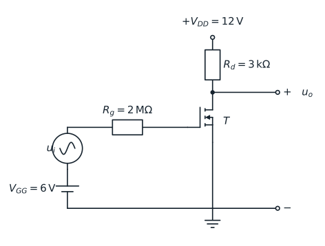

[矢量图](assets/电子线路期末复习/redrawn/B21.svg) · [原扫描第 6 页](assets/电子线路期末复习/page-06.png)

## C8：共源放大电路

按题干共源放大、独立栅偏置重建；原涂改不作为导线。

[矢量图](assets/电子线路期末复习/redrawn/C8.svg) · [原扫描第 10 页](assets/电子线路期末复习/page-10.png)

## C1：理想运放与 MOS 输出级

按源极输出、输出电压负反馈保留原连接；所有电阻相等条件仍由题干规定。

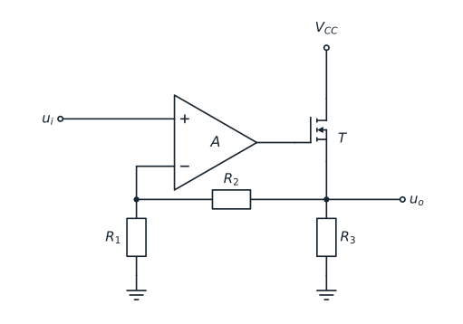

[矢量图](assets/电子线路期末复习/redrawn/C1.svg) · [原扫描第 13 页](assets/电子线路期末复习/page-13.png)

## C2：反相积分电路

正输入端接地支路电阻原图无编号，以 Rb 标示；不补阻值。

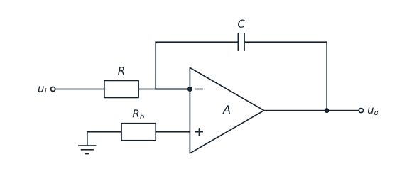

[矢量图](assets/电子线路期末复习/redrawn/C2.svg) · [原扫描第 13 页](assets/电子线路期末复习/page-13.png)

## C3：电压输入与输出电流反馈

原扫描右缘和回流路径不清。按题意重建为双运放电流反馈候选电路：A2 跟随 R0 后的负载节点，其输出送回 A1 输入电阻网络。负载回地与 A2 局部反馈属于重建假设；不声称是原图已确认接法，保留待复核。

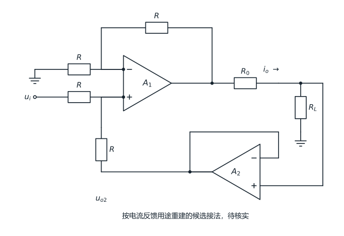

[矢量图](assets/电子线路期末复习/redrawn/C3.svg) · [原扫描第 13 页](assets/电子线路期末复习/page-13.png)

## C4：双输入 RC 运算电路

对应已去重的 E7-13，保留本扫描选择题电路供对照。

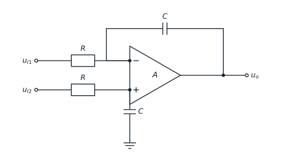

[矢量图](assets/电子线路期末复习/redrawn/C4.svg) · [原扫描第 13 页](assets/电子线路期末复习/page-13.png)

## C5：双运放差分输出

输出为上下两运放输出之差，不能将下输出端误接地。

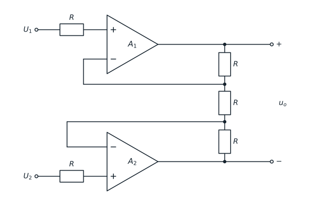

[矢量图](assets/电子线路期末复习/redrawn/C5.svg) · [原扫描第 10 页](assets/电子线路期末复习/page-10.png)

## C9：反相求和比较器与稳压限幅

R1 为参考输入、R2 为信号输入；图中未出现正反馈，保留原单阈值比较器连接。输出串联限流电阻原图未给阻值。

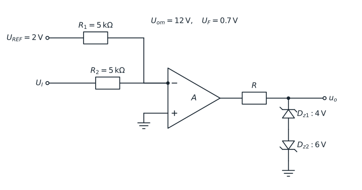

[矢量图](assets/电子线路期末复习/redrawn/C9.svg) · [原扫描第 10 页](assets/电子线路期末复习/page-10.png)

## C12：同相输入 RC 低通与输出反馈

Rf 反馈至反相端，因虚断无电流不补接地电阻；R1/C1 无数值仍保留符号参数。

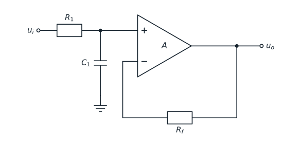

[矢量图](assets/电子线路期末复习/redrawn/C12.svg) · [原扫描第 9 页](assets/电子线路期末复习/page-09.png)

## C13：运放与 BJT 复合反馈电路

输出取发射极，R2 从输出回到反相端。

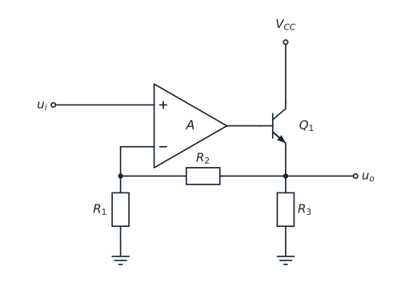

[矢量图](assets/电子线路期末复习/redrawn/C13.svg) · [原扫描第 9 页](assets/电子线路期末复习/page-09.png)

## C14：反相有源高通滤波电路

原图 R2 是正输入端平衡电阻，题干称“负载 R2”与图不符，保留原编号并在题旁提示该冲突。

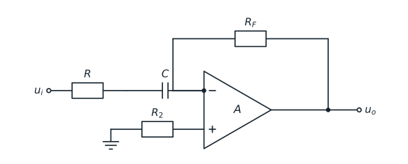

[矢量图](assets/电子线路期末复习/redrawn/C14.svg) · [原扫描第 9 页](assets/电子线路期末复习/page-09.png)

## C15：同相有源高通滤波电路

同相端为 C 串联、R 对地的高通输入，不能将输入电容改作反馈电容。

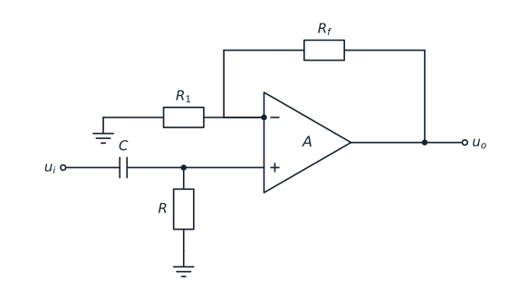

[矢量图](assets/电子线路期末复习/redrawn/C15.svg) · [原扫描第 9 页](assets/电子线路期末复习/page-09.png)

## OP-symbol：集成运放符号

教学符号，不指定未给出的开环增益数值。

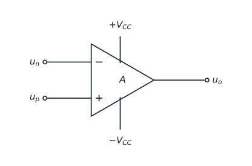

[矢量图](assets/电子线路期末复习/redrawn/OP-symbol.svg) · [原扫描第 12 页](assets/电子线路期末复习/page-12.png)

## OP-transfer：运放电压传输特性

示意线性区和正负饱和区，横坐标断点不表示特定数值。

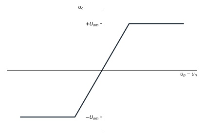

[矢量图](assets/电子线路期末复习/redrawn/OP-transfer.svg) · [原扫描第 12 页](assets/电子线路期末复习/page-12.png)
