# 电子线路期末复习：去重后题面

%%
chapter: 综合
question_type: 真题整卷｜复习资料
source: 夸克扫描王_电子线路期末复习
paper_type: 其他
academic_year: 未知
%%

> 来源为 14 页手写复习资料，不虚构学年或真题卷名。仅整理题面，不导入参考答案；原题序与去重映射见配套复习要求。A=第一部分，B=基本放大，C=集成运放及混排补题。

[[电路分析/10_题库/电子线路期末复习_复习要求与来源|复习要求、去重映射和原页]]

> 本批10张题图使用已核验矢量稿，见[前后对照、源文件与核验报告](首批10张重绘图_核验报告.md)。A4、A7、C3保留存疑原图；[此前草稿说明](电子线路期末复习_电路图重绘说明.md)另存来源记录。

### 电子复习-A1

%%
chapter: 第九章
question_type: 直流电源｜半波与桥式整流
source: 电子线路期末复习｜原第1页｜A1
question_form: 填空题
ocr_status: 已对照 PDF 复核
%%

整流的目的是 ______。

[原扫描第 1 页](assets/电子线路期末复习/page-01.png)

### 电子复习-A2

%%
chapter: 第五章
question_type: 二极管｜限幅整流与应用
source: 电子线路期末复习｜原第1页｜A2
question_form: 填空题
ocr_status: 已对照 PDF 复核
%%

全波整流电路中利用了二极管 ______ 的特性，将交流变换为直流，而在稳压电路中，则是利用了二极管工作在 ______ 状态下，在一定电流范围内起到稳压的特性。

[原扫描第 1 页](assets/电子线路期末复习/page-01.png)

### 电子复习-A3

%%
chapter: 第五章
question_type: 二极管｜PN结与器件基础
source: 电子线路期末复习｜原第1页｜A3
question_form: 选择题
ocr_status: 已对照 PDF 复核
%%

哪个不属于半导体的特性？

a) 热敏性；b) 光敏性；c) 单向导电性；d) 可掺杂性。

[原扫描第 1 页](assets/电子线路期末复习/page-01.png)

### 电子复习-A4

%%
chapter: 第五章
question_type: 二极管｜导通截止与模型选择
source: 电子线路期末复习｜原第1页｜A4
question_form: 填空题
ocr_status: 待复核
%%

判断二极管的工作状态：$D_1$：______；$D_2$：______。

原图左侧电源未标数值，照原图保留，不补造条件。

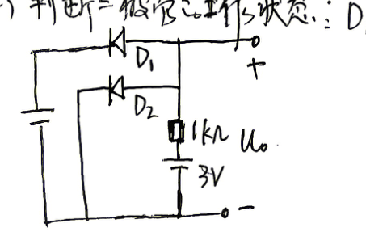

[原扫描题图](assets/电子线路期末复习/A4.png)

[原扫描第 1 页](assets/电子线路期末复习/page-01.png)

> 本批保留原图：缺失或存疑信息尚不能裁决，不以按用途推测的草稿替代原连接。

### 电子复习-A5

%%
chapter: 第五章
question_type: 二极管｜PN结与器件基础
source: 电子线路期末复习｜原第1页｜A5
question_form: 填空题
ocr_status: 已对照 PDF 复核
%%

PN 结加正向电压时，空间电荷区将（　）。

[原扫描第 1 页](assets/电子线路期末复习/page-01.png)

### 电子复习-A6

%%
chapter: 第五章
question_type: 二极管｜稳压管稳压判断
source: 电子线路期末复习｜原第1页｜A6
question_form: 填空题
ocr_status: 已对照 PDF 复核
%%

稳压管的稳压是工作在 ______。

[原扫描第 1 页](assets/电子线路期末复习/page-01.png)

### 电子复习-A7

%%
chapter: 第七章
question_type: 运放｜比较器与传输特性
source: 电子线路期末复习｜原第2页｜A7
question_form: 填空题
ocr_status: 待复核
%%

放大器 A 供电电压为 $\pm15\,\mathrm{V}$，$D_{z1}$、$D_{z2}$ 的稳压值为 $5\,\mathrm{V}$，导通压降为 $0.7\,\mathrm{V}$，则输出电压 $U_o$ 的电压范围为（　）。

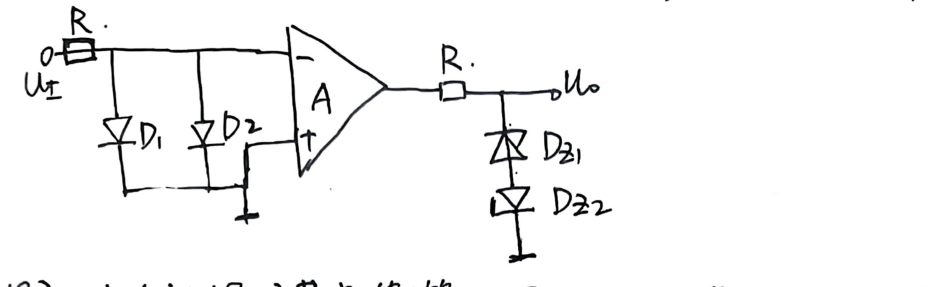

[原扫描题图](assets/电子线路期末复习/A7.png)

[原扫描第 2 页](assets/电子线路期末复习/page-02.png)

> 本批保留原图：缺失或存疑信息尚不能裁决，不以按用途推测的草稿替代原连接。

### 电子复习-A8

%%
chapter: 第六章
question_type: BJT｜管型与工作状态判断
source: 电子线路期末复习｜原第2页｜A8
question_form: 填空题
ocr_status: 已对照 PDF 复核
%%

工作在放大区的某晶体管，当 $I_B$ 从 $12\,\mu\mathrm{A}$ 增大到 $22\,\mu\mathrm{A}$ 时，$I_C$ 从 $1\,\mathrm{mA}$ 变为 $2\,\mathrm{mA}$，那么它的 $\beta$ 约为（　）。

[原扫描第 2 页](assets/电子线路期末复习/page-02.png)

### 电子复习-A9

%%
chapter: 第五章
question_type: 二极管｜限幅整流与应用
source: 电子线路期末复习｜原第2页｜A9
question_form: 综合题
ocr_status: 已对照 PDF 复核
%%

假设二极管等效为理想二极管和 $1\,\mathrm{V}$ 电压源的串联，$u_i$ 输入波形如图所示，画出 $u_o$ 的波形。

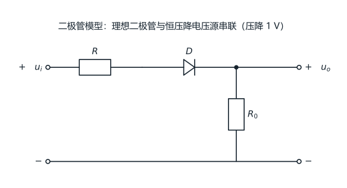

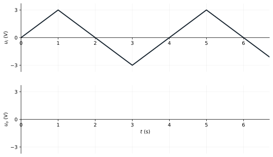

[原扫描题图](assets/电子线路期末复习/A9.png)

[原扫描第 2 页](assets/电子线路期末复习/page-02.png)

### 电子复习-B1

%%
chapter: 第六章
question_type: BJT｜管型与工作状态判断
source: 电子线路期末复习｜原第3页｜B1
question_form: 填空题
ocr_status: 已对照 PDF 复核
%%

NPN 型 BJT，测得 $U_C=2.3\,\mathrm{V}$，$U_B=2.7\,\mathrm{V}$，$U_E=2\,\mathrm{V}$，则该晶体管工作状态是 ______。

[原扫描第 3 页](assets/电子线路期末复习/page-03.png)

### 电子复习-B2

%%
chapter: 第六章
question_type: BJT｜管型与工作状态判断
source: 电子线路期末复习｜原第3页｜B2
question_form: 填空题
ocr_status: 已对照 PDF 复核
%%

晶体三极管是依靠 ______ 来控制集电极电流，是一种 ______ 控制器件。

[原扫描第 3 页](assets/电子线路期末复习/page-03.png)

### 电子复习-B5

%%
chapter: 第六章
question_type: FET｜基本放大电路
source: 电子线路期末复习｜原第4页｜B5
question_form: 填空题
ocr_status: 已对照 PDF 复核
%%

基于场效应管构成的放大电路中，场效应管的工作区域为 ______。

[原扫描第 4 页](assets/电子线路期末复习/page-04.png)

### 电子复习-B6

%%
chapter: 第六章
question_type: BJT｜共射小信号分析
source: 电子线路期末复习｜原第4页｜B6
question_form: 填空题
ocr_status: 已对照 PDF 复核
%%

为了实现尽可能大的电压放大倍数，通常选用（　）基本放大电路。

[原扫描第 4 页](assets/电子线路期末复习/page-04.png)

### 电子复习-B7

%%
chapter: 第六章
question_type: 放大电路｜差分与共模抑制
source: 电子线路期末复习｜原第4页｜B7
question_form: 填空题
ocr_status: 已对照 PDF 复核
%%

差分放大电路的作用是（　）。

[原扫描第 4 页](assets/电子线路期末复习/page-04.png)

### 电子复习-B8

%%
chapter: 第六章
question_type: 放大电路｜功率放大输出级
source: 电子线路期末复习｜原第4页｜B8
question_form: 填空题
ocr_status: 已对照 PDF 复核
%%

OCL 功率放大电路的结构是（　）。

[原扫描第 4 页](assets/电子线路期末复习/page-04.png)

### 电子复习-B9

%%
chapter: 第六章
question_type: 放大电路｜功率放大输出级
source: 电子线路期末复习｜原第4页｜B9
question_form: 填空题
ocr_status: 已对照 PDF 复核
%%

与甲类功率放大电路比较，乙类功率放大电路的主要优点是（　）。

[原扫描第 4 页](assets/电子线路期末复习/page-04.png)

### 电子复习-B10

%%
chapter: 第六章
question_type: BJT｜共集与共基特性
source: 电子线路期末复习｜原第4页｜B10
question_form: 填空题
ocr_status: 已对照 PDF 复核
%%

为了实现尽可能大的输入电阻，通常选用（　）基本放大电路。

[原扫描第 4 页](assets/电子线路期末复习/page-04.png)

### 电子复习-B11

%%
chapter: 第六章
question_type: 放大电路｜静态工作点
source: 电子线路期末复习｜原第4页｜B11
question_form: 填空题
ocr_status: 已对照 PDF 复核
%%

放大电路中交直流信号同时存在，分析放大电路的方法是（　）。

[原扫描第 4 页](assets/电子线路期末复习/page-04.png)

### 电子复习-B12

%%
chapter: 第六章
question_type: 放大电路｜失真与动态范围
source: 电子线路期末复习｜原第4页｜B12
question_form: 填空题
ocr_status: 已对照 PDF 复核
%%

放大电路中，若静态工作点设置不合理，可能会出现的失真有（　）和（　）。

[原扫描第 4 页](assets/电子线路期末复习/page-04.png)

### 电子复习-B13

%%
chapter: 第六章
question_type: 放大电路｜频率响应
source: 电子线路期末复习｜原第4页｜B13
question_form: 填空题
ocr_status: 已对照 PDF 复核
%%

放大电路的频率响应包括（　）和（　），其频率响应曲线的对数化坐标表示称为（　）。

[原扫描第 4 页](assets/电子线路期末复习/page-04.png)

### 电子复习-B14

%%
chapter: 第六章
question_type: 放大电路｜差分与共模抑制
source: 电子线路期末复习｜原第4页｜B14
question_form: 填空题
ocr_status: 已对照 PDF 复核
%%

双端差分放大电路的两个电压分别为 $u_{i1}=3\,\mathrm{V}$、$u_{i2}=2.98\,\mathrm{V}$，则差模电压、共模输入电压为（　）。

[原扫描第 4 页](assets/电子线路期末复习/page-04.png)

### 电子复习-B15

%%
chapter: 第六章
question_type: 放大电路｜负反馈组态判断
source: 电子线路期末复习｜原第5页｜B15
question_form: 填空题
ocr_status: 已对照 PDF 复核
%%

负反馈对输入电阻的影响取决于基本放大电路与反馈网络在电路输入端的连接方式。引入（　），使引入反馈支路的等效电阻增大到基本放大电路的（　）倍。

[原扫描第 5 页](assets/电子线路期末复习/page-05.png)

### 电子复习-B16

%%
chapter: 第六章
question_type: 放大电路｜负反馈组态判断
source: 电子线路期末复习｜原第5页｜B16
question_form: 填空题
ocr_status: 已对照 PDF 复核
%%

负反馈对输出电阻的影响取决于基本放大电路与反馈网络在放大电路输出端的连接方式。引入（　），使得引入反馈支路的等效电阻增大到基本放大电路的（　）倍。

[原扫描第 5 页](assets/电子线路期末复习/page-05.png)

### 电子复习-B18

%%
chapter: 第六章
question_type: 放大电路｜负反馈组态判断
source: 电子线路期末复习｜原第5页｜B18
question_form: 填空题
ocr_status: 已对照 PDF 复核
%%

当信号源为恒流源或内阻很大的电压源时，为了减小放大电路的输入电阻，使电路获得更大的输入电流，应引入（　）负反馈。

[原扫描第 5 页](assets/电子线路期末复习/page-05.png)

### 电子复习-B19

%%
chapter: 第六章
question_type: BJT｜共射小信号分析
source: 电子线路期末复习｜原第5页｜B19
question_form: 综合题
ocr_status: 已对照 PDF 复核
%%

下图 (b) 是 (a) 图经过变换后的等效电路，请分析图 (b)：(1) $+U'_{CC}$ 和 $R'$ 分别是多少？(2) 等效变换的理论依据是什么？(3) 该电路属于哪种基本放大电路？

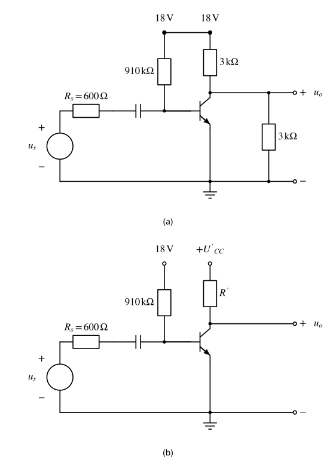

[原扫描题图](assets/电子线路期末复习/B19.png)

[原扫描第 5 页](assets/电子线路期末复习/page-05.png)

[本批逐项核验与前后对照](首批10张重绘图_核验报告.md)

### 电子复习-B20

%%
chapter: 第六章
question_type: 放大电路｜偏置反馈与稳定工作点
source: 电子线路期末复习｜原第6页｜B20
question_form: 简答题
ocr_status: 已对照 PDF 复核
%%

基于 BJT 构成的放大电路静态工作点对温度敏感，请简述下图所示电路引入 $R_e$ 后稳定静态工作点的机理。稳定放大电路静态工作点还有哪些方法？

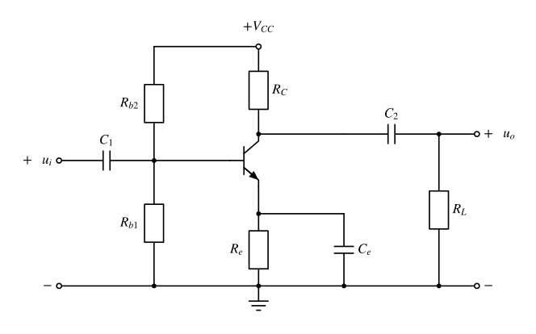

[原扫描题图](assets/电子线路期末复习/B20.png)

[原扫描第 6 页](assets/电子线路期末复习/page-06.png)

[本批逐项核验与前后对照](首批10张重绘图_核验报告.md)

### 电子复习-B21

%%
chapter: 第六章
question_type: FET｜基本放大电路
source: 电子线路期末复习｜原第6页｜B21
question_form: 填空题
ocr_status: 已对照 PDF 复核
%%

图示共源放大电路，已知 $V_{GG}=6\,\mathrm{V}$、$V_{DD}=12\,\mathrm{V}$、$R_g=2\,\mathrm{M}\Omega$、$R_d=3\,\mathrm{k}\Omega$、$U_{GS(th)}=4\,\mathrm{V}$，则静态电压 $U_{GSQ}=$ ______。

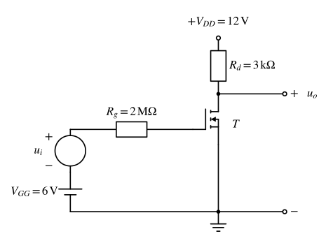

[原扫描题图](assets/电子线路期末复习/B21.png)

[原扫描第 6 页](assets/电子线路期末复习/page-06.png)

[本批逐项核验与前后对照](首批10张重绘图_核验报告.md)

### 电子复习-B22

%%
chapter: 第六章
question_type: BJT｜管型与工作状态判断
source: 电子线路期末复习｜原第6页｜B22
question_form: 简答题
ocr_status: 已对照 PDF 复核
%%

BJT 与 MOSFET 的区别？

[原扫描第 6 页](assets/电子线路期末复习/page-06.png)

### 电子复习-B24

%%
chapter: 第六章
question_type: 放大电路｜放大本质与性能指标
source: 电子线路期末复习｜原第8页｜B24
question_form: 简答题
ocr_status: 已对照 PDF 复核
%%

从能量的角度看，放大电路为什么可以放大信号的功率？放大电路的技术性能指标有哪些？

[原扫描第 8 页](assets/电子线路期末复习/page-08.png)

### 电子复习-C1

%%
chapter: 第七章
question_type: 运放｜比例运算基础
source: 电子线路期末复习｜原第13页｜C1
question_form: 选择题
ocr_status: 已对照 PDF 复核
%%

A 为理想运放，其中所有电阻相等，则输出电压与输入电压关系为（　）。

A. $u_o=2U_I$；B. $u_o=-2U_I$；C. $u_o=U_I$；D. $u_o=-u_I$。

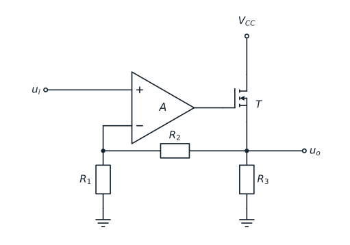

[原扫描题图](assets/电子线路期末复习/C1.png)

[原扫描第 13 页](assets/电子线路期末复习/page-13.png)

### 电子复习-C2

%%
chapter: 第七章
question_type: 运放｜积分与微分运算
source: 电子线路期末复习｜原第13页｜C2
question_form: 选择题
ocr_status: 已对照 PDF 复核
%%

A 为理想运放，电容的初始电压为 0，则输出电压与输入电压关系为（　）。

A. $u_o=-RC\frac{du_I}{dt}$；B. $u_o=-\frac{1}{RC}\int u_I\,dt$；C. $u_o=U_I$；D. $u_o=0$。

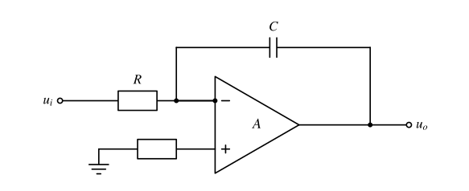

[原扫描题图](assets/电子线路期末复习/C2.png)

[原扫描第 13 页](assets/电子线路期末复习/page-13.png)

[本批逐项核验与前后对照](首批10张重绘图_核验报告.md)

### 电子复习-C3

%%
chapter: 第六章
question_type: 放大电路｜负反馈组态判断
source: 电子线路期末复习｜原第13页｜C3
question_form: 填空题
ocr_status: 待复核
%%

输入电压 $u_i$，输出电流为 $i_o$。集成运放均工作在线性放大状态，$A_2$ 将输出电流信号反馈至输入端，则输出电流与输入电压关系为（　）。

原稿电路右侧贴近扫描边缘；保留原图全部可见连接，不补画边界外内容。

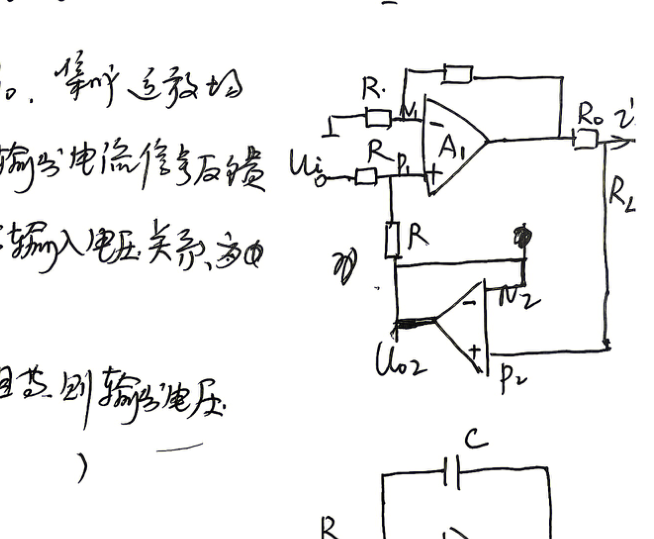

[原扫描题图](assets/电子线路期末复习/C3.png)

[原扫描第 13 页](assets/电子线路期末复习/page-13.png)

> 本批保留原图：缺失或存疑信息尚不能裁决，不以按用途推测的草稿替代原连接。

### 电子复习-C5

%%
chapter: 第七章
question_type: 运放｜差分比例运算
source: 电子线路期末复习｜原第10页｜C5
question_form: 选择题
ocr_status: 已对照 PDF 复核
%%

如图，求输出电压与输入电压关系为（　）。

A. $u_o=-(U_1-U_2)$；B. $u_o=U_1-U_2$；C. $u_o=-3(U_1-U_2)$；D. $u_o=3(U_1-U_2)$。

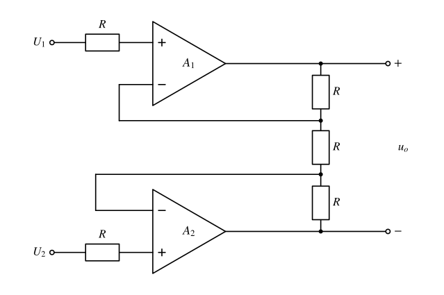

[原扫描题图](assets/电子线路期末复习/C5.png)

[原扫描第 10 页](assets/电子线路期末复习/page-10.png)

[本批逐项核验与前后对照](首批10张重绘图_核验报告.md)

### 电子复习-C9

%%
chapter: 第七章
question_type: 运放｜比较器与传输特性
source: 电子线路期末复习｜原第10页｜C9
question_form: 填空题
ocr_status: 已对照 PDF 复核
%%

$R_1=R_2=5\,\mathrm{k}\Omega$，$U_{om}=12\,\mathrm{V}$，$U_{REF}=2\,\mathrm{V}$。$D_{z1}$ 和 $D_{z2}$ 的稳压电压分别为 $4\,\mathrm{V}$ 和 $6\,\mathrm{V}$，正向压降为 $0.7\,\mathrm{V}$。电路的输出正电压 $U_{oH}=$ ______，阈值电压 $U_T=$ ______。当 $U_I$ 从大于 $U_T$ 变为小于 $U_T$ 时，输出曲线变化趋势是（　）。

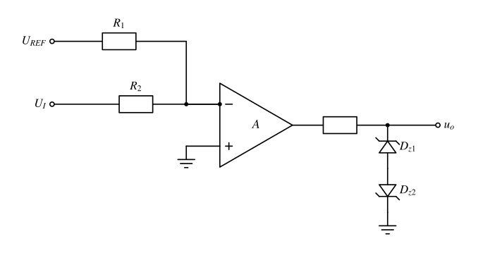

[原扫描题图](assets/电子线路期末复习/C9.png)

[原扫描第 10 页](assets/电子线路期末复习/page-10.png)

[本批逐项核验与前后对照](首批10张重绘图_核验报告.md)

### 电子复习-C11

%%
chapter: 第六章
question_type: 放大电路｜频率响应
source: 电子线路期末复习｜原第9页｜C11
question_form: 填空题
ocr_status: 已对照 PDF 复核
%%

当放大器频率处于通频带时，放大器的电压放大倍数为 100，则当输入信号频率为截止频率时，放大器的电压放大倍数为 ______。

[原扫描第 9 页](assets/电子线路期末复习/page-09.png)

### 电子复习-C12

%%
chapter: 第七章
question_type: 运放｜有源滤波器判断
source: 电子线路期末复习｜原第9页｜C12
question_form: 填空题
ocr_status: 已对照 PDF 复核
%%

如图，A 为理想运放，当 $u_i$ 频率趋于 0 时，输出电压 $u_o$ 与输入 $u_i$ 的关系为 ______；当 $u_i$ 的频率为 $1\,\mathrm{kHz}$ 时，输出电压 $u_o$ 与 $u_i$ 的关系为 ______。

原图未给出 $R_1,C_1$ 的数值，按原题保留符号参数，不替其补值。

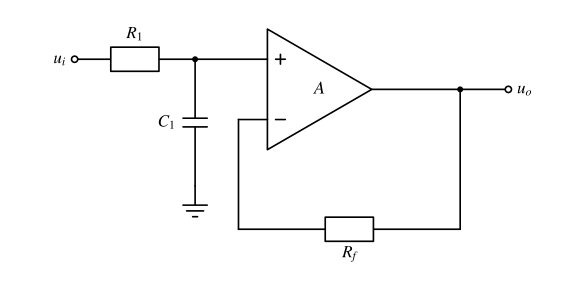

[原扫描题图](assets/电子线路期末复习/C12.png)

[原扫描第 9 页](assets/电子线路期末复习/page-09.png)

[本批逐项核验与前后对照](首批10张重绘图_核验报告.md)

### 电子复习-C13

%%
chapter: 第六章
question_type: 放大电路｜负反馈组态判断
source: 电子线路期末复习｜原第9页｜C13
question_form: 填空题
ocr_status: 已对照 PDF 复核
%%

如图，电路反馈组态属于（　）。

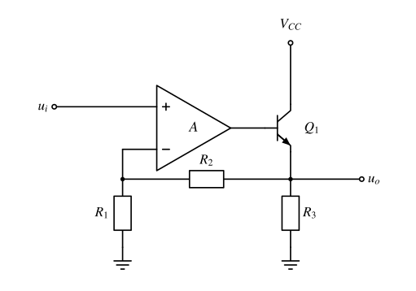

[原扫描题图](assets/电子线路期末复习/C13.png)

[原扫描第 9 页](assets/电子线路期末复习/page-09.png)

[本批逐项核验与前后对照](首批10张重绘图_核验报告.md)

### 电子复习-C14

%%
chapter: 第七章
question_type: 运放｜有源滤波器判断
source: 电子线路期末复习｜原第9页｜C14
question_form: 填空题
ocr_status: 待复核
%%

如图所示运算电路是（　）（高通/低通）滤波电路，带宽与负载 $R_2$（　）（有关/无关）。

第 14 题图。

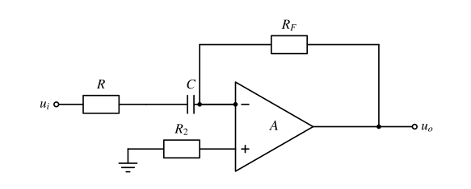

[原扫描题图](assets/电子线路期末复习/C14.png)

[原扫描第 9 页](assets/电子线路期末复习/page-09.png)

原图与题干冲突：原图中的 $R_2$ 位于同相输入端接地支路，题干却称其为“负载”。重绘保留原连接及编号，不擅自将该电阻移到输出端，保留待复核。

[本批逐项核验与前后对照](首批10张重绘图_核验报告.md)

### 电子复习-C15

%%
chapter: 第七章
question_type: 运放｜有源滤波器判断
source: 电子线路期末复习｜原第9页｜C15
question_form: 简答题
ocr_status: 已对照 PDF 复核
%%

分析第 9 页下方所示电路是哪种类型滤波器。

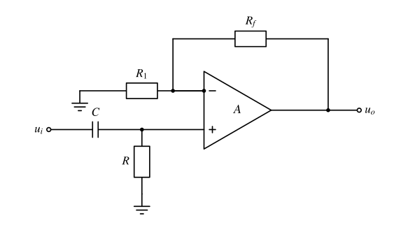

[原扫描题图](assets/电子线路期末复习/C15.png)

[原扫描第 9 页](assets/电子线路期末复习/page-09.png)
[本批逐项核验与前后对照](首批10张重绘图_核验报告.md)
