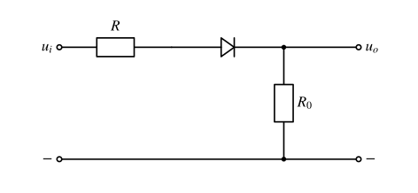
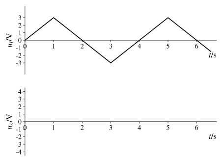
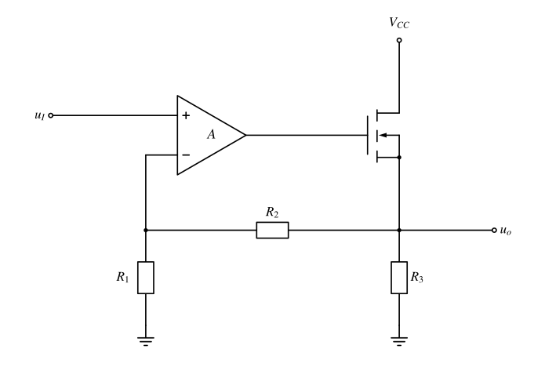
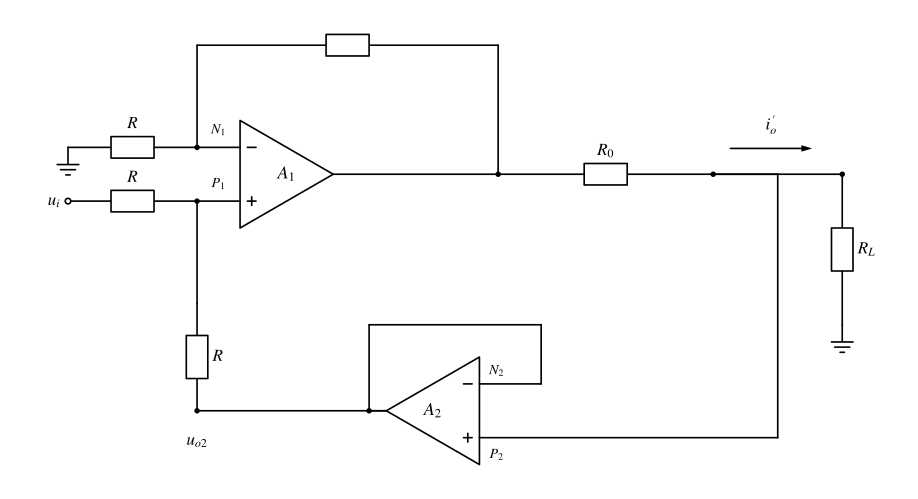

# 电子线路期末复习：去重后题面

%%
chapter: 综合
question_type: 真题整卷｜复习资料
source: 夸克扫描王_电子线路期末复习
paper_type: 其他
academic_year: 未知
%%

> 来源为14页手写复习资料，不虚构学年或真题卷名；原题序与去重映射见配套复习要求。A=第一部分，B=基本放大，C=集成运放及混排补题。2026-11-07按题给模型补齐36道可解题的折叠解答，均标“独立解答未对照”；首次处理时A4、A7、C3未添加解答；本次A7按输出稳压支路明确补解，A4/C3继续保留条件不足，不冒充原资料参考答案。

[[电路分析/10_题库/电子线路期末复习_复习要求与来源|复习要求、去重映射和原页]]

> 本批10张题图使用已核验矢量稿，见前后对照、源文件与核验报告（过程产物未发布）。A4/C3保留待复核原图，A7输入支路照原件保留同向画法；[此前草稿说明](电子线路期末复习_电路图重绘说明.md)另存来源记录。

### 电子复习-A1

%%
chapter: 第九章
question_type: 直流电源｜半波与桥式整流
source: 电子线路期末复习｜原第1页｜A1
question_form: 填空题
ocr_status: 已对照 PDF 复核
%%

整流的目的是 ______。

[原扫描第 1 页](assets/电子线路期末复习/page-01.png)

> [!note]- 解答｜状态：独立解答未对照
>
> 整流的目的是把交流电转换成方向不变的脉动直流电。整流后仍可有纹波，不能把整流直接等同于滤波或稳压。
>
> 自检依据：使用题给模型的定义、极限情况或KCL/端电压方向检查；未获得本资料的参考答案，不升级为已对照。
>
> 起手：区分“电流方向不变”和“数值恒定”。

### 电子复习-A2

%%
chapter: 第五章
question_type: 二极管｜限幅整流与应用
source: 电子线路期末复习｜原第1页｜A2
question_form: 填空题
ocr_status: 已对照 PDF 复核
%%

全波整流电路中利用了二极管 ______ 的特性，将交流变换为直流，而在稳压电路中，则是利用了二极管工作在 ______ 状态下，在一定电流范围内起到稳压的特性。

[原扫描第 1 页](assets/电子线路期末复习/page-01.png)

> [!note]- 解答｜状态：独立解答未对照
>
> 依次填“单向导电”“反向击穿”。前者让两个半周的负载电流同向；后者指稳压管在允许的反向电流与功耗范围内，端电压随电流的变化较小，并非任意二极管击穿都可长期稳压。
>
> 自检依据：使用题给模型的定义、极限情况或KCL/端电压方向检查；未获得本资料的参考答案，不升级为已对照。
>
> 起手：分别识别整流管与稳压管利用的伏安特性区段。

### 电子复习-A3

%%
chapter: 第五章
question_type: 二极管｜PN结与器件基础
source: 电子线路期末复习｜原第1页｜A3
question_form: 选择题
ocr_status: 已对照 PDF 复核
%%

哪个不属于半导体的特性？

a) 热敏性；b) 光敏性；c) 单向导电性；d) 可掺杂性。

[原扫描第 1 页](assets/电子线路期末复习/page-01.png)

> [!note]- 解答｜状态：独立解答未对照
>
> 选 c。热敏、光敏、可掺杂性是这里所说半导体材料的基本特性；单向导电性是形成PN结等器件结构后的特性，不能直接当作均匀半导体材料本身的普遍特性。
>
> 自检依据：使用题给模型的定义、极限情况或KCL/端电压方向检查；未获得本资料的参考答案，不升级为已对照。
>
> 起手：先判断选项讨论的是材料，还是由材料形成的PN结器件。

### 电子复习-A4

%%
chapter: 第五章
question_type: 二极管｜导通截止与模型选择
source: 电子线路期末复习｜原第1页｜A4
question_form: 填空题
ocr_status: 待复核
%%

判断二极管的工作状态：$D_1$：______；$D_2$：______。

原图左侧电源未标数值，照原图保留，不补造条件。

[原扫描题图](assets/电子线路期末复习/A4.png)

[原扫描第 1 页](assets/电子线路期末复习/page-01.png)

> 本批保留原图：缺失或存疑信息尚不能裁决，不以按用途推测的草稿替代原连接。

### 电子复习-A5

%%
chapter: 第五章
question_type: 二极管｜PN结与器件基础
source: 电子线路期末复习｜原第1页｜A5
question_form: 填空题
ocr_status: 已对照 PDF 复核
%%

PN 结加正向电压时，空间电荷区将（　）。

[原扫描第 1 页](assets/电子线路期末复习/page-01.png)

> [!note]- 解答｜状态：独立解答未对照
>
> 填“变窄”。正向外电场削弱内建场及势垒，空间电荷区缩窄，有利于多数载流子扩散；反向偏置则相反。
>
> 自检依据：使用题给模型的定义、极限情况或KCL/端电压方向检查；未获得本资料的参考答案，不升级为已对照。
>
> 起手：画出外加正向场与内建场的相反方向。

### 电子复习-A6

%%
chapter: 第五章
question_type: 二极管｜稳压管稳压判断
source: 电子线路期末复习｜原第1页｜A6
question_form: 填空题
ocr_status: 已对照 PDF 复核
%%

稳压管的稳压是工作在 ______。

[原扫描第 1 页](assets/电子线路期末复习/page-01.png)

> [!note]- 解答｜状态：独立解答未对照
>
> 填“反向击穿区”。必须有串联限流电阻并使稳压管电流处在稳压范围内，同时不超过额定功耗；反向截止区不能据此稳压。
>
> 自检依据：使用题给模型的定义、极限情况或KCL/端电压方向检查；未获得本资料的参考答案，不升级为已对照。
>
> 起手：在稳压管伏安曲线中找到反向电流变化大而电压变化小的区段。

### 电子复习-A7

%%
chapter: 第七章
question_type: 运放｜比较器与传输特性
source: 电子线路期末复习｜原第2页｜A7
question_form: 填空题
ocr_status: 已对照 PDF 复核
%%

放大器 A 供电电压为 $\pm15\,\mathrm{V}$，$D_{z1}$、$D_{z2}$ 的稳压值为 $5\,\mathrm{V}$，导通压降为 $0.7\,\mathrm{V}$，则输出电压 $U_o$ 的电压范围为（　）。

[原扫描题图](assets/电子线路期末复习/A7.png)

[原扫描第 2 页](assets/电子线路期末复习/page-02.png)

> 2026-11-07逐图复核：输入D1/D2在原扫描中确实画成同向，按原件保留，不改画成反并联。输出两只稳压管明确反向串联；本问只求该输出钳位范围，无需假定输入保护用途。

> [!note]- 解答｜状态：独立解答未对照
>
> 正输出时一只稳压管反向击穿5V，另一只正向导通0.7V；负输出时角色互换，故恒压降模型下的高、低限为
> $$U_{oH}=+(5+0.7)=5.7\,\mathrm V,\qquad U_{oL}=-5.7\,\mathrm V.$$
> 因此输出被限制在约 $[-5.7,5.7]\,\mathrm V$，比较器充分驱动时为这两个电平。±15V供电提供了达到钳位电平的幅度余量，但输出串联电阻、负载与允许电流未给出，不能计算稳压电流或保证任意负载仍钳位。
>
> 输入D1/D2照原手绘同向保留。本结论仅由输出反串稳压支路推得，不用反并联输入保护的常见示例来改写原图；不据此确认实际运放在任意输入下均安全。
>
> 自检：正负两方向都经过一次反向击穿和一次正向导通；不能把串联的两个5V直接相加成10V。无独立可靠参考答案，故标独立解答未对照。
>
> 起手：先沿正、负输出到地的支路分别判断哪只稳压管反向击穿。

### 电子复习-A8

%%
chapter: 第六章
question_type: BJT｜管型与工作状态判断
source: 电子线路期末复习｜原第2页｜A8
question_form: 填空题
ocr_status: 已对照 PDF 复核
%%

工作在放大区的某晶体管，当 $I_B$ 从 $12\,\mu\mathrm{A}$ 增大到 $22\,\mu\mathrm{A}$ 时，$I_C$ 从 $1\,\mathrm{mA}$ 变为 $2\,\mathrm{mA}$，那么它的 $\beta$ 约为（　）。

[原扫描第 2 页](assets/电子线路期末复习/page-02.png)

> [!note]- 解答｜状态：独立解答未对照
>
> 用增量电流放大系数，$\beta\approx\Delta I_C/\Delta I_B=(2-1)\,\mathrm{mA}/[(22-12)\,\mu\mathrm A]=100$。这里不是取某一个工作点的 $I_C/I_B$，因为题目给的是变化前后两组值。
>
> 自检依据：使用题给模型的定义、极限情况或KCL/端电压方向检查；未获得本资料的参考答案，不升级为已对照。
>
> 起手：先求集电极与基极电流的增量并统一单位。

### 电子复习-A9

%%
chapter: 第五章
question_type: 二极管｜限幅整流与应用
source: 电子线路期末复习｜原第2页｜A9
question_form: 综合题
ocr_status: 已对照 PDF 复核
%%

假设二极管等效为理想二极管和 $1\,\mathrm{V}$ 电压源的串联，$u_i$ 输入波形如图所示，画出 $u_o$ 的波形。

[原扫描题图](assets/电子线路期末复习/A9.png)

[原扫描第 2 页](assets/电子线路期末复习/page-02.png)

> [!note]- 解答｜状态：独立解答未对照
>
> 二极管从输入侧向负载侧导通，恒压降为 $1\,\mathrm V$。截止时负载将输出接地；导通时两个电阻串联。因此
> $$u_o(t)=\begin{cases}0,&u_i(t)\le1\,\mathrm V,\\\dfrac{R_0}{R+R_0}[u_i(t)-1\,\mathrm V],&u_i(t)>1\,\mathrm V.\end{cases}$$
> 令 $k=R_0/(R+R_0)$，图中首个正三角脉冲从 $t=1/3\,\mathrm s$ 开始，在 $t=1\,\mathrm s$ 达到峰值 $2k\,\mathrm V$，在 $t=5/3\,\mathrm s$ 回到零；此后每4s重复。负半周输出为零。原题没有给出 $R,R_0$ 比值，故峰值保留 $2k$，不能擅取2V。
> 自检：切换处连续为零，导通电流 $(u_i-1\,\mathrm V)/(R+R_0)$ 非负。
>
> 自检依据：使用题给模型的定义、极限情况或KCL/端电压方向检查；未获得本资料的参考答案，不升级为已对照。
>
> 起手：先用 $u_i=1\,\mathrm V$ 找到导通起止时刻，再做串联分压。

### 电子复习-B1

%%
chapter: 第六章
question_type: BJT｜管型与工作状态判断
source: 电子线路期末复习｜原第3页｜B1
question_form: 填空题
ocr_status: 已对照 PDF 复核
%%

NPN 型 BJT，测得 $U_C=2.3\,\mathrm{V}$，$U_B=2.7\,\mathrm{V}$，$U_E=2\,\mathrm{V}$，则该晶体管工作状态是 ______。

[原扫描第 3 页](assets/电子线路期末复习/page-03.png)

> [!note]- 解答｜状态：独立解答未对照
>
> 为饱和状态。NPN管有 $U_{BE}=2.7-2=0.7\,\mathrm V>0$，$U_{BC}=2.7-2.3=0.4\,\mathrm V>0$，发射结与集电结均正偏；$U_{CE}=0.3\,\mathrm V$ 也符合低压降饱和的方向。
>
> 自检依据：使用题给模型的定义、极限情况或KCL/端电压方向检查；未获得本资料的参考答案，不升级为已对照。
>
> 起手：先计算 $U_{BE}$ 和 $U_{BC}$，用两个结的偏置判区。

### 电子复习-B2

%%
chapter: 第六章
question_type: BJT｜管型与工作状态判断
source: 电子线路期末复习｜原第3页｜B2
question_form: 填空题
ocr_status: 已对照 PDF 复核
%%

晶体三极管是依靠 ______ 来控制集电极电流，是一种 ______ 控制器件。

[原扫描第 3 页](assets/电子线路期末复习/page-03.png)

> [!note]- 解答｜状态：独立解答未对照
>
> 依次填“基极电流”“电流”。在本课程放大区简化模型中 $i_C\approx\beta i_B$，因此称电流控制电流的器件；这不表示基极—发射极电压与电流无关。
>
> 自检依据：使用题给模型的定义、极限情况或KCL/端电压方向检查；未获得本资料的参考答案，不升级为已对照。
>
> 起手：写出放大区的 $i_C\approx\beta i_B$ 关系。

### 电子复习-B5

%%
chapter: 第六章
question_type: FET｜基本放大电路
source: 电子线路期末复习｜原第4页｜B5
question_form: 填空题
ocr_status: 已对照 PDF 复核
%%

基于场效应管构成的放大电路中，场效应管的工作区域为 ______。

[原扫描第 4 页](assets/电子线路期末复习/page-04.png)

> [!note]- 解答｜状态：独立解答未对照
>
> 填“恒流区（饱和区、放大区）”。MOS的饱和区与BJT的饱和区含义不同：前者是常用线性小信号放大工作区，后者通常不是。
>
> 自检依据：使用题给模型的定义、极限情况或KCL/端电压方向检查；未获得本资料的参考答案，不升级为已对照。
>
> 起手：先确认器件为FET，再使用其工作区名称。

### 电子复习-B6

%%
chapter: 第六章
question_type: BJT｜共射小信号分析
source: 电子线路期末复习｜原第4页｜B6
question_form: 填空题
ocr_status: 已对照 PDF 复核
%%

为了实现尽可能大的电压放大倍数，通常选用（　）基本放大电路。

[原扫描第 4 页](assets/电子线路期末复习/page-04.png)

> [!note]- 解答｜状态：独立解答未对照
>
> 通常填“共射极”。在课程比较的三种BJT基本接法、相近负载与工作条件下，共射电路兼有电压、电流放大能力；共集电压增益接近1，共基无电流放大。具体增益仍取决于负载、偏置及发射极退化，不能脱离条件给绝对排序。
>
> 自检依据：使用题给模型的定义、极限情况或KCL/端电压方向检查；未获得本资料的参考答案，不升级为已对照。
>
> 起手：比较共射、共集、共基的典型电压增益。

### 电子复习-B7

%%
chapter: 第六章
question_type: 放大电路｜差分与共模抑制
source: 电子线路期末复习｜原第4页｜B7
question_form: 填空题
ocr_status: 已对照 PDF 复核
%%

差分放大电路的作用是（　）。

[原扫描第 4 页](assets/电子线路期末复习/page-04.png)

> [!note]- 解答｜状态：独立解答未对照
>
> 放大差模信号、抑制共模信号和共同的零点漂移。理想对称差分电路的共模增益为零，实际电路只能有限抑制，常用共模抑制比衡量。
>
> 自检依据：使用题给模型的定义、极限情况或KCL/端电压方向检查；未获得本资料的参考答案，不升级为已对照。
>
> 起手：把两个输入分解为差模分量与共模分量。

### 电子复习-B8

%%
chapter: 第六章
question_type: 放大电路｜功率放大输出级
source: 电子线路期末复习｜原第4页｜B8
question_form: 填空题
ocr_status: 已对照 PDF 复核
%%

OCL 功率放大电路的结构是（　）。

[原扫描第 4 页](assets/电子线路期末复习/page-04.png)

> [!note]- 解答｜状态：独立解答未对照
>
> 填“双电源、互补对称推挽、输出直接耦合（无输出耦合电容）”。OCL输出静态电位通常设在接近地，正、负半周由互补支路交替供电；不要与单电源且经输出电容接负载的OTL混淆。
>
> 自检依据：使用题给模型的定义、极限情况或KCL/端电压方向检查；未获得本资料的参考答案，不升级为已对照。
>
> 起手：查看是否双电源，以及输出与负载之间是否有大耦合电容。

### 电子复习-B9

%%
chapter: 第六章
question_type: 放大电路｜功率放大输出级
source: 电子线路期末复习｜原第4页｜B9
question_form: 填空题
ocr_status: 已对照 PDF 复核
%%

与甲类功率放大电路比较，乙类功率放大电路的主要优点是（　）。

[原扫描第 4 页](assets/电子线路期末复习/page-04.png)

> [!note]- 解答｜状态：独立解答未对照
>
> 主要优点是转换效率高、静态功耗小。理想乙类每管导通半周期，最大效率 $\pi/4\approx78.5\%$；代价是零点附近可能有交越失真，不能填“失真更小”。
>
> 自检依据：使用题给模型的定义、极限情况或KCL/端电压方向检查；未获得本资料的参考答案，不升级为已对照。
>
> 起手：从静态电流和每管导通角比较甲类与乙类。

### 电子复习-B10

%%
chapter: 第六章
question_type: BJT｜共集与共基特性
source: 电子线路期末复习｜原第4页｜B10
question_form: 填空题
ocr_status: 已对照 PDF 复核
%%

为了实现尽可能大的输入电阻，通常选用（　）基本放大电路。

[原扫描第 4 页](assets/电子线路期末复习/page-04.png)

> [!note]- 解答｜状态：独立解答未对照
>
> 在BJT三种基本接法中通常填“共集电极（射极跟随器）”。其输入电阻近似含 $(1+\beta)R_E'$ 的反映项，较大；共基输入电阻较小。这里未把MOS栅极等不同器件类型混入比较。
>
> 自检依据：使用题给模型的定义、极限情况或KCL/端电压方向检查；未获得本资料的参考答案，不升级为已对照。
>
> 起手：辨别输入端的电流是否因发射极跟随而减小。

### 电子复习-B11

%%
chapter: 第六章
question_type: 放大电路｜静态工作点
source: 电子线路期末复习｜原第4页｜B11
question_form: 填空题
ocr_status: 已对照 PDF 复核
%%

放大电路中交直流信号同时存在，分析放大电路的方法是（　）。

[原扫描第 4 页](assets/电子线路期末复习/page-04.png)

> [!note]- 解答｜状态：独立解答未对照
>
> 填“静态分析与动态分析相结合（直流、交流分开分析）”。先在直流通路求Q点，再以该Q点建立小信号交流模型，求增益和端口电阻；最后检查信号摆幅是否仍处于所假定工作区。大信号失真时不能直接套小信号叠加。
>
> 自检依据：使用题给模型的定义、极限情况或KCL/端电压方向检查；未获得本资料的参考答案，不升级为已对照。
>
> 起手：先将耦合电容在直流稳态中开路求静态工作点。

### 电子复习-B12

%%
chapter: 第六章
question_type: 放大电路｜失真与动态范围
source: 电子线路期末复习｜原第4页｜B12
question_form: 填空题
ocr_status: 已对照 PDF 复核
%%

放大电路中，若静态工作点设置不合理，可能会出现的失真有（　）和（　）。

[原扫描第 4 页](assets/电子线路期末复习/page-04.png)

> [!note]- 解答｜状态：独立解答未对照
>
> 填“截止失真”“饱和失真”。Q点太靠近截止或饱和边界时，输入某一方向变化会先碰到边界，输出被削顶；两者都是非线性失真，不能用提高小信号增益补救。
>
> 自检依据：使用题给模型的定义、极限情况或KCL/端电压方向检查；未获得本资料的参考答案，不升级为已对照。
>
> 起手：在负载线上标出Q点两侧到截止、饱和边界的余量。

### 电子复习-B13

%%
chapter: 第六章
question_type: 放大电路｜频率响应
source: 电子线路期末复习｜原第4页｜B13
question_form: 填空题
ocr_status: 已对照 PDF 复核
%%

放大电路的频率响应包括（　）和（　），其频率响应曲线的对数化坐标表示称为（　）。

[原扫描第 4 页](assets/电子线路期末复习/page-04.png)

> [!note]- 解答｜状态：独立解答未对照
>
> 依次填“幅频特性”“相频特性”“波特图（Bode图）”。幅频特性描述增益幅度随频率变化，相频特性描述相位随频率变化；波特图使用对数频率轴，幅度常以dB表示。
>
> 自检依据：使用题给模型的定义、极限情况或KCL/端电压方向检查；未获得本资料的参考答案，不升级为已对照。
>
> 起手：把复增益写成幅值和相位两部分。

### 电子复习-B14

%%
chapter: 第六章
question_type: 放大电路｜差分与共模抑制
source: 电子线路期末复习｜原第4页｜B14
question_form: 填空题
ocr_status: 已对照 PDF 复核
%%

双端差分放大电路的两个电压分别为 $u_{i1}=3\,\mathrm{V}$、$u_{i2}=2.98\,\mathrm{V}$，则差模电压、共模输入电压为（　）。

[原扫描第 4 页](assets/电子线路期末复习/page-04.png)

> [!note]- 解答｜状态：独立解答未对照
>
> 以 $u_{id}=u_{i1}-u_{i2}$ 定义差模电压，有 $u_{id}=3-2.98=0.02\,\mathrm V=20\,\mathrm{mV}$；共模输入电压 $u_{ic}=(u_{i1}+u_{i2})/2=2.99\,\mathrm V$。若问“每端差模分量”，两端分别为 $+10\,\mathrm{mV}$ 与 $-10\,\mathrm{mV}$，不是将20mV各加一次。
>
> 自检依据：使用题给模型的定义、极限情况或KCL/端电压方向检查；未获得本资料的参考答案，不升级为已对照。
>
> 起手：分别写出差与平均值的定义。

### 电子复习-B15

%%
chapter: 第六章
question_type: 放大电路｜负反馈组态判断
source: 电子线路期末复习｜原第5页｜B15
question_form: 填空题
ocr_status: 已对照 PDF 复核
%%

负反馈对输入电阻的影响取决于基本放大电路与反馈网络在电路输入端的连接方式。引入（　），使引入反馈支路的等效电阻增大到基本放大电路的（　）倍。

[原扫描第 5 页](assets/电子线路期末复习/page-05.png)

> [!note]- 解答｜状态：独立解答未对照
>
> 填“串联负反馈”“$1+AF$”。令 $A$ 为基本放大器增益、$F$ 为反馈系数，采用低中频负反馈且 $AF$ 表示正的环路增益大小的约定，有 $R_{if}\approx(1+AF)R_i$。输入混合方式决定输入电阻变化；输出取样方式另行决定输出电阻。
>
> 自检依据：使用题给模型的定义、极限情况或KCL/端电压方向检查；未获得本资料的参考答案，不升级为已对照。
>
> 起手：先看反馈信号是在输入端串联比较电压，还是并联比较电流。

### 电子复习-B16

%%
chapter: 第六章
question_type: 放大电路｜负反馈组态判断
source: 电子线路期末复习｜原第5页｜B16
question_form: 填空题
ocr_status: 已对照 PDF 复核
%%

负反馈对输出电阻的影响取决于基本放大电路与反馈网络在放大电路输出端的连接方式。引入（　），使得引入反馈支路的等效电阻增大到基本放大电路的（　）倍。

[原扫描第 5 页](assets/电子线路期末复习/page-05.png)

> [!note]- 解答｜状态：独立解答未对照
>
> 填“电流负反馈”“$1+AF$”。输出取样的是电流，反馈将输出趋向电流源，使输出电阻增大，近似 $R_{of}\approx(1+AF)R_o$；电压取样则使输出电阻减小。采用低中频负反馈环路增益大小为 $AF>0$ 的约定。
>
> 自检依据：使用题给模型的定义、极限情况或KCL/端电压方向检查；未获得本资料的参考答案，不升级为已对照。
>
> 起手：先判断输出端取样电流还是电压。

### 电子复习-B18

%%
chapter: 第六章
question_type: 放大电路｜负反馈组态判断
source: 电子线路期末复习｜原第5页｜B18
question_form: 填空题
ocr_status: 已对照 PDF 复核
%%

当信号源为恒流源或内阻很大的电压源时，为了减小放大电路的输入电阻，使电路获得更大的输入电流，应引入（　）负反馈。

[原扫描第 5 页](assets/电子线路期末复习/page-05.png)

> [!note]- 解答｜状态：独立解答未对照
>
> 填“并联”负反馈。高内阻源更接近电流驱动，并联混合使输入电阻减小，$R_{if}\approx R_i/(1+AF)$，输入电流不易流失到源内阻支路；仅此条件不能进一步唯一决定输出端采用电压还是电流取样。
>
> 自检依据：使用题给模型的定义、极限情况或KCL/端电压方向检查；未获得本资料的参考答案，不升级为已对照。
>
> 起手：由“减小输入电阻”反推输入端采用并联混合。

### 电子复习-B19

%%
chapter: 第六章
question_type: BJT｜共射小信号分析
source: 电子线路期末复习｜原第5页｜B19
question_form: 综合题
ocr_status: 已对照 PDF 复核
%%

下图 (b) 是 (a) 图经过变换后的等效电路，请分析图 (b)：(1) $+U'_{CC}$ 和 $R'$ 分别是多少？(2) 等效变换的理论依据是什么？(3) 该电路属于哪种基本放大电路？

[原扫描题图](assets/电子线路期末复习/B19.png)

[原扫描第 5 页](assets/电子线路期末复习/page-05.png)

本批逐项核验与前后对照（过程产物未发布）

> [!note]- 解答｜状态：独立解答未对照
>
> 将集电极端口所见的“18V经3kΩ”与“3kΩ接地”合成戴维南源：开路电压 $U'_{CC}=18\times3/(3+3)=9\,\mathrm V$；独立电压源置零后 $R'=3\parallel3=1.5\,\mathrm{k}\Omega$。理论依据是线性有源单口的戴维南定理。输入在基极、输出在集电极、发射极为公共端，因此是共射极放大电路。
> 自检：原网络短路电流 $18/3\,\mathrm{k}\Omega=6\,\mathrm{mA}$，等效源 $9/1.5\,\mathrm{k}\Omega$ 相同。
>
> 自检依据：使用题给模型的定义、极限情况或KCL/端电压方向检查；未获得本资料的参考答案，不升级为已对照。
>
> 起手：只对集电极外接的电源电阻网络求开路电压和等效内阻。

### 电子复习-B20

%%
chapter: 第六章
question_type: 放大电路｜偏置反馈与稳定工作点
source: 电子线路期末复习｜原第6页｜B20
question_form: 简答题
ocr_status: 已对照 PDF 复核
%%

基于 BJT 构成的放大电路静态工作点对温度敏感，请简述下图所示电路引入 $R_e$ 后稳定静态工作点的机理。稳定放大电路静态工作点还有哪些方法？

[原扫描题图](assets/电子线路期末复习/B20.png)

[原扫描第 6 页](assets/电子线路期末复习/page-06.png)

本批逐项核验与前后对照（过程产物未发布）

> [!note]- 解答｜状态：独立解答未对照
>
> 直流时 $C_e$ 开路，若温度升高使 $I_C,I_E$ 增大，则 $R_e$ 压降增大、发射极电位升高；分压偏置使基极电位近似稳定，于是 $U_{BE}$ 减小、$I_B$ 减小，抑制原来电流的增大，形成直流负反馈。$C_e$ 在信号频段旁路 $R_e$，可减轻交流增益损失，但不取消直流稳定作用。
> 其他方法包括采用较硬的分压偏置、恒流源偏置、温度补偿器件与热耦合、适当散热。不能以“电容短路”分析直流Q点。
> 自检：沿“电流增大→发射极电位升高→结电压减小→电流受抑制”闭环，反馈方向为负。
>
> 自检依据：使用题给模型的定义、极限情况或KCL/端电压方向检查；未获得本资料的参考答案，不升级为已对照。
>
> 起手：先画直流通路，把 $C_e$ 开路。

### 电子复习-B21

%%
chapter: 第六章
question_type: FET｜基本放大电路
source: 电子线路期末复习｜原第6页｜B21
question_form: 填空题
ocr_status: 已对照 PDF 复核
%%

图示共源放大电路，已知 $V_{GG}=6\,\mathrm{V}$、$V_{DD}=12\,\mathrm{V}$、$R_g=2\,\mathrm{M}\Omega$、$R_d=3\,\mathrm{k}\Omega$、$U_{GS(th)}=4\,\mathrm{V}$，则静态电压 $U_{GSQ}=$ ______。

[原扫描题图](assets/电子线路期末复习/B21.png)

[原扫描第 6 页](assets/电子线路期末复习/page-06.png)

本批逐项核验与前后对照（过程产物未发布）

> [!note]- 解答｜状态：独立解答未对照
>
> $I_G\approx0$，所以 $R_g$ 上没有直流压降，栅极电位 $V_G=V_{GG}=6\,\mathrm V$；源极接地，故 $U_{GSQ}=6\,\mathrm V$。阈值4V只说明过驱动电压为2V，不应把 $U_{GSQ}$ 填成2V。仅凭本题所给数据还不能求出漏极静态电流。
>
> 自检依据：使用题给模型的定义、极限情况或KCL/端电压方向检查；未获得本资料的参考答案，不升级为已对照。
>
> 起手：利用MOS栅极直流电流近似为零，先求栅源电位差。

### 电子复习-B22

%%
chapter: 第六章
question_type: BJT｜管型与工作状态判断
source: 电子线路期末复习｜原第6页｜B22
question_form: 简答题
ocr_status: 已对照 PDF 复核
%%

BJT 与 MOSFET 的区别？

[原扫描第 6 页](assets/电子线路期末复习/page-06.png)

> [!note]- 解答｜状态：独立解答未对照
>
> BJT由双极载流子参与传输，放大区课程模型常用 $i_C=\beta i_B$，基极需要电流，输入电阻有限；MOSFET靠栅源电压控制沟道，栅绝缘，静态栅极电流近似为零，输入电阻通常很高，动态仍须给栅电容充放电。BJT放大区对应发射结正偏、集电结反偏；MOS通常在恒流/饱和区进行小信号放大。两者都需要合适Q点、外接电源及负载，MOS的“饱和”不能套成BJT的饱和失真。
>
> 自检依据：使用题给模型的定义、极限情况或KCL/端电压方向检查；未获得本资料的参考答案，不升级为已对照。
>
> 起手：分别写出 $i_C$ 受 $i_B$ 控制和 $i_D$ 受 $u_{GS}$ 控制的基本模型。

### 电子复习-B24

%%
chapter: 第六章
question_type: 放大电路｜放大本质与性能指标
source: 电子线路期末复习｜原第8页｜B24
question_form: 简答题
ocr_status: 已对照 PDF 复核
%%

从能量的角度看，放大电路为什么可以放大信号的功率？放大电路的技术性能指标有哪些？

[原扫描第 8 页](assets/电子线路期末复习/page-08.png)

> [!note]- 解答｜状态：独立解答未对照
>
> 输出增加的信号功率来自直流电源，输入信号控制有源器件向负载输送能量的变化；放大器不是自行产生能量。主要指标包括电压/电流/功率增益、输入与输出电阻、通频带与截止频率、最大不失真输出、非线性失真、效率，以及噪声等。不同应用的主要矛盾不同，电压增益接近1的跟随器仍可能有电流与功率增益。
> 自检：把直流电源断开后，不能继续获得原来的持续功率放大。
>
> 自检依据：使用题给模型的定义、极限情况或KCL/端电压方向检查；未获得本资料的参考答案，不升级为已对照。
>
> 起手：先画清信号控制通道与直流供能通道。

### 电子复习-C1

%%
chapter: 第七章
question_type: 运放｜比例运算基础
source: 电子线路期末复习｜原第13页｜C1
question_form: 选择题
ocr_status: 已对照 PDF 复核
%%

A 为理想运放，其中所有电阻相等，则输出电压与输入电压关系为（　）。

A. $u_o=2U_I$；B. $u_o=-2U_I$；C. $u_o=U_I$；D. $u_o=-u_I$。

[原扫描题图](assets/电子线路期末复习/C1.png)

[原扫描第 13 页](assets/电子线路期末复习/page-13.png)

> [!note]- 解答｜状态：独立解答未对照
>
> 选 A，$u_o=2U_I$。理想运放输入无电流，$u_+=U_I$；从最终输出节点经等值 $R_2,R_1$ 取样，$u_-=u_o/2$。线性负反馈下 $u_-=u_+$，得到 $u_o=2U_I$。MOS管处于环内，其栅源压降由运放输出补偿，不能另从最终输出扣一次阈值。
> 自检：输出升高会使反相端升高，运放减少栅极驱动，是负反馈；结果需满足器件导通与供电摆幅条件。
>
> 自检依据：使用题给模型的定义、极限情况或KCL/端电压方向检查；未获得本资料的参考答案，不升级为已对照。
>
> 起手：确认反馈取自MOS源极的最终输出节点，再用虚短。

### 电子复习-C2

%%
chapter: 第七章
question_type: 运放｜积分与微分运算
source: 电子线路期末复习｜原第13页｜C2
question_form: 选择题
ocr_status: 已对照 PDF 复核
%%

A 为理想运放，电容的初始电压为 0，则输出电压与输入电压关系为（　）。

A. $u_o=-RC\frac{du_I}{dt}$；B. $u_o=-\frac{1}{RC}\int u_I\,dt$；C. $u_o=U_I$；D. $u_o=0$。

[原扫描题图](assets/电子线路期末复习/C2.png)

[原扫描第 13 页](assets/电子线路期末复习/page-13.png)

本批逐项核验与前后对照（过程产物未发布）

> [!note]- 解答｜状态：独立解答未对照
>
> 选 B。$u_+=u_-=0$，输入电流 $i_R=u_I/R$ 全流入反馈电容，因此 $du_o/dt=-u_I/(RC)$。以题设初始电容电压为零，有
> $$u_o(t)=-\frac1{RC}\int_0^t u_I(\tau)\,d\tau.$$
> 自检：正的恒定输入使输出线性下降；对结果求导还原电容电流方程。积分常数由初值给定，不可任意省略非零初值。
>
> 自检依据：使用题给模型的定义、极限情况或KCL/端电压方向检查；未获得本资料的参考答案，不升级为已对照。
>
> 起手：在反相输入虚地点列电阻电流与反馈电容电流的KCL。

### 电子复习-C3

%%
chapter: 第六章
question_type: 放大电路｜负反馈组态判断
source: 电子线路期末复习｜原第13页｜C3
question_form: 填空题
ocr_status: 待复核
%%

输入电压 $u_i$，输出电流为 $i_o$。集成运放均工作在线性放大状态，$A_2$ 将输出电流信号反馈至输入端，则输出电流与输入电压关系为（　）。

扫描PDF右侧裁边已通过[未裁切原始照片](../00_原材料/16139e9cc73fa00690f9250ca6bcd131.jpg)补充核对：$R_0$ 后输出节点连接 $R_L$ 对地及 $A_2$ 同相输入端，$A_2$ 反相端接自身输出。原照片中 $A_1$ 上方反馈电阻仍未标阻值/符号，不能自动假定它等于其他 $R$；本题继续待复核，缺少该反馈电阻的条件或教师确认。下方重绘据未裁原照片核对接线，反馈电阻原样不标号；原扫描图仍保留。

[原扫描题图](assets/电子线路期末复习/C3.png)

[原扫描第 13 页](assets/电子线路期末复习/page-13.png)

> 本批保留原图：缺失或存疑信息尚不能裁决，不以按用途推测的草稿替代原连接。

### 电子复习-C5

%%
chapter: 第七章
question_type: 运放｜差分比例运算
source: 电子线路期末复习｜原第10页｜C5
question_form: 选择题
ocr_status: 已对照 PDF 复核
%%

如图，求输出电压与输入电压关系为（　）。

A. $u_o=-(U_1-U_2)$；B. $u_o=U_1-U_2$；C. $u_o=-3(U_1-U_2)$；D. $u_o=3(U_1-U_2)$。

[原扫描题图](assets/电子线路期末复习/C5.png)

[原扫描第 10 页](assets/电子线路期末复习/page-10.png)

本批逐项核验与前后对照（过程产物未发布）

> [!note]- 解答｜状态：独立解答未对照
>
> 选 D，$u_o=3(U_1-U_2)$。两反相端电位分别为 $U_1,U_2$，中间电阻的电流为 $(U_1-U_2)/R$；理想输入不取电流，串联的三只R中电流相同，故上输出为 $2U_1-U_2$，下输出为 $2U_2-U_1$，两输出之差为 $3(U_1-U_2)$。
> 自检：令 $U_1=U_2$ 得差分输出零，交换两输入输出反号。
>
> 自检依据：使用题给模型的定义、极限情况或KCL/端电压方向检查；未获得本资料的参考答案，不升级为已对照。
>
> 起手：先用两路虚短确定中间电阻的两个端点电位。

### 电子复习-C9

%%
chapter: 第七章
question_type: 运放｜比较器与传输特性
source: 电子线路期末复习｜原第10页｜C9
question_form: 填空题
ocr_status: 已对照 PDF 复核
%%

$R_1=R_2=5\,\mathrm{k}\Omega$，$U_{om}=12\,\mathrm{V}$，$U_{REF}=2\,\mathrm{V}$。$D_{z1}$ 和 $D_{z2}$ 的稳压电压分别为 $4\,\mathrm{V}$ 和 $6\,\mathrm{V}$，正向压降为 $0.7\,\mathrm{V}$。电路的输出正电压 $U_{oH}=$ ______，阈值电压 $U_T=$ ______。当 $U_I$ 从大于 $U_T$ 变为小于 $U_T$ 时，输出曲线变化趋势是（　）。

[原扫描题图](assets/电子线路期末复习/C9.png)

[原扫描第 10 页](assets/电子线路期末复习/page-10.png)

本批逐项核验与前后对照（过程产物未发布）

> [!note]- 解答｜状态：独立解答未对照
>
> 正输出时 $D_{z1}$ 反向击穿、$D_{z2}$ 正向导通，所以 $U_{oH}=4+0.7=4.7\,\mathrm V$；负输出时下限为 $-(6+0.7)=-6.7\,\mathrm V$。输入电流近似为零且 $R_1=R_2$，有 $u_-=(U_{REF}+U_I)/2$，$u_+=0$。切换条件 $u_-=0$ 给 $U_T=-U_{REF}=-2\,\mathrm V$。
> 当 $U_I$ 从大于 $-2\,\mathrm V$ 降到小于它，反相端由正变负，输出由低电平 $-6.7\,\mathrm V$ 跳变到高电平 $4.7\,\mathrm V$。原图没有从输出返回输入的正反馈，不是双阈值滞回比较器。
> 自检：内部饱和幅度12V大于两钳位电平的大小，串联限流支路有压差余量。
>
> 自检依据：使用题给模型的定义、极限情况或KCL/端电压方向检查；未获得本资料的参考答案，不升级为已对照。
>
> 起手：先由两输入电位相等求阈值，再判断输出正时哪只稳压管反向击穿。

### 电子复习-C11

%%
chapter: 第六章
question_type: 放大电路｜频率响应
source: 电子线路期末复习｜原第9页｜C11
question_form: 填空题
ocr_status: 已对照 PDF 复核
%%

当放大器频率处于通频带时，放大器的电压放大倍数为 100，则当输入信号频率为截止频率时，放大器的电压放大倍数为 ______。

[原扫描第 9 页](assets/电子线路期末复习/page-09.png)

> [!note]- 解答｜状态：独立解答未对照
>
> 截止频率按相对通带幅度下降3dB定义，因此 $|A_u|=100/\sqrt2\approx70.71$。这是幅值，不是把100减去3，也不是将功率比例直接用于电压幅度。
>
> 自检依据：使用题给模型的定义、极限情况或KCL/端电压方向检查；未获得本资料的参考答案，不升级为已对照。
>
> 起手：将 $-3\,\mathrm{dB}$ 转成电压幅值比 $1/\sqrt2$。

### 电子复习-C12

%%
chapter: 第七章
question_type: 运放｜有源滤波器判断
source: 电子线路期末复习｜原第9页｜C12
question_form: 填空题
ocr_status: 已对照 PDF 复核
%%

如图，A 为理想运放，当 $u_i$ 频率趋于 0 时，输出电压 $u_o$ 与输入 $u_i$ 的关系为 ______；当 $u_i$ 的频率为 $1\,\mathrm{kHz}$ 时，输出电压 $u_o$ 与 $u_i$ 的关系为 ______。

原图未给出 $R_1,C_1$ 的数值，按原题保留符号参数，不替其补值。

[原扫描题图](assets/电子线路期末复习/C12.png)

[原扫描第 9 页](assets/电子线路期末复习/page-09.png)

本批逐项核验与前后对照（过程产物未发布）

> [!note]- 解答｜状态：独立解答未对照
>
> 理想运放构成电压跟随器，反馈电阻中没有输入电流，故 $u_o=u_+$。输入RC低通得到
> $$H(j\omega)=\frac{u_o}{u_i}=\frac1{1+j\omega R_1C_1}.$$
> 频率趋于零时 $u_o=u_i$；频率为1kHz时，相量关系为 $\dot U_o=\dot U_i/[1+j2\pi(1000)R_1C_1]$。幅值比为 $[1+(2000\pi R_1C_1)^2]^{-1/2}$，相位为 $-\arctan(2000\pi R_1C_1)$。
> 题图没有给出 $R_1,C_1$ 数值，故不能唯一填数值幅比或直接断言1kHz为截止频率。自检：低频趋于1，高频趋于0，符合低通。
>
> 自检依据：使用题给模型的定义、极限情况或KCL/端电压方向检查；未获得本资料的参考答案，不升级为已对照。
>
> 起手：先把运放认作跟随器，再计算其同相端的RC分压。

### 电子复习-C13

%%
chapter: 第六章
question_type: 放大电路｜负反馈组态判断
source: 电子线路期末复习｜原第9页｜C13
question_form: 填空题
ocr_status: 已对照 PDF 复核
%%

如图，电路反馈组态属于（　）。

[原扫描题图](assets/电子线路期末复习/C13.png)

[原扫描第 9 页](assets/电子线路期末复习/page-09.png)

本批逐项核验与前后对照（过程产物未发布）

> [!note]- 解答｜状态：独立解答未对照
>
> 属于电压串联负反馈。输出电压通过 $R_2,R_1$ 分压取样送至反相端，与同相端输入作电压差比较；输出升高使反相端升高，从而减小驱动。三极管是环内输出缓冲级，不改变输出取样的是电压这一事实。
> 自检：理想线性条件下 $u_o=(1+R_2/R_1)u_i$，输入电阻提高、输出电阻减小。
>
> 自检依据：使用题给模型的定义、极限情况或KCL/端电压方向检查；未获得本资料的参考答案，不升级为已对照。
>
> 起手：先看反馈取样的是最终输出电压，再看输入端比较的是电压差。

### 电子复习-C14

%%
chapter: 第七章
question_type: 运放｜有源滤波器判断
source: 电子线路期末复习｜原第9页｜C14｜原照片b7bf74b5bc47f925dbc46be32e997930.jpg逐字核对
question_form: 填空题
ocr_status: 已对照 PDF 复核
%%

如图所示运算电路是（　）（高通/低通）滤波电路，带宽与负载 $R_L$（　）（有关/无关）。

第 14 题图。

[原扫描题图](assets/电子线路期末复习/C14.png)

[原扫描第 9 页](assets/电子线路期末复习/page-09.png)

续查更正：对照[原始照片完整页](../00_原材料/b7bf74b5bc47f925dbc46be32e997930.jpg)，题干清楚写作“负载 $R_L$”，不是 $R_2$。图中同相端接地电阻仍为 $R_2$，题干的负载为另一符号；原所谓图文冲突来自转录误读，现已解除。保留原扫描和现有图片引用，不补画未显示的负载。

本批逐项核验与前后对照（过程产物未发布）

> [!note]- 解答｜状态：独立解答未对照
>
> 填“高通”“无关”（理想运放模型）。输入串联RC，反相端虚地，
> $$H(s)=-\frac{R_F}{R+1/(sC)}=-\frac{R_F}{R}\frac{sRC}{1+sRC}.$$
> 低频趋于零，高频趋于 $-R_F/R$，下限截止频率为 $f_L=1/(2\pi RC)$。理想运放输出电阻为零，外接负载 $R_L$ 不改变传函；其理想上限为无穷，若把“带宽”理解为通带范围，则边界不受 $R_L$ 影响。实际运放的有限带宽和带负载能力不能从理想模型中推断为无限。
>
> 自检依据：使用题给模型的定义、极限情况或KCL/端电压方向检查；未获得本资料的参考答案，不升级为已对照。
>
> 起手：将输入串联RC写成 $Z_i=R+1/(sC)$，使用反相比例关系。

### 电子复习-C15

%%
chapter: 第七章
question_type: 运放｜有源滤波器判断
source: 电子线路期末复习｜原第9页｜C15
question_form: 简答题
ocr_status: 已对照 PDF 复核
%%

分析第 9 页下方所示电路是哪种类型滤波器。

[原扫描题图](assets/电子线路期末复习/C15.png)

[原扫描第 9 页](assets/电子线路期末复习/page-09.png)
本批逐项核验与前后对照（过程产物未发布）

> [!note]- 解答｜状态：独立解答未对照
>
> 是一阶同相有源高通滤波器。输入串联电容、并联电阻的电压传输为 $sRC/(1+sRC)$，运放同相比例增益为 $1+R_f/R_1$，因此
> $$H(s)=\left(1+\frac{R_f}{R_1}\right)\frac{sRC}{1+sRC}.$$
> 低频电容阻断输入，输出趋于零；高频电容近似短路，增益趋于 $1+R_f/R_1$；截止频率 $f_L=1/(2\pi RC)$。
>
> 自检依据：使用题给模型的定义、极限情况或KCL/端电压方向检查；未获得本资料的参考答案，不升级为已对照。
>
> 起手：先判断电容位于输入串联支路还是反馈支路，再分别计算RC网络和运放增益。

