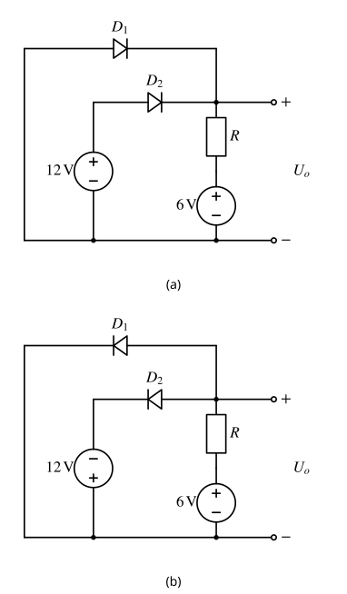
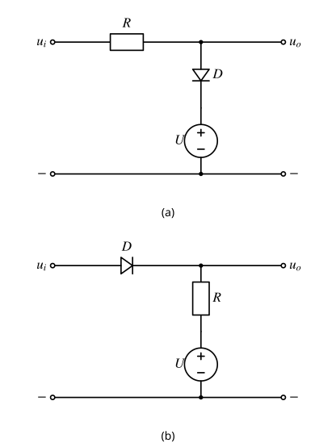
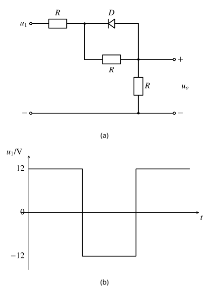
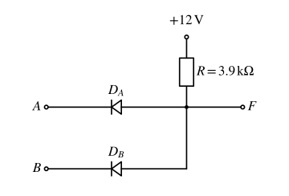
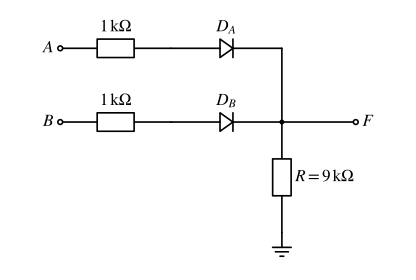
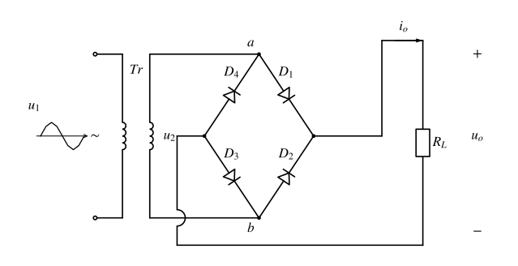
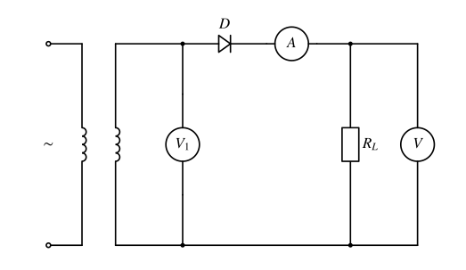
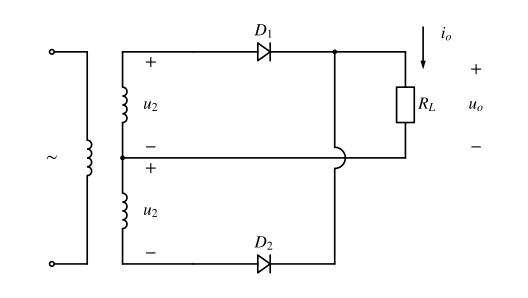
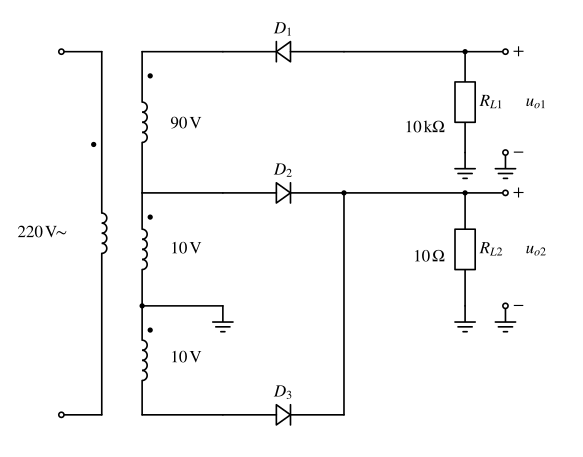

# 第5章课后习题（E5-1—E5-10）

%%
source: 电路与模拟电子技术（第4版）学习辅导与习题解答｜5.4习题详解
paper_type: 其他
academic_year: 未知
%%

> 依据殷瑞祥主编《电路与模拟电子技术（第4版）学习辅导与习题解答》（高等教育出版社，2022）第5章5.4“习题详解”提取题面。书页168—174，对应349页扫描件的PDF第177—183页。S1阶段收入题面、全部子问与原图；2026-11-07另按S9补齐十题折叠解答并对照原书，E5-4的额外均分假设在题下单列裁决。
>
> [本章原扫描摘页：书页159—174／原PDF第168—183页](../90_缓存/s1-ch5-20261106/扫描件_电路与模拟电子技术%281%29_p168-183.pdf) · [覆盖核查、来源与去重记录](第5章课后习题_覆盖核查.md)。E5-6、E5-7共用原书图5-5(a)，已随题保留。

### 章节卷-E5-1

%%
chapter: 第五章
question_type: 二极管｜导通截止与模型选择
source: 电路与模拟电子技术（第4版）学习辅导与习题解答｜书页168｜E5-1
question_form: 计算题
ocr_status: 已对照 PDF 复核
%%

二极管电路如题图 E5-1 所示，忽略二极管的正向压降，试求电压 $U_0$。

> [!note]- 解答｜状态：已对照一致
>
> 先把理想二极管视为单向开关，再检查断开支路的端电压。
>
> 图(a)中，若两管都截止，电阻无电流会把输出拉到 $6\,\mathrm V$，此时接 $12\,\mathrm V$ 的 $D_2$ 正偏，故 $D_2$ 导通，把输出钳位为 $U_0=12\,\mathrm V$。$D_1$ 的阳极在地、阴极在输出，反偏，假设自洽。电流由 $12\,\mathrm V$ 支路经 $D_2,R$ 流向 $6\,\mathrm V$ 电源。
>
> 图(b)的 $D_2$ 方向和左电源极性同时反转，$D_2$ 导通把输出钳在 $-12\,\mathrm V$；$D_1$ 阳极为输出、阴极为地，反偏。因此 $U_0=-12\,\mathrm V$。
>
> 核验：两图导通管电流方向均允许，截止管反偏；与原书书页168结论一致。
>
> 起手：先标出每只二极管的阳极、阴极及各电源对地电位。

### 章节卷-E5-2

%%
chapter: 第五章
question_type: 二极管｜限幅整流与应用
source: 电路与模拟电子技术（第4版）学习辅导与习题解答｜书页168｜E5-2
question_form: 综合题
ocr_status: 已对照 PDF 复核
%%

在题图 E5-2 所示电路中，$R=1\,\mathrm{k}\Omega$，$U=10\,\mathrm{V}$，$u_i=20\sin(\omega t)\,\mathrm{V}$，试分别画出输出电压 $u_0$ 的波形。二极管的正向压降忽略不计。

> [!note]- 解答｜状态：已对照一致
>
> 令 $x=20\sin(\omega t)\,\mathrm V$。图(a)是并联上限幅：当 $x\le10\,\mathrm V$ 时二极管截止，电阻无电流，$u_0=x$；当 $x>10\,\mathrm V$ 时二极管导通，$u_0=10\,\mathrm V$，其电流为 $(x-10\,\mathrm V)/R\ge0$。所以
>
> $$u_{0a}=\min(x,10\,\mathrm V).$$
>
> 输出保留负半周到 $-20\,\mathrm V$，正峰削平在 $10\,\mathrm V$；每周期 $\pi/6<\omega t<5\pi/6$ 的部分导通。
>
> 图(b)是串联下限幅：当 $x\ge10\,\mathrm V$ 时二极管导通，$u_0=x$；当 $x<10\,\mathrm V$ 时截止，电阻无电流，输出由直流源保持在 $10\,\mathrm V$。所以
>
> $$u_{0b}=\max(x,10\,\mathrm V).$$
>
> 核验：在切换点两段连续，导通段电流非负，截止段阳极电位不高于阴极。两幅输出波形与原书书页169图5-17一致；导通/截止按上述电压与电流检验判断。
>
> 起手：分别求二极管断开时的端电压，找出 $u_i=10\,\mathrm V$ 的切换点。

### 章节卷-E5-3

%%
chapter: 第五章
question_type: 二极管｜限幅整流与应用
source: 电路与模拟电子技术（第4版）学习辅导与习题解答｜书页169｜E5-3
question_form: 综合题
ocr_status: 已对照 PDF 复核
%%

在题图 E5-3(a) 所示电路中，$R=1\,\mathrm{k}\Omega$，输入电压 $u_1$ 的波形如题图 E5-3(b) 所示，试画出输出电压 $u_0$ 的波形。二极管的正向压降忽略不计。

> [!note]- 解答｜状态：已对照一致
>
> 记输入电阻后的节点为 $v_a$。二极管阳极在输出侧、阴极在 $v_a$ 侧。
>
> 输入 $u_1=12\,\mathrm V$ 时，先按截止分析，三个相等电阻串联，$u_0=12/3=4\,\mathrm V$，$v_a=8\,\mathrm V$；阳极低于阴极，截止成立。
>
> 输入 $u_1=-12\,\mathrm V$ 时，若仍截止会得到 $v_a=-8\,\mathrm V,u_0=-4\,\mathrm V$，二极管正偏，因此应导通。它短接中间电阻，余下两电阻分压，$u_0=-12/2=-6\,\mathrm V$。导通电流从地经负载、二极管流向输入，方向允许。
>
> 输出方波的高、低电平分别为 $+4\,\mathrm V$、$-6\,\mathrm V$，切换时刻与输入相同。与原书书页169—170一致。
>
> 起手：先假设二极管截止，用三电阻分压检查阳极与阴极电位。

### 章节卷-E5-4

%%
chapter: 第五章
question_type: 二极管｜导通截止与模型选择
source: 电路与模拟电子技术（第4版）学习辅导与习题解答｜书页169—170｜E5-4
question_form: 计算题
ocr_status: 已对照 PDF 复核
%%

在题图 E5-4 所示电路中，试分别求出下列情况下输出端 $F$ 的电位及流过各元件（$R,D_A,D_B$）的电流。二极管的正向压降忽略不计。

（1）$V_A=V_B=0\,\mathrm{V}$；

（2）$V_A=3\,\mathrm{V},\ V_B=0$；

（3）$V_A=V_B=3\,\mathrm{V}$。

> [!note]- 解答｜状态：与参考答案不一致（已裁决）
>
> $12\,\mathrm V$ 电源通过 $R=3.9\,\mathrm{k}\Omega$ 上拉输出，二极管由输出指向输入，低电位输入会钳住 $F$。约定 $I_R$ 从电源流向 $F$，$I_{D_A},I_{D_B}$ 从 $F$ 流向输入。
>
> （1）$V_A=V_B=0$ 时，$V_F=0$，$I_R=12/3.9\approx3.077\,\mathrm{mA}$。但两个理想零压降二极管并接到同电位的理想电源，只能确定
>
> $$I_{D_A}+I_{D_B}=3.077\,\mathrm{mA},\qquad I_{D_A},I_{D_B}\ge0.$$
>
> 题设本身不能唯一决定支路分流。若另加“两个支路器件、内阻完全对称并等流”的假设，才有各 $1.538\,\mathrm{mA}$。
>
> （2）$V_A=3\,\mathrm V,V_B=0$ 时，$D_B$ 导通而 $D_A$ 反偏，$V_F=0$，$I_{D_A}=0$，$I_{D_B}=I_R\approx3.077\,\mathrm{mA}$。
>
> （3）$V_A=V_B=3\,\mathrm V$ 时，$V_F=3\,\mathrm V$，$I_R=(12-3)/3.9\approx2.308\,\mathrm{mA}$。仍只能确定两支路电流之和；若补充等流假设，各为 $1.154\,\mathrm{mA}$。
>
> 裁决：原书书页170直接将（1）（3）电流各分一半，隐含了题干没有写出的等流假设。节点电位、总电流及（2）与原书一致；这里保留等流值作为条件性结果，不把它写成理想模型必然结论。KCL及二极管允许方向均满足。
>
> 起手：先用最低输入电位确定钳位电位，再用KCL区分可确定的总电流与不唯一的分流。

### 章节卷-E5-5

%%
chapter: 第五章
question_type: 二极管｜导通截止与模型选择
source: 电路与模拟电子技术（第4版）学习辅导与习题解答｜书页170｜E5-5
question_form: 计算题
ocr_status: 已对照 PDF 复核
%%

在题图 E5-5 所示电路中，试分别求出下列情况下输出端 $F$ 的电位及流过各元件的电流。二极管的正向压降忽略不计。

（1）$V_A=+10\,\mathrm{V},\ V_B=0\,\mathrm{V}$；

（2）$V_A=+6\,\mathrm{V},\ V_B=+5.8\,\mathrm{V}$；

（3）$V_A=V_B=+5\,\mathrm{V}$。

> [!note]- 解答｜状态：已对照一致
>
> 约定二极管电流由输入流向 $F$，负载电流由 $F$ 流向地。输入各串有 $1\,\mathrm{k}\Omega$ 电阻，故即使两管同时导通也能用KCL唯一求分流。
>
> （1）$V_A=10\,\mathrm V,V_B=0$：假设 $D_A$ 导通、$D_B$ 截止，得到 $V_F=10\times9/(1+9)=9\,\mathrm V$，$I_R=I_{D_A}=1\,\mathrm{mA}$，$I_{D_B}=0$。$D_B$ 阳极为0、阴极为9V，反偏，成立。
>
> （2）$V_A=6\,\mathrm V,V_B=5.8\,\mathrm V$：两管导通时
>
> $$\frac{6-V_F}{1\,\mathrm{k}\Omega}+\frac{5.8-V_F}{1\,\mathrm{k}\Omega}=\frac{V_F}{9\,\mathrm{k}\Omega}.$$
>
> 解得 $V_F=5.5895\,\mathrm V$，$I_{D_A}=0.4105\,\mathrm{mA}$，$I_{D_B}=0.2105\,\mathrm{mA}$，$I_R=0.6211\,\mathrm{mA}$。两管电流均为正，假设成立。
>
> （3）$V_A=V_B=5\,\mathrm V$：两只 $1\,\mathrm{k}\Omega$ 支路并联，$V_F=5\times9/(9+0.5)=4.7368\,\mathrm V$，$I_R=0.5263\,\mathrm{mA}$，$I_{D_A}=I_{D_B}=0.2632\,\mathrm{mA}$。
>
> 核验：三种情形都满足 $I_R=I_{D_A}+I_{D_B}$；结果与原书书页170—171的四舍五入值一致。
>
> 起手：假设导通组合，列 $F$ 节点KCL，再检查各二极管电流是否非负。

### 章节卷-E5-6

%%
chapter: 第五章
question_type: 二极管｜限幅整流与应用
source: 电路与模拟电子技术（第4版）学习辅导与习题解答｜书页171｜E5-6
question_form: 计算题
ocr_status: 已对照 PDF 复核
%%

单相桥式整流电路如图5-5(a)所示，已知变压器二次电压有效值 $U_2=300\,\mathrm{V}$，负载电阻 $R_L=300\,\Omega$。试求：

（1）整流电压平均值 $U_0$，整流电流平均值 $I_0$；

（2）每个二极管平均电流 $I_D$，承受最大反向电压 $U_{\mathrm{DRM}}$；

（3）变压器二次电流的有效值 $I_2$。

> [!note]- 解答｜状态：已对照一致
>
> 按无滤波电容、忽略二极管压降的桥式整流模型，$u_0=\sqrt2U_2|\sin\omega t|$。正、负半周各有一对二极管导通，负载电流方向相同。
>
> （1）$U_0=(2\sqrt2/\pi)U_2\approx0.9U_2\approx270\,\mathrm V$，$I_0=U_0/R_L\approx0.9\,\mathrm A$。
>
> （2）每只管只承担一半周期的负载电流，所以 $I_D=I_0/2\approx0.45\,\mathrm A$；桥式整流截止管最大反向电压为 $U_{\mathrm{DRM}}=\sqrt2U_2\approx424.3\,\mathrm V$。
>
> （3）变压器二次电流是双向正弦电流，大小等于负载电流瞬时值；平方后不受方向影响，$I_2=U_2/R_L=1\,\mathrm A$。
>
> 核验：$I_0/I_2=2\sqrt2/\pi\approx0.9003<1$，平均值小于有效值；与原书书页171—172一致。这里沿用教材 $0.9$ 近似，精确平均电压约 $270.095\,\mathrm V$。
>
> 起手：先画出两组交替导通回路，确认是无滤波的全波整流。

### 章节卷-E5-7

%%
chapter: 第五章
question_type: 二极管｜限幅整流与应用
source: 电路与模拟电子技术（第4版）学习辅导与习题解答｜书页172｜E5-7
question_form: 综合题
ocr_status: 已对照 PDF 复核
%%

在上题桥式整流电路中，若

（1）二极管 $D_1$ 虚焊断路，定性画出输出电压 $u_0$ 波形；

（2）二极管 $D_2$ 接触不良，接触电阻 $R'=\frac12 R_L$，定性画出输出电压 $u_0$ 波形；

（3）有一个二极管极性连接反了（或一个二极管损坏短路），会造成什么后果？

上题为本文件[章节卷-E5-6](#章节卷-e5-6)；对应原书图5-5(a)如下。

> [!note]- 解答｜状态：已对照一致
>
> 按图5-5(a)的电源参考方向，正常时正半周 $D_1,D_3$ 导通，负半周 $D_2,D_4$ 导通，令 $u_2=\sqrt2U_2\sin\omega t$。
>
> （1）$D_1$ 断路后，正半周回路断开，$u_0=0$；负半周正常整流，$u_0=-u_2$。输出只剩每周期一个向上的半正弦脉冲。
>
> （2）$D_2$ 串入接触电阻 $R'=R_L/2$，正半周仍有 $u_0=u_2$；负半周有 $u_0=-u_2R_L/(R_L+R')=-(2/3)u_2$。因此输出仍为正向双脉冲，负半周对应脉冲高度降为正常的 $2/3$。若计算各半周对整周期平均值的贡献，分别约为 $0.45U_2$、$0.30U_2$，总平均值约 $0.75U_2$。
>
> （3）任一管反接或短路，都会在某个半周形成绕过负载的低阻回路，可能使变压器二次绕组短路、二极管过流烧毁；不是仅少一个正常输出脉冲。理想零内阻模型只能指出短路，不能据此给出有限故障电流。
>
> 核验：$R'=0$ 恢复正常全波，$R'\to\infty$ 时对应半波消失；故障路径与原书书页172一致。
>
> 起手：逐半周追踪导通对，把断路或接触电阻放回对应回路。

### 章节卷-E5-8

%%
chapter: 第五章
question_type: 二极管｜限幅整流与应用
source: 电路与模拟电子技术（第4版）学习辅导与习题解答｜书页172—173｜E5-8
question_form: 计算题
ocr_status: 已对照 PDF 复核
%%

在题图 E5-8 所示电路中，已知 $R_L=80\,\Omega$，直流电压表 V 的读数为 $110\,\mathrm{V}$，二极管的正向压降忽略不计。试求：

（1）直流电流表 A 的读数；

（2）整流电流的最大值；

（3）交流电压表 $\mathrm{V}_1$ 的读数；

（4）变压器二次电流的有效值。

> [!note]- 解答｜状态：已对照一致
>
> 原图只有一只串联二极管且无滤波电容，是半波整流；直流表读取平均值，交流电压表 $\mathrm V_1$ 读取变压器二次正弦电压有效值。
>
> （1）$I_0=U_0/R_L=110/80=1.375\,\mathrm A$。
>
> （2）半波平均值 $U_0=U_m/\pi$，故 $U_m=110\pi\approx345.58\,\mathrm V$，整流电流峰值 $I_{\max}=U_m/R_L\approx4.320\,\mathrm A$。
>
> （3）$U_2=U_m/\sqrt2\approx244.36\,\mathrm V$，即 $\mathrm V_1$ 读数。
>
> （4）半波正弦电流在另半周期为零，按整个周期取均方根，有 $I_2=I_{\max}/2\approx2.160\,\mathrm A$。
>
> 核验：$I_0=I_{\max}/\pi$，$I_2=I_{\max}/2>I_0$；与原书书页173的1.375A、4.32A、244.4V、2.16A一致。不能将二次电流误作完整正弦而使用 $I_{\max}/\sqrt2$。
>
> 起手：先确认单管半波整流，再把平均值、峰值与有效值分开。

### 章节卷-E5-9

%%
chapter: 第五章
question_type: 二极管｜限幅整流与应用
source: 电路与模拟电子技术（第4版）学习辅导与习题解答｜书页173｜E5-9
question_form: 计算题
ocr_status: 已对照 PDF 复核
%%

题图 E5-9 所示电路是变压器二次绕组有中心抽头的单相全波整流电路，二次绕组两段的电压有效值 $U_2$ 各为 $30\,\mathrm{V}$。试求：

（1）输出电压平均值 $U_0$；

（2）当负载电阻 $R=100\,\Omega$ 时，输出电流平均值 $I_0$；

（3）二极管平均电流 $I_D$，承受最大反向电压 $U_{\mathrm{DRM}}$。

> [!note]- 解答｜状态：已对照一致
>
> 中心抽头作为负载回流端，两段绕组相对抽头的电压反相，每半周一只管导通。每段 $U_2=30\,\mathrm V$，不能先把两段相加代入输出公式。
>
> （1）$U_0=(2\sqrt2/\pi)U_2\approx0.9\times30=27\,\mathrm V$。
>
> （2）$I_0=U_0/R_L\approx27/100=0.27\,\mathrm A$。
>
> （3）每只管的平均电流 $I_D=I_0/2\approx0.135\,\mathrm A$。一只导通把公共阴极抬到 $+\sqrt2U_2$ 时，另一只阳极处于 $-\sqrt2U_2$，故截止管最大反向电压
>
> $$U_{\mathrm{DRM}}=2\sqrt2U_2\approx84.85\,\mathrm V.$$
>
> 核验：与同样单段电压的桥式整流相比，输出平均电压相同、管反向耐压要求翻倍；与原书书页173一致，平均值使用教材0.9近似。
>
> 起手：标出中心抽头为参考点，分别写两段绕组相对它的瞬时电压。

### 章节卷-E5-10

%%
chapter: 第五章
question_type: 二极管｜限幅整流与应用
source: 电路与模拟电子技术（第4版）学习辅导与习题解答｜书页173—174｜E5-10
question_form: 计算题
ocr_status: 已对照 PDF 复核
%%

有一整流电路如题图 E5-10 所示。试求：

（1）负载电阻 $R_{L1}$ 和 $R_{L2}$ 上整流电压的平均值 $U_{01}$ 和 $U_{02}$，并标出极性；

（2）二极管 $D_1,D_2,D_3$ 中的平均电流 $I_{D1},I_{D2},I_{D3}$ 以及各管所承受的最高反向电压。

> [!note]- 解答｜状态：已对照一致
>
> 中间接地抽头把两个负载分开。$R_{L1}=10\,\mathrm{k}\Omega$ 由 $90+10=100\,\mathrm V$ 绕组和反向接法的 $D_1$ 供给负向半波；$R_{L2}=10\,\Omega$ 由两段各10V的中心抽头全波整流供给正向输出。
>
> （1）按图中两个负载“上正下负”的参考极性，
>
> $$U_{01}\approx-0.45\times100=-45\,\mathrm V,\qquad U_{02}\approx0.9\times10=9\,\mathrm V.$$
>
> 因此 $R_{L1}$ 实际上端负、接地端正；$R_{L2}$ 上端正、接地下端负。
>
> （2）$D_1$ 平均电流的大小为 $I_{D1}=|U_{01}|/R_{L1}\approx4.5\,\mathrm{mA}$。两只下方二极管交替导通，$I_{D2}=I_{D3}=U_{02}/(2R_{L2})\approx0.45\,\mathrm A$。注意两负载单位不同，不能把 $R_{L2}$ 的 $10\,\Omega$ 看成 $10\,\mathrm{k}\Omega$。
>
> $D_1$ 承受半波绕组峰值 $U_{\mathrm{DRM1}}=100\sqrt2\approx141.4\,\mathrm V$；$D_2,D_3$ 承受中心抽头全波的两倍单段峰值，$U_{\mathrm{DRM2}}=U_{\mathrm{DRM3}}=2\sqrt2\times10\approx28.28\,\mathrm V$。
>
> 核验：两支路均无滤波电容，截止管耐压分别用半波与中心抽头全波模型；电流乘负载电阻恢复相应平均电压。与原书书页174一致，原书先给45V大小后说明极性反向，这里直接以 $U_{01}=-45\,\mathrm V$ 表示。
>
> 起手：先以接地抽头为公共参考，把上方负半波与下方正全波回路分开。

