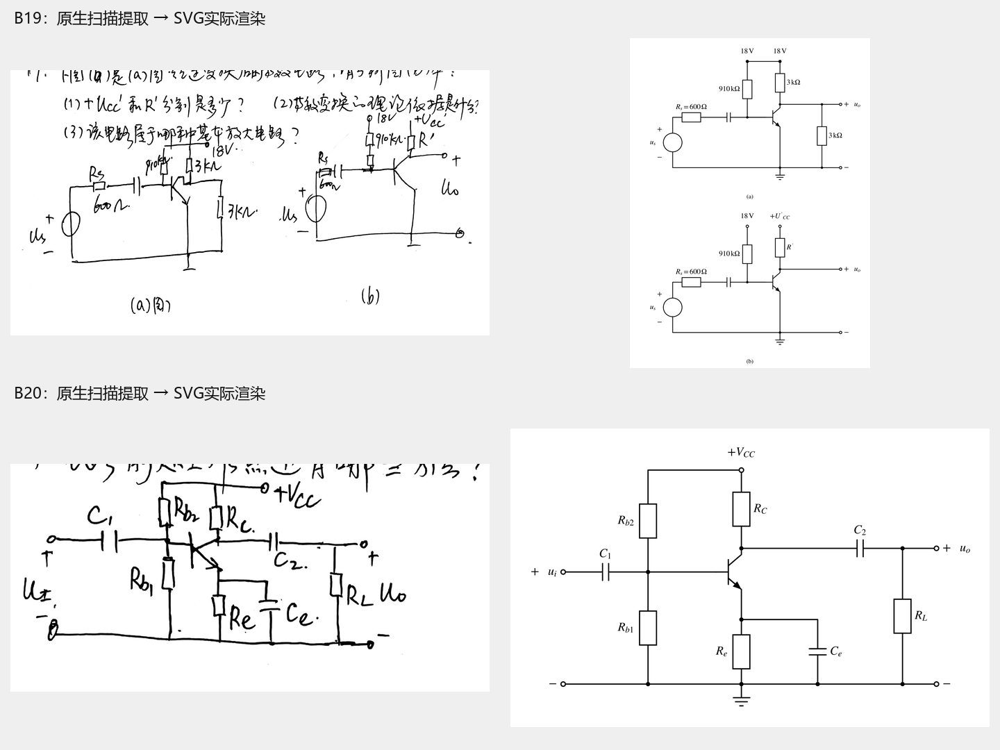
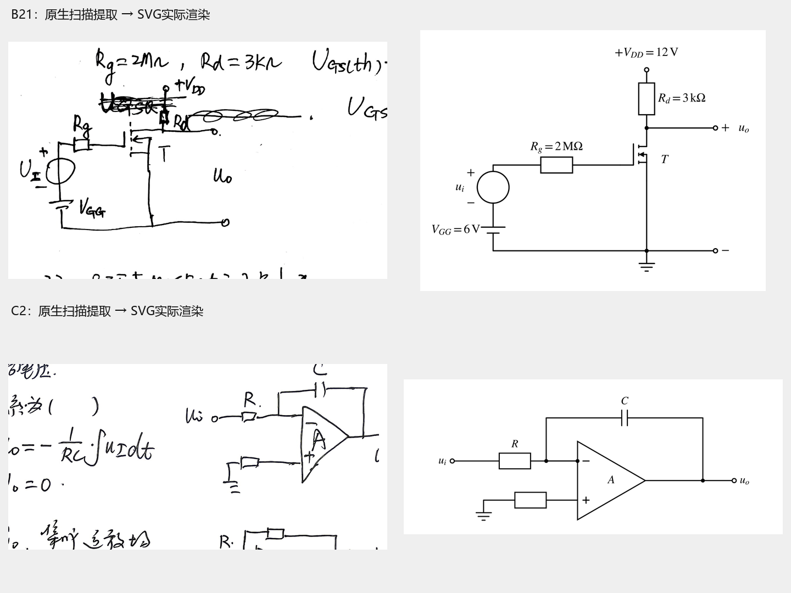
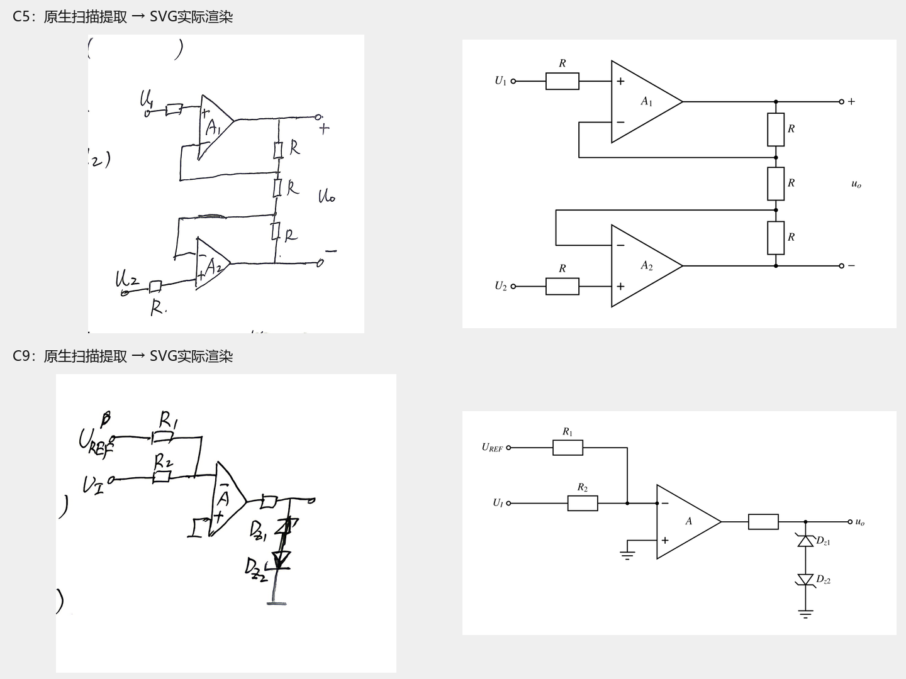
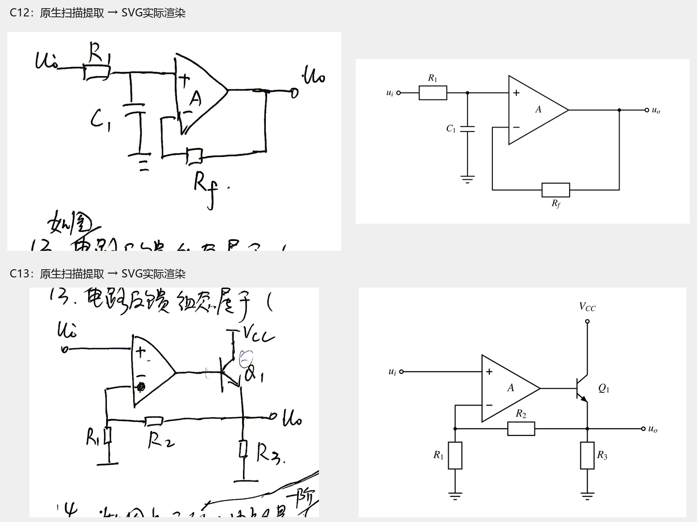
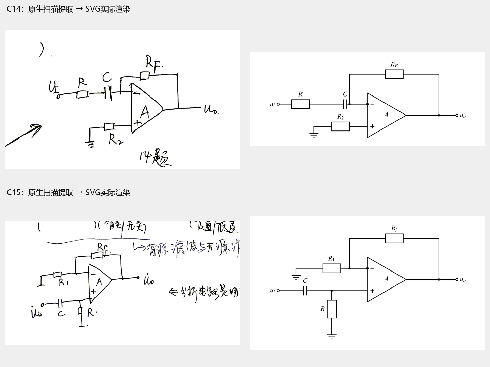

# 电路分析：首批10张核验重绘图

本批10张为10个原题图的替换，B19的(a)(b)合在一张竖排图中。原图、PDF、答案截图保留。已先提取PDF内嵌原生扫描，再判定手写图仍需重绘。已逐张查看实际SVG渲染及640/320像素宽度效果；不以重绘图证明原答案正确。

[题面入口](电子线路期末复习_题面整理.md) · [候选及映射台账](assets/redraw-batch01/ledger.json) · [可编辑绘图源](assets/redraw-batch01/render.py) · [组图与实际SVG渲染脚本](assets/redraw-batch01/assemble.py)

## 前后对照与核验

| 题目 / PDF页 | 原图 | 重绘SVG / PNG | 核验要点 | 结果 |
|---|---|---|---|---|
| [[电路分析/10_题库/电子线路期末复习_题面整理#电子复习-B19]] / 5 | [扫描图](assets/电子线路期末复习/B19.png) · [原生像素](assets/redraw-batch01/B19-source-native.png) | [SVG](assets/redraw-batch01/B19.svg) · [PNG](assets/redraw-batch01/B19.png) | (a) NPN发射极接地；两条18V支路共节点；基极910kΩ；集电极3kΩ与对地3kΩ支路；Rs=600Ω；(b)保留18V、U′CC、R′未知量；不补答案。两子图合为一张题图。 | 通过 |
| [[电路分析/10_题库/电子线路期末复习_题面整理#电子复习-B20]] / 6 | [扫描图](assets/电子线路期末复习/B20.png) · [原生像素](assets/redraw-batch01/B20-source-native.png) | [SVG](assets/redraw-batch01/B20.svg) · [PNG](assets/redraw-batch01/B20.png) | NPN集电极经RC接+VCC，发射极Re与Ce并联至公共端；Rb2在上、Rb1在下；C1输入，C2输出，RL在C2之后；无额外电容极性。 | 通过 |
| [[电路分析/10_题库/电子线路期末复习_题面整理#电子复习-B21]] / 6 | [扫描图](assets/电子线路期末复习/B21.png) · [原生像素](assets/redraw-batch01/B21-source-native.png) | [SVG](assets/redraw-batch01/B21.svg) · [PNG](assets/redraw-batch01/B21.png) | 第6页涂改处由第10页重复C8交叉核对；增强型N沟道MOS，漏极经Rd接+VDD；源极公共端；栅极经Rg接输入源；VGG长极板朝输入源（正端朝上）；2MΩ、3kΩ、6V、12V均在原题。 | 通过 |
| [[电路分析/10_题库/电子线路期末复习_题面整理#电子复习-C2]] / 13 | [扫描图](assets/电子线路期末复习/C2.png) · [原生像素](assets/redraw-batch01/C2-source-native.png) | [SVG](assets/redraw-batch01/C2.svg) · [PNG](assets/redraw-batch01/C2.png) | R串联至反相端；C由输出反馈至反相端；正相端经未编号电阻接地；不增设Rb编号或阻值；初始电容条件仍在题干。 | 通过 |
| [[电路分析/10_题库/电子线路期末复习_题面整理#电子复习-C5]] / 10 | [扫描图](assets/电子线路期末复习/C5.png) · [原生像素](assets/redraw-batch01/C5-source-native.png) | [SVG](assets/redraw-batch01/C5.svg) · [PNG](assets/redraw-batch01/C5.png) | 上下运放同相端各经R接U1、U2；三个R串接在两输出之间；两反相端分别回接上、下分压节点；差分输出下端不是地。 | 通过 |
| [[电路分析/10_题库/电子线路期末复习_题面整理#电子复习-C9]] / 10 | [扫描图](assets/电子线路期末复习/C9.png) · [原生像素](assets/redraw-batch01/C9-source-native.png) | [SVG](assets/redraw-batch01/C9.svg) · [PNG](assets/redraw-batch01/C9.png) | R1接UREF、R2接UI，汇于反相端；同相端地；输出串联无编号电阻；Dz1阴极接输出、Dz2阴极接地，两阳极相接；未增正反馈。 | 通过 |
| [[电路分析/10_题库/电子线路期末复习_题面整理#电子复习-C12]] / 9 | [扫描图](assets/电子线路期末复习/C12.png) · [原生像素](assets/redraw-batch01/C12-source-native.png) | [SVG](assets/redraw-batch01/C12.svg) · [PNG](assets/redraw-batch01/C12.png) | R1-C1对地节点接同相端；Rf连接输出与反相端；不添加反相端对地电阻；R1和C1保留符号值。 | 通过 |
| [[电路分析/10_题库/电子线路期末复习_题面整理#电子复习-C13]] / 9 | [扫描图](assets/电子线路期末复习/C13.png) · [原生像素](assets/redraw-batch01/C13-source-native.png) | [SVG](assets/redraw-batch01/C13.svg) · [PNG](assets/redraw-batch01/C13.png) | NPN Q1箭头沿发射极向外；集电极VCC；基极接运放输出；发射极接uo、R3、R2；R2回反相端与R1对地节点；ui接同相端。 | 通过 |
| [[电路分析/10_题库/电子线路期末复习_题面整理#电子复习-C14]] / 9 | [扫描图](assets/电子线路期末复习/C14.png) · [原生像素](assets/redraw-batch01/C14-source-native.png) | [SVG](assets/redraw-batch01/C14.svg) · [PNG](assets/redraw-batch01/C14.png) | 输入R、C串联到反相端；RF从输出回反相端；同相端通过R2接地；原照片题干写负载R_L，原称R2为负载属转录误判；图中R2连接不变。 | 通过；原R_L转录误判已更正 |
| [[电路分析/10_题库/电子线路期末复习_题面整理#电子复习-C15]] / 9 | [扫描图](assets/电子线路期末复习/C15.png) · [原生像素](assets/redraw-batch01/C15-source-native.png) | [SVG](assets/redraw-batch01/C15.svg) · [PNG](assets/redraw-batch01/C15.png) | 输入C串联至同相端，R对地；反相端经R1对地，经Rf接输出；保留无数值符号参数。 | 通过 |

## 可视对照

左侧为提取的原始扫描，右侧为实际SVG的独立渲染；扫描中的原答案笔迹只作为来源证据。B19采用竖排以便小屏阅读。

## 保留与未解决项

- E6-15现有印刷图清楚，已回查原PDF第221页，不重绘、不计数。
- A4电源数值缺失、A7输入二极管方向歧义、C3上方反馈电阻未标值（未裁原照片已补足右侧接线）：保留原图，待完整条件；旧候选草稿不能替代题图。
- C1局部MOS符号不够清楚，本批不采纳；B21则使用第10页C8重复图交叉核对。
- 后续来源核验更正：C14原照片题干清楚写负载R_L，图中R2仍是同相端接地电阻；原“称谓冲突”是R_L误录成R2，已解除。原图及重绘接线均未修改。
- 初次扫描293处引用，包含2张多文档共用图；共用图本身清楚，不为凑数重绘。并发任务随后新增草稿引用，本批在其提交01ce22a之后仅合并指定图片替换，保留其他改动。

## 重现与规范

使用Python、Schemdraw、Matplotlib生成矢量SVG与PNG，字体STIXGeneral与STIX数学字形、线宽1.65pt、IEC矩形电阻、实心连接点，单色呈现。SVG字形轮廓化避免不同渲染器把撇号误成数字；变量与上下标在Python源中可编辑。进入本目录运行 `python render.py`、`python assemble.py`。

相关链接、锚点、只读来源及技能校验结果见 [校验记录](assets/redraw-batch01/validation.json)。本任务没有变更知识层讲解、标签或解答块，不涉及重新入库、S2考频重算或S8摘要重建。
