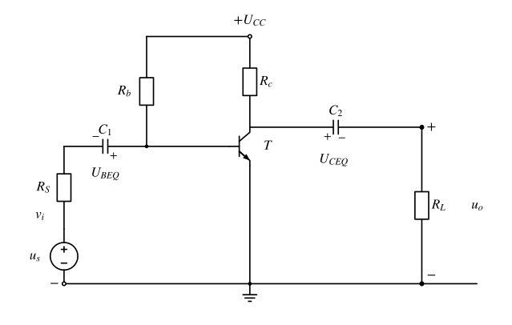
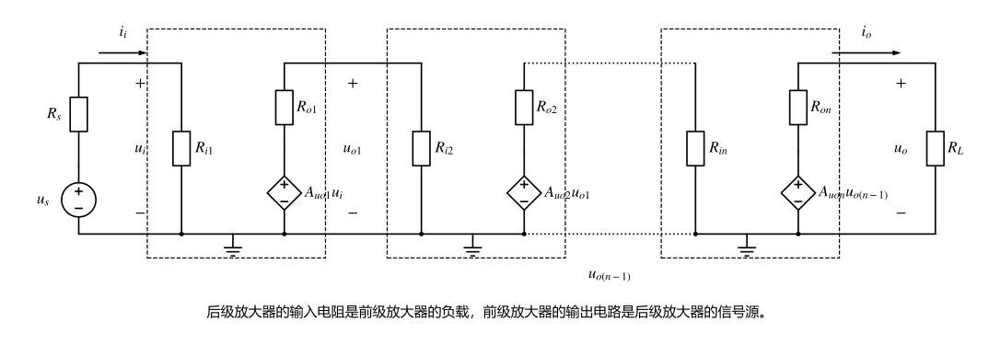
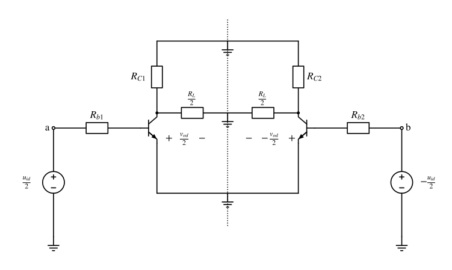
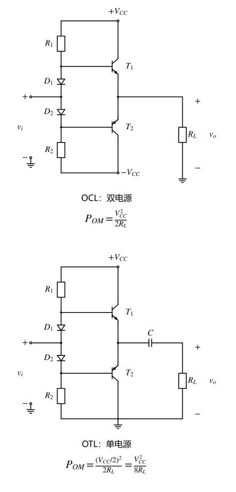
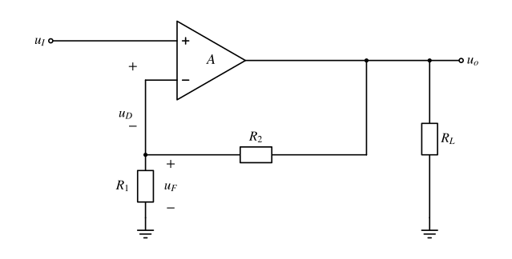

# 第6章 晶体管放大电路基础：先偏置，再小信号，再看整个系统

## 这一章抓什么

二极管让我们学会了“先确定工作区，再选择模型”。晶体管在此基础上多了一件关键的事：用一个端口的较小变化，控制另一个端口的电流。输入信号并没有创造能量，较大的输出能量来自电源；信号决定电源怎样向负载供能。

本章最重要的顺序是：**先确认器件的工作区，用直流电路确定静态工作点，再围绕工作点建立小信号模型，最后检查负载、幅度和频率是否允许这种近似。**只会背共射增益，却不知道发射极在交流中是否接地、负载是否已经接入，仍然不能可靠地分析放大器。

这里汇集了多份课件，内容横跨器件、单级、多级、差分、输出级和反馈。主线对应6-1、6-2、6-3、6-4、6-6；功率计算6-5、详细频率响应6-7保留为已确认的补充层。补充不等于只记一个名字，也不意味着6-4原本讲授的互补输出级应被移出主线。

## 先建立整体直觉

可以把放大器看成“带偏置的受控电流通道”。偏置先让器件处在可以向两个方向小幅改变电流的位置；输入再使电流增加或减少；输出电阻、负载或后级把这种电流变化转成所需的电压或功率。

这也解释了三个看似矛盾的现象。没有交流输入时，放大器仍可能消耗直流功率，因为偏置正在维持工作点。电压增益接近1的跟随器仍可能很有用，因为它可以少取输入电流、向低阻负载提供更大的电流。负反馈会降低某种闭环增益，却能让实际放大量更接近设计值，而不是随晶体管参数大幅飘动。

“线性放大”不表示器件本身线性。它表示在合适工作区、足够小的变化范围和适当频带内，可以用曲线的局部斜率近似分析。信号摆得太大、频率太高或器件偏置错误，原来的增益公式便失去依据。

## 本章怎么串起来

BJT的载流子传输 → 偏置与工作区 → 直流/交流分离 → 共射、共集、共基的端口行为 → 将同一方法迁移到JFET和MOSFET → 级联时处理加载 → 差分结构区分“差”和“共同变化” → 输出级负责电流与功率 → 负反馈校正偏差 → 用频率响应说明这种校正与放大何时失效。

第一次学习可先贯通6.1—6.4和6.6，再按需要回到6.5、6.7。遇到某个公式看不懂时，先问它对应哪张等效电路，而不是把所有公式放在一起背。以下电阻符号会先说明连接位置；不同课件的编号并不总是一致。

## 分节主干

### 6.1 双极型晶体管：两只PN结为什么能产生控制作用

#### 从内部结构解释三端电流

《6-1 双极性晶体三极管 (1).pptx》讨论NPN与PNP两类BJT。它有发射极E、基极B、集电极C，但不能等效成两只独立二极管简单背靠背：两个结之间共享很薄的基区，载流子能从发射区穿过基区到达集电区，这种耦合才是晶体管作用的关键。

以NPN为例，发射区较重掺杂，发射结正偏后向基区注入大量电子；基区薄且掺杂较轻，只有一小部分注入电子在基区复合，更多电子到达反偏的集电结并被收集。于是与基区复合有关的基极电流较小，集电极电流却可以较大。集电区的结构还要兼顾载流子收集、耐压与散热，不宜把集电极、发射极任意对调。

按通常电流参考方向，发射极电流分成基极与集电极电流，即 $I_E=I_B+I_C$。忽略漏电流、工作在正向放大区时，有：

$$
I_C\approx\beta I_B,\qquad I_C\approx\alpha I_E,\qquad
\alpha=\frac{\beta}{1+\beta}.
$$

$\beta$ 是共射电流放大系数，$\alpha$ 是共基电流放大系数；前者可以较大，后者小于1但通常接近1。这不是说基极电流提供了全部输出能量，而是在指定工作区内，用电流比概括器件的控制关系。

课件还区分直流系数与交流系数。直流系数是工作点处的电流比，交流系数是工作点附近、指定条件下的增量比。常见低频分析把二者近似看成相同，但不能因此断言同型号的所有管、所有工作点、所有频率都具有同一个 $\beta$。

#### 工作区必须检查两个结

对NPN管，通常的正向放大区要求 $V_E<V_B<V_C$：发射结正偏，集电结反偏。对PNP管，相应电位次序反过来，为 $V_C<V_B<V_E$。因此，“硅管的发射结压降约0.7V”只能检查一个结，不能独自证明器件处于放大区。

| 工作状态 | 发射结与集电结 | 可以怎样近似 |
| --- | --- | --- |
| 截止 | 发射结未进入所用模型的导通区，集电结通常反偏 | 主电流很小；不能继续使用正常放大区的 $I_C=\beta I_B$ |
| 正向放大 | 发射结正偏、集电结反偏 | 小变化可以被线性化，是本章BJT小信号分析的主要工作区 |
| 饱和 | 两个结都正偏 | 集电极电流受外电路限制，不能再随意用 $\beta I_B$ 求电流 |

饱和时常用较小的 $U_{CE(sat)}$ 近似，但具体数值按题给模型取，不能把某个典型压降当成普适常数。判断时先画电位或写结电压，再选择区域方程；若按放大区求出的结果不满足集电结反偏，就要换区重算。

特别注意：**BJT的“饱和区”与MOSFET的“饱和区”不是同一种放大状态。**BJT线性放大一般避开饱和；MOSFET通常恰恰利用其饱和、也叫恒流工作区做放大。后文会重新说明。

#### 输入、输出曲线告诉我们哪些近似可以用

共射输入特性把 $i_B$ 与 $u_{BE}$ 的关系画出来，并注明固定的 $u_{CE}$；输出特性则在不同基极电流下，画 $i_C$ 随 $u_{CE}$ 的变化。它们分别说明输入端像一个受偏置影响的结，以及输出端在放大区近似受控电流源。

输出曲线在放大区比较平坦，因此常把集电极电流主要看作由输入控制。但“平坦”不等于绝对水平。精细模型可以保留有限的输出电阻，基本计算只有在该影响相对负载足够小时才忽略它。接近饱和、截止或击穿边界，原来的平坦区近似都不可靠。

课件中的 $I_{CBO}$ 是发射极开路时集电结的反向漏电流；$I_{CEO}$ 是基极开路时的集电极—发射极漏电流。在相应近似下，$I_{CEO}\approx(1+\beta)I_{CBO}$。温度上升会改变漏电流、结压降和电流系数，所以仅靠固定基极电流设置工作点，未必稳定。

极限参数用于检查器件能否安全工作：电流不能越过允许范围，集电极—发射极电压不能超出相应接法的耐压，耗散功率与散热条件也必须满足要求。不同端子开路条件下的击穿指标不能任意互换。小信号增益正确，并不自动意味着大摆幅时仍然安全。

### 6.2 BJT基本放大电路：把直流位置与交流变化分开

#### 先定义放大量和端口

《6-2 双极性晶体管基本放大电路.ppt》先区分电压、电流和功率放大。电压增益 $A_u=u_o/u_i$ 比较的是指定输入端与输出端的变化量；输入电阻 $R_i=u_i/i_i$ 表示输入端向信号源取多少电流；输出电阻 $R_o$ 则表示输出端电压会怎样受负载电流影响。

若信号源本身有内阻 $R_s$，输入端并不能得到全部源电压：

$$
u_i=u_s\frac{R_i}{R_s+R_i},\qquad
A_{us}=\frac{u_o}{u_s}=A_u\frac{R_i}{R_s+R_i}.
$$

$u_i$ 与源电压 $u_s$ 是两个不同位置的量，后续计算都应先说明输入参考点。电压放大100倍的级，接在一个内阻很大的信号源后，端到端增益可能远小于100倍。

电压增益的分贝表示为 $20\lg|A_u|$，功率比的分贝表示为 $10\lg(P_o/P_i)$。功率还取决于端口阻抗与相位，不能只见到“电压放大10倍”就无条件断言功率放大100倍。级联增益用分贝相加时，每级也必须先按实际负载计算。

#### 一张图，两种问题

图中 $R_b$ 给基极提供直流偏置，$R_c$ 把集电极电流变化转成输出电压，$C_1$、$C_2$ 在传递交流的同时隔开两侧直流电位。分析图时，不要把电容的“直流不通过”误解为其两端直流电压一定等于零：它恰恰可以保存两侧的偏置差。

求静态工作点时，看直流稳态电路：电容开路，纯交流独立信号源置零；理想电感在直流稳态相当于短路，实际绕组电阻仍应按题意保留。此时的未知量记为 $I_{BQ}$、$I_{CQ}$、$U_{CEQ}$ 等。

求交流小变化时，把总量拆成直流与增量，例如 $u_{BE}(t)=U_{BEQ}+u_{be}(t)$、$i_C(t)=I_{CQ}+i_c(t)$。独立直流电压源置零为短路，独立直流电流源置零为开路；受控源必须保留控制关系。耦合、旁路电容只有在所考察频率下阻抗足够小时才近似短路，绝不是“只要交流，所有电容都短路、所有电感都开路”。

图中负载经 $C_2$ 耦合，所以理想直流稳态下不影响Q点；若负载直接接在集电极，则它会参与直流计算。这是一个连接条件，不是所有放大器共有的结论。

#### 固定偏置怎样求Q点，怎样发现假设错了

对图中发射极接地的固定偏置电路，先假设NPN管处于放大区，采用题给 $U_{BEQ}$ 与 $\beta$：

$$
I_{BQ}=\frac{V_{CC}-U_{BEQ}}{R_b},\qquad
I_{CQ}=\beta I_{BQ},\qquad
U_{CEQ}=V_{CC}-I_{CQ}R_c.
$$

这三个式子依次来自输入回路、器件关系和输出回路。它们只是候选解；最后要检查基极电流方向、集电结是否反偏以及电流、功率限制。如果算出集电极电位低于基极，就不能一面保留该结果，一面继续宣称管子处于放大区。

输出特性图上的直流负载线表达 $I_C=(V_{CC}-U_{CE})/R_c$；它与器件曲线交点就是Q点。这样理解后，图解法和方程法就不再是两套互不相关的方法：二者都在寻找“器件关系”和“外电路约束”同时成立的位置。

#### 分压偏置的稳定性来自哪里

为避免不同课件电阻编号相反，这里规定：$R_\uparrow$ 从电源接到基极，$R_\downarrow$ 从基极接地，发射极通过 $R_E$ 接地。将分压网络作戴维南等效：

$$
V_{TH}=V_{CC}\frac{R_\downarrow}{R_\uparrow+R_\downarrow},\qquad
R_{TH}=R_\uparrow\parallel R_\downarrow.
$$

基极电流会加载分压器，所以不能总把实际基极电压直接写成 $V_{TH}$。保留该影响时：

$$
I_{BQ}=\frac{V_{TH}-U_{BEQ}}{R_{TH}+(1+\beta)R_E},\qquad
I_{EQ}=(1+\beta)I_{BQ},
$$

$$
U_{CEQ}=V_{CC}-I_{CQ}R_C-I_{EQ}R_E.
$$

当 $R_{TH}\ll(1+\beta)R_E$、分压网络足够“硬”，且解仍满足放大区条件时，才可以近似认为 $V_B\approx V_{TH}$，进而用 $I_{EQ}\approx(V_B-U_{BEQ})/R_E$。这比只背“分压电流远大于基极电流”更清楚地说明了近似条件。

假设某种温度变化让电流增大，发射极电阻压降随之增大，$V_E$ 上升；若 $V_B$ 变化不大，$U_{BE}$ 就下降，抑制原来的电流增大。这是偏置中的直流负反馈。它不是使参数完全不变，而是减弱参数变化对工作点的影响。

若在 $R_E$ 两端并旁路电容，电容在直流中开路，稳定Q点的电阻仍然存在；中频交流时电容可能近似短路，交流负反馈减弱，从而恢复较大增益。部分旁路电路也按同一原则处理：直流用全部发射极电阻，交流只保留没有被有效旁路的部分。

#### 小信号模型是Q点处的局部线性关系

对已经处于放大区的BJT，在低、中频的小变化范围内，可以写 $u_{be}=i_b r_{be}$、$i_c\approx\beta i_b$。课件采用：

$$
r_{be}\approx r_{bb'}+(1+\beta)\frac{U_T}{I_{EQ}},\qquad U_T\approx26\,\mathrm{mV}\ \text{（室温附近）}.
$$

$r_{bb'}$ 是基区体电阻，后面的项来自结的微分电阻。把电流单位用安培代入，结果才是欧姆；$I_{EQ}$ 是静态发射极电流，不能拿交流电流振幅代替。偏置改变，斜率改变，$r_{be}$ 也会改变。

这与第5章的切线模型是一回事：用一阶变化关系代替局部非线性曲线。KCL、KVL本来就适用于非线性电路；线性化的作用，是使叠加和线性增益计算可用于小增量，而不是让此前“失效”的基本电路定律重新成立。

#### 共射：为什么反相，发射极电阻怎样进入分母

共射从基极输入、集电极输出，发射极是输入与输出的公共参考。输入稍增大，集电极电流随之增大，$R_C$ 上压降增大，集电极电位反而下降，所以输出反相。公式的负号来自这条因果链。

先设集电极交流负载为 $R_C'=R_C\parallel R_L$，未被旁路的发射极交流电阻为 $R_{Ea}$，并忽略管子有限输出电阻。基极输入电压分成结上的变化与发射极抬升：

$$
u_i=i_b r_{be}+(1+\beta)i_bR_{Ea},\qquad
u_o=-\beta i_bR_C'.
$$

因此

$$
A_u\approx-\frac{\beta R_C'}{r_{be}+(1+\beta)R_{Ea}},\qquad
R_i\approx R_B\parallel[r_{be}+(1+\beta)R_{Ea}],\qquad R_o\approx R_C.
$$

这里 $R_B$ 是交流等效图中从基极看向地的偏置电阻；分压偏置时通常为两只偏置电阻的并联。发射极被充分旁路时 $R_{Ea}\approx0$，才退化成常见的 $A_u\approx-\beta(R_C\parallel R_L)/r_{be}$。

当 $(1+\beta)R_{Ea}\gg r_{be}$ 且 $\beta$ 足够大时，增益近似为 $-R_C'/R_{Ea}$，对 $\beta$ 的依赖减弱，但幅度也通常下降。输入电阻则因为发射极电压随输入一起抬升而增大：同样输入电压，真正落在基极—发射极间的变化更小，所需基极电流更少。

这些式子的 $R_L$ 只属于交流负载情形。计算 $R_o$ 时要移走被驱动的负载，在输出端加测试源，不能把负载本身并进去后称为“放大器的输出电阻”。

#### 共集：电压不放大，为什么还能增强驱动能力

共集又叫射极跟随器，从基极输入、发射极输出，集电极通过理想直流电源成为交流公共点。设发射极交流负载 $R_E'=R_E\parallel R_L$，则 $u_o=(1+\beta)i_bR_E'$，而 $u_i=i_b r_{be}+u_o$。所以：
$$
A_u=\frac{(1+\beta)R_E'}{r_{be}+(1+\beta)R_E'}<1,
$$

$$
R_i\approx R_B\parallel[r_{be}+(1+\beta)R_E'].
$$

当发射极负载映射到基极后远大于 $r_{be}$，输出电压便能较好地跟随输入。与此同时，负载电流主要由电源经晶体管提供，输入只需供较小的基极电流，因此它适合作缓冲。

求输出电阻时，将输入独立信号源置零，但保留其内阻；对基极有并联偏置 $R_B$ 的常见电路：

$$
R_o\approx R_E\parallel\frac{r_{be}+(R_s\parallel R_B)}{1+\beta}.
$$

若题图的偏置电阻串在信号路径中，而不是从基极并到交流地，基极看到的等效电阻就要重新计算，不能照搬此处的并联形式。跟随器电压增益接近1也不代表输出电阻严格为零，更不代表可以无限提供电流。

#### 共基：输入端换到发射极，方向也随之改变

共基从发射极输入、集电极输出，基极在交流中接地。发射极电压上升，使 $u_{BE}$ 减小，集电极电流下降，集电极电位上升，因此电压输出同相。

对基极理想交流接地、发射极有对地偏置电阻 $R_E$、忽略管子输出电阻的基本电路：

$$
A_u\approx+\frac{\beta(R_C\parallel R_L)}{r_{be}},\qquad
R_i\approx R_E\parallel\frac{r_{be}}{1+\beta},\qquad R_o\approx R_C.
$$

输入端是发射极，输入电流接近发射极电流，因此器件支路电流传输比约为 $\alpha<1$；它可以有较大电压增益，却没有像共射那样的大电流增益。偏置支路或不同外接电阻会改变整个端口的电流比，不能把器件支路系数不加说明地当成所有外部端口的增益。

共射、共集、共基的识别要看交流公共端和实际输出端，不看原图的上下位置。通常共射适合电压放大，共集适合缓冲，共基具有低输入电阻并可用于较宽频带；这些是有条件的结构特点，不替代具体电路计算。

#### 交流负载线与削顶：先说输出的是电压还是电流

接入隔直电容后的负载不改直流Q点，却会改变交流负载线。发射极交流接地时，该线穿过Q点、斜率为 $-1/(R_C\parallel R_L)$，而不是原直流线的 $-1/R_C$。最大交流摆幅应沿交流线寻找边界。

以共射的集电极电压为输出：电流向零减小、管子趋于截止时，集电极电压向上走，所以**截止限制电压波形的上端**；电流增大、管子趋于饱和时，集电极电压向下走，所以**饱和限制电压波形的下端**。若观察集电极电流，方向恰好不同。只说“Q点太高会削哪边”，却不说明坐标与输出量，很容易讲反。

在上述简单中频模型中，正弦输出的峰值上限可估为：

$$
U_{o,p}\le\min\{I_{CQ}(R_C\parallel R_L),\ U_{CEQ}-U_{CE(sat)}\}.
$$

第一项是从Q点向截止方向能产生的电压变化，第二项是向饱和方向剩余的电压空间。若题目要有效值，应再除以 $\sqrt2$。发射极不再交流接地、输出级结构不同或存在额外限流时，应重新分析，不能把这个式子当通用摆幅公式。即使尚未削顶，过大的输入也可能使局部线性化误差明显增大。

### 6.3 场效应管：用栅压改变沟道，再沿用同一分析顺序

#### JFET、增强型MOS、耗尽型MOS不能混成一种管

《6-3  场效应管MOS及基本放大电路.pptx》不仅讲MOS，也讲结型场效应管JFET。场效应管的栅极G、源极S、漏极D分别承担控制、载流子进入与离开的角色；主要靠一种类型载流子的沟道导电，与BJT中电子和空穴共同参与的机制不同。

JFET利用反偏的栅结改变耗尽层宽度，进而控制导电沟道宽度。MOSFET利用绝缘栅上的电场改变表面载流子分布；理想直流栅电流近似为零，但极间电容需要充放电，所以“高输入电阻”不等于“高频不需要输入电流”。

每种结构还分N沟道与P沟道。以下方程统一以N沟道为例，并明确所用电压方向 $u_{GS}=V_G-V_S$、$u_{DS}=V_D-V_S$；分析P沟道时应按相反极性或统一的幅值约定重写条件，而不是只把最后的电流结果加一个负号。

| 器件 | 零栅源电压附近的沟道 | 栅压控制的要点 |
| --- | --- | --- |
| N沟道JFET | 已有导电沟道 | 正常控制时栅结反偏，$u_{GS}$ 越负，沟道越窄 |
| N沟道增强型MOSFET | 理想截止模型下没有反型导电沟道 | 栅压超过正阈值后才建立足够强的反型沟道 |
| N沟道耗尽型MOSFET | 已有沟道 | 负栅压可削弱沟道，正栅压可增强；绝缘栅不要求像JFET那样始终反偏 |

#### JFET的局部夹断不等于整条沟道截止

以N沟道JFET为例，记夹断、也称截止栅压为 $U_P=U_{GS(off)}<0$。当栅压从0向更负方向变化，耗尽层加宽，电流减小；达到相应截止条件时，沟道难以导通。

另一方面，固定 $u_{GS}$ 增大 $u_{DS}$，漏端相对栅极的反偏更强，漏端先出现局部夹断。载流子仍可穿过该区域被电场拉向漏极，因而电流并未变成零，而是进入近似恒流的放大工作区。**漏端局部夹断**与**栅压使整条沟道截止**必须分开。

课件采用的恒流区转移关系为：

$$
I_D=I_{DSS}\left(1-\frac{U_{GS}}{U_P}\right)^2,
\qquad U_P\le U_{GS}\le0.
$$

$I_{DSS}$ 是该模型中 $U_{GS}=0$ 时的恒流区漏极电流，不是任意漏源电压下的固定电流。还要检查 $U_{DS}\ge U_{GS}-U_P$ 等恒流区条件；若漏源电压太小，器件处在电阻区，不能照套这个平方关系。

#### MOS的阈值、预夹断与恒流区

N沟道增强型MOS中，正栅压先排斥表面空穴、改变耗尽状态，再吸引电子形成反型层。达到阈值 $U_{th}$ 后，才能在本课程的强导电近似中建立沟道。若 $U_{GS}\le U_{th}$，按课程理想截止模型处理；真实器件的微弱亚阈值电流不在这里展开。

当 $U_{GS}>U_{th}$，较小 $U_{DS}$ 对应电阻区；漏端达到 $U_{GD}=U_{th}$ 后，进入饱和、恒流区。其条件常写为 $U_{DS}\ge U_{GS}-U_{th}$。在这个区内，课件用：

$$
I_D=I_{D0}\left(\frac{U_{GS}}{U_{th}}-1\right)^2
=K(U_{GS}-U_{th})^2,\qquad K=\frac{I_{D0}}{U_{th}^2}.
$$

$I_{D0}$ 对应课件中 $U_{GS}=2U_{th}$ 时的参考电流；不同书对系数是否包含 $1/2$ 有不同记法，所以应从本题给出的转移式确认 $K$ 的定义。方程的平方会让不满足 $U_{GS}>U_{th}$ 的根也看起来“电流为正”，选根时必须回到物理条件。

耗尽型MOS在零栅压已有沟道，课件常用类似 $I_{DSS}(1-U_{GS}/U_{GS(off)})^2$ 的关系描述指定恒流区。它与JFET的形式相似，但栅结构、可用栅压范围与极限参数不同，不能仅凭公式相同就把两种器件的偏置限制混为一谈。

#### 先联立偏置，再求跨导

对栅极电流可忽略、源极有电阻 $R_S$ 的电路，先由偏置网络求栅电位 $V_G$，再写：

$$
U_{GS}=V_G-I_D R_S,\qquad
U_{DS}=V_{DD}-I_D(R_D+R_S).
$$

将第一式与对应器件的恒流区转移关系联立，得到候选 $I_{DQ}$，再检查阈值、沟道工作区、漏源电压和功耗。分压偏置时，理想直流栅电流很小，栅串联电阻几乎没有直流压降；但它在输入电阻和高频充电路径中仍可能起作用。

自偏置令栅极经电阻接地，故 $U_{GS}=-I_D R_S$。对N沟道JFET、某些耗尽型器件，这是合理的负栅源偏置；对需要正阈值以上栅压的N沟道增强型MOS，不能仅靠这种零栅压自偏置得到正常导通工作点。这是模型选择错误，不是求二次方程不熟练。

跨导表示工作点附近栅压变化引起多大漏极电流变化：

$$
g_m=\left.\frac{\partial i_D}{\partial u_{GS}}\right|_{Q,\ u_{DS}\text{不变}}.
$$

对上述增强型模型，$g_m=2K(U_{GSQ}-U_{th})=2I_{DQ}/(U_{GSQ}-U_{th})$；对课件的耗尽型平方模型，$g_m=2\sqrt{I_{DQ}I_{DSS}}/|U_{GS(off)}|$。它们来自对转移曲线求导，而不是器件固定不变的常数。$g_m$ 的单位是西门子，即安培/伏特；$\beta$ 无量纲，二者的数值不能直接比较大小。

#### 共源与源极跟随：把电流控制换成电压控制

在低、中频小信号模型中，漏极变化电流近似为 $i_d=g_m u_{gs}$。忽略有限漏源输出电阻、且源极交流接地时，共源增益为 $A_u\approx-g_m(R_D\parallel R_L)$，输出电阻约为 $R_D$。负号与共射一样：漏电流增加，漏极电阻压降增加，漏极输出电位下降。

若源极交流电阻 $R_{Sa}$ 没有被旁路，源极抬升会抵消一部分栅压变化，得到 $A_u\approx-g_m(R_D\parallel R_L)/(1+g_mR_{Sa})$。输入电阻主要由实际栅偏置网络决定；只有看进理想器件栅端时才近似无穷大，不能把整台有偏置电阻的放大器也写成无穷大。

共漏、也叫源极跟随器，从源极输出。设源极交流负载为 $R_S'=R_S\parallel R_L$，则 $u_o=g_m(u_i-u_o)R_S'$，所以：

$$
A_u=\frac{g_mR_S'}{1+g_mR_S'}<1,\qquad
R_o\approx R_S\parallel\frac1{g_m}.
$$

后一式要求输入源置零后栅极在相关频带内接到交流地，并忽略器件有限输出电阻。跟随器可以缓冲电压，但仍要满足恒流区与输出摆幅条件。

器件选用还涉及 $I_{DM}$、允许耗散功率、栅源/漏源耐压、极间电容及噪声等。JFET的反向栅结和MOS的绝缘栅有不同限制，“输入电阻高”并不意味着任意栅压都安全；也不能把课件中对FET与BJT的经验比较当作所有型号、所有频段下的绝对优劣。

### 6.4 多级、差分与输出级：让放大器成为可连接的系统

#### 级间耦合同时影响直流与交流

《6-4  多级放大电路.ppt》讨论四种耦合。直接耦合不隔断直流，所以可以传递直流和很慢的变化，但各级Q点相互影响，前级偏移也会继续被放大。阻容耦合隔开直流，使各级偏置较独立，却不能直接传递直流，而且低频会受耦合电容阻抗影响。

同极性的NPN共射级直接相连时，后级基极接前级集电极；各级又要求集电极高于本级基极，电位可能一级级抬高，挤占后级摆幅。改变发射极电位、采用二极管/稳压管作适当电平移动、混用NPN与PNP，都是课件讨论的解决思路。电阻可以产生所需直流压降，却同时引入交流退化；已导通二极管或稳压管可以在提供直流压差的同时具有较小动态电阻，但必须先保证其工作区和电流。

变压器耦合可以隔开直流并变换阻抗。理想变压器中，由功率守恒与电压、电流匝数比可得原边看到的负载 $R_L'=(N_1/N_2)^2R_L$。这不是“线圈本身产生功率”，也不意味着实际损耗为零；其低频能力仍受磁路等条件限制。

光电耦合将发光元件与光敏接收元件电气隔离，信号经历电—光—电转换。它解决的重点是隔离和抗干扰，而不是把输入输出简单视为一根导线。某些输出采用复合管以提高电流传输能力；具体增益与频带仍由器件和外电路决定。

#### 前级的负载，就是后级的输入

把一个放大级等效成输入电阻、受控电压源和输出电阻后，可以看清连接代价。第一级输出电阻 $R_{o1}$ 与第二级输入电阻 $R_{i2}$ 构成分压；因此第一级接上后级后的增益，不一定等于它原来的空载增益。

若用 $A_{u0k}$ 表示第 $k$ 级空载电压增益，两级的源到负载增益可写成：

$$
A_{us}=\frac{R_{i1}}{R_s+R_{i1}}A_{u01}
\frac{R_{i2}}{R_{o1}+R_{i2}}A_{u02}
\frac{R_L}{R_{o2}+R_L}.
$$

若每级 $A_{uk}$ 已经包含实际加载，才直接使用 $A_u=\prod A_{uk}$。例如某级空载增益为100，而后级输入电阻恰好等于该级输出电阻，连接处电压先减半；遗漏这个分压，再精确地计算后级增益，也无法得到正确总增益。

总输入电阻从第一级看入，但第一级本身可能受后级负载影响；总输出电阻从末级看入，而末级的信号源内阻来自前一级。射极/源极跟随器之所以常放在级间或末端，正是为了缓解这种加载，而不是为了多乘一个电压增益。

#### 差分电路为何特别适合直接耦合

直接耦合会把零输入时的偏移、温度漂移继续传递。差分结构让两条尽量匹配的支路共同经历相似环境，再取输出之差，试图抵消共同变化，同时保留两输入之间的差别。

先把任意两个输入分解为：

$$
u_{id}=u_{i1}-u_{i2},\qquad u_{ic}=\frac{u_{i1}+u_{i2}}2,
$$

$$
u_{i1}=u_{ic}+\frac{u_{id}}2,\qquad
u_{i2}=u_{ic}-\frac{u_{id}}2.
$$

差模是两端的差，共模是一起抬升的部分。“双端输入”不自动等于“没有共模”；只有反相等幅的纯差模激励才有 $u_{ic}=0$。单端输入、另一端交流接地时，则 $u_{id}=u_i$、$u_{ic}=u_i/2$，两种成分都存在。

对称偏置时，两管静态发射极电流相等，各占尾电流的一半；理想匹配的两集电极静态电位相同，所以双端差输出为零。若从单个集电极对地输出，它本来就带有直流电位。固定的输出偏置与偏置随环境改变的零点漂移应区分，不能见到一个非零直流输出便称为“放大错误”。

#### 纯差模下，为什么可以拆成两半

纯差模使两支路电流等幅反向变化，尾部总电流增量相抵消。于是对称条件下的公共发射极成为交流虚地；跨接两集电极的负载中点也成为交流虚地，可以把 $R_L$ 拆成两侧各 $R_L/2$。这里说的是增量电位不变，不是把直流发射极电位改成零，更不是实际增加了一根接地导线。

设两侧集电极电阻均为 $R_C$，输入端串联的基极电阻均为 $R_b$，小信号参数相同，输出方向取 $u_o=u_{c1}-u_{c2}$。忽略有限输出电阻时：

$$
A_d=\frac{u_o}{u_{id}}\approx-\frac{\beta(R_C\parallel R_L/2)}{R_b+r_{be}},
$$

$$
R_{id}\approx2(R_b+r_{be}),\qquad R_{od}\approx2R_C.
$$

每侧输入只有 $u_{id}/2$，每侧输出也只有总差输出的一半，两个“半”在双端电压比中相抵消，所以总差模增益不是再额外乘2。负载却确实应在每个半电路中取 $R_L/2$，这是另一个不同来源的二分。

#### 单端输出与共模分析，两个“2”出现在不同位置

若改为从第一侧集电极对地输出，并把 $R_L$ 接在该输出端，则纯差模增益为

$$
A_{d,1}\approx-\frac{\beta(R_C\parallel R_L)}{2(R_b+r_{be})};
$$

从第二侧输出，相同参考输入下符号为正。此时输出只取一侧，输入仍以两端差 $u_{id}$ 定义，因而保留 $1/2$。输出电阻约为 $R_C$。不能一面改变负载连接，一面机械断言“双端增益必然恰好是单端的两倍”；两种图中的负载加载并不相同。

共模则使两支路电流同向变化，公共尾电阻 $R_E$ 中流过两倍单支路增量。每个共模半电路因此看到 $2R_E$，产生较强负反馈。对单端输出，在上述模型下：

$$
A_c\approx-\frac{\beta(R_C\parallel R_L)}{R_b+r_{be}+2(1+\beta)R_E},
$$

$$
\mathrm{CMRR}=\left|\frac{A_d}{A_c}\right|
\approx\frac{R_b+r_{be}+2(1+\beta)R_E}{2(R_b+r_{be})}.
$$

共模抑制比的分贝值为 $20\lg\mathrm{CMRR}$。式中的分母2来自单端差模增益，不能丢掉；源课件个别页漏写该因子，已按同页增益定义与后文一致关系纠正。理想完全对称的双端输出可抵消共模，得到 $A_c=0$；实际器件、负载和偏置不完全匹配，共模抑制不会无限大。

这里的 $R_{id}$ 是差模端口电阻。单端驱动含有共模成分时，求实际从一个端子看入的阻抗，要结合另一端接法与共模电流，不能把所有“输入电阻”都不加定义地写成 $2(R_b+r_{be})$。

#### 尾电流源、调零与总输出

增大尾电阻能减小共模增益，但为保持原静态电流，需要更大的直流压差。尾电流源解决的是“小信号输出电阻很大，却不必像同样大的电阻那样消耗巨大直流压降”的矛盾。实际电流源仍需要足够的端电压，内部管子也必须留在相应工作区，不能把“恒流”理解成无条件成立。

调零电位器可以补偿两侧不对称，但也会在每侧发射极引入局部退化。对课件中总电阻为 $R_W$、滑动端居中的对称接法，每侧相当于增加 $R_W/2$，差模增益分母多出 $(1+\beta)R_W/2$，差模输入电阻相应增加。调零改善静态偏差，并不自动消除所有共模误差。

实际小信号输出应写成 $u_o=U_{OQ}+A_d u_{id}+A_c u_{ic}$。直流表读数包含 $U_{OQ}$；要由输出变化反推输入，应先减去静态输出，而不是拿整个几伏读数除以增益。单端负载若直接接地，还可能改变该侧集电极静态电位，必须重新检查Q点；电容耦合负载则按另一张直流图分析。

FET差分电路沿用同一差模/共模与半电路思想，只是受控源改为 $g_m u_{gs}$。对称、源极成为差模交流虚地、忽略输出电阻时，双端差模增益约为 $-g_m(R_D\parallel R_L/2)$；理想器件栅输入不取电流，实际输入阻抗仍要算偏置网络。每只FET仍需处于其恒流放大区。

#### 互补输出级不是“另一个电压放大级”

末级常需要向低阻负载提供较大电流。基本互补输出级用NPN与PNP分别承担正、负半周，结构近似一对跟随器，电压增益接近1，目的主要是电流和功率驱动。在对称双电源下，理想输出可以围绕零电位摆动，使负载没有大的直流电流。

无静态导通偏置的实际乙类级在输入接近零时，两管可能都未充分导通，形成交越死区。若采用恒压降模型，正半周近似 $u_o=u_i-U_{BE}$，负半周近似 $u_o=u_i+|U_{BE}|$；不能一面保留0.7V开启门槛，一面又让导通段严格满足 $u_o=u_i$。零压降的理想跟随模型是另一种近似。

甲乙类输出级让零输入附近两管已有少量电流，使正负半周顺畅交接。两个适当偏置的二极管可建立约两个结压降，其小信号动态电阻又较小，使两基极随输入变化。偏置太小仍有交越失真，偏置太大则增加静态损耗，并可能带来温度相关的电流增长。

课件还给出**$U_{BE}$ 倍增电路**：一只晶体管的集电极—基极接 $R_3$，基极—发射极接 $R_4$，在分压电流远大于基极电流且晶体管工作合适时，两端电压约为 $(1+R_3/R_4)U_{BE}$。它通过电阻比调整输出级的偏置压差，不是任意情况下都会自动得到该电压。

复合管用前管驱动后管，适当连接和放大区条件下，总电流放大系数可近似达到两管系数的乘积，减轻前级驱动压力。普通互补复合结构与准互补结构的内部管型、导通结数不同；准互补可用同类型功率管形成相反控制作用的两条支路。设计偏置时应数清实际导通路径中的结压降，不能永远固定用“两只二极管”。

### 6.5 功率放大补充：平均功率、效率和热最坏点

本节对应《6-5 功率放大电路.ppt》，作为6.4输出级的补充。小信号分析关心局部增益，功率分析则关心整个信号周期中电源向哪里送能、管子在哪些时段导通、多少能量变成热。进入大信号区后，不能仅靠 $r_{be}$ 或 $g_m$ 的小变化关系计算全部功率。

#### 导通角与不同电路的任务

若一只管在整个周期导通，称甲类；约半个周期导通为乙类；介于半周期和整周期之间为甲乙类；少于半周期为丙类。丙类通常需与适当的选频负载配合，不是把普通音频波形截去大半后仍称为无失真放大。

课件列出变压器耦合、双电源互补、单电源互补等电路。效率上限依工作类别与负载形式而变，例如甲类变压器耦合的理想最大效率与乙类推挽的上限不同。不能看到一只变压器，就把所有电路都套为50%。

#### 统一峰值与有效值，再计算理想OCL功率

设双电源为 $\pm V_S$，$V_S>0$；输出为正弦，峰值 $U_p$，负载为纯电阻 $R_L$。有效值为 $U_p/\sqrt2$，所以平均输出功率是：

$$
P_O=\frac{U_p^2}{2R_L}.
$$

对理想对称乙类级，忽略静态、驱动与其他损耗，每路电源只供相应半周。单路平均电流为 $U_p/(\pi R_L)$，两路电源合计提供：

$$
P_V=\frac{2V_SU_p}{\pi R_L},\qquad
\eta=\frac{P_O}{P_V}=\frac\pi4\frac{U_p}{V_S}.
$$

理想极限 $U_p\to V_S$ 时效率趋近 $\pi/4\approx78.5\%$。计入饱和余量时，简单估计 $U_{p,\max}\approx V_S-U_{CE(sat)}$；若驱动级、保护电阻或其他压降先限制摆幅，还要再减小。甲乙类有静态电流，不能直接把理想乙类的零静态损耗结果当成精确值。

这里的 $U_p$ 始终是峰值。源课件部分导言用有效值写 $P=U^2/R_L$，后文又用相似符号表示振幅；做题前统一记号，可避免输出功率差一倍、输入有效值差 $\sqrt2$ 的错误。

#### 最大输出时，管子不一定最热

两管总平均耗散为电源功率减去负载功率：

$$
P_T=P_V-P_O=\frac{2V_SU_p}{\pi R_L}-\frac{U_p^2}{2R_L}.
$$

它不是随输出幅度一直增加的直线。求极值得到 $U_p=2V_S/\pi\approx0.637V_S$；如果电路能达到这个幅度，总管耗在这里最大，为 $2V_S^2/(\pi^2R_L)$，对称时单管承担一半。按理想最大输出功率 $P_{OM}=V_S^2/(2R_L)$ 表示，总最坏管耗约为 $0.405P_{OM}$，单管约为 $0.203P_{OM}$。

满幅输出时更多电源功率送到负载，管耗反而不一定最大。因此选散热与额定耗散不能只测最大音量。还要分别核查输出峰值电流约 $U_p/R_L$、截止管可能承受的接近两轨总压差、实际安全工作区与温度条件；额定参数应留适当余量，而不是刚好压在边界。

#### OTL的输出电容与故障判断

单电源OTL通常将内部输出静态电位设在电源中点附近，再经电容向负载传递交流。电容隔开内部直流与负载，不表示内部输出静态电压为零。理想情况下，若单电源总电压为 $V_{DD}$，可用峰值约为 $V_{DD}/2$，从而 $P_{OM}\approx V_{DD}^2/(8R_L)$。

比较OCL与OTL时，必须先说明电压符号代表单路幅值还是两轨总压差，不能不看电源定义就说某种电路功率必为另一种的四倍。输出电容与负载还构成低频限制，不能只看中频最大功率。

源课件的综合电路还包含偏置、频率补偿和过流保护。故障题先检查是否失去负反馈、是否让两功率管过度同时导通、负载是否出现危险直流、保护电阻压降是否启动限流，再判断波形。仅回答“声音失真”可能漏掉器件损坏风险；具体阈值应按实际连接和参数计算，不用不清晰原页的重叠答案框代替推理。

### 6.6 负反馈：把输出偏差送回来，而不是只背一个分式

#### 先找通路，再判断改变了哪个净输入量

《6-6 放大电路中的负反馈-1.ppt》把反馈定义为输出量的一部分经网络返回输入端，参与输入量的形成。只有从输出变化返回、并影响输入控制量的通路才是反馈；一根接到电源或地的支路，不会仅因为“绕回来”就自动成为反馈。

判断负反馈时，设某个输出量发生小幅增加，沿反馈路径追踪它对放大器**净输入**的影响。如果作用抵消原来的变化趋势，是负反馈；如果助长该变化，是正反馈。不能只看返回点瞬时为正或负，因为还需要看净输入究竟是 $u_b-u_e$、两运放输入端之差，还是节点电流之差。

有些反馈只通过电容传递交流，有些在直流中也存在。直流负反馈主要帮助稳定Q点，交流负反馈改变增益、阻抗和失真；同一元件在不同频率下的作用可能不同。局部反馈只包围一个级，全局反馈跨越多个级；含多个环路时必须说明正在分析哪一条。

#### 四种组态实际上是两个独立问题

先看输出端取样什么：取输出电压的为电压反馈，取输出电流的为电流反馈。再看输入端怎样合成：以电压之差形成净输入的是串联反馈，以节点电流之差形成净输入的是并联反馈。这个“串联/并联”说的是输入端的混合方式，不是输出端画成串联还是并联。

在简单单环路小信号电路中，可辅助使用输出置零检验：把输出电压置零后若反馈信号消失，通常对应电压取样；仍有电流相关反馈则进一步检查电流取样路径。该方法是对等效电路的分析，不是要求真的短路正在供电的设备。复杂网络应回到被取样量的定义，不能把“反馈电阻是否直接碰到输出节点”当普适判据。

| 组态 | 净输入 / 输出量 | $A$ 的量纲 | $F$ 的量纲 | 深反馈时稳定的转换 |
| --- | --- | --- | --- | --- |
| 电压串联 | 电压 / 电压 | 无量纲 | 无量纲 | 电压增益 |
| 电压并联 | 电流 / 电压 | 欧姆 | 西门子 | 电流到电压的跨阻 |
| 电流串联 | 电压 / 电流 | 西门子 | 欧姆 | 电压到电流的跨导 |
| 电流并联 | 电流 / 电流 | 无量纲 | 无量纲 | 电流增益 |

所以“负反馈放大倍数等于 $1/F$”并不总是在说电压增益。先看分子分母代表什么，才能把它转成题目要求的 $u_o/u_s$ 或其他量。

#### 方框图怎样给出闭环关系

采用统一的减法约定，记外部输入为 $x_i$，反馈量为 $x_f$，净输入为 $x_i'=x_i-x_f$；基本放大器满足 $x_o=A x_i'$，反馈网络满足 $x_f=F x_o$。代入便得：

$$
A_f=\frac{x_o}{x_i}=\frac{A}{1+AF},\qquad
\frac{x_i'}{x_i}=\frac1{1+AF}.
$$

$A$ 是输出对净输入的转换，不是已反馈后的整个电路增益；$AF$ 是无量纲的环路增益。在中频实数近似和上述符号约定下，负反馈对应 $AF>0$；一般复数频响不能使用“复数大于零”来判反馈极性。

当闭环稳定、工作在线性范围，且所考察频带内 $|AF|\gg1$，可以近似 $A_f\approx1/F$。净输入只是相对外部输入很小，不是物理上绝对为零；有限放大器仍靠这个小误差产生有限输出。这正是后面运放“虚短”近似的来源之一。

把反馈回路断开来求 $A$ 时，反馈网络对输入、输出的负载效应通常仍需保留。直接删掉反馈电阻，可能既断了回传，又改变了偏置或端口加载，所得就不是公式里规定的那个基本放大器。网络复杂时，直接按小信号等效电路列节点方程，往往比勉强拼凑 $A$ 与 $F$ 更可靠。

#### 用两个熟悉电路理解 $F$ 的定义

图中 $R_2$ 从输出接到反相输入节点，$R_1$ 从该节点接地；忽略运放输入电流时，反馈电压为 $u_f=u_oR_1/(R_1+R_2)$，因此 $F=R_1/(R_1+R_2)$，深反馈闭环电压增益约为 $1+R_2/R_1$。图中的 $u_D$ 表示两输入端之差，不是第5章的二极管压降。

反相放大则是并联混合。反相节点在合适负反馈下接近零电位，输入电流经反馈电阻流向输出，故 $u_o\approx-i_iR_f$。这个 $-R_f$ 是跨阻，单位欧姆；若输入来自电压源 $u_s$ 经 $R_s$，且节点电位近似零，才进一步有 $i_i\approx u_s/R_s$，得到 $u_o/u_s\approx-R_f/R_s$。

电流串联的典型思路是让输出电流经过取样电阻 $R_{sense}$，使 $u_f=i_oR_{sense}$。深反馈迫使 $u_f\approx u_i$，于是 $i_o\approx u_i/R_{sense}$；负载电压再由 $i_oR_L$ 求出。若负载增大到所需输出电压超过电源余量，恒流关系就失效，而不是电路产生无限高电压。

电流并联则以反馈电流抵消输入电流。例如实际网络使 $i_f=-k i_o$，其中 $k$ 为按电流方向定义的取样比例，则深反馈电流增益约为 $-1/k$。要转成电压增益，还要把信号源电阻、负载和真正被取样的支路电流带进去。

#### 虚短、虚断不是看见运放符号就成立

理想输入端不取电流给出“虚断”；足够大增益、稳定负反馈和线性输出条件下，净输入电压很小，才可用“虚短”。两输入电位接近，不表示它们实际用导线相连；反相节点是否近似地电位，还取决于同相端接到哪里。

分析顺序应是先确认反馈方向，按线性假设列式，再检查输出是否越过电源与电流限制、输入共模范围是否合适。存在负反馈路径，并不能保证任意大的输入都不会使运放饱和。第7章会把这些条件用于具体运算电路；本章先建立它们的原因。

#### 稳定增益、调整阻抗，各自有适用端口

若 $F$ 固定，在中频实数近似下对闭环式求微分：

$$
\frac{\mathrm dA_f}{A_f}=\frac1{1+AF}\frac{\mathrm dA}{A}.
$$

基本放大器增益的相对变化被压低；深反馈时闭环值主要由反馈网络决定。代价是增益下降，也意味着反馈电阻本身的误差、温漂不会被同样神奇地消除。

串联反馈增加输入电阻，因为返回电压抵消了部分外部输入，同样外部电压下进入的电流减少；并联反馈降低输入电阻，因为外部电流的一部分被反馈支路分流。在相应单向模型、已计入反馈网络加载的端口上，分别近似为 $R_{if}=(1+AF)R_i$ 与 $R_{if}=R_i/(1+AF)$。

电压反馈使输出更接近恒压源，输出电阻约降为 $R_o/(1+AF)$；电流反馈使输出更接近恒流源，输出电阻约升为 $(1+AF)R_o$。如果计算的是反馈网络之外另串、并电阻后的整机端口，还应把这些元件重新合入，不能把倍数口诀贴到任意位置。

#### 失真、带宽与稳定性不是无条件改善

在相同输出基波幅度、有足够驱动和输出余量时，环内产生的非线性误差可被反馈抑制。但输入信号原本带有的失真会被当作信号的一部分处理；输出已撞到电源轨、管子截止或环路在某频率没有足够增益时，也不能靠反馈“补出”缺失的能力。不同谐波应看各自频率处的环路增益，不宜统一套一个中频倍数。

对纯电阻反馈网络、上下截止区各由单一主导极点控制且相互充分分离的近似，设中频环路因子为 $1+A_mF$，则上限频率约提高到 $(1+A_mF)f_H$，下限频率约降到 $f_L/(1+A_mF)$。这里的带宽对应所选增益类型；一般多极点电路未必遵循这种简单比例。

为什么负反馈还可能振荡？因为反馈经过电容与多级放大，会出现随频率变化的相位。中频抵消变化的回传信号，在另一频率可能变成助长变化。由闭环分母 $1+A(j\omega)F(j\omega)$ 可看出，当环路接近满足 $AF=-1$ 时，原来的抑制关系有危险；不能只凭中频反馈为负就断言所有频率稳定。

这是由本章方框式与频率响应建立的基础桥梁，不是复杂闭环的完整稳定性判据。现有6-6文件只在目录列出“稳定性”和“反馈的其他问题”，正文没有展开对应两节；不能假称已提供完整裕量或补偿设计课程。第8章的起振、选频与稳幅将继续帮助区分“希望振荡”与“放大器不该振荡”的情形。

### 6.7 频率响应补充：同一放大器，为什么换频率就换了行为

本节依据《6-7 放大电路的频率响应.ppt》，补足中频增益、级联和反馈结论的频带条件。它保留补充层级，但需要真正理解电容、相位和时间尺度，而非只记“低频下降、高频下降”。

#### 幅度和相位一起决定波形

非正弦信号可以分解成不同频率的分量。线性电路对每个分量分别改变幅度与相位；若改变方式不合适，重叠后的波形就会失真，即使电路从未进入饱和。这种线性、频率失真不需要产生新的频率分量；非线性失真则可能生成原信号没有的谐波等分量。

允许整个波形延迟固定时间 $t_0$ 的无失真条件是 $u_o(t)=K u_i(t-t_0)$。因此相关频带内幅度比例应一致，附加相位应随角频率成 $-\omega t_0$ 的线性关系，而不是各频率随意增加同一个相位。纯反相还可以看作整体乘负号。这个区别比笼统背“各频率相移相同”更准确。

幅频响应是复增益的模，相频响应是其相角。相对中频幅度下降至 $1/\sqrt2$ 的边界常称3dB截止频率；在相同电阻条件下，对应功率减半，不是电压减半。阻容耦合电路有下限 $f_L$ 与上限 $f_H$，带宽为 $f_H-f_L$；只有 $f_H\gg f_L$ 时才约等于 $f_H$。

#### 两个RC原型，来自同一个阻抗分压

串联电阻、输出取电容两端的低通网络：

$$
H_L(j\omega)=\frac1{1+j\omega RC},\qquad f_c=\frac1{2\pi RC}.
$$

低频时电容阻抗大，输出接近输入；高频时电容阻抗小，输出被压低。幅度为 $1/\sqrt{1+(f/f_c)^2}$，相位为 $-\arctan(f/f_c)$。

串联电容、输出取电阻两端的高通网络则为：

$$
H_H(j\omega)=\frac{j\omega RC}{1+j\omega RC}.
$$

低频大部分电压落在电容上，输出小；高频电容趋于短路，输出接近输入。幅度为 $(f/f_c)/\sqrt{1+(f/f_c)^2}$，相位为 $90^\circ-\arctan(f/f_c)$。两个原型在各自转折频率的附加相位为负、正45度；这个结论属于单一一阶环节，不适用于任意多级电路的总相位。

波特图以对数频率为横轴、$20\lg|H|$ 为幅度纵轴。单个低通极点的高频渐近斜率为每十倍频下降20dB；高通在低频侧随频率增加按每十倍频上升20dB。乘积在分贝图中变成相加，相位也相加，但不要遗漏共射中频本来具有的反相。

#### 低频主要看耦合和旁路电容怎样看到电阻

中频把大电容近似短路，低频则必须恢复其阻抗。估计各电容作用时，将独立信号源置零，其他相关大电容先按短路处理，从目标电容两端求等效电阻，这就是课件采用的短路时间常数思路。

对常见的分压偏置共射电路，记 $R_B=R_\uparrow\parallel R_\downarrow$，可得到：

$$
\tau_1=[R_s+(R_B\parallel r_{be})]C_1,
\qquad \tau_2=(R_C+R_L)C_2,
$$

$$
\tau_E=\left[R_E\parallel\frac{r_{be}+(R_s\parallel R_B)}{1+\beta}\right]C_E.
$$

相应频率尺度为 $1/(2\pi\tau)$。输出耦合电容两端看到的是两侧对地电阻之和，所以这里是 $R_C+R_L$，而不是把计算中频增益时的并联符号原封不动搬来。发射极旁路电容看到的电阻可能很小，因此相同电容值也可能有更显著的低频影响。

这些是分开考察的时间尺度，若某个环节明显主导，可以作一阶估计；多个转折接近时应结合整个传递关系。旁路电容还改变发射极负反馈强弱，有限发射极电阻下可能同时出现极点与零点，不能把任意旁路支路严格当作独立、直流增益为零的高通块。

#### 高频混合π模型与米勒效应

高频时，原来忽略的结电容需要充放电，部分输入电流不再贡献原来的载流子控制作用。混合π模型把外基极B与内部基极B′之间的体电阻 $r_{bb'}$、输入微分电阻 $r_\pi=r_{b'e}$、受控电流源 $g_m u_{b'e}$，以及 $C_\pi$、$C_\mu$ 放在同一张小信号图中。

$C_\pi$ 位于内部基极—发射极，$C_\mu$ 位于内部基极—集电极。给定放大区Q点时，$g_m\approx I_{CQ}/U_T$，$r_\pi\approx\beta_0/g_m$；高频模型中看作常参数，只是在适用频段内的近似，并不代表真实器件可以一直外推到无穷高频。

为什么很小的集电结电容也会明显限制共射带宽？设其两端电压比为 $k=u_c/u_{b'e}$，流入该电容的电流为 $j\omega C_\mu(u_{b'e}-u_c)=j\omega C_\mu(1-k)u_{b'e}$。输入端因而好像并了一只 $C_\mu'=(1-k)C_\mu$。共射中 $k\approx-g_mR_C'$，所以 $C_\mu'\approx(1+g_mR_C')C_\mu$，这就是米勒放大效应。

输出侧对应的等效电容约为 $C_\mu''=(1-1/k)C_\mu$。只有它与输出端电阻形成的频率尺度远高于输入端主导尺度时，才可忽略输出极点，而不是因为“原电容小”就自动删掉。

在输入主导极点近似下：

$$
C_{in}\approx C_\pi+(1+g_mR_C')C_\mu,
$$

$$
f_H\approx\frac1{2\pi\{r_\pi\parallel[r_{bb'}+(R_B\parallel R_s)]\}C_{in}}.
$$

增大中频增益可能同时增大米勒等效输入电容，从而压低上限频率；增益与带宽的取舍在这里有了电路原因。但更换源内阻、器件、接法或负载都会改变关系，不能把某一近似下的增益带宽积当成任意放大器的固定常数。

#### $f_\beta$、$f_T$ 是器件参数，不是整机带宽

在固定直流偏置、交流输出短路的测试条件下，课件用一阶式描述共射电流增益：

$$
\beta(jf)=\frac{\beta_0}{1+jf/f_\beta},\qquad
f_\beta=\frac1{2\pi r_\pi(C_\pi+C_\mu)}.
$$

“交流短路”表示 $u_{ce}$ 增量为零，不是把直流电源短掉。此时输出端没有相应电压变化，所以不出现通常共射负载产生的那种米勒放大。

$f_\beta$ 是电流增益相对低频值下降3dB的频率；$f_T$ 定义为电流增益幅值降到1的频率。一阶模型中 $f_T=f_\beta\sqrt{\beta_0^2-1}\approx\beta_0 f_\beta$，最后一步要求 $\beta_0\gg1$。共基截止频率 $f_\alpha$ 在该模型中约为 $(1+\beta_0)f_\beta$，所以较大 $\beta_0$ 时常见 $f_\alpha\approx f_T$ 的近似关系。

由给定 $f_\beta$、$r_\pi$ 和 $C_\mu$ 可反求 $C_\pi=1/(2\pi r_\pi f_\beta)-C_\mu$。但放大器还有源内阻、负载、耦合电容和反馈，整机的 $f_H$、$f_L$ 不能直接用某个器件频率参数替代。

#### 多级带宽为什么会收窄

若各级参数已按相互加载求出，总复增益仍为各级复增益之积。某频率下每级都只略有衰减，乘在一起可能已经达到总3dB衰减，因此典型单调响应的多级放大器下限上移、上限下移。

对上、下频带充分分离且各级为相同一阶环节的特殊情形，设每级上限为 $f_{H0}$、下限为 $f_{L0}$，共 $n$ 级，则由总幅度平方等于中频的一半可得：

$$
f_H=f_{H0}\sqrt{2^{1/n}-1},\qquad
f_L=\frac{f_{L0}}{\sqrt{2^{1/n}-1}}.
$$

课件还给出不等截止频率时的经验估计 $f_L\approx1.1\sqrt{\sum f_{Lk}^2}$、$1/f_H\approx1.1\sqrt{\sum1/f_{Hk}^2}$。1.1是修正系数，不是恒等定律；条件不合适时应回到实际增益乘积，而不是将估算当精确答案。

FET高频分析同样恢复极间电容。共源中，栅漏电容 $C_{GD}$ 跨接输入与反相输出，会产生类似的米勒作用，输入等效电容近似包含 $C_{GS}+(1-A_u)C_{GD}$；再配合信号源与偏置网络的等效电阻求频率尺度。换成其他接法后，哪只电容跨接输入、输出也会改变，不能只把BJT参数名称机械替换。该部分是源课件明确留下的同理自学范围。

## 典型题型入口与解题流程

| 题目要解决什么 | 先做的动作 | 最后必须补的检查 |
| --- | --- | --- |
| 管型、工作区、静态工作点 | 标电位与方向，画直流通路，再联立器件和电路 | BJT两结状态；FET阈值与恒流区；额定限制 |
| 单级 $A_u,R_i,R_o$ | 用Q点求参数，再画指定频带的小信号图 | 输入参考点、未旁路电阻、负载与受控源是否保留 |
| 最大无失真输出 | 明确输出量和峰值/有效值，画交流负载线 | 截止、饱和、限流、驱动与电源余量分别约束 |
| 多级总增益 | 将后级输入看作前级负载 | 不把空载增益直接相乘，末级源内阻来自前级 |
| 差分、共模抑制 | 分解 $u_{id},u_{ic}$，说明输出与负载接法 | $R_L/2$、单端1/2、共模尾部 $2R_E$ 的来源不同 |
| 反馈组态与闭环值 | 找回路、判极性、定义输入输出物理量 | $AF$ 无量纲；深反馈、加载、线性与稳定条件成立 |
| 功率与频率补充题 | 功率先统一峰值；频响先求中频和时间尺度 | 平均功率/管耗最坏点；主导极点与近似频带 |

## 易错点

最大的通病是把一个工作区、一个端口或一个频带中的关系带到另一个场景：BJT饱和仍用 $\beta I_B$，MOS恒流区却被误判为不能放大，未求Q点就算 $r_{be}$，把源到输出增益当成端口电压增益，计算输出电阻时不去掉负载，或把“有负反馈”当作任意输入都不饱和。

另一个通病是把不同来源的“二分”混在一起。差模半电路负载为 $R_L/2$；单端差模输出增益有 $1/2$；共模半电路尾部变成 $2R_E$；正弦峰值变有效值要除 $\sqrt2$。每一个因子都应能从连接、对称性或定义解释，而不是靠记忆凑出。

原课件中存在少量公式、参数或表述矛盾，例如某共射例题的510Ω偏置参数不能支持随后假设的放大区，差分单端共模抑制比有漏因子，个别功率页混用峰值与有效值。正文采用已核对的电路关系，不要求学生照背这些错误；不清楚的具体例题参数应回查，而不是为了得到“标准答案”擅自补一个单位。

## 复习检查

**只知道NPN管 $U_{BE}\approx0.7\,\mathrm V$，能否断定它在放大区？**不能，还需检查集电结反偏以及电流、功耗条件。

**给发射极电阻并旁路电容后，求Q点是否删除该电阻？**不删除。直流稳态电容开路；交流中是否旁路，还要看频率与阻抗。

**共射电压波形上端被截平，对应什么边界？**在本章常见集电极电压输出、发射极交流接地条件下，对应趋于截止；饱和限制下端。先确认观察量，不能把电流波形方向照搬过来。

**平方转移式解出两个正的 $I_D$，为什么不随便取一个？**平方式只适用于指定器件和区域；候选根还须满足栅压、漏源电压、恒流区与额定条件。

**单端输入为什么也可能用到共模增益？**另一输入接地时，输入可分成 $u_{id}=u_i$ 与 $u_{ic}=u_i/2$；单端输出一般对两者都有响应。

**差分单端CMRR为何不能漏掉分母2？**单端差模输出只取一侧，对总差输入的增益包含 $1/2$，与共模增益相除后该因子仍存在。

**输出功率最大时，乙类管耗是否必然最大？**不是。理想对称乙类的管耗最坏点在可达到的 $U_p\approx0.637V_S$ 附近，应与最大输出点分开检查。

**电压并联反馈的 $1/F$ 是什么量？**通常是跨阻，单位欧姆；转成电压增益还需输入电流与源电压的关系。

**米勒电容为什么可能比物理电容大得多？**电容另一端随反相输出朝相反方向变化，使同一输入变化需要更多充放电电流，因此输入端表现出较大的等效电容。

**器件 $f_T$ 能否直接当作放大电路的上限频率？**不能。测试端口、偏置、源负载、米勒效应和外接网络均不同。

## 进入 S10 的问题入口

进入S10时可以指向一个具体断点：“我会列偏置方程，但不知道哪个工作区条件推翻了我的解”“我分不清哪一段发射极电阻还留在交流图”“我算差分时总是错一个2”“我知道反馈名称，却不会定义F的单位”“我想解释低频、高频为什么分别衰减”。先补这个推理环节，再做只改变一个条件的变式，比把整章公式重新抄一遍更有效。
