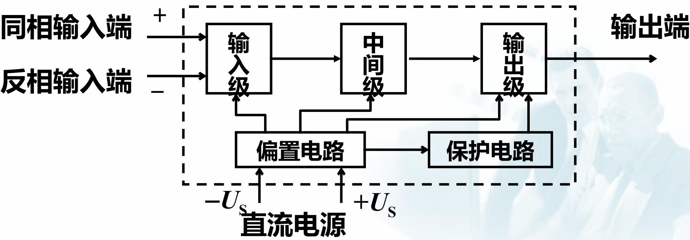
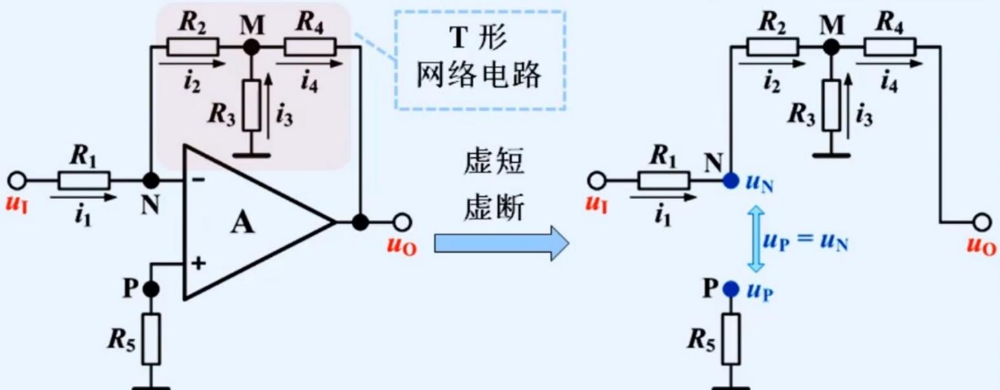
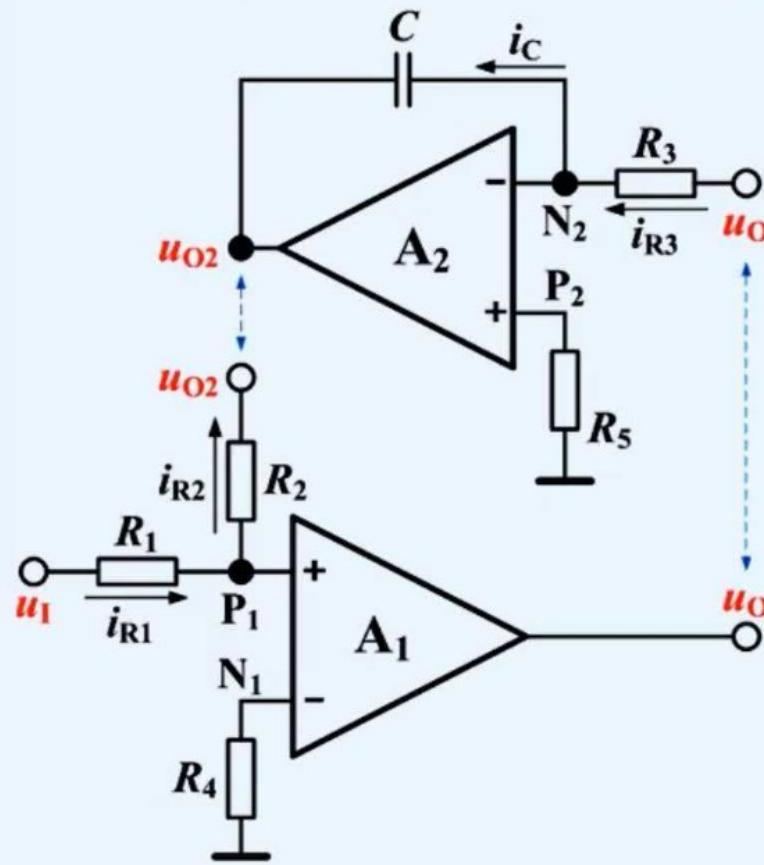
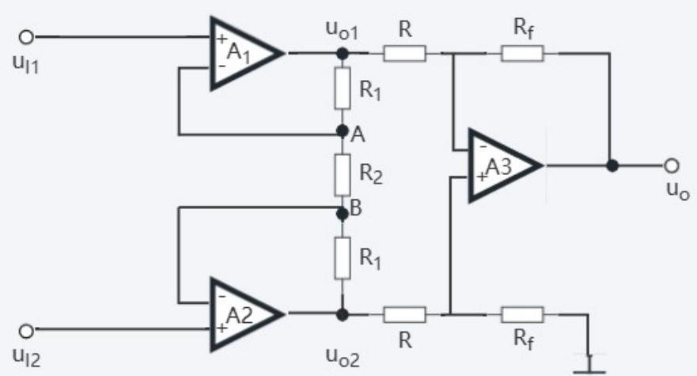
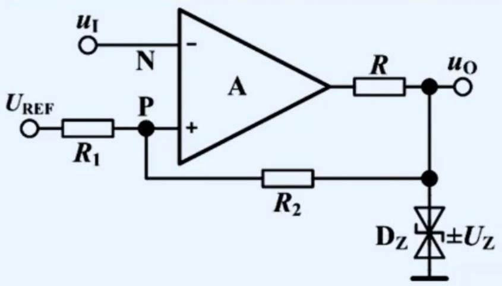

# 第7章 模拟集成电路及运放应用：让反馈网络规定功能

## 这一章抓什么

第6章从晶体管搭出了高增益放大器；本章把许多内部细节封装成运算放大器，研究怎样用外部电阻、电容和反馈网络，让它完成比例、加减、积分、微分、滤波与比较。

本章的核心不是认出电路名字后立即套公式，而是回答三个问题：输出怎样返回输入？运放能否维持所假设的工作状态？外部网络要求输出怎样变化？线性负反馈电路主要用节点电流守恒；带电容的电路再加上储能与时间关系；比较与滞回电路则要追踪门限、输出状态和历史。

第一次学完，应能从一张陌生但相近的图重新列式，而不依赖“图长得像某个模板”。同时要避免两个相反误区：有负反馈不保证任何输入下都不饱和；输出呈高低两值也不自动证明运放内部一定饱和，非线性反馈可以实现另一种限幅比较。

## 先建立整体直觉

运放强烈放大两个输入端之间的差。没有适当约束时，很小的差值便可能把输出推到允许范围的边界。负反馈利用这种敏感性：输出只要偏离外部网络要求的值，返回输入的信号就促使它向相反方向调整。于是内部增益很大、并不精确的器件，可以在一定条件下实现由外部电阻比决定的运算。

可以把虚短理解为这个调整过程的近似结果：为了维持有限输出，两个输入端只需保留极小的差值。虚断则来自理想输入端不取电流，与“输入端电压相等”是两件不同的事。它们让外部节点分析简单，却不会取消电源、电流、频率与稳定性的限制。

反馈中放电阻，主要规定电流与电压的比例；放电容，就引入“现在的输出与过去积累的电荷有关”；使用正反馈，则让当前输出强化自己，并改变下一次翻转所需的门限。运算、记忆与比较，都是不同反馈规则的结果。

## 本章怎么串起来

运放内部的五个功能部分 → 输入输出特性与理想化 → 负反馈下的节点分析 → 电阻网络实现比例、加减 → 电容把电流转换成积分或变化率 → 频域看成滤波 → 传感器需要高输入阻抗、差模提取或电荷转换 → 非线性比较 → 正反馈形成滞回与状态记忆。

前半部分依据《7-模拟集成电路及其应用.pptx》，比较器依据《7_比较器.pptx》。原文件目录中的“内部单元电路”以及“对数、指数运算”没有展开完整专节：本章保留已提供的内部功能图，并用前章PN结关系建立一个明确标为补充的对数/指数理解桥，不把它冒充已给出的完整授课内容。

## 分节主干

### 7.1 运放是什么：高增益不等于无限输出

输入级通常利用差分结构，尽量少取输入电流并抑制共模影响；中间级提供主要电压增益；输出级提高驱动负载的能力；偏置电路为内部各级提供合适工作点；保护电路在一定条件下限制异常电流或其他危险状态。保护不是无条件免损坏的保证，实际限制仍依器件而定。

电路符号中的“+”“−”分别表示同相、反相输入，不是正、负电源端。电源在一些示意图里被省略，并不意味着运放不用供电。图中同相端电压记为 $u_P$，反相端为 $u_N$，在线性范围的开环关系为：

$$
u_O=A_{od}(u_P-u_N).
$$

$A_{od}$ 是开环差模电压增益。由于它很大，有限的输出摆幅只对应很窄的输入差范围。超出这一范围，不能让公式继续给出任意大的输出，而应按高、低饱和电平或实际限幅条件处理。输出能量来自电源，输入只起控制作用。

理想模型取开环增益、输入电阻和带宽无限大，输出电阻、失调、漂移与噪声为零。它是分析用的近似，不是某种实际器件的性能清单。现实中有限增益造成闭环误差，输入偏置电流使电阻上产生额外压降，输出电阻和电流限制影响带载，频率与大信号变化速度也会限制输出。课程先利用理想模型掌握结构，再在需要时检查这些条件。

### 7.2 虚短、虚断、虚地：三个词不要合成一条口诀

在稳定负反馈、输出未饱和且有足够环路增益的区间，由 $u_P-u_N=u_O/A_{od}$ 可知输入差很小，近似取 $u_P=u_N$，称为**虚短**。它不是用导线将两端相连，因此不能让任意电流从一个输入端流到另一个输入端。

理想输入电阻无限大，得到 $i_P=i_N=0$，称为**虚断**。它不意味着输入端没有电压，也不依赖输出一定处于线性区：基本理想比较器同样通常不取输入电流。实际器件是否出现偏置、漏电或保护电流，应另外按工作条件分析。

只有当一个输入端被固定在地电位，且虚短条件成立，另一个输入端才近似处于地电位，称为**虚地**。若同相端接2V参考，反相端在线性负反馈下应接近2V，而不是0V。虚地只是节点电压条件，不是真正的公共导线。

第一步应沿完整反馈路径判断极性。简单电阻直接从输出接反相端通常是负反馈，但若中间还经过反相级，返回同相端也可能构成整体负反馈。不能只凭“接到+端还是−端”替代对整个回路的判断。

| 当前电路状态 | 可用的主要关系 | 还要检查什么 |
| --- | --- | --- |
| 稳定线性负反馈 | 虚短、理想虚断、外部KCL | 输出摆幅/电流、输入范围、频带和稳定性 |
| 开环或正反馈的基本比较器 | 比较 $u_P-u_N$ 的符号，输出取相应状态 | 不在整个区间强加虚短，初始状态可能重要 |
| 二极管等构成的非线性负反馈 | 分段判断器件状态；有效反馈区间可用虚短 | 支路是否真的导通、稳压电流与输出余量 |

### 7.3 从反相比例推到一般反馈阻抗

设同相端接地，输入经 $R$ 接反相节点，输出经 $R_f$ 返回反相节点。在允许的线性工作区，反相节点为虚地。输入电流 $u_I/R$ 不能流进运放，只能经反馈支路流向输出，因此：

$$
\frac{u_I}{R}=\frac{0-u_O}{R_f}
\quad\Rightarrow\quad u_O=-\frac{R_f}{R}u_I.
$$

负号来自电流守恒：正输入把电流送到虚地，输出必须变负，才能通过反馈电阻把电流带走。整个电路的输入电阻约为 $R$，并不是理想运放自身的无限大输入电阻；信号源实际面对的是输入电阻通往虚地的通路。

若信号源有串联内阻，源电压到输出的比例要把它计入输入路径。若同相端改接固定参考 $U_R$，在同样两电阻结构中列式可得 $u_O=(1+R_f/R)U_R-(R_f/R)u_I$。这说明“反相端一定是0V”和“输出只有负比例项”都依赖同相端接地这个条件。

把输入、反馈支路推广为阻抗，在零初始条件与相应线性模型下有：

$$
H(s)=\frac{U_O(s)}{U_I(s)}=-\frac{Z_f(s)}{Z_i(s)}.
$$

积分、微分和若干滤波电路都可从这里理解。但若网络含多个节点、支路加载或两输入都有信号，不能把整块网络不加辨认地当成一只阻抗，仍要列节点方程。

#### 补偿电阻补偿的是什么

真实运放两输入端会有小的偏置电流。若两电流近似相等，让它们分别流过相近的外接直流等效电阻，就可使产生的压降更接近，减小由此形成的差分误差。反相比例电路在输入源置零、源内阻可忽略时，常取同相端到地电阻 $R'=R\parallel R_f$。

这是偏置电流误差的近似平衡，不会消除运放固有输入失调电压，也不会让任意不相等的偏置电流完全抵消。求两端等效电阻时应看直流通路、信号源实际内阻和反馈连接；不能只背一个与图无关的并联式。

### 7.4 T形反馈：为什么不直接把反馈电阻做得很大

大反相比例系数要求较大的反馈阻抗与输入阻抗之比；但输入电阻又不能无限减小，否则严重加载信号源。简单地把反馈电阻做得很大，也会放大某些误差和实际实现问题。T形网络利用一个中点分流，在不使用同样巨大的单只电阻时实现较大的等效反馈作用。

图中 $R_1$ 是输入电阻；反相节点N经 $R_2$ 到中点M，M经 $R_4$ 到输出，同时经 $R_3$ 接地。先在N列KCL，由虚地得 $u_M=-(R_2/R_1)u_I$。再对M列式：

$$
\frac{-u_M}{R_2}+\frac{-u_M}{R_3}=\frac{u_M-u_O}{R_4}.
$$

消去 $u_M$，得到：

$$
u_O=-\frac{R_2+R_4+R_2R_4/R_3}{R_1}u_I.
$$

其中 $R_2+R_4+R_2R_4/R_3$ 起到信号比例关系中的等效反馈电阻作用；输入电阻仍约为 $R_1$。让 $R_3$ 开路，上式自然退化成两只串联反馈电阻的结果，这是一个很好的验算。

M不是虚地，不能把T网络的三只电阻直接当成某个随意的串并联。增大等效反相比例的同时，反馈系数可能减小，所以仍需要足够的开环增益与频率余量。它也不会无代价地解决所有噪声、偏置或稳定性问题。

### 7.5 同相比例与跟随器：输出怎样追随输入

在标准同相比例电路中，输入直接接同相端；反相端经 $R$ 接地，经 $R_f$ 接输出。由于该输入端理想不取电流，反相节点是输出的电阻分压：

$$
u_N=u_O\frac{R}{R+R_f}\approx u_P=u_I,
\qquad u_O=\left(1+\frac{R_f}{R}\right)u_I.
$$

输出与输入同相，比例系数不小于1。这里说的是幅度比例与同号，不意味着对负输入仍有通常数值意义上的 $u_O>u_I$。信号从理想输入端进入，因而输入电阻很高；实际电路还受偏置路径与器件输入特性影响。

将输出直接返回反相端，就得到电压跟随器 $u_O\approx u_I$。它不提供大于1的电压增益，却可以使高内阻信号源少受负载影响，由电源经输出级提供负载电流。若负载电流或容性负载使输出超出能力，仍不能保持理想跟随。

同相输入电压同时抬升两输入端的共模电位，所以不能只检查输出不饱和，还要确认输入端处于允许共模范围。高共模抑制比减少共同变化带来的误差，不等于共模电压可以无限大。

### 7.6 加法、减法与设计：权重来自电流，而不是符号位置

#### 反相求和与同相加权平均

多个输入分别经 $R_1,R_2,\ldots,R_n$ 汇入反相虚地，反馈电阻为 $R_f$，则所有输入电流都流经反馈支路：

$$
u_O=-R_f\sum_{k=1}^n\frac{u_{Ik}}{R_k}.
$$

每个权重由电阻比决定。各输入面对各自的电阻通往虚地，因此在理想条件下，不需要先把多个电压源直接并在一起；真正相加的是它们送入节点的电流。求补偿电阻时，输入源置零后把各输入电阻与反馈电阻的直流作用合入。

同相求和不同：多个输入通过电阻接到同相端时，该节点先形成**加权平均**，再由同相比例级放大。若同相端还经 $R_0$ 接地，则

$$
u_P=\frac{\sum_{k=1}^n u_{Ik}/R_k}{\sum_{k=1}^n1/R_k+1/R_0},
\qquad u_O=\left(1+\frac{R_f}{R}\right)u_P.
$$

没有对地支路时删去 $1/R_0$。不能跳过分母，直接把同相节点写成各输入电压之和；某个输入源置零后，其串联电阻通常仍接地，也不能跟着消失。课件中简化为 $u_O=R_f\sum u_{Ik}/R_k$ 的关系还利用了两输入端等效电阻匹配等特定条件，不是任意同相求和网络的通式。

#### 标准差分比例：比值匹配才会抑制共模

规定输入 $u_1$ 经 $R_1$ 接反相端，反馈电阻为 $R_2$；输入 $u_2$ 经 $R_3$ 接同相端，同相端经 $R_4$ 接地。先求

$$
u_P=\frac{R_4}{R_3+R_4}u_2.
$$

再在反相端列KCL，得到一般关系：

$$
u_O=\left(1+\frac{R_2}{R_1}\right)\frac{R_4}{R_3+R_4}u_2-\frac{R_2}{R_1}u_1.
$$

只有当 $R_2/R_1=R_4/R_3=k$ 时，才化为 $u_O=k(u_2-u_1)$。两输入共同增加时，两个系数恰好抵消，才不会在理想输出中留下共模项。电阻比不匹配、信号源内阻不同或输入网络加载，都会破坏这种抵消。

因此，高共模抑制不是只由运放型号决定，外部比值匹配也重要。正负号则由哪一路接到哪个输入端决定，不能离开接线背“输出等于第一路减第二路”。

#### 两运放的高输入电阻加减电路

源课件用第一级同相放大一路信号，再让该输出进入第二级反相支路，而另一原始信号接第二级同相端。这样两路源都接在高输入阻抗端，却能得到加减关系。

若第一级 $u_{O1}=(1+R_{f1}/R_1)u_1$，第二级反相输入电阻为 $R_3$、反馈为 $R_{f2}$、同相端为 $u_2$，则

$$
u_O=\left(1+\frac{R_{f2}}{R_3}\right)u_2
-\frac{R_{f2}}{R_3}\left(1+\frac{R_{f1}}{R_1}\right)u_1.
$$

当 $(R_{f1}/R_1)(R_{f2}/R_3)=1$ 时，两系数幅值相等，形成差分比例。做多运放题应先为每个输出命名，再逐级代入；不要跳过中间输出及其可能饱和的检查。

#### 从给定加减关系反推电阻

设计 $u_O=a u_1-bu_2-cu_3$ 时，正权输入可进入同相网络，负权输入通过各自电阻进入反相求和节点。但反相节点电位会跟随同相端，因此正权系数还包含闭环比例和同相分压，不是简单把三个电阻分别设成 $R_f/a,R_f/b,R_f/c$ 就结束。

可靠起手是按拟用图列出一般式，对照系数建立电阻比，再选择可实现的正电阻及合适阻值尺度；还要检查输入电阻、补偿条件与输出范围。理想叠加只能在共同的线性工作区使用，不能把各输入单独作用时都不饱和当成相加后也不饱和的保证。

### 7.7 积分：输出保存的是过去的电荷

将反相电路的反馈电阻换成电容C，输入仍经电阻R，非反相端接地。在理想线性区，输入电流 $u_I/R$ 给反馈电容充电。按从反相节点流向输出的电容电流方向，有

$$
\frac{u_I}{R}=C\frac{\mathrm d(0-u_O)}{\mathrm dt}
=-C\frac{\mathrm du_O}{\mathrm dt}.
$$

因此从已知初始时刻 $t_0$ 起：

$$
u_O(t)=u_O(t_0)-\frac1{RC}\int_{t_0}^{t}u_I(\tau)\,\mathrm d\tau.
$$

$RC$ 的单位是秒；输出斜率由输入电压与时间常数之比决定。正直流输入使输出沿负方向匀速变化，负输入使输出上升。初始值由电容原来保存的电荷决定，不能随手设成零，也不能在输入每次翻转后把积分重新从零开始。

有限输入电流不会让理想电容电压瞬间跳变。因而对分段常值输入，应逐段求斜率，并把前一段终点作为下一段起点。对称方波在适当偏置与线性范围内变为三角波；若方波幅值为 $U$、频率为f，每个半周期的输出变化量为 $U/(2fRC)$。输入含有不为零的周期平均值时，理想输出会持续漂移，不能无限保持有界周期波形。

反馈电容若并联 $R_f$，直流误差可以经电阻泄放，减小无限积累导致的饱和。在零初始条件下，其传递关系为

$$
H(s)=-\frac{R_f/R}{1+sR_fC}.
$$

低频更像有限比例放大器；只有在 $|sR_fC|\gg1$ 且运放仍能正常工作的频带，才近似为 $-1/(sRC)$ 的积分器。并联电阻改善直流工作，却牺牲了任意低频的纯积分特性。

课件的带二极管、开关或参考电平的积分变体，仍从电容电流和初始值入手。先判断当前哪条反馈/复位支路导通，再写该区间的斜率；换向时重新验器件状态与电容连续性，而不是用一条固定积分式跨过全部工作区。

### 7.8 微分、函数变换与微分方程模拟

把电容放到反相输入支路，反馈用电阻R，输入电流由输入电压变化率决定：$i=C\,\mathrm du_I/\mathrm dt$。反相虚地的KCL给出

$$
u_O=-RC\frac{\mathrm du_I}{\mathrm dt}.
$$

斜坡输入产生近似常值输出；输入变化越快，理想输出幅值越大。方波跳变在理想数学模型中有冲激导数，不能据此声称真实电路会产生无穷高电压：有限带宽、输出摆幅、变化速度和元件寄生都会限制尖峰。

由于理想微分增益随频率增加，它会强调高频噪声；在输入串联限流电阻或反馈中引入适当电容，可以限制高频增益。具体传递式要按实际图列，不能把所有“多加一个元件”的电路都当成仍在全频段精确微分。

源课件还从函数变换角度实现微分。图中A2对最终输出作反相积分，得到 $u_{O2}=-(1/(R_3C))\int u_O\,\mathrm dt$；A1同相节点在有效整体负反馈下近似为零，所以 $u_I/R_1+u_{O2}/R_2=0$。联立、对时间求导可得

$$
u_O=\frac{R_2R_3C}{R_1}\frac{\mathrm du_I}{\mathrm dt}.
$$

正号来自整体连接，不能照抄单运放反相微分的负号。这个图也说明：A2已先反相，因此信号返回A1同相端不一定意味着整体正反馈。实际还需检查动态稳定、初始条件和各级输出范围。

积分器、比例与求和电路还可组合实现线性微分方程。方法是把最高阶导数写成其他状态与输入的加权和，再用积分器逐次恢复较低阶状态；每个积分器的初始电容电压对应一个初始条件。比例系数由电阻比和RC时间尺度决定。搭好形式后应把各级关系重新联立回目标方程，检查符号和单位，而不是只数用了几只积分器。

### 7.9 有源滤波：先看负载，再看频率

滤波让指定频带相对容易通过、其余频率受到衰减。低通保留低频，高通保留高频，带通保留中间一段，带阻抑制中间一段；全通的理想幅度不随频率变化，但可以改变相位。“高频/低频”是相对于本电路的转折频率，不是一个固定的赫兹分界。

理想砖墙幅频图帮助定义目标，却没有实际的过渡带；真实有限阶电路通常有逐渐衰减的过渡区。要分别说明通带增益、截止频率、过渡斜率，以及相位对波形的影响，不能把“是低通”当成已经完成分析。

#### 一阶RC为什么会被负载改变

对串联R、输出取并联电容C的无源低通，空载时

$$
H(s)=\frac1{1+sRC},\qquad f_p=\frac1{2\pi RC}.
$$

若输出并入负载 $R_L$，它与电容共同分流，低频增益与转折频率都变化：

$$
H(s)=\frac{R_L/(R+R_L)}{1+s(R\parallel R_L)C},\qquad
f_p'=\frac1{2\pi(R\parallel R_L)C}.
$$

于是通带幅度下降，而相对于新通带的截止频率升高。计算增益时用的是分压，计算电容时间常数时用的是信号源置零后电容看到的等效电阻，两者不应混为同一个公式。

在RC节点后接一个合适的电压跟随器，就让滤波网络主要面对运放的高输入电阻，而负载由低输出阻抗端驱动，近似恢复空载滤波关系。再把跟随器换成合适的同相比例级，可以设置通带增益。**有源**表示使用了需要供电的有源器件，不表示电压增益必定大于1。

这种隔离在运放允许的电压、电流、负载与频带内才成立。源课件对无源与有源的比较是围绕本类信号处理电路：不能把“无源一定不精确”或“所有电源滤波只能怎样实现”推广成无条件结论。

#### 从KCL到传递函数，再到幅频图

先检查低、高频极限：电容在直流极限趋于开路，在高频阻抗极限趋于短路。由此可以初判某些低通、高通、带通结构，但极限不能告诉你中间有没有峰值，也不能取代实际频带内的计算。

零初始条件下，用 $R$、$1/(sC)$、$sL$ 表示阻抗，结合虚短、虚断在真实节点列KCL，求 $H(s)=U_O(s)/U_I(s)$。若有非零初始储能，响应还需加入相应初始条件项，不能只拿传递函数乘输入就称为总响应。

对稳定线性模型，令 $s=j\omega$ 得正弦稳态响应。以一阶低通 $H(j\omega)=A_p/(1+j\omega RC)$ 为例，幅度在 $f=1/(2\pi RC)$ 降到通带的 $1/\sqrt2$，即约负3dB，高频渐近斜率为每十倍频下降20dB；相位也从0逐渐趋向负90度，整体反相的级还要计入自身符号。

阶数应看约去公共因子后的传递函数分母；高频斜率还与分子零点有关，不能对高通、带通等一律只数电容就断言每阶都向下20dB。课件的一阶例题建立了方法，更复杂拓扑仍用同一节点分析。理想式写到 $f\to\infty$ 只是数学极限，不代表真实运放在无限高频还可用虚短。

### 7.10 仪表放大器：放大小差异，而不压垮信号源

当传感器两端都带有较大的共同电位，但要测的差值很小时，仅追求高增益不够。还需要较高输入电阻以减少加载，以及较好的共模抑制，使共同变化不要冒充被测差值。

图中前两只运放分别以同相端接两输入，两个反相节点A、B之间由 $R_2$ 相连，各自反馈电阻为 $R_1$。在线性条件下 $u_A\approx u_{I1}$、$u_B\approx u_{I2}$，因此连接电阻电流为 $(u_{I1}-u_{I2})/R_2$。再对两侧节点列KCL，得到第一级差输出：

$$
u_{O1}-u_{O2}=\left(1+\frac{2R_1}{R_2}\right)(u_{I1}-u_{I2}).
$$

后级电阻比匹配的差分电路在图示极性下给出：

$$
u_O=-\frac{R_f}{R}\left(1+\frac{2R_1}{R_2}\right)(u_{I1}-u_{I2}).
$$

改变中间 $R_2$ 可以调节差模增益，而两输入仍接高阻抗端。纯共模输入时，A、B相等，中间电阻无电流，两侧输出随共同输入一起变化，理想后级将其相减消除。

实际共模抑制受运放和电阻比匹配限制。即使最终理想差输出接近零，前两级也可能因较大共模电位而超出输入/输出范围；所以不能只检查最后一个输出。单只运放差分电路、两运放高输入电阻电路与三运放仪表结构都可作差，但输入加载、调节方式和内部摆幅条件并不相同。

### 7.11 电荷放大器：用已知电容把电荷变成电压

压电类传感器等可近似看作电荷或电流源，并伴随自身电容与连接电容。若直接测电压，结果可能明显依赖这些电容；电荷放大器利用反相输入节点的近似虚地，使输入电荷主要转移到已知反馈电容 $C_f$ 上。

对选定电流方向，$i_q=-C_f\,\mathrm du_O/\mathrm dt$，积分得到输出变化：

$$
\Delta u_O=-\frac{\Delta q}{C_f}.
$$

忽略初始电荷时才简写 $u_O=-q/C_f$。输出与电荷之比主要由反馈电容决定，不是“对电荷做无单位的电压放大”。虚地节点也不是凭空吸收电荷，输入电流经反馈电容进入输出回路，电荷与KCL仍守恒。

常在 $C_f$ 上并联 $R_f$，给缓慢的偏置与漏电提供泄放通路，避免长期积累导致饱和。要保持良好的纯电荷比例，需要 $\omega R_fC_f\gg1$，而不是频率刚超过 $1/(2\pi R_fC_f)$ 就完全无误差。并联电阻意味着极慢或静态信号会逐渐泄放；器件高频能力又给出另一端限制。

### 7.12 对数与指数：目录未展开部分的补充理解桥

原课件把对数、指数列在运算目录，却没有给出完整专节。以下仅用第5章PN结伏安关系和本章KCL说明“为什么可能实现”，不把该具体补充接法或设计深度当成已确认考试范围。

设反相端为虚地，输入经R送入正向电流，反馈二极管阳极接反相节点、阴极接输出，则二极管电压为 $-u_O$。采用第5章模型可得

$$
\frac{u_I}{R}=I_S\left(e^{-u_O/U_T}-1\right),\qquad
u_O=-U_T\ln\left(1+\frac{u_I}{RI_S}\right).
$$

在正向电流远大于 $I_S$ 的区间，可近似为 $-U_T\ln[u_I/(RI_S)]$。对数里面必须是无量纲正数；二极管没有处于相应正向区、运放输出到达边界或反馈中断时，该近似不能用。

若改让输入电压施加在输入二极管上，而反馈用电阻 $R_f$，同样的KCL会把二极管的指数电流转换成负输出电压，例如相应方向下 $u_O=-R_f I_S(e^{u_I/U_T}-1)$。本质是交换“电压决定电流”和“电流决定电压”的位置。

这类电路的整体输入输出是非线性的，运放本身却可以处于有效负反馈的非饱和区。$U_T$ 与 $I_S$ 随温度变化，说明简单电路还不是高精度、宽范围对数测量设计。详细温度补偿、器件匹配或实际专用芯片不在现有来源中展开。

### 7.13 基本比较器：用高低电平表示谁更大

《7_比较器.pptx》先介绍高增益开环或正反馈的基本比较器。输入端给出模拟电压，输出用高、低两个状态表示比较结果。对同相、反相端的定义，有

$$
u_P>u_N\Rightarrow u_O=U_{OH},\qquad
u_P<u_N\Rightarrow u_O=U_{OL}.
$$

$U_{OH}$、$U_{OL}$ 是实际被观察输出节点的高、低电平，未必等于电源电压，甚至不一定关于零对称。输入恰好相等的理想边界不负责决定唯一输出，实际由失调、噪声、迟滞或先前状态决定。

同相输入信号与固定反相参考比较，输入增大越过参考时输出由低到高；反相输入信号与固定同相参考比较，方向相反。参考为零称过零比较，非零参考给单一非零门限；若输入经过电阻混合，门限是让两个输入端电位相等的**原始输入电压**，未必直接等于参考源数值。

这里在翻转边界求 $u_P=u_N$ 是找临界点，不是在整个输入区间使用虚短。对一个正弦输入，应先求它何时越过门限，再决定每个区间的高低电平；门限不在信号范围内时，输出可能根本不翻转。

#### 输出限幅、输入保护与真实变化速度

稳压管、二极管和限流电阻可以设置不同输出电平，便于接后续电路。输出经电阻后再限幅时，应分清运放原输出与限幅节点；后续反馈取样哪个节点，必须按图确定。双向限幅器件标注的电压可能已表示整组有效钳位值；若明确由反向稳压管与另一只正向管串联，则要按模型合计相应压降，不能重复加或漏掉。

输入端也可用适当保护支路限制差分电压，但其导通会引入输入电流并改变电路，不能一面让保护管导通，一面仍把整个输入网络当成无限阻抗。输出变化不是瞬时的，受器件传播延迟与变化速度限制；理想传输曲线只能描述静态状态，不能直接说明最高可靠工作频率。

### 7.14 非线性负反馈比较：为什么有些比较电路仍可用虚短

课件另给出在反馈中加入稳压管的电路。反馈支路根据电流方向进入不同状态，运放通过调整输出，让输入端在各自有效区间仍近似平衡，而输出相对参考被限制在相应正、负电压附近。整体传输不再是固定比例，却不一定依赖运放本体饱和。

这种结构的起手与基本开环比较器不同：先假设输入所在区间，判断哪只二极管正向导通、哪只进入反向稳压，再检查是否存在有效负反馈。如果有效且输出有足够余量，就可用虚短与KCL求输出；随后必须验证各管电流方向、最小稳压电流、功率以及输出极限。

接近门限时，输入电阻能提供的电流可能很小，稳压管未必进入所假定的稳定区，所以“只要输入非零就永远输出精确的 $\pm U_Z$”不成立。限幅电平相对于何处计算也要明确：参考端不是地时，输出可能围绕参考而不是零对称。

这也是对数电路与比较电路共同提醒的一点：**运放在线性工作状态**和**整个电路的输入输出关系线性**不是同一个命题。判断能否用虚短，应看当前反馈与工作状态，而不是只看函数长得是不是直线。

### 7.15 滞回比较：当前输出会改变下一次翻转门槛

普通单限比较器在输入缓慢经过门限时，噪声可能让它反复跨过同一个点，输出多次跳变。滞回通过正反馈让高、低输出对应不同门限：翻转后门槛被推开，小扰动不容易马上把输出推回原状态。它增加的是状态记忆和抗抖动能力，不会消除器件本身的动态限制。

图中输入接反相端，同相节点经 $R_1$ 接参考 $U_R$，经 $R_2$ 接被限幅后的输出 $u_O$。忽略输入电流，节点分压为

$$
u_P=\frac{R_2U_R+R_1u_O}{R_1+R_2}
=\alpha U_R+\beta u_O,
\quad \alpha=\frac{R_2}{R_1+R_2},\quad\beta=\frac{R_1}{R_1+R_2}.
$$

输出为高时，同相门限较高；输出为低时，门限较低。设上、下门限分别为 $U_H,U_L$，则

$$
U_H=\alpha U_R+\beta U_{OH},\qquad
U_L=\alpha U_R+\beta U_{OL},
$$

$$
\Delta U=U_H-U_L=\beta(U_{OH}-U_{OL}).
$$

若限幅输出为 $\pm U_Z$，两门限围绕 $\alpha U_R$ 对称，宽度为 $2\beta U_Z$。参考电压在这个结构中移动中心，反馈分压与输出电平一起决定宽度；改变限幅输出也可能同时改变门限，不应默认只是把传输曲线竖直平移。

#### 每个门限对应哪条运动方向

对于图示反相结构，先设输出为高。只要 $u_I<u_P=U_H$，高输出自洽；输入上升越过 $U_H$ 后，反相端更高，输出跳低。输出一低，门限同时移到 $U_L$，因此输入稍微回落但未低于 $U_L$ 时，低状态仍保持。直到输入下降越过 $U_L$，输出才跳回高。

在 $U_L<u_I<U_H$ 内，两种状态都可能自洽，输出由历史决定。这一区间不是一个新的线性输出区；若初始条件和此前输入轨迹没有给出，也不能随意画出唯一波形。

正反馈的再生可用同一过程解释：刚开始输出下降，会让同相门限下降，从而进一步增强使输出下降的输入差，推动翻转完成。再生加快状态建立，但有限压摆率和传播延迟仍然存在。

#### 同相滞回不是把同一公式随手换符号

另一常见接法把输入经 $R_a$、输出经 $R_b$ 混合到同相节点，反相端接固定参考 $U_R$。临界点满足

$$
\frac{u_I-U_R}{R_a}+\frac{u_O-U_R}{R_b}=0,
\quad u_{I,T}=\left(1+\frac{R_a}{R_b}\right)U_R-\frac{R_a}{R_b}u_O.
$$

输出为低时对应上升过程的较高门限，输入升过后输出变高；输出为高时对应下降过程的较低门限。反馈分压公式、输入方向和输出状态的对应关系都与前图不同，可靠方法仍是“假设当前输出→求门限→检查状态→沿输入轨迹翻转”。

课件不同例题对 $U_{T1}$、$U_{T2}$ 的编号并不总按同一上下顺序。做题应自己注明“上门限/下门限”和上升/下降箭头，不要只凭下标1、2判断数值大小。门限含二极管支路时，每个输出状态还要先判断该支路的导通、截止再列式。

滞回与窗口判断也不同：滞回的中间区间可能保留两个历史状态；单纯窗口判断则问输入当前是否位于两数之间。两者都可能出现两个门限，却不能据此混成同一种传输关系。本章来源主要展开单限和滞回，不据此扩写未给出的完整窗口电路课程。

## 典型题型入口与解题流程

| 题目给出的结构或要求 | 第一动作 | 收尾验证 |
| --- | --- | --- |
| 比例、T形、多个电阻输入 | 沿完整路径判反馈，再为关键节点命名、列KCL | 比例单位、符号、输入加载、输出余量 |
| 求和或差分 | 同相端先求真实电位，反相端再作电流平衡 | 比值匹配才可简写差；线性叠加不越界 |
| 积分、分段波形 | 指定电容电压/输出初值，逐段求斜率 | 端点连续、平均输入漂移、何时饱和 |
| 微分或多运放函数变换 | 分别写各级关系，再消去中间量 | 正负号、初始条件、有限频带和动态范围 |
| 有源滤波 | 先看两端频率极限，再写 $H(s)$ | 零初始假设、负载影响、真实通带与极点 |
| 仪表/电荷放大 | 确认信号源要输出差值还是电荷 | 输入共模、各级摆幅、泄放时间尺度 |
| 单限比较 | 比较两端电位，求输入临界值 | 实际高低电平、限幅与输入保护的状态 |
| 滞回比较 | 分别假设高、低输出求门限 | 输入方向、初始状态、翻转后的自洽性 |

## 易错点

最常见的根本错误是把近似条件合并成一句“运放题虚短虚断”。虚断来自理想输入不取流，虚短来自有效线性反馈；虚地还需要某端确实接到地参考。三者的前提不同。开环比较器不能全程虚短，而某些非线性反馈电路在分段内仍可以虚短。

其次是只看最终输出、忘记中间节点。T形中点不为零；同相求和节点是加权平均；仪表放大器前级可能先因共模越界；积分器输出含初始值；稳压限幅后的节点与运放原输出也可能不同。这些节点的物理含义应先明确，再算电阻比。

另外，滤波不能只列LPF、HPF几个名字，必须解释截止频率和加载；滞回不能只背两个数字，必须解释运动方向与历史；对数函数必须检查自变量无量纲与有效区间。把这些条件写清，比额外记住一串标准图更能防止后续S10漏教或误判。

## 复习检查

**理想比较器的输入电流是否因为开环而必然不为零？**不是。理想虚断仍可使用，不能使用的是维持线性平衡的全程虚短；实际输入电流另由器件条件决定。

**为什么T形反馈不能直接把三只电阻串并联后代入反相增益？**中点M既受输出驱动又有对地分流，不是虚地；需要N、M两个节点方程。

**同相求和节点为什么通常是平均而不是求和？**节点不取电流，其电位由各支路电导加权平衡，分母是总电导；后续比例级才可能把平均转成所需的和。

**差分比例电路为什么要匹配两组电阻比？**两个输入系数幅值相等才会消除共同变化；比值失配会把共模转成输出。

**积分输入翻转时，能否把输出重新设零？**不能。有限电流下电容电压连续，后一段从前一段终值继续；除非题目明确存在相应复位过程。

**反馈电容并联电阻后，任意低频还保持理想积分吗？**不保持。低频趋于有限比例，只有高于相应泄放拐点足够多且运放仍适用时才近似积分。

**输入只有很小差值，三运放仪表电路就一定不会饱和吗？**不一定。较大的共模电位可能先使前级或输入超出范围，即使最终理想差输出很小。

**同一个滞回区间中的输入值为什么可能对应高、低两种输出？**当前输出反过来设置门限，区间内两态都可能自洽，需要由此前状态决定。

**求翻转门限时写两输入相等，是否等于把比较器当线性运放？**不是。相等只用来定位状态边界，边界两侧仍分别按高低状态分析。

## 进入 S10 的问题入口

可以直接提出一个节点或条件上的疑问：“这个反馈绕了两级，为什么总体为负？”“同相端的加权平均怎样求？”“积分初值应该从哪里接上？”“我算出的两门限应该分别放在哪条箭头上？”S10先让你解释当前状态和节点关系，再给只改变一个电阻、参考值或初始状态的变式。
