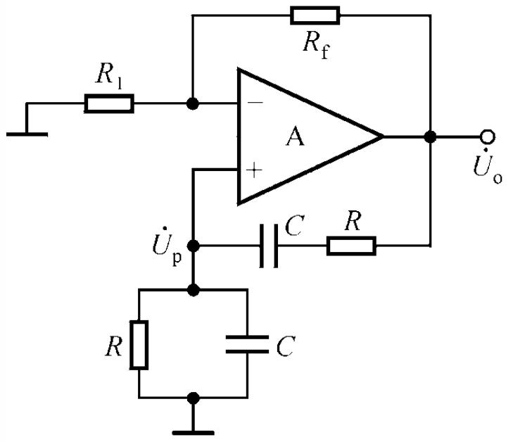
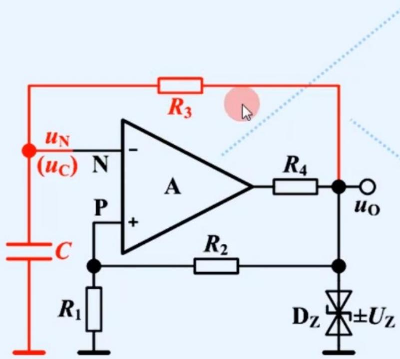
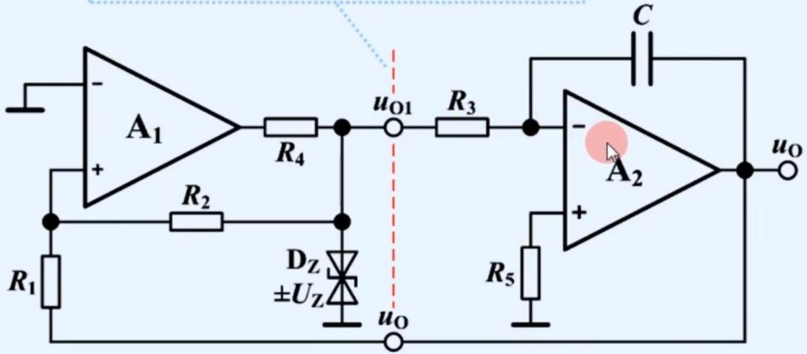
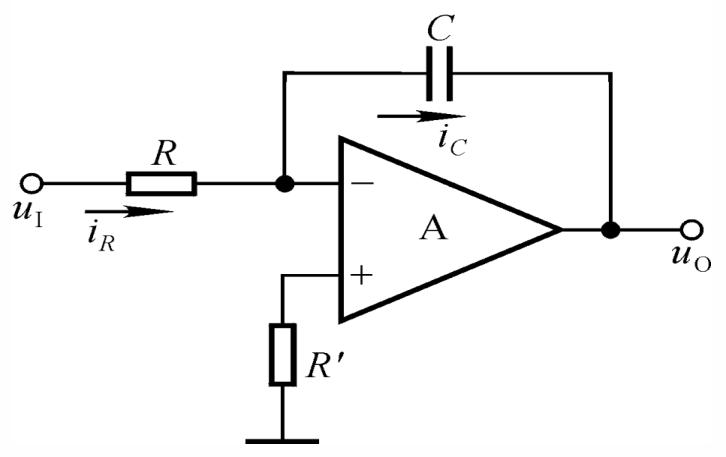

# 第8章 信号产生电路：选出频率，维持振幅，安排状态变化

## 这一章抓什么

第6、7章主要讨论“输入一个信号，电路怎样处理它”；本章开始让电路自己产生周期信号。没有外加周期输入，不表示没有能量来源：直流电源持续供能，反馈、储能元件和器件状态决定输出以怎样的频率与形状变化。

本章有两条分析路线。正弦波振荡看一个频率的信号绕反馈环路一周后，相位是否回到原处、幅度是增长还是减小，再用非线性调节使它稳定。矩形波、三角波发生器则看高低状态怎样轮流保持，电容电压怎样随时间变化，何时到达下一次翻转门限。

不能用一条 $AF=1$ 解释全部波形，也不能把RC充放电一律画成直线。读完应能区分选频、起振、稳幅与状态延时，并从实际连接重新算出频率或周期。

## 先建立整体直觉

想象一个微小扰动经过放大器，分出一部分送回输入。如果回来时方向不合适，它会抵消自身；如果相位合适但幅度越来越小，它会衰减；若每绕一周都变大，就可能从微小扰动长成明显输出。电源提供维持这种增长的能量，反馈负责控制其路径。

但只让它持续变大并不能得到好正弦波。输出最终会撞到电源或器件限制，造成削顶。因此，正弦波源还要让有效环路增益随振幅适当下降，在某个有限幅度附近既不继续增大也不衰减，尽量避免过硬的限幅。

矩形波发生器则有意利用两个明确状态：比较器输出先保持高，电容缓慢变化；到达门限后输出跳低，电容又朝相反方向变化。比较器负责“翻转”，电容负责“等待”。三角波进一步让等待过程成为恒流充放电，用近似恒定斜率代替指数曲线。

## 本章怎么串起来

第6章反馈相位与放大→正弦波的环路条件→RC串并联网络选频→同相比例级补偿网络衰减→非线性稳幅；第7章滞回比较与电容初始条件→RC延时形成矩形波→分开充放电支路调占空比→积分器与比较器互相驱动形成三角波→已有波形经过比较、积分实现转换。

来源《8b_信号产生_RC振荡电路--2026.pptx》实际包含8.1—8.4，不只讲RC正弦波。8.4末尾主要由图组成，图示的正弦源、滞回整形和反相积分同样属于应进入知识库的内容。源课件虽列出锯齿、尖顶、阶梯等波形名称，但未展开每一种发生电路，不将名称擅自扩充成已讲授专节。

## 分节主干

### 8.1 从反馈到自激振荡：平衡、起振、稳幅分别是什么

#### 放大器不希望的自激，与信号源有意的振荡

一个在中频为负反馈的放大器，反馈回路中可能含有耦合电容、旁路电容、极间电容或其他动态环节。频率改变后，回传信号会多出相移；如果在某频率附近从抵消变成助长扰动，且环路增益足够，就可能自激。

这并不意味着可以随便拿一个不稳定放大器作高质量信号源。其频率可能明显受寄生电容、负载、器件参数和环境影响，幅度也未必可控。有意设计的振荡器则用明确的选频网络与稳幅机制，把想要的变化保留下来。本课件着重RC低、中频方案，LC、晶体仅作选频类别与典型用途的比较，不把经验频率范围当成不可跨越的硬分界。

#### 对“返回量”定义清楚，环路条件才有意义

把已经包含局部偏置与必要负反馈的放大环节记为 $A(j\omega)$，从输出返回该环节输入的网络记为 $F(j\omega)$，并采用同相相加的正反馈约定。没有外部输入时，返回量满足 $X_f=F X_o$，输出又满足 $X_o=A X_f$。若存在非零的单频稳态输出，就需要

$$
A(j\omega_0)F(j\omega_0)=1.
$$

复数相等包含两件事：

$$
|AF|=1,\qquad \arg A+\arg F=2n\pi,\quad n\in\mathbb Z.
$$

相位条件保证信号返回时与原来同相；幅度条件保证绕一周后不增不减。只有幅度相等而相位相反，会抵消而不是维持同一个信号。这是近似单频稳态的平衡关系，不是“任何电路只要代入得到1，就一定能可靠起振且永不失真”的充分保证。

判断相位时，应分析整个回路及目标频率。若各环节已知只提供0或180度反相，瞬时极性法很方便；一般RC网络有连续的频率相移，某一个瞬间两个电压同号并不能证明它们相位严格相同。

#### 起振需要小扰动增长，稳定振幅需要增长最终停止

实际开机、噪声或器件微小不对称会给出扰动。在选定的近似相位条件下，通常让小幅环路增益略大于1，使目标频率成分逐渐增长。这解释了为什么设计起振时需要一定余量，而不能把每个元件误差都忽略后只要求恰好1。

随着振幅增大，非线性调节使有效增益下降，最终接近幅度平衡。还需看平衡两侧的趋势：振幅偏大时应使增长减弱甚至转为衰减，振幅偏小时应重新增长。仅在某一点“算出等于1”，但两侧变化方向不对，也未必能稳定在该幅度。

理想、完全对称且没有任何初始扰动的数学仿真，可能停在零输出；这不代表现实器件不需要起振条件，也不应通过随意改错电路去强迫仿真振荡。另一方面，依靠电源轨硬削顶虽可限制幅度，却会产生谐波，不能同时宣称低失真正弦输出。

#### 四个功能，不一定是四块独立元件

放大环节从电源获取能量并控制输出；选频网络使某些频率满足合适的幅相条件；正反馈将输出的一部分送回；稳幅环节使振幅不无限增长。RC桥中选频与正反馈由同一网络承担；器件本身的非线性也可能承担部分稳幅，但是否足够取决于稳定度和失真要求，不能一概说分立元件电路不需要专门稳幅。

观察陌生振荡电路时，先找出这些功能，再检查器件能否正常偏置、信号有没有通路。正确的频率公式无法弥补一个根本没有工作在合适状态的放大级。

### 8.2 RC串并联网络：为什么恰有一个零相移选频点

#### 先看两端频率，再作精确分压

串联支路为电阻R与电容C，接在输出与反馈节点之间；反馈节点对地再并联同样的R与C。先假设驱动源输出阻抗可忽略、反馈节点所接输入阻抗很高，且两电阻、两电容分别相等。

低频时，串联电容阻抗很大，大部分电压落在它上面，反馈幅度很小；输出取并联支路，近似表现为高通的超前相位。高频时，对地电容阻抗很小，把反馈电压压低，表现为低通的滞后相位。中间某处相位从超前过渡到滞后，存在与输出同相的点。

用阻抗写得更精确：

$$
Z_s=R+\frac1{j\omega C},\qquad
Z_p=R\parallel\frac1{j\omega C}=\frac{R}{1+j\omega RC}.
$$

反馈系数是输出到反馈节点的分压，而不是某一只电阻与电容的比值：

$$
F(j\omega)=\frac{Z_p}{Z_s+Z_p}
=\frac1{3+j\left(\omega RC-\frac1{\omega RC}\right)}.
$$

令 $\omega_0=1/(RC)$，即 $f_0=1/(2\pi RC)$，有

$$
F(jf)=\frac1{3+j(f/f_0-f_0/f)},
$$

$$
|F|=\frac1{\sqrt{9+(f/f_0-f_0/f)^2}},\qquad
\varphi_F=-\arctan\frac{f/f_0-f_0/f}{3}.
$$

在 $f=f_0$，虚部抵消，$F=1/3$，既同相又有最大反馈幅度。这里的“三分之一”是特定等值、未被额外加载的网络分压结果，不是所有RC电路共同的定律。

低、高频的简化电路只用来解释各自极限；不能把它们的近似幅度式拿到 $f_0$ 附近当精确公式。该RC网络没有电感，不应把它与LC间的磁、电储能交换混为一谈；本章称之为选频、零相移点即可。

#### 元件不等时，应该重新算什么

若串联支路为 $R_s,C_s$，并联支路为 $R_p,C_p$，仍可以从同一分压关系推导，而不是硬套 $1/(2\pi RC)$。在相同的理想端口条件下，分母可写成

$$
F^{-1}=1+\frac{R_s}{R_p}+\frac{C_p}{C_s}
+j\left(\omega R_sC_p-\frac1{\omega R_pC_s}\right).
$$

因此零相移角频率为 $1/\sqrt{R_sR_pC_sC_p}$，该点反馈值为 $1/(1+R_s/R_p+C_p/C_s)$。这是对源课件阻抗分压方法的直接推广，用来说明等值公式的边界，不要求把另一个长公式当作新的记忆负担。

额外负载、放大器有限输出电阻和输入电容也会改变实际分压。检查电路时应先问哪些元件真的属于选频网络，哪些只负责增益或限流；不要把图里所有R都乘进同一个RC。

### 8.3 文氏桥式正弦振荡：为什么局部负反馈不妨碍整体振荡

图中输出经 $R_f$ 返回反相端、反相端经 $R_1$ 接地，这一部分构成同相比例放大级，其闭环增益近似为 $A=1+R_f/R_1$。输出又经过RC串并联网络返回同相端，构成正反馈选频通路。两条反馈处理的是不同层次的关系，不能看到负反馈电阻就判定全电路“不可能振荡”。

这里环路式中的A是**整个局部负反馈同相比例级**，不是运放开环增益。对等值RC网络、且该级在 $f_0$ 附近相移可忽略的条件，$F(f_0)=1/3$，所以稳定单频所需有效A约为3。小幅起振通常取 $A>3$，对应 $R_f>2R_1$；稳幅后有效增益应回到约3。

“略大于3”和“最后等于3”分别回答起振与稳定两个阶段，不是互相矛盾的答案。R、C主要设定选频尺度；增益比主要决定能否起振及增长趋势；实际振幅还由非线性稳幅、电源与器件余量决定，不能仅由线性RC式算出。

#### 热稳幅怎样形成负向调节

源课件让 $R_1$ 采用正温度系数元件。振幅增大，流过它的电流和平均耗散增加，温度上升使电阻增大，于是 $A=1+R_f/R_1$ 下降，抑制原来的幅度增长。反方向也类似：振幅过小，元件冷却，增益上升。

稳定的是振幅变化的趋势，不是把每一瞬间的信号电压钳到常数。热过程还具有响应时间，因此不能用一个毫无延时的“阻值立即变化”模型解释全部动态；本章保留其工作原理，不扩展未提供的热控制设计。

#### 二极管稳幅怎样避免无限增益

课件另一接法是在反馈 $R_f$ 支路串入一组反向并联的二极管，使两个半周分别有相应的导通通路。电流增加时，二极管局部动态电阻减小，反馈支路的有效作用增强，同相级的有效增益降低；局部趋势可用 $A\approx1+(R_f+r_d)/R_1$ 理解。

这里的 $r_d$ 随瞬时电流而变，两个管又交替导通，不能把一只固定动态电阻当作整周期的精确模型，更不能据此保证完全无谐波。稳幅应在允许振幅、失真和器件电流之间折中。更改二极管连接位置后，增益随幅度的变化方向也可能不同，应重新沿实际反馈路径分析。

#### 调频为何常成对改变元件

等值网络中 $f_0=1/[2\pi(R+R_w)C]$。课件用联动电位器同步改变两只选频电阻，或用双联波段开关同时切换两只电容，尽量在调频时维持两支路的比值与反馈系数。电容切换常承担较大的档位变化，电阻连续调节提供连续细调。

提高频率只需减小RC乘积，并非数学上必须同时减小R和C。但R太小会让输出电阻、驱动能力与加载变得重要；C太小则使寄生电容相对不可忽略；运放在高频的幅度下降和额外相移也会移动实际条件。因而不能沿 $f_0=1/(2\pi RC)$ 无限提高频率而保持原有质量。

### 8.4 矩形波发生器：一次指数充电如何触发一次翻转

在源图中，输出经 $R_4$ 与双向限幅网络形成近似 $u_O=\pm U_Z$ 的两种电平；输出经 $R_2$ 返回同相端，该端再经 $R_1$ 接地。反相端连接电容C，并通过 $R_3$ 从输出充放电。$R_4$ 是限流支路，理想限幅有效时并不是电容时间常数中的 $R_3$。

令 $\beta=R_1/(R_1+R_2)$，同相端电压为 $u_P=\beta u_O$。因此输出高时门限为 $+U_T=+\beta U_Z$，输出低时为 $-U_T=-\beta U_Z$。电容电压 $u_C$ 是反相输入，所以它超过当前同相门限时会使输出向低状态翻转。

先设输出高。电容经 $R_3$ 朝 $+U_Z$ 指数变化，从上一个翻转留下的 $-U_T$ 上升。当它达到 $+U_T$，输出跳低，门限也立即移到 $-U_T$，而电容电压仍连续保持在原来的 $+U_T$。随后电容朝 $-U_Z$ 变化，达到 $-U_T$ 时再翻高，循环重复。

这里“保持连续”只指理想电路中没有冲激电流导致的电容电压瞬变；比较器输出则可以在相对较短时间内跳变。输出高低翻转与电容平滑变化必须画成不同波形，不能把电容也画成矩形。

#### 周期从初值、目标值与渐近值推出来

高态保持期间，电容的微分方程为 $C\,\mathrm du_C/\mathrm dt=(U_Z-u_C)/R_3$，解为

$$
u_C(t)=U_Z+[-U_T-U_Z]e^{-t/(R_3C)}.
$$

初值是 $-U_T$，本段结束值是 $+U_T$，如果永不翻转才会最终趋近 $+U_Z$。**段末门限不等于渐近终值**，这正是许多周期计算的错误来源。

令段末电压等于门限，求得高态持续时间

$$
t_H=R_3C\ln\frac{U_Z+U_T}{U_Z-U_T}
=R_3C\ln\frac{1+\beta}{1-\beta}.
$$

在对称高低电平、相同充放电路径条件下，低态时间相同，所以

$$
T=2R_3C\ln\frac{1+\beta}{1-\beta}
=2R_3C\ln\left(1+\frac{2R_1}{R_2}\right),
\qquad f=\frac1T.
$$

占空比定义为高态时间占整周期的比例 $q=t_H/T$；此对称情况为50%，称为方波。式中需要 $0<\beta<1$，使门限位于充放电能够到达的两电平之间。若某个目标门限超出该段的渐近终值，电容可能永远到不了它，电路就不再按原假设往返翻转。

#### 不对称时，别再把半周期乘2

有参考偏移、二极管压降、不同高低电平或不同充放电电阻时，分别写每段的三要素：$u_0$ 为段初值，$u_\infty$ 为保持该状态的渐近值，$u_1$ 为结束门限，$\tau$ 为该状态的时间常数。到达时间为

$$
t=\tau\ln\frac{u_\infty-u_0}{u_\infty-u_1}.
$$

应检查该比值对应正的有限时间、目标确实沿当前运动方向可达。两段各算一次，再求T和q，比记忆许多变体周期公式更可靠。

#### 二极管分路怎样调占空比而近似不调周期

课件用相反方向二极管把充电、放电分到电位器的不同部分，令两部分为 $R_{w1},R_{w2}$，且和为固定 $R_w$。在二极管压降和动态电阻可忽略、限幅与门限对称的近似下：

$$
t_H\approx(R_3+R_{w1})C L,\qquad
t_L\approx(R_3+R_{w2})C L,
\quad L=\ln\frac{1+\beta}{1-\beta}.
$$

所以 $T\approx(2R_3+R_w)CL$ 基本不随滑动端改变，而 $q\approx(R_3+R_{w1})/(2R_3+R_w)$ 可以改变。固定R3也意味着占空比不能任意逼近0或1。若题目计入二极管压降，应重算各段渐近电压，不能只改电阻而原样保留同一个对数因子。

### 8.5 三角波发生器：恒定电流带来恒定斜率

#### 为什么普通RC电容上只有近似三角波

矩形波发生器中，电阻电流为 $(u_O-u_C)/R_3$，随着电容电压改变，电流也改变，所以严格波形是指数曲线。若门限范围相对输出电平很小，即 $U_T\ll U_Z$，这段曲线的弯曲不明显，可以近似直线；但它仍受加载和非恒定电流影响。

为了得到更好的线性斜率，可以让比较器的固定高低电平通过电阻，驱动一个反相积分器的虚地输入。输入电阻两端电压近似恒定，电容电流也近似恒定，于是输出按恒定速度升降。这是把第7章积分关系用于波形产生。

#### 比较器与积分器互相作为输入

图中A1输出的限幅节点记为 $u_{O1}=\pm U_Z$，A2的三角波输出记为 $u_O$。A2通过R3、C对 $u_{O1}$ 反相积分；A1同相端则经R1接三角波、经R2接方波，反相端接地。比较器决定斜率何时换向，积分器同时承担延时与三角波形成，因此不需要再独立放一个普通RC延时回路。

A1同相节点的电流平衡为

$$
u_{P1}=\frac{R_2u_O+R_1u_{O1}}{R_1+R_2}.
$$

翻转边界 $u_{P1}=0$，所以当 $u_{O1}=+U_Z$ 时，对应三角波的下门限 $u_O=-(R_1/R_2)U_Z$；当 $u_{O1}=-U_Z$ 时，对应上门限 $u_O=+(R_1/R_2)U_Z$。因此三角波峰值为 $U_T=(R_1/R_2)U_Z$，峰峰值为 $2U_T$。

注意这里是 $R_1/R_2$，前面单运放RC矩形发生器的门限因子却是 $R_1/(R_1+R_2)$。两张图中三角波/电容接入方式不同，不能只见到R1、R2就套同一个分压比。

A2在未饱和的积分区满足

$$
\frac{\mathrm du_O}{\mathrm dt}=-\frac{u_{O1}}{R_3C}.
$$

方波高时，三角波从 $+U_T$ 以斜率 $-U_Z/(R_3C)$ 下降；到达 $-U_T$，A1翻为低，积分斜率变正；三角波升回 $+U_T$ 后A1再翻高。A1作比较不能全程虚短，A2作线性积分才在条件允许时虚短，两只运放的角色不同。

#### 用“走多远除以速度”算周期

每段需要越过的电压是 $2U_T$，速度大小为 $U_Z/(R_3C)$，因此

$$
t_H=t_L=\frac{2U_TR_3C}{U_Z}
=\frac{2R_1R_3C}{R_2},
$$

$$
T=\frac{4R_1R_3C}{R_2},\qquad
f=\frac{R_2}{4R_1R_3C}.
$$

理想对称情况下UZ在周期里抵消，是因为同时同比改变了目标幅度与充放电斜率；它仍改变方波和三角波幅度。实际限幅不对称、比较器延迟、积分器变化速度或输出范围不足时，抵消与对称性都可能失效。

增大R3或C会减慢斜率、降低频率，但不直接改变理想门限幅度；改变R1/R2则同时改变幅度和周期。高频或大幅度时要检查A2能否提供所需 $U_Z/(R_3C)$ 的变化速度，以及三角波门限是否落在其允许输出范围内。负反馈改善带载，不等于任何负载下波形均不变。

### 8.6 信号转换：从已有波形得到另一种形状

源课件8.4末尾用图展示一条转换链：RC桥式源先给出正弦波，反相滞回比较器在上下门限处翻转形成方波，再让方波进入反相积分器形成三角波。它与前节闭环发生器不同：转换链的后两级已有输入，周期来自前级信号，不是每一级各自选择一个新振荡频率。

正弦波转方波时，输入必须能够跨越两个门限，才能稳定地产生每周期对应的两次翻转。偏置、门限不对称或输入幅度不足，会改变占空比，甚至使输出保持一个状态。滞回提供抗门限附近扰动能力，也引入与轨迹有关的翻转时刻，不能直接把输出与正弦的过零点永远对齐。

对称零均值方波幅值为 $U_Q$、周期为T时，反相积分器每半周期的输出变化量为 $U_QT/(2RC)$，这就是稳定三角波的峰峰变化量；若将直流偏置选为关于零对称，其峰值为 $U_QT/(4RC)$。初始电容电荷决定输出整体位置，输入有不为零的平均值则会造成漂移，直到实际输出受限。

源图显示的5V正弦示意和正负12V方波，是各图的具体标注，不是无论采用什么电源、门限和器件都会成立的固定转换比例。没有给出的电阻比、初始状态与频率，不应从波形图自行捏造。

## 典型题型入口与解题流程

| 题目线索 | 先建立的关系 | 完成前的检查 |
| --- | --- | --- |
| 正弦振荡、RC桥、起振 | 将局部负反馈放大级和正反馈网络分开，求复环路增益 | 相位、微小幅度起振、有限幅度稳幅都成立 |
| 改元件或调频 | 从实际阻抗分压求选频点 | 两支路是否同步、反馈值是否仍为1/3、端口是否加载 |
| 非线性稳幅 | 沿“幅度增大→元件变化→有效增益变化”追踪 | 是否真的抑制增长，是否会明显削顶或失真 |
| RC矩形波、周期、占空比 | 分高低态，写门限、初值、渐近值和时间常数 | 目标可达、两段是否对称、不能把指数画直线 |
| 比较器加积分器 | 先求比较门限，再求积分斜率 | 方波节点与三角节点区分、峰值/峰峰值与时间对应 |
| 波形转换链 | 确认已有输入的幅度、频率与偏置 | 跨越两门限、积分零均值、各级不越过能力限制 |

## 易错点

$AF=1$ 是单频稳态关系，不能替代起振与稳幅；桥式电路里的A是带局部负反馈的整个放大级，不能拿运放开环增益再套一次；$F=1/3$ 依赖等值与端口近似，不是看见两个电容就成立。

时间域的主要错误则是混淆四种量：电容当前值、本段结束门限、若不翻转才会达到的渐近值、比较器输出电平。普通RC的到达时间含对数，积分器的恒速到达时间是电压变化除斜率，两者不能互相替代。翻转时电容电压连续，但门限随比较器输出可以马上改变。

原课件的部分括号、净输入撇号、调频电阻记号与状态编号有识别或表达问题，主干已按连接和方程统一。无参数支撑的尾页图不作为固定数值例题，旧题型标签也不自动代表考试统计。

## 复习检查

**为什么没有外部周期输入仍可能有输出？**电源供能，初始扰动在合适回路中增长；“无输入”不等于“无能量”。

**起振要求略大于1，稳态为什么又等于1？**小幅时要放大扰动，振幅增加后非线性减小有效增益，使绕一周的幅度不再继续增长。

**为什么文氏桥中同时出现正、负反馈？**负反馈设置一个可控同相放大级，RC正反馈选频并返回该级输入；A应取这个局部闭环级的增益。

**RC方波电容高态最后趋近的是门限还是输出高电平？**若保持高态不翻转，趋近输出高电平；实际到门限就已经换态，门限只是本段结束值。

**二极管调占空比时，周期不变是精确普遍定理吗？**不是。它依赖总阻值固定、对称门限/输出、二极管影响可忽略等近似；破坏条件要分别重算两段。

**单运放RC电容波形与积分器三角波的根本区别？**前者电流随电压变化，严格是指数；后者在虚地输入与固定方波驱动下近似恒流，输出斜率近似常量。

**为什么三角波发生器中改变UZ可能不改变理想频率？**幅度门限和积分斜率同时按UZ变化，所需时间中的UZ抵消；这不代表实际电平或能力限制不重要。

**已有方波经积分后，输出一定关于零对称吗？**不一定，初值决定直流位置；非零平均输入还会引起持续漂移。

## 进入 S10 的问题入口

先指出你卡在“相位与起振”“幅度如何稳定”“RC三要素”“门限与积分斜率”哪一层。S10可让你只解释一个半周期，或只追踪振幅稍增后的反馈方向，再给改变一个电阻、输出电平或初始条件的变式。
