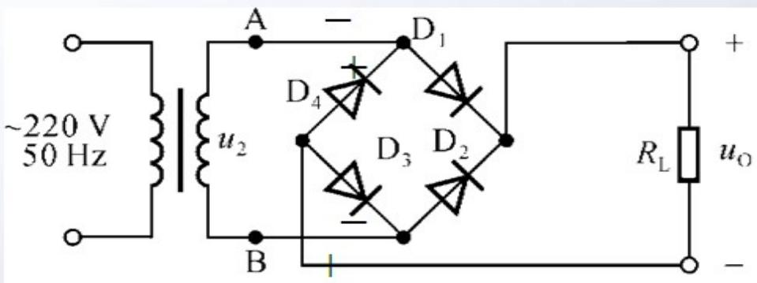
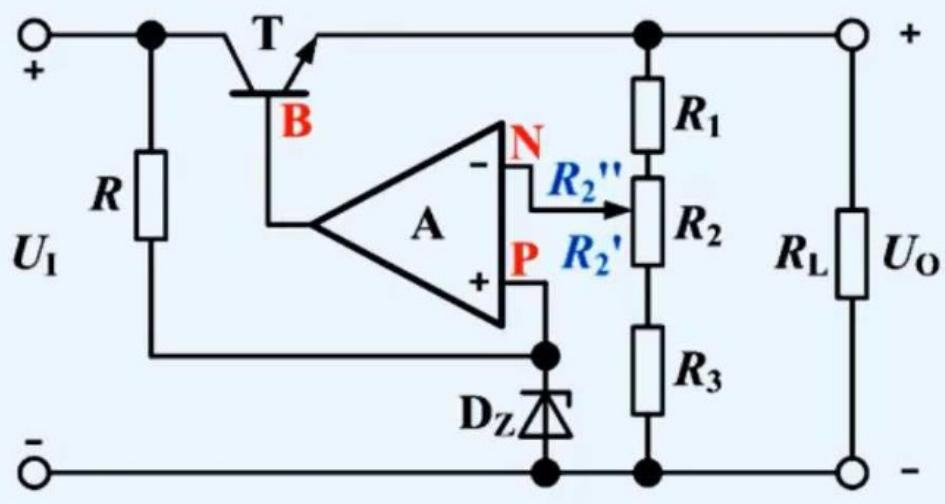
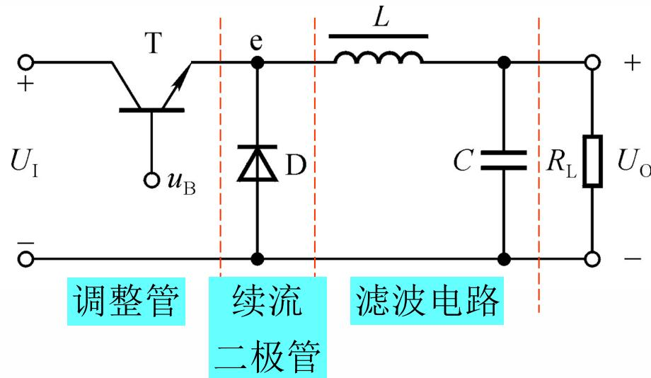
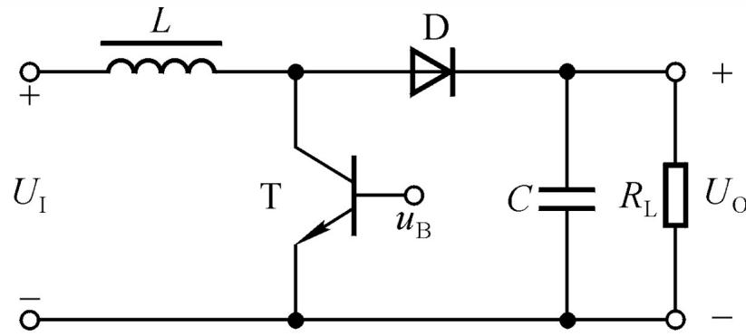

# 第9章 直流电源基础：整流改变方向，储能填补间隙，反馈维持输出

## 这一章抓什么

前几章把电源看成给定的直流电压，本章反过来研究怎样获得这个电压。交流经过整流后虽然方向不再反复改变，数值仍会周期起伏；电容可以在输入较高时储能、输入较低时供电，却不能保证负载或输入变化时平均值不变；稳压环节再利用基准与反馈，维持所需输出。

因此分析电源不能只求一个平均电压。还要看最低谷值是否足以维持稳压、最大峰值是否超过耐压、负载最重时能否供流、调整元件在哪个允许工况最热。本章把第5章二极管、第6章放大与功率、第7章比较放大连接成一个完整系统。

来源《9_直流电源--2026.pptx》以整流、电容滤波、稳压管与串联稳压为主，并将开关稳压标为自学。这里保留这个层级，但仍解释降压、升压的能量路径和公式条件，不能把自学内容压成一个名字。标题提到的集成稳压在现有文件中未展开独立型号、引脚或接法专节，不虚构这些已被课程讲授。

## 先建立整体直觉

把滤波电容看成一个小的储能池。整流电压高于它当前电压、足以克服通路压降时，输入可以补充电荷；整流电压低于它时，二极管阻止反向放电，负载暂时由电容供电。电荷被取走，电容电压就下降，所以有负载便不可能只充一次而永久保持峰值。

线性稳压器像一个受反馈控制的串联压降：当输出偏高，它增大适当的限制；输出偏低时则尝试放松限制。输入必须始终比期望输出留有足够余量，而且压差乘电流的功率主要变成热。反馈可以纠正偏差，却不能从比输出还低的瞬时输入中凭空补出电压。

开关稳压改变供能方式：通过高效开关、储能电感与电容，在不同时间段安排能量流动，再调节导通时间比例。开关管尽量避免同时承担很大电流和很大压降，但实际仍有导通、切换和其他损耗。它不是“没有损耗的线性调整管”。

## 本章怎么串起来

交流输入与变压 → 二极管按半周选择通路 → 电阻负载下的脉动单向电压 → 加电容后改为间歇补充电荷 → 用稳压管建立近似参考 → 加晶体管提高驱动能力 → 加比较放大与取样网络提高调节能力 → 检查全工况的电流、耐压、功耗与最低输入 → 自学开关式能量转换。

分析始终沿输入到负载的方向推进，但验算要反向追问：负载要多大电流，滤波需要补多少电荷，整流管要承受多大峰值，前级最低电压够不够。不要只把各块各自的“典型系数”相乘，就认为系统已经设计完成。

## 分节主干

### 9.1 四个环节解决四种不同问题

传统工频供电链通常包含变压、整流、滤波、稳压。变压器按电压与功率需求变换交流，同时在相应结构中提供电气隔离；整流把交替方向的输入变成负载中主要同向的电流；滤波减小其中交流起伏；稳压减少输入、负载变化造成的输出变化。

这是一种课程中讨论的典型结构，不代表所有现代电源都以相同顺序、相同器件实现。课件提及的电网电压、频率和百分比变化用于该课设的输入假设；实际题目以给定输入范围为准，不把例题假设当成所有地区和设备的通用标准。学习分析不需要直接接触市电，实验应遵循课程安全要求与隔离供电条件。

整流后的单向脉动电压已经有非零平均值，但仍含交流分量，所以“变成直流”不等于“波形是一条水平线”。滤波之后可能更平滑，却仍随负载变重而下跌；稳压之后也有残余纹波与误差，不能把“稳压”理解成对任意输入、任意负载都输出精确常数。

### 9.2 整流先找每半周的电流回路

半波整流只让一个半周向负载供流，另一半周主要截止。桥式整流在正、负半周分别由相应一对二极管导通，使负载电流方向相同。看图时要从交流源一端出发，经导通管、负载、另一只导通管回到交流源，而不是只记某两只编号永远一起导通；编号会随图而变。

先回顾第5章已建立的**无滤波、电阻负载、理想管、正弦输入**情形。设变压器二次电压有效值为 $U_2$，峰值 $U_p=\sqrt2U_2$，则半波输出平均值为 $U_p/\pi\approx0.45U_2$，全波桥式为 $2U_p/\pi\approx0.9U_2$。它们来自输出波形在完整周期的积分平均，不是二极管或变压器的固定转换效率。

桥式导通路径串有两只二极管，计入正向压降后，导通期间负载电压大致比相应整流输入低两只管的压降；接近零点的导通区间也可能改变。负载中每半周都有同方向脉冲，因此桥式脉动的重复频率是输入交流频率的两倍；半波只有一倍。

单管的平均电流与导通时瞬时电流不同。桥式每只管只承担相应半周期，但导通时流的是整条负载/充电通路电流。若随后加电容，通路会出现较窄的补充电荷脉冲，不能继续以电阻负载的波形估计峰值电流。

### 9.3 电容滤波：有了储能，导通时间也随之改变

将电容并在负载两端后，整流管是否导通取决于输入与**电容当前电压**的比较。输入不是只要处于正半周就必然导通；电容可能还保持着前一个峰值附近的电压，使整流管在大部分时间反偏。

当整流输入足够高，二极管导通，通路电流分成负载电流与电容电流；电容电压升高。输入降低到无法继续提供正向通路电流时，二极管截止，电容只经负载放电，其电压再逐渐下降。下一次输入峰值到来前后，输入重新超过电容电压及必要压降，才再次补充电荷。

#### 输入刚过峰值，不必立即截止

在理想零源阻抗、零管压降的导通区，电容电压跟随整流输入 $u_r$。二极管通路电流是

$$
i_D=i_L+i_C=\frac{u_r}{R_L}+C\frac{\mathrm du_r}{\mathrm dt}.
$$

峰值处导数为零，电容不再继续充电，但二极管仍可提供负载电流。刚过峰值后导数为负，电容开始释放部分电荷；只要上式总和仍为正，通路仍可维持导通。直到按该导通模型继续计算会要求负的二极管电流，才应转入截止、由电容独立供电的状态。

因此“输入一下降，二极管立刻截止”通常只是简化，不是严格判据。课件用正弦电位下降与电容自然放电趋势比较说明这一过程；理解的关键是**电容电流可以为负，而总二极管电流仍为正**。对带有限内阻的实际回路，应连同内阻重新列方程，不能要求导通时电容电压与源电压处处完全相同。

#### 充得快、放得慢的条件

课件把变压器内阻与导通器件等效电阻合记为 $R'$，通常远小于负载 $R_L$。因此快速充电的尺度可近似为 $R'C$，截止后负载放电的时间常数为 $R_LC$。这是关于阻值大小和通路状态的近似；对正弦驱动的整个充电过程，不应误认为它在任意时刻都等价于一次固定电压阶跃。

截止期间，若负载为电阻且其他通路忽略，有

$$
u_C(t)=u_C(t_0)e^{-(t-t_0)/(R_LC)}.
$$

这里的初值是上一段结束时已储存的电压，不是自动等于零。若两次补电间隔相比 $R_LC$ 很短，电压下降较少，纹波就小。桥式每个输入周期通常有两次补电机会，半波只有一次，因此在其他条件相近时桥式更容易平滑输出。

电容C增大、负载电阻RL增大，通常都使放电更慢。RL增大表示负载更轻、取走的电流更小；RL减小表示负载更重，平均输出往往下降、纹波增大。不能把“大负载”含混地同时用于“大电阻”和“大电流”。

#### 纹波、平均值与最低谷值怎样联系

在纹波较小、负载电流近似常量、充电阶段相对短的估算中，两次补电之间丢失的电荷约为 $I_L\Delta t$，由 $\Delta q=C\Delta U$ 得

$$
\Delta U_{pp}\approx\frac{I_L}{f_rC},
$$

其中 $f_r$ 是补充电荷的重复频率，桥式约为输入频率的2倍，半波约为1倍。该式是由电荷守恒作的小纹波估算，不适用于任何负载、任何电容量都精确成立的情况。

若最高电压近似为 $U_{C,\max}\approx\sqrt2U_2-2U_D$，纹波又近似呈小幅锯齿，可估平均值约为 $U_{C,\max}-\Delta U_{pp}/2$，最低值约为 $U_{C,\max}-\Delta U_{pp}$。源内阻、充电脉冲压降、二极管特性和负载都会改变这些结果。没有给出相应条件，不应把某个经验值如 $1.2U_2$ 当成所有桥式电容滤波的统一输出公式。

电容不是越大越无代价。它可降低纹波，却可能使补充电荷更集中、启动充电电流更大，对整流管、变压器与回路阻抗提出要求。元件耐压按最高可能电压检查，而稳压器能否正常工作要看最低谷值；平均值处于合理范围不能代替这两个检查。

### 9.4 并联稳压管：用分流吸收变化

最简单的稳压结构由串联限流电阻R与并联稳压管构成，负载与稳压管并联。先假设稳压管进入规定反向工作区，输出近似 $U_Z$，得到

$$
I_R=\frac{U_I-U_Z}{R},\qquad I_L=\frac{U_Z}{R_L},\qquad I_Z=I_R-I_L.
$$

输入升高时，限流电阻电流增加；负载不变，多出的电流主要流入稳压管。负载变重时，它取走更多电流，稳压管电流下降。这一分流关系让输出近似保持不变，但必须同时满足

$$
I_{Z\min}\le I_Z\le I_{Z\max},\qquad U_ZI_Z\le P_{Z,\max}.
$$

最低输入与最大负载电流通常最容易使稳压管退出稳压区；最高输入与最轻负载通常最容易使其电流或功耗过大。理想定压模型下，给定可独立达到的输入、负载范围，可以反推限流电阻需满足

$$
\frac{U_{I\max}-U_Z}{I_{L\min}+I_{Z\max}}
\le R\le
\frac{U_{I\min}-U_Z}{I_{L\max}+I_{Z\min}}.
$$

右界小于左界时，说明这个简单结构不能同时满足给定范围，而不是在两数之间随便取平均就能解决。实际还应结合稳压管允许功耗重新限制最大电流，并检查电阻在最坏工况的耗散与输出动态误差。

若算得 $I_Z<0$，意味着假设的稳压状态根本不能成立，应按不稳压的等效电路重新求输出。稳压管不是能双向凭空补给任意缺失电流的理想电压源。

### 9.5 基本串联稳压：把基准与负载驱动分开

基本串联稳压在输入与负载之间加一只调整晶体管，稳压管主要给它的基极提供参考，较大的负载电流由输入电源经晶体管提供。以NPN发射极跟随结构为例，集电极接输入，基极约为 $U_Z$，发射极作为输出，则

$$
U_O\approx U_Z-U_{BE}.
$$

这不是负载电流直接流过稳压管，而是小的基极控制电流帮助调节较大的发射极电流。给基极偏置的电阻电流仍分成稳压管电流与基极电流；不能把这三者写成同一个量。

在简单结构中，负载电流约为发射极电流，$I_B\approx I_L/(1+\beta)$，故需检查

$$
I_Z\approx\frac{U_I-U_Z}{R}-\frac{I_L}{1+\beta}
$$

仍在允许窗口。$\beta$ 随器件、温度和工作点改变，不能用一个乐观的典型值保证最大供流。若其他条件固定且整个稳压电流窗口都能转移为基极电流，课件的变化范围估计为 $\Delta I_L\approx(1+\beta)(I_{Z\max}-I_{Z\min})$；它不是任意输入、散热和驱动条件下的额定输出电流。

为什么输出会受到稳定作用？假设负载增加使输出电压下降，基极参考若暂时近似不变，$U_{BE}$ 增大，晶体管提供更多电流，抵消下降。这种负向调节仍依赖基准有效、调整管有足够输入压差与驱动余量。若输入谷值过低、基极电流不够或管子达到极限，反馈不能继续维持原输出。

只要求 $U_{CE}$ 大于某个典型饱和压降，充其量是在检查一个最低边界，不足以保证整个调节链在所有条件下都处于良好放大状态；基本稳压管偏置本身也需要输入高于基准并留有限流电阻压降。实际所需最小压差应由所用结构与器件确定。

### 9.6 带比较放大的串联稳压：测误差，再控制调整管

基本跟随结构的输出包含 $U_{BE}$，可调范围也受限制。加入比较放大器后，可以从最终输出取样，与稳定基准比较，让放大后的误差控制调整管。四个功能是基准、取样、比较放大、串联调整；晶体管不只是“增大电流”，而是在反馈要求下改变输入到输出之间的压降。

源图中同相端接稳压基准 $U_Z$，反相端接输出分压。若输出稍低，反馈取样电压下降，使比较器件提高调整管驱动，输出回升；若输出偏高则反向调节。这才是该接法为负反馈的原因，不能仅因为图上有运放就套虚短。

设输出分压的上、下等效电阻为 $R_a,R_b$，取样系数 $\beta_f=R_b/(R_a+R_b)$。在闭环稳定、比较放大器和调整管均有工作余量的区间，$\beta_f U_O\approx U_Z$，因此

$$
U_O\approx\frac{U_Z}{\beta_f}.
$$

这里下标f用来与晶体管电流系数 $\beta$ 区分。公式描述控制目标，不保证实际可达到任意大的输出；降低取样系数会提高要求输出，同时可能先耗尽输入与驱动余量。

#### 电位器的上下移动为什么与输出方向相反

源图的分压器由固定R1、电位器总电阻R2、固定R3从输出串联到地，滑动端取样。设R2′为滑动端以下、接向R3的部分，则

$$
U_N=\frac{R_2'+R_3}{R_1+R_2+R_3}U_O,
\qquad U_O\approx\frac{R_1+R_2+R_3}{R_2'+R_3}U_Z.
$$

滑动端在最上方时 $R_2'=R_2$，取样比例最大，维持同样基准所需输出最小；在最下方时 $R_2'=0$，所需输出最大。因此理想设定范围是

$$
U_{O\min}=\frac{R_1+R_2+R_3}{R_2+R_3}U_Z,
\qquad U_{O\max}=\frac{R_1+R_2+R_3}{R_3}U_Z.
$$

这说明“滑片越高输出越高”不能靠位置直觉判断；要看取样比例如何改变。两个端点还需与实际最低输入、运放输出驱动、调整管压差和负载电流范围求交，才是可用调节范围。

取样分压器也要从输出取电流。对源图，调整管发射极电流等于负载电流与分压支路电流之和；只有后者相对负载足够小且 $\beta$ 足够大时，才近似 $I_C\approx I_L$。这类“辅助支路很小”应先检查再省略，而不是默认不存在。

#### 集成稳压的知识边界

把基准、误差放大、调整与保护等功能集成在器件中，外部分析仍需检查输入、输出、负载与稳定条件。这个功能联系可由本章框图理解，但现有课件没有给出某个具体三端稳压型号的引脚图、最小压差、保护策略或外接电容要求。后续S10不得凭标题捏造这些参数；遇到指定型号，应以题给资料或对应原始资料另行确认。

### 9.7 选调整管与整机验算：热、耐压、供流分别找最坏点

调整管常需要承受较大电流与耗散。电流、耐压、功率是三个不同约束，不能选中一个“功率够大”的管子就结束。

首先求实际输出电流需求，包括取样等支路。在相应近似下，管子最大集电极电流接近最大负载加辅助电流。其次检查集电极—发射极最大压差；对输入、输出范围独立可达到的简单情况，可用 $U_{CE\max}=U_{I\max}-U_{O\min}$ 作检查。最低输入、最高输出则对应最小调节余量，是稳压可能失败的另一端，而不是耐压最坏点。

连续线性调整的主要耗散为

$$
P_T\approx(U_I-U_O)I_C.
$$

要在实际能同时发生的工况中求最大值。若高输入、低输出和最大负载电流可同时出现，它们通常构成严苛热工况；若负载为固定电阻，$I_L=U_O/R_L$ 与输出相关，就不能把不可能同时达到的独立极值当成唯一真实工作点。把各极值相乘可以是保守上界，但应说明其性质。

例如固定电阻负载、忽略辅助支路时，$P_T\approx(U_I-U_O)U_O/R_L$，它在允许区间中可能于 $U_O=U_I/2$ 达到峰值，而非一定在最小输出处。这是从功率关系直接得到的判断方法，不要求背“永远低输出最热”的错误口诀。

器件名义允许功率还与温度、散热和安全工作区相关。即使平均功率低于某个标称上限，也不自动保证任意电压、电流组合安全；设计题至少要报告所依据的工况与余量，不能忽略散热条件。

最后把滤波与稳压接起来：输入交流最低时，滤波电容的谷值要满足调节链的最低输入要求；输入最高、轻载时，电容峰值与各器件反压不能越界；输入最高、重载或其他可达严苛组合时，再查整流脉冲、电阻功率和调整管温升。平均电压只是这张验算图中的一个量。

### 9.8 开关稳压自学：电感的伏秒平衡与电容的电荷平衡

源课件将这一部分列为自学。主线目标是看懂开关、二极管、电感、电容在两个状态下各做什么，并从周期稳态推导理想变比，不要求凭空掌握未提供的完整控制环设计。

线性调整主要把输入输出压差变成热；开关调整让开关尽量处于小压降导通或小电流截止的状态，配合储能元件传送能量。真实开关仍有导通损耗、切换损耗，电感、电容也非理想。源课件给出的效率区间是示例性描述，不是所有线性或开关电源必须落入的固定范围。

#### 降压型：导通时充电感，截止时仍有续流

降压电路让开关节点经电感接输出，输出并电容，二极管提供开关关断后的续流回路。设周期T，导通时间 $t_{on}$，占空比 $D=t_{on}/T$。在输出纹波较小、理想开关/二极管和连续电感电流的近似下，导通时开关节点约为 $U_I$，电感电压为 $U_I-U_O$，电流上升；截止时二极管续流，开关节点约为0，电感电压为 $-U_O$，电流下降。

周期稳态要求电感电流每周期回到原值，即平均电感电压为零：

$$
D(U_I-U_O)+(1-D)(-U_O)=0,
\qquad U_O=DU_I.
$$

若保留开关导通压降 $U_{CE(sat)}$ 与二极管压降 $U_D$，同样方法给出

$$
U_O\approx D[U_I-U_{CE(sat)}]-(1-D)U_D.
$$

导通不等于电容一直充电，关断也不等于电容一直放电。电容电流为 $i_C=i_L-i_O$，电感送入的电流大于负载需求时它充电，小于负载需求时它补充缺口。电感电流若下降到零，二极管会截止并出现第三种区间，此时不能继续按整段恒定负电感电压推导 $U_O=DU_I$。

取样与基准比较，再调整开关导通比例，就能纠正输出变化；具体驱动极性取决于开关管与控制电路接法。固定频率下改变脉宽与改变开关频率是不同控制方式，不要把所有“调占空比”都理解成调频。

#### 升压型：关断时电感维持电流，把能量送向较高电压

升压结构中，输入先接电感，电感另一端通过开关接地，并经二极管通向输出。开关导通时，该节点较低，二极管通常反偏，电感承受约 $U_I$ 并储能，负载主要由电容供电；开关关断时，电感为维持电流抬高节点电压，使二极管导通，输入与电感共同向输出送能。

在理想周期稳态、连续电感电流、输出纹波较小的条件下，电感伏秒平衡为

$$
DU_I+(1-D)(U_I-U_O)=0,
\qquad U_O=\frac{U_I}{1-D},\quad0<D<1.
$$

输出电压可以高于输入，并不违反能量守恒：忽略损耗时输出功率不能大于输入功率，升高电压伴随可供输出电流相对输入电流的变化。占空比趋近1时理想式发散，不表示实际电路能产生无限电压；器件耐压、电流、损耗、控制和储能能力早已限制工作。

电感L控制电流变化速度与连续/断续模式；不是只有“足够大的L”才能升压，断续模式也能升压，但变比还会依赖负载、频率等条件。C决定负载在间隙供电时电压下降多少，不能只说“电容大就完全没有交流”。关断送能期间C是否充电，同样取决于电感送来的电流是否超过负载电流。

### 9.9 从电路图到一次完整的电源判断

先确认负载类型、所需输出范围与输入波动，再沿各状态画电流通路。整流与开关电路用分段状态；滤波电容用电荷连续和放电时间尺度；线性稳压用基准、取样和工作区条件。每一个公式都应标明它说的是峰值、平均值、谷值、瞬时电流还是周期平均电流。

一份可靠答案至少能解释：输入电压升高时哪一处电流或压降增加；负载变重时哪一块首先失去余量；波形最低点是否仍可稳压；哪种工况使关键器件最热；模型不再成立时应换成什么状态。单独得到一个输出数值，并不等于电源在整个范围都可以工作。

## 典型题型入口与解题流程

| 题目线索 | 第一动作 | 必做验算 |
| --- | --- | --- |
| 整流、导通二极管、波形 | 按每半周画完整回路，说明有无滤波 | 管压降、反压、瞬时与平均电流区分 |
| 电容滤波、纹波、负载变化 | 找补电间隔与截止放电通路 | 电荷/初值、峰谷值、源阻抗与充电脉冲 |
| 稳压管与限流电阻 | 假设输出UZ后列分流KCL | 最小稳压电流、最大电流/功耗、R区间是否存在 |
| 串联稳压、调压范围 | 确认基准与反馈极性，写取样比例 | 基极驱动、最低输入、所有辅助支路电流 |
| 调整管选型 | 分别求电流、反压和耗散工况 | 极值能否同时发生、散热与安全工作区 |
| 降压/升压自学 | 分导通、截止状态写电感电压 | 连续电流与周期稳态、C电流符号、实际损耗 |

## 易错点

无滤波的0.45/0.9系数不能直接用于电容滤波；平均电压不能替代最低稳压余量；“管子导通”不表示电容一定充电；电阻负载变小意味着电流需求变大。以上错误都来自忽略了波形、通路或量的定义。

稳压方面最危险的遗漏是把假设写成结论：用 $U_O=U_Z$ 后不验IZ窗口，用取样比求输出后不验输入与驱动，用 $P=(U_I-U_O)I$ 后不问这些电压电流是否可同时出现。反馈能减小误差，不能取消能量和器件限制。

自学开关部分也不能只记D倍或1/(1−D)倍。公式来自指定状态的伏秒平衡，电流归零、元件压降或其他模式会改变方程；实际升压不是无限大占空比换无限大电压。

## 复习检查

**整流后方向不变，为什么还需要滤波？**输出数值仍按周期起伏，负载需要的是较平滑电压；单向不等于恒定。

**桥式输入刚过峰值，电容开始放电，二极管一定立即截止吗？**不一定。只要负载电流与电容电流之和仍为正，导通仍可能维持；应检查通路电流而不只看电容电流符号。

**负载电阻减小，滤波通常怎样变化？**取走电流增大、放电时间常数减小，纹波增大且平均输出可能下降。

**为什么验证稳压器要看滤波谷值？**谷值时输入余量最小，即使平均输入足够，某一段仍可能失去调节能力。

**基本串联稳压里，给基极的电阻电流是否等于稳压管电流？**不是，它分成稳压管电流与基极电流，负载驱动会占用基准的电流余量。

**调压电位器使取样比例增大，理想输出怎样变？**为让取样仍等于同一基准，所需输出减小；之后还需检查可实现范围。

**固定电阻负载下，调整管一定在最低输出最热吗？**不一定，电流随输出变化，应在允许区间最大化 $(U_I-U_O)U_O/R_L$。

**降压开关关断时，为什么负载还有电流？**电感电流通过续流二极管继续流向输出，电容也按电流差供能或储能；不是电感电流瞬间消失。

**升压变比 $1/(1-D)$ 需要什么前提？**理想周期稳态、连续电感电流和相应小纹波近似；其他模式及实际器件限制不能忽略。

## 进入 S10 的问题入口

可以从一个工况提出问题：“电容已经放电，为什么整流管还能导通？”“我按分压比算对了，哪一处余量让实际输出达不到？”“最热工况为什么不是各量都随便取最大？”“降压电路这一段电容究竟在充电还是放电？”先把对应电流回路和条件画清，再做只改变一个输入、负载或状态的变式。
