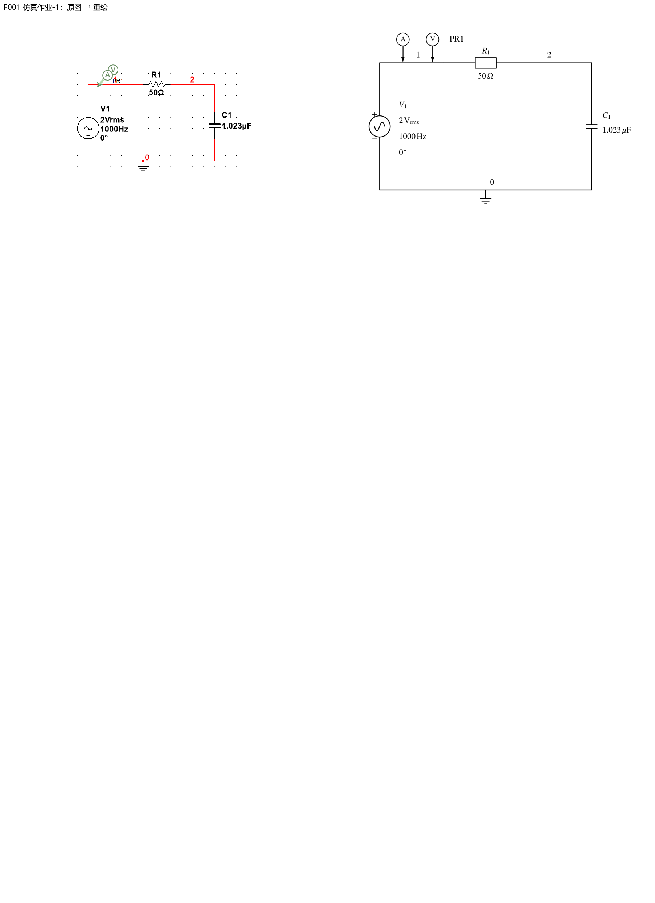

> 派生文件，可重新生成，勿手改。

# 第3章：图像重绘与核验

1张正式引用图已重绘；0张保留原图待确认；0张复用此前已核验矢量稿；0张原答案截图保留证据。STIX数学字体、黑白、IEC电阻符号；可编辑Python源、SVG及PNG均保留。仅替换图片引用，题面、答案、标题锚点与标签逐字保留。

[台账与原图SHA](../../10_题库/assets/chapter-redraw/ch03/ledger.json) · [核验记录](../../10_题库/assets/chapter-redraw/ch03/validation.json) · [可编辑源](../../10_题库/assets/chapter-redraw/ch03/generate.py)

复杂多子图在窄屏须放大查看；320px灰度缩图用于检查结构与遮挡，不宣称所有细小数值在此宽度可读。

| 图 | 所在题目 | 核验结果 |
|---|---|---|
| F001 | 仿真作业-1 | 50Ω电阻R1与1.023μF电容C1串联；交流源V1为2Vrms、1000Hz、0°，正上负下；保留节点1/2/0、接地与PR1电压/电流探针标记。黑白重绘不以颜色区分信息。；verified |

## 校验范围

图片引用、原图哈希、SVG/PNG、题面与答案逐字还原、标题锚点不变、S1及受影响入库清单通过。本章未修改知识文档，不新增S8绑定。全课程S8仍报告既存问题：临时笔记结构、整体框架旧标题链接和旧digest覆盖不足；本章不宣称这些旧问题已修复。
