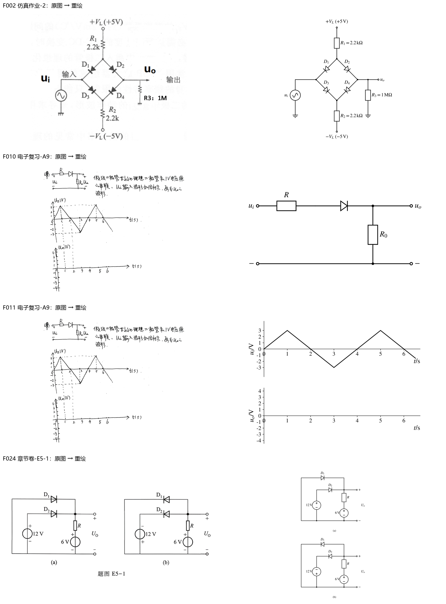
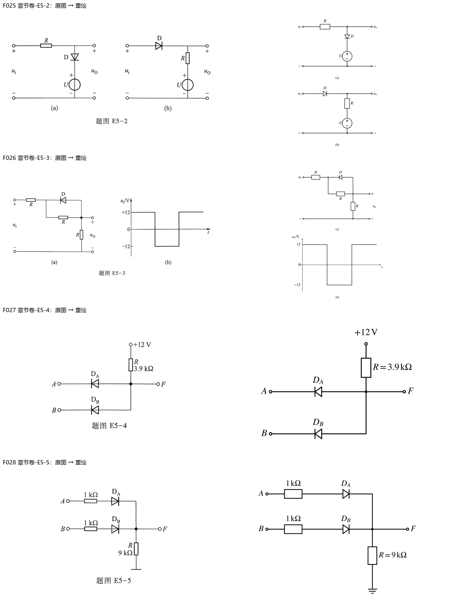
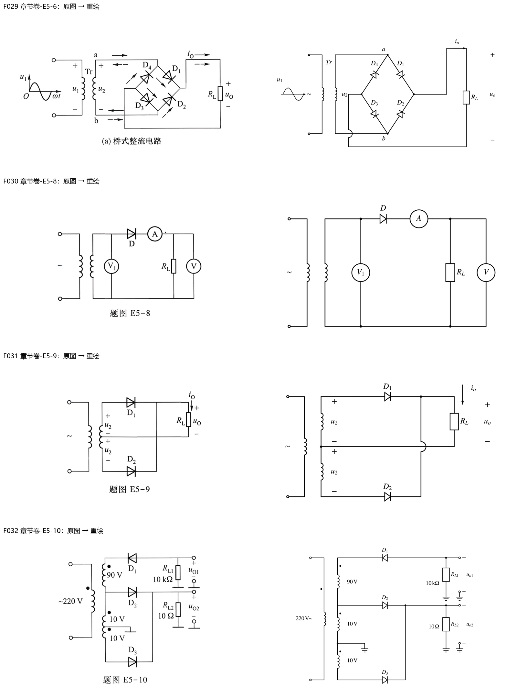
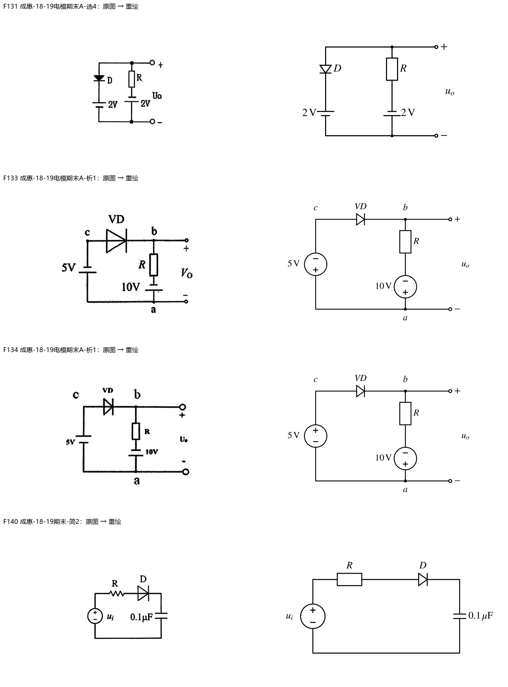
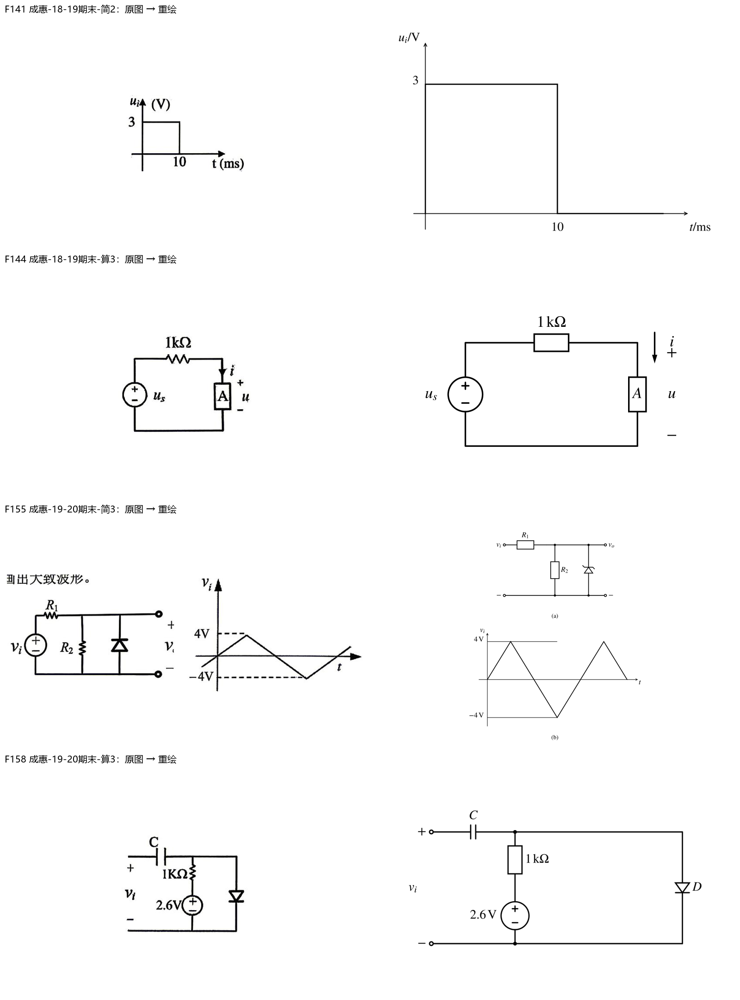
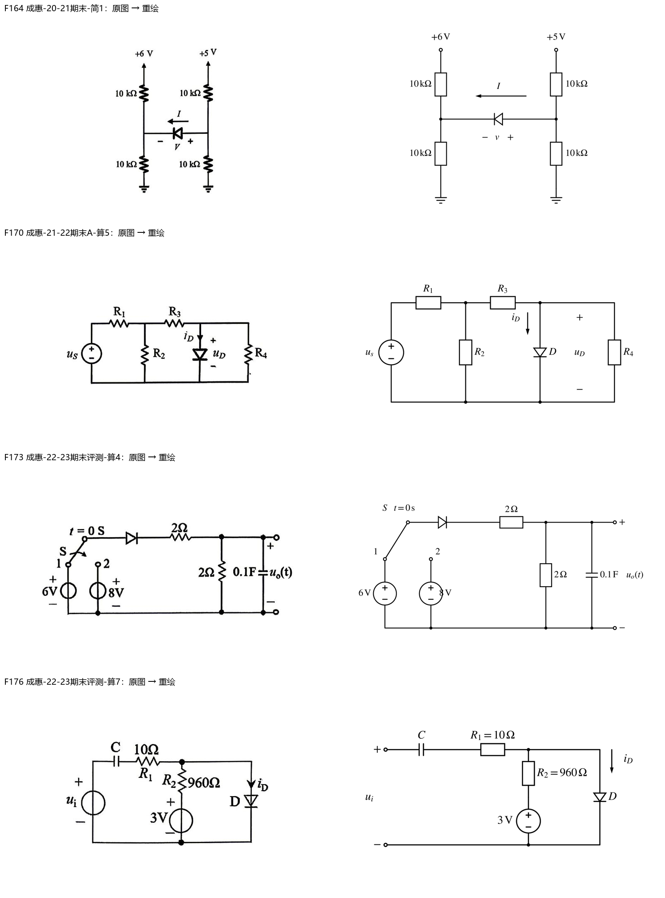

> 派生文件，可重新生成，勿手改。

# 第5章：图像重绘与核验

24张正式引用图已重绘；E5-6/E5-7共用一张。A4因电源值缺失保留原图；2张答案截图保留为来源证据。字体STIX、单色、可编辑Python源与SVG/PNG均保留；不改变题面、锚点、标签和答案状态。

[台账与逐项核验](../../10_题库/assets/chapter-redraw/ch05/ledger.json) · [生成源](../../10_题库/assets/chapter-redraw/ch05/generate.py) · [校验记录](../../10_题库/assets/chapter-redraw/ch05/validation.json)

| 图 | 原题 | 核验 |
|---|---|---|
| F002 | 仿真作业-2 | 菱形四管：D1/D2从正供电节点指向输入/输出；D3/D4指向负供电；R1=R2=2.2kΩ，R3=1MΩ；正负5V；原EMF可追溯。；verified |
| F008 | 电子复习-A4 | A4左侧电源无数值；原图只读保留，不能猜测补全；pending_source |
| F010 | 电子复习-A9 | A9原题图只有R、D、R0；1V为题干模型条件，不画成原图额外电池。；verified |
| F011 | 电子复习-A9 | A9峰值±3V，峰值时刻1s、5s，谷值3s；输出坐标为空，不填答案。；verified |
| F024 | 章节卷-E5-1 | 两幅D1/D2方向互反；(a)12V正端朝上；(b)12V正端朝下；6V两幅均正端朝上。；verified |
| F025 | 章节卷-E5-2 | (a)R串联输入、D向下接U正端；(b)D串联输入、R接U正端；无臆造数值。；verified |
| F026 | 章节卷-E5-3 | D从输出节点指向输入分压节点，与并联R共节点；方波±12V，未给周期，不添加时间刻度。；verified |
| F027 | 章节卷-E5-4 | DA/DB阴极朝A/B；R=3.9kΩ接+12V；F为公共阳极节点。；verified |
| F028 | 章节卷-E5-5 | DA/DB阳极分别经1kΩ接A/B；公共阴极F经9kΩ对地。；verified |
| F029 | 章节卷-E5-6 | 变压器交流a/b；D1/D2公共阴极接负载正端、D3/D4公共阳极接负端；保留io箭头；回线与交流线交叉处用跨线桥表示不连接；E5-6/7共用。；verified |
| F030 | 章节卷-E5-8 | A串接于D阴极后；V1跨接副边；V跨RL；D阳极朝副边上端。；verified |
| F031 | 章节卷-E5-9 | 双绕组中心抽头为负载负端；D1/D2公共阴极为正端；中心抽头与阴极母线跨线不相接；两个u2极性正上负下。；verified |
| F032 | 章节卷-E5-10 | 副边90V/10V/10V，抽头地；D1阴极朝绕组，D2/D3阳极朝绕组；保留同名端点；RL1=10kΩ，RL2=10Ω。；verified |
| F131 | 成惠-18-19电模期末A-选4 | 左支路D向下、2V电池正上；右支路2V电池正下；输出极性正上负下。；verified |
| F133 | 成惠-18-19电模期末A-析1 | VD阳极左阴极右；5V、10V两电源均正下；保留a/b/c节点。；verified |
| F134 | 成惠-18-19电模期末A-析1 | VD阳极左阴极右；5V正上、10V正下；保留a/b/c节点。；verified |
| F135 | 成惠-18-19电模期末A-析1 | 原答案截图只读保留，不用重绘稿替换来源证据；source_evidence_retained |
| F140 | 成惠-18-19期末-简2 | R、D、0.1μF串联；ui正上负下；D阳极朝R。；verified |
| F141 | 成惠-18-19期末-简2 | 3V正脉冲，10ms回到0；坐标轴正向已实际渲染检查。；verified |
| F144 | 成惠-18-19期末-算3 | 1kΩ串联方框器件A；电流箭头向下、端电压正上负下；A不作为电阻值。；verified |
| F155 | 成惠-19-20期末-简3 | R1串联、R2并联、稳压二极管阴极朝上；定性三角波±4V，不增周期值。；verified |
| F158 | 成惠-19-20期末-算3 | 输入隔直C后分为偏置R/2.6V支路和D支路；D阴极地；1kΩ及电源正上。；verified |
| F159 | 成惠-19-20期末-算3 | 原答案截图只读保留，不用重绘稿替换来源证据；source_evidence_retained |
| F164 | 成惠-20-21期末-简1 | 左6V/右5V；四个10kΩ分压器；D阳极朝右、阴极朝左，I箭头向左，v正右负左。；verified |
| F170 | 成惠-21-22期末A-算5 | R1/R3串联，R2/R4分支；D从R3后节点向地；iD向下；uD正上负下；不填答案数值。；verified |
| F173 | 成惠-22-23期末评测-算4 | 开关由1(6V)切至2(8V)，图示初始在1；D后2Ω串联、2Ω与0.1F并联；输出正上负下。；verified |
| F176 | 成惠-22-23期末评测-算7 | C、10Ω串联；960Ω串3V正上电源支路；D阴极地；iD向下。；verified |

