> 派生文件，可重新生成，勿手改。

# 第7章：图像重绘与核验

49张正式引用图已重绘；3张保留原图待确认；6张复用此前已核验矢量稿；10张原答案截图保留证据。STIX数学字体、黑白、IEC电阻符号；可编辑Python源、SVG及PNG均保留。仅替换图片引用，题面、答案、标题锚点与标签逐字保留。

[台账与原图SHA](../../10_题库/assets/chapter-redraw/ch07/ledger.json) · [核验记录](../../10_题库/assets/chapter-redraw/ch07/validation.json) · [可编辑源](../../10_题库/assets/chapter-redraw/ch07/generate.py)

复杂多子图在窄屏须放大查看；320px灰度缩图用于检查结构与遮挡，不宣称所有细小数值在此宽度可读。

| 图 | 所在题目 | 核验结果 |
|---|---|---|
| F005 | 仿真作业-6 | 保留仿真原截图：XBP1测量端、彩色交叉布线及U1供电脚的连接尚未从原生仿真文件独立确认。需要原生电路/网表再裁决，暂不发布猜测的电路图。；pending_source |
| F006 |  | 同一符号上负下正，un/up/uo和±VCC照原矢量图；电源脚与三角形边界相接，字形统一STIX。；verified |
| F007 |  | 开环定性传输保留正斜率线性段和±Uom饱和，不增加数值刻度；输入差明确up-un。；verified |
| F009 | 电子复习-A7 | A7的二极管方向/符号仍有来源歧义；保留原手绘图，等待更清楚的原题或教师裁决。；pending_source |
| F015 | 电子复习-C1 | 未裁切照片确认是绝缘栅MOS器件：运放正端uI、负端R1地/R2回源极输出、R3负载；VCC接上端，沟道箭头朝左，未画成NPN三极管。；verified |
| F016 | 电子复习-C2 | 复用此前已核验矢量图，本章不重复生成。；reused_verified_vector |
| F018 | 电子复习-C5 | 复用此前已核验矢量图，本章不重复生成。；reused_verified_vector |
| F019 | 电子复习-C9 | 复用此前已核验矢量图，本章不重复生成。；reused_verified_vector |
| F020 | 电子复习-C12 | 复用此前已核验矢量图，本章不重复生成。；reused_verified_vector |
| F022 | 电子复习-C14 | 复用此前已核验矢量图，本章不重复生成。；reused_verified_vector |
| F023 | 电子复习-C15 | 复用此前已核验矢量图，本章不重复生成。；reused_verified_vector |
| F052 | 章节卷-E7-1 | 两幅分别为反相与同相放大；保留R1/R2输入和接地角色、RF反馈、u1/uo及正负输入方向。；verified |
| F053 | 章节卷-E7-2 | A1反相输入R1、RF1反馈、正端R2接地；A1输出经R3到A2正端并由R4接地；A2负端仅经RF2回输出，保留原题无下分压电阻的结构。；verified |
| F054 | 章节卷-E7-3 | u11/u12/u13分别经R11/R12/R13共接反相汇流节点；RF从该节点反馈输出；正端R2接地，未合并任何元件。；verified |
| F055 | 章节卷-E7-4 | R1/R2接反相输入与输出；R3接u12到正端，正端另经R4接输出并经RL接地；IL向下，反馈下行线独立绕开RL本体。；verified |
| F056 | 章节卷-E7-5 | 两输入各经R1到对应端；上、下各有两只R2构成T支路，a-b间为αR2；a到输出经R2，b右侧R2接地；α支路跨输出线不连接。；verified |
| F057 | 章节卷-E7-6 | 反相R1/RF与正端R2接地；RP负载接地，滑臂返回输出端，未将负载误作输入电阻。；verified |
| F058 | 章节卷-E7-7 | A1/A2/A3均为电压跟随；三路输出各经3R汇于uA，uA经30R接地后送A4正端；A4负端经R到地、30R回输出，所有输出端实际连线。；verified |
| F059 | 章节卷-E7-8 | 第一级u1/R1与u2/R2反相汇流、R3反馈、正端R接地；uo1经R4入第二级负端，R5反馈；u3/R6和u4/R7共接第二级正端，未添加接地电阻。；verified |
| F060 | 章节卷-E7-9 | 输入R1、反相反馈R2/R3串联，其中点经R4接地；正端经R到地，R4未误接正端或输出。；verified |
| F061 | 章节卷-E7-10 | A1输入5mV/6k和−5mV/4k、反馈24k、正端2.2k接地；A2正端−6mV经6k及6k接地，负端+6mV经6k并接4k/6k反馈分压；末级两路12k、负反馈6k及正端6k接地，所有给定数值照录。；verified |
| F062 | 章节卷-E7-11 | A1正端接u1、A2正端接u2；R1/R2/R3串接两个输出，两个反相端分别取R1/R2与R2/R3节点；uo跨两个输出，绝不把负输出接地。；verified |
| F063 | 章节卷-E7-12 | 前级R1分段标号确为cR1、bR1、dR1，中段可调；两反相端分别取分段节点；末级上路R2/aR2、下路R3/aR3接地，保留原题参数字母。；verified |
| F064 | 章节卷-E7-13 | u11经R入反相端、C反馈；u12经R入同相端、C到公共下轨；两输入负参考端与输出负端同轨，未对调正负输入。；verified |
| F065 | 章节卷-E7-14 | 电路为输入C、反馈R、正端R接地；输入矩形波仅标T1/T2及0、u1、t，无虚构幅值/周期，也不添加输出答案波形。；verified |
| F066 | 章节卷-E7-15 | 第一级输入C、反馈R1，第二级输入R1、反馈C；两级正端均R2接地，级间没有额外旁路或短接。；verified |
| F067 | 章节卷-E7-16 | 差分级两输入R1、负反馈R2和正端R2接地；后级R3输入，RF与C串联反馈，正端R4到公共下轨；未将串联反馈误画并联。；verified |
| F068 | 章节卷-E7-17 | u11/u12各经R1共接第一负端，R2反馈；u13经R3接正端且无额外接地电阻；R4接第二负端、C反馈、正端R5接公共下轨。；verified |
| F069 | 章节卷-E7-18 | 电路R1/R2/R3/R4与输出双向稳压限幅照录；原给定传输图保留±12V饱和及±4V输入拐点，未据曲线反填图中未知电阻值。；verified |
| F070 | 章节卷-E7-19 | 第一运放R1输入/R2正端接地/UZ1双向稳压反馈；uo1接第二负端，正端R3/R4构成正反馈，R5后UZ2限幅；只重绘原给定±3V正弦输入，不添周期值与输出答案。；verified |
| F071 | 章节卷-E7-20 | UR经R1入负端、u1经R2入正端；输出经R3驱动NPN基极，发射极接地、集电极串灯到+UCC；D阴极接基极、阳极接地，方向照录。；verified |
| F096 | 成惠-15-16模电期末A-设5 | 答案截图只读保留，不用重绘稿替代原答案证据。；source_evidence_retained |
| F097 | 成惠-15-16模电期末A-算6 | 电桥上两臂R、下左R/下右Rt，E=+5V；两取样端对应A1/A2正端；前级R/RW/R；末级上正下负及R1/R2分配照原题，不套常见极性。；verified |
| F101 | 成惠-16-17模电期末A-算4 | 100kΩ输入/10μF反馈积分器，正端地；输入给定±1V，1/3/5/7s跳变；输出坐标保留±1/±2V而不添加答案曲线。；verified |
| F102 | 成惠-16-17模电期末A-算4 | 答案截图只读保留，不用重绘稿替代原答案证据。；source_evidence_retained |
| F103 | 成惠-16-17模电期末A-算4 | 答案截图只读保留，不用重绘稿替代原答案证据。；source_evidence_retained |
| F104 | 成惠-16-17模电期末A-算5 | 原图输入C=2μF串R=800Ω；Rf=8kΩ负反馈、Rp=8kΩ正端接地；所有单位照录。；verified |
| F105 | 成惠-16-17模电期末A-算5 | 答案截图只读保留，不用重绘稿替代原答案证据。；source_evidence_retained |
| F106 | 成惠-16-17模电期末A-设6 | 答案截图只读保留，不用重绘稿替代原答案证据。；source_evidence_retained |
| F110 | 成惠-16-17第二期末A-算5 | 低通：两串联R；第一只0.1μF从两R中点接输出，第二只从正输入接地；负端R1接地/R2反馈，未把第一电容误接地。；verified |
| F115 | 成惠-17-18期末-算4-1 | R1输入、R2反馈、R3正端接地；原(a)图无负载，不擅加RL。；verified |
| F116 | 成惠-17-18期末-算4-1 | R1输入、R2反馈、R3正端接地；RL由输出到地。；verified |
| F117 | 成惠-17-18期末-算4-2 | 积分器：输入R、反馈C、同相R接地，v_i/v_o照原图。；verified |
| F118 | 成惠-17-18期末-算4-2 | 原题给定上下两波形：输入±1V、输出±0.5V，0.1/0.2μs及反相斜率照录；这是题干条件图，不是代画解答。；verified |
| F119 | 成惠-17-18期末-算4-2 | 答案截图只读保留，不用重绘稿替代原答案证据。；source_evidence_retained |
| F120 | 成惠-17-18期末-算4-3 | R1后节点v1经C2到负端v2；C1从v1跨到输出，R2从v2反馈输出；正端接地；不能交换C1/C2标号。；verified |
| F121 | 成惠-17-18期末-算4-3 | 答案截图只读保留，不用重绘稿替代原答案证据。；source_evidence_retained |
| F128 | 成惠-18-19电子基础期末-算5 | 高通两只0.1μF串联；两节点各自R接地，确无输出到第一个中点的反馈支路；R1接地、Rf负反馈。；verified |
| F139 | 成惠-18-19电模期末A-算7 | 已回查扫描件物理第63页；六小图中(4)左侧电源的数值在原扫描中也截缺，只剩V，不能根据答案反填−2V。整幅保留原图，需未截缺原卷。；pending_source |
| F147 | 成惠-18-19期末-算6 | 1kΩ输入、10kΩ与0.2μF并联反馈、正端1kΩ地；不是串联RC反馈。；verified |
| F148 | 成惠-18-19期末-算6 | 答案截图只读保留，不用重绘稿替代原答案证据。；source_evidence_retained |
| F153 | 成惠-18-19第二期末-算6 | 低通两R均1.6kΩ，两C分别跨接中点到输出/正端到地；R1接地R2负反馈。；verified |
| F156 | 成惠-19-20期末-简6 | 三级分别同相1k/10k放大、跟随、负端接地比较器；三级均±12V供电，输入间1kΩ均保留，未添加第三反馈。；verified |
| F157 | 成惠-19-20期末-简6 | 答案截图只读保留，不用重绘稿替代原答案证据。；source_evidence_retained |
| F162 | 成惠-19-20期末-算5 | C串接同相输入、R并地；R1从负端到地、R2回输出；源电压正上负下，不能误画反相高通。；verified |
| F163 | 成惠-19-20期末-算5 | 答案截图只读保留，不用重绘稿替代原答案证据。；source_evidence_retained |
| F167 | 成惠-20-21期末-算6 | 第一级输入分两路：R2到负端、C1到正端；R2负反馈、R1正端地；第二级上正下负，R3地/R4反馈。；verified |
| F169 | 成惠-21-22期末A-算4 | 10kΩ输入/正端接地、100kΩ与C并联反馈，保留±us供电引脚和时间变量。；verified |
| F171 | 成惠-21-22期末A-算6 | R1后节点经C1到负端，C2从R1/C1节点跨到输出；R2负反馈、正端地，与另一年份题的电容编号相反。；verified |
| F174 | 成惠-22-23期末评测-算5 | 输入1kΩ；反馈10kΩ、0.1μF、1mH三支路并联，正端直接地；三个反馈元件均保留。；verified |
| F175 | 成惠-22-23期末评测-算6 | A1上正下负；输出经1kΩ到A2负端，A2正端直接地/11kΩ反馈；输出20k/10k中点经9k接A1负端，再1k地，五处不同数值不混用。；verified |
| F177 | 成惠-23-24期末A-填7-1 | 同相放大：R1负端接地、Rf反馈、vi经R3到正端；按原图R3而非擅改R2。；verified |
| F182 | 成惠-23-24期末A-算6-1 | vi交流源接同相；负端取R1/R2中点；RL跨输出和公共地，不与R1/R2串联；输出极性保留。；verified |
| F188 | 7.1 运放是什么：高增益不等于无限输出 | 保留输入/中间/输出/偏置/保护五部分；同相/反相输入和双电源±US、偏置与保护连向，改为黑白线型且不依赖底色。；verified |
| F189 | 7.4 T形反馈：为什么不直接把反馈电阻做得很大 | 原电路及右侧虚短/虚断等效均重绘：R1输入、R2/R4反馈串接，中点M经R3地，正端P经R5地；等效P/N之间只画虚线关系，不画物理短线。；verified |
| F190 | 7.8 微分、函数变换与微分方程模拟 | 照图分置A2朝左、A1朝右；A2负端R3输入/C反馈/正端R5地，A1正端R1输入/R2到标为uO2的开口端、负端R4地；虚线是电压对应箭头，未补为实导线。；verified |
| F191 | 7.10 仪表放大器：放大小差异，而不压垮信号源 | 两同相输入uI1/uI2，前级R1/R2/R1取样A/B，末级上负下正、R输入/Rf反馈与接地，未复制电桥题相反末级极性。；verified |
| F192 | 7.15 滞回比较：当前输出会改变下一次翻转门槛 | uI直入负端N；UREF经R1入正端P，R2从限幅后输出正反馈；R串于运放输出，双向DZ限幅到地，保留参考电压与节点标识。；verified |

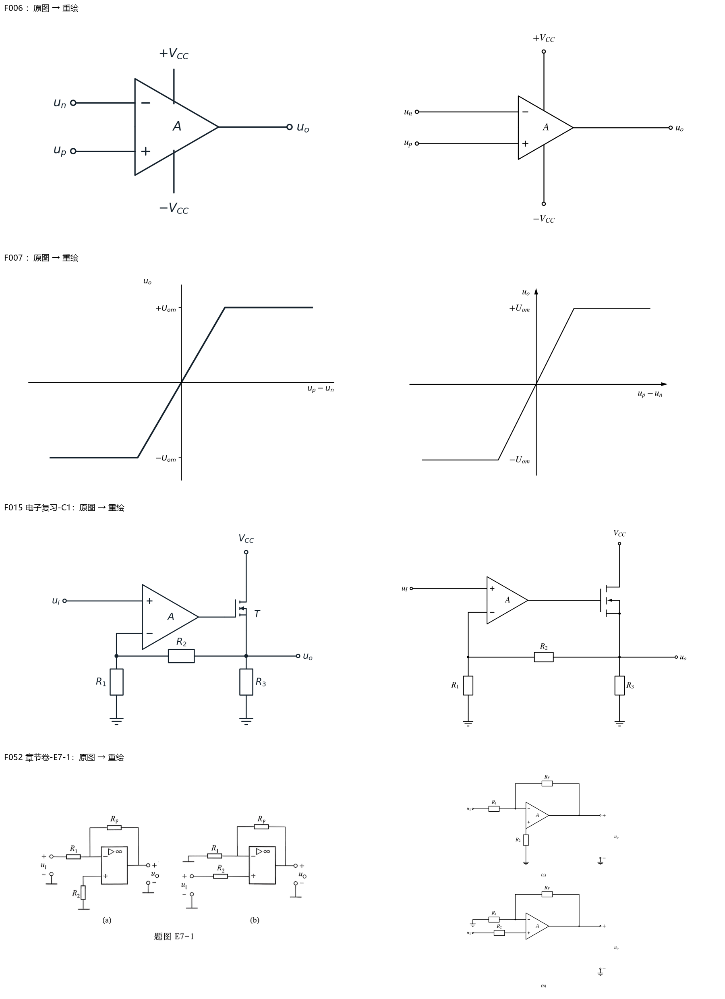

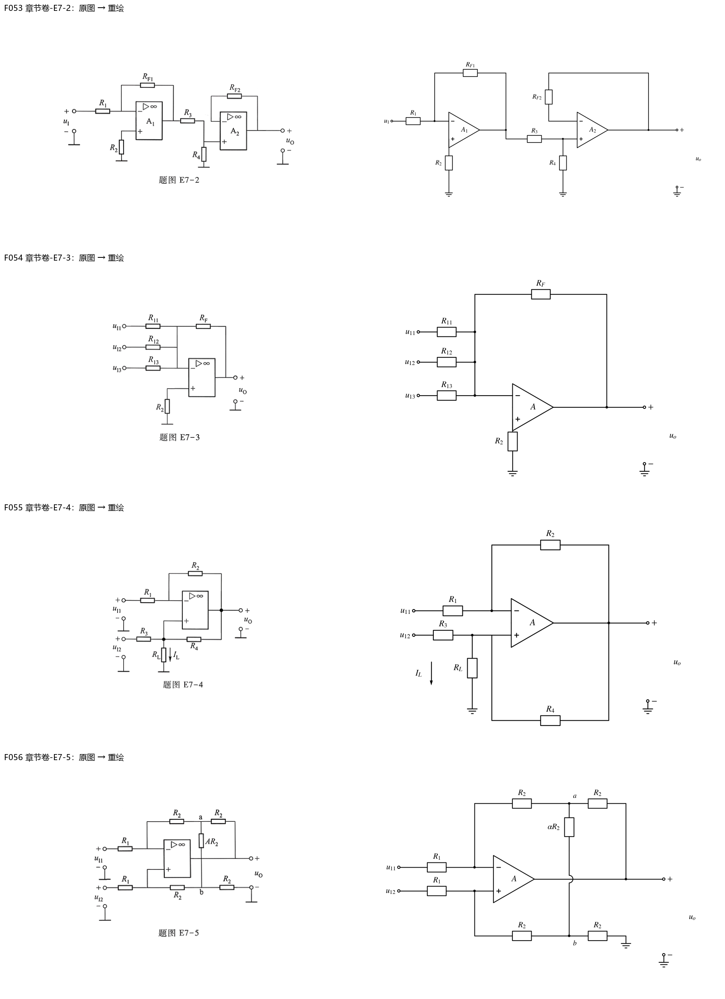

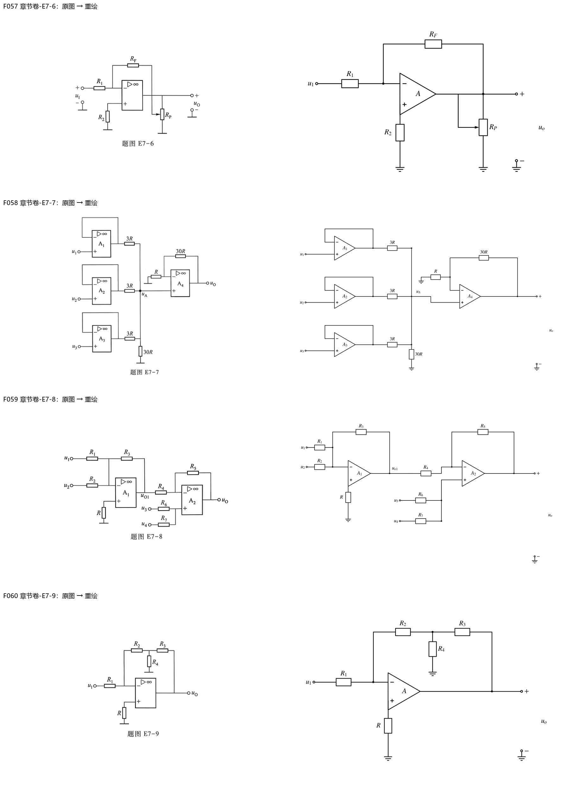

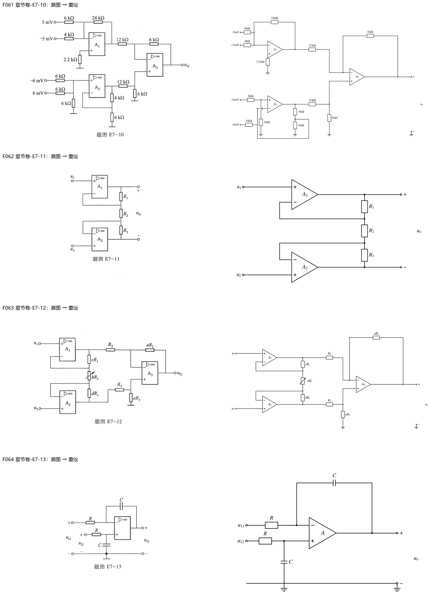

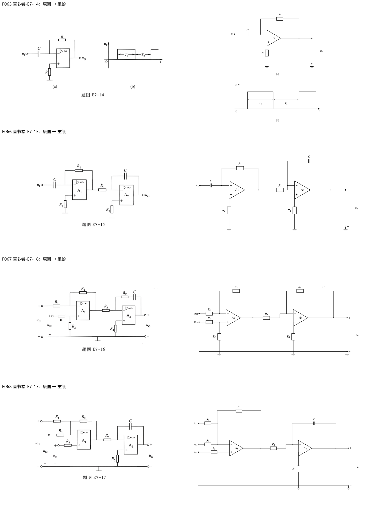

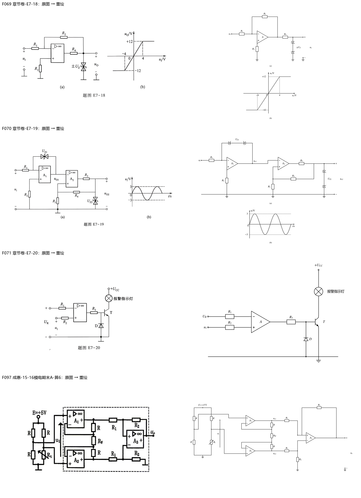

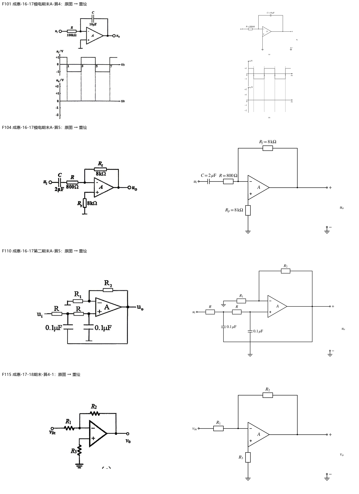

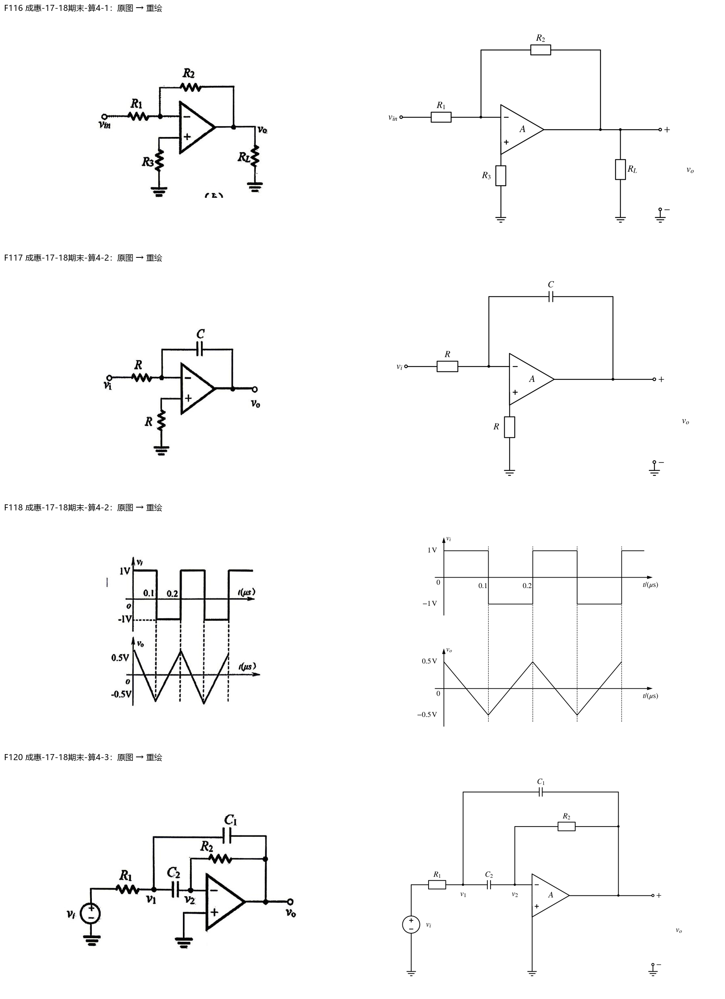

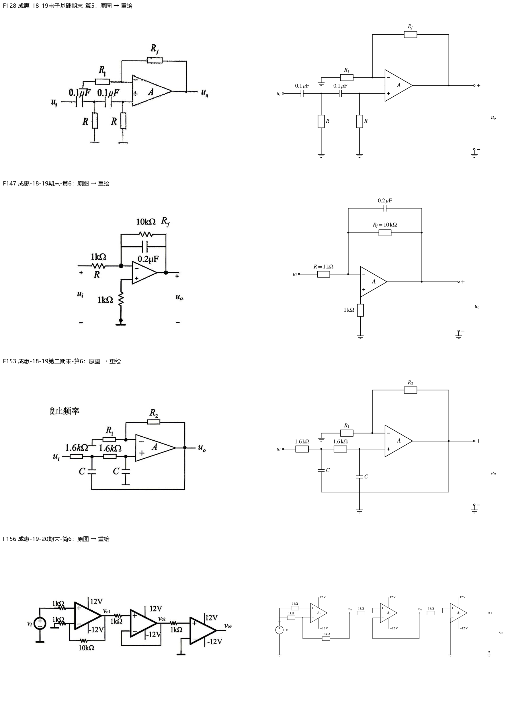

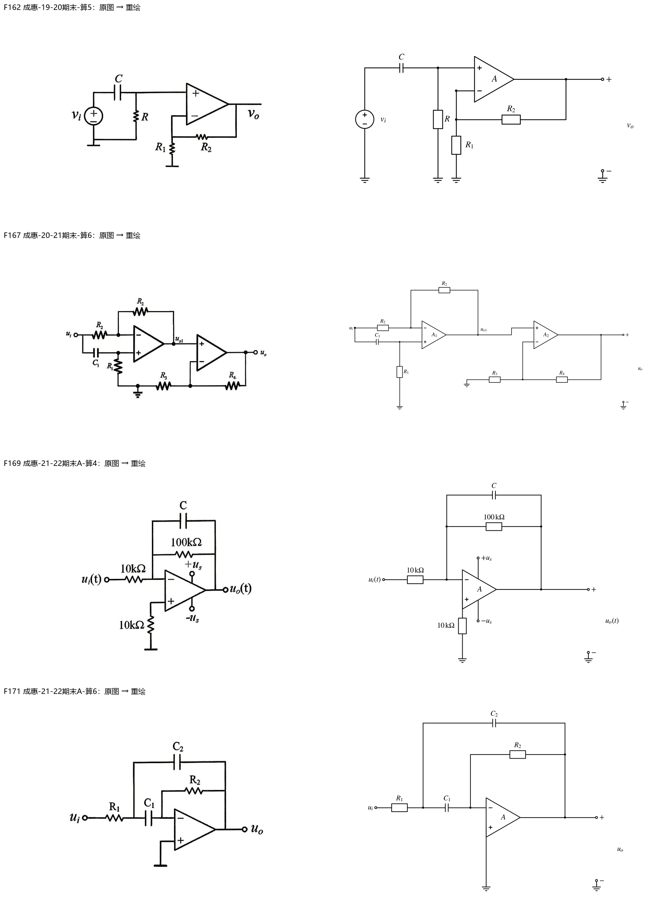

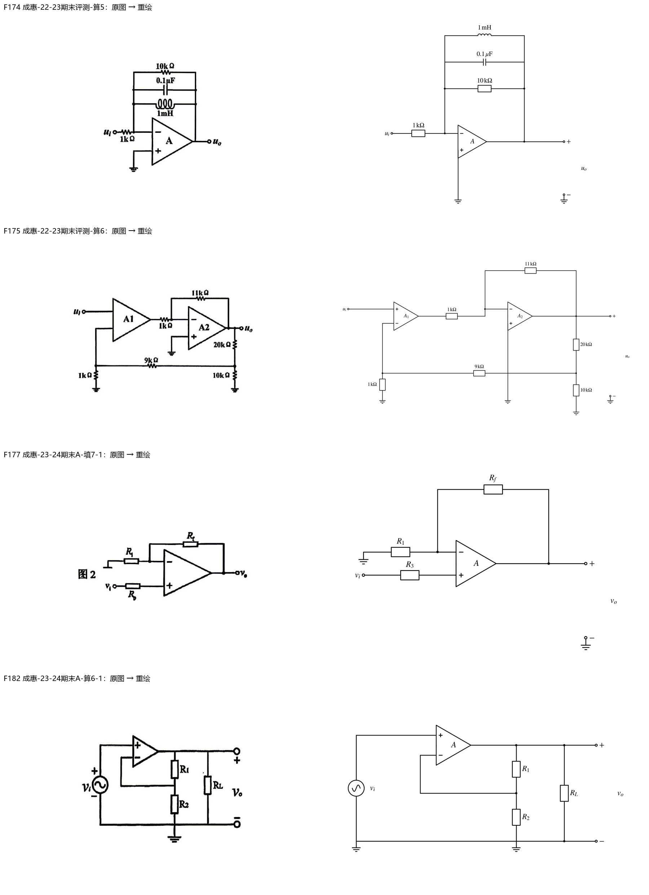

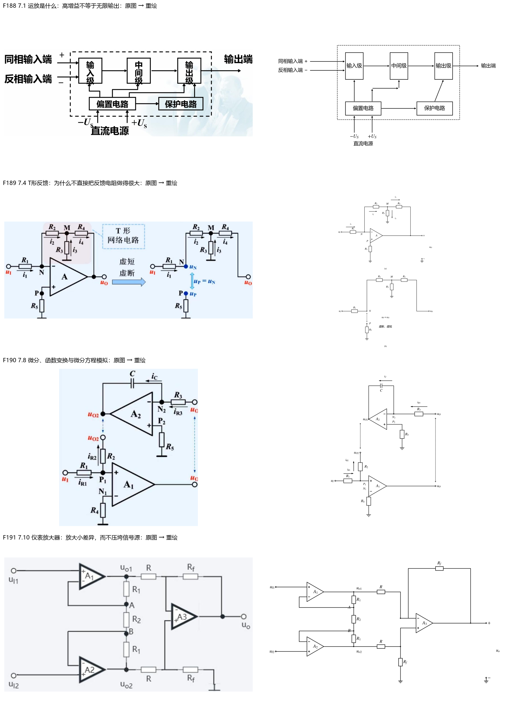

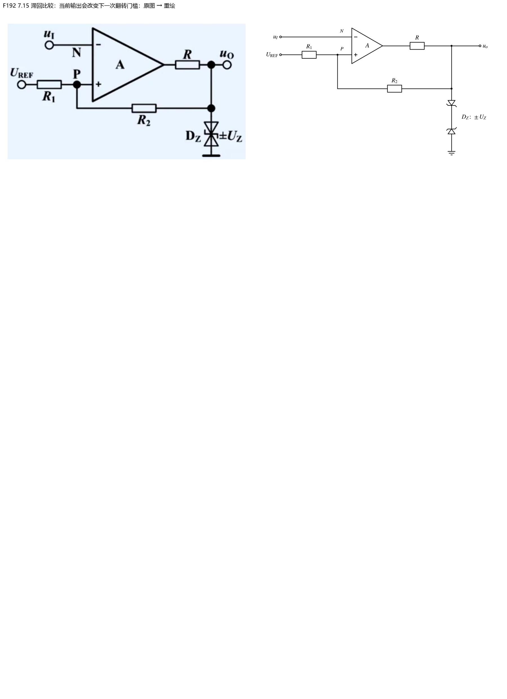

## 校验范围

图片引用、原图哈希、SVG/PNG、题面与答案逐字还原、标题锚点不变、S1及受影响入库清单通过。新增仅图像更新的S8来源绑定通过。全课程S8仍报告既存问题：临时笔记结构、整体框架旧标题链接和旧digest覆盖不足；本章不宣称这些旧问题已修复。
