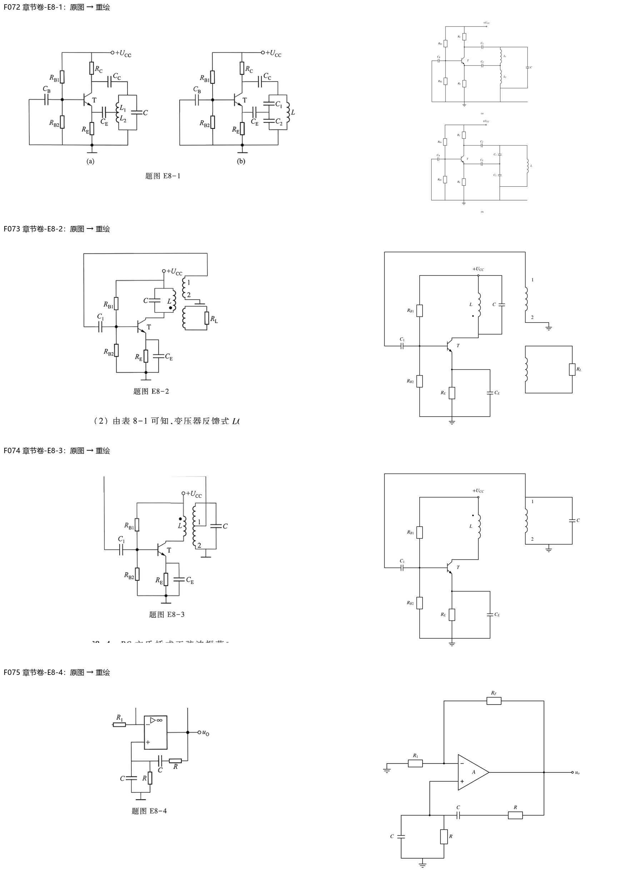
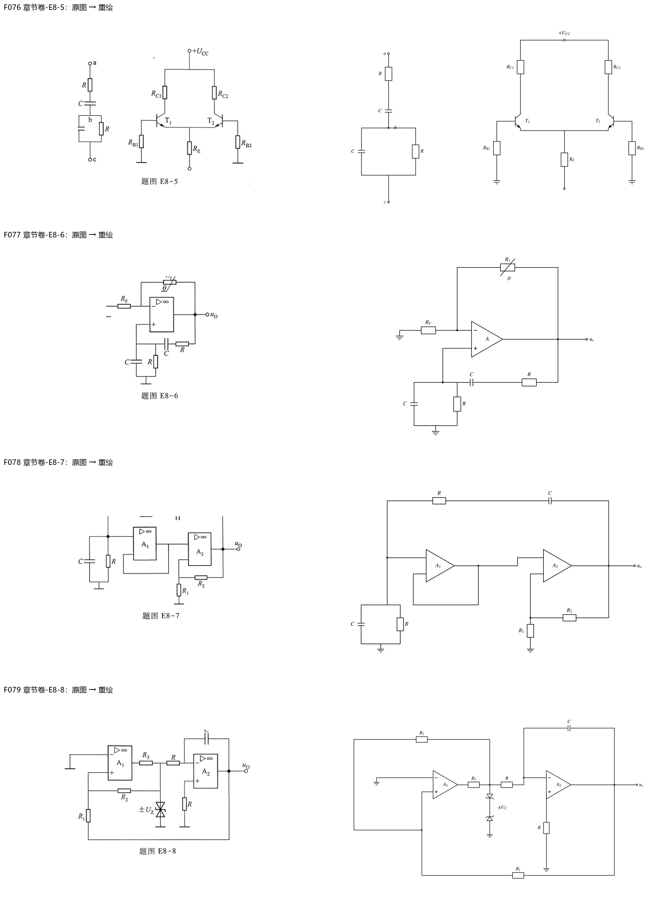
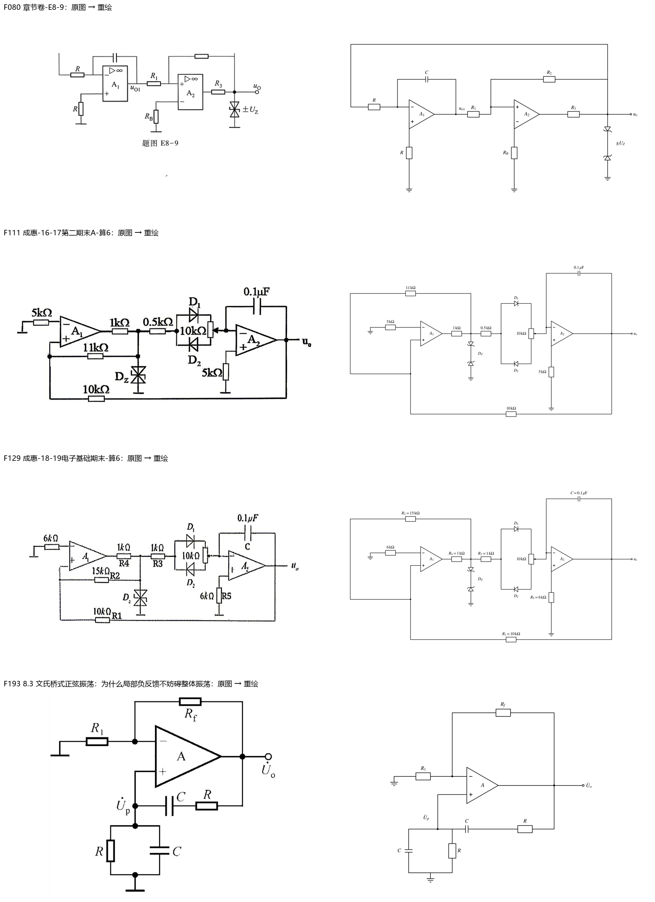
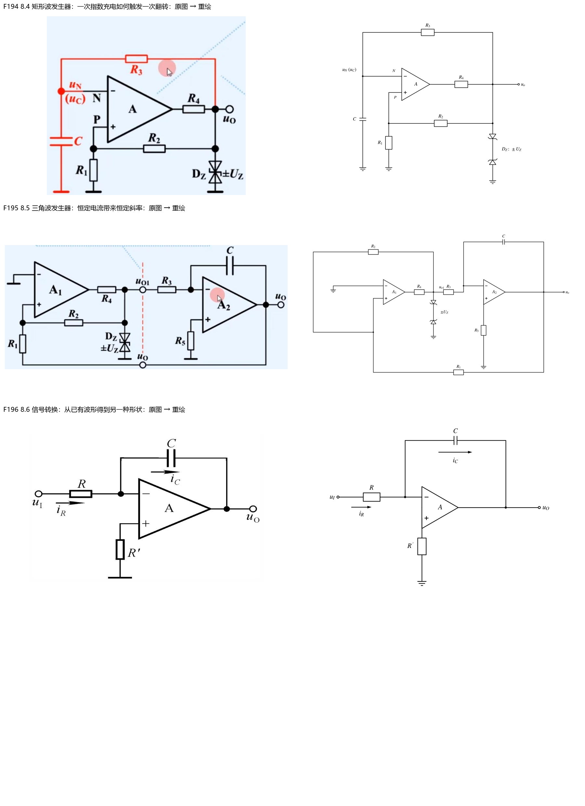

> 派生文件，可重新生成，勿手改。

# 第8章：图像重绘与核验

15张正式引用图已重绘；0张保留原图待确认；0张复用此前已核验矢量稿；0张原答案截图保留证据。STIX数学字体、黑白、IEC电阻符号；可编辑Python源、SVG及PNG均保留。仅替换图片引用，题面、答案、标题锚点与标签逐字保留。

[台账与原图SHA](../../10_题库/assets/chapter-redraw/ch08/ledger.json) · [核验记录](../../10_题库/assets/chapter-redraw/ch08/validation.json) · [可编辑源](../../10_题库/assets/chapter-redraw/ch08/generate.py)

复杂多子图在窄屏须放大查看；320px灰度缩图用于检查结构与遮挡，不宣称所有细小数值在此宽度可读。

| 图 | 所在题目 | 核验结果 |
|---|---|---|
| F072 | 章节卷-E8-1 | 两幅共基LC：CB接基极交流地，CC从集电极到谐振上端，CE从发射极到L1/L2或C1/C2中点；RE/RB1/RB2/RC及公共地保留，不把抽头短接地。；verified |
| F073 | 章节卷-E8-2 | E8-2原题初级同名点在下端；上次级1/2端尚未标同名端，不补作答黑点；独立负载绕组与RL保留，反馈1端经C1接基极、2端地。；verified |
| F074 | 章节卷-E8-3 | E8-3初级同名点在电源上端；次级1端经C1回基极、2端地，次级与C并联；不把参考解新加的次级黑点写进题图，不在图中改写有争议的C单位。；verified |
| F075 | 章节卷-E8-4 | 从完整物理279页恢复RF负反馈：R1接地、RF回输出；输出到正端为C/R串联，正端到地为R∥C。旧裁图缺顶部不可沿用。；verified |
| F076 | 章节卷-E8-5 | RC网络a/b/c与差分级保持原题未接状态：上串RC、下并RC；两NPN共发射极/RE到开口电源端，RC1/RC2接+UCC，RB1/RB2各地；不代填连接答案。；verified |
| F077 | 章节卷-E8-6 | 完整物理281页确认RF为接地支路、R1为带θ标记热敏反馈电阻；文氏桥仍为串联CR和并联RC，未对调RF/R1。；verified |
| F078 | 章节卷-E8-7 | 完整原题E8-7两运放均未标±，重绘保持空白；A1下输入回自身输出、上输入接并联RC节点；A2下输入R1地/R2输出，上输入接A1输出，顶部R/C串联回路齐全。；verified |
| F079 | 章节卷-E8-8 | E8-8：比较器负端地/正端R1接最终输出、R2接钳位节点，输出经R3限流；钳位节点再经R入A2负端、C反馈、正端R地；外反馈回最终三角波输出。；verified |
| F080 | 章节卷-E8-9 | E8-9第一级负端R输入/C反馈、正端R地；第二级上正下负，uo1经R1、钳位后uo经R2同接正端，负端RB地，R3输出限流；最终uo回第一级R输入，保留原振荡闭环。；verified |
| F111 | 成惠-16-17第二期末A-算6 | 锯齿波题：5k负端地、1k限流、0.5k串联；D1朝右/D2朝左分别接10k电位器两端，滑端送积分器；11k正反馈、10k外反馈、5k正端地、0.1μF均照录。；verified |
| F129 | 成惠-18-19电子基础期末-算6 | 另一年份：6k负端地、R4=1k/R3=1k、R2=15k/R1=10k/R5=6k、C=0.1μF；D1/D2接电位器两端且方向相反，滑端接A2负端；不混入上一年份0.5k/11k。；verified |
| F193 | 8.3 文氏桥式正弦振荡：为什么局部负反馈不妨碍整体振荡 | 文氏桥知识图RF负反馈/R1地，输出经串联C/R回正端，正端并联R/C到地；保留相量Up，移除背景截图。；verified |
| F194 | 8.4 矩形波发生器：一次指数充电如何触发一次翻转 | 矩形波源R3从限幅输出回负端电容C节点；正端R1地/R2正反馈、输出R4串接双向DZ；所有连接使用黑线/节点，不依赖原红色高亮或鼠标标记。；verified |
| F195 | 8.5 三角波发生器：恒定电流带来恒定斜率 | 方波/三角波互反馈：A1负端地、R4到钳位方波uo1，经R3入A2积分，C反馈/正端R5地；R2局部正反馈、R1最终输出反馈，原开口节点语义保留为同网导线。；verified |
| F196 | 8.6 信号转换：从已有波形得到另一种形状 | 方波转三角波积分器：R输入、C反馈、正端R′地；iR向右、iC反馈线向右，保留源变量撇号与箭头方向。；verified |

## 校验范围

图片引用、原图哈希、SVG/PNG、题面与答案逐字还原、标题锚点不变、S1及受影响入库清单通过。新增仅图像更新的S8来源绑定通过。全课程S8仍报告既存问题：临时笔记结构、整体框架旧标题链接和旧digest覆盖不足；本章不宣称这些旧问题已修复。
