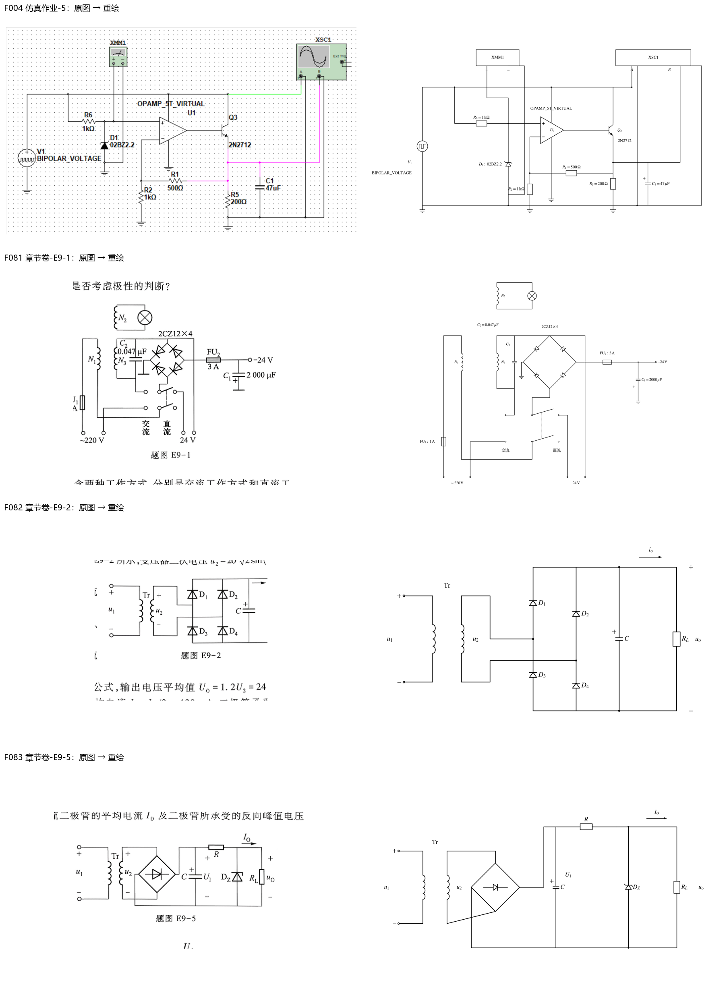
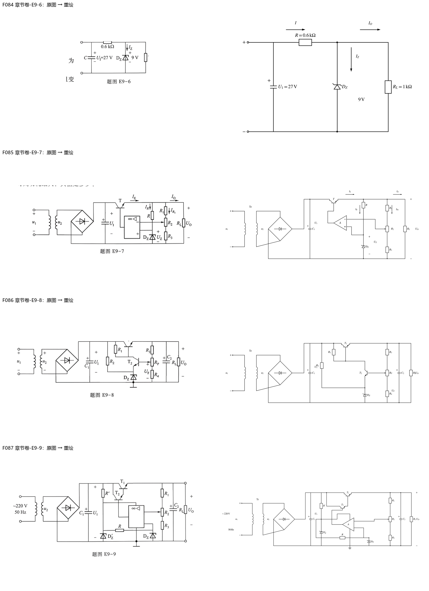
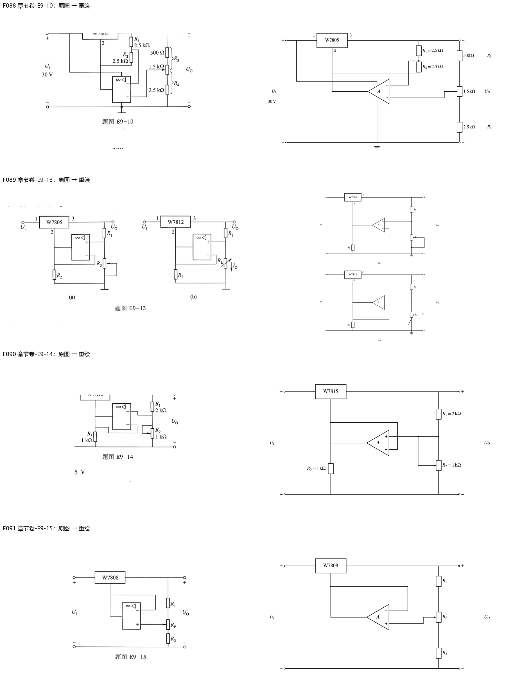
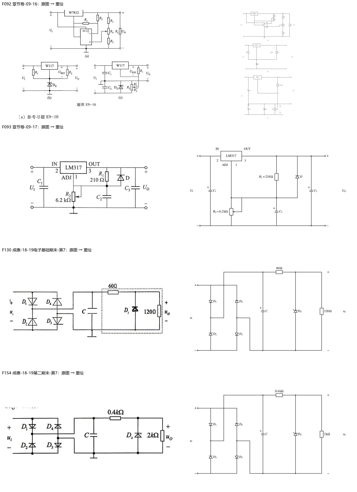
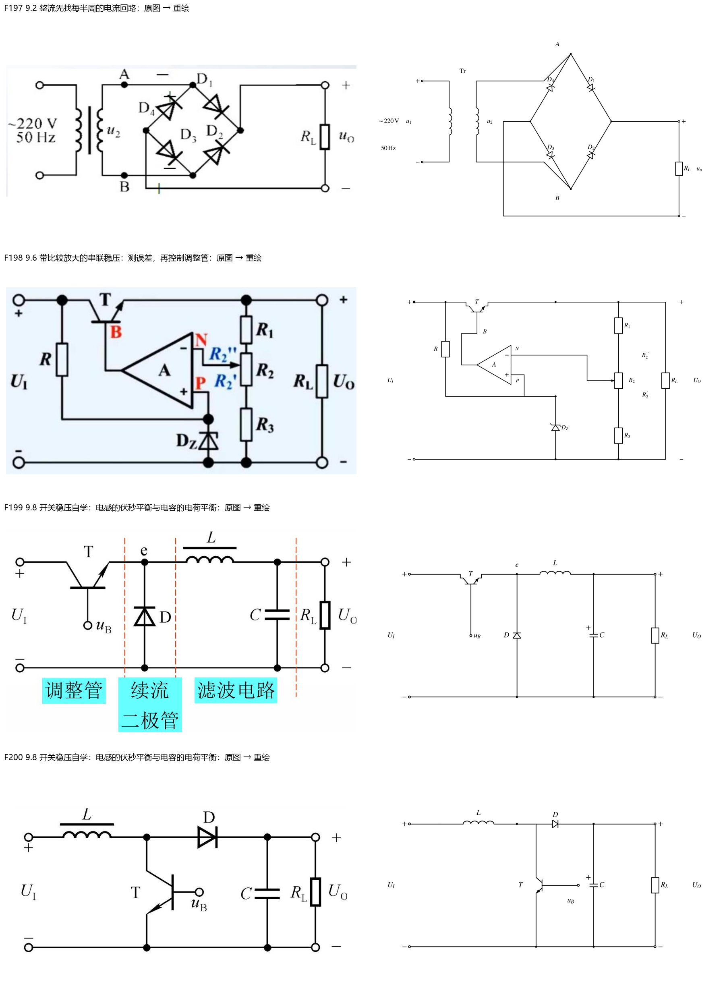

> 派生文件，可重新生成，勿手改。

# 第9章：图像重绘与核验

20张正式引用图已重绘；0张保留原图待确认；0张复用此前已核验矢量稿；0张原答案截图保留证据。STIX数学字体、黑白、IEC电阻符号；可编辑Python源、SVG及PNG均保留。仅替换图片引用，题面、答案、标题锚点与标签逐字保留。

[台账与原图SHA](../../10_题库/assets/chapter-redraw/ch09/ledger.json) · [核验记录](../../10_题库/assets/chapter-redraw/ch09/validation.json) · [可编辑源](../../10_题库/assets/chapter-redraw/ch09/generate.py)

复杂多子图在窄屏须放大查看；320px灰度缩图用于检查结构与遮挡，不宣称所有细小数值在此宽度可读。

| 图 | 所在题目 | 核验结果 |
|---|---|---|
| F004 | 仿真作业-5 | 仿真原图按节点核对：V1供Q3集电极和U1正电源，U1负电源地；R6=1k/D1=02BZ2.2参考，U1正端参考/负端500Ω+1k分压，Q3=2N2712、R5=200Ω、C1=47μF；XMM1跨参考、XSC1 A测输入/B测输出且回路地，保留原型名称与探测连接，不生成答案波形。；verified |
| F081 | 章节卷-E9-1 | 完整E9-1：N2独立照明、N3/C2、四管桥输出右端−24V/C1正极地；双刀转换开关下方直流触点本来开口，保持开口；FU1=1A/FU2=3A及24V外接端/220V输入照录，不将交流输入误作输出档。；verified |
| F082 | 章节卷-E9-2 | E9-2完整图：D1/D3左桥臂、D2/D4右桥臂均上阴极；次级分别接两中点，交叉处无接点；C正极上、RL并输出，io向右。；verified |
| F083 | 章节卷-E9-5 | E9-5整流包、C滤波后R串联，DZ阴极上与RL并联；保留变压器u1/u2、U1及IO，未把题干数值或答案回填图中。；verified |
| F084 | 章节卷-E9-6 | 27V输入、0.6kΩ串R、9V DZ反偏、1kΩRL并接，原图I/IO向右、IZ向下；输入符号按原双线源保留为电容状源标识。；verified |
| F085 | 章节卷-E9-7 | E9-7集成比较稳压：NPN串联T，输出经R到DZ基准，运放正端基准/负端电位器R2滑端；R1/R2/R3全分压、RL及IE/IR/IR1/IO原方向照录。；verified |
| F086 | 章节卷-E9-8 | E9-8 NPN T1调整/T2比较，T2基极取RP滑端、发射极接DZ基准；R1由输入到T1基极/T2集电极，R2由输入供DZ；R3/RP/R4输出采样、C1/C2滤波完整。；verified |
| F087 | 章节卷-E9-9 | E9-9原题要求标运放同/反相，故两输入端不预填±；复合NPN T1/T2、R′/DZ′电源、R/DZ参考、R1/R2/R3滑动采样和C1/C2均照题，供电脚与信号脚独立，未用参考解替题图。；verified |
| F088 | 章节卷-E9-10 | E9-10恢复W7805完整电路；输出到采样R1=2.5k、采样到公共端R2=2.5k，负端取中点；正端取右侧1.5k电位器滑端，上500Ω/下2.5k；R3/R4为滑动分段，不反填计算结果。；verified |
| F089 | 章节卷-E9-13 | E9-13(a)W7805、R3滑端短下端；(b)W7812、RL可调并标IO向下；两运放上正下负、输出接稳压器公共脚并回负端，R2从公共脚到地。1/2/3引脚照图。；verified |
| F090 | 章节卷-E9-14 | E9-14完整页恢复W7815；R1=2k、R2=1k、R3=1k，R2滑端回上端；运放上正下负跟随、输出接公共端，R3泄放地，未漏短接线。；verified |
| F091 | 章节卷-E9-15 | E9-15 W7808、R1/RP/R2串采样，RP滑端入正端，负端回公共脚/运放输出；无额外R3泄放，不套上一题结构。；verified |
| F092 | 章节卷-E9-16 | E9-16三幅完整：a为W7812、R2输出/R1公共端、正端取R4滑端及RL；b为W117+DZ参考/R1输入供电/R2输出至ADJ；c地在两输入电容中点，输出负端同该地，DZ跨下半电源，R2滑端回ADJ、下端接输入负端，R2′/R2″保留。；verified |
| F093 | 章节卷-E9-17 | LM317引脚IN=2/OUT=3/ADJ=1按原图；R1=210Ω、R2标6.2kΩ可调且滑端回ADJ；C1输入/C2旁路/C3输出，保护D阳极ADJ、阴极OUT。题干另指定3kΩ计算时不改原图标值。；verified |
| F130 | 成惠-18-19电子基础期末-算7 | 原卷桥式矩形接法：D1朝下/D2朝上、D4朝上/D3朝下；交流加上下母线、直流从两中点取出；C滤波、60Ω串联、DZ阴极输出/120Ω负载，数值与方向全保留。；verified |
| F154 | 成惠-18-19第二期末-算7 | 同矩形整流拓扑独立对源核验，后级0.4kΩ及2kΩ，不能复用上一题60Ω/120Ω数值；C正上、DZ阴极上，交叉无连接。；verified |
| F197 | 9.2 整流先找每半周的电流回路 | 桥式整流知识图：A/B为次级交流端，D1/D2阴极汇右正输出，D3/D4阳极汇左负输出；RL跨直流两端，未把B误接负输出。；verified |
| F198 | 9.6 带比较放大的串联稳压：测误差，再控制调整管 | 串联比较稳压知识图T基极B由运放驱动，正端P接DZ基准、负端N取R2滑端；R2上下段R2″/R2′及输入/输出极性保留，R从输入供基准。；verified |
| F199 | 9.8 开关稳压自学：电感的伏秒平衡与电容的电荷平衡 | Buck原理：NPN集电极接输入、发射极开关节点e，L串输出；续流D阳极地/阴极e；C与RL并联输出，基极uB开口控制，黑白分区不依赖原底色。；verified |
| F200 | 9.8 开关稳压自学：电感的伏秒平衡与电容的电荷平衡 | Boost原理：输入串L到开关节点，D阳极节点/阴极输出；NPN集电极节点、发射极地、基极uB，C/RL并输出；不画成Buck续流方向。；verified |

## 校验范围

图片引用、原图哈希、SVG/PNG、题面与答案逐字还原、标题锚点不变、S1及受影响入库清单通过。新增仅图像更新的S8来源绑定通过。全课程S8仍报告既存问题：临时笔记结构、整体框架旧标题链接和旧digest覆盖不足；本章不宣称这些旧问题已修复。
