# 电子线路期末复习

## 一、半导体二极管

① 掌握二极管单向导通特性，利用单向导通特性分析整流、检波、限幅电路的输出波形等。分析方法：a) 图解法；b) 等效电路法和微变等效电路。

② 二极管的三种数学模型。（原稿此处仅列标题和括号，未展开。）

③ 稳压二极管及稳压电路。

### 习题

(1) 整流的目的是 ______。

(2) 全波整流电路中利用了二极管 ______ 的特性，将交流变换为直流，而在稳压电路中，则是利用了二极管工作在 ______ 状态下，在一定电流范围内起到稳压的特性。

(3) 哪个不属于半导体的特性？

a) 热敏性；b) 光敏性；c) 单向导电性；d) 可掺杂性。

(4) 判断二极管的工作状态：$D_1$：______；$D_2$：______。

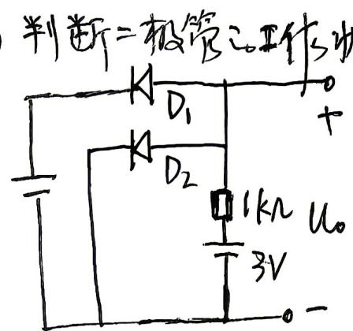

(5) PN 结加正向电压时，空间电荷区将（　）。

(6) 稳压管的稳压是工作在 ______。

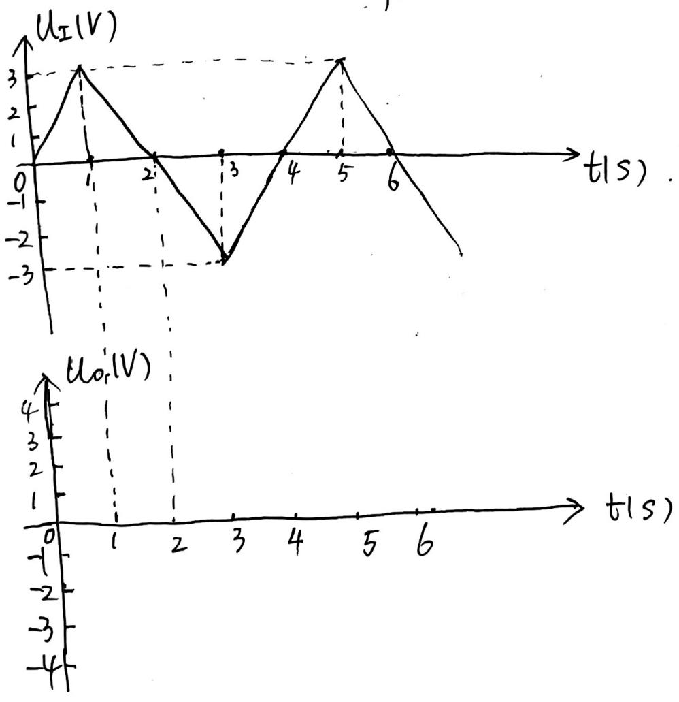

(7) 放大器 A 供电电压为 $\pm15\,\mathrm{V}$，$D_{z1}$、$D_{z2}$ 的稳压值为 $5\,\mathrm{V}$，导通压降为 $0.7\,\mathrm{V}$，则输出电压 $U_o$ 的电压范围为（　）。

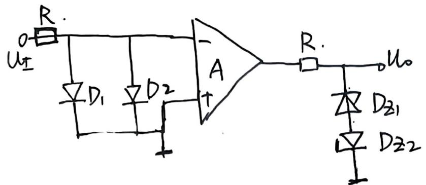

(8) 工作在放大区的某晶体管，当 $I_B$ 从 $12\,\mu\mathrm{A}$ 增大到 $22\,\mu\mathrm{A}$ 时，$I_C$ 从 $1\,\mathrm{mA}$ 变为 $2\,\mathrm{mA}$，那么它的 $\beta$ 约为（　）。

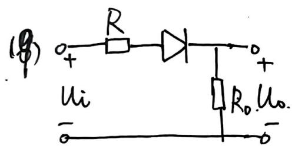

补充波形题（原稿题号涂改）：假设二极管等效为理想二极管和 $1\,\mathrm{V}$ 电压源的串联，$u_i$ 输入波形如图所示，画出 $u_o$ 的波形。

## 二、基本放大电路

1. 晶体管的工作原理及电流放大作用，晶体管的共射特性曲线。
   温度对晶体管特性及参数的影响。（原稿此行标“8”。）
2. 场效应管（JFET、MOSFET）的工作原理、转移特性和输出特性。
3. 放大电路的工作原理。
4. 晶体管放大电路的三种接法及各自特点。
5. 场效应管放大电路的三种接法，尤其是共源、共漏。
6. 基本放大电路的分析方法，尤其是用等效电路法：静态分析和动态分析，求参数值，画等效电路。
7. 差分放大电路的分析。
8. 功率放大电路。
9. 负反馈及深度负反馈放大倍数分析，负反馈对放大电路性能的影响。

（也可以比较学习一下放大电路中正反馈的产生条件。）

### 习题

1. NPN 型 BJT，测得 $U_C=2.3\,\mathrm{V}$，$U_B=2.7\,\mathrm{V}$，$U_E=2\,\mathrm{V}$，则该晶体管工作状态是 ______。
2. 晶体三极管是依靠 ______ 来控制集电极电流，是一种 ______ 控制器件。
3. MOSFET 管工作在放大状态的外部两个条件是 ______ 且 ______。
4. MOSFET（N 增强型）三极管可变电阻区和饱和区（恒流区）的分界线为 ______。
5. 基于场效应管构成的放大电路中，场效应管的工作区域为 ______。
6. 为了实现尽可能大的电压放大倍数，通常选用（　）基本放大电路。
7. 差分放大电路的作用是（　）。
8. OCL 功率放大电路的结构是（　）。
9. 与甲类功率放大电路比较，乙类功率放大电路的主要优点是（　）。
10. 为了实现尽可能大的输入电阻，通常选用（　）基本放大电路。
11. 放大电路中交直流信号同时存在，分析放大电路的方法是（　）。
12. 放大电路中，若静态工作点设置不合理，可能会出现的失真有（　）和（　）。
13. 放大电路的频率响应包括（　）和（　），其频率响应曲线的对数化坐标表示称为（　）。
14. 双端差分放大电路的两个电压分别为 $u_{i1}=3\,\mathrm{V}$、$u_{i2}=2.98\,\mathrm{V}$，则差模电压、共模输入电压为（　）。
15. 负反馈对输入电阻的影响取决于基本放大电路与反馈网络在电路输入端的连接方式。引入（　），使引入反馈支路的等效电阻增大到基本放大电路的（　）倍。
16. 负反馈对输出电阻的影响取决于基本放大电路与反馈网络在放大电路输出端的连接方式。引入（　），使得引入反馈支路的等效电阻增大到基本放大电路的（　）倍。
17. 为了稳定静态工作点，应引入（　）；为了改善电路的动态性能，应引入（　）。
18. 当信号源为恒流源或内阻很大的电压源时，为了减小放大电路的输入电阻，使电路获得更大的输入电流，应引入（　）负反馈。
19. 下图 (b) 是 (a) 图经过变换后的等效电路，请分析图 (b)：(1) $+U'_{CC}$ 和 $R'$ 分别是多少？(2) 等效变换的理论依据是什么？(3) 该电路属于哪种基本放大电路？

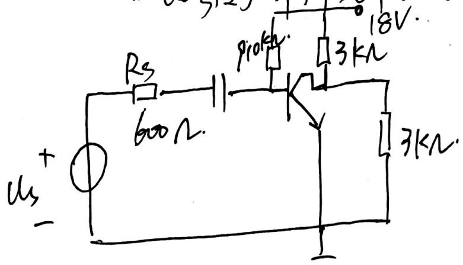

(a)

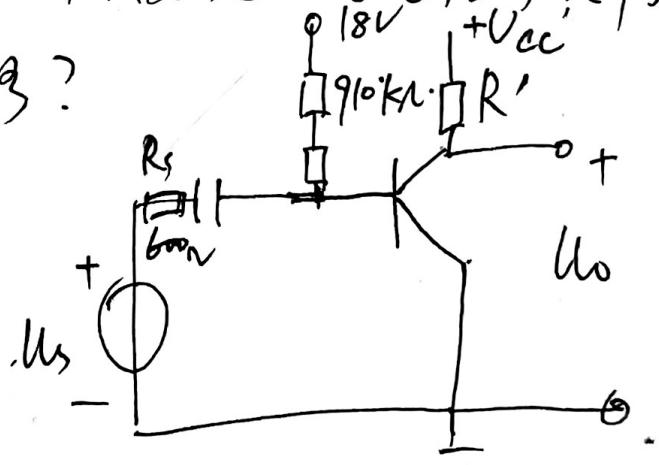

(b)

20. 基于 BJT 构成的放大电路静态工作点对温度敏感，请简述下图所示电路引入 $R_e$ 后稳定静态工作点的机理。稳定放大电路静态工作点还有哪些方法？

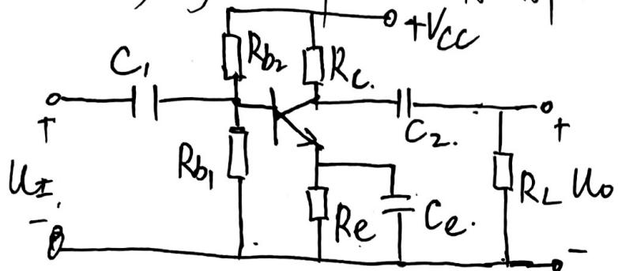

21. 图示共源放大电路，已知 $V_{GG}=6\,\mathrm{V}$、$V_{DD}=12\,\mathrm{V}$、$R_g=2\,\mathrm{M}\Omega$、$R_d=3\,\mathrm{k}\Omega$、$U_{GS(th)}=4\,\mathrm{V}$，则静态电压 $U_{GSQ}=$ ______。

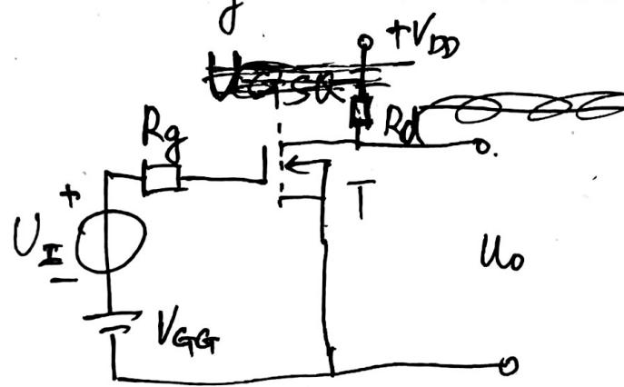

22. BJT 与 MOSFET 的区别？
23. 关于基本放大电路的分析和计算，参考 PPT 上的例题。

## 一、答案（原稿参考，未作 S9 裁决）

(1) 将交流变换为直流。
(2) 单向导电性；反偏。
(3) C。
(4) $D_1$ 截止，$D_2$ 导通。
(5) 变窄。
(6) 反向击穿区。
(7) 原稿有涂改，保留第 7 页原图，不将涂改字迹作为确定答案。
(8) 100。

补充问题（原稿标“16”，第 8 页）：从能量的角度看，放大电路为什么可以放大信号的功率？放大电路的技术性能指标有哪些？

10. 集成运算放大电路由（　）（　）（　）（　）和保护电路 5 部分组成。
11. 当放大器频率处于通频带时，放大器的电压放大倍数为 100，则当输入信号频率为截止频率时，放大器的电压放大倍数为 ______。
12. 如图，A 为理想运放，当 $u_i$ 频率趋于 0 时，输出电压 $u_o$ 与输入 $u_i$ 的关系为 ______；当 $u_i$ 的频率为 $1\,\mathrm{kHz}$ 时，输出电压 $u_o$ 与 $u_i$ 的关系为 ______。

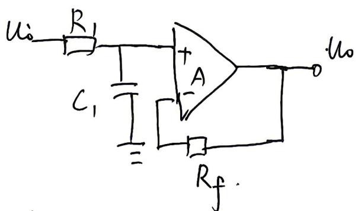

13. 如图，电路反馈组态属于（　）。

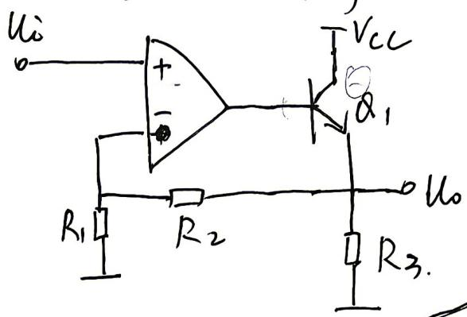

14. 如图所示运算电路是（　）（高通/低通）滤波电路，带宽与负载 $R_2$（　）（有关/无关）。

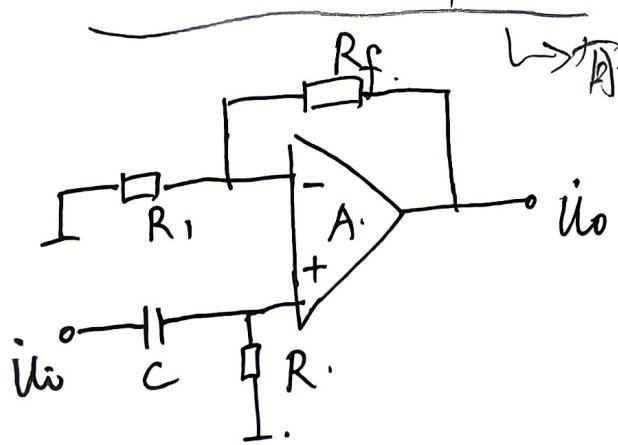

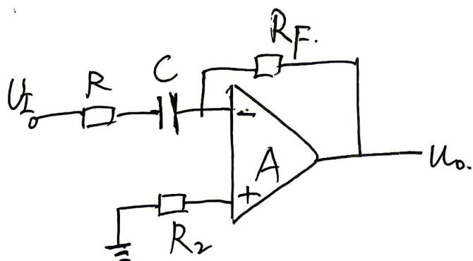

第 14 题图。补充要求：有源滤波与无源滤波的区别；分析下方电路是哪种类型滤波器。

5. 如图，求输出电压与输入电压关系为（　）。

A. $u_o=-(U_1-U_2)$；B. $u_o=U_1-U_2$；C. $u_o=-3(U_1-U_2)$；D. $u_o=3(U_1-U_2)$。

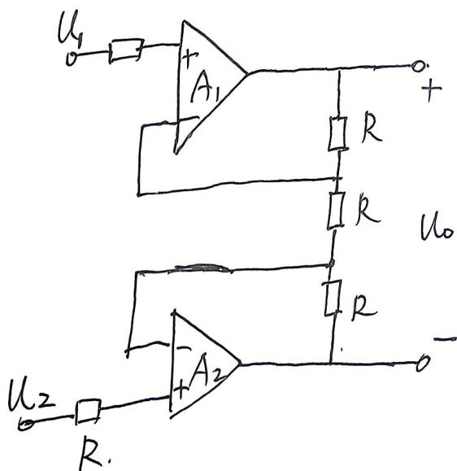

6. 理想运算放大器的电路模型特点：输入电阻为（　），输出电阻为（　），开环增益为（　）。
7. 多级放大电路常见的耦合方式有（　）（　）、光电耦合和变压器耦合。
8. 如图所示，已知 $V_{GG}=6\,\mathrm{V}$、$V_{DD}=12\,\mathrm{V}$、$R_g=2\,\mathrm{M}\Omega$、$R_d=3\,\mathrm{k}\Omega$、$U_{GS(th)}=4\,\mathrm{V}$，则静态电压 $U_{GSQ}=（　）$。

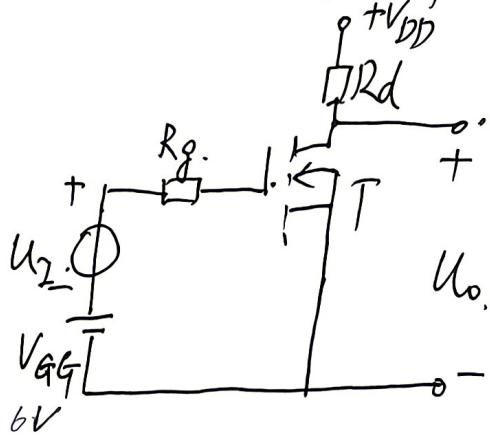

9. $R_1=R_2=5\,\mathrm{k}\Omega$，$U_{om}=12\,\mathrm{V}$，$U_{REF}=2\,\mathrm{V}$。$D_{z1}$ 和 $D_{z2}$ 的稳压电压分别为 $4\,\mathrm{V}$ 和 $6\,\mathrm{V}$，正向压降为 $0.7\,\mathrm{V}$。电路的输出正电压 $U_{oH}=$ ______，阈值电压 $U_T=$ ______。当 $U_I$ 从大于 $U_T$ 变为小于 $U_T$ 时，输出曲线变化趋势是（　）。

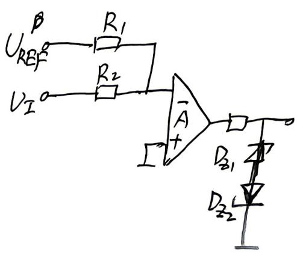

## 二、答案（原稿参考，未作 S9 裁决）

1. 饱和区。
2. 基极电流；电流。
3. $U_{GS}>U_{GS(th)}>0$，$U_{DS}>U_{GS}-U_{GS(th)}$。
4. $U_{DS}=U_{GS}-U_{GS(th)}$。
5. 饱和区，也叫恒流区。
6. 共射放大电路。
7. 抑制共模，放大差模。
8. 采用两组电源供电。
9. 效率高。
10. 共集放大电路。
11. 交直流分开。
12. 饱和、截止失真。
13. 幅频、相频、波特图。
14. 原稿写 $0.01\,\mathrm{V}$、$2.99\,\mathrm{V}$（照录，未裁决）。
15. 串联负反馈，$(1+AF)$ 倍。
16. 电流负反馈，$(1+AF)$ 倍。
17. 直流负反馈；交流负反馈。
18. 并联负反馈。

## 三、集成运放电路

1. 集成运算放大电路的组成及各部分的作用。

说明：集成运放电路（也可以说是多级放大电路）由前面的基本放大电路组成。

- 第一级要求输入电阻高、电压放大倍数大、抑制零点漂移，因此需要双端输入的高性能差分放大电路。
- 中间级需要电压放大倍数大的基本放大电路，可采用共射或共源。
- 输出级需要输出电压线性范围宽、输出电阻小（带载能力强）、非线性失真小，故需采用互补输出电路（功率放大电路）。
- 偏置电路。
- 保护电路。

上述各级电路集成在一起，形成集成运算放大器。

2. 集成运算放大器的电压传输特性（掌握）。
3. 利用“虚短”和“虚断”分析集成运算放大器在线性区的应用及电路设计。

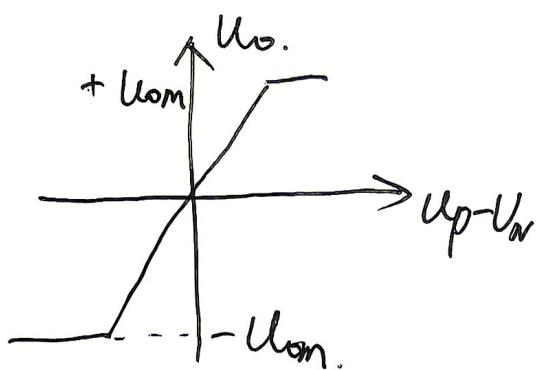

### 集成运放习题

1. A 为理想运放，其中所有电阻相等，则输出电压与输入电压关系为（　）。

A. $u_o=2U_I$；B. $u_o=-2U_I$；C. $u_o=U_I$；D. $u_o=-u_I$。

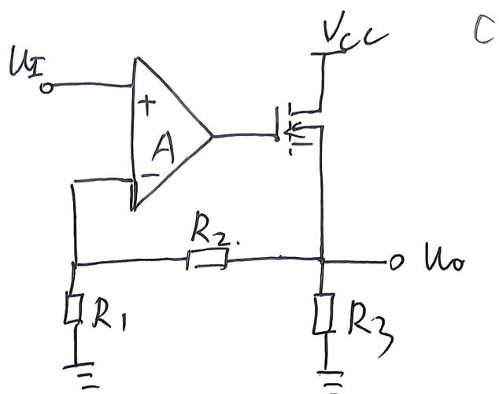

2. A 为理想运放，电容的初始电压为 0，则输出电压与输入电压关系为（　）。

A. $u_o=-RC\frac{du_I}{dt}$；B. $u_o=-\frac{1}{RC}\int u_I\,dt$；C. $u_o=U_I$；D. $u_o=0$。

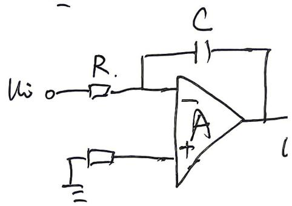

3. 输入电压 $u_i$，输出电流为 $i_o$。集成运放均工作在线性放大状态，$A_2$ 将输出电流信号反馈至输入端，则输出电流与输入电压关系为（　）。
4. A 为理想运放，其中所有电阻相等，则输出电压与输入电压的关系为（　）。

A. $u_o=-RC\frac{d(U_{I2}-U_{I1})}{dt}$；B. $u_o=RC\frac{d(U_{I2}-U_{I1})}{dt}$；C. $u_o=\frac{1}{RC}\int(U_{I2}-U_{I1})\,dt$；D. $u_o=0$。

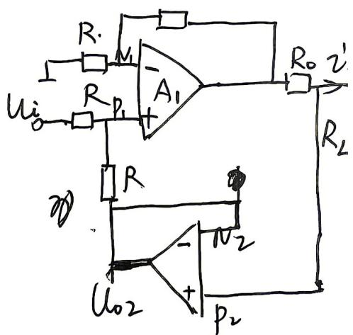

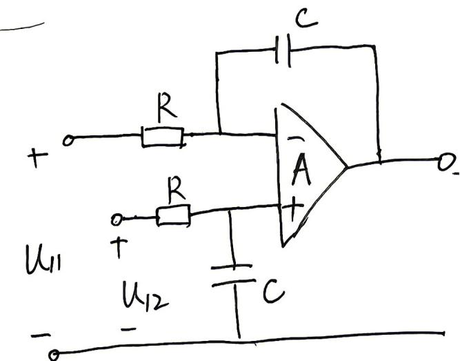

书上例 7-3-2。

① PPT 和教学大纲中要求的运算电路要掌握。
② 有源滤波电路的分析。
③ 仪表放大器。
☆4. 利用集成运放在非线性区的特性进行电路分析：① 简单比较器电路的分析及输出波形；② 迟滞比较器。
