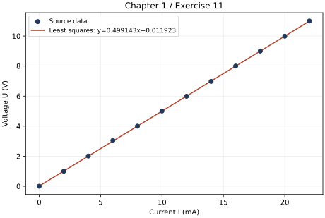
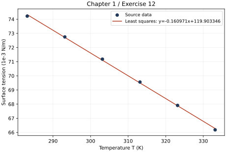

# 第一章 误差与数据处理·习题

%%
source: 结构化大学物理实验 教材练习｜第一章 误差与数据处理
paper_type: 其他
academic_year: 未知
%%

来源：[原始教材](../00_原材料/结构化大学物理实验.pdf)。题中的“本实验”、操作序号和仪器参数以相应实验原文为准。学年未知；本轮依用户指定范围归入大一分享队列，不代表教材全部实验都是大一必修。

共12题；逐题核对原PDF第60—62页（教材50—52页）。折叠解答为独立推导与数值自检，教材无所附参考答案；不确定度按第一章的均匀分布、0.2格估读约定。

### PHYSLAB-C01-Q01

%%
chapter: 第一章
question_type: 有效数字｜位数与单位换算
source: 结构化大学物理实验 教材练习｜第一章习题1｜PDF第60—61页
question_form: 简答题
ocr_status: 已对照 PDF 复核
%%

写出下列各量的有效数字位数。
(1) U = 1.000 kV; (2) l = 1.001 cm;
(3) T = 0.001 s; (4) $v = 3.90 \times 10^{3}$ m/s;

(5) L = 0.000 123 mm; (6) m = 10.010 kg;
(7) $X=(4.325\pm0.041)\mathrm{A}$ ; (8) 自然数 10。

> [!note]- 解答｜状态：独立解答未对照
> 按本章“有效数字只有一位可疑数字”的口径，(1)—(6)依次为 **4、4、1、3、3、5 位**。单位变换和前导零不改变位数，末尾记录的零要保留。
>
> (7)须区分记录位数与本书定义的有效位数：4.325写了4位数字，但不确定度0.041的首位在百分位，因此按本书第24页“误差和不确定度的有效数字”约定，测量值只计至百分位，**3位有效数字**，末尾5是额外保留位。若只按数字字符串数位会得到4，不能混用口径。
>
> (8)自然数10是精确计数，**无限多位**，不限制其他测量量的有效数字。
>
> 自检：0.000123移去定位零后只有123；10.010中的中间零和末尾零均有效。
>
> 起手：先辨认测量量、精确计数和明确给出的不确定度，再确定首位与末位。

### PHYSLAB-C01-Q02

%%
chapter: 第一章
question_type: 有效数字｜位数与单位换算
source: 结构化大学物理实验 教材练习｜第一章习题2｜PDF第61页
question_form: 计算题
ocr_status: 已对照 PDF 复核
%%

以毫米(mm)为单位表示下列各值。
0.05 m; 1.37 m; 4 cm; 6.0 μm。

> [!note]- 解答｜状态：独立解答未对照
> 保持原有效数字，依次为 $5\times10^{1}\,\mathrm{mm}$、$1.37\times10^{3}\,\mathrm{mm}$、$4\times10^{1}\,\mathrm{mm}$、$6.0\times10^{-3}\,\mathrm{mm}$。
>
> 自检：除以1000回到米时，第一项为0.05 m；最后一项乘1000回到微米时为6.0 μm。换算系数为精确值，不能凭空增加末尾零。
>
> 起手：先写精确单位换算系数，再用科学记数法保留原有效位数。

### PHYSLAB-C01-Q03

%%
chapter: 第一章
question_type: 测量结果｜规范表达
source: 结构化大学物理实验 教材练习｜第一章习题3｜PDF第61页
question_form: 简答题
ocr_status: 已对照 PDF 复核
%%

改正下列错误写法。
(1) $l=2.0\ km\pm100\ m$ ; (2) $m=(72.320\pm0.4)\ kg$ ;
(3) $v=1.23\pm0.015m/s$ ; (4) $h=27.3\times10^{4}\pm2000km$ ;
(5) $E=(1.93\times10^{11}\pm6.79\times10^{9})N/m^{2}$ ;

(6) 最小分度值为 $30^{\prime\prime}$ 的测角仪测得角度刚好为 $60^{\circ}$ 整, 测量结果表示为 $\varphi = 60^{\circ} \pm 30^{\prime\prime}$ 。

题面校正：第(6)项原PDF第61页为30″，认证转换文字曾误为30°，此处已据原图纠正。

> [!note]- 解答｜状态：独立解答未对照
> 采用本书常用的一位不确定度表示，先统一单位、把共同单位放在括号外，并使测量值末位与不确定度首位对齐：
>
> (1) $l=(2.0\pm0.1)\,\mathrm{km}$。
>
> (2) $m=(72.3\pm0.4)\,\mathrm{kg}$。
>
> (3) $v=(1.23\pm0.02)\,\mathrm{m/s}$。若保留两位不确定度供计算，可写 $(1.230\pm0.015)\,\mathrm{m/s}$，并说明额外保留位。
>
> (4) $h=(2.73\pm0.02)\times10^{5}\,\mathrm{km}$。
>
> (5) $E=(1.93\pm0.07)\times10^{11}\,\mathrm{N/m^2}$；6.79×10⁹取一位不确定度为7×10⁹。
>
> (6)原PDF的分度值为 **30″**。既然读到了角秒位，中心值也应明确相同位：$\varphi=60^{\circ}00'00''\pm30''$。这是对题给误差限的格式修正，不能仅由“分度值30″”断言实际合成不确定度就是30″；若要求计算不确定度，还需仪器误差和估读规则。
>
> 自检：(4)0.02×10⁵ km=2000 km；(6)30″=1/120°，不能误作30°。
>
> 起手：把加减号两侧单位统一，再按不确定度所在数位整理中心值。

### PHYSLAB-C01-Q04

%%
chapter: 第一章
question_type: 有效数字｜位数与单位换算
source: 结构化大学物理实验 教材练习｜第一章习题4｜PDF第61页
question_form: 计算题
ocr_status: 已对照 PDF 复核
%%

试用有效数字运算法则计算下列各题结果。
(1) $123.98 - 40.456 + 7.8$ ; (2) $\lg 10.00$ ;
(3) $789.30 \times 50 \div 0.100$ ; (4) $1.00^{2}$ ;

(5) $\frac{4.0345}{9.0121-9.011}+58.1;$ (6) $\sqrt{1.00};$

(7) $V=\pi\left(\frac{D}{2}\right)^{2}h,D=13.984\times10^{-3}\mathrm{m},h=0.005\mathrm{m}$ ，求V;
(8) $100^{2}$ 。

> [!note]- 解答｜状态：独立解答未对照
> 计算中保留保护位，最后一次取舍。
>
> (1) $123.98-40.456+7.8=91.324\to\boxed{91.3}$，加减法保留到最粗的十分位。
>
> (2) $\lg10.00=\boxed{1.0000}$，尾数小数位数与真数的4位有效数字相同。
>
> (3) $789.30\times50/0.100=394650\to\boxed{3.9\times10^5}$。这里按本书“记录末尾零有效”把50作2位测量数。
>
> (4) $1.00^2=\boxed{1.00}$；(6) $\sqrt{1.00}=\boxed{1.00}$。
>
> (5) 分母9.0121−9.011=0.0011，但其有效末位由9.011限制在0.001位，差只有1位有效数字。用未截尾的0.0011计算得3725.827…，最后按千位表示为 $\boxed{4\times10^3}$。不可先把0.0011粗略截为0.001后再把商写成多位。
>
> (7) $V=\pi(13.984\times10^{-3})^2(0.005)/4=7.6793\times10^{-7}\,\mathrm{m^3}$，h只有1位，故 $\boxed{V=8\times10^{-7}\,\mathrm{m^3}}$。
>
> (8) 按本书第27页将100视为3位测量数，则 $\boxed{100^2=1.00\times10^4}$。若题中的100另指精确自然数，平方仍精确；本题未另行说明，采用本章乘方例子的口径。
>
> 自检：(3)量级约800×500=4×10⁵；(7)半径约7 mm、高5 mm，体积约770 mm³，与7.7×10⁻⁷ m³一致。
>
> 起手：先找每一步的末位或最少有效位数，保留保护位到最后再截尾。

### PHYSLAB-C01-Q05

%%
chapter: 第一章
question_type: 不确定度｜函数传播
source: 结构化大学物理实验 教材练习｜第一章习题5｜PDF第61页
question_form: 计算题
ocr_status: 已对照 PDF 复核
%%

计算下列结果。

(1) $N=A+B-\frac{1}{3}C$ ，已知： $A=(0.5768\pm0.0002)\mathrm{cm},B=(85.07\pm0.02)\mathrm{cm},C=(3.247\pm0.002)\mathrm{cm};$

(2) $V=(1\ 000\pm1)\mathrm{cm}^{3}$ ,求 $\frac{1}{V}$ ;

(3) $R = \frac{a}{b} x$ , 已知: $a = (13.65 \pm 0.12) \, \text{cm}, b = (10.871 \pm 0.035) \, \text{cm}, x = (67.0 \pm 0.58) \, \Omega$ ;

(4) $v=\frac{h_{1}}{h_{1}-h_{2}}$ ，已知： $h_{1}=(45.51\pm0.02)\mathrm{cm},h_{2}=(12.20\pm0.02)\mathrm{cm};$

(5) $x=18^{\circ}12',x$ 的不确定度是 $1'\approx0.0003\ rad$ ，求 $\cos18^{\circ}12'$ 的有效数字。

> [!note]- 解答｜状态：独立解答未对照
> 把题给各“±”值视为互相独立的标准不确定度，使用一阶方和根传播；若它们实际表示误差限，需先换成标准不确定度，不能直接套用以下数值。
>
> (1) $N=A+B-C/3=84.5644667\,\mathrm{cm}$，$u_N=\sqrt{0.0002^2+0.02^2+(0.002/3)^2}=0.0200121\,\mathrm{cm}$。故 $\boxed{N=(84.56\pm0.02)\,\mathrm{cm}}$。
>
> (2) $Y=1/V=0.001000\,\mathrm{cm^{-3}}$，$u_Y=u_V/V^2=10^{-6}\,\mathrm{cm^{-3}}$。故 $\boxed{Y=(1.000\pm0.001)\times10^{-3}\,\mathrm{cm^{-3}}}$。
>
> (3) $R=ax/b=84.127495\,\Omega$，$u_R=R\sqrt{(0.12/13.65)^2+(0.035/10.871)^2+(0.58/67.0)^2}=1.072715\,\Omega$。可写 $\boxed{R=(84\pm1)\,\Omega}$；计算保留形式为(84.1±1.1) Ω。
>
> (4) 不能把分子和分母当成独立量，因为都含h₁。令 $d=h_1-h_2$，则 $\partial v/\partial h_1=-h_2/d^2$，$\partial v/\partial h_2=h_1/d^2$。所以 $v=1.36625638$，$u_v=\sqrt{(h_2u_{h_1})^2+(h_1u_{h_2})^2}/d^2=0.000849292$，$\boxed{v=1.3663\pm0.0008}$。
>
> (5) $x=18.2^{\circ}$，$\cos x=0.94997205$；传播时角度不确定度必须用弧度，$u_{\cos x}=|\sin x|u_x\approx9.37\times10^{-5}$。首位在小数后第4位，故函数值记作 $\boxed{0.9500}$，4位有效数字。
>
> 自检：(2)体积相对不确定度0.1%，倒数也为0.1%；(4)对两个原始变量作数值微扰，导数符号与上述式子一致。
>
> 起手：把目标量写成互相独立的原始测量量的函数，再分别求偏导数。

### PHYSLAB-C01-Q06

%%
chapter: 第一章
question_type: 不确定度｜函数传播
source: 结构化大学物理实验 教材练习｜第一章习题6｜PDF第61页
question_form: 计算题
ocr_status: 已对照 PDF 复核
%%

分别写出下列各式的不确定度传递公式。
(1) $N=x+y-2z$ ; (2) $N=\frac{x-y}{x+y}$ ; (3) $N=\frac{V}{\sqrt{1+at}}$ (a为常数);
(4) $V=\frac{\pi d^{2}h}{4}$ ; (5) $N=\frac{1}{A}(B-C)^{2}D^{2}-\frac{1}{2}F$ 。

> [!note]- 解答｜状态：独立解答未对照
> 以下各原始输入量相互独立，$u_x$等表示其标准不确定度，a、π及数字系数为精确常数。若输入相关，还需加入协方差项。
>
> (1) $u_N^2=u_x^2+u_y^2+4u_z^2$。
>
> (2) $u_N^2=\dfrac{4y^2u_x^2+4x^2u_y^2}{(x+y)^4}$，其中$x+y\ne0$。
>
> (3) $u_N^2=\dfrac{u_V^2}{1+at}+\dfrac{a^2V^2u_t^2}{4(1+at)^3}$，其中$1+at>0$；V是输入量，N是输出量。
>
> (4) $u_V^2=\left(\dfrac{\pi dh}{2}\right)^2u_d^2+\left(\dfrac{\pi d^2}{4}\right)^2u_h^2$。非零时等价为$(u_V/V)^2=4(u_d/d)^2+(u_h/h)^2$。
>
> (5)令 $Q=B-C$，但求导仍以A、B、C、D、F为独立量，$A\ne0$：
>
> $$
> u_N^2=\frac{Q^4D^4}{A^4}u_A^2+\frac{4Q^2D^4}{A^2}(u_B^2+u_C^2)+\frac{4Q^4D^2}{A^2}u_D^2+\frac14u_F^2.
> $$
>
> 自检：(1)系数−2在平方后为4；(2)交换x、y只改变N符号，方差式保持相同形式；(5)Q=0时前四个一阶灵敏系数为0，只余F项。这不表示有限误差严格为0，而是该点一阶近似失去对二阶项的描述。
>
> 起手：逐项计算偏导数，将“偏导×输入不确定度”平方后相加。

### PHYSLAB-C01-Q07

%%
chapter: 第一章
question_type: 仪器读数｜分辨率与误差位
source: 结构化大学物理实验 教材练习｜第一章习题7｜PDF第61—62页
question_form: 选择题
ocr_status: 已对照 PDF 复核
%%

找出下列正确的数据记录。
(1)用分度值为0.05 mm的游标卡尺测物体的长度如下:
32.50 mm, 32.48 mm, 43.25 mm, 32.5 mm, 32.500 mm。
(2)用分度值为0.02 mm的游标卡尺测物体的长度如下:
45.22 mm, 52.78 mm, 64.05 mm, 84 mm, 73.464 mm。

(3)用分度值为0.01 mm的螺旋测微计测物体的长度如下：

0.50 mm, 0.5 mm, 0.500 mm, 0.500 0 mm, 0.324 mm。

(4)用量程为 100 mA, 刻有 100 小格的 0.1 级表测量电流, 指针指在 80 小格上; 用量程为 100 V, 刻有 50 小格的 1.0 级表测量电压, 指针指在 40 小格上, 数据如下:

80 mA, 80.0 mA, 80.00 mA, 80 V, 80.0 V, 80.00 V

> [!note]- 解答｜状态：独立解答未对照
> (1)游标卡尺不能在最小游标分度以下连续估读，应记录到0.01 mm且为0.05 mm的整数倍，正确的是 **32.50 mm、43.25 mm**。
>
> (2)应为0.02 mm的整数倍并写到0.01 mm，正确的是 **45.22 mm、52.78 mm**。64.05不在0.02 mm网格；84 mm缺少应记录的末尾小数位。
>
> (3)螺旋测微计可估读到最小分度0.01 mm的下一位，正确的是 **0.500 mm、0.324 mm**。
>
> (4)电流表示值为80 mA，仪器误差=100 mA×0.1%=0.1 mA，按已知误差位记录为 **80.0 mA**。电压表示值为80 V，仪器误差=100 V×1.0%=1 V，记录为 **80 V**。本题采用教材第24—25页的“不另申明误差时读至误差所在位”规则。
>
> 自检：32.50/0.05和52.78/0.02均为整数；0.324比最小分度多估读一位；等级误差用量程而非示值计算。
>
> 起手：先判断仪器能否连续估读，再核对分辨率、误差位和末尾零。

### PHYSLAB-C01-Q08

%%
chapter: 第一章
question_type: 不确定度｜A类与B类合成
source: 结构化大学物理实验 教材练习｜第一章习题8｜PDF第62页
question_form: 计算题
ocr_status: 已对照 PDF 复核
%%

用最小刻度为 $1\Omega$ 、仪器误差为 $2\Omega$ 惠斯通电桥测一物体电阻，共测 10 次，其测量值 $R_{i} = 142.3, 142.7, 141.9, 142.4, 142.8, 142.1, 142.0, 141.8, 142.2, 142.3$ （单位 $\Omega$ ）。试计算电阻 $R$ 的平均值 $\overline{R}$ ，A 类不确定度 $u_{A\overline{R}}$ ，B 类不确定度 $u_{\Delta_{\text{电桥}}}$ 和 $u_{\Delta_{\text{估}}}$ ，合成不确定度 $\sigma_{\overline{R}}$ ，并写出结果表达式。

> [!note]- 解答｜状态：独立解答未对照
> 10个值的均值 $\overline R=142.25\,\Omega$，残差平方和为0.945 Ω²，样本标准差 $s=\sqrt{0.945/9}=0.324037\,\Omega$，故
>
> $$
> u_{A\overline R}=\sqrt{\frac{0.945}{10\times9}}=0.102470\,\Omega.
> $$
>
> 本书规定仪器误差均匀分布，估读误差限取最小分度的0.2格，因此
>
> $$
> u_{\Delta_{\text{电桥}}}=\frac2{\sqrt3}=1.154701\,\Omega,\qquad u_{\Delta_{\text{估}}}=\frac{0.2\times1}{\sqrt3}=0.115470\,\Omega.
> $$
>
> 独立合成为 $\sigma_{\overline R}=\sqrt{0.102470^2+1.154701^2+0.115470^2}=1.164975\,\Omega$。可写 $\boxed{R=(142\pm1)\,\Omega}$（一位不确定度）；计算中保留两位不确定度时写 $R=(142.3\pm1.2)\,\Omega$。这里是合成标准不确定度，未另乘覆盖因子。
>
> 自检：仪器分量约1.15 Ω显著大于A类分量，多测次数不能把它缩小成1/√10；合成量应略大于1.1547 Ω。
>
> 起手：先求均值和均值的A类不确定度，再把仪器、估读误差限分别除以√3。

### PHYSLAB-C01-Q09

%%
chapter: 第一章
question_type: 测量设计｜精度分配与仪器选择
source: 结构化大学物理实验 教材练习｜第一章习题9｜PDF第62页
question_form: 计算题
ocr_status: 已对照 PDF 复核
%%

用复摆公式 $T = 2\pi \sqrt{l / g}$ ，通过测周期 $T$ 来测摆长 $l$ 。已知 $g$ ，其相对不确定度约为 $0.2\%$ ；采用仪器误差为 $\Delta T = 0.1 \, \text{s}$ 的数显光电门计时器测得周期 $T \approx 2 \, \text{s}$ 。要求 $l$ 的相对不确定度小于 $1\%$ ，问：至少应该测多少个周期才能满足要求？

> [!note]- 解答｜状态：独立解答未对照
> 由 $l=g(T/2\pi)^2$，独立传播得
>
> $$
> \left(\frac{u_l}{l}\right)^2=\left(\frac{u_g}{g}\right)^2+4\left(\frac{u_T}{T}\right)^2.
> $$
>
> 连续测n个周期的总时长 $t=nT$，再取 $T=t/n$。按教材仪器误差均匀分布且数字计时器不另计估读误差，$u_t=0.1/\sqrt3\,\mathrm s$，所以 $u_T/T=0.1/(\sqrt3\,n\times2)$。
>
> 要求 $\sqrt{0.002^2+[0.1/(\sqrt3 n)]^2}<0.01$，得 $n>5.89256$，故 $\boxed{至少连续计时6个周期}$。n=5时相对标准不确定度约1.17%，n=6时约0.983%。
>
> 必须说明口径：若把0.1 s直接作为周期总时长的标准不确定度而非误差限，则需n≥11；若要求最坏误差界线性相加，也需重新按误差界设计。以上6采用本教材第一章约定，并假定g与计时独立且其他误差可忽略。它不是把单周期独立测量重复6次。
>
> 自检：n增大只减小总时长计时误差的相对贡献，g的0.2%始终保留。
>
> 起手：将摆长写成g和周期的函数，再把周期不确定度改写为连续n周期总计时的不确定度。

### PHYSLAB-C01-Q10

%%
chapter: 第一章
question_type: 测量设计｜精度分配与仪器选择
source: 结构化大学物理实验 教材练习｜第一章习题10｜PDF第62页
question_form: 应用题
ocr_status: 已对照 PDF 复核
%%

通过测定直径 D 及高 h，求圆柱体的体积 $V\left(V=\frac{\pi}{4}D^{2}h\right)$ 。已知： $D\approx8\ mm, h\approx32\ mm$ ，米尺的仪器误差为 $\Delta_{米}=0.15\ mm$ ，游标卡尺的仪器误差为 $\Delta_{卡}=0.02\ mm$ ，螺旋测微计的仪器误差为 $\Delta_{干}=0.01\ mm$ 。问如果要求 $\frac{\sigma_{v}}{V}\approx0.5\%$ ，应如何选用仪器？

> [!note]- 解答｜状态：独立解答未对照
> 忽略输入间相关性，$u_V/V=\sqrt{4(u_D/D)^2+(u_h/h)^2}$。本题有多种达标配法，不能仅凭仪器名称给唯一答案。
>
> 一个稳妥的方案是 **直径D和高h都用游标卡尺**。游标读数不另连续估读，按题给仪器误差取 $u_D=u_h=0.02/\sqrt3\,\mathrm{mm}$，得 $u_V/V=0.002909\approx0.29\%<0.5\%$，满足要求。
>
> 若希望较省事且误差接近0.5%，可用 **螺旋测微计测D、米尺测h**：依本章常见最小分度分别为0.01 mm、1 mm、估读误差限为0.2格，$u_D=\sqrt{0.01^2+0.002^2}/\sqrt3$，$u_h=\sqrt{0.15^2+0.2^2}/\sqrt3$，合成相对不确定度约0.475%，也达标。该配法须核对实际最小分度。
>
> 仅按仪器误差、忽略米尺估读时，“D用游标、h用米尺”算得约0.396%；加入上述米尺0.2 mm估读误差后变成约0.535%，就略超标。因此不能省去本章约定的估读分量后声称此配法稳妥达标。尚未给出重复测量散布等A类分量，实际实验需加入后再验收。
>
> 自检：D在体积中为平方，其相对误差权重为2，因此精度较高的仪器应优先用于D；用米尺测D单凭仪器误差就约2.17%，不能达标。
>
> 起手：先写体积的相对不确定度传播式，再分别代入每种仪器的标准不确定度。

### PHYSLAB-C01-Q11

%%
chapter: 第一章
question_type: 数据处理｜最小二乘直线拟合
source: 结构化大学物理实验 教材练习｜第一章习题11｜PDF第62页
question_form: 计算题
ocr_status: 已对照 PDF 复核
%%

用伏安法测电阻数据如下：

| 电压 U/V | 0.00 | 1.00 | 2.01 | 3.05 | 4.00 | 5.01 | 5.99 | 6.98 | 8.00 | 9.00 | 9.99 | 11.00 |
|---|---|---|---|---|---|---|---|---|---|---|---|---|
| 电流 I/mA | 0.00 | 2.00 | 4.00 | 6.00 | 8.00 | 10.00 | 12.00 | 14.00 | 16.00 | 18.00 | 20.00 | 22.00 |

用直角坐标纸作图,写出 U-I 函数式,并用最小二乘法求出 U-I 函数式。

> [!note]- 解答｜状态：独立解答未对照
> 令横坐标I用mA，纵坐标U用V，拟合 $U=kI+b$。数据有n=12、$\overline I=11$、$\overline U=5.5025$、$S_{II}=\sum(I-\overline I)^2=572$，$S_{IU}=\sum(I-\overline I)(U-\overline U)=285.51$。
>
> $$
> k=\frac{S_{IU}}{S_{II}}=0.499143357\,\mathrm{V/mA},\qquad b=\overline U-k\overline I=0.011923077\,\mathrm V.
> $$
>
> 故最小二乘结果为 $\boxed{U/\mathrm V=0.49914(I/\mathrm{mA})+0.01192}$，等效电阻约499.14 Ω。若I用A写式子，斜率为499.14 V/A。
>
> 作图时标出全部12个数据点、坐标单位和拟合直线。用端点(0,0)、(22 mA,11 V)作图估计可得 $U\approx0.500I$（I用mA），与拟合接近。题目未规定直线必须过原点，不能在求截距前强行设b=0。随题附散点和最小二乘直线图。
>
> 自检：残差和与I乘残差的和均接近0，符合带截距最小二乘正规方程；1 V/2 mA≈500 Ω验证单位与数量级。
>
> 起手：明确U对I作图及其单位，再计算中心化平方和与交叉积。
>
> 

### PHYSLAB-C01-Q12

%%
chapter: 第一章
question_type: 数据处理｜最小二乘直线拟合
source: 结构化大学物理实验 教材练习｜第一章习题12｜PDF第62页
question_form: 计算题
ocr_status: 已对照 PDF 复核
%%

水的表面张力 $\gamma(10^{-3}N \cdot m^{-1})$ 在不同温度时其数值如下表所示：

| t/°C | 10 | 20 | 30 | 40 | 50 | 60 |
|---|---|---|---|---|---|---|
| γ/(10⁻³ N·m⁻¹) | 74.22 | 72.75 | 71.18 | 69.56 | 67.91 | 66.18 |

设 $\gamma = aT - b$ ，其中 T 为开尔文温标。用最小二乘法求常数 a 和 b。

> [!note]- 解答｜状态：独立解答未对照
> 先将摄氏温度换成开尔文 $T=t+273.15$，表中纵坐标数值记为 $y=\gamma/(10^{-3}\,\mathrm{N/m})$。拟合 $y=a_yT+c_y$ 得
>
> $$
> a_y=-0.1609714286\,\mathrm{K^{-1}},\qquad c_y=119.9033457.
> $$
>
> 题设为 $\gamma=aT-b$，因此
>
> $$
> \boxed{a=-1.609714286\times10^{-4}\,\mathrm{N\,m^{-1}K^{-1}},\qquad b=-0.1199033457\,\mathrm{N/m}}.
> $$
>
> 等价地，若直接用表内10⁻³ N/m为单位，可报 $a_y=-0.16097143$、$b_y=-119.90335$。b是负数；不能因题面用了“−b”就擅自强制b为正。
>
> 摄氏形式为 $y=-0.1609714286t+75.02166667$；先拟合摄氏温度再平移273.15，只改变截距、不改变斜率，得到同一开尔文式。
>
> 自检：T=283.15 K时预测γ≈74.412×10⁻³ N/m，T=333.15 K时≈66.169×10⁻³ N/m，量级和随温度降低的趋势与数据一致；附数据与拟合图。
>
> 起手：先把温度换成开尔文，再拟合直线并把截距与题设的负b对应起来。
>
> 
