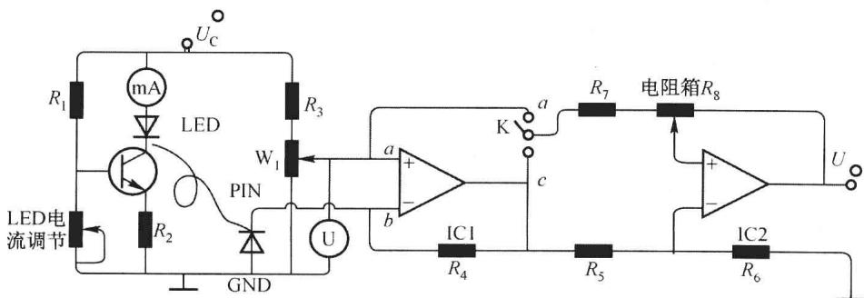

# 第十一章 设计与研究式实验·实验思考题

%%
source: 结构化大学物理实验 教材练习｜第十一章 设计与研究式实验
paper_type: 其他
academic_year: 未知
%%

来源：[原始教材](../00_原材料/结构化大学物理实验.pdf)。题中的“本实验”、操作序号和仪器参数以相应实验原文为准。学年未知；本轮依用户指定范围归入大一分享队列，不代表教材全部实验都是大一必修。

已逐栏阅读认证转换文本并拆题；除个别标注的原PDF核验项外，题目保留“已做结构修复”状态，尚未逐题视觉复核，也尚未配解答。

## 实验11.1 伏安法测线性电阻和非线性电阻 · 思考栏1

[实验原文](../00_原材料/结构化大学物理实验.pdf)，起始PDF第458页。

### PHYSLAB-E11.1-S01-Q01

%%
chapter: 第十一章
question_type: 设计与研究式实验｜伏安法测线性电阻和非线性电阻
source: 结构化大学物理实验 教材练习｜实验11.1｜思考栏1第1条｜认证文本第12736行
question_form: 简答题
ocr_status: 已做结构修复
%%

电流表和电压表在测量时,若改变不同量程对测量结果有无影响?为什么?

### PHYSLAB-E11.1-S01-Q02

%%
chapter: 第十一章
question_type: 设计与研究式实验｜伏安法测线性电阻和非线性电阻
source: 结构化大学物理实验 教材练习｜实验11.1｜思考栏1第2条｜认证文本第12736行
question_form: 简答题
ocr_status: 已做结构修复
%%

稳压管的正反伏安特性各有什么特点？为什么测量正向特性时采用了电流表外接法，而测量反向特性时采用了电流表内接法？

### PHYSLAB-E11.1-S01-Q03

%%
chapter: 第十一章
question_type: 设计与研究式实验｜伏安法测线性电阻和非线性电阻
source: 结构化大学物理实验 教材练习｜实验11.1｜思考栏1第3条｜认证文本第12736行
question_form: 简答题
ocr_status: 已做结构修复
%%

稳压二极管伏安特性曲线上任一点的斜率代表什么？

## 实验11.2 非平衡电桥与压力传感器 · 思考栏1

[实验原文](../00_原材料/结构化大学物理实验.pdf)，起始PDF第462页。

### PHYSLAB-E11.2-S01-Q01

%%
chapter: 第十一章
question_type: 设计与研究式实验｜非平衡电桥与压力传感器
source: 结构化大学物理实验 教材练习｜实验11.2｜思考栏1第1条｜认证文本第12948行
question_form: 简答题
ocr_status: 已做结构修复
%%

阐述非平衡电桥的工作原理。

### PHYSLAB-E11.2-S01-Q02

%%
chapter: 第十一章
question_type: 设计与研究式实验｜非平衡电桥与压力传感器
source: 结构化大学物理实验 教材练习｜实验11.2｜思考栏1第2条｜认证文本第12948行
question_form: 简答题
ocr_status: 已做结构修复
%%

传感器不受外力作用时,理论上电桥处于初始平衡状态,但实际测量时,电桥总是有点不平衡,为什么?

### PHYSLAB-E11.2-S01-Q03

%%
chapter: 第十一章
question_type: 设计与研究式实验｜非平衡电桥与压力传感器
source: 结构化大学物理实验 教材练习｜实验11.2｜思考栏1第3条｜认证文本第12948行
question_form: 简答题
ocr_status: 已做结构修复
%%

传感器的灵敏度与电源电压有何关系？电源电压能无限制地加大吗？为什么？

## 实验11.3 半导体光电二极管伏安特性的测定 · 思考栏1

[实验原文](../00_原材料/结构化大学物理实验.pdf)，起始PDF第469页。

### PHYSLAB-E11.3-S01-Q01

%%
chapter: 第十一章
question_type: 设计与研究式实验｜半导体光电二极管伏安特性的测定
source: 结构化大学物理实验 教材练习｜实验11.3｜思考栏1第1条｜认证文本第13049行
question_form: 简答题
ocr_status: 已做结构修复
%%

在正向偏压状态下, 光电二极管受光照射时有无光电流产生? 为什么光电二极管不能像普通二极管那样, 工作在正向偏压状态?

### PHYSLAB-E11.3-S01-Q02

%%
chapter: 第十一章
question_type: 设计与研究式实验｜半导体光电二极管伏安特性的测定
source: 结构化大学物理实验 教材练习｜实验11.3｜思考栏1第2条｜认证文本第13049行
question_form: 简答题
ocr_status: 已做结构修复
%%

能否用通常的伏安法测定光电二极管的伏安特性?

### PHYSLAB-E11.3-S01-Q03

%%
chapter: 第十一章
question_type: 设计与研究式实验｜半导体光电二极管伏安特性的测定
source: 结构化大学物理实验 教材练习｜实验11.3｜思考栏1第3条｜认证文本第13049行
question_form: 简答题
ocr_status: 已做结构修复
%%

为什么不把图 11.3-3 的电压表接于光电二极管的两端对其偏压进行直接测量?

图源：教材实验11.3；保留原始题图，未重绘。

## 实验11.4 全息光学元件的设计与制作 · 思考栏1

[实验原文](../00_原材料/结构化大学物理实验.pdf)，起始PDF第474页。

### PHYSLAB-E11.4-S01-Q01

%%
chapter: 第十一章
question_type: 设计与研究式实验｜全息光学元件的设计与制作
source: 结构化大学物理实验 教材练习｜实验11.4｜思考栏1第1条｜认证文本第13260行
question_form: 简答题
ocr_status: 已做结构修复
%%

普通三维物体的全息照片为什么能显示物体的立体像？

## 实验11.5 荧光分光光度计的调整和使用 · 思考栏1

[实验原文](../00_原材料/结构化大学物理实验.pdf)，起始PDF第481页。

### PHYSLAB-E11.5-S01-Q01

%%
chapter: 第十一章
question_type: 设计与研究式实验｜荧光分光光度计的调整和使用
source: 结构化大学物理实验 教材练习｜实验11.5｜思考栏1第1条｜认证文本第13442行
question_form: 简答题
ocr_status: 已做结构修复
%%

说明吸收光谱和荧光光谱的差别。

### PHYSLAB-E11.5-S01-Q02

%%
chapter: 第十一章
question_type: 设计与研究式实验｜荧光分光光度计的调整和使用
source: 结构化大学物理实验 教材练习｜实验11.5｜思考栏1第2条｜认证文本第13442行
question_form: 简答题
ocr_status: 已做结构修复
%%

为什么进行 EM 扫描时,选择的起始发射波长比激发波长大?

### PHYSLAB-E11.5-S01-Q03

%%
chapter: 第十一章
question_type: 设计与研究式实验｜荧光分光光度计的调整和使用
source: 结构化大学物理实验 教材练习｜实验11.5｜思考栏1第3条｜认证文本第13442行
question_form: 简答题
ocr_status: 已做结构修复
%%

请比较出体相材料和纳米材料荧光性质的差异。

## 实验11.6 真空的获得与测量 · 思考栏1

[实验原文](../00_原材料/结构化大学物理实验.pdf)，起始PDF第492页。

### PHYSLAB-E11.6-S01-Q01

%%
chapter: 第十一章
question_type: 设计与研究式实验｜真空的获得与测量
source: 结构化大学物理实验 教材练习｜实验11.6｜思考栏1第1条｜认证文本第13627行
question_form: 简答题
ocr_status: 已对照 PDF 复核
%%

真空度的物理意义是什么?

### PHYSLAB-E11.6-S01-Q02

%%
chapter: 第十一章
question_type: 设计与研究式实验｜真空的获得与测量
source: 结构化大学物理实验 教材练习｜实验11.6｜思考栏1第2条｜认证文本第13627行
question_form: 简答题
ocr_status: 已对照 PDF 复核
%%

机械真空泵在系统中有什么作用？它的极限真空是多少？

### PHYSLAB-E11.6-S01-Q03

%%
chapter: 第十一章
question_type: 设计与研究式实验｜真空的获得与测量
source: 结构化大学物理实验 教材练习｜实验11.6｜思考栏1第3条｜认证文本第13627行
question_form: 简答题
ocr_status: 已对照 PDF 复核
%%

闭扩散泵启动后真空度有一个什么变化过程?

原文说明：原PDF第496页确实印作“闭扩散泵启动后”，语义不顺；按原文保留，不据此编造另一问法。

### PHYSLAB-E11.6-S01-Q04

%%
chapter: 第十一章
question_type: 设计与研究式实验｜真空的获得与测量
source: 结构化大学物理实验 教材练习｜实验11.6｜思考栏1第4条｜认证文本第13627行
question_form: 计算题
ocr_status: 已对照 PDF 复核
%%

计算的抽速 S, 是指什么之间的抽速 S?

上下文：原文先要求计算机械泵及启动扩散泵后的系统抽速；这里的“之间”仍按原书用语保留。

## 实验11.7 减压降温技术与电阻的温度关系 · 思考栏1

[实验原文](../00_原材料/结构化大学物理实验.pdf)，起始PDF第496页。

### PHYSLAB-E11.7-S01-Q01

%%
chapter: 第十一章
question_type: 设计与研究式实验｜减压降温技术与电阻的温度关系
source: 结构化大学物理实验 教材练习｜实验11.7｜思考栏1第1条｜认证文本第13746行
question_form: 简答题
ocr_status: 已对照 PDF 复核
%%

阀 3 和阀 6 的作用是什么？在改变蒸气压及停机械泵之前为什么要打开它们？

### PHYSLAB-E11.7-S01-Q02

%%
chapter: 第十一章
question_type: 设计与研究式实验｜减压降温技术与电阻的温度关系
source: 结构化大学物理实验 教材练习｜实验11.7｜思考栏1第2条｜认证文本第13746行
question_form: 简答题
ocr_status: 已对照 PDF 复核
%%

测量中如何判定温度是否达到平衡?

### PHYSLAB-E11.7-S01-Q03

%%
chapter: 第十一章
question_type: 设计与研究式实验｜减压降温技术与电阻的温度关系
source: 结构化大学物理实验 教材练习｜实验11.7｜思考栏1第3条｜认证文本第13746行
question_form: 简答题
ocr_status: 已对照 PDF 复核
%%

在实验中如何选去测量电流?

原文说明：原PDF第500页印作“选去测量电流”；保留原书用语，通常可按“选取测量电流”理解。

## 实验11.8 半导体制冷系统最佳制冷系数的测量 · 思考栏1

[实验原文](../00_原材料/结构化大学物理实验.pdf)，起始PDF第500页。

### PHYSLAB-E11.8-S01-Q01

%%
chapter: 第十一章
question_type: 设计与研究式实验｜半导体制冷系统最佳制冷系数的测量
source: 结构化大学物理实验 教材练习｜实验11.8｜思考栏1第1条｜认证文本第14000行
question_form: 计算题
ocr_status: 已做结构修复
%%

如果是多级制冷,制冷量如何计算?

### PHYSLAB-E11.8-S01-Q02

%%
chapter: 第十一章
question_type: 设计与研究式实验｜半导体制冷系统最佳制冷系数的测量
source: 结构化大学物理实验 教材练习｜实验11.8｜思考栏1第2条｜认证文本第14000行
question_form: 简答题
ocr_status: 已做结构修复
%%

如何提高制冷系数?

## 实验11.10 金属薄膜磁电阻特性综合实验 · 思考栏1

[实验原文](../00_原材料/结构化大学物理实验.pdf)，起始PDF第508页。

### PHYSLAB-E11.10-S01-Q01

%%
chapter: 第十一章
question_type: 设计与研究式实验｜金属薄膜磁电阻特性综合实验
source: 结构化大学物理实验 教材练习｜实验11.10｜思考栏1第1条｜认证文本第14229行
question_form: 简答题
ocr_status: 已做结构修复
%%

分析磁电阻随磁场变化的规律?

### PHYSLAB-E11.10-S01-Q02

%%
chapter: 第十一章
question_type: 设计与研究式实验｜金属薄膜磁电阻特性综合实验
source: 结构化大学物理实验 教材练习｜实验11.10｜思考栏1第2条｜认证文本第14229行
question_form: 简答题
ocr_status: 已做结构修复
%%

分析平行磁电阻与垂直磁电阻随磁场变化的特点?

### PHYSLAB-E11.10-S01-Q03

%%
chapter: 第十一章
question_type: 设计与研究式实验｜金属薄膜磁电阻特性综合实验
source: 结构化大学物理实验 教材练习｜实验11.10｜思考栏1第3条｜认证文本第14229行
question_form: 简答题
ocr_status: 已做结构修复
%%

本实验中测量电压时为什么要求测量同一电流状况下的正反向电压？如果不这样做结果会如何吗？用实验数据来说明你的观点。

## 实验11.11 锁相放大器 · 思考栏1

[实验原文](../00_原材料/结构化大学物理实验.pdf)，起始PDF第513页。

### PHYSLAB-E11.11-S01-Q01

%%
chapter: 第十一章
question_type: 设计与研究式实验｜锁相放大器
source: 结构化大学物理实验 教材练习｜实验11.11｜思考栏1第1条｜认证文本第14395行
question_form: 简答题
ocr_status: 已做结构修复
%%

什么是相关接收原理？用什么电路可实现相关接收？

### PHYSLAB-E11.11-S01-Q02

%%
chapter: 第十一章
question_type: 设计与研究式实验｜锁相放大器
source: 结构化大学物理实验 教材练习｜实验11.11｜思考栏1第2条｜认证文本第14395行
question_form: 简答题
ocr_status: 已做结构修复
%%

实际的锁相放大器中主要使用了哪两种抑制噪声的技术？

## 实验11.12 信号的频谱分析 · 思考栏1

[实验原文](../00_原材料/结构化大学物理实验.pdf)，起始PDF第520页。

### PHYSLAB-E11.12-S01-Q01

%%
chapter: 第十一章
question_type: 设计与研究式实验｜信号的频谱分析
source: 结构化大学物理实验 教材练习｜实验11.12｜思考栏1第1条｜认证文本第14608行
question_form: 简答题
ocr_status: 已做结构修复
%%

在实验内容(三)中,微微调动“脉冲宽度”,观察主瓣变化情况,有什么规律?

## 实验11.13 A/D 与 D/A 变换器的研究 · 11.13.1 A/D 变换器 · 思考栏1

[实验原文](../00_原材料/结构化大学物理实验.pdf)，起始PDF第528页。

### PHYSLAB-E11.13-S01-Q01

%%
chapter: 第十一章
question_type: 设计与研究式实验｜A/D 与 D/A 变换器的研究
source: 结构化大学物理实验 教材练习｜实验11.13｜11.13.1 A/D 变换器｜思考栏1第1条｜认证文本第14701行
question_form: 简答题
ocr_status: 已做结构修复
%%

如果 $V_{x}$ 是负值, A/D 变换器应作哪些改动才能测量?

### PHYSLAB-E11.13-S01-Q02

%%
chapter: 第十一章
question_type: 设计与研究式实验｜A/D 与 D/A 变换器的研究
source: 结构化大学物理实验 教材练习｜实验11.13｜11.13.1 A/D 变换器｜思考栏1第2条｜认证文本第14701行
question_form: 应用题
ocr_status: 已做结构修复
%%

如果 $V_{x}$ 大于 $8 \mathrm{~V}, \mathrm{A} / \mathrm{D}$ 变换器能否测量？应当怎样设计才能扩大量程。

### PHYSLAB-E11.13-S01-Q03

%%
chapter: 第十一章
question_type: 设计与研究式实验｜A/D 与 D/A 变换器的研究
source: 结构化大学物理实验 教材练习｜实验11.13｜11.13.1 A/D 变换器｜思考栏1第3条｜认证文本第14701行
question_form: 简答题
ocr_status: 已做结构修复
%%

将 $V_{x} = 4 \, V$ ，与 $V_{x} = 2 \, V$ 的波形图加以比较，有什么结论？是否可以看

出第一次积分为定时积分,第二次定积分为定斜率积分。请通过实验检验。

## 实验11.13 A/D 与 D/A 变换器的研究 · 11.13.2 D/A 变换器 · 思考栏2

[实验原文](../00_原材料/结构化大学物理实验.pdf)，起始PDF第528页。

### PHYSLAB-E11.13-S02-Q01

%%
chapter: 第十一章
question_type: 设计与研究式实验｜A/D 与 D/A 变换器的研究
source: 结构化大学物理实验 教材练习｜实验11.13｜11.13.2 D/A 变换器｜思考栏2第1条｜认证文本第14811行
question_form: 简答题
ocr_status: 已做结构修复
%%

实验内容1中如果某一电压值不对,应如何调整?

### PHYSLAB-E11.13-S02-Q02

%%
chapter: 第十一章
question_type: 设计与研究式实验｜A/D 与 D/A 变换器的研究
source: 结构化大学物理实验 教材练习｜实验11.13｜11.13.2 D/A 变换器｜思考栏2第2条｜认证文本第14811行
question_form: 简答题
ocr_status: 已做结构修复
%%

实验内容 2 中分析误差原因, 提出改进办法。

## 实验11.14 热焓法测定复合大块金属玻璃结晶度 · 思考栏1

[实验原文](../00_原材料/结构化大学物理实验.pdf)，起始PDF第539页。

### PHYSLAB-E11.14-S01-Q01

%%
chapter: 第十一章
question_type: 设计与研究式实验｜热焓法测定复合大块金属玻璃结晶度
source: 结构化大学物理实验 教材练习｜实验11.14｜思考栏1第1条｜认证文本第14887行
question_form: 计算题
ocr_status: 已做结构修复
%%

在 $Gd_{55}Co_{15}Al_{30}Ge_{x}(4 \leqslant x \leqslant 10)$ 合金中，假设 Ge 原子在凝固过程中先与 Gd 原子结合形成 $Gd_{5}Ge_{3}$ 相，在随后的过程中，剩余的 Gd、Co、Al 原子凝固成金属玻璃，从而形成复合结构。试计算当 x = 5 时，合金中金属玻璃相的成分。

## 实验11.15 Rietveld 多晶粉末晶体结构精修 · 思考栏1

[实验原文](../00_原材料/结构化大学物理实验.pdf)，起始PDF第548页。

### PHYSLAB-E11.15-S01-Q01

%%
chapter: 第十一章
question_type: 设计与研究式实验｜Rietveld 多晶粉末晶体结构精修
source: 结构化大学物理实验 教材练习｜实验11.15｜思考栏1第1条｜认证文本第15242行
question_form: 计算题
ocr_status: 已做结构修复
%%

完成本实验中 $LaNi_{4.85}Sn_{0.15}$ 样品中 Sn 原子含量的计算。

本题所需原表11.15-3（g为占位率；位点前数字为重数）：

| Atom | Site | x | y | z | g |
|---|---|---|---|---|---|
| La | 1(a) | 0 | 0 | 0 | 1 |
| Ni1 | 2(c) | 1/3 | 2/3 | 0 | 1 |
| Ni2 | 3(g) | 1/2 | 0 | 1/2 | 0.944(2) |
| Sn | 3(g) | 1/2 | 0 | 1/2 | 0.056(2) |

该表是精修所得占位率；不要把名义配比中的0.15直接当成实际Sn原子分数。

### PHYSLAB-E11.15-S01-Q02

%%
chapter: 第十一章
question_type: 设计与研究式实验｜Rietveld 多晶粉末晶体结构精修
source: 结构化大学物理实验 教材练习｜实验11.15｜思考栏1第2条｜认证文本第15242行
question_form: 简答题
ocr_status: 已做结构修复
%%

参考相关书籍, 思考多相样品如何进行 Rietveld 精修。

## 实验11.16 PASCO 物理系列实验 · 11.16.1 动力学系列实验；一、弹性碰撞实验中速度与加速度矢量的相互关系 · 思考栏1

[实验原文](../00_原材料/结构化大学物理实验.pdf)，起始PDF第559页。

### PHYSLAB-E11.16-S01-Q01

%%
chapter: 第十一章
question_type: 设计与研究式实验｜PASCO 物理系列实验
source: 结构化大学物理实验 教材练习｜实验11.16｜11.16.1 动力学系列实验；一、弹性碰撞实验中速度与加速度矢量的相互关系｜思考栏1第1条｜认证文本第15328行
question_form: 简答题
ocr_status: 已做结构修复
%%

小车的位置、速度、加速度矢量是什么关系？

## 实验11.16 PASCO 物理系列实验 · 11.16.1 动力学系列实验；二、非弹性碰撞中的冲力与动量的相互关系 · 思考栏2

[实验原文](../00_原材料/结构化大学物理实验.pdf)，起始PDF第559页。

### PHYSLAB-E11.16-S02-Q01

%%
chapter: 第十一章
question_type: 设计与研究式实验｜PASCO 物理系列实验
source: 结构化大学物理实验 教材练习｜实验11.16｜11.16.1 动力学系列实验；二、非弹性碰撞中的冲力与动量的相互关系｜思考栏2第1条｜认证文本第15385行
question_form: 简答题
ocr_status: 已做结构修复
%%

实验数据是否说明了碰撞过程中小车动量的增量等于冲量？（是否满足 $mv=\int_{t_{1}}^{t_{2}}Fdt$ ？）。

## 实验11.16 PASCO 物理系列实验 · 11.16.1 动力学系列实验；三、完全非弹性碰撞过程中动量守恒与动能的损失 · 思考栏3

[实验原文](../00_原材料/结构化大学物理实验.pdf)，起始PDF第559页。

### PHYSLAB-E11.16-S03-Q01

%%
chapter: 第十一章
question_type: 设计与研究式实验｜PASCO 物理系列实验
source: 结构化大学物理实验 教材练习｜实验11.16｜11.16.1 动力学系列实验；三、完全非弹性碰撞过程中动量守恒与动能的损失｜思考栏3第1条｜认证文本第15460行
question_form: 简答题
ocr_status: 已做结构修复
%%

非弹性碰撞对系统总动量和总动能的影响是什么?

### PHYSLAB-E11.16-S03-Q02

%%
chapter: 第十一章
question_type: 设计与研究式实验｜PASCO 物理系列实验
source: 结构化大学物理实验 教材练习｜实验11.16｜11.16.1 动力学系列实验；三、完全非弹性碰撞过程中动量守恒与动能的损失｜思考栏3第2条｜认证文本第15460行
question_form: 简答题
ocr_status: 已做结构修复
%%

摩擦力对于系统总动能和总动量的影响是什么?

### PHYSLAB-E11.16-S03-Q03

%%
chapter: 第十一章
question_type: 设计与研究式实验｜PASCO 物理系列实验
source: 结构化大学物理实验 教材练习｜实验11.16｜11.16.1 动力学系列实验；三、完全非弹性碰撞过程中动量守恒与动能的损失｜思考栏3第3条｜认证文本第15460行
question_form: 简答题
ocr_status: 已做结构修复
%%

还有其他什么因素造成了实验数据与理想数据间的误差?

## 实验11.16 PASCO 物理系列实验 · 11.16.1 动力学系列实验；四、完全弹性碰撞中动能和动量的守恒 · 思考栏4

[实验原文](../00_原材料/结构化大学物理实验.pdf)，起始PDF第559页。

### PHYSLAB-E11.16-S04-Q01

%%
chapter: 第十一章
question_type: 设计与研究式实验｜PASCO 物理系列实验
source: 结构化大学物理实验 教材练习｜实验11.16｜11.16.1 动力学系列实验；四、完全弹性碰撞中动能和动量的守恒｜思考栏4第1条｜认证文本第15532行
question_form: 简答题
ocr_status: 已做结构修复
%%

弹性碰撞对系统的总动量和总动能影响如何？

## 实验11.16 PASCO 物理系列实验 · 11.16.1 动力学系列实验；五、加速度和简谐振动 · 思考栏5

[实验原文](../00_原材料/结构化大学物理实验.pdf)，起始PDF第559页。

### PHYSLAB-E11.16-S05-Q01

%%
chapter: 第十一章
question_type: 设计与研究式实验｜PASCO 物理系列实验
source: 结构化大学物理实验 教材练习｜实验11.16｜11.16.1 动力学系列实验；五、加速度和简谐振动｜思考栏5第1条｜认证文本第15591行
question_form: 简答题
ocr_status: 已做结构修复
%%

周期会随着倾角的改变而改变吗?

### PHYSLAB-E11.16-S05-Q02

%%
chapter: 第十一章
question_type: 设计与研究式实验｜PASCO 物理系列实验
source: 结构化大学物理实验 教材练习｜实验11.16｜11.16.1 动力学系列实验；五、加速度和简谐振动｜思考栏5第2条｜认证文本第15591行
question_form: 简答题
ocr_status: 已做结构修复
%%

比较实验值和理论值, 结果如何?

### PHYSLAB-E11.16-S05-Q03

%%
chapter: 第十一章
question_type: 设计与研究式实验｜PASCO 物理系列实验
source: 结构化大学物理实验 教材练习｜实验11.16｜11.16.1 动力学系列实验；五、加速度和简谐振动｜思考栏5第3条｜认证文本第15591行
question_form: 简答题
ocr_status: 已做结构修复
%%

随着倾角改变平衡位置会改变吗?

### PHYSLAB-E11.16-S05-Q04

%%
chapter: 第十一章
question_type: 设计与研究式实验｜PASCO 物理系列实验
source: 结构化大学物理实验 教材练习｜实验11.16｜11.16.1 动力学系列实验；五、加速度和简谐振动｜思考栏5第4条｜认证文本第15591行
question_form: 简答题
ocr_status: 已做结构修复
%%

如果倾角变为 $90^{\circ}$ ，周期将是多少？

## 实验11.16 PASCO 物理系列实验 · 11.16.1 动力学系列实验；六、向心力实验 · 思考栏6

[实验原文](../00_原材料/结构化大学物理实验.pdf)，起始PDF第559页。

### PHYSLAB-E11.16-S06-Q01

%%
chapter: 第十一章
question_type: 设计与研究式实验｜PASCO 物理系列实验
source: 结构化大学物理实验 教材练习｜实验11.16｜11.16.1 动力学系列实验；六、向心力实验｜思考栏6第1条｜认证文本第15674行
question_form: 简答题
ocr_status: 已做结构修复
%%

实验2中,当半径提高时,周期是增加了还是减小了?

### PHYSLAB-E11.16-S06-Q02

%%
chapter: 第十一章
question_type: 设计与研究式实验｜PASCO 物理系列实验
source: 结构化大学物理实验 教材练习｜实验11.16｜11.16.1 动力学系列实验；六、向心力实验｜思考栏6第2条｜认证文本第15674行
question_form: 简答题
ocr_status: 已做结构修复
%%

实验3物体的转动半径和质量恒定时,周期的增长会不会引起向心力的改变?

### PHYSLAB-E11.16-S06-Q03

%%
chapter: 第十一章
question_type: 设计与研究式实验｜PASCO 物理系列实验
source: 结构化大学物理实验 教材练习｜实验11.16｜11.16.1 动力学系列实验；六、向心力实验｜思考栏6第3条｜认证文本第15674行
question_form: 简答题
ocr_status: 已做结构修复
%%

实验4中,当转动物体的质量增加时,向心力是增加了还是减少了?

### PHYSLAB-E11.16-S06-Q04

%%
chapter: 第十一章
question_type: 设计与研究式实验｜PASCO 物理系列实验
source: 结构化大学物理实验 教材练习｜实验11.16｜11.16.1 动力学系列实验；六、向心力实验｜思考栏6第4条｜认证文本第15674行
question_form: 简答题
ocr_status: 已做结构修复
%%

分析每个实验的误差原因。

## 实验11.16 PASCO 物理系列实验 · 11.16.2 磁悬浮实验 · 思考栏7

[实验原文](../00_原材料/结构化大学物理实验.pdf)，起始PDF第559页。

### PHYSLAB-E11.16-S07-Q01

%%
chapter: 第十一章
question_type: 设计与研究式实验｜PASCO 物理系列实验
source: 结构化大学物理实验 教材练习｜实验11.16｜11.16.2 磁悬浮实验｜思考栏7第1条｜认证文本第15739行
question_form: 简答题
ocr_status: 已做结构修复
%%

简要说明现有磁悬浮实验装置的优缺点。

## 实验11.16 PASCO 物理系列实验 · 11.16.3 弦音计系列实验；一、有限长金属弦线的共振模式 · 思考栏8

[实验原文](../00_原材料/结构化大学物理实验.pdf)，起始PDF第559页。

### PHYSLAB-E11.16-S08-Q01

%%
chapter: 第十一章
question_type: 设计与研究式实验｜PASCO 物理系列实验
source: 结构化大学物理实验 教材练习｜实验11.16｜11.16.3 弦音计系列实验；一、有限长金属弦线的共振模式｜思考栏8第1条｜认证文本第15823行
question_form: 简答题
ocr_status: 已做结构修复
%%

分析实验数据, 确定频率增加时的共振波形及波形与弦长间的关系。

### PHYSLAB-E11.16-S08-Q02

%%
chapter: 第十一章
question_type: 设计与研究式实验｜PASCO 物理系列实验
source: 结构化大学物理实验 教材练习｜实验11.16｜11.16.3 弦音计系列实验；一、有限长金属弦线的共振模式｜思考栏8第2条｜认证文本第15823行
question_form: 简答题
ocr_status: 已做结构修复
%%

对于每一种弦长,确定产生谐振时的最低谐振频率(基频)和高端的谐振频率之间的关系。

### PHYSLAB-E11.16-S08-Q03

%%
chapter: 第十一章
question_type: 设计与研究式实验｜PASCO 物理系列实验
source: 结构化大学物理实验 教材练习｜实验11.16｜11.16.3 弦音计系列实验；一、有限长金属弦线的共振模式｜思考栏8第3条｜认证文本第15823行
question_form: 简答题
ocr_status: 已做结构修复
%%

在不同的谐振频率时,探测器靠近驱动器时,观察弦振动状态是否改变?测量波形发生了什么变化?为什么?

### PHYSLAB-E11.16-S08-Q04

%%
chapter: 第十一章
question_type: 设计与研究式实验｜PASCO 物理系列实验
source: 结构化大学物理实验 教材练习｜实验11.16｜11.16.3 弦音计系列实验；一、有限长金属弦线的共振模式｜思考栏8第4条｜认证文本第15823行
question_form: 简答题
ocr_status: 已做结构修复
%%

弦线谐振频率与驱动频率有何关系？从理论上分析。

## 实验11.16 PASCO 物理系列实验 · 11.16.3 弦音计系列实验；二、测量波在不同弦线中传播的速度 · 思考栏9

[实验原文](../00_原材料/结构化大学物理实验.pdf)，起始PDF第559页。

### PHYSLAB-E11.16-S09-Q01

%%
chapter: 第十一章
question_type: 设计与研究式实验｜PASCO 物理系列实验
source: 结构化大学物理实验 教材练习｜实验11.16｜11.16.3 弦音计系列实验；二、测量波在不同弦线中传播的速度｜思考栏9第1条｜认证文本第15879行
question_form: 简答题
ocr_status: 已做结构修复
%%

在长为 L 的弦上产生驻波模式的波, 确定并描述弦线长度与波长的数学关系式。

### PHYSLAB-E11.16-S09-Q02

%%
chapter: 第十一章
question_type: 设计与研究式实验｜PASCO 物理系列实验
source: 结构化大学物理实验 教材练习｜实验11.16｜11.16.3 弦音计系列实验；二、测量波在不同弦线中传播的速度｜思考栏9第2条｜认证文本第15879行
question_form: 简答题
ocr_status: 已做结构修复
%%

利用 1 的答案, 以及表达式 $v = \lambda \times f$ , 来确定长为 $L$ 的弦的谐振频率。

### PHYSLAB-E11.16-S09-Q03

%%
chapter: 第十一章
question_type: 设计与研究式实验｜PASCO 物理系列实验
source: 结构化大学物理实验 教材练习｜实验11.16｜11.16.3 弦音计系列实验；二、测量波在不同弦线中传播的速度｜思考栏9第3条｜认证文本第15879行
question_form: 简答题
ocr_status: 已做结构修复
%%

能否根据实验原理自制一种器件(如乐器)。

## 实验11.16 PASCO 物理系列实验 · 11.16.4 摆动系列实验；一、扭摆实验 · 思考栏10

[实验原文](../00_原材料/结构化大学物理实验.pdf)，起始PDF第559页。

### PHYSLAB-E11.16-S10-Q01

%%
chapter: 第十一章
question_type: 设计与研究式实验｜PASCO 物理系列实验
source: 结构化大学物理实验 教材练习｜实验11.16｜11.16.4 摆动系列实验；一、扭摆实验｜思考栏10第1条｜认证文本第16030行
question_form: 应用题
ocr_status: 已做结构修复
%%

利用该装置测量一个不规则物体的转动惯量。

## 实验11.16 PASCO 物理系列实验 · 11.16.4 摆动系列实验；二、复摆实验 · 思考栏11

[实验原文](../00_原材料/结构化大学物理实验.pdf)，起始PDF第559页。

### PHYSLAB-E11.16-S11-Q01

%%
chapter: 第十一章
question_type: 设计与研究式实验｜PASCO 物理系列实验
source: 结构化大学物理实验 教材练习｜实验11.16｜11.16.4 摆动系列实验；二、复摆实验｜思考栏11第1条｜认证文本第16136行
question_form: 简答题
ocr_status: 已做结构修复
%%

在实验中用较大的角度( $\theta\approx20^{\circ}$ )摆动复摆,记录其10个周期内,这每个周期与角度的关系,会得到什么样的结果?

## 实验11.16 PASCO 物理系列实验 · 11.16.5 波动光学综合系列实验；一、光的偏振 · 思考栏12

[实验原文](../00_原材料/结构化大学物理实验.pdf)，起始PDF第559页。

### PHYSLAB-E11.16-S12-Q01

%%
chapter: 第十一章
question_type: 设计与研究式实验｜PASCO 物理系列实验
source: 结构化大学物理实验 教材练习｜实验11.16｜11.16.5 波动光学综合系列实验；一、光的偏振｜思考栏12第1条｜认证文本第16210行
question_form: 简答题
ocr_status: 已做结构修复
%%

光强度—角度的图是什么形状?

### PHYSLAB-E11.16-S12-Q02

%%
chapter: 第十一章
question_type: 设计与研究式实验｜PASCO 物理系列实验
source: 结构化大学物理实验 教材练习｜实验11.16｜11.16.5 波动光学综合系列实验；一、光的偏振｜思考栏12第2条｜认证文本第16210行
question_form: 简答题
ocr_status: 已做结构修复
%%

光强度—角度余弦的图是什么形状?

### PHYSLAB-E11.16-S12-Q03

%%
chapter: 第十一章
question_type: 设计与研究式实验｜PASCO 物理系列实验
source: 结构化大学物理实验 教材练习｜实验11.16｜11.16.5 波动光学综合系列实验；一、光的偏振｜思考栏12第3条｜认证文本第16210行
question_form: 简答题
ocr_status: 已做结构修复
%%

光强度—角度余弦平方的图是什么形状?

### PHYSLAB-E11.16-S12-Q04

%%
chapter: 第十一章
question_type: 设计与研究式实验｜PASCO 物理系列实验
source: 结构化大学物理实验 教材练习｜实验11.16｜11.16.5 波动光学综合系列实验；一、光的偏振｜思考栏12第4条｜认证文本第16210行
question_form: 简答题
ocr_status: 已做结构修复
%%

假定偏振片是理想的, 且第二个偏振器与第一个偏振器的光轴夹角相差17度, 同样放置第三个偏振器时, 第三个偏振器与第二个偏振器的光轴夹角相差也是17度, 理论上将会有多大比例的入射平面偏振光通过三个偏振器透射出去?

## 实验11.16 PASCO 物理系列实验 · 11.16.5 波动光学综合系列实验；二、双缝干涉 · 思考栏13

[实验原文](../00_原材料/结构化大学物理实验.pdf)，起始PDF第559页。

### PHYSLAB-E11.16-S13-Q01

%%
chapter: 第十一章
question_type: 设计与研究式实验｜PASCO 物理系列实验
source: 结构化大学物理实验 教材练习｜实验11.16｜11.16.5 波动光学综合系列实验；二、双缝干涉｜思考栏13第1条｜认证文本第16303行
question_form: 简答题
ocr_status: 已做结构修复
%%

当狭缝间距增加时, 亮纹间距是增加了还是减小了? 还是保持不变?

### PHYSLAB-E11.16-S13-Q02

%%
chapter: 第十一章
question_type: 设计与研究式实验｜PASCO 物理系列实验
source: 结构化大学物理实验 教材练习｜实验11.16｜11.16.5 波动光学综合系列实验；二、双缝干涉｜思考栏13第2条｜认证文本第16303行
question_form: 简答题
ocr_status: 已做结构修复
%%

当狭缝宽度增加时, 亮纹间距是增加了还是减小了? 还是保持不变?

### PHYSLAB-E11.16-S13-Q03

%%
chapter: 第十一章
question_type: 设计与研究式实验｜PASCO 物理系列实验
source: 结构化大学物理实验 教材练习｜实验11.16｜11.16.5 波动光学综合系列实验；二、双缝干涉｜思考栏13第3条｜认证文本第16303行
question_form: 简答题
ocr_status: 已做结构修复
%%

当狭缝间距增加时, 衍射包络中第一级到极小的距离是增加了还是减小了? 还是保持不变?

### PHYSLAB-E11.16-S13-Q04

%%
chapter: 第十一章
question_type: 设计与研究式实验｜PASCO 物理系列实验
source: 结构化大学物理实验 教材练习｜实验11.16｜11.16.5 波动光学综合系列实验；二、双缝干涉｜思考栏13第4条｜认证文本第16303行
question_form: 简答题
ocr_status: 已做结构修复
%%

当狭缝宽度增加时, 衍射包络中第一级到极小的距离是增加了还是减小了? 还是保持不变?

### PHYSLAB-E11.16-S13-Q05

%%
chapter: 第十一章
question_type: 设计与研究式实验｜PASCO 物理系列实验
source: 结构化大学物理实验 教材练习｜实验11.16｜11.16.5 波动光学综合系列实验；二、双缝干涉｜思考栏13第5条｜认证文本第16303行
question_form: 简答题
ocr_status: 已做结构修复
%%

分析两种方法得出的实验结果, 哪种实验数据更准确些? 说出理由。

## 实验11.16 PASCO 物理系列实验 · 11.16.5 波动光学综合系列实验；三、单缝衍射 · 思考栏14

[实验原文](../00_原材料/结构化大学物理实验.pdf)，起始PDF第559页。

### PHYSLAB-E11.16-S14-Q01

%%
chapter: 第十一章
question_type: 设计与研究式实验｜PASCO 物理系列实验
source: 结构化大学物理实验 教材练习｜实验11.16｜11.16.5 波动光学综合系列实验；三、单缝衍射｜思考栏14第1条｜认证文本第16388行
question_form: 简答题
ocr_status: 已做结构修复
%%

随着缝宽的增加,极小值间的距离是随着增加还是减小呢?
